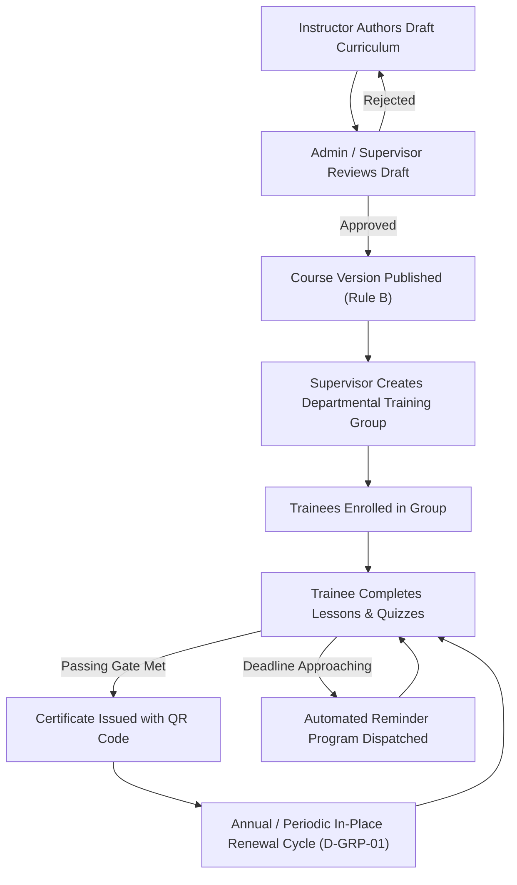

# MetroLMS — Business Requirements Document (BRD)
## Subsystem / Program: Cairo Metro LMS Enterprise Platform

> **Document Title:** Cairo Metro E-Learning Platform Business Requirements Document  
> **Document Identifier:** `METROLMS-BRD-CORE-001`  
> **Document Status:** `ACTIVE — AUTHORITATIVE BASELINE`  
> **Canonical Authority Level:** Level 4 Requirements Specification  
> **Target System:** MetroLMS (Cairo Metro E-Learning Platform)  
> **Prepared For:** Project Owner, Executive Stakeholders & Engineering Leadership  
> **Governing Decisions:** [`D-AUTH-01`](../../architecture/decision-register.md#d-auth-01), [`D-DB-01`](../../architecture/decision-register.md#d-db-01), [`D-SEC-01`](../../architecture/decision-register.md#d-sec-01), [`D-MEDIA-01`](../../architecture/decision-register.md#d-media-01)  
> **Last Updated:** 2026-11-12 (Phase 1 Baseline Authoring)

---

## 1. Executive Summary & Business Context

### 1.1 Organizational Mission
The **Egyptian Company for Metro Management and Operation — General Administration for Training Centers** is responsible for delivering technical, operational, safety, and compliance education to thousands of operational personnel across Cairo Metro Lines 1, 2, and 3. Personnel include train operators, station masters, traffic controllers, electrical engineers, track maintenance technicians, and customer service staff.

### 1.2 Business Problem
Historically, mandatory training programs, regulatory safety re-certifications, and technical refreshers relied on paper-based tracking, in-person lecture scheduling, and manual record keeping. This produced significant administrative friction:
1. Difficulty tracking individual and departmental compliance deadlines across geographically dispersed depot locations.
2. Lack of automated, tamper-evident audit trails for safety-critical training qualifications.
3. Inability to provide flexible, self-paced digital learning for shift workers operating under 24/7 schedules.

### 1.3 Strategic Objectives
MetroLMS (Cairo Metro E-Learning Platform) establishes a centralized digital training portal to:
- Digitize curriculum authoring, review, publishing, and lifecycle versioning.
- Automate recurrent training programs and departmental cohort monitoring.
- Deliver self-paced, video-rich multimedia learning with automated passing gates.
- Issue cryptographically verifiable, version-scoped completion certificates with QR verification.

---

## 2. Business Scope & Boundaries

### 2.1 In-Scope Business Capabilities
1. **User Identity & Role-Based Access:** Support for 6 organizational roles (Trainee, Lecturer/Instructor, Assistant Admin/Supervisor, System Administrator, Platform Auditor, Support Lead).
2. **Curriculum & Course Lifecycle:** Digital course builder supporting video lessons, quizzes, passing gates, and major/minor version diffing.
3. **Cohort Oversight & Reminder Programs:** Supervisor management of departmental training groups, automated reminder intervals, and in-place renewal cycles (`D-GRP-01`).
4. **Learning & Attempt Isolation:** Structured learning player with progress calculation, retry controls, and historical attempt freezing.
5. **Certification & Regulatory Verification:** Generation of tamper-evident PDF completion certificates with unique verification QR codes.

### 2.2 Out-of-Scope Items
- E-commerce, payment gateways, or public course selling (platform is strictly internal enterprise).
- Real-time video conferencing or synchronous virtual classrooms (content is asynchronous).
- Direct hosting of large raw video binaries on core application servers (`D-MEDIA-01`).
- Hardware Security Module (HSM) appliances or external cloud KMS key management.

### 2.3 Regulatory & Environmental Dependencies
- Egypt National Telecom Regulatory Authority (NTRA) network compliance.
- Hosting within Cairo Metro secure on-premise infrastructure.

---

## 3. Stakeholder Profiles & Roles

| Role Identifier | Role Label (AR / EN) | Authority Scope | Key Workflow Interactions |
| :--- | :--- | :--- | :--- |
| `trainee` | متدرب / Trainee | Self-learning, lesson playback, assessments | Enrolled courses, video player, `/my-groups`, certificate downloads |
| `lecturer` | محاضر / Instructor | Authoring content, evaluating subjective tests | Course builder, grading queue, draft revision |
| `assistant_admin` | مشرف / Supervisor | Cohort monitoring, enrollment, group reminders | Training group dashboards, reminder dispatch, renewal cycle triggers |
| `admin` | مدير النظام / Administrator | Full platform administration, course approvals | User provisioning, catalog publishing, system settings, audit review |
| `auditor` | مراجع خارجي / Auditor | Read-only compliance inspection | Audit log viewer, completion report export |
| `support` | دعم فني / Support | User assistance, session triage | User offboarding triage, operational status dashboards |

---

## 4. High-Level Business Processes & Workflows

---

## 5. Success Metrics & Key Performance Indicators (KPIs)

| KPI Identifier | Metric Description | Target Threshold | Measurement Frequency |
| :--- | :--- | :--- | :--- |
| `KPI-01` | Mandatory safety compliance completion rate | >= 98% within statutory deadlines | Monthly |
| `KPI-02` | Digital certificate verification latency | <= 2.0 seconds via mobile QR scan | Continuous |
| `KPI-03` | Self-service password/account activation success | >= 95% on initial onboarding | Weekly |
| `KPI-04` | Curriculum publishing turnaround time | <= 3 business days from draft submission | Bi-weekly |

---

## 6. Review & Approval History

| Revision | Date | Author / Reviewer | Classification | Summary of Changes |
| :--- | :--- | :--- | :--- | :--- |
| `1.0` | 2026-11-12 | Architecture Team | Phase 1 Baseline | Initial formalization based on `system-architecture.md` and REV6 |
