# MetroLMS — Classic Chen Entity Relationship Diagrams (`erd-chen.md`)

> **Document Title:** MetroLMS Physical Database Architecture — Classic Chen Notation ER Diagrams  
> **Revision Date:** 2026-11-16 (Redesigned Structured Layout)  
> **Status:** `UPDATED CHEN ERD — DERIVED FROM APPROVED DATA DICTIONARY`  
> **Primary Source of Truth:** [`data-dictionary.md`](data-dictionary.md) (`METROLMS-DATA-DICT-001`)  
> **Visual Style Reference:** [`docs/backend/diagrams/`](../../backend/diagrams/) (matching its `#FAFAFA` canvas, `#E8F0FE`/`#1967D2` entities, `#FEF7E0`/`#E37400` relationship diamonds, `#FCE8E6`/`#C5221F` underlined PK ovals, `#FFFFFF`/`#5F6368` attribute ovals, `#FFFFFF`/`#DADCE0` cardinality badges, and parallel double participation lines)  
> **Layout & Rendering Engine:** Draw.io XML (`.drawio` per-diagram + 15-page [`MetroLMS-Chen-ERD.drawio`](erd-chen-rendered/MetroLMS-Chen-ERD.drawio)) → Direct Vector `.svg` → `@resvg/resvg-js` `300 DPI` `.png`  
> **Technical Reference (Crow's Foot):** [`erd-crow-foot.md`](erd-crow-foot.md)

---

## 1. Purpose & Scope

This document provides the **Classic Chen Entity Relationship Diagrams (ERDs)** for the MetroLMS SQL Server 2022 physical database design, derived strictly from [`data-dictionary.md`](data-dictionary.md) after integrating:

- `D-01` through `D-06`
- `OD-PF-01` through `OD-PF-08` (including `OD-PF-03-B` and `OD-PF-02` telemetry reconciliation)
- `OR-DB-01` (delegated technical recommendation batch, `2026-11-16`)
- `OR-DB-02` (`101` active physical string fields)
- `OR-DB-03` (`45`-entry index baseline)
- `OR-DB-04` (`Arabic_100_CI_AS` collation & field-scoped normalization)
- `OR-DB-08a/b/c` (permanent persistence of `CourseReviewSubmission`, `StagedAdminEdit`, `WorkingNote`)
- `DepartmentTrack` **Option A** (`department_code NVARCHAR(64) PK`)
- `PendingApprovalRequest` (`id UNIQUEIDENTIFIER PK`)

Large domains are split into **14 balanced detailed subdiagrams** (`2–6` entities and `12–31` physical columns per diagram) plus **1 Global Overview** (`54` entities, `84` FK relationships, `0` attributes) so every label remains readable at normal page scale without force-directed scatter.

---

## 2. Classic Chen Notation & Visual Legend

| Chen Component | Visual Representation | MetroLMS Application |
|---|---|---|
| **Strong Entity** | Blue-tinted rectangle (`#E8F0FE` fill, `#1967D2` `2px` border, `13px` bold `#174EA6`) | All `54` active physical tables (each has an independent single-column PK) |
| **External Entity Reference** | Dashed blue-tinted rectangle (`#E8F0FE` fill, `#1967D2` dashed border, `[External: Domain N]`) | Cross-domain FK target shown without duplicating its attributes |
| **Relationship** | Amber diamond (`#FEF7E0` fill, `#E37400` `2px` border, `11px` bold `#B06000`) | Each of the `84` declared SQL Server FK constraints (`ON DELETE NO ACTION`) |
| **Simple Attribute** | White ellipse (`#FFFFFF` fill, `#5F6368` `1.5px` border, `11px` `#202124` + `9px` type/nullability) | Each of the `305` active physical columns, grouped compactly around its owning entity |
| **Primary Key Attribute** | Red-tinted ellipse (`#FCE8E6` fill, `#C5221F` `1.6px` border, underlined bold `#A50E0E`) | All `54` primary-key columns (`50 BIGINT`, `3 NVARCHAR`, `1 UNIQUEIDENTIFIER`) |
| **Cardinality** | White pill badge (`#FFFFFF`, `#DADCE0` border, `13px` bold `#202124`) | `1:N` (ordinary FK) or `1:1` (`UNIQUE` / filtered `UNIQUE` FK) |
| **Total Participation** | Parallel double connector lines (`#3C4043`, `±1.8px` offset) | Mandatory participation (`NOT NULL` FK on child side, or documented `1..N` parent side) |
| **Partial Participation** | Single solid connector line (`#3C4043`, `1.5px`) | Optional participation (`NULL` FK or `0..N` / `0..1` parent side) |

### Special Chen Notation Notes
- **Weak Entities / Identifying Diamonds (0):** Every one of the `54` active entities has its own independent single-column primary key (`50` `BIGINT IDENTITY(1,1)`, `3` string PKs, `1` `UNIQUEIDENTIFIER` PK) rather than a composite key inherited from an owner entity.
- **Multivalued / Derived / Composite Attributes (0):** The physical SQL Server schema is 1NF-normalized (`NVARCHAR(MAX)` JSON columns are scalar with `ISJSON()` checks, and zero persisted derived columns exist post-`OD-PF-02`).
- **Associative Entities:** Junction tables (`UserOrganizationalDepartment`, `DepartmentJobTitle`, `UserJobTitle`, `CourseAssistantLecturer`, `CourseAudience*`, `GroupAssistantAssignment`, `GroupCourseAssignment`, `GroupMembership`) are preserved as explicit entity rectangles.

---

## 3. Diagram Navigation & Editable Sources

**Multi-Page Editable Draw.io Workbook (All 15 Pages):** [`MetroLMS-Chen-ERD.drawio`](erd-chen-rendered/MetroLMS-Chen-ERD.drawio)

| # | Subdiagram | Entities | Columns | Vector (`.svg`) | High-Res Preview (`.png`, 300 DPI) | Draw.io Page |
|---:|---|---:|---:|---|---|---|
| 0 | **Global Overview** (5-Panel Full-System View, No Attribute Ovals) | 54 | — | [erd-global-overview.svg](erd-chen-rendered/erd-global-overview.svg) (`5800×4100`) | [erd-global-overview.png](erd-chen-rendered/erd-global-overview.png) (`5800×4100`) | [erd-global-overview.drawio](erd-chen-rendered/erd-global-overview.drawio) |
| 1A | **Domain 1A** — User Identity, Roles & Sessions | 3 | 26 | [erd-01a-user-identity-and-sessions.svg](erd-chen-rendered/erd-01a-user-identity-and-sessions.svg) (`2815×948`) | [erd-01a-user-identity-and-sessions.png](erd-chen-rendered/erd-01a-user-identity-and-sessions.png) (`7038×2370`) | Page 2 |
| 1B | **Domain 1B** — Overrides, Delegations & Tombstones | 4 | 20 | [erd-01b-access-overrides-delegations-tombstones.svg](erd-chen-rendered/erd-01b-access-overrides-delegations-tombstones.svg) (`2680×880`) | [erd-01b-access-overrides-delegations-tombstones.png](erd-chen-rendered/erd-01b-access-overrides-delegations-tombstones.png) (`6700×2200`) | Page 3 |
| 2A | **Domain 2A** — HR Catalogs & Department Tracks | 6 | 21 | [erd-02a-hr-catalogs-and-department-tracks.svg](erd-chen-rendered/erd-02a-hr-catalogs-and-department-tracks.svg) (`1985×1018`) | [erd-02a-hr-catalogs-and-department-tracks.png](erd-chen-rendered/erd-02a-hr-catalogs-and-department-tracks.png) (`4963×2545`) | Page 4 |
| 2B | **Domain 2B** — User HR Assignments & History | 4 | 17 | [erd-02b-user-hr-assignments-and-history.svg](erd-chen-rendered/erd-02b-user-hr-assignments-and-history.svg) (`2463×776`) | [erd-02b-user-hr-assignments-and-history.png](erd-chen-rendered/erd-02b-user-hr-assignments-and-history.png) (`6158×1940`) | Page 5 |
| 3 | **Domain 3** — Governance, Approvals & Audit | 2 | 23 | [erd-03-governance-approvals-audit.svg](erd-chen-rendered/erd-03-governance-approvals-audit.svg) (`2269×450`) | [erd-03-governance-approvals-audit.png](erd-chen-rendered/erd-03-governance-approvals-audit.png) (`5673×1125`) | Page 6 |
| 4A | **Domain 4A** — Course Core & Audience Targeting | 5 | 23 | [erd-04a-course-core-and-audience.svg](erd-chen-rendered/erd-04a-course-core-and-audience.svg) (`2411×1142`) | [erd-04a-course-core-and-audience.png](erd-chen-rendered/erd-04a-course-core-and-audience.png) (`6028×2855`) | Page 7 |
| 4B | **Domain 4B** — Curriculum, Modules, Lessons & Versions | 5 | 28 | [erd-04b-curriculum-modules-lessons-versions.svg](erd-chen-rendered/erd-04b-curriculum-modules-lessons-versions.svg) (`2463×1226`) | [erd-04b-curriculum-modules-lessons-versions.png](erd-chen-rendered/erd-04b-curriculum-modules-lessons-versions.png) (`6158×3065`) | Page 8 |
| 4C | **Domain 4C** — Course Review Workflow | 3 | 17 | [erd-04c-course-review-workflow.svg](erd-chen-rendered/erd-04c-course-review-workflow.svg) (`2583×776`) | [erd-04c-course-review-workflow.png](erd-chen-rendered/erd-04c-course-review-workflow.png) (`6458×1940`) | Page 9 |
| 4D | **Domain 4D** — Comments & Moderation | 2 | 12 | [erd-04d-comments-and-moderation.svg](erd-chen-rendered/erd-04d-comments-and-moderation.svg) (`2111×430`) | [erd-04d-comments-and-moderation.png](erd-chen-rendered/erd-04d-comments-and-moderation.png) (`5278×1075`) | Page 10 |
| 5 | **Domain 5** — Media Storage & Content References | 2 | 17 | [erd-05-media-storage-content-references.svg](erd-chen-rendered/erd-05-media-storage-content-references.svg) (`2606×830`) | [erd-05-media-storage-content-references.png](erd-chen-rendered/erd-05-media-storage-content-references.png) (`6515×2075`) | Page 11 |
| 6A-1 | **Domain 6A-1** — Training Groups, Cycles & Assignments | 4 | 22 | [erd-06a-training-groups-cycles-assignments.svg](erd-chen-rendered/erd-06a-training-groups-cycles-assignments.svg) (`2609×776`) | [erd-06a-training-groups-cycles-assignments.png](erd-chen-rendered/erd-06a-training-groups-cycles-assignments.png) (`6523×1940`) | Page 12 |
| 6A-2 | **Domain 6A-2** — Group Membership, QR & Onboarding | 4 | 20 | [erd-06b-group-membership-and-onboarding.svg](erd-chen-rendered/erd-06b-group-membership-and-onboarding.svg) (`2302×880`) | [erd-06b-group-membership-and-onboarding.png](erd-chen-rendered/erd-06b-group-membership-and-onboarding.png) (`5755×2200`) | Page 13 |
| 6B | **Domain 6B** — Enrollments, Attempts, Progress & Certificates | 5 | 31 | [erd-07-enrollments-attempts-progress-certificates.svg](erd-chen-rendered/erd-07-enrollments-attempts-progress-certificates.svg) (`2741×1226`) | [erd-07-enrollments-attempts-progress-certificates.png](erd-chen-rendered/erd-07-enrollments-attempts-progress-certificates.png) (`6853×3065`) | Page 14 |
| 7 | **Domain 7** — Notifications, WhatsApp & Scheduled Jobs | 5 | 28 | [erd-08-notifications-whatsapp-scheduled-jobs.svg](erd-chen-rendered/erd-08-notifications-whatsapp-scheduled-jobs.svg) (`2463×1330`) | [erd-08-notifications-whatsapp-scheduled-jobs.png](erd-chen-rendered/erd-08-notifications-whatsapp-scheduled-jobs.png) (`6158×3325`) | Page 15 |
| — | **Total Active Scope** | **54** | **305** | **15 SVGs** | **15 PNGs (300 DPI)** | **15 Pages** |

---

## 4. Global Relationship Overview (54 Entities, 84 FK Relationships)

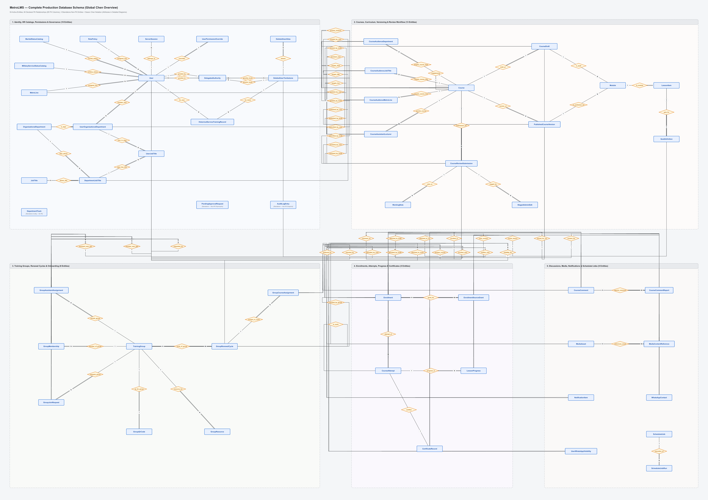

---

## 5. Detailed Domain Subdiagrams (All 305 Active Physical Columns)

### 5.1 Domain 1A — User Identity, Roles & Sessions (`3` Entities, `26` Columns)
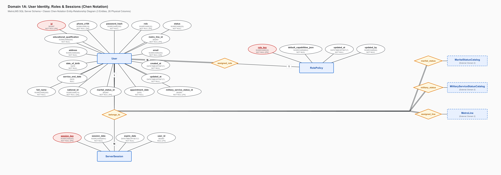

### 5.2 Domain 1B — Access Overrides, Delegations & Deletion Tombstones (`4` Entities, `20` Columns)
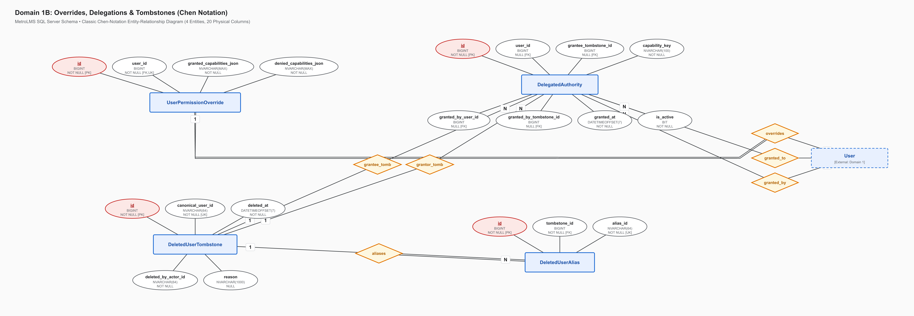

### 5.3 Domain 2A — HR Catalogs & Department Tracks (`6` Entities, `21` Columns)
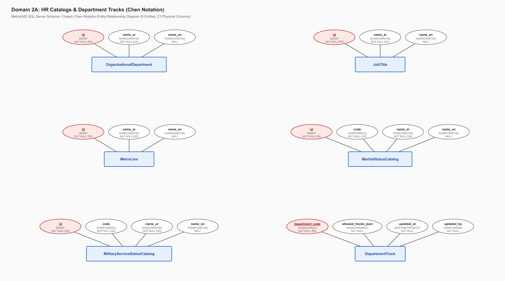

### 5.4 Domain 2B — User HR Assignments & Service Training History (`4` Entities, `17` Columns)
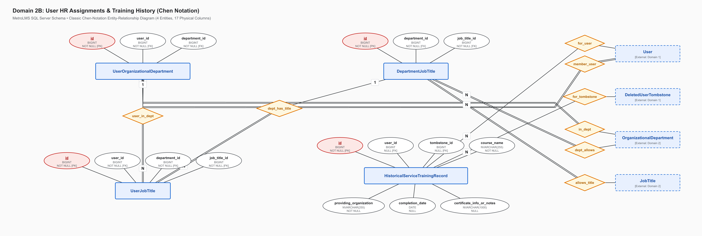

### 5.5 Domain 3 — Governance, Approvals & Audit (`2` Entities, `23` Columns)
*(Note: `PendingApprovalRequest` and `AuditLogEntry` intentionally hold no relational FKs to `User` so `D-01` user deletion never breaks immutable governance/audit history.)*
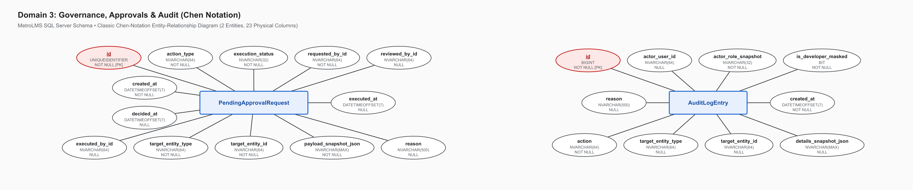

### 5.6 Domain 4A — Course Core & Audience Targeting (`5` Entities, `23` Columns)
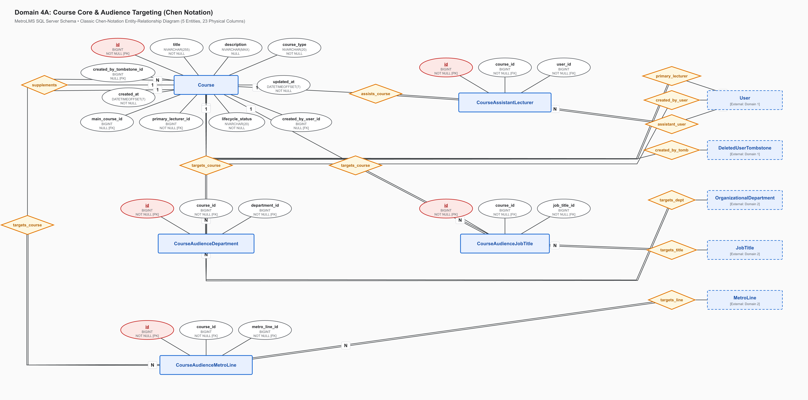

### 5.7 Domain 4B — Curriculum, Modules, Lessons & Versions (`5` Entities, `28` Columns)
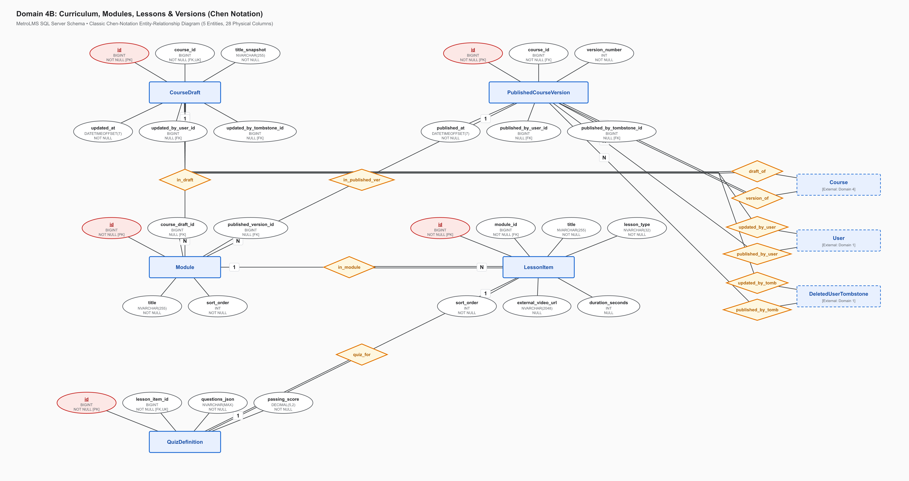

### 5.8 Domain 4C — Course Review Workflow (`3` Entities, `17` Columns)
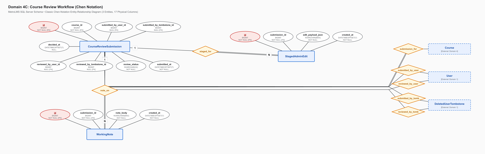

### 5.9 Domain 4D — Comments & Moderation (`2` Entities, `12` Columns)
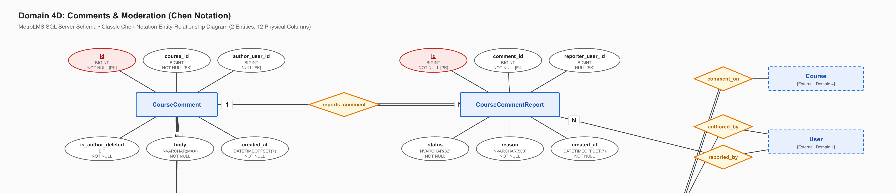

### 5.10 Domain 5 — Media Storage & Content References (`2` Entities, `17` Columns)
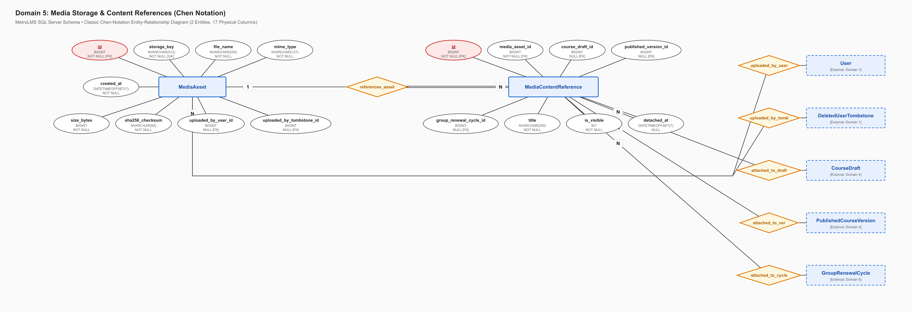

### 5.11 Domain 6A-1 — Training Groups, Cycles & Course Assignments (`4` Entities, `22` Columns)
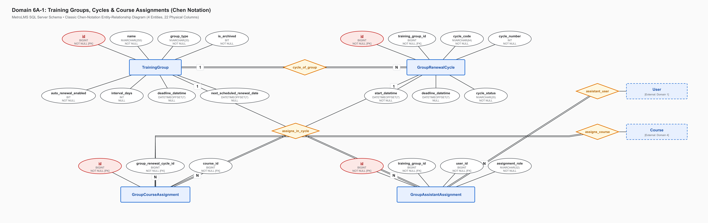

### 5.12 Domain 6A-2 — Group Membership, QR & Onboarding (`4` Entities, `20` Columns)
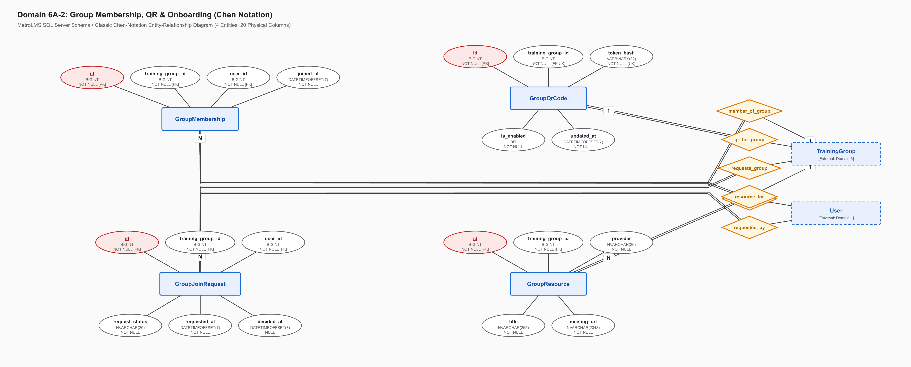

### 5.13 Domain 6B — Enrollments, Attempts, Progress & Certificates (`5` Entities, `31` Columns)
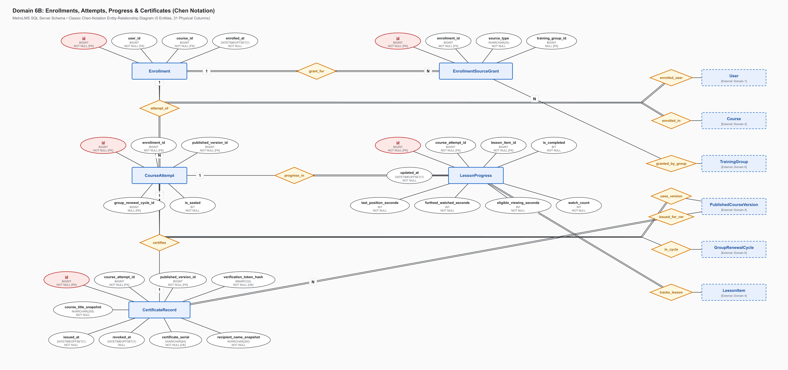

### 5.14 Domain 7 — Notifications, WhatsApp & Scheduled Jobs (`5` Entities, `28` Columns)
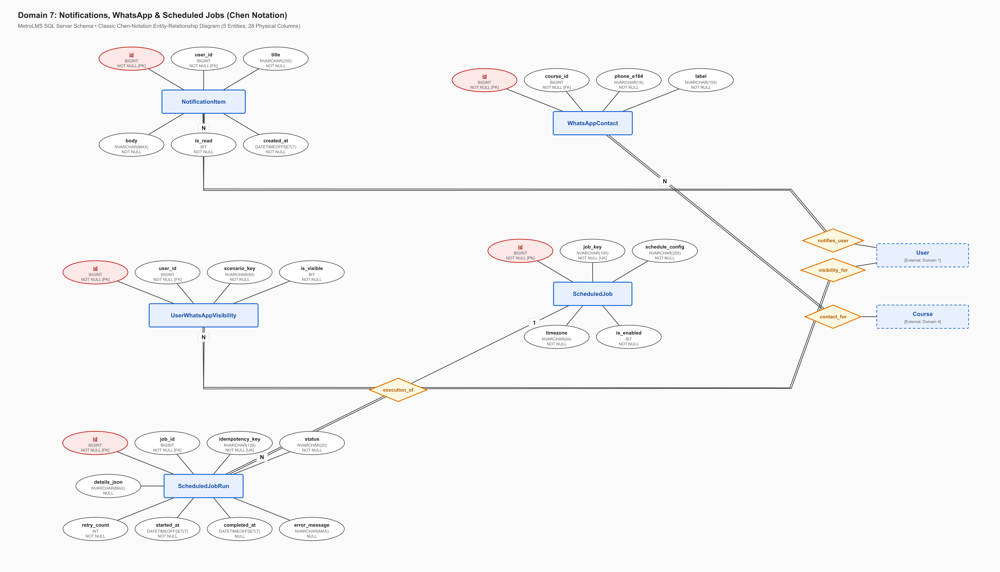

---

## 6. Physical Schema Reconciliation & `OR-DB-03` Index Baseline

| Verification | Expected | Chen ERD Verified | Result |
|---|---:|---:|---|
| Active entities | 54 | 54 | **MATCH** (`3+4+6+4+2+5+5+3+2+2+4+4+5+5 = 54`) |
| Physical columns | 305 | 305 | **MATCH** (`26+20+21+17+23+23+28+17+12+17+22+20+31+28 = 305`; `306` logical mappings before `DepartmentTrack` Option A collapse) |
| PK constraints | 54 | 54 | **MATCH** (`50` `BIGINT IDENTITY(1,1)` + `3` String PKs + `1` `UNIQUEIDENTIFIER`) |
| FK constraints | 84 | 84 | **MATCH** (`81` single `BIGINT` + `2` composite `BIGINT` in `UserJobTitle` + `1` `NVARCHAR(32)`; all `ON DELETE NO ACTION`) |
| Distinct FK columns | 85 | 85 | **MATCH** (`UserJobTitle.department_id` shared across 2 composite FKs) |
| Integer FK type matches | 84/84 | 84/84 | **MATCH** (`84/84` `BIGINT` integer FK type matches; plus `User.role` `NVARCHAR(32)` → `RolePolicy.role_key`) |
| `DepartmentTrack` PK | Single `NVARCHAR(64)` | Single `NVARCHAR(64)` | **MATCH** (Option A: `department_code NVARCHAR(64) NOT NULL`) |
| `PendingApprovalRequest` PK | `UNIQUEIDENTIFIER` | `UNIQUEIDENTIFIER` | **MATCH** (`id UNIQUEIDENTIFIER NOT NULL`) |
| Deferred active entities | 0 | 0 | **MATCH** (`InPersonAttendanceRecord` excluded) |

### `OR-DB-03` Consolidated Index Baseline (`45` Entries — Documented Non-Visually)
- **`4` Filtered `UNIQUE` Indexes:** `User(role) WHERE role = 'developer'`, `User(email) WHERE email IS NOT NULL`, `GroupJoinRequest(training_group_id, user_id) WHERE request_status = 'Pending'`, `CertificateRecord(course_attempt_id) WHERE course_attempt_id IS NOT NULL`.
- **`36` Ordinary `UNIQUE` Constraints / Indexes:** `15` in Cluster 1 + `8` in Cluster 2 + `13` in Cluster 3.
- **`5` Non-Unique / Composite Lookup Indexes:** `ServerSession(expire_date)`, `ServerSession(user_id)`, `PendingApprovalRequest(target_entity_type, target_entity_id)`, `MediaAsset(sha256_checksum)`, `DelegatedAuthority(user_id, capability_key)`.

---

## 7. Deferred Entity Note (`Domain 16`)
- **`InPersonAttendanceRecord`:** **`DEFERRED — NOT PART OF THE 54 ACTIVE ENTITIES`**. Excluded from all 15 Chen ERD diagrams and column counts pending separate future scope authorization.

---

## 8. Source-of-Truth References
1. [`data-dictionary.md`](data-dictionary.md) — Primary database source of truth (`54` entities, `305` physical columns, `OR-DB-01`–`08`).
2. [`logical-data-model.md`](logical-data-model.md) — Conceptual entity relationships and domain semantics.
3. [`erd-crow-foot.md`](erd-crow-foot.md) — Companion Crow's Foot technical reference.
4. [`decision-register.md`](../../architecture/decision-register.md) — Owner architectural decisions (`D-01`–`D-06`, `D-DB-01`).
5. [`django-sqlserver-integration-contract.md`](../../backend/django-sqlserver-integration-contract.md) — SQL Server 2022 & Django 5.2 integration contract.

---

## 9. Known Limitations & Unresolved Questions
1. **`ScheduledJobRun.details_json`:** Root JSON structure remains untyped `ISJSON(...)` (`OR-DB-01`) pending Phase 12 schema definition.
2. **`GroupRenewalCycle.cycle_code`:** No separate `UNIQUE(training_group_id, cycle_code)` constraint exists in `data-dictionary.md:479` (only `UNIQUE(training_group_id, cycle_number)` is declared).
3. **`User.date_of_birth` `CHECK`:** Authoritative validation is in Django (`ZoneInfo("Africa/Cairo")`); the optional SQL Server `AT TIME ZONE 'Egypt Standard Time'` `CHECK` is non-deterministic and subject to Phase 12 DDL verification.
