# MetroLMS — Physical Crow's Foot Entity-Relationship Diagram

> **Document Title:** Physical Crow's Foot Entity-Relationship Diagram (SQL Server 2022 / Django 5.2 LTS)  
> **Document Identifier:** `METROLMS-DATA-ERD-001`  
> **Document Status:** `UPDATED DESIGN ARTIFACT — DERIVED FROM APPROVED DATA DICTIONARY`  
> **Revision Date:** `2026-11-16` *(Supersedes `WP-5.4` Conceptual ERD)*  
> **Canonical Authority Note:** [`data-dictionary.md`](data-dictionary.md) remains the **sole authoritative source of truth** for active entities, physical columns, SQL Server types, nullability, keys, and constraints; this ERD is a derived visual and structural representation.  
> **Target Stack:** Python `3.12` / Django `5.2` LTS / DRF + Microsoft SQL Server `2022` (`mssql-django==2.0.0`, `Arabic_100_CI_AS` database collation; `Arabic_100_BIN2` on `User.phone_e164`).

---

## 1. Authoritative Source-of-Truth References

1. [`data-dictionary.md`](data-dictionary.md) (`54` active entities, `305` active physical columns under `DepartmentTrack` Option A, `1` `DEFERRED` entity; `OWNER-APPROVED — CONTENT ACCEPTED — UNFROZEN`)
2. [`logical-data-model.md`](logical-data-model.md) (conceptual entities, business semantics, and relationship rules)
3. [`cp-009-baseline-erratum-metroline-and-egyptian-phone.md`](cp-009-baseline-erratum-metroline-and-egyptian-phone.md) (`MetroLine` & Egyptian `+2010/11/12/15` phone baseline)
4. [`decision-register.md`](../../architecture/decision-register.md) (`D-01`–`D-06`, `OD-PF-01`–`08`, `WP55-PT-01`–`06`, `OR-DB-01`, `OR-DB-02`, `OR-DB-03`, `OR-DB-04`, `OR-DB-08a/b/c`)
5. [`django-sqlserver-integration-contract.md`](../../backend/django-sqlserver-integration-contract.md) (SQL Server 2022 DDL, `ISJSON()`, filtered indexes, `default`+`db_default`, `Arabic_100_CI_AS` & `OR-DB-04` contracts)
6. [`wp-5-5-consolidated-pre-freeze-owner-review-register.md`](wp-5-5-consolidated-pre-freeze-owner-review-register.md) (consolidated pre-freeze inventory & decision reconciliation)

---

## 2. Mermaid Physical Type & Key Notation Legend

Because Mermaid `erDiagram` attribute syntax requires single-token type identifiers without parentheses or commas, the following exact SQL Server physical type aliases are used consistently across all detailed diagrams:

| Mermaid Type Token | Exact SQL Server 2022 Physical Type | Key / Marker Legend |
| :--- | :--- | :--- |
| `BIGINT` | `BIGINT` (or `BIGINT IDENTITY(1,1)` when comment states `IDENTITY(1,1)`) | **`PK`** = Primary Key |
| `INT` | `INT` | **`FK`** = Foreign Key (`ON DELETE NO ACTION`) |
| `BIT` | `BIT` | **`UK`** = Unique Key / Unique Constraint |
| `DECIMAL_5_2` | `DECIMAL(5,2)` | **`NOT NULL`** / **`NULL`** = Column Nullability (in comment) |
| `NVARCHAR_n` | `NVARCHAR(n)` (e.g., `NVARCHAR_16` = `NVARCHAR(16)`) | **`DEFAULT ...`** = `default` + `db_default` (`OR-DB-01`) |
| `NVARCHAR_MAX` | `NVARCHAR(MAX)` | **`ISJSON_ARRAY`** / **`ISJSON_OBJECT`** / **`ISJSON`** = SQL Server 2022 JSON `CHECK` |
| `UNIQUEIDENTIFIER` | `UNIQUEIDENTIFIER` (`PendingApprovalRequest.id` only) | **`XOR_FK`** = Participates in mutually exclusive FK `CHECK` |
| `BINARY_32` / `VARBINARY_32` | `BINARY(32)` / `VARBINARY(32)` | **`FILTERED_UK`** = Filtered `UNIQUE` index (`OR-DB-03`) |
| `DATETIMEOFFSET_7` | `DATETIMEOFFSET(7)` (`USE_TZ=True`, UTC `+00:00`) | |
| `DATE` | `DATE` | |

---

## 3. Global Relationship Overview (`54` Active Entities)

This high-level diagram shows all **`54` active entities** and their **actual declared foreign-key relationships** (`84` relational FK constraints across `85` FK columns, all `ON DELETE NO ACTION`). `PendingApprovalRequest` and `AuditLogEntry` have no declared relational FKs (polymorphic/snapshot attribution only) and appear as standalone nodes.

```mermaid
erDiagram
    RolePolicy ||--o{ User : "governs_role"
    MaritalStatusCatalog ||--o{ User : "classifies"
    MilitaryServiceStatusCatalog ||--o{ User : "classifies"
    MetroLine ||--o{ User : "classifies"

    User ||--o{ ServerSession : "owns_optional"
    User ||--o| UserPermissionOverride : "has_override"
    User ||--o{ DelegatedAuthority : "grantee_or_grantor"
    DeletedUserTombstone ||--o{ DelegatedAuthority : "post_d01_attribution"
    DeletedUserTombstone ||--o{ DeletedUserAlias : "maps_legacy_alias"
    User ||--o{ HistoricalServiceTrainingRecord : "owns_active"
    DeletedUserTombstone ||--o{ HistoricalServiceTrainingRecord : "owns_post_d01"

    User ||--o{ UserOrganizationalDepartment : "assigned_dept"
    OrganizationalDepartment ||--o{ UserOrganizationalDepartment : "has_member"
    OrganizationalDepartment ||--o{ DepartmentJobTitle : "defines_title"
    JobTitle ||--o{ DepartmentJobTitle : "in_dept"
    UserOrganizationalDepartment ||--o{ UserJobTitle : "scopes_user_dept"
    DepartmentJobTitle ||--o{ UserJobTitle : "scopes_dept_title"
    DepartmentTrack {
        NVARCHAR_64 department_code PK
    }

    User ||--o{ Course : "primary_lecturer"
    User ||--o{ Course : "created_by_user"
    DeletedUserTombstone ||--o{ Course : "created_by_tombstone"
    Course ||--o{ Course : "main_to_reminder"
    Course ||--o{ CourseAssistantLecturer : "assists"
    User ||--o{ CourseAssistantLecturer : "assigned_assistant"
    Course ||--o{ CourseAudienceDepartment : "targets_dept"
    OrganizationalDepartment ||--o{ CourseAudienceDepartment : "targeted_by"
    Course ||--o{ CourseAudienceJobTitle : "targets_title"
    JobTitle ||--o{ CourseAudienceJobTitle : "targeted_by"
    Course ||--o{ CourseAudienceMetroLine : "targets_line"
    MetroLine ||--o{ CourseAudienceMetroLine : "targeted_by"

    Course ||--o| CourseDraft : "has_draft"
    User ||--o{ CourseDraft : "updated_by_user"
    DeletedUserTombstone ||--o{ CourseDraft : "updated_by_tombstone"
    Course ||--o{ PublishedCourseVersion : "publishes"
    User ||--o{ PublishedCourseVersion : "published_by_user"
    DeletedUserTombstone ||--o{ PublishedCourseVersion : "published_by_tombstone"
    CourseDraft ||--o{ Module : "contains_draft"
    PublishedCourseVersion ||--o{ Module : "contains_published"
    Module ||--o{ LessonItem : "contains"
    LessonItem ||--o| QuizDefinition : "has_quiz"

    Course ||--o{ CourseReviewSubmission : "submitted_for"
    User ||--o{ CourseReviewSubmission : "submitted_or_reviewed_by_user"
    DeletedUserTombstone ||--o{ CourseReviewSubmission : "submitted_or_reviewed_by_tombstone"
    CourseReviewSubmission ||--o{ StagedAdminEdit : "stages"
    CourseReviewSubmission ||--o{ WorkingNote : "annotates"

    Course ||--o{ CourseComment : "hosts"
    User ||--o{ CourseComment : "authors_optional"
    CourseComment ||--o{ CourseCommentReport : "flagged_by"
    User ||--o{ CourseCommentReport : "reported_by_optional"

    User ||--o{ MediaAsset : "uploaded_by_user"
    DeletedUserTombstone ||--o{ MediaAsset : "uploaded_by_tombstone"
    MediaAsset ||--o{ MediaContentReference : "referenced_by"
    CourseDraft ||--o{ MediaContentReference : "links_draft"
    PublishedCourseVersion ||--o{ MediaContentReference : "links_published"
    GroupRenewalCycle ||--o{ MediaContentReference : "links_cycle"

    TrainingGroup ||--o{ GroupAssistantAssignment : "scopes"
    User ||--o{ GroupAssistantAssignment : "assigned_to"
    TrainingGroup ||--|{ GroupRenewalCycle : "cycles"
    GroupRenewalCycle ||--o{ GroupCourseAssignment : "assigns"
    Course ||--o{ GroupCourseAssignment : "assigned_in"
    TrainingGroup ||--o{ GroupMembership : "enrolls"
    User ||--o{ GroupMembership : "member_of"
    TrainingGroup ||--o| GroupQrCode : "issues_qr"
    TrainingGroup ||--o{ GroupJoinRequest : "receives"
    User ||--o{ GroupJoinRequest : "requests_join"
    TrainingGroup ||--o{ GroupResource : "attaches_meeting"

    User ||--o{ Enrollment : "enrolled_in"
    Course ||--o{ Enrollment : "grants_access"
    Enrollment ||--|{ EnrollmentSourceGrant : "provenance"
    TrainingGroup ||--o{ EnrollmentSourceGrant : "group_source_optional"
    Enrollment ||--o{ CourseAttempt : "tracks"
    PublishedCourseVersion ||--o{ CourseAttempt : "version_scope"
    GroupRenewalCycle ||--o{ CourseAttempt : "cycle_scope_optional"
    CourseAttempt ||--o{ LessonProgress : "records"
    LessonItem ||--o{ LessonProgress : "tracked_for"
    CourseAttempt ||--o| CertificateRecord : "issues_optional_d01"
    PublishedCourseVersion ||--o{ CertificateRecord : "certifies_version"

    User ||--o{ NotificationItem : "receives"
    Course ||--o{ WhatsAppContact : "supports"
    User ||--o{ UserWhatsAppVisibility : "configures"
    ScheduledJob ||--o{ ScheduledJobRun : "executes"

    PendingApprovalRequest {
        UNIQUEIDENTIFIER id PK
    }
    AuditLogEntry {
        BIGINT id PK
    }
```

---

## 4. Detailed Domain ERDs (`54` Active Entities / `305` Physical Columns)

### 4.1 Domain 1 — Identity, Authentication & Access Control (`7` Entities)

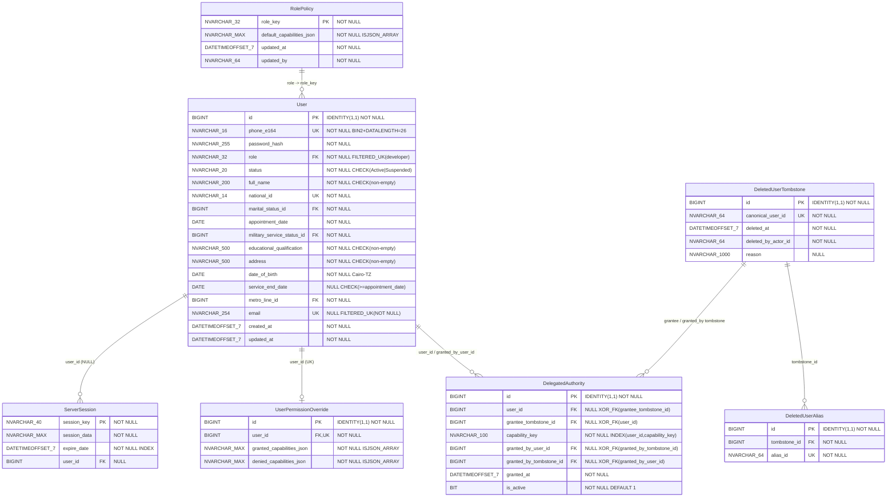

### 4.2 Domain 2 — Organization, HR Catalogs & Historical Service Records (`10` Entities)

```mermaid
erDiagram
    OrganizationalDepartment ||--o{ UserOrganizationalDepartment : "department_id"
    OrganizationalDepartment ||--o{ DepartmentJobTitle : "department_id"
    JobTitle ||--o{ DepartmentJobTitle : "job_title_id"
    UserOrganizationalDepartment ||--o{ UserJobTitle : "composite FK(user_id,department_id)"
    DepartmentJobTitle ||--o{ UserJobTitle : "composite FK(department_id,job_title_id)"

    OrganizationalDepartment {
        BIGINT id PK "IDENTITY(1,1) NOT NULL"
        NVARCHAR_150 name_ar UK "NOT NULL"
        NVARCHAR_150 name_en "NULL"
    }

    JobTitle {
        BIGINT id PK "IDENTITY(1,1) NOT NULL"
        NVARCHAR_150 name_ar UK "NOT NULL"
        NVARCHAR_150 name_en "NULL"
    }

    MetroLine {
        BIGINT id PK "IDENTITY(1,1) NOT NULL"
        NVARCHAR_100 name_ar UK "NOT NULL"
        NVARCHAR_100 name_en "NULL"
    }

    MaritalStatusCatalog {
        BIGINT id PK "IDENTITY(1,1) NOT NULL"
        NVARCHAR_32 code UK "NOT NULL"
        NVARCHAR_100 name_ar UK "NOT NULL"
        NVARCHAR_100 name_en "NULL"
    }

    MilitaryServiceStatusCatalog {
        BIGINT id PK "IDENTITY(1,1) NOT NULL"
        NVARCHAR_32 code UK "NOT NULL"
        NVARCHAR_100 name_ar UK "NOT NULL"
        NVARCHAR_100 name_en "NULL"
    }

    HistoricalServiceTrainingRecord {
        BIGINT id PK "IDENTITY(1,1) NOT NULL"
        BIGINT user_id FK "NULL XOR_FK(tombstone_id)"
        BIGINT tombstone_id FK "NULL XOR_FK(user_id)"
        NVARCHAR_255 course_name "NOT NULL CHECK(non-empty)"
        NVARCHAR_255 providing_organization "NOT NULL CHECK(non-empty)"
        DATE completion_date "NULL"
        NVARCHAR_1000 certificate_info_or_notes "NULL"
    }

    DepartmentTrack {
        NVARCHAR_64 department_code PK "NOT NULL Option-A-String-PK"
        NVARCHAR_MAX allowed_tracks_json "NOT NULL ISJSON_ARRAY"
        DATETIMEOFFSET_7 updated_at "NOT NULL"
        NVARCHAR_64 updated_by "NOT NULL"
    }

    UserOrganizationalDepartment {
        BIGINT id PK "IDENTITY(1,1) NOT NULL"
        BIGINT user_id FK "NOT NULL UK(user_id,department_id)"
        BIGINT department_id FK "NOT NULL UK(user_id,department_id)"
    }

    DepartmentJobTitle {
        BIGINT id PK "IDENTITY(1,1) NOT NULL"
        BIGINT department_id FK "NOT NULL UK(department_id,job_title_id)"
        BIGINT job_title_id FK "NOT NULL UK(department_id,job_title_id)"
    }

    UserJobTitle {
        BIGINT id PK "IDENTITY(1,1) NOT NULL"
        BIGINT user_id FK "NOT NULL UK(user_id,department_id,job_title_id)"
        BIGINT department_id FK "NOT NULL"
        BIGINT job_title_id FK "NOT NULL"
    }
```

*(Cross-domain FKs to Domain 1: `User.marital_status_id` → `MaritalStatusCatalog.id`; `User.military_service_status_id` → `MilitaryServiceStatusCatalog.id`; `User.metro_line_id` → `MetroLine.id`; `UserOrganizationalDepartment.user_id` → `User.id`; `HistoricalServiceTrainingRecord.user_id` → `User.id`; `HistoricalServiceTrainingRecord.tombstone_id` → `DeletedUserTombstone.id`.)*

### 4.3 Domain 3 — Governance, Approvals & Audit (`2` Entities — No Relational FKs)

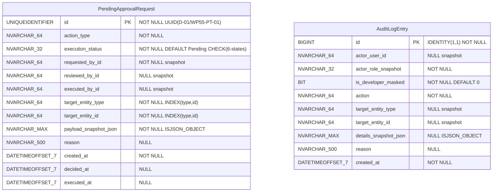

### 4.4 Domain 4 — Curriculum, Versioning, Review & Comments (`15` Entities)

```mermaid
erDiagram
    Course ||--o{ Course : "main_course_id (NULL)"
    Course ||--o{ CourseAssistantLecturer : "course_id"
    Course ||--o{ CourseAudienceDepartment : "course_id"
    Course ||--o{ CourseAudienceJobTitle : "course_id"
    Course ||--o{ CourseAudienceMetroLine : "course_id"
    Course ||--o| CourseDraft : "course_id (UK)"
    Course ||--o{ PublishedCourseVersion : "course_id"
    CourseDraft ||--o{ Module : "course_draft_id (XOR)"
    PublishedCourseVersion ||--o{ Module : "published_version_id (XOR)"
    Module ||--o{ LessonItem : "module_id"
    LessonItem ||--o| QuizDefinition : "lesson_item_id (UK)"
    Course ||--o{ CourseReviewSubmission : "course_id"
    CourseReviewSubmission ||--o{ StagedAdminEdit : "submission_id"
    CourseReviewSubmission ||--o{ WorkingNote : "submission_id"
    Course ||--o{ CourseComment : "course_id"
    CourseComment ||--o{ CourseCommentReport : "comment_id"

    Course {
        BIGINT id PK "IDENTITY(1,1) NOT NULL"
        NVARCHAR_255 title "NOT NULL CHECK(non-empty)"
        NVARCHAR_MAX description "NULL"
        NVARCHAR_20 course_type "NOT NULL CHECK(main|reminder)"
        BIGINT main_course_id FK "NULL CHECK(type-main-xor)"
        BIGINT primary_lecturer_id FK "NOT NULL User.id"
        NVARCHAR_20 lifecycle_status "NOT NULL DEFAULT Draft CHECK(4-states)"
        BIGINT created_by_user_id FK "NULL XOR_FK(created_by_tombstone_id)"
        BIGINT created_by_tombstone_id FK "NULL XOR_FK(created_by_user_id)"
        DATETIMEOFFSET_7 created_at "NOT NULL"
        DATETIMEOFFSET_7 updated_at "NOT NULL"
    }

    CourseAssistantLecturer {
        BIGINT id PK "IDENTITY(1,1) NOT NULL"
        BIGINT course_id FK "NOT NULL UK(course_id,user_id)"
        BIGINT user_id FK "NOT NULL UK(course_id,user_id)"
    }

    CourseAudienceDepartment {
        BIGINT id PK "IDENTITY(1,1) NOT NULL"
        BIGINT course_id FK "NOT NULL UK(course_id,department_id)"
        BIGINT department_id FK "NOT NULL UK(course_id,department_id)"
    }

    CourseAudienceJobTitle {
        BIGINT id PK "IDENTITY(1,1) NOT NULL"
        BIGINT course_id FK "NOT NULL UK(course_id,job_title_id)"
        BIGINT job_title_id FK "NOT NULL UK(course_id,job_title_id)"
    }

    CourseAudienceMetroLine {
        BIGINT id PK "IDENTITY(1,1) NOT NULL"
        BIGINT course_id FK "NOT NULL UK(course_id,metro_line_id)"
        BIGINT metro_line_id FK "NOT NULL UK(course_id,metro_line_id)"
    }

    CourseDraft {
        BIGINT id PK "IDENTITY(1,1) NOT NULL"
        BIGINT course_id FK,UK "NOT NULL"
        NVARCHAR_255 title_snapshot "NOT NULL"
        DATETIMEOFFSET_7 updated_at "NOT NULL"
        BIGINT updated_by_user_id FK "NULL XOR_FK(updated_by_tombstone_id)"
        BIGINT updated_by_tombstone_id FK "NULL XOR_FK(updated_by_user_id)"
    }

    PublishedCourseVersion {
        BIGINT id PK "IDENTITY(1,1) NOT NULL"
        BIGINT course_id FK "NOT NULL UK(course_id,version_number)"
        INT version_number "NOT NULL UK CHECK(>=1)"
        DATETIMEOFFSET_7 published_at "NOT NULL"
        BIGINT published_by_user_id FK "NULL XOR_FK(published_by_tombstone_id)"
        BIGINT published_by_tombstone_id FK "NULL XOR_FK(published_by_user_id)"
    }

    Module {
        BIGINT id PK "IDENTITY(1,1) NOT NULL"
        BIGINT course_draft_id FK "NULL XOR_FK(published_version_id)"
        BIGINT published_version_id FK "NULL XOR_FK(course_draft_id)"
        NVARCHAR_255 title "NOT NULL CHECK(non-empty)"
        INT sort_order "NOT NULL DEFAULT 0 CHECK(>=0)"
    }

    LessonItem {
        BIGINT id PK "IDENTITY(1,1) NOT NULL"
        BIGINT module_id FK "NOT NULL"
        NVARCHAR_255 title "NOT NULL CHECK(non-empty)"
        NVARCHAR_32 lesson_type "NOT NULL"
        INT sort_order "NOT NULL DEFAULT 0 CHECK(>=0)"
        NVARCHAR_2048 external_video_url "NULL"
        INT duration_seconds "NULL DEFAULT 0 CHECK(>=0)"
    }

    QuizDefinition {
        BIGINT id PK "IDENTITY(1,1) NOT NULL"
        BIGINT lesson_item_id FK,UK "NOT NULL"
        NVARCHAR_MAX questions_json "NOT NULL ISJSON_ARRAY"
        DECIMAL_5_2 passing_score "NOT NULL CHECK(0.00..100.00)"
    }

    CourseReviewSubmission {
        BIGINT id PK "IDENTITY(1,1) NOT NULL"
        BIGINT course_id FK "NOT NULL"
        BIGINT submitted_by_user_id FK "NULL XOR_FK(submitted_by_tombstone_id)"
        BIGINT submitted_by_tombstone_id FK "NULL XOR_FK(submitted_by_user_id)"
        BIGINT reviewed_by_user_id FK "NULL MAX1(reviewed_by_tombstone_id)"
        BIGINT reviewed_by_tombstone_id FK "NULL MAX1(reviewed_by_user_id)"
        NVARCHAR_32 review_status "NOT NULL DEFAULT Pending CHECK(3-states)"
        DATETIMEOFFSET_7 submitted_at "NOT NULL"
        DATETIMEOFFSET_7 decided_at "NULL"
    }

    StagedAdminEdit {
        BIGINT id PK "IDENTITY(1,1) NOT NULL"
        BIGINT submission_id FK "NOT NULL"
        NVARCHAR_MAX edit_payload_json "NOT NULL ISJSON_OBJECT"
        DATETIMEOFFSET_7 created_at "NOT NULL"
    }

    WorkingNote {
        BIGINT id PK "IDENTITY(1,1) NOT NULL"
        BIGINT submission_id FK "NOT NULL"
        NVARCHAR_MAX note_body "NOT NULL"
        DATETIMEOFFSET_7 created_at "NOT NULL"
    }

    CourseComment {
        BIGINT id PK "IDENTITY(1,1) NOT NULL"
        BIGINT course_id FK "NOT NULL"
        BIGINT author_user_id FK "NULL D-02-anonymize"
        BIT is_author_deleted "NOT NULL DEFAULT 0"
        NVARCHAR_MAX body "NOT NULL"
        DATETIMEOFFSET_7 created_at "NOT NULL"
    }

    CourseCommentReport {
        BIGINT id PK "IDENTITY(1,1) NOT NULL"
        BIGINT comment_id FK "NOT NULL"
        BIGINT reporter_user_id FK "NULL D-01-nullify"
        NVARCHAR_32 status "NOT NULL DEFAULT Pending CHECK(3-states)"
        NVARCHAR_500 reason "NOT NULL CHECK(non-empty)"
        DATETIMEOFFSET_7 created_at "NOT NULL"
    }
```

*(Cross-domain FKs to Domains 1–2: `User.id` for `primary_lecturer_id`, `*_user_id`, `author_user_id`, `reporter_user_id`; `DeletedUserTombstone.id` for `*_tombstone_id`; `OrganizationalDepartment.id`, `JobTitle.id`, and `MetroLine.id` for `CourseAudience*`.)*

### 4.5 Domain 5 — Media Storage & Content References (`2` Entities)

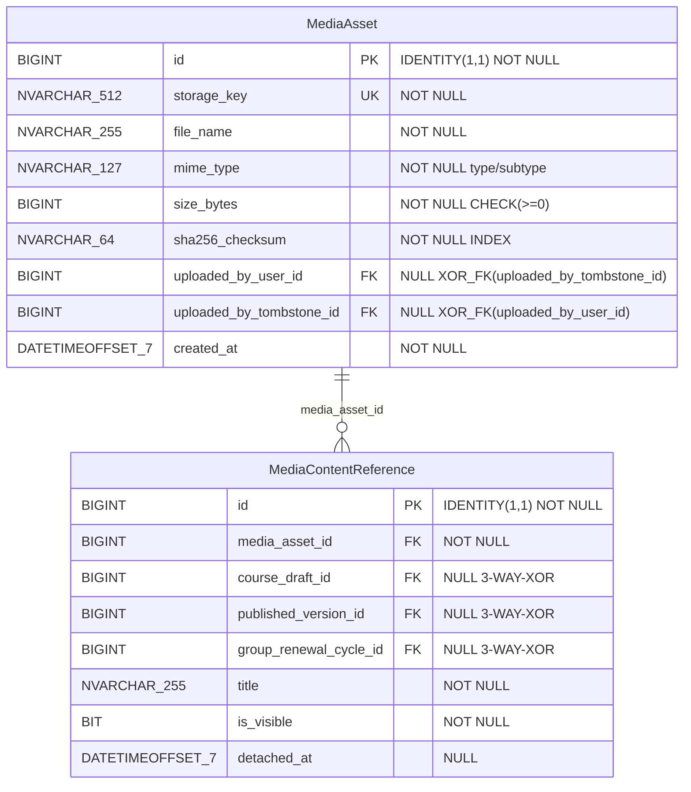

*(Cross-domain FKs: `MediaAsset.uploaded_by_user_id` → `User.id`; `MediaAsset.uploaded_by_tombstone_id` → `DeletedUserTombstone.id`; `MediaContentReference.course_draft_id` → `CourseDraft.id`; `MediaContentReference.published_version_id` → `PublishedCourseVersion.id`; `MediaContentReference.group_renewal_cycle_id` → `GroupRenewalCycle.id`.)*

### 4.6 Domain 6A — Training Groups, Cycles & Onboarding (`8` Entities)

```mermaid
erDiagram
    TrainingGroup ||--o{ GroupAssistantAssignment : "training_group_id"
    TrainingGroup ||--|{ GroupRenewalCycle : "training_group_id"
    GroupRenewalCycle ||--o{ GroupCourseAssignment : "group_renewal_cycle_id"
    TrainingGroup ||--o{ GroupMembership : "training_group_id"
    TrainingGroup ||--o| GroupQrCode : "training_group_id (UK)"
    TrainingGroup ||--o{ GroupJoinRequest : "training_group_id"
    TrainingGroup ||--o{ GroupResource : "training_group_id"

    TrainingGroup {
        BIGINT id PK "IDENTITY(1,1) NOT NULL"
        NVARCHAR_255 name "NOT NULL CHECK(non-empty)"
        NVARCHAR_20 group_type "NOT NULL CHECK(regular|reminder)"
        BIT is_archived "NOT NULL DEFAULT 0"
        BIT auto_renewal_enabled "NOT NULL"
        INT interval_days "NULL CHECK(1..730)"
        DATETIMEOFFSET_7 deadline_datetime "NULL"
        DATETIMEOFFSET_7 next_scheduled_renewal_date "NULL"
    }

    GroupAssistantAssignment {
        BIGINT id PK "IDENTITY(1,1) NOT NULL"
        BIGINT training_group_id FK "NOT NULL UK(group,user,role)"
        BIGINT user_id FK "NOT NULL UK(group,user,role)"
        NVARCHAR_32 assignment_role "NOT NULL UK(group,user,role)"
    }

    GroupRenewalCycle {
        BIGINT id PK "IDENTITY(1,1) NOT NULL"
        BIGINT training_group_id FK "NOT NULL UK(group,cycle_number)"
        NVARCHAR_64 cycle_code "NOT NULL"
        INT cycle_number "NOT NULL UK(group,cycle_number)"
        DATETIMEOFFSET_7 start_datetime "NOT NULL"
        DATETIMEOFFSET_7 deadline_datetime "NULL"
        NVARCHAR_20 cycle_status "NOT NULL CHECK(5-states)"
    }

    GroupCourseAssignment {
        BIGINT id PK "IDENTITY(1,1) NOT NULL"
        BIGINT group_renewal_cycle_id FK "NOT NULL UK(cycle,course)"
        BIGINT course_id FK "NOT NULL UK(cycle,course)"
    }

    GroupMembership {
        BIGINT id PK "IDENTITY(1,1) NOT NULL"
        BIGINT training_group_id FK "NOT NULL UK(group,user)"
        BIGINT user_id FK "NOT NULL UK(group,user)"
        DATETIMEOFFSET_7 joined_at "NOT NULL"
    }

    GroupQrCode {
        BIGINT id PK "IDENTITY(1,1) NOT NULL"
        BIGINT training_group_id FK,UK "NOT NULL"
        VARBINARY_32 token_hash UK "NOT NULL SHA-256"
        BIT is_enabled "NOT NULL"
        DATETIMEOFFSET_7 updated_at "NOT NULL"
    }

    GroupJoinRequest {
        BIGINT id PK "IDENTITY(1,1) NOT NULL"
        BIGINT training_group_id FK "NOT NULL FILTERED_UK(Pending)"
        BIGINT user_id FK "NOT NULL FILTERED_UK(Pending)"
        NVARCHAR_20 request_status "NOT NULL DEFAULT Pending CHECK(3-states)"
        DATETIMEOFFSET_7 requested_at "NOT NULL"
        DATETIMEOFFSET_7 decided_at "NULL"
    }

    GroupResource {
        BIGINT id PK "IDENTITY(1,1) NOT NULL"
        BIGINT training_group_id FK "NOT NULL"
        NVARCHAR_20 provider "NOT NULL CHECK(4-providers)"
        NVARCHAR_255 title "NOT NULL"
        NVARCHAR_2048 meeting_url "NOT NULL"
    }
```

### 4.7 Domain 6B — Enrollments, Attempts, Progress & Certificates (`5` Entities)

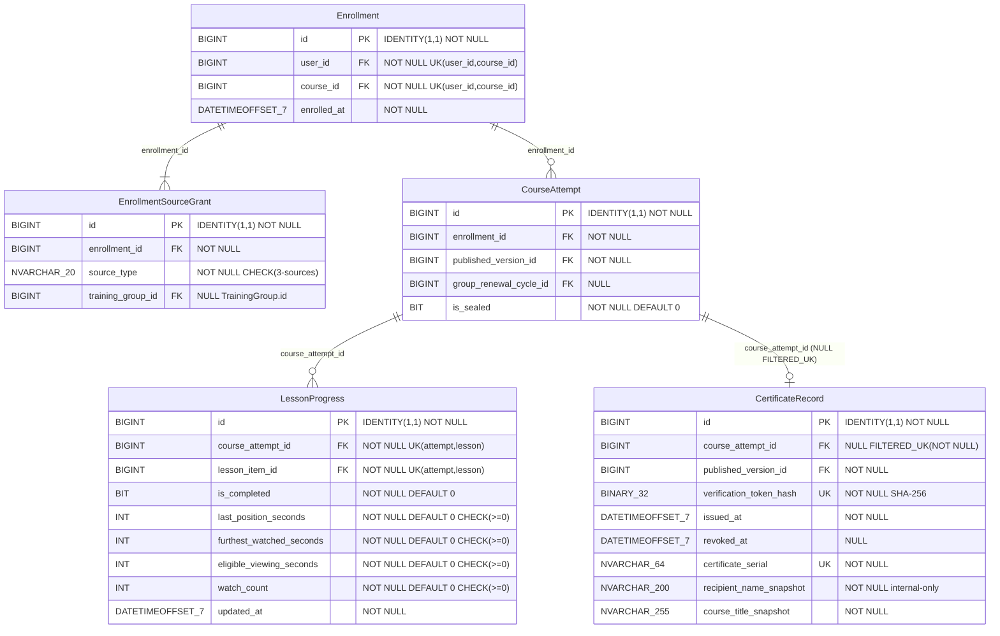

### 4.8 Domain 6C — Notifications, WhatsApp & Scheduled Jobs (`5` Entities)

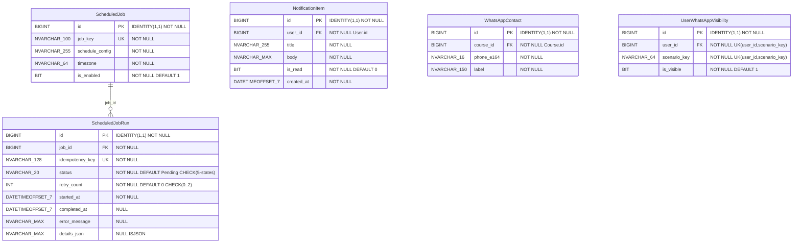

---

## 5. Relationship & Constraint Notes

1. **Referential Actions (`ON DELETE NO ACTION`):** Every declared FK (`84` FK constraints across `85` FK columns: `81` single-column `BIGINT` FKs + `2` composite `BIGINT` FKs in `UserJobTitle` + `1` `NVARCHAR(32)` FK `User.role` → `RolePolicy.role_key`) uses `ON DELETE NO ACTION` to prevent SQL Server multiple-cascade-path Error `1785` and enforce `D-01` / `D-03` / `D-OWNER-REV-10` service-layer guards.
2. **One-to-One (`1 : 0..1`) via `UNIQUE` FK:** `UserPermissionOverride.user_id`, `CourseDraft.course_id`, `QuizDefinition.lesson_item_id`, `GroupQrCode.training_group_id`, and `CertificateRecord.course_attempt_id` (filtered `UNIQUE WHERE course_attempt_id IS NOT NULL` so issued certificates survive `D-01` when `course_attempt_id` is decoupled to `NULL`).
3. **Composite FKs (`UserJobTitle`):** `UserJobTitle` enforces `D-OWNER-REV-17` via two composite FKs: `(user_id, department_id) → UserOrganizationalDepartment(user_id, department_id)` and `(department_id, job_title_id) → DepartmentJobTitle(department_id, job_title_id)`.
4. **Composite `UNIQUE` Constraints:** `UserOrganizationalDepartment(user_id, department_id)`, `DepartmentJobTitle(department_id, job_title_id)`, `UserJobTitle(user_id, department_id, job_title_id)`, `CourseAssistantLecturer(course_id, user_id)`, `CourseAudienceDepartment(course_id, department_id)`, `CourseAudienceJobTitle(course_id, job_title_id)`, `CourseAudienceMetroLine(course_id, metro_line_id)`, `PublishedCourseVersion(course_id, version_number)`, `GroupAssistantAssignment(training_group_id, user_id, assignment_role)`, `GroupRenewalCycle(training_group_id, cycle_number)`, `GroupCourseAssignment(group_renewal_cycle_id, course_id)`, `GroupMembership(training_group_id, user_id)`, `Enrollment(user_id, course_id)`, `LessonProgress(course_attempt_id, lesson_item_id)`, `UserWhatsAppVisibility(user_id, scenario_key)`.
5. **Filtered `UNIQUE` Indexes (`4` in `OR-DB-03`):**
   - `User(role) WHERE role = 'developer'`
   - `User(email) WHERE email IS NOT NULL`
   - `GroupJoinRequest(training_group_id, user_id) WHERE request_status = 'Pending'`
   - `CertificateRecord(course_attempt_id) WHERE course_attempt_id IS NOT NULL`
6. **Non-FK Polymorphic / Snapshot Attribution:** `PendingApprovalRequest` (`requested_by_id`, `reviewed_by_id`, `executed_by_id`, `target_entity_type`, `target_entity_id`), `AuditLogEntry` (`actor_user_id`, `target_entity_type`, `target_entity_id`), and `DeletedUserTombstone` (`canonical_user_id`, `deleted_by_actor_id`) intentionally hold **no relational FK** to `User` so `D-01` deletion never breaks historical audit/tombstone records.
7. **Key `CHECK` & `ISJSON()` Constraints (`OR-DB-01`):**
   - `52` individual SQL Server `CHECK` constraints (`38` domain/enum/range/XOR/date + `4` `LessonProgress` telemetry `>= 0` + `10` non-empty text `LTRIM(RTRIM(col)) <> N''`), including `User.phone_e164` (`COLLATE Arabic_100_BIN2 LIKE N'+201[0125]...' AND DATALENGTH(phone_e164) = 26 AND LEN(phone_e164) = 13`) and optional non-deterministic `User.date_of_birth` `AT TIME ZONE 'Egypt Standard Time'` (`ZoneInfo("Africa/Cairo")` authoritative).
   - `9` `ISJSON()` constraints (`5` `ISJSON(..., ARRAY)`, `3` `ISJSON(..., OBJECT)`, `1` untyped `ISJSON(...)` on `ScheduledJobRun.details_json`).

---

## 6. Deferred Entity Note (`Domain 16`)
- **`InPersonAttendanceRecord`** (`Domain 16`): **`DEFERRED — NOT PART OF THE 54 ACTIVE ENTITIES`**. Intentionally excluded from all active ERD diagrams and column counts pending separate future scope authorization.

---

## 7. Reconciliation Results

| Verification | Data Dictionary | New ERD | Result |
|---|---:|---:|---|
| Active entities | 54 | 54 | **MATCH** (`7 + 10 + 2 + 15 + 2 + 8 + 5 + 5 = 54`) |
| Physical columns | 305 | 305 | **MATCH** (`306` logical mappings collapsed via `DepartmentTrack` Option A) |
| PKs | 54 | 54 | **MATCH** (`50` `BIGINT IDENTITY(1,1)` + `3` String PKs + `1` `UNIQUEIDENTIFIER`) |
| FKs | 84 constraints (`85` FK cols) | 84 constraints (`85` FK cols) | **MATCH** (`81` single `BIGINT` + `2` composite `BIGINT` + `1` `NVARCHAR(32)`; all `NO ACTION`) |
| Unique constraints / indexes | 40 (`36` ordinary + `4` filtered) | 40 (`36` ordinary + `4` filtered) | **MATCH** (`45`-entry `OR-DB-03` index baseline incl. `5` non-unique indexes) |
| Deferred entities | 1 | Separately noted | **MATCH** (`InPersonAttendanceRecord` excluded from active ERD) |

---

## 8. Known Limitations & Source Notes
1. **Mermaid Type-Token Aliasing:** Mermaid `erDiagram` grammar disallows parentheses/commas inside attribute type tokens, so `NVARCHAR(n)`, `DATETIMEOFFSET(7)`, `DECIMAL(5,2)`, `BINARY(32)`, and `VARBINARY(32)` use underscore tokens (`NVARCHAR_n`, `DATETIMEOFFSET_7`, `DECIMAL_5_2`, `BINARY_32`, `VARBINARY_32`) paired with the exact SQL Server physical type mapping in Section 2 and column comments.
2. **Mermaid Rendering:** All `9` Mermaid `erDiagram` blocks have been rendered into both `.svg` and `.png` visual diagrams under [`erd-rendered/`](erd-rendered/) using `@mermaid-js/mermaid-cli` `12.2.0` via ephemeral `npx` execution (`-b white`, PNG `-s 2`) with zero modifications to `package.json` or lockfiles.
3. **Unresolved Non-Blocking Source Notes:** `ScheduledJobRun.details_json` root JSON type remains untyped `ISJSON(...)` (`OR-DB-01`), and `GroupRenewalCycle.cycle_code` has no separate `UNIQUE` constraint beyond `UNIQUE(training_group_id, cycle_number)` in `data-dictionary.md:479` (`UNIQUE(training_group_id, cycle_code)` appears in `OR-DB-03` notes only — left uninvented on `cycle_code` in the ERD pending freeze cleanup if needed).

---

## 9. Rendered Visual ERD Diagrams

All `9` Mermaid source blocks in Sections 3 and 4 have been rendered to vector (`.svg`) and high-DPI raster (`.png`) visual diagrams in [`erd-rendered/`](erd-rendered/). Use the `.svg` files for lossless zooming on large multi-entity diagrams (especially the `54`-entity Global Overview and `15`-entity Domain 4 diagram).

| # | Diagram Scope | SVG | PNG | Preview |
|---:|---|---|---|---|
| 1 | Global Relationship Overview (`54` active entities) | [erd-global-overview.svg](erd-rendered/erd-global-overview.svg) | [erd-global-overview.png](erd-rendered/erd-global-overview.png) | Inline below |
| 2 | Domain 1 — Identity, Authentication & Access Control (`7` entities) | [erd-01-identity-authentication-access-control.svg](erd-rendered/erd-01-identity-authentication-access-control.svg) | [erd-01-identity-authentication-access-control.png](erd-rendered/erd-01-identity-authentication-access-control.png) | Inline below |
| 3 | Domain 2 — Organization, HR Catalogs & History (`10` entities) | [erd-02-organization-hr-catalogs-history.svg](erd-rendered/erd-02-organization-hr-catalogs-history.svg) | [erd-02-organization-hr-catalogs-history.png](erd-rendered/erd-02-organization-hr-catalogs-history.png) | Inline below |
| 4 | Domain 3 — Governance, Approvals & Audit (`2` entities) | [erd-03-governance-approvals-audit.svg](erd-rendered/erd-03-governance-approvals-audit.svg) | [erd-03-governance-approvals-audit.png](erd-rendered/erd-03-governance-approvals-audit.png) | Inline below |
| 5 | Domain 4 — Curriculum, Versioning, Reviews & Comments (`15` entities) | [erd-04-curriculum-versioning-reviews-comments.svg](erd-rendered/erd-04-curriculum-versioning-reviews-comments.svg) | [erd-04-curriculum-versioning-reviews-comments.png](erd-rendered/erd-04-curriculum-versioning-reviews-comments.png) | Inline below |
| 6 | Domain 5 — Media Storage & Content References (`2` entities) | [erd-05-media-storage-content-references.svg](erd-rendered/erd-05-media-storage-content-references.svg) | [erd-05-media-storage-content-references.png](erd-rendered/erd-05-media-storage-content-references.png) | Inline below |
| 7 | Domain 6A — Training Groups, Cycles & Onboarding (`8` entities) | [erd-06-training-groups-cycles-onboarding.svg](erd-rendered/erd-06-training-groups-cycles-onboarding.svg) | [erd-06-training-groups-cycles-onboarding.png](erd-rendered/erd-06-training-groups-cycles-onboarding.png) | Inline below |
| 8 | Domain 6B — Enrollments, Attempts, Progress & Certificates (`5` entities) | [erd-07-enrollments-attempts-progress-certificates.svg](erd-rendered/erd-07-enrollments-attempts-progress-certificates.svg) | [erd-07-enrollments-attempts-progress-certificates.png](erd-rendered/erd-07-enrollments-attempts-progress-certificates.png) | Inline below |
| 9 | Domain 7 — Notifications, WhatsApp & Scheduled Jobs (`5` entities) | [erd-08-notifications-whatsapp-scheduled-jobs.svg](erd-rendered/erd-08-notifications-whatsapp-scheduled-jobs.svg) | [erd-08-notifications-whatsapp-scheduled-jobs.png](erd-rendered/erd-08-notifications-whatsapp-scheduled-jobs.png) | Inline below |

### 9.1 Global Relationship Overview
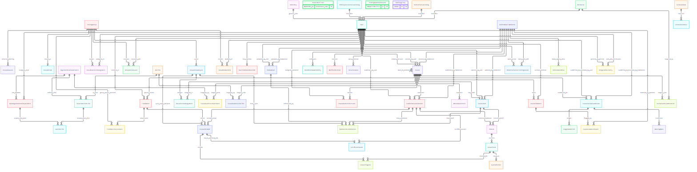

### 9.2 Domain 1 — Identity, Authentication & Access Control
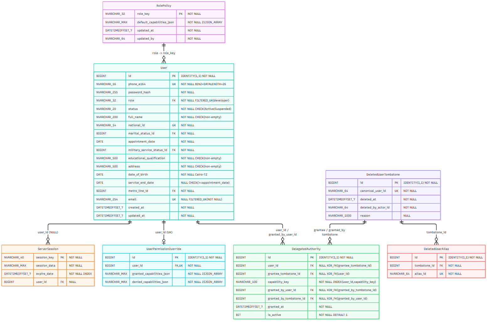

### 9.3 Domain 2 — Organization, HR Catalogs & History
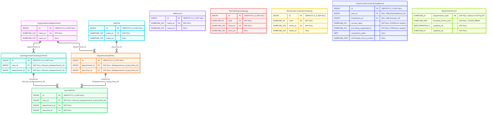

### 9.4 Domain 3 — Governance, Approvals & Audit
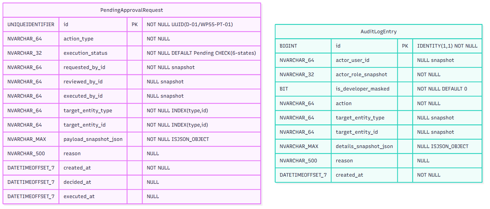

### 9.5 Domain 4 — Curriculum, Versioning, Reviews & Comments
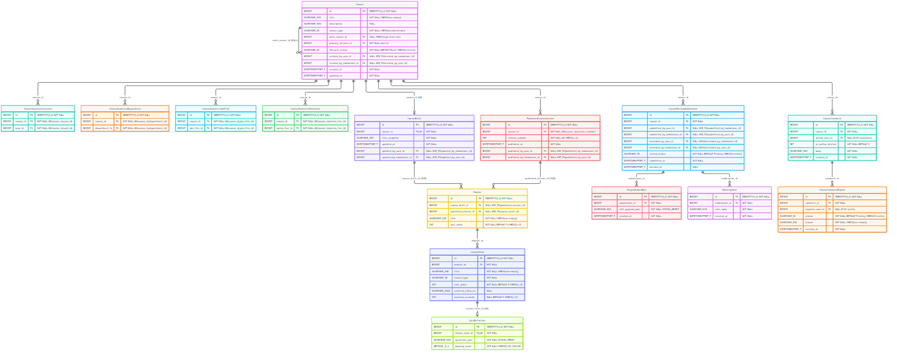

### 9.6 Domain 5 — Media Storage & Content References
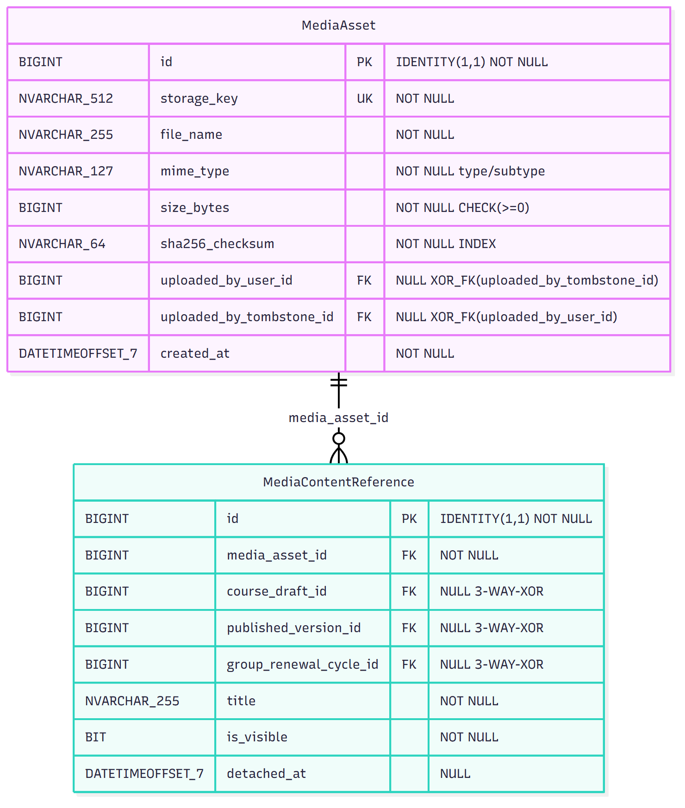

### 9.7 Domain 6A — Training Groups, Cycles & Onboarding
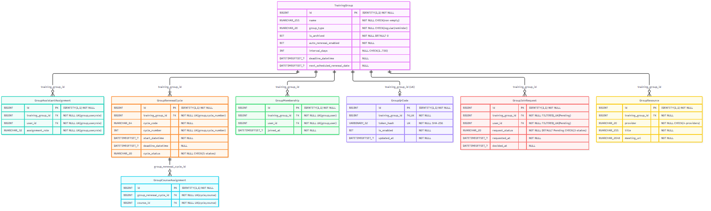

### 9.8 Domain 6B — Enrollments, Attempts, Progress & Certificates
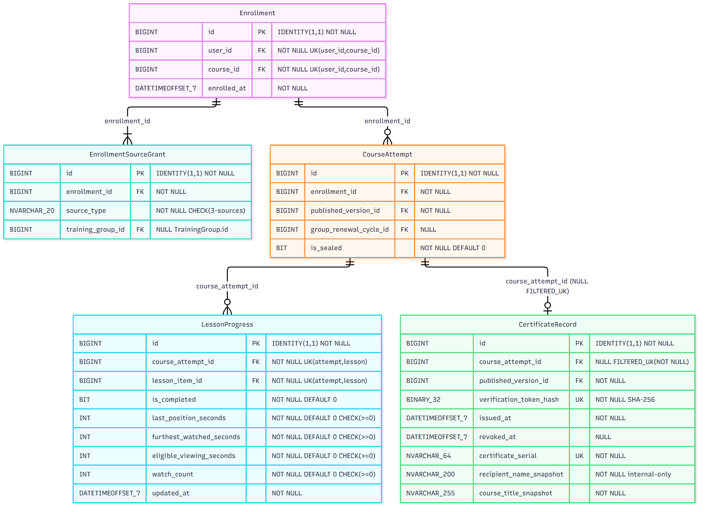

### 9.9 Domain 7 — Notifications, WhatsApp & Scheduled Jobs
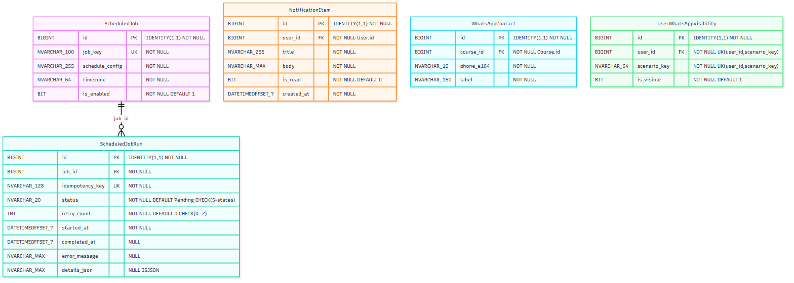
