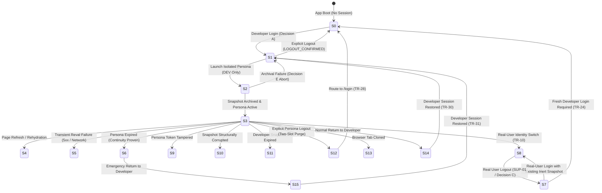

# MetroLMS — Low-Level Component Design (LLD)
## Component / Module: `LLD-001` — Session Lifecycle State Machine (`S0`–`S15`)

> **Document Title:** Session Lifecycle State Machine, Logout Contract & Developer Isolation (`S0`–`S15`)  
> **Document Identifier:** `METROLMS-LLD-AUTH-001`  
> **Document Status:** `APPROVED — PHASE 2A BASELINE`  
> **Canonical Authority Level:** Level 2 Architecture & Component Specification  
> **Target System:** MetroLMS (Cairo Metro E-Learning Platform)  
> **Prepared For:** Senior Software Engineers & Module Developers  
> **Governing Decisions:** [`D-AUTH-01`](../../architecture/decision-register.md#d-auth-01), [`D-10`](../../architecture/decision-register.md), [`Decision A, B, C, E, F`](../../architecture/decision-register.md)  
> **Last Updated:** 2026-11-12 (Phase 2A Remediation `MIN-01`)

---

## 1. Component Overview & Scope

- **Module Purpose:** Specify the formal 16-state session lifecycle finite state machine (`S0` through `S15`), monotonic `sessionEpoch` (`S7`) request quarantine, `POST /api/auth/logout` (`LOGOUT_CONFIRMED` vs. `LOGOUT_UNCONFIRMED`) handling, and strict security boundaries for DEV-only (`import.meta.env.DEV === true`) Isolated Role Test Sessions.
- **Internal Structure:** `AuthContext.tsx`, `authApi.ts`, `authStorage.ts`, `sessionEpoch.ts`, `apiClient.ts`, `AppLayout.tsx` (`<Outlet key>`), and Django server session views (`/api/auth/login`, `/api/auth/me`, `/api/auth/logout`).
- **Production vs. DEV Boundary:** In production (`!import.meta.env.DEV`), `SYNTHETIC_TEST_PERSONA_REGISTRY` is empty and isolated testing (`S2`–`S6`, `S13`–`S15`) is disabled; all sessions follow standard `D-AUTH-01` server-side Django `HttpOnly` cookie lifecycles (`S0` $\leftrightarrow$ `S1`, plus `LOGOUT_UNCONFIRMED`).

---

## 2. State Machine & Lifecycle Specifications (`S0`–`S15`)

> **Diagram Precondition Note (`S8` Entry):** State `S8` (*Real-User Identity Mismatch*) is **not** reachable from a clean `S0` state without a prior Developer origin snapshot. Entering `S8` strictly requires an existing inert `metro_lms_developer_origin_session` snapshot already present in per-tab `sessionStorage` from a prior `S3`/`S4`/`S7` session (`TR-10` or real-user login from `S7`). In all `S8` and `S7` states, `S14`/`S15` return transitions remain strictly forbidden (`Decision B`, `Decision C`).

### 2.1 Canonical 16-State Inventory (`S0`–`S15`)

| State ID | Canonical State Name | Authenticated User | Active Session Slot | Origin Snapshot (`metro_lms_developer_origin_session`) | `isIsolatedSession` | `emergencyProof` | Forbidden Transitions |
| :---: | :--- | :--- | :--- | :--- | :---: | :---: | :--- |
| **`S0`** | **Unauthenticated** | `null` | None | None | `false` | `false` | $\rightarrow$ `S3`, `S14`, `S15` (`Decision A`) |
| **`S1`** | **Authenticated Developer** | `USR_DEV_001` | Valid Developer session | None | `false` | `false` | $\rightarrow$ `S14`, `S15` |
| **`S2`** | **Isolated Launch in Progress** | `USR_DEV_001` (transient) | In transition | Writing credential-free snapshot | `false` | `false` | Direct return |
| **`S3`** | **Active Isolated Persona** | `USR_TEST_*` | Valid persona session | Valid unexpired snapshot | `true` | `false` | $\rightarrow$ `S15` (requires `S6`) |
| **`S4`** | **Active Isolated Post-Refresh** | `USR_TEST_*` | Valid persona session | Valid unexpired snapshot | `true` | `false` | Elevation without return |
| **`S5`** | **Transient Reval Failure** | Cached persona / `null` | Preserved | Valid unexpired snapshot | `true` | `false` | Auto-quarantine |
| **`S6`** | **Expired Persona (Continuity Proven)** | `null` | Wiped / expired | Valid unexpired snapshot | `true` | `true` | $\rightarrow$ `S14` |
| **`S7`** | **Missing Active Session (Continuity Lost)** | `null` | None | Inert snapshot (until tab close) | `false` | `false` | $\rightarrow$ `S14`, `S15` (`Decision C`) |
| **`S8`** | **Real-User Identity Mismatch** | Real user (non-DEV) | Valid real-user session | Inert snapshot (until tab close) | `false` | `false` | $\rightarrow$ `S14`, `S15` (`Decision B`) |
| **`S9`** | **Active Persona Token Tampered** | `null` | Wiped untrusted session | Inert snapshot (until tab close) | `false` | `false` | $\rightarrow$ `S14`, `S15` |
| **`S10`** | **Structurally Corrupted Snapshot** | Persona or `null` | Persona session | Purged | `false` | `false` | $\rightarrow$ `S14`, `S15` |
| **`S11`** | **Expired Developer Snapshot** | `null` | Wiped | Quarantined (`metro_lms_quarantined_snapshot`) | `false` | `false` | Token extension |
| **`S12`** | **Explicit Logout** | `null` | Wiped | Wiped (`INV-P5-7`) | `false` | `false` | Silent restoration |
| **`S13`** | **Cloned Tab Autonomous** | `USR_TEST_*` | Cloned per-tab session | Cloned per-tab snapshot | `true` | `false` | Mutating Tab A |
| **`S14`** | **Normal Return Execution** | `USR_DEV_001` | Restored Developer session | Wiped (`null`) | `false` | `false` | Calling with expired token |
| **`S15`** | **Emergency Return Execution** | `USR_DEV_001` | Restored Developer session | Wiped (`null`) | `false` | `false` | Execution without proof |

### 2.2 Canonical Transitions Table (`TR-01`–`TR-31`, `SUP-01`, `SAF-01`–`SAF-02`)

Per [`phase-05-increment-04-wp-5.4.5-implementation-report.md`](../../frontend/reports/phase-05-increment-04-wp-5.4.5-implementation-report.md) (§4.2–§4.4), the 31 canonical transitions, 1 supplementary Owner-approved transition (`SUP-01`), and 2 fail-closed safety transitions (`SAF-01`, `SAF-02`) are defined as follows:

| Transition ID | Source | Trigger / Event | Preconditions / Guards | Actions / Effects | Destination | Governing Decision / Invariant |
| :---: | :---: | :--- | :--- | :--- | :---: | :--- |
| **`TR-01`** | `S0` | Developer Login (`USR_DEV_001` verified) | Valid credentials (`Decision A`) | Establish Developer session; `isolatedPersona = null` | **`S1`** | `Decision A`, `D-AUTH-01` |
| **`TR-02`** | `S1` | `launchIsolatedTestSession` invoked | `import.meta.env.DEV === true`; allowlisted `USR_TEST_*` | Write Developer origin snapshot; increment generation seq | **`S2`** | `D-10` |
| **`TR-03`** | `S1` | Explicit Developer Logout | Active Developer session | Clear session (`user = null`); route `/login` *(or `LOGOUT_UNCONFIRMED` on failure)* | **`S0`** | `D-AUTH-01` |
| **`TR-04`** | `S2` | Persona Auth Success | Synthetic persona verified | Set active session to persona; `user.id === personaId`; increment `sessionEpoch` | **`S3`** | `D-10` |
| **`TR-05`** | `S2` | Persona Auth Failure | Persona launch failed *(or `Decision E` abort)* | Rollback to Developer session; clear snapshot; preserve Developer session | **`S1`** | `Decision E` |
| **`TR-06`** | `S3` | Page Reload (`F5`) / Server Revalidation OK | Valid persona session & unexpired origin snapshot | Reconstruct `isolatedPersona`; keep amber banner visible | **`S4`** | `D-10` |
| **`TR-07`** | `S3` | Page Reload / Network Offline (`5xx`/timeout) | Transient transport failure | Enter stale-while-revalidate; preserve cached session; offer retry | **`S5`** | `MFR-20` |
| **`TR-08`** | `S3` | Persona Token Expired (Continuity Proven) | Persona expired; valid unexpired Developer snapshot | Evict expired persona; preserve snapshot; create in-memory `emergencyProof` | **`S6`** | `D-10` |
| **`TR-09`** | `S3` | Cold Load with Missing Active Session | Active session empty; Developer snapshot exists | Block return; keep Developer snapshot inert | **`S7`** | `Decision C` |
| **`TR-10`** | `S3` | Real-User Identity Switch / Snapshot Leftover | Non-Developer real user active while origin snapshot exists | Preserve origin snapshot inert; hide all return controls | **`S8`** | `Decision B` |
| **`TR-11`** | `S3` | Persona Token Tampered | Invalid token format / signature | Wipe untrusted persona session; preserve snapshot inert; block return | **`S9`** | `D-AUTH-01` |
| **`TR-12`** | `S3` | Developer Snapshot Structurally Corrupted | Malformed JSON, negative expiration, or invalid schema | Purge corrupt snapshot; display error alert | **`S10`** | `D-10` |
| **`TR-13`** | `S3` | Developer Snapshot Expired | `developerExpiresAt <= Date.now()` | Write sanitized quarantine record (`metro_lms_quarantined_snapshot`); purge snapshot | **`S11`** | `D-10` |
| **`TR-14`** | `S3` | Explicit Logout in Isolated Session | `isIsolatedSession === true` | Purge both `metro_lms_auth_session` and `metro_lms_developer_origin_session` | **`S12`** | `INV-P5-7` |
| **`TR-15`** | `S3` | Browser Tab Duplicated / Cloned | New tab inherits `sessionStorage` | Operate autonomously with independent `sessionEpoch` manager | **`S13`** | `D-10` |
| **`TR-16`** | `S3` | Standard Return Clicked (`returnToDeveloperSession`) | Valid active persona & valid origin snapshot | Validate active user ID and token format; begin normal return | **`S14`** | `D-10` |
| **`TR-17`** | `S4` | Standard Return Clicked Post-Refresh | Valid rehydrated persona & valid origin snapshot | Execute normal return restoring exact `expiresAt` | **`S14`** | `D-10` |
| **`TR-18`** | `S4` | Explicit Logout Clicked Post-Refresh | `isIsolatedSession === true` | Execute two-slot purge | **`S12`** | `INV-P5-7` |
| **`TR-19`** | `S5` | Revalidation Retry Success | Network restored & `GET /api/auth/me` returns `200` | Switch yellow retry banner back to standard amber banner | **`S4`** | `MFR-20` |
| **`TR-20`** | `S5` | Return to Developer from Transient Failure | Valid cached origin snapshot | Execute normal return using validated local snapshot | **`S14`** | `D-10` |
| **`TR-21`** | `S6` | Emergency Return Clicked (`returnFromExpiredPersonaSession`) | Single-flight guard armed; valid `emergencyProof` & snapshot hash | Begin emergency return | **`S15`** | `D-10` |
| **`TR-22`** | `S6` | Developer Snapshot Expires Awaiting Return | `developerExpiresAt <= Date.now()` | Write sanitized quarantine record; purge snapshot | **`S11`** | `D-10` |
| **`TR-23`** | `S6` | Emergency Return Declined / Navigate `/login` | User declines return or initiates fresh login | Clear `emergencyProof`; redirect `/login` | **`S0`** | `D-10` |
| **`TR-24`** | `S7` | Fresh Developer Login Required | Inert snapshot; no active session | Redirect `/login`; require fresh interactive Developer login | **`S0`** | `Decision C` |
| **`TR-25`** | `S9` | Fresh Developer Login Required (Tampered) | Untrusted session purged | Fail closed to `/login`; require fresh Developer auth | **`S0`** | `D-AUTH-01` |
| **`TR-26`** | `S10` | Corrupt Snapshot Purged / Fail Closed | Active session invalid after corrupt snapshot wipe | Wipe corrupt snapshot; fail closed to `/login` | **`S0`** | `D-10` |
| **`TR-27`** | `S11` | Quarantine Complete / Redirect `/login` | Both slots purged; sanitized quarantine written | Redirect `/login` | **`S0`** | `D-10` |
| **`TR-28`** | `S12` | Two-Slot Purge Complete | Both slots verified `null` | Increment `sessionEpoch`; remount router `<Outlet>`; redirect `/login` | **`S0`** | `INV-P5-7` |
| **`TR-29`** | `S13` | Independent Return in Cloned Tab B | Valid cloned snapshot in Tab B | Restore Developer in Tab B without mutating Tab A | **`S14`** | `D-10` |
| **`TR-30`** | `S14` | Normal Return Verified & Committed | Storage write verified via read-back | Restore Developer with exact `expiresAt`; wipe snapshot | **`S1`** | `D-10` |
| **`TR-31`** | `S15` | Emergency Return Verified & Proof Consumed | Digest validated; pre-write & post-readback supersession fences pass | Restore Developer; consume `emergencyProof`; wipe snapshot | **`S1`** | `D-10` |
| **`SUP-01`** | `S8` | Real-User Logout (`Decision C`) | Real user (`isIsolatedSession === false`) with inert snapshot | Clear real-user session (`user = null`); preserve origin snapshot **inert & credential-free**; `emergencyProof = null`; hide return controls | **`S7`** | `Decision C` (`SUP-01`) |
| **`SAF-01`** | `S14` | Normal Return Storage Restoration Failure | Storage read-back fails during normal return | Preserve origin snapshot for inspection; clear active storage; fail closed `/login` | **`S0`** | Fail-Closed Safety |
| **`SAF-02`** | `S15` | Emergency Return Failure / Invalid Proof | Hash validation fails or supersession detected | Invalidate `emergencyProof` (anti-replay); active storage stays `null`; fail closed `/login` | **`S0`** | Fail-Closed Safety |

---

## 3. Logout, Epoch Quarantine & Snapshot Security Design

1. **Monotonic `sessionEpoch` (`S7`):**
   - Every login, logout, isolated launch, return, or authoritative `401`/`403`/`404` invalidation calls `advanceSessionEpoch()`.
   - Any in-flight async request whose captured `requestEpoch !== getSessionEpoch()` throws `StaleEpochError` and is discarded before mutating React state.
   - `<Outlet key={`${user ? user.id : 'anonymous'}_epoch_${sessionEpoch}`} />` in `AppLayout.tsx` resets route subtrees on identity change (deliberately excluding `previewRole`).
2. **Two-Layer Logout Contract (`POST /api/auth/logout`):**
   - Client immediately clears protected UI (`user = null`, `advanceSessionEpoch()`, `authOpSeqRef++`) and sends `POST /api/auth/logout` with `credentials: 'same-origin'` and `X-CSRFToken`.
   - `200`/`204` or idempotent `401`: transitions to `LOGOUT_CONFIRMED`.
   - `403` (CSRF failure), `5xx`, or network failure: transitions to `LOGOUT_UNCONFIRMED`, blocks silent session restoration from `GET /api/auth/me`, and surfaces retry UI.
   - **Real-User Logout from `S8` (`Decision C: S8 -> S7`):** Leaves `metro_lms_developer_origin_session` inert and **credential-free** (`emergencyProof = null`, return controls hidden).
   - **Isolated Persona Logout (`S3/S4 -> S12 -> S0`):** Executes two-slot purge (`INV-P5-7`).
3. **Archival Failure (`Decision E`):**
   - If `sessionStorage` archival or read-back verification fails (e.g., `QuotaExceededError`), abort transition transactionally, preserve `S8`, and show the Arabic error message.

---

## 4. Error Handling & Invariant Enforcement

| Condition | Error / State | HTTP Code | Recovery Strategy |
| :--- | :--- | :---: | :--- |
| Stale In-Flight Async Response | `StaleEpochError` | N/A (Client) | Discard response silently without state mutation |
| Logout `403` / `5xx` / Network Error | `LOGOUT_UNCONFIRMED` | `403` / `5xx` | Keep UI on `/login`, block silent `GET /api/auth/me` restore, offer retry |
| Corrupted Origin Snapshot | `S10` | N/A (Client) | Purge corrupt snapshot, display error alert, require fresh login |
| Suspended / Deleted Account on Reval | Session Evicted | `401` | `advanceSessionEpoch()`, clear client state, redirect `/login` |

---

## 5. Traceability

- [`domain-01-authentication-and-sessions.md`](../../01-requirements/domains/domain-01-authentication-and-sessions.md)
- [`authentication-and-session-contract.md`](../../architecture/authentication-and-session-contract.md)
- [`phase-05-increment-04-wp-5.4.5-implementation-report.md`](../../frontend/reports/phase-05-increment-04-wp-5.4.5-implementation-report.md)

