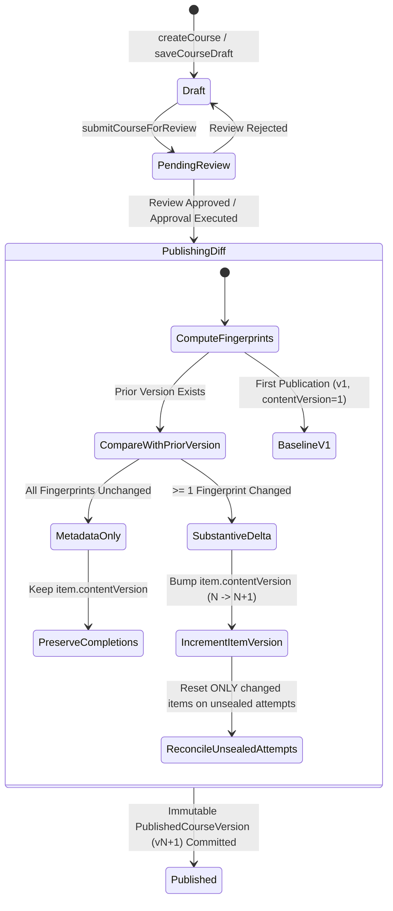

# MetroLMS — Low-Level Component Design (LLD)
## Component / Module: `LLD-002` — Course Versioning & Diff Engine (`Rule B`)

> **Document Title:** Course Versioning, Substantive Fingerprinting & Diff Engine (`Rule B`)  
> **Document Identifier:** `METROLMS-LLD-CRS-002`  
> **Document Status:** `APPROVED — PHASE 2A BASELINE`  
> **Canonical Authority Level:** Level 2 Architecture & Component Specification  
> **Target System:** MetroLMS (Cairo Metro E-Learning Platform)  
> **Prepared For:** Senior Software Engineers & Module Developers  
> **Governing Decisions:** [`Rule B`](../../requirements/domain-business-rules.md), [`D-06`](../../architecture/decision-register.md), [`D-12`](../../architecture/decision-register.md), [`D-13`](../../architecture/decision-register.md)  
> **Last Updated:** 2026-11-12 (Phase 2A Remediation `MIN-02`)

---

## 1. Component Overview & Scope

- **Module Purpose:** Specify the low-level algorithm for immutable `PublishedCourseVersion` snapshot creation, deterministic 6-field substantive content fingerprinting, metadata-only vs. substantive diff detection (`Rule B`), and selective attempt reconciliation that protects sealed historical attempts.
- **Internal Structure:** `computeItemSubstantiveFingerprint`, `recordPublishedCourseVersionAndReconcileAttempts`, `reconcileActiveAttemptsForSubstantiveChanges`, `isLessonCompletedForCurrentItemVersion`, `isAttemptSealed`.

---

## 2. State Machine & Publication Flow (`Rule B`)



---

## 3. Conceptual Service & Algorithm Design

```python
# Conceptual Service Signature (Target Backend & Frontend Parity)
class CourseVersioningService:
    SUBSTANTIVE_FIELDS = ("type", "videoUrl", "pdfUrl", "mediaId", "content", "durationSeconds")

    def compute_substantive_fingerprint(self, item: ChapterItem) -> str:
        """
        Normalizes undefined/null/"" to None (type defaults to 'video') and hashes
        the 6 substantive fields in fixed canonical order. Excludes metadata fields
        (title, description, order, formatted duration string).
        """
        pass

    def publish_course_version(self, course_id: str, actor: User) -> PublishedCourseVersion:
        """
        Executes inside an atomic transaction:
        1. Guard against duplicate re-approval when no pending draft/review exists.
        2. Compute fingerprints for all draft items and diff against latest PublishedCourseVersion.
        3. Create immutable PublishedCourseVersion (versionNumber = N + 1).
        4. Reconcile active unsealed CourseAttempts only for items whose contentVersion incremented.
        """
        pass
```

### 3.1 Detailed Algorithm Steps

1. **Draft Sanitization (Pre-Publication):** On `saveCourseDraft`, strip any client-supplied `publishedBy`, `publishedAt`, `versionNumber`, `currentVersionNumber`, `contentVersion`, and `contentFingerprint`. Draft edits never create `PublishedCourseVersion` records.
2. **Idempotent Publication Guard:** Both authoritative publication paths (`executeReviewDecision` and `approveApprovalRequest`) verify `hadPendingReviewOrDraft === true` (or no baseline version exists yet) to prevent duplicate snapshot creation on repeated approval calls.
3. **6-Field Canonical Fingerprinting:** Serialize `{ type, videoUrl, pdfUrl, mediaId, content, durationSeconds }` in fixed key order, normalizing `undefined`/`null`/`""` to `null` (`type` defaults to `'video'`), and hash deterministically (`fnv1a64_<16-hex>` or equivalent SHA-256 in backend).
4. **Diff Classification (`Rule B`):**
   - **No Fingerprint Change (Metadata-Only or No-Op):** Preserve `item.contentVersion` and `item.contentFingerprint`. All active learner completions remain valid.
   - **Fingerprint Changed (Substantive Edit):** Increment `item.contentVersion` (`N -> N + 1`) and store new `contentFingerprint`.
5. **Selective Unsealed Attempt Reconciliation:**
   - Iterate over all `CourseAttempt` records for the course.
   - **Skip Sealed Attempts:** If `isAttemptSealed(attempt)` is `true` (completed/archived renewal cycles, archived predecessor groups without continuation grants, revoked-only grants, or explicitly sealed), leave 100% untouched.
   - **Update Active Unsealed Attempts:** Remove completion **only** for substantively modified `itemId`s (leaving unchanged items completed), recalculate `progressPercent`, and revert `status` from `'completed'` to `'in_progress'` if newly incomplete.
   - **Version-Matched Validation:** `isLessonCompletedForCurrentItemVersion` requires `LessonProgress.contentVersion === ChapterItem.contentVersion`.

### 3.2 `ChapterItem` Addition and Removal Semantics (`Rule B` + `D-12` + `D-13`)

Per [`domain-business-rules.md`](../../requirements/domain-business-rules.md) (§4.2) and [`t-2-3-1-published-course-versions-and-diffing-report.md`](../../frontend/reports/t-2-3-1-published-course-versions-and-diffing-report.md) (`recordPublishedCourseVersionAndReconcileAttempts`):

1. **`ChapterItem` Addition:**
   - **Fingerprinting & Version Progression:** A newly added `ChapterItem` (no matching `itemId` in the prior `PublishedCourseVersion`) is initialized at `contentVersion = 1` with its computed 6-field `contentFingerprint`. Approved publication creates a new immutable `PublishedCourseVersion` (`versionNumber = N + 1`). Unlike modifying an existing item, the new `itemId` is not added to `substantivelyChangedItemIds` because no prior completion exists to reset.
   - **Active Unsealed Attempt Reconciliation:** `reconcileActiveAttemptsForSubstantiveChanges` executes unconditionally on publication. Because the current curriculum (`flatItems`) now includes the added item, `totalRequiredItems` increases while prior unchanged item completions remain valid. Under `D-12` (`Math.round((completed / total) * 100)`, capped at `99%` when `completed < total`), a previously `100%` (`'completed'`) unsealed attempt reverts to `< 100%` (`'in_progress'`) until the new item is completed, while any prior `vN` certificate remains preserved (`D-13`).
2. **`ChapterItem` Removal:**
   - **Fingerprinting & Version Progression:** Removing an existing `ChapterItem` omits that `itemId` from the new `PublishedCourseVersion` (`versionNumber = N + 1`) and from `flatItems`, while all historical `PublishedCourseVersion` snapshots (`1..N`) retain the removed item immutably. Remaining unchanged items keep their existing `contentVersion` and `contentFingerprint`.
   - **Active Unsealed Attempt Reconciliation:** `getValidCompletedItemIdsForAttempt` evaluates completions strictly against current `flatItems`, so completions referencing the removed `itemId` are excluded from both `completedRequiredItems` and `totalRequiredItems`. `progressPercent` recalculates against the reduced denominator (`D-12`).
3. **Sealed Historical Attempt Immunity (`D-06`, `D-13`):**
   - Across **all** `Rule B` changes (item modification, addition, or removal), sealed attempts (`isAttemptSealed(attempt) === true`, completed renewal cycles, archived predecessor groups without continuation grants, and revoked-only grants) are strictly skipped and never modified or reset.

---

## 4. Error Handling & Invariant Enforcement

| Condition | Error Class | HTTP Code | Recovery Strategy |
| :--- | :--- | :---: | :--- |
| Duplicate Publication Attempt | `AlreadyPublishedError` | `409 Conflict` | Idempotent no-op / return existing version |
| Draft Spoofing Publication Fields | `SanitizedInput` | `200 OK` (stripped) | Server ignores client version/publisher fields |
| Attempt Mutation on Sealed Cycle | `SealedAttemptError` | `409 Conflict` | Reject mutation; historical cycle immutable |

---

## 5. Traceability

- [`domain-07-published-versions-and-diffs.md`](../../01-requirements/domains/domain-07-published-versions-and-diffs.md)
- [`domain-business-rules.md`](../../requirements/domain-business-rules.md) (§4.2)
- [`t-2-3-1-published-course-versions-and-diffing-report.md`](../../frontend/reports/t-2-3-1-published-course-versions-and-diffing-report.md)

