# MetroLMS — Low-Level Component Design (LLD)
## Component / Module: `LLD-003` — Group Renewal Cycle Manager

> **Document Title:** Group Renewal Cycle Manager & In-Place Renewal Engine  
> **Document Identifier:** `METROLMS-LLD-GRP-003`  
> **Document Status:** `APPROVED — PHASE 2B BASELINE`  
> **Canonical Authority Level:** Level 2 Architecture & Component Specification  
> **Target System:** MetroLMS (Cairo Metro E-Learning Platform)  
> **Prepared For:** Senior Software Engineers & Module Developers  
> **Governing Decisions:** [`D-GRP-01`](../../architecture/decision-register.md#d-grp-01), [`D-GRP-02`](../../architecture/decision-register.md#d-grp-02), [`D-GRP-03`](../../architecture/decision-register.md#d-grp-03), [`D-GRP-04`](../../architecture/decision-register.md#d-grp-04), [`D-GRP-06`](../../architecture/decision-register.md#d-grp-06), [`D-GRP-07`](../../architecture/decision-register.md#d-grp-07), [`D-07`](../../architecture/decision-register.md#d-07), [`D-13`](../../architecture/decision-register.md#d-13)  
> **Last Updated:** 2026-11-12 (Phase 2B Execution)

---

## 1. Component Overview & Scope

- **Module Purpose:** Specify the low-level algorithm, concurrency guards, state machine, and atomic transaction boundaries for in-place `GroupRenewalCycle` progression (`CYC-<groupId>-<NN>`), day-based recurrence scheduling (`D-GRP-02`), historical `CourseAttempt` sealing (`D-GRP-04`), monotonic reminder classification (`D-GRP-06`), and fresh cycle attempt provisioning (`D-13`).
- **Existing Prototype Symbols (`frontend/src/`):** `resolveGroupType`, `resolveGroupOperationalStatus`, `calculateGroupTimeInfo`, `formatGroupTimeInfoAr` (`core/groups/resolvers.ts`); `validateRenewalIntervalDays`, `calculateNextRenewalDate` (`core/domain/groups.ts`); `useAutoRenewalScheduler` (`features/groups/hooks/useAutoRenewalScheduler.ts`); `isAttemptSealed`, `createRenewalCycle`, `checkAndProcessAllDueRenewals`, `checkAndProcessAutoRenewal` (`mocks/store/inMemoryStore.ts`).
- **Proposed Target Backend Services (Django 5 + SQL Server — Not Yet Implemented):** Unified `renew_group_in_place` domain service and planned Django management command `process_due_group_renewals` invoked by Windows Task Scheduler every 6 hours (`API-REC-01` & `Domain 20 / D4` — `OWNER APPROVED`, `2026-11-13`; Celery/Celery Beat/Redis/RabbitMQ/SQL Server Agent not required initially).

---

## 2. State Machine & Unified Renewal Flow

```mermaid
stateDiagram-v2
    [*] --> ActiveCycle: Group Created (CYC-groupId-01)
    ActiveCycle --> ScheduledWait: now < startDateTime
    ScheduledWait --> ActiveCycle: now >= startDateTime
    ActiveCycle --> ExpiredCycle: now > deadlineDateTime
    ActiveCycle --> Renewing: Manual renewGroupInPlace OR Auto-Renewal Due
    ExpiredCycle --> Renewing: Manual renewGroupInPlace OR Auto-Renewal Due
    state Renewing {
        [*] --> AcquireLock
        AcquireLock --> CheckIdempotency: SELECT FOR UPDATE / isExecutingRef
        CheckIdempotency --> AbortDuplicate: lastAutoRenewedCycleId == currentCycleId
        CheckIdempotency --> ClosePriorCycle: Eligible & Not Archived
        ClosePriorCycle --> SealAttempts: cycle.status = 'completed', snapshot traineeIds
        SealAttempts --> ComputeDates: attempt.isSealed = true
        ComputeDates --> AppendNewCycle: start = max(scheduled, now); next = deadline + intervalDays
        AppendNewCycle --> ProvisionAttempts: CYC-groupId-(NN+1), fresh CourseAttempts
    }
    Renewing --> ActiveCycle: transaction.atomic() Committed
```

---

## 3. Core Algorithms & Function Contracts

### 3.1 `resolveGroupType(group, cycle?)` (5-Step Deterministic Evaluation)
1. If `group.hasHistoricalReminderCourses === true` -> return `'reminder'` (`D-GRP-06`).
2. Else if active `cycle` has any course with `courseRole === 'reminder'` -> return `'reminder'` (`D-GRP-03`).
3. Else if `group.courses` has any course with `courseRole === 'reminder'` -> return `'reminder'`.
4. Else if any historical entry in `group.renewalCycles` contains a course with `courseRole === 'reminder'` -> return `'reminder'`.
5. Else -> return `'regular'`.

### 3.2 `resolveGroupOperationalStatus(group, now)`
1. Resolve active cycle via `group.currentCycleId` (fallback to group baseline dates).
2. If `now < startDateTime` -> `'scheduled'`.
3. If `now > deadlineDateTime` -> `'expired'` (even if `nextScheduledRenewalDate` is in the future).
4. Otherwise -> `'active'`.

### 3.3 Proposed Target Unified 8-Step `renew_group_in_place` Pipeline vs. Current Prototype
> **Prototype vs. Target Distinction:** In the current MSW prototype (`inMemoryStore.ts`), manual renewal (`createRenewalCycle`) and automated renewal (`checkAndProcessAutoRenewal`) are separate methods: `createRenewalCycle` does not block `adminStatus === 'archived'` or `groupType !== 'reminder'` and marks `att.status !== 'completed'` as `'expired_incomplete'`, whereas `checkAndProcessAutoRenewal` checks `adminStatus !== 'archived'` and `autoRenewalEnabled`, triggers `effectiveStartIso = now` when `scheduledStart + durationMs <= now`, and marks `att.status === 'in_progress' && att.progressPercent < 100` as `'expired_incomplete'`. The unified pipeline below defines the **Target Backend Service** (`renew_group_in_place`, proposed for Django 5 + SQL Server):

1. **Acquire Lock & Guard (`API-REC-08A`, `API-REC-08B`, End-Date, No-Early-Renewal, Option A, `INV-DOM10-10`, `INV-DOM10-12` — `OWNER APPROVED`, `2026-11-13`):** Target Backend executes inside an atomic transaction with DB-supported row-level locking or equivalent concurrency control (specific `mssql-django` / SQL Server `select_for_update()` locking behavior flagged for Phase 12 technical validation) and enforces **First Successful Transaction Wins** (`INV-DOM10-12`); Prototype uses client-local `isExecutingRef`. Revalidate eligibility after acquiring lock: reject if `adminStatus === 'archived'` (`D-GRP-07` & `API-REC-08A`; never implicitly unarchive) or `groupType !== 'reminder'` (`API-REC-08B` — manual and automatic renewal apply only to eligible non-archived Reminder Groups, never Regular Groups). Both manual and automatic renewal require a valid, explicitly defined `deadlineDateTime` on the relevant group/cycle (`INV-DOM10-07`, `INV-DOM10-08`, `INV-DOM20-05` — never fall back to `startDateTime` or fabricate an artificial end date; applies to manual renewal even when `autoRenewalEnabled === false`). Per `INV-DOM10-11`, reject manual renewal if the current active cycle has not yet reached its `deadlineDateTime` (`now < currentCycle.deadlineDateTime`; never shorten, replace, or prematurely terminate the current cycle; automatic renewal preserves the same no-overlap rule). Removing `deadlineDateTime` when `groupType === 'reminder' && autoRenewalEnabled === true` requires UI confirmation (*Cancel* leaves both unchanged; *Confirm* removes `deadlineDateTime`, sets `autoRenewalEnabled = false`, **preserves `groupType === 'reminder'`** per `INV-DOM10-09`, and marks any already-created future cycle with `startDateTime > now` as target status **`Cancelled`** per `INV-DOM10-10` while retaining its record), causing automatic renewal to skip the group while active/already-started/historical cycles, learner progress, completed courses, and issued certificates remain preserved (`D-GRP-04`, `D-06`, `D-13`; `Cancelled` is a target lifecycle status not yet present in prototype `types.ts`). For `trigger === 'auto'`, also require `autoRenewalEnabled === true`.
2. **Idempotency & Committed-Successor Guard (`INV-DOM10-12`):** After acquiring transactional protection, verify the closing/current cycle has not already been renewed by a committed concurrent transaction. If already renewed: `trigger === 'manual'` returns HTTP `409 Conflict` (using canonical error envelope in `django-sqlserver-integration-contract.md` §2.4); `trigger === 'auto'` safely skips, logs the outcome in structured scheduler logs, and continues. If the first transaction rolls back before committing, a competing eligible transaction may proceed after lock release.
3. **Close Prior Cycle:** Set closing cycle `status = 'completed'`, `completedAt = now`, and freeze `traineeIds` snapshot (`[...group.traineeIds]`).
4. **Seal Historical Attempts (`D-GRP-04`):** For every `CourseAttempt` referencing `closingCycle.id`, set `isSealed = true` and `sealedAt = now`. Sealed attempts are immune to future `Rule B` diffs (`LLD-002`) and progress mutations.
5. **Compute New Cycle Dates (`D-GRP-02`, `INV-DOM20-07`):**
   - **Target Backend (`INV-DOM20-07`, `OWNER APPROVED`, `2026-11-13`):** Reconstructs the `D-GRP-02` recurrence sequence, selects the **latest missed scheduled renewal start date** `<= now` as `startDateTime` (never shifting to `now`), computes `deadlineDateTime` per existing cycle duration (`Expired` status accepted if `deadlineDateTime < now`), and advances `nextScheduledRenewalDate` to the next `D-GRP-02` slot after the recovery cycle (`> now`). *(Prototype `inMemoryStore.ts` L7902/L8011–8013 differs and is superseded for the Target Backend.)*
   - `deadlineDateTime = startDateTime + durationMs`.
   - `nextScheduledRenewalDate = deadlineDateTime + intervalDays` (strictly day-based, `intervalDays` $\in [1, 730]$).
6. **Create New Cycle:** Append `GroupRenewalCycle` with ID `CYC-${group.id}-${pad2(nextNumber)}`, `cycleNumber = nextNumber`, `status = 'active'`, `courses = snapshot(group.courses)`, `traineeIds = [...group.traineeIds]`.
7. **Update Group Pointers:** Update `group.currentCycleId = newCycle.id`, `group.nextScheduledRenewalDate`, and (when `trigger === 'auto'`) `group.lastAutoRenewedCycleId = closingCycle.id`. Retain `TrainingGroup.id`, `enrollmentCode`, and `name` unchanged (`D-GRP-01`).
8. **Provision Fresh Attempts (`D-13`):** For each trainee in `group.traineeIds` and each course in `newCycle.courses`, create a new unsealed `CourseAttempt` bound to `newCycle.id` and the latest `PublishedCourseVersion.id`, isolated from any `D-07` continuation grants (`self:continued:*`) held by previously removed trainees.
9. **Approaching-Deadline Reminder Dispatch (Prototype-Only Observed Behavior):** In `inMemoryStore.checkAndProcessAllDueRenewals`, active non-archived groups within 7 days of `deadlineDateTime` emit deduplicated `deadline_reminder` notifications (`dedupeKey: deadline_reminder:${group.id}:${cycleKey}:${canonicalUserId}`) for trainees with incomplete courses. This is documented as current prototype behavior pending formal Owner approval.

---

## 4. Concurrency, Transaction & Isolation Contracts

| Mechanism | Prototype Simulation (MSW) | Target Production Backend (Django 5 + SQL Server) |
| :--- | :--- | :--- |
| **Scheduler Trigger** | `useAutoRenewalScheduler` (timer & visibility change) | Windows Task Scheduler (every 6 hours) -> planned Django management command (`process_due_group_renewals`, not yet implemented) |
| **Row Locking** | In-memory `isExecutingRef` guard | `TrainingGroup.objects.select_for_update().filter(...)` |
| **Transaction Boundary** | Synchronous `inMemoryStore` update | ACID `transaction.atomic()` wrapping steps 3–8 |
| **Monotonic Marker (`D-GRP-06`)** | Boolean `group.hasHistoricalReminderCourses` | `has_historical_reminder_courses BIT NOT NULL DEFAULT 0` |
| **Archived Exclusion (`D-GRP-07`)** | Filter `adminStatus !== 'archived'` | ORM `exclude(admin_status='archived')` on trainee queries & scheduler |

---

## 5. Failure Modes & Recovery

- **Concurrent Scheduler Runs / Manual Overlap (`INV-DOM10-12` — `OWNER APPROVED`, `2026-11-13`):** Both manual (`POST /api/admin/groups/:groupId/renew`) and automatic (`process_due_group_renewals`) paths execute inside `transaction.atomic()` using unified renewal logic (`renew_group_in_place`), DB-supported row-level locking or equivalent concurrency control (exact `mssql-django` / SQL Server locking primitives and isolation behavior flagged for Phase 12 technical validation), post-lock eligibility revalidation, cycle-level idempotency (`lastAutoRenewedCycleId` / committed-successor guard), and **First Successful Transaction Wins** semantics. If the first transaction commits, a competing manual request returns `409 Conflict` (canonical [`django-sqlserver-integration-contract.md`](../../backend/django-sqlserver-integration-contract.md) §2.4 envelope) and a competing scheduler run safely skips with structured logging without failing other groups; if the first transaction rolls back before commit, the lock is released and a competing eligible transaction may proceed.
- **Partial Failure Inside Renewal:** `transaction.atomic()` rolls back cycle closure, attempt sealing, and cycle creation together so `group.currentCycleId` never points to a missing or partially provisioned cycle.
- **Overdue Missed Window (`INV-DOM20-06`, `INV-DOM20-07` — `OWNER APPROVED`, `2026-11-13`):** If the scheduler was offline past `nextScheduledRenewalDate` and multiple intervals were missed, `process_due_group_renewals` skips earlier missed slots, never generates artificial historical cycles, creates **at most one** recovery cycle anchored to the **latest missed scheduled renewal start date** `<= now` (preserving it as `startDateTime`, not `now`; `Expired` status accepted if `deadlineDateTime < now`), advances `nextScheduledRenewalDate` to the next `D-GRP-02` slot (`> now`) so consecutive runs do not repeat recovery, and preserves historical cycles, progress, completed courses, and certificates (`D-06`, `D-GRP-04`, `D-13`).

