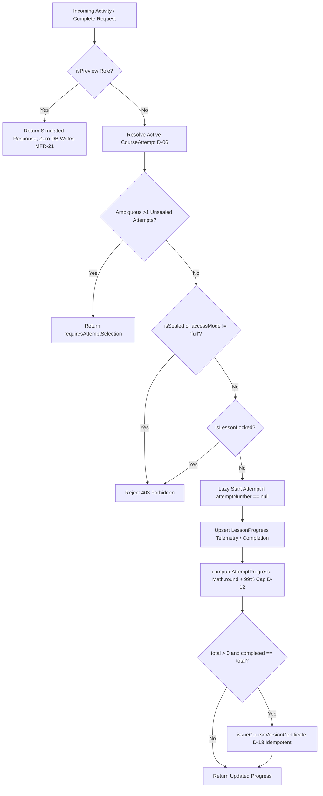

# MetroLMS — Low-Level Component Design (LLD)
## Component / Module: `LLD-004` — Progress Calculation Pipeline

> **Document Title:** Progress Calculation, Attempt Isolation & Versioned Certification Pipeline  
> **Document Identifier:** `METROLMS-LLD-LRN-004`  
> **Document Status:** `DRAFT — PHASE 3 EXECUTION (PENDING OWNER ACCEPTANCE)`  
> **Canonical Authority Level:** Level 2 Architecture & Component Specification  
> **Target System:** MetroLMS (Cairo Metro E-Learning Platform)  
> **Prepared For:** Senior Software Engineers & Module Developers  
> **Governing Decisions:** [`D-06`](../../architecture/decision-register.md#d-06), [`D-07`](../../architecture/decision-register.md#d-07), [`D-12`](../../architecture/decision-register.md#d-12), [`D-13`](../../architecture/decision-register.md#d-13), [`D-GRP-04`](../../architecture/decision-register.md#d-grp-04)  
> **Last Updated:** 2026-11-13 (Phase 3 Execution)

---

## 1. Component Overview & Scope

- **Module Purpose:** Specify the end-to-end deterministic pipeline that resolves a learner's active `CourseAttempt`, enforces preview/seal/post-deadline/sequential-lock guards, updates `LessonProgress`, computes authoritative rounded course percentages (`D-12`), and triggers idempotent version-scoped `CertificateRecord` issuance (`D-13`).
- **Existing Prototype Symbols (`frontend/src/`):** `calculateTraineeProgress`, `isLessonLocked`, `resolveResumeLesson` (`core/domain/progress.ts`); `resolveActiveAttemptForLearning`, `getAttemptAccessMode`, `isAttemptSealed`, `recordLessonActivity`, `completeLesson`, `computeAttemptProgress`, `issueCourseVersionCertificate` (`mocks/store/inMemoryStore.ts`); `learningHandlers.ts`.
- **Target Backend Services (Django 5 + SQL Server — Proposed, Not Yet Implemented):** `ProgressCalculationPipeline` domain service inside `transaction.atomic()`.

---

## 2. End-to-End Pipeline Flow

---

## 3. Core Algorithms & Contracts

### 3.1 Authoritative Progress Calculation (`calculateTraineeProgress`, `D-12`)
1. If `totalItems <= 0` or `completedCount <= 0` (or non-finite) -> return `0`.
2. Clamp `validCompleted = min(floor(totalItems), max(0, floor(completedCount)))`.
3. If `validCompleted === validTotal` -> return `100`.
4. Otherwise -> return `min(round((validCompleted / validTotal) * 100), 99)`.
5. `isCompleted` is `true` **iff** `totalRequiredItems > 0 && completedRequiredItems === totalRequiredItems`.

### 3.2 Version-Aware Attempt Evaluation (`computeAttemptProgress`, `D-13`, `Rule B`)
- If `isAttemptSealed(attempt)` is `true` (prior renewal cycle or removed course): `courseVersionNumber` uses `attempt.sealedCourseVersion`; `completedItemIds` and `progressPercent` remain frozen against `Rule B` (`LLD-002`) diffs.
- If unsealed: `courseVersionNumber` resolves to `latestPublishedVersion.versionNumber`; `getValidCompletedItemIdsForAttempt` intersects completed items with the active published curriculum (`Rule B` resets invalidated items when substantive edits occur).

### 3.3 Sequential Lock & Resume Resolution (`core/domain/progress.ts`)
- **`isLessonLocked(itemIndex, flatItems, completedItemIds, userRole)`:** Staff (`admin`, `super_admin`, `developer`, `assistant_admin`, `lecturer`) bypass locking; index `0` is unlocked; index `N > 0` requires `flatItems[N-1].id` in `completedItemIds`.
- **`resolveResumeLesson`:** (1) `lastWatchedItemId` if valid & unlocked -> (2) first incomplete unlocked item -> (3) `flatItems[0]`.

### 3.4 Idempotent Certificate Issuance (`issueCourseVersionCertificate`, `D-13`)
1. Verify course is `published` or `live`.
2. Verify non-preview trainee role and `accessMode === 'full'` (blocks `'review_only'` / `keep_no_cert`).
3. Verify `computeAttemptProgress` satisfies `100%` completion (`totalRequiredItems > 0 && completedRequiredItems === totalRequiredItems`).
4. Check `(userId, courseId, attemptId, courseVersionNumber)` uniqueness; return existing record if already issued, else create immutable `CertificateRecord` without touching prior version certificates.

---

## 4. Concurrency, Transactions & Failure Modes

- **Target Backend Transaction Boundary:** Wrap Steps `D`–`O` in `transaction.atomic()` with `select_for_update()` on the `CourseAttempt` row to prevent duplicate `attemptNumber` assignment or duplicate certificate rows under concurrent playback/completion requests.
- **Ambiguity Guard:** Never merge or auto-pick between two active unsealed attempts for the same `(userId, courseId)`; return `requiresAttemptSelection` cleanly.
- **Database Schema Hold:** Exact SQL Server table/index definitions for `CourseAttempt`, `LessonProgress`, and `CertificateRecord` remain **`PROVISIONAL — OWNER REVIEW REQUIRED`** until Phase 5.

