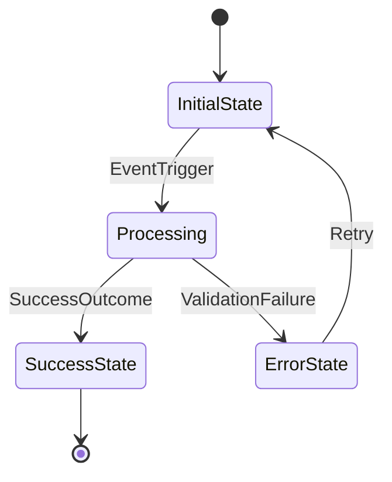

# MetroLMS — Low-Level Component Design (LLD)
## Component / Module: [Module Name]

> **Document Title:** [LLD Title]  
> **Document Identifier:** `METROLMS-LLD-[DOMAIN]-[NNN]`  
> **Document Status:** `[DRAFT | REVIEW | APPROVED]`  
> **Canonical Authority Level:** Level 2 Architecture & Component Specification  
> **Target System:** MetroLMS (Cairo Metro E-Learning Platform)  
> **Prepared For:** Senior Software Engineers & Module Developers  
> **Governing Decisions:** [`D-AUTH-01`](../architecture/decision-register.md#d-auth-01), [`D-DB-01`](../architecture/decision-register.md#d-db-01)  
> **Last Updated:** YYYY-MM-DD ([Author / Version])

---

## 1. Component Overview & Scope
- **Module Purpose:** [Precise technical responsibility of the module].
- **Internal Structure:** [Classes, services, hooks, utility functions].

## 2. State Machine & Lifecycle Specifications


## 3. Class & Service Layer Design
```python
# Conceptual Service Signature
class DomainService:
    def execute_operation(self, actor: User, command: OperationCommand) -> OperationResult:
        """
        Executes domain business transaction within an atomic database block.
        Enforces domain invariants and emits audit telemetry.
        """
        pass
```

## 4. Detailed Algorithm & Data Flow
1. **Algorithm Step 1:** [Input parsing and payload structural validation].
2. **Algorithm Step 2:** [Precondition checks and locking].
3. **Algorithm Step 3:** [Calculation or mutation pipeline].
4. **Algorithm Step 4:** [Atomic persistence and commit].

## 5. Error Handling & Invariant Enforcement
| Condition | Error Class | HTTP Code | Recovery Strategy |
| :--- | :--- | :--- | :--- |
| Stale Version | `OptimisticLockError` | `409 Conflict` | Refresh entity and notify user |
| Gate Violation| `BusinessRuleViolation` | `422 Unprocessable`| Highlight missing passing gate |
