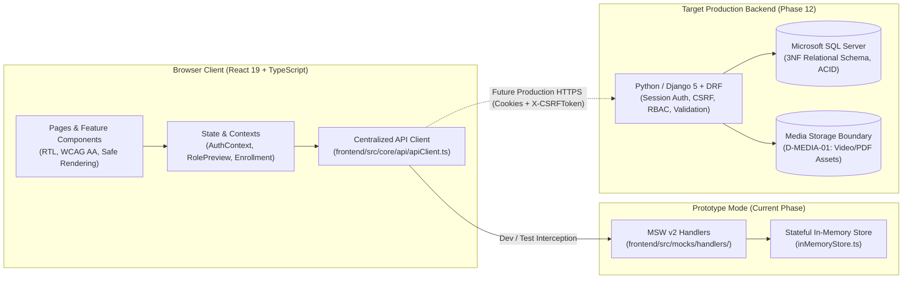

# MetroLMS — Canonical System Architecture & Technology Stack

> **Document Status:** `ACTIVE — AUTHORITATIVE`  
> **Canonical Scope:** Project Purpose, Confirmed Technology Stack, System Architecture, Frontend/Backend Responsibility Boundaries, Media Integration Boundary (`D-MEDIA-01`), and Out-of-Scope Infrastructure Fence.  
> **Governing Decisions:** [`D-AUTH-01`](./decision-register.md#d-auth-01), [`D-DB-01`](./decision-register.md#d-db-01), [`D-SEC-01`](./decision-register.md#d-sec-01), [`D-MEDIA-01`](./decision-register.md#d-media-01).  
> **Last Updated:** 2026-11-07 (Phase A Closure & Documentation Consolidation)

---

## 1. Project Purpose & Product Scope

**MetroLMS (Cairo Metro E-Learning Platform)** is the enterprise Learning Management System designed for the **Egyptian Company for Metro Management and Operation — General Administration for Training Centers**.

### 1.1 Primary Development Objective
The active engineering objective of the project is **Frontend Integration Readiness**:
> **Complete, reconcile, and verify the entire MetroLMS React frontend so that all features, pages, workflows, domain logic, state management, and API boundaries are internally consistent, stable, and ready for integration with the target Python/Django and Microsoft SQL Server backend.**

### 1.2 Core Functional Domains
1. **Identity, 6-Tier Role Hierarchy & Governance:** Role-based workspaces and access boundaries across `developer` (المطور), `super_admin` (المسؤول الأعلى), `admin` (مدير النظام), `assistant_admin` (مدير النظام المساعد), `lecturer` (المحاضر) / group-scoped `assistant_lecturer` (المحاضر المساعد), and `user` (المتدرب — Trainee).
2. **Course Catalog, Authoring & Quality Review:** Searchable course catalog, multi-chapter curriculum builder, staged edits with 3-way rebase, substantive curriculum versioning (`Rule B`), and administrative approval/audit workflows.
3. **Training Groups, Cohorts & Deadlines:** Cohort group scheduling, multi-course assignments, renewal cycles, QR/token join workflows, group materials, live session links, and automated deadline attention monitoring (`checkTraineeAttention`).
4. **Learning Player, Attempts & Certificates:** Sequential lesson locking, custom HTML5 video playback with forward-seek clamping, PDF viewing with timer confirmation, isolated per-attempt progress calculation (`D-06`, `D-12`), and version-scoped completion certificates (`D-13`).
5. **Discussions, Notifications & Operational Nudges:** Course comment discussions, report triage and moderation, role-aware notification center, and pre-formatted WhatsApp reminders.

---

## 2. Confirmed Authoritative Technology Stack

All active development, code reviews, API contracts, and future backend preparation must adhere strictly to this confirmed stack. Other documents must reference this section rather than maintaining duplicate stack tables.

### 2.1 Frontend Stack (`frontend/` — Active Implementation)

| Layer / Concern | Approved Technology | Version / Configuration | Architectural Role |
| :--- | :--- | :--- | :--- |
| **UI Framework** | **React** | React 19 (`^19.0.0`) | Component architecture, hooks, and declarative RTL UI rendering. |
| **Language** | **TypeScript** | TypeScript 5.7 (`~5.7.3`) | Strict static typing, domain DTO contracts, and compile-time safety. |
| **Build & Dev Server** | **Vite** | Vite (`@vitejs/plugin-react`) | Fast HMR development server and Rollup production bundling. |
| **Styling Engine** | **Tailwind CSS v4** | `@tailwindcss/vite` (`^4.0.6`) | CSS-first design tokens via `@theme` in [`frontend/src/styles/tokens.css`](../../frontend/src/styles/tokens.css) and RTL logical properties. |
| **Typography** | **Cairo (Local Fonts)** | Bundled `.woff2` (`400`, `600`, `700`) | 100% offline-capable Arabic/Latin typography with zero Google Fonts CDN calls. |
| **Iconography** | **`lucide-react`** | Typed `<Icon name="..." />` registry | Offline SVG icon bundle managed centrally in [`frontend/src/shared/ui/Icon/`](../../frontend/src/shared/ui/Icon/). |
| **Routing** | **React Router** | Data Router (`createBrowserRouter` / `createMemoryRouter`) | Centralized routing, `<ProtectedRoute>` RBAC guards, and unsaved-changes navigation blocking (`useBlocker`). |
| **API Mocking** | **MSW v2** | Mock Service Worker (`^2.15.0`) + `inMemoryStore.ts` | Network-level HTTP interception simulating REST endpoints and stateful persistence during frontend readiness. |
| **Automated Testing** | **Vitest + RTL** | Vitest + `@testing-library/react` | Unit, characterization, component, integration, and security regression testing. |
| **Architecture Linting** | **ESLint 9** | `eslint-plugin-boundaries` | Compile/lint-time enforcement of unidirectional layer imports (`shared` $\rightarrow$ `core` $\rightarrow$ `features` $\rightarrow$ `pages`). |

### 2.2 Target Backend Stack (Future Implementation Track — Phase 12)

| Layer / Concern | Approved Technology | Governing Decision | Architectural Role |
| :--- | :--- | :--- | :--- |
| **Backend Language** | **Python** | [`D-DB-01`](./decision-register.md#d-db-01) | Server-side application runtime (Python 3.12+). |
| **Web Framework** | **Django + DRF** | [`D-AUTH-01`](./decision-register.md#d-auth-01), [`D-DB-01`](./decision-register.md#d-db-01) | Django 5+ and Django REST Framework for REST APIs, ORM, session management, CSRF protection, and RBAC enforcement. |
| **Database Engine** | **Microsoft SQL Server** | [`D-DB-01`](./decision-register.md#d-db-01) | **Sole approved production relational database engine.** Accessed via `mssql-django` / `pyodbc` (ODBC Driver 18+ for SQL Server). |
| **Authentication** | **Django Server Sessions** | [`D-AUTH-01`](./decision-register.md#d-auth-01) | Database-backed server-side sessions using `HttpOnly`, `Secure` cookies and Django CSRF protection (`X-CSRFToken`). |

---

## 3. System Architecture & Responsibility Boundaries

### 3.1 Division of Frontend vs. Backend Responsibilities

| Architectural Concern | React Frontend Responsibility (Current Scope) | Django + SQL Server Responsibility (Target Backend) |
| :--- | :--- | :--- |
| **Authentication & Sessions** | Render `/login`, submit credentials, call `GET /api/auth/me`, include credentials/cookies, attach `X-CSRFToken` on state-changing calls, clear state on `401` or logout ([`D-AUTH-01`](./authentication-and-session-contract.md)). | Verify credentials (`Argon2id` / `PBKDF2`), create/invalidate server-side sessions in SQL Server, issue `HttpOnly`/`Secure` cookies, enforce session expiration. |
| **Authorization & RBAC** | Role-aware navigation (`Sidebar`, `MobileDrawer`), `<ProtectedRoute>` UX gating, visual `RolePreview` barrier, and `202 Accepted` pending approval feedback. **Never treated as a security boundary.** | Authoritative enforcement of the 6-tier role matrix, `INV-R1`–`INV-R10`, `Rule A`, capability ceilings, object-level ownership, and uniform `404` Developer non-disclosure (`INV-R8`). |
| **Business & Domain Logic** | Deterministic client calculations (`progress.ts`, `attention.ts`), attempt disambiguation modals, lecturer deletion warning modal (`D-03`/`D-11`), and group removal per-course prompt (`D-07`). | Authoritative ACID transactions, multi-source enrollment provenance persistence, curriculum version snapshotting (`Rule B`), certificate issuance (`D-13`), and referential integrity cascades (`D-01`–`D-03`). |
| **XSS & Input Validation** | Client-side form validation, React automatic JSX escaping, DOMPurify allowlist sanitization for rich HTML, CSP compatibility ([`D-SEC-01`](./security-and-xss-baseline.md)). | Strict server-side schema/serializer validation, HTML sanitization before persistence, Content-Security-Policy headers, and rate limiting. |
| **Media & File Handling** | Upload files via decoupled media service (`D-MEDIA-01`), track upload status, render video streams (`VideoPlayer`) and PDFs (`DocumentViewer`) via media IDs/URLs. | Validate MIME types/sizes, enforce download/streaming permissions, manage physical storage (`MEDIA_ROOT`, streaming server, or object store). |

---

## 4. Media Integration Boundary (`D-MEDIA-01`)

Per Owner Decision **`D-MEDIA-01`**, physical media hosting infrastructure is decoupled from Frontend Readiness:
1. **Frontend Contract:** The React frontend interacts exclusively through structured media descriptors (`mediaId`, `url` / `videoUrl` / `pdfUrl`, `mimeType`, `sizeBytes`, `durationSeconds`, `uploadStatus`, `canDownload`).
2. **Prototype Simulation:** During Frontend Readiness, local browser storage (`IndexedDB` via [`mediaStorageService.ts`](../../frontend/src/core/storage/mediaStorageService.ts) and in-memory blob registries) simulates file persistence.
3. **Backend Deferral:** Whether production Django stores media on a local intranet volume (`MEDIA_ROOT` with byte-range streaming), a dedicated media server, or an S3-compatible store remains a Phase 12 backend deployment decision that does not block frontend completion.

---

## 5. Explicit Out-of-Scope & Architecture Deviations Fence

To prevent scope drift, the following topics are formally excluded from MetroLMS Frontend Readiness and active project scope:
1. **PostgreSQL-Specific Infrastructure:** PostgreSQL is **not** part of the approved stack (`D-DB-01`). Historical references to `pg_hba.conf`, `pg_ident.conf`, PgBouncer, `SECURITY DEFINER`, `search_path`, `JSONB` operators, and PostgreSQL replication slots in archived reports or provisional schema notes must not be implemented.
2. **Enterprise KMS / HSM Cryptographic Appliances:** On-premises PKCS#11 HSM management, AWS KMS / Google Cloud KMS policy propagation fencing, hardware cipher drain accounting, and FIPS 140-3 hardware module certifications are out of scope.
3. **Single Sign-On (SSO) & Client Bearer Tokens:** SSO (SAML/OIDC) and browser-stored JWT/Bearer tokens are not required for the current application (`D-AUTH-01`).
4. **Legacy Prototype Modifications:** The [`legacy-reference/`](../../legacy-reference/) directory is strictly read-only historical reference material.

---

## 6. Related Canonical Documents

- **Frontend Internal Layer Architecture:** [`docs/frontend/architecture.md`](../frontend/architecture.md)
- **Master Owner Decision Register:** [`docs/architecture/decision-register.md`](./decision-register.md)
- **Authentication & Session Contract:** [`docs/architecture/authentication-and-session-contract.md`](./authentication-and-session-contract.md)
- **Security & XSS Defense Baseline:** [`docs/architecture/security-and-xss-baseline.md`](./security-and-xss-baseline.md)
- **Django & SQL Server Integration Contract:** [`docs/backend/django-sqlserver-integration-contract.md`](../backend/django-sqlserver-integration-contract.md)
- **Current Project State & Checkpoint:** [`docs/project-state/CURRENT.md`](../project-state/CURRENT.md)

