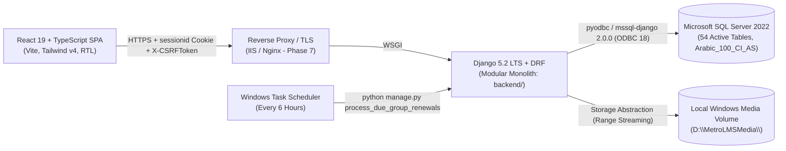
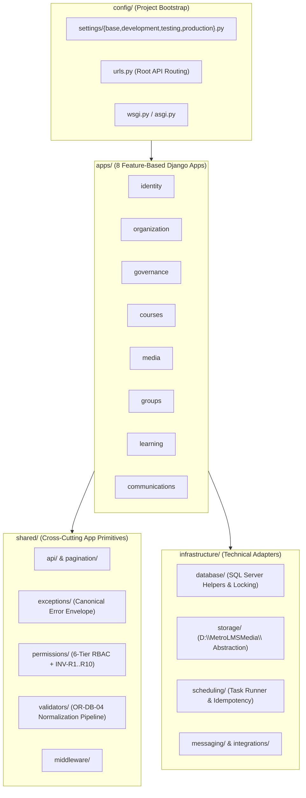
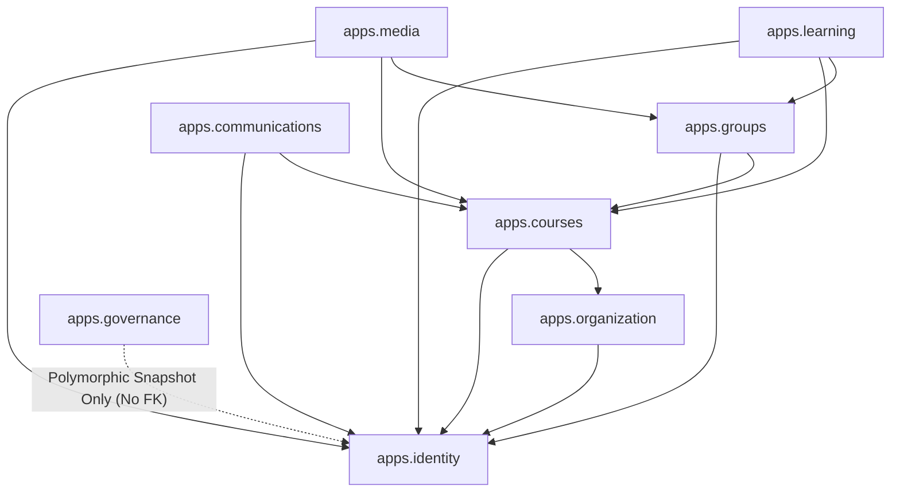
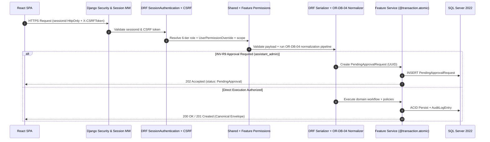
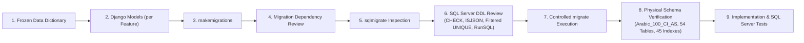

# MetroLMS — Backend Foundation Architecture (`METROLMS-BACK-ARCH-001`)

> **Document Status:** `ACTIVE — FOUNDATION ARCHITECTURE`  
> **Owner-Approved Direction:** Feature-Based Backend Architecture + Layered Architecture inside each Feature  
> **Primary Authority References:** [`CURRENT.md`](../project-state/CURRENT.md) | [`system-architecture.md`](../architecture/system-architecture.md) | [`decision-register.md`](../architecture/decision-register.md) | [`django-sqlserver-integration-contract.md`](django-sqlserver-integration-contract.md) | [`data-dictionary.md`](../02-architecture-and-design/data-models/data-dictionary.md) | [`openapi-specification.yaml`](../03-technical-documentation/api/openapi-specification.yaml)  
> **Last Updated:** 2026-11-16 (`Phase 12` Foundation Preparation — Data Dictionary remains `UNFROZEN`; zero DB-bound models/migrations authorized yet)

---

## 1. Executive Summary

This document defines the **Backend Foundation Architecture** for MetroLMS (Cairo Metro E-Learning Platform). It translates the approved database specification (`54` active entities, `305` physical columns, `84` FK constraints), the `85`-path OpenAPI `3.1` contract, and the security/session contracts (`D-AUTH-01`, `D-SEC-01`, `D-MEDIA-01`, `D-DB-01`) into a clean, maintainable **Django 5.2 LTS + Django REST Framework** project layout under `backend/`.

**Governance Boundary:** The Data Dictionary (`METROLMS-DATA-DICT-001`) remains **`UNFROZEN`** and `WP-5.6` remains **`BLOCKED — NOT AUTHORIZED`** for DDL/code execution. Accordingly, this foundation establishes **architecture documentation and structural scaffolding only** — no database-bound Django Model fields, `0001_initial.py` migrations, SQL DDL, or business endpoint implementations are created at this stage.

---

## 2. Architecture Style & Decision Classification

| Architectural Choice | Classification | Rationale |
|---|---|---|
| **Feature-Based Django Apps + Layered Architecture inside each Feature** | **`OWNER-APPROVED` (`2026-11-16`)** | Features own cohesive business capabilities and models; each Feature separates `api`, `services`, `selectors`, `policies`, `models`, `tasks`, and `tests`. |
| **Modular Monolith** | **`OWNER-APPROVED` (`2026-11-16`)** | Single deployable Django process enforcing Feature separation through application and code boundaries rather than Microservices. |
| **SQL Server `dbo` Schema Organization** | **`OWNER-APPROVED` (`2026-11-16`)** | All MetroLMS SQL Server tables use the `dbo` schema; Feature separation is enforced at the application/code boundary, not via per-Feature SQL Server schemas. |
| **Single Shared SQL Server 2022 Database** | **`OWNER-APPROVED` (`2026-11-16`)** | One shared SQL Server 2022 database (`dbo` schema) preserves ACID transactions and declared cross-Feature FKs (`84` FKs) across all `54` entities while strictly preserving Feature ownership and application/code boundaries. |
| **Django ORM + Dedicated Selectors (No generic Repository-per-Model)** | **`TECHNICAL-RECOMMENDATION`** | Avoids redundant wrapper boilerplate over Django `QuerySet`s while keeping read queries cleanly isolated in `selectors/`. |

### 2.1 Mandatory Technology Stack (`OWNER-APPROVED` / `OWNER-CONFIRMED`)
- **Language:** Python `3.12` (note: host discovery observed `Python 3.14.6` globally; production target remains `3.12` on **Windows Server 2022** `x64` pending infra inventory).
- **Web Framework:** Django `5.2 LTS` + Django REST Framework (`DRF`).
- **Database:** Microsoft SQL Server `2022` (`D-DB-01`), `mssql-django==2.0.0`, `pyodbc` (active/default driver), Microsoft ODBC Driver `18`, and `mssql-python>=1.15.0` (required package dependency).
- **Authentication:** Django server-side database-backed sessions (`HttpOnly`, `Secure`, `SameSite=Lax` `sessionid` cookie + `X-CSRFToken`; zero JWT/Bearer tokens or SSO).
- **Media Storage:** Local Windows storage (`D:\MetroLMSMedia\`, `D-MEDIA-01`), accessed strictly via `infrastructure.storage` abstraction (Django-mediated `Range` streaming in Phase 1).
- **Scheduling:** Windows Task Scheduler (every `6` hours) invoking Django management commands (`process_due_group_renewals`); **no** Celery, Redis, RabbitMQ, PostgreSQL, SQLite, S3, or MinIO.

---

## 3. System Context

---

## 4. Backend Component Architecture

---

## 5. Feature Ownership Matrix (`54` Active Entities — `100%` Coverage)

Every active physical entity from [`data-dictionary.md`](../02-architecture-and-design/data-models/data-dictionary.md) is owned by **exactly one** Feature app (`InPersonAttendanceRecord` remains `DEFERRED`).

| # | Feature App | Owned Entities (`54` Total) | Count | Primary Responsibilities |
|---:|---|---|---:|---|
| 1 | `apps.identity` | `User`, `RolePolicy`, `ServerSession`, `UserPermissionOverride`, `DelegatedAuthority`, `DeletedUserTombstone`, `DeletedUserAlias` | `7` | Session auth (`D-AUTH-01`), `phone_e164` login, 6-tier RBAC ceilings, overrides, delegations, `D-01` tombstones & aliases |
| 2 | `apps.organization` | `OrganizationalDepartment`, `JobTitle`, `MetroLine`, `MaritalStatusCatalog`, `MilitaryServiceStatusCatalog`, `DepartmentTrack`, `UserOrganizationalDepartment`, `DepartmentJobTitle`, `UserJobTitle`, `HistoricalServiceTrainingRecord` | `10` | HR catalogs, department-scoped job titles (`D-OWNER-REV-17`), department tracks (Option A), historical service training records |
| 3 | `apps.governance` | `PendingApprovalRequest`, `AuditLogEntry` | `2` | `INV-R9`/`INV-R10` deferred approval workflow (`202 Accepted`, `UNIQUEIDENTIFIER` PK), immutable audit trail with `INV-R8` Developer masking |
| 4 | `apps.courses` | `Course`, `CourseAssistantLecturer`, `CourseAudienceDepartment`, `CourseAudienceJobTitle`, `CourseAudienceMetroLine`, `CourseDraft`, `PublishedCourseVersion`, `Module`, `LessonItem`, `QuizDefinition`, `CourseReviewSubmission`, `StagedAdminEdit`, `WorkingNote`, `CourseComment`, `CourseCommentReport` | `15` | Course catalog, audience targeting, draft builder, substantive versioning (`Rule B`), admin review workflow (`OR-DB-08a/b/c`), comments & moderation |
| 5 | `apps.media` | `MediaAsset`, `MediaContentReference` | `2` | Decoupled media assets (`D-MEDIA-01`), two-step upload/repoint (`INV-DOM21-12`), logical detachment (`INV-DOM21-18`), Django-mediated `Range` streaming |
| 6 | `apps.groups` | `TrainingGroup`, `GroupAssistantAssignment`, `GroupRenewalCycle`, `GroupCourseAssignment`, `GroupMembership`, `GroupQrCode`, `GroupJoinRequest`, `GroupResource` | `8` | Training & reminder groups, in-place renewal cycles (`D-GRP-02`, `INV-DOM10-12`), QR/join requests, group resources & assistant scoping |
| 7 | `apps.learning` | `Enrollment`, `EnrollmentSourceGrant`, `CourseAttempt`, `LessonProgress`, `CertificateRecord` | `5` | Multi-source enrollment provenance, per-attempt isolation (`D-06`), playback telemetry & `D-12` progress calculation, version-scoped certificates (`D-13`) |
| 8 | `apps.communications` | `NotificationItem`, `WhatsAppContact`, `UserWhatsAppVisibility`, `ScheduledJob`, `ScheduledJobRun` | `5` | In-app notifications, course WhatsApp contacts & visibility, `ScheduledJob` & idempotent `ScheduledJobRun` tracking |

---

## 6. Cross-Feature Dependency Map & Rules

### Dependency Rules
1. **Unidirectional & Acyclic:** Lower-level shared infrastructure (`shared/`, `infrastructure/`) never imports from `apps/*`.
2. **DB FKs vs. Service Calls:** A Django `ForeignKey` to another Feature's model (e.g., `Enrollment.user` → `identity.User`) is permitted for relational integrity (`84` FKs), but cross-Feature mutations **must** call the owning Feature's public `services/` or `selectors/` interface—never directly mutating another Feature's internal state or bypassing its `policies/`.
3. **No Circular Service Imports:** Where two Features interact on lifecycle events (e.g., `D-01` user deletion in `identity` sweeping `groups`/`courses`/`learning` references, or `groups` renewal creating `learning` enrollment grants), coordination uses explicit application-layer orchestrators or well-defined service interfaces without circular module-level imports.

---

## 7. Layer Responsibilities Inside Each Feature

| Layer | Directory | Responsibility |
|---|---|---|
| **Models** | `models/` | Django ORM models, constraints (`CHECK`, `UniqueConstraint`, `ISJSON`), indexes, and entity invariants. No HTTP/DRF imports. |
| **API** | `api/{serializers,views,permissions,urls.py}` | HTTP transport, DRF request/response serialization, `200`/`201`/`202` & canonical error envelopes, permission classes. Delegates all business logic to `services/` and `selectors/`. |
| **Services** | `services/` | Transactional application workflows (`@transaction.atomic`), centralized `OR-DB-04` normalization invocation, `PendingApprovalRequest` gating (`INV-R9`), and audit emission. |
| **Selectors** | `selectors/` | Read-only ORM queries, `select_related`/`prefetch_related` optimization, `INV-R8` Developer filtering across all 11 surfaces. |
| **Policies** | `policies/` | Pure business authorization, eligibility, and state-transition rules (e.g., `resolveCourseAccess`, `Rule B` diffing, renewal eligibility). |
| **Tasks** | `tasks/` | Scheduled/background operations invoked by management commands (e.g., `process_due_group_renewals`), recording `ScheduledJobRun` idempotency. |
| **Tests** | `tests/` | Feature-owned unit, service, policy, and API contract tests. |

---

## 8. Request Lifecycle

---

## 9. OOP & SOLID Principles

- **Single Responsibility:** Views handle HTTP; Serializers validate & normalize; Policies decide eligibility; Services orchestrate transactions; Selectors query.
- **Open/Closed & Polymorphism:** Media storage (`infrastructure.storage`), scheduling (`infrastructure.scheduling`), and lesson-type handlers (`video`, `pdf`, `quiz`) use abstract base interfaces/protocols so Phase 1 local storage can later extend to `CL-03` signed URLs without modifying domain services.
- **Composition over Inheritance:** Features compose `shared.permissions` and `shared.validators` rather than forcing artificial model inheritance trees across unrelated entities.
- **Dependency Inversion:** `apps.media` depends on a storage `Protocol` (`StorageBackend`), not directly on `D:\MetroLMSMedia\` filesystem calls.

---

## 10. Design Pattern Catalog

| Pattern | Proposed Use | Justification | Owning Feature / Layer | Status |
|---|---|---|---|---|
| **Service Layer** | Transactional use-case orchestration (`@transaction.atomic`) | Keeps views thin and ensures normalization (`OR-DB-04` Condition B) runs on all write paths | All Features (`services/`) | `TECHNICAL-RECOMMENDATION` |
| **Selector Pattern** | Read-only ORM query encapsulation | Centralizes `INV-R8` Developer masking and `select_related` optimization | All Features (`selectors/`) | `TECHNICAL-RECOMMENDATION` |
| **Policy / Specification** | Access resolution (`resolveCourseAccess`), renewal eligibility, `INV-R1`–`INV-R10` | Isolates complex business rules for deterministic unit testing | `identity`, `courses`, `groups`, `learning` (`policies/`) | `TECHNICAL-RECOMMENDATION` |
| **Adapter** | Local Windows media storage (`D:\MetroLMSMedia\`), future WhatsApp/external integrations | Decouples domain logic from physical OS paths (`INV-DOM21-06`) | `infrastructure/storage/`, `infrastructure/integrations/` | `OWNER-APPROVED` (Storage Abstraction) / `TECHNICAL-RECOMMENDATION` |
| **Strategy** | Lesson progress/activity strategies (`video`, `pdf`, `quiz`) & `Rule B` diffing | Cleanly handles per-lesson-type completion rules without giant `if/elif` chains | `learning`, `courses` | `TECHNICAL-RECOMMENDATION` |
| **State Transition** | `CourseReviewSubmission`, `GroupRenewalCycle`, `PendingApprovalRequest` lifecycles | Enforces valid state transitions and `INV-R10` re-validation | `governance`, `courses`, `groups` | `TECHNICAL-RECOMMENDATION` |
| **Factory** | Test data builders & `CourseAttempt` / `PublishedCourseVersion` snapshot creation | Ensures immutable snapshot consistency | `courses`, `learning`, `tests/` | `TECHNICAL-RECOMMENDATION` |
| **CQRS / Event Sourcing / Repo-per-Model** | *Explicitly Excluded* | Unnecessary complexity for a Modular Monolith on SQL Server 2022 | — | `PROHIBITED / EXCLUDED` |

---

## 11. API Integration & OpenAPI Traceability (`85` Paths)

The backend preserves the exact `/api/...` paths in [`openapi-specification.yaml`](../03-technical-documentation/api/openapi-specification.yaml):

| API Prefix / Resource Group | Endpoint Count | Owning Feature | Key Contract Notes |
|---|---:|---|---|
| `/api/auth/*` (`login`, `logout`, `me`) | `3` | `apps.identity` | `D-AUTH-01` `HttpOnly` session cookie + `X-CSRFToken`; `LOGOUT_CONFIRMED` |
| `/api/profile`, `/api/admin/users/*` | `6` | `apps.identity` (+ `apps.organization` transcript/HR) | `phone_e164` login; `INV-R1`–`INV-R8` (`404` for Developer); `D-01` deletion |
| `/api/admin/permissions/*` (roles, users, effective, delegation) | `5` | `apps.identity` | 6-tier capabilities + `UserPermissionOverride` + `DelegatedAuthority` |
| `/api/admin/permissions/governance/approvals*`, `/api/admin/audit*` | `5` | `apps.governance` | `202 Accepted` UUID `PendingApprovalRequest`; `INV-R10` execution; `AuditLogEntry` |
| `/api/admin/department-tracks*` | `2` | `apps.organization` | `DepartmentTrack` Option A (`department_code` PK) |
| `/api/courses*`, `/api/lecturer/courses*`, `/api/admin/courses/*`, `/api/comments/*`, `/api/admin/comments*` | `25` | `apps.courses` (except `performance` → `apps.learning`) | Canonical `/api/admin/courses/{courseId}/*` (`API-REC-02`); `Rule B` versioning |
| `/api/groups/*`, `/api/admin/groups/*`, `/api/admin/lecturers`, `/api/admin/trainees` | `21` | `apps.groups` | `API-REC-02a`–`02c` assistants; `INV-DOM10-12` atomic renewal; QR & join requests |
| `/api/admin/groups/{groupId}/materials*` | `2` | `apps.media` (with `apps.groups` scope check) | `D-MEDIA-01`, `INV-DOM21-12`–`21`, Django-mediated `Range` streaming |
| `/api/courses/{id}/enrollments*`, `/api/enrollments/my`, `/api/users/.../attempts`, `/api/courses/{id}/progress`, `.../activity|complete`, `.../performance`, `/api/certificates/verify/{code}` | `9` | `apps.learning` | Multi-source grants, attempt isolation, `D-12` rounding, `D-13` certificates |
| `/api/notifications*`, `/api/courses/{id}/whatsapp-contacts`, `/api/admin/users/{id}/whatsapp-visibility`, `/api/public/support-contacts` | `7` | `apps.communications` | Notification center, WhatsApp contact & visibility controls |

**Unresolved API Decisions (`openapi-foundations.md` §12):** `OD-API-01` (unversioned `/api/` vs `/api/v1/`) and `OD-API-02` (`{ status: "OK", data }` wrapper vs bare DRF JSON) remain `PENDING OWNER DECISION`.

---

## 12. Data Persistence, Custom User Model & ORM/Migration Lifecycle

### 12.1 Custom User Model (`AUTH_USER_MODEL`)
Per `data-dictionary.md` §2.1, `User` uses `phone_e164` (`NVARCHAR(16) NOT NULL UNIQUE`) as the canonical login identifier, nullable `email` (`NVARCHAR(254)` with filtered `UNIQUE`), `role` (`NVARCHAR(32)` FK → `RolePolicy.role_key`), `BIGINT IDENTITY(1,1)` PK, and HR catalog FKs. Therefore, MetroLMS **requires a custom Django User model** (`AUTH_USER_MODEL = "identity.User"`) configured **before** generating the first project migration (`0001_initial.py`).

### 12.2 ORM & Migration Lifecycle (Deferred Until Data Dictionary Freeze)

- Each Feature owns its `migrations/` package; cross-Feature FKs are coordinated via Django migration dependencies (`dependencies = [...]`).
- Special SQL Server DDL (`52` `CHECK` constraints, `9` `ISJSON()` constraints, `4` filtered `UNIQUE` indexes, `Arabic_100_CI_AS` collation) requires `sqlmigrate` inspection and controlled `migrations.RunSQL` fallback only where `mssql-django==2.0.0` DDL generation requires it.

---

## 13. Security, Timezone & Normalization Baseline

- **Auth & Sessions (`D-AUTH-01`):** `SessionAuthentication` (`HttpOnly`, `Secure` in prod, `SameSite=Lax`), `CsrfViewMiddleware` (`X-CSRFToken`), `Argon2`/`PBKDF2` password hashing.
- **Role Invariants (`D-SEC-01`, `INV-R1`–`INV-R10`):** Server-side enforcement on every endpoint; `404` non-disclosure for `Developer` targets (`INV-R8`); `202 Accepted` approval gating (`INV-R9`).
- **Temporal (`D-05`):** `USE_TZ = True`, `TIME_ZONE = "UTC"`, SQL Server `DATETIMEOFFSET(7)` UTC storage, explicit `ZoneInfo("Africa/Cairo")` conversions via `tzdata` for Cairo calendar/clock rules.
- **Normalization (`OR-DB-04`):** Centralized pre-validation normalization pipeline in `shared/validators/` invoked across **all** write paths (DRF serializers, services, management commands, bulk ops), preserving leading/trailing whitespace (`trim_whitespace=False`) on the `9` free-form `NFC`-only fields.

---

## 14. Configuration, Testing & Deployment Operations

- **Settings Split (`config/settings/`):** `base.py` (shared contracts, `USE_TZ=True`, `TIME_ZONE='UTC'`, DRF defaults), `development.py` (local debug, permissive dev CORS/CSRF if needed), `testing.py` (isolated test runner config), `production.py` (strict `HTTPS`, `SESSION_COOKIE_SECURE=True`, `CSRF_COOKIE_SECURE=True`, `Content-Security-Policy-Report-Only`).
- **Testing Architecture:** Feature-level unit tests (`policies/`, `services/`), API contract tests (`api/`), architecture boundary tests (`tests/architecture/`), and SQL Server 2022 integration tests (`tests/integration/`).
- **Windows Server 2022 Operations:** `D:\MetroLMSMedia\` local volume, Windows Task Scheduler every `6` hours for `process_due_group_renewals`. Exact SQL Server topology (co-hosted vs. separate), IIS vs. Nginx / Waitress selection, and x64 hardware sizing remain pending external infrastructure inventory (`WP55-PT-06`, Phase 7).

---

## 15. Outstanding Decisions Requiring Owner Approval

*(Note: `G-02` — Modular Monolith, Feature-Based + Layered Architecture, one shared SQL Server 2022 database, and `dbo` schema — is `OWNER-APPROVED` as of `2026-11-16`.)*

1. **OpenAPI Envelope & Versioning (`OD-API-01`, `OD-API-02`):** Confirm unversioned `/api/` vs. `/api/v1/` and `{ status: "OK", data }` wrapper vs. bare DRF JSON.
2. **Collation Verification (`OR-DB-04`):** Phase 12 live SQL Server 2022 verification of `Arabic_100_CI_AS` (`NFC`/`NFD`, `UNIQUE` collisions).
3. **Data Dictionary Freeze & `WP-5.6` / Phase 12 Gate:** Formal Owner authorization required before implementing DB-bound Django models or running `makemigrations`/`migrate`.
4. **Production Infrastructure Inventory (`WP55-PT-06`):** Confirm Windows Server `x64` specs, SQL Server 2022 edition/topology, IIS/Waitress vs. Nginx, and exact `D:\MetroLMSMedia\` volume.

