# MetroLMS — Backend Implementation Master Roadmap (`METROLMS-BACK-ROADMAP-001`)

> **Document Title:** Backend Implementation Master Roadmap & Permanent Execution Checklist  
> **Document Identifier:** `METROLMS-BACK-ROADMAP-001`  
> **Document Status:** `DRAFT — OWNER REVIEW REQUIRED`  
> **Canonical Authority Level:** Level 3 Execution Roadmap (Governed by [`AGENTS.md`](../../AGENTS.md), [`decision-register.md`](../architecture/decision-register.md), [`data-dictionary.md`](../02-architecture-and-design/data-models/data-dictionary.md), and [`backend-foundation-architecture.md`](backend-foundation-architecture.md))  
> **Last Updated:** 2026-11-16 (`Backend Foundation Scaffold` verified at syntax/import level; `BP-00`–`BP-13` initialized; Data Dictionary remains `UNFROZEN`)

---

## 1. Executive Summary

This document is the **single authoritative execution checklist** for implementing the MetroLMS Django 5.2 LTS + Django REST Framework + Microsoft SQL Server 2022 backend (`backend/`). It governs the complete journey from Backend Foundation Verification (`BP-00`) through SQL Server ORM & Migrations (`BP-01`), Authentication & RBAC (`BP-02`–`BP-03`), all 8 business Features (`BP-04`–`BP-11`), Cross-Feature Integration (`BP-12`), and Production Readiness (`BP-13`).

**Governance Notice:** Creating this roadmap does **not** authorize execution of database-bound models, migrations, SQL DDL, or Feature implementations. All `BP-01`+ implementation packages remain `BLOCKED` until Gate `G-01` (Data Dictionary Freeze & Phase 5 Closure) is formally approved by the Owner.

---

## 2. Progress Dashboard

| Metric | Count / Value | Notes |
|---|---:|---|
| **Total Work Packages (`BP-00`–`BP-13`)** | **14** | Ordered strictly by dependency & governance gates |
| **Completed (`DONE — VERIFIED`)** | **2** | `BP-00 — Backend Foundation Verification` (`2026-11-16`), `BP-01 — SQL Server Integration & Django ORM Foundation` (`2026-11-16`) |
| **In Progress (`IN PROGRESS`)** | **0** | `BP-01` completed; `BP-02` awaits `G-03` (`OD-API-02`) |
| **Ready (`READY`)** | **0** | `BP-02` blocked solely by `G-03` (`OD-API-02` — Login/Logout/Session API contract) |
| **Blocked (`BLOCKED`)** | **12** | `BP-02`–`BP-13` blocked on `G-03` (`OD-API-01`/`02`) / `G-04` (prod infra) |
| **Owner Decisions Pending (`NEEDS OWNER DECISION`)** | **2** | `OD-API-01`, `OD-API-02` (`G-01` & `G-02` are `OWNER-APPROVED — CLOSED`) |
| **Deferred (`DEFERRED`)** | **0** (WPs) | `InPersonAttendanceRecord` (`Domain 16`) & `API-REC-06` (`CL-03`) remain deferred |
| **Verified Completion %** | **14%** | `2/14` Work Packages `DONE — VERIFIED` (`BP-00`, `BP-01`) |

- **Current Next Eligible Task:** `G-03` Gate Resolution (`OD-API-01` & `OD-API-02` Owner decisions) to unblock `BP-02` (`Identity & Authentication / Login`)
- **Current Active Work Package:** `BP-02 — Identity & Authentication / Login` (`BLOCKED` on `G-03` `OD-API-02`)
- **Last Verified Update:** `2026-11-16`
- **Last Verification Evidence:** `BP-01` **`DONE — VERIFIED`**: `MetroLMS` DB created (`COMPATIBILITY_LEVEL = 160`, `Arabic_100_CI_AS`, `RCSI = ON`); `54` `dbo` Feature tables & `84/84` `ON DELETE NO ACTION` FKs + `4` filtered `UNIQUE` indexes + `67` `CHECK` constraints verified live; `manage.py test apps.identity.tests.test_bp01_schema_and_normalization` → `6/6` tests `OK` (`0.272s`) on `test_MetroLMS`; `manage.py check` (`dev/test/prod`) → `0` issues.

### Status Legend (Mandatory)
- `NOT STARTED` | `READY` | `IN PROGRESS` | `BLOCKED` | `DONE — VERIFIED` | `NEEDS OWNER DECISION` | `DEFERRED`

---

## 3. Current Project Baseline

Verified directly against the repository on `2026-11-16`:
- **Foundation Scaffold (`backend/`):** Created (`manage.py`, `requirements.txt`, `.env.example` with placeholders only, `.gitignore`, `README.md`, `config/settings/{base,development,testing,production}.py`, `config/{urls,asgi,wsgi}.py`, `apps/{identity,organization,governance,courses,media,groups,learning,communications}/`, `shared/`, `infrastructure/`, `tests/`, `scripts/`).
- **Pre-Runtime Checks:** Python syntax compilation (`compileall`) and module importability (`4` settings + `8` URL modules) passed without a live SQL Server connection. **Classified as partially validated** until `python manage.py check` executes under Python 3.12 with `backend/requirements.txt` installed.
- **Database & Code State:** Zero database-bound Django Model fields, zero migrations (`0001_initial.py`), zero SQL DDL, zero business endpoints/services, and zero database connections created.
- **Canonical Spec State:** [`data-dictionary.md`](../02-architecture-and-design/data-models/data-dictionary.md) (`54` active entities, `305` physical columns, `84` FK constraints, `45` `OR-DB-03` indexes, `101` `OR-DB-04` string fields) remains **`UNFROZEN`**; latest checkpoint is [`CP-012`](../project-state/checkpoints/CP-012-2026-11-15-wp-5-5-checkpoint-3-closure.md); `WP-5.6` remains `BLOCKED — NOT AUTHORIZED`.

---

## 4. Architecture Baseline

Preserved from [`backend-foundation-architecture.md`](backend-foundation-architecture.md) and [`django-sqlserver-integration-contract.md`](django-sqlserver-integration-contract.md):
- **Organization:** **Modular Monolith** (`OWNER-APPROVED — 2026-11-16`), **Feature-Based Django Apps + Layered Architecture inside each Feature** (`OWNER-APPROVED — 2026-11-16`), **one shared SQL Server 2022 database** (`OWNER-APPROVED — 2026-11-16`), and **SQL Server `dbo` schema** for all MetroLMS tables (`OWNER-APPROVED — 2026-11-16`). Feature ownership and application/code boundaries remain strictly enforced; a shared database does not authorize unrestricted cross-Feature access or per-Feature SQL schemas/Microservices.
- **Stack:** Python `3.12`, Django `5.2 LTS`, DRF, Microsoft SQL Server `2022` (`mssql-django==2.0.0`, `pyodbc`, ODBC Driver `18`, `mssql-python>=1.15.0`), Windows Server `2022` (`x64` pending infra inventory).
- **Auth (`D-AUTH-01`):** Server-side DB sessions (`HttpOnly`, `Secure` in prod, `SameSite=Lax` `sessionid` cookie) + `X-CSRFToken`; zero JWT/Bearer or SSO.
- **Temporal (`D-05`):** `USE_TZ=True`, `TIME_ZONE='UTC'`, `DATETIMEOFFSET(7)` UTC storage, explicit `ZoneInfo("Africa/Cairo")` via `tzdata`.
- **Media (`D-MEDIA-01`):** Local Windows volume `D:\MetroLMSMedia\` via `infrastructure.storage` abstraction (Django-mediated `Range` streaming in Phase 1).
- **Scheduling:** Windows Task Scheduler (every `6` hours) → Django management command (`process_due_group_renewals`); no Celery/Redis/RabbitMQ.

---

## 5. Governance & Authorization Gates (`G-01`–`G-04`)

| Gate ID | Gate Name | Required Conditions | Current Status | Blocks |
|---|---|---|---|---|
| **`G-01`** | **Phase 5 Closure & Data Dictionary Freeze** | `data-dictionary.md` reviewed & frozen (`FROZEN — OWNER-APPROVED (2026-11-16)`); `WP-5.6` guides accepted; `REV6 Phase 5` closed (`CP-013`) | **`OWNER-APPROVED — CLOSED`** | Unblocks `BP-01`–`BP-13` |
| **`G-02`** | **SQL Server Architecture Decisions** | **All `2026-11-16` Decisions Approved:** Modular Monolith (`OWNER-APPROVED`), Feature-Based + Layered Architecture (`OWNER-APPROVED`), one shared SQL Server 2022 database (`OWNER-APPROVED`), and `dbo` schema for all MetroLMS tables (`OWNER-APPROVED`). Zero pending sub-decisions remain. | **`OWNER-APPROVED — CLOSED`** | None (`BP-01` remains blocked by `G-01`, `BP-00`, `G-04`) |
| **`G-03`** | **API Contract Decisions** | Resolve `OD-API-01` (unversioned `/api/` vs. `/api/v1/`) and `OD-API-02` (`{ status: "OK", data }` wrapper vs. bare DRF JSON) in [`openapi-foundations.md`](../03-technical-documentation/api/openapi-foundations.md) | **`NEEDS OWNER DECISION`** | `BP-02`–`BP-11` |
| **`G-04`** | **Runtime & Production Infrastructure** | **Local (`CLOSED — VERIFIED`):** Python `3.12.10` + `ODBC Driver 18` + local `SQL Server 2025 Developer` (`MSSQLSERVER`, `COMPATIBILITY_LEVEL = 160` for `SQL Server 2022` parity). **Prod (`OPEN — PRE-DEPLOYMENT VERIFICATION`, `WP55-PT-06`):** Windows Server `x64` host, `SQL Server 2022` edition/topology, IIS/Waitress vs. Nginx, `D:\MetroLMSMedia\` volume | **`LOCAL CLOSED — VERIFIED` / `PROD OPEN — PRE-DEPLOYMENT VERIFICATION`** | Local: `BP-00`, `BP-01` (unblocked); Prod: `BP-13` |

---

## 6. Implementation Phases & Work Package Sequence

```mermaid
flowchart LR
    BP00["BP-00 Foundation Verify"] --> BP01["BP-01 SQL Server & ORM"]
    BP01 --> BP02["BP-02 Auth & Sessions"]
    BP02 --> BP03["BP-03 6-Tier RBAC"]
    BP03 --> BP04["BP-04 Organization & HR"]
    BP03 --> BP05["BP-05 Governance & Audit"]
    BP04 --> BP06["BP-06 Courses & Curriculum"]
    BP05 --> BP06
    BP06 --> BP07["BP-07 Media Management"]
    BP04 --> BP08["BP-08 Groups & Onboarding"]
    BP06 --> BP08
    BP07 --> BP08
    BP08 --> BP09["BP-09 Enrollment & Progress"]
    BP09 --> BP10["BP-10 Quizzes & Certificates"]
    BP06 --> BP11["BP-11 Comms & Scheduler"]
    BP08 --> BP11
    BP10 --> BP12["BP-12 Integration & Hardening"]
    BP11 --> BP12
    BP12 --> BP13["BP-13 Production Readiness"]
```

| WP ID | Work Package | Owning Feature(s) | Dependencies | Initial Status |
|---|---|---|---|---|
| **`BP-00`** | Backend Foundation Verification | `config/`, all `apps/` | None | **`DONE — VERIFIED`** (`2026-11-16`) |
| **`BP-01`** | SQL Server Integration & Django ORM Foundation | All `8` Features (`54` models) | `BP-00`, `G-01`, `G-04` local (`SQL Server 2025 Developer` / `COMPATIBILITY_LEVEL = 160`) | **`DONE — VERIFIED`** (`2026-11-16`) |
| **`BP-02`** | Identity & Authentication / Login | `apps.identity` | `BP-01`, `G-03` (`OD-API-02`) | **`BLOCKED`** (`G-03`) |
| **`BP-03`** | Authorization & 6-Tier RBAC | `apps.identity`, `shared.permissions` | `BP-02` | **`BLOCKED`** (`BP-02`) |
| **`BP-04`** | Organization & HR | `apps.organization` | `BP-03` | **`BLOCKED`** (`BP-03`) |
| **`BP-05`** | Governance, Approvals & Audit | `apps.governance` | `BP-03` | **`BLOCKED`** (`BP-03`) |
| **`BP-06`** | Courses & Curriculum | `apps.courses` | `BP-04`, `BP-05` | **`BLOCKED`** (`BP-04`, `BP-05`) |
| **`BP-07`** | Media Management | `apps.media`, `infrastructure.storage` | `BP-06` | **`BLOCKED`** (`BP-06`) |
| **`BP-08`** | Training Groups & Onboarding | `apps.groups` | `BP-04`, `BP-06`, `BP-07` | **`BLOCKED`** (`BP-06`, `BP-07`) |
| **`BP-09`** | Enrollment & Learning Progress | `apps.learning` | `BP-08` | **`BLOCKED`** (`BP-08`) |
| **`BP-10`** | Assessments, Attempts & Certificates | `apps.learning`, `apps.courses` (`QuizDefinition`) | `BP-09` | **`BLOCKED`** (`BP-09`) |
| **`BP-11`** | Communications & Scheduled Operations | `apps.communications`, `infrastructure.scheduling` | `BP-06`, `BP-08` | **`BLOCKED`** (`BP-08`) |
| **`BP-12`** | Cross-Feature Integration & Hardening | All `8` Features, `tests/` | `BP-10`, `BP-11` | **`BLOCKED`** (`BP-10`, `BP-11`) |
| **`BP-13`** | Deployment & Production Readiness | `config/`, Windows Server 2022 | `BP-12`, `G-04` | **`BLOCKED`** (`BP-12`, `G-04`) |

---

## 7. Feature Ownership & Cross-Feature Dependency Reference

Canonical 54-entity ownership matrix and cross-Feature dependency rules live in [`backend-foundation-architecture.md`](backend-foundation-architecture.md) **§5** and **§6** (`identity`: 7, `organization`: 10, `governance`: 2, `courses`: 15, `media`: 2, `groups`: 8, `learning`: 5, `communications`: 5; total = `54` active entities; `InPersonAttendanceRecord` = `DEFERRED`). All `85` OpenAPI `/api/...` paths are mapped in [`backend-foundation-architecture.md`](backend-foundation-architecture.md) **§11** and [`openapi-specification.yaml`](../03-technical-documentation/api/openapi-specification.yaml).

---

## 8. Detailed Work Package & Feature Checklists

### `BP-00` — Backend Foundation Verification (`DONE — VERIFIED` — `2026-11-16`)
- **Owner:** Platform / Backend Foundation | **Dependencies:** None | **Refs:** `backend/requirements.txt`, `config/settings/*.py`, `backend/scripts/metrolms-windows-environment-setup.bat`
- [x] `BP-00-ENV-01`: Installed `Python 3.12.10` (`64`-bit via `winget Python.Python.3.12`) and created `backend/.venv/` (`py -3.12 -m venv backend/.venv`).
- [x] `BP-00-ENV-02`: Upgraded `pip` (`26.3`), installed `backend/requirements.txt` (`Django 5.2.19`, `djangorestframework 3.18.3`, `mssql-django 2.0.0`, `pyodbc 5.5.0`, `mssql-python 1.17.0`, `tzdata 2026.6`), and ran `pip check` → `No broken requirements found.`.
- [x] `BP-00-CHK-01`: Verified `manage.py check --settings=config.settings.{development,testing,production}` → `System check identified no issues (0 silenced)` ×3, `config.wsgi`/`config.asgi` imports OK, `8` Feature apps registered, zero PostgreSQL config.
- [x] `BP-00-SEC-01`: Verified `.env` & `.venv/` exclusion in `backend/.gitignore`, placeholder-only `.env.example`, `DEV DEBUG=True` / `PROD DEBUG=False`, `PROD SECURE COOKIES=True`, `TIME_ZONE='UTC'`, `USE_TZ=True`, and portable setup utility `backend/scripts/metrolms-windows-environment-setup.bat`.
- **Acceptance:** `PASS` — `python manage.py check` passed across all 3 settings modules in Python `3.12.10` without production secrets.

### `BP-01` — SQL Server Integration & Django ORM Foundation (`DONE — VERIFIED` — `2026-11-16`)
- **Owner:** Persistence / All `8` Features | **Refs:** `data-dictionary.md` (`54` entities, `305` cols, `54` PKs, `84` FKs, `85` FK cols, `45` indexes), `schema-design-guidelines.md`, `django-models-and-migrations-guide.md`, `django-sqlserver-integration-contract.md` §4
- [x] `BP-01-DB-01`: Created local `MetroLMS` database on `MSSQLSERVER` (`SQL Server 2025 Developer`, `COMPATIBILITY_LEVEL = 160`, `Arabic_100_CI_AS`, `READ_COMMITTED_SNAPSHOT ON`, `dbo` schema, `USE_TZ=True`/`TIME_ZONE='UTC'`), plus `metrolms_app_user` login (`LoginMode=2` written; awaits one-time `MSSQLSERVER` service restart for SQL Auth, `Trusted_Connection=yes` active locally).
- [x] `BP-01-USR-01`: Defined `identity.User` (`phone_e164` login, `BIGINT IDENTITY(1,1)` PK), `identity.ServerSession` + `apps.identity.sessions.SessionStore`, and enabled `AUTH_USER_MODEL = "identity.User"` in `config/settings/base.py` prior to `0001_initial.py`.
- [x] `BP-01-MOD-01`: Mapped all `54` active entities (`identity`: 7, `organization`: 10, `governance`: 2, `courses`: 15, `media`: 2, `groups`: 8, `learning`: 5, `communications`: 5), `84` FKs (`ON DELETE NO ACTION`), `16` defaults (`default`+`db_default`), `CHECK`/`ISJSON()` constraints, `4` filtered `UNIQUE` indexes, `UserJobTitle` composite FKs, and `shared/validators/normalization.py` (`OR-DB-04`), excluding `InPersonAttendanceRecord`.
- [x] `BP-01-MIG-01`: Generated migrations across all `8` Feature apps, inspected `sqlmigrate` DDL, applied `migrate` to `MetroLMS` (`0` errors), and verified `6/6` integration & normalization tests (`test_MetroLMS`, `0.272s`) + `manage.py check` (`dev/test/prod`).
- **Acceptance:** `PASS` — Live SQL Server `MetroLMS` (`COMPATIBILITY_LEVEL = 160`) physical schema matches `data-dictionary.md` 100%.

### `BP-02` — Identity & Authentication / Login (`BLOCKED` — `BP-01`, `G-03`)
- **Owning Feature:** `apps.identity` | **API Refs:** `/api/auth/login`, `/api/auth/logout`, `/api/auth/me` | **Contracts:** `authentication-and-session-contract.md` (`D-AUTH-01`, `LOGOUT_CONFIRMED`/`LOGOUT_UNCONFIRMED`)
- [ ] `BP-02-AUTH-01` — Implement Login, Logout & Session Lifecycle:
  - [ ] Custom `identity.User` `phone_e164` normalization & auth backend, password hashing, `Active`/`Suspended` status check.
  - [ ] `POST /api/auth/login`, `POST /api/auth/logout`, `GET /api/auth/me`, CSRF (`X-CSRFToken`), `HttpOnly`/`Secure`/`SameSite=Lax` cookies, `ServerSession` tracking, session race/reconciliation handling.
  - [ ] Tests: valid/invalid login, inactive user, missing/invalid CSRF, session creation/restoration/expiry, logout reconciliation, concurrent session transitions, frontend `apiClient.ts` compatibility.
- **Acceptance:** Session auth & logout match `D-AUTH-01` and frontend contract (zero JWT/SSO).

### `BP-03` — Authorization & 6-Tier RBAC (`BLOCKED` — `BP-02`)
- **Owning Feature:** `apps.identity` + `shared.permissions` | **API Refs:** `/api/admin/permissions/roles*`, `/api/admin/permissions/users/{userId}`, `/api/admin/permissions/effective/{userId}`, `/api/admin/permissions/governance/delegation/{userId}` | **Contracts:** `security-and-xss-baseline.md` (`INV-R1`–`INV-R10`)
- [ ] `BP-03-RBAC-01`: Implement `RolePolicy`, 6-step capability resolution, `UserPermissionOverride`, `DelegatedAuthority`, centralized `OR-DB-04` normalization pipeline (`shared/validators/`), `INV-R8` `404` Developer non-disclosure across all 11 surfaces, and `INV-R9` `202 Accepted` gating.
- [ ] `BP-03-RBAC-02`: Positive/negative permission & service-boundary tests covering `INV-R1`–`INV-R10`.

### `BP-04` — Organization & HR (`BLOCKED` — `BP-03`)
- **Owning Feature:** `apps.organization` (`10` entities) | **API Refs:** `/api/admin/department-tracks*`, HR catalog/assignment/transcript endpoints (`/api/admin/users/*`)
- [ ] `BP-04-ORG-01`: Implement catalog services/selectors (`OrganizationalDepartment`, `JobTitle`, `MetroLine`, `MaritalStatusCatalog`, `MilitaryServiceStatusCatalog`, `DepartmentTrack` Option A), `UserOrganizationalDepartment`/`DepartmentJobTitle`/`UserJobTitle` (`D-OWNER-REV-17` composite constraints), `HistoricalServiceTrainingRecord`, `OR-DB-04` normalization, unit/API/SQL Server tests.

### `BP-05` — Governance, Approvals & Audit (`BLOCKED` — `BP-03`)
- **Owning Feature:** `apps.governance` (`2` entities) | **API Refs:** `/api/admin/permissions/governance/approvals*`, `/api/admin/audit*`
- [ ] `BP-05-GOV-01`: Implement `PendingApprovalRequest` (`UUID` PK, `202 Accepted`, `INV-R10` execution-time revalidation), immutable `AuditLogEntry` (`INV-R8` masking, actor/target snapshots), concurrency guards, and integrity tests.

### `BP-06` — Courses & Curriculum (`BLOCKED` — `BP-04`, `BP-05`)
- **Owning Feature:** `apps.courses` (`15` entities) | **API Refs:** `/api/courses*`, `/api/lecturer/courses*`, `/api/admin/courses/*` (`API-REC-02`), `/api/comments/*`, `/api/admin/comments*`
- [ ] `BP-06-CRS-01`: Implement `Course` lifecycle (`D-03`/`D-11`), audience targeting (`CourseAudience*`), `CourseAssistantLecturer`, `CourseDraft`, `Module`/`LessonItem`/`QuizDefinition`, `Rule B` `PublishedCourseVersion` diffing/snapshotting, `CourseReviewSubmission`/`StagedAdminEdit`/`WorkingNote` (`OR-DB-08a/b/c`), `CourseComment`/`CourseCommentReport` moderation, and full test suite.

### `BP-07` — Media Management (`BLOCKED` — `BP-06`)
- **Owning Feature:** `apps.media` (`2` entities) + `infrastructure.storage` | **API Refs:** `/api/admin/groups/{groupId}/materials*`, `MediaAssetReference` (`D-MEDIA-01`, `INV-DOM21-05`–`21`)
- [ ] `BP-07-MED-01`: Implement `D:\MetroLMSMedia\` storage abstraction, Step 1 upload validation (MIME, size, SHA-256, safe storage keys, `OR-DB-04` `file_name` NFC), Step 2 `MediaContentReference` repoint & logical detachment (`INV-DOM21-18`), Django-mediated `Range`/`206` streaming, and security/traversal/failure tests.

### `BP-08` — Training Groups & Onboarding (`BLOCKED` — `BP-04`, `BP-06`, `BP-07`)
- **Owning Feature:** `apps.groups` (`8` entities) | **API Refs:** `/api/groups/*`, `/api/admin/groups/*`, `/api/admin/lecturers`, `/api/admin/trainees`
- [ ] `BP-08-GRP-01`: Implement `TrainingGroup` (`regular`/`reminder`), `GroupAssistantAssignment` (`API-REC-02a`–`02c`), `GroupMembership`, `GroupJoinRequest`, `GroupQrCode` (`VARBINARY(32)` hash, `TR-C3-01`), `GroupResource`, `GroupRenewalCycle` (`TR-C3-02`, `INV-DOM10-12` locking/concurrency), `GroupCourseAssignment`, and unit/API/concurrency tests.

### `BP-09` — Enrollment & Learning Progress (`BLOCKED` — `BP-08`)
- **Owning Feature:** `apps.learning` (`Enrollment`, `EnrollmentSourceGrant`, `CourseAttempt`, `LessonProgress`) | **API Refs:** `/api/courses/{id}/enrollments*`, `/api/enrollments/my`, `/api/users/.../attempts`, `/api/courses/{id}/progress`, `.../activity|complete`
- [ ] `BP-09-LRN-01`: Implement multi-source `Enrollment`/`EnrollmentSourceGrant`, per-attempt isolation (`D-06`), `LessonProgress` playback telemetry & `D-12` progress rounding (preserving unresolved video/document thresholds without inventing rules), group removal continuation grants (`D-07`), and concurrency tests.

### `BP-10` — Assessments, Attempts & Certificates (`BLOCKED` — `BP-09`)
- **Owning Feature:** `apps.learning` (`CertificateRecord`) + `apps.courses` (`QuizDefinition`) | **API Refs:** `/api/lecturer/courses/{courseId}/performance`, `/api/certificates/verify/{code}`
- [ ] `BP-10-CRT-01`: Implement quiz attempt/score calculation & passing-score enforcement, version-scoped `CertificateRecord` (`D-13`, `TR-C3-03`, `BINARY(32)` token hash, internal `recipient_name_snapshot` vs. PII-free public verification), revocation, and boundary tests.

### `BP-11` — Communications & Scheduled Operations (`BLOCKED` — `BP-06`, `BP-08`)
- **Owning Feature:** `apps.communications` (`5` entities) + `infrastructure.scheduling` | **API Refs:** `/api/notifications*`, `/api/courses/{id}/whatsapp-contacts`, `/api/admin/users/{id}/whatsapp-visibility`, `/api/public/support-contacts`
- [ ] `BP-11-COM-01`: Implement `NotificationItem` delivery/read state, `WhatsAppContact` & `UserWhatsAppVisibility`, `ScheduledJob`/`ScheduledJobRun` (`TR-C3-04` idempotency, retry `0..2`, `ZoneInfo("Africa/Cairo")` DST handling), `process_due_group_renewals` management command, and duplicate/failure/timezone tests.

### `BP-12` — Cross-Feature Integration & Hardening (`BLOCKED` — `BP-10`, `BP-11`)
- [ ] `BP-12-INT-01`: End-to-end cross-Feature transaction tests (`D-01` deletion cascade across Features, group renewal → enrollment grants, course publish → attempt isolation), N+1 query/locking review, `OR-DB-04` all-write-path audit, full frontend-to-Django contract verification, and security regression tests.

### `BP-13` — Deployment & Production Readiness (`BLOCKED` — `BP-12`, `G-04`)
- [ ] `BP-13-OPS-01`: Confirm Windows Server 2022 (`x64`), SQL Server 2022 edition/topology, IIS/Waitress vs. Nginx, HTTPS/CSP headers, `D:\MetroLMSMedia\` permissions, Windows Task Scheduler (6h), backup/restore testing, and production readiness sign-off.

---

## 9. Testing, Evidence & Blocker Tracking

- **Mandatory Per-Package Testing:** Every `BP-*` package must author and execute unit, service, serializer, API contract, RBAC (`INV-R1`–`INV-R10`), concurrency, and SQL Server 2022 integration tests alongside implementation (never deferred to REV6 Phase 6).
- **Evidence Log (`2026-11-16`):**
  - **Local Host Setup & `BP-00` (`DONE — VERIFIED`):** Windows 10 Pro `10.0.19045` (64-bit); installed `Python 3.12.10` (`64`-bit); created `backend/.venv/`; installed `backend/requirements.txt` (`Django 5.2.19`, `DRF 3.18.3`, `mssql-django 2.0.0`, `pyodbc 5.5.0`, `mssql-python 1.17.0`, `tzdata 2026.6`); `pip check` → `No broken requirements found.`; `python manage.py check` (`development`, `testing`, `production`) → `0` issues; `ODBC Driver 18` (64-bit) & `pyodbc` connected to local `MSSQLSERVER` (`Microsoft SQL Server 2025 (RTM) - 17.0.1000.7 (X64) Standard Developer Edition`; production target remains SQL Server 2022 under `G-04`).
  - **Portable Setup Utility:** Created and verified `backend/scripts/metrolms-windows-environment-setup.bat` (`/HELP`, `/CHECKONLY` from `%TEMP%`, interactive local/remote SQL checks, zero temp leftovers, zero secrets in `%LOCALAPPDATA%\MetroLMS\logs\`).
- **Active Blockers:** `BLK-03` (`G-03` `OD-API-01` & `OD-API-02`), `BLK-04` (`G-04` Production Infrastructure Readiness `OPEN — PRE-DEPLOYMENT VERIFICATION` for `BP-13`: Windows Server 2022 + SQL Server 2022 infra inventory; `G-04` Local Development Readiness is `CLOSED — VERIFIED` and does not block local `BP-01`). *(`G-01` / `BLK-01` closed `2026-11-16` via `CP-013`; `G-02` / `BLK-02` closed `2026-11-16`.)*

---

## 10. Change History
- `2026-11-16`: Completed `BP-00` (`DONE — VERIFIED`, `7%` overall) with `Python 3.12.10` x64, `backend/.venv/`, `manage.py check` across `dev/test/prod`, local SQL Server `pyodbc` verification, and portable `backend/scripts/metrolms-windows-environment-setup.bat`.
- `2026-11-16`: Closed `G-01` (`OWNER-APPROVED — CLOSED` via `CP-013`, `data-dictionary.md` `FROZEN — OWNER-APPROVED (2026-11-16)`, `WP-5.6` guides accepted, `REV6 Phase 5` closed), split `G-04` into `Local Development Readiness: CLOSED — VERIFIED` (`SQL Server 2025 Developer`, `COMPATIBILITY_LEVEL = 160` for `SQL Server 2022` parity) and `Production Infrastructure Readiness: OPEN — PRE-DEPLOYMENT VERIFICATION`, and marked `BP-01` `READY` (overall roadmap remains `DRAFT — OWNER REVIEW REQUIRED`).
- `2026-11-16`: Completed `BP-01` (`DONE — VERIFIED`, `14%` overall): created local `MetroLMS` database (`COMPATIBILITY_LEVEL = 160`, `Arabic_100_CI_AS`, `RCSI = ON`), implemented all `54` Django Feature models + `shared/validators/normalization.py` (`OR-DB-04`), generated & applied all `33` migrations (`54` `dbo` tables, `84/84` `ON DELETE NO ACTION` FKs, `4` filtered `UNIQUE` indexes, `67` `CHECK`s), and passed `6/6` SQL Server integration & normalization tests (`test_MetroLMS`, `0.272s`) + `manage.py check` (`dev/test/prod`).
- `2026-11-16`: Executed Stage 1–5 local environment inventory and independent `BP-00` static/config checks; marked `BP-00` `BLOCKED` on missing host Python `3.12` (`BP-00-SEC-01` passed); recorded local SQL Server 2025 (`17.0.1000.7`) + ODBC Driver 18 availability.
- `2026-11-16`: Closed Gate `G-02` (`OWNER-APPROVED — CLOSED`) following Owner approval of Single Shared SQL Server 2022 Database (`2026-11-16`). Roadmap remains `DRAFT — OWNER REVIEW REQUIRED`.
- `2026-11-16`: Integrated Owner-approved backend architecture decisions (`Modular Monolith`, `SQL Server dbo schema`, `Feature-Based + Layered Architecture` preserved as `OWNER-APPROVED`); updated `G-02` to separate the still-unapproved single-shared-DB confirmation. Roadmap remains `DRAFT — OWNER REVIEW REQUIRED`.
- `2026-11-16`: Initial creation (`DRAFT — OWNER REVIEW REQUIRED`) following Backend Foundation scaffolding (`backend/`).

