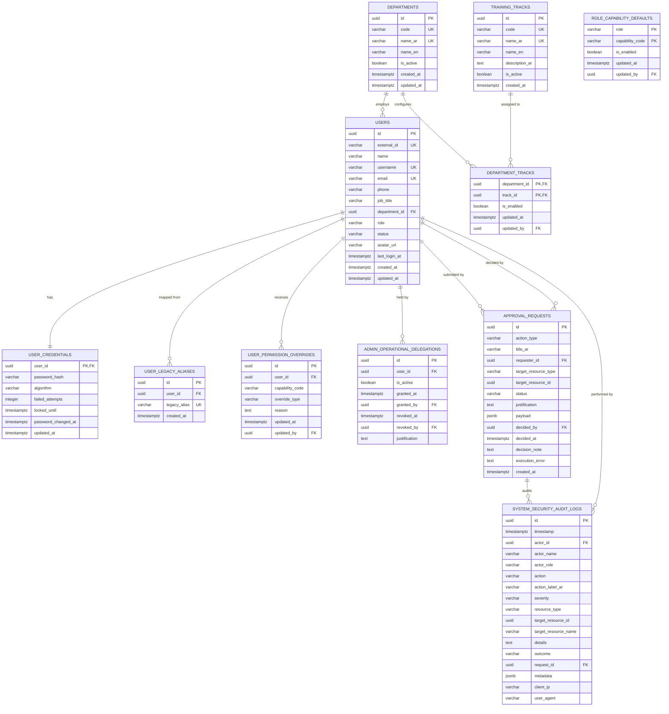
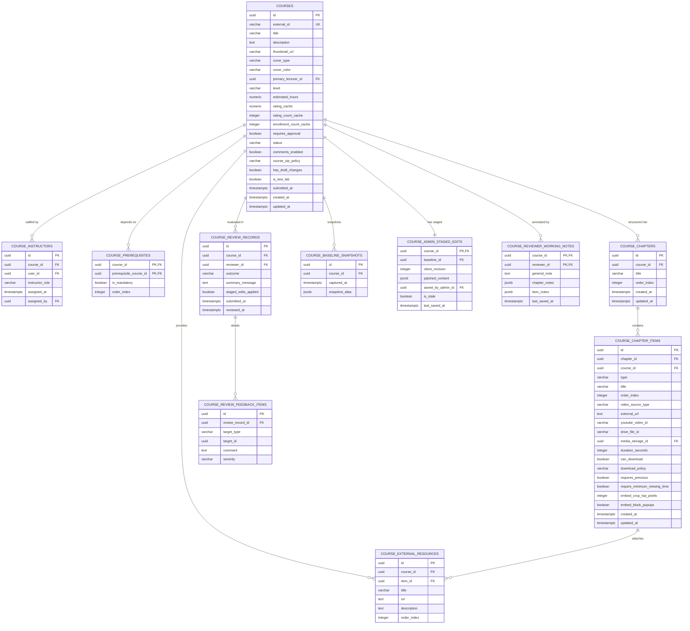
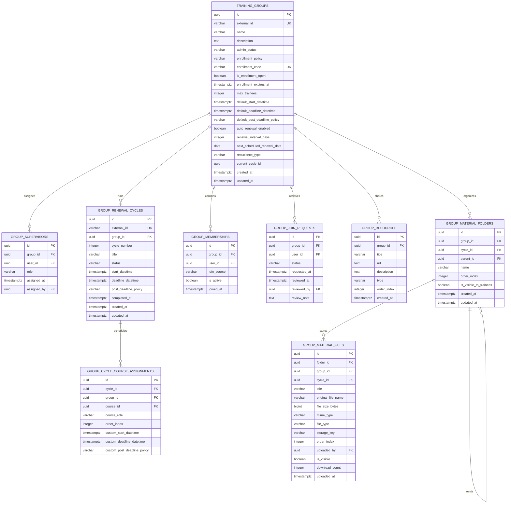
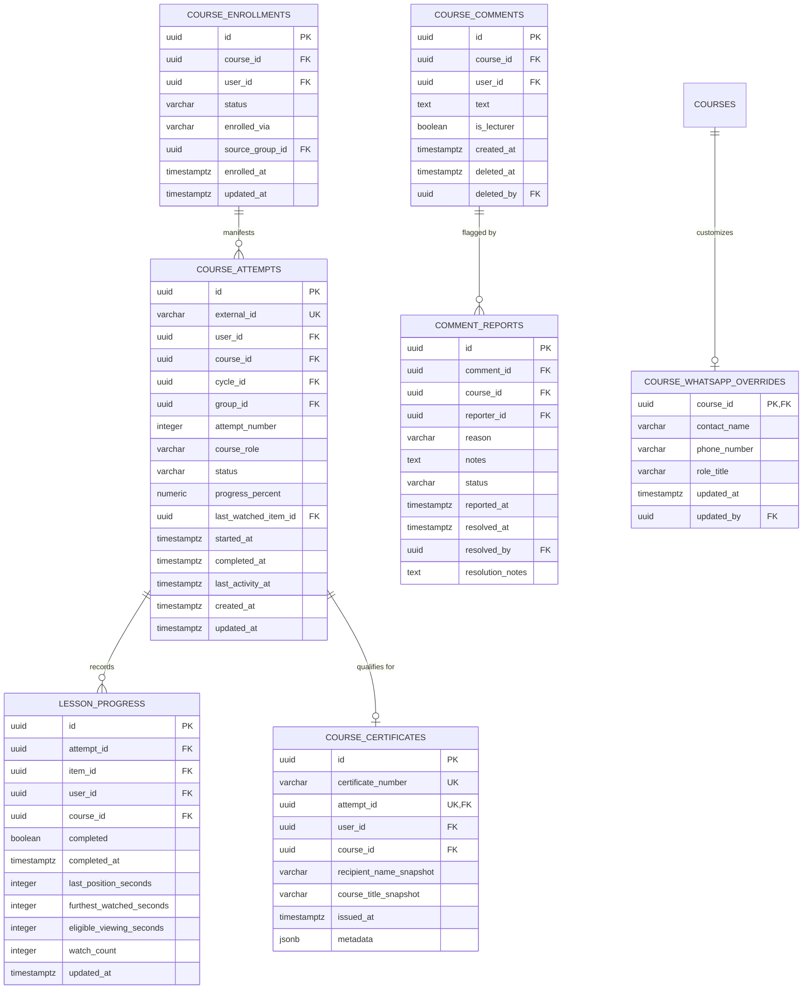

# Metro Courses LMS — Production Relational Database Schema Design & Architecture Review

---

## A. Executive Summary & Design Assumptions

### 1. Purpose of the Production Database Specification
The modern frontend of **Metro Courses LMS** (`frontend/`) has achieved full operational parity with the legacy Vanilla JavaScript application across Increments 1 through 11. Throughout this modernization, client-side application state, multi-role access control, curriculum authoring, group renewals, discussions, and moderation have been driven by an in-memory mock engine (`inMemoryStore.ts`) backed by Mock Service Worker (MSW v2).

While this in-memory architecture has enabled high-velocity testing and UI verification (with 1,174 passing sequential tests across 66 files), an in-memory client-side store is **not** a production persistence layer:
1. **Zero Durable Persistence:** State resets upon browser refresh, tab closure, or pod recreation.
2. **Absence of Concurrency Control:** Simultaneous trainee submissions, group renewals, or administrative edits cannot be coordinated or serialized.
3. **No True Security Boundary:** Client-side mock stores expose all state to the browser runtime; real data isolation, role-based resource filtering, and cryptographic audit security require an authoritative server-side persistence tier.
4. **Data Integrity Fragility:** Relational invariants (referential integrity, foreign-key cascades, unique constraints, and atomic transactions) currently rely on procedural TypeScript assertions rather than database-level enforcement.

This document establishes the authoritative, production-grade relational database schema for the future backend of Metro Courses LMS. It translates the verified business models, frontend domain contracts, and administrative governance policies into an enterprise-ready relational architecture.

---

### 2. Reference Database Engine Assumption
- **Provisional Engine:** **PostgreSQL 16+** is adopted as the provisional reference target for SQL data types, index mechanisms, check constraints, foreign-key behaviors, and native `JSONB` support.
- **Engine Status:** *Provisional Assumption Requiring Owner Ratification.* PostgreSQL is chosen because its advanced transactional DDL, partial indexing, row-level security (RLS) capability, and robust JSONB indexing match the application's audit and snapshot requirements. However, the schema design remains strictly relational and portable to standard ANSI SQL targets (e.g., MySQL 8+, Oracle, SQL Server) if organizational infrastructure mandates an alternative.
- **Framework & ORM Agnosticism:** This specification defines pure relational contracts (tables, columns, foreign keys, constraints, and indexes). It does not bind the project to any specific backend framework (Node.js/Express/Fastify, Go, Python/FastAPI, Java/Spring) or ORM (Prisma, Drizzle, TypeORM, SQLAlchemy, Hibernate).

---

### 3. Data Ownership & Architectural Boundaries
The database schema enforces clear ownership boundaries across domains:
- **Identity & Organization:** The central user directory and canonical departments are authoritative across the platform. Trainees, instructors, assistant administrators, and administrators are records within the same identity boundary, distinguished by canonical roles.
- **Course Authoring & Governance:** Courses are authored by instructors but owned and published by the platform. Editorial drafts, formal review records, and staged administrative modifications are versioned separately from published snapshots.
- **Training Groups & Cohorts:** Groups establish cohort pacing, deadlines, and renewal cycles. Group memberships are decoupled from direct course enrollments.
- **Learning Attempts & History:** Course attempts are append-only per learning cycle. History is preserved: completing or renewing a cycle never overwrites or erases previous attempts or verified lesson progress.
- **Audit & Governance:** Administrative approval requests and security audit logs are immutable, append-only records that outlive the entities they reference.

---

### 4. Scope Classification Matrix

| Category | In-Scope Production Database Components | Explicitly Out-of-Scope (Deferred or Disallowed) |
| :--- | :--- | :--- |
| **Identity & Access** | Canonical users, password hashes (Argon2id/bcrypt), legacy aliases, departments, training tracks, capability ceilings, role defaults, individual permission overrides. | Storing plaintext passwords, social logins, SSO SAML/OIDC (deferred to backend enterprise roadmap). |
| **Courses & Curriculum** | Courses, instructors (primary + co-instructors), prerequisites, chapters, lessons/items, completion policies, embed policies, external resources, review workflows, staged edits, reviewer notes. | Real-time collaborative multi-cursor authoring, direct video streaming servers (video bytes remain in external storage/hosting). |
| **Groups & Cycles** | Cohort groups, supervisors, assistants, renewal cycles, cycle-course assignments with 3-level schedule overrides, group memberships, join requests, QR tokens, group materials (folders/files). | WebRTC signaling servers, real-time socket clusters (handled by external meeting providers like Microsoft Teams / Zoom). |
| **Learning & Assessment** | Authoritative course enrollments, cycle-aware course attempts, granular lesson progress, certificates. | Fabricated playback telemetry, arbitrary continuous heartbeats without client events. |
| **Discussions & Moderation** | Course comments, comment reports, moderation triage records, course-level discussion toggles. | Live WebSocket chat channels, direct peer-to-peer trainee messaging. |
| **WhatsApp Contacts** | Configured course overrides, group contacts, support lines, phone normalization. | Automated message delivery gateways / bot sending engines (WhatsApp links remain client-side `wa.me` links). |
| **Files & Media** | File metadata, MIME types, file sizes, storage provider keys, checksums. | Storing raw binary files/blobs directly inside relational table columns. |
| **Analytics** | Structured session event logs, derived SQL aggregates, materialized reporting views. | Fabricated peak viewing hours without telemetry source events. |

---

## B. Entity Relationship Diagrams (Mermaid)

### 1. System Overview Architecture

```mermaid
erDiagram
    DEPARTMENTS ||--o{ USERS : "employs"
    USERS ||--o{ USER_CREDENTIALS : "authenticates via"
    USERS ||--o{ USER_LEGACY_ALIASES : "identified by"
    USERS ||--o{ USER_PERMISSION_OVERRIDES : "governed by"
    USERS ||--o{ ADMIN_OPERATIONAL_DELEGATIONS : "delegated to"
    USERS ||--o{ APPROVAL_REQUESTS : "requests or decides"
    USERS ||--o{ SYSTEM_SECURITY_AUDIT_LOGS : "acts in"

    USERS ||--o{ COURSE_INSTRUCTORS : "instructs"
    COURSES ||--o{ COURSE_INSTRUCTORS : "assigned to"
    COURSES ||--o{ COURSE_CHAPTERS : "contains"
    COURSE_CHAPTERS ||--o{ COURSE_CHAPTER_ITEMS : "contains"
    COURSES ||--o{ COURSE_PREREQUISITES : "requires"
    COURSES ||--o{ COURSE_REVIEW_RECORDS : "evaluated by"
    COURSES ||--o{ COURSE_COMMENTS : "hosts"
    COURSES ||--o{ COURSE_WHATSAPP_OVERRIDES : "configures"

    USERS ||--o{ GROUP_SUPERVISORS : "supervises"
    TRAINING_GROUPS ||--o{ GROUP_SUPERVISORS : "managed by"
    TRAINING_GROUPS ||--o{ GROUP_RENEWAL_CYCLES : "executes"
    TRAINING_GROUPS ||--o{ GROUP_MEMBERSHIPS : "enrolls"
    USERS ||--o{ GROUP_MEMBERSHIPS : "member of"
    TRAINING_GROUPS ||--o{ GROUP_MATERIAL_FOLDERS : "organizes"
    GROUP_RENEWAL_CYCLES ||--o{ GROUP_CYCLE_COURSE_ASSIGNMENTS : "assigns"
    COURSES ||--o{ GROUP_CYCLE_COURSE_ASSIGNMENTS : "included in"

    USERS ||--o{ COURSE_ENROLLMENTS : "registered for"
    COURSES ||--o{ COURSE_ENROLLMENTS : "has enrolled"
    COURSE_ENROLLMENTS ||--o{ COURSE_ATTEMPTS : "manifests in"
    COURSE_ATTEMPTS ||--o{ LESSON_PROGRESS : "tracks"
    COURSE_CHAPTER_ITEMS ||--o{ LESSON_PROGRESS : "evaluated on"
    COURSE_ATTEMPTS ||--o{ COURSE_CERTIFICATES : "awards"

    COURSE_COMMENTS ||--o{ COMMENT_REPORTS : "flagged by"
    USERS ||--o{ COMMENT_REPORTS : "submitted by"
    USERS ||--o{ COURSE_COMMENTS : "authors"
```



---

### 2. Domain Sub-Diagram 1: Identity, Departments & Permissions Governance



---

### 3. Domain Sub-Diagram 2: Courses, Curriculum & Quality Review Workflow



---

### 4. Domain Sub-Diagram 3: Training Groups, Cycles & Materials



---

### 5. Domain Sub-Diagram 4: Enrollment, Attempts, Progress & Moderated Discussions



---

## C. Table-by-Table Data Dictionary

### 1. Identity & Organization Domain

#### 1.1 `departments`
- **Purpose:** Authoritative registry of Cairo Metro organizational sectors, departments, and general administrations.
- **Frontend Model:** `METRO_DEPARTMENTS` array in `core/user-management/types.ts` and `CanonicalDepartmentDTO` in `core/permissions/types.ts`.

| Column | Type | Nullable | Default | Constraints & Relationships | Description |
| :--- | :--- | :---: | :--- | :--- | :--- |
| `id` | `UUID` | No | `gen_random_uuid()` | **PK** | Internal immutable unique identifier. |
| `code` | `VARCHAR(50)` | No | — | **UNIQUE** | Machine-readable department code (e.g. `DEP_CENTRAL_CONTROL`). |
| `name_ar` | `VARCHAR(255)` | No | — | **UNIQUE** | Official Arabic department name. |
| `name_en` | `VARCHAR(255)` | Yes | `NULL` | — | Optional Latin translation. |
| `is_active` | `BOOLEAN` | No | `TRUE` | — | Soft active status. |
| `created_at` | `TIMESTAMPTZ` | No | `CURRENT_TIMESTAMP` | — | Creation audit timestamp. |
| `updated_at` | `TIMESTAMPTZ` | No | `CURRENT_TIMESTAMP` | — | Modification audit timestamp. |

- **Indexes:** `idx_departments_active (is_active)`, `idx_departments_code (code)`.
- **Classification:** Source Data. Deletion Behavior: `RESTRICT` on referenced users.

---

#### 1.2 `training_tracks`
- **Purpose:** Specialized technical training tracks (e.g., Electrical Maintenance, Signalling, Operations).
- **Frontend Model:** `CANONICAL_TRACKS` and `CanonicalTrackDTO` in `core/permissions/types.ts`.

| Column | Type | Nullable | Default | Constraints & Relationships | Description |
| :--- | :--- | :---: | :--- | :--- | :--- |
| `id` | `UUID` | No | `gen_random_uuid()` | **PK** | Internal unique track identifier. |
| `code` | `VARCHAR(50)` | No | — | **UNIQUE** | Technical track code (e.g. `TRK_ELEC`). |
| `name_ar` | `VARCHAR(255)` | No | — | **UNIQUE** | Arabic track designation. |
| `name_en` | `VARCHAR(255)` | Yes | `NULL` | — | English track name. |
| `description_ar` | `TEXT` | Yes | `NULL` | — | Detailed track curriculum description. |
| `is_active` | `BOOLEAN` | No | `TRUE` | — | Active status. |
| `created_at` | `TIMESTAMPTZ` | No | `CURRENT_TIMESTAMP` | — | Creation timestamp. |

- **Indexes:** `idx_training_tracks_code (code)`.
- **Classification:** Source Data. Deletion Behavior: `RESTRICT`.

---

#### 1.3 `department_tracks`
- **Purpose:** Configurable many-to-many relationship mapping departments to authorized course tracks.
- **Frontend Model:** `DepartmentPermissionDTO` / `INITIAL_DEPARTMENT_TRACKS` in `mocks/fixtures/departmentTracksFixtures.ts`.

| Column | Type | Nullable | Default | Constraints & Relationships | Description |
| :--- | :--- | :---: | :--- | :--- | :--- |
| `department_id` | `UUID` | No | — | **PK**, **FK** -> `departments.id` (`CASCADE`) | Target department. |
| `track_id` | `UUID` | No | — | **PK**, **FK** -> `training_tracks.id` (`RESTRICT`) | Configured track. |
| `is_enabled` | `BOOLEAN` | No | `TRUE` | — | Whether track is enabled for department. |
| `updated_at` | `TIMESTAMPTZ` | No | `CURRENT_TIMESTAMP` | — | Timestamp of last policy adjustment. |
| `updated_by` | `UUID` | Yes | `NULL` | **FK** -> `users.id` (`SET NULL`) | Administrator who modified the mapping. |

- **Classification:** Source Data.

---

#### 1.4 `users`
- **Purpose:** Central personnel directory and user authentication identity.
- **Frontend Model:** `ManagedUserDTO` in `core/user-management/types.ts`.

| Column | Type | Nullable | Default | Constraints & Relationships | Description |
| :--- | :--- | :---: | :--- | :--- | :--- |
| `id` | `UUID` | No | `gen_random_uuid()` | **PK** | Internal surrogate primary key. |
| `external_id` | `VARCHAR(50)` | No | — | **UNIQUE** | Canonical business ID (e.g., `USR001`, `usr_admin_001`). |
| `name` | `VARCHAR(255)` | No | — | — | Full Arabic display name (presentation label only). |
| `username` | `VARCHAR(100)` | No | — | **UNIQUE** | Unique login handle / system identifier. |
| `email` | `VARCHAR(255)` | No | — | **UNIQUE** | Primary corporate email address. |
| `phone` | `VARCHAR(50)` | Yes | `NULL` | — | E.164 normalized registered contact phone number. |
| `job_title` | `VARCHAR(255)` | No | — | — | Professional position / job title. |
| `department_id` | `UUID` | No | — | **FK** -> `departments.id` (`RESTRICT`) | Assigned organizational unit. |
| `role` | `VARCHAR(30)` | No | `'user'` | **CHECK** (`role IN ('admin', 'assistant_admin', 'lecturer', 'user')`) | Four canonical roles. |
| `status` | `VARCHAR(20)` | No | `'active'` | **CHECK** (`status IN ('active', 'suspended')`) | Account lifecycle status. |
| `avatar_url` | `VARCHAR(512)` | Yes | `NULL` | — | Optional user profile image path. |
| `last_login_at` | `TIMESTAMPTZ` | Yes | `NULL` | — | Timestamp of most recent authenticated session. |
| `created_at` | `TIMESTAMPTZ` | No | `CURRENT_TIMESTAMP` | — | Account creation timestamp. |
| `updated_at` | `TIMESTAMPTZ` | No | `CURRENT_TIMESTAMP` | — | Account record modification timestamp. |

- **Indexes:** `idx_users_role (role)`, `idx_users_status (status)`, `idx_users_department (department_id)`, `idx_users_search (name, username, job_title)`.
- **Classification:** Source Data. Deletion Behavior: Soft deletion (`status = 'suspended'` or audit trail retention); Hard deletion strictly forbidden for users with active historical attempts or review records.

---

#### 1.5 `user_credentials`
- **Purpose:** Secure, isolated storage of authentication credentials. Completely separated from public user profile queries.
- **Frontend Model:** Isolated credential ledger (`mockUserCredentials`) in `inMemoryStore.ts`.

| Column | Type | Nullable | Default | Constraints & Relationships | Description |
| :--- | :--- | :---: | :--- | :--- | :--- |
| `user_id` | `UUID` | No | — | **PK**, **FK** -> `users.id` (`CASCADE`) | 1-to-1 association with `users`. |
| `password_hash` | `VARCHAR(255)` | No | — | — | Salted cryptographic hash (Argon2id or bcrypt). |
| `algorithm` | `VARCHAR(50)` | No | `'argon2id'` | — | Hashing algorithm identifier. |
| `failed_attempts` | `INTEGER` | No | `0` | **CHECK** (`failed_attempts >= 0`) | Sequential failed login counter for brute-force lockouts. |
| `locked_until` | `TIMESTAMPTZ` | Yes | `NULL` | — | Temporary lockout expiration time. |
| `password_changed_at` | `TIMESTAMPTZ` | No | `CURRENT_TIMESTAMP` | — | Timestamp of last password rotation. |
| `updated_at` | `TIMESTAMPTZ` | No | `CURRENT_TIMESTAMP` | — | Credential record modification timestamp. |

- **Classification:** Source Data. Never exposed in API responses or user directories.

---

#### 1.6 `user_legacy_aliases`
- **Purpose:** Explicit mapping of verified legacy and synthetic demo identifiers (e.g. `usr_lect_002` $\leftrightarrow$ `USR002`) to canonical user records.
- **Frontend Model:** `legacyAliases` in `ManagedUserDTO` and `resolveCanonicalUserId` in `userDirectoryFixtures.ts`.

| Column | Type | Nullable | Default | Constraints & Relationships | Description |
| :--- | :--- | :---: | :--- | :--- | :--- |
| `id` | `UUID` | No | `gen_random_uuid()` | **PK** | Unique alias entry identifier. |
| `user_id` | `UUID` | No | — | **FK** -> `users.id` (`CASCADE`) | Canonical user reference. |
| `legacy_alias` | `VARCHAR(100)` | No | — | **UNIQUE** | Historical or synthetic alias string. |
| `created_at` | `TIMESTAMPTZ` | No | `CURRENT_TIMESTAMP` | — | Registration timestamp. |

- **Indexes:** `idx_legacy_aliases_alias (LOWER(legacy_alias))`.
- **Classification:** Source Data / Identity Resolution Mapping.

---

### 2. Permissions & Administrative Governance Domain

#### 2.1 `system_capabilities`
- **Purpose:** Master dictionary of all 34 semantic system capabilities across the 12 operational areas.
- **Frontend Model:** `SystemCapability` in `core/permissions/types.ts`.

| Column | Type | Nullable | Default | Constraints & Relationships | Description |
| :--- | :--- | :---: | :--- | :--- | :--- |
| `code` | `VARCHAR(100)` | No | — | **PK** | Semantic capability key (e.g. `courses.create`, `users.delete`). |
| `category` | `VARCHAR(100)` | No | — | — | Operational category (e.g., `user_management`, `curriculum`). |
| `description_ar` | `VARCHAR(255)` | No | — | — | Arabic human-readable capability description. |
| `is_governance_action` | `BOOLEAN` | No | `FALSE` | — | Whether action triggers dual-control approval for assistant admins. |

- **Classification:** Reference Seed Data.

---

#### 2.2 `role_capability_defaults`
- **Purpose:** Administrator-configurable shared role permission baselines (within code-defined role ceilings).
- **Frontend Model:** `RolePermissionsConfig` in `core/permissions/types.ts`.

| Column | Type | Nullable | Default | Constraints & Relationships | Description |
| :--- | :--- | :---: | :--- | :--- | :--- |
| `role` | `VARCHAR(30)` | No | — | **PK**, **CHECK** (`role IN ('admin', 'assistant_admin', 'lecturer', 'user')`) | Canonical role. |
| `capability_code` | `VARCHAR(100)` | No | — | **PK**, **FK** -> `system_capabilities.code` (`RESTRICT`) | Target capability. |
| `is_enabled` | `BOOLEAN` | No | `TRUE` | — | Whether capability is granted by default to the role. |
| `updated_at` | `TIMESTAMPTZ` | No | `CURRENT_TIMESTAMP` | — | Last modification timestamp. |
| `updated_by` | `UUID` | Yes | `NULL` | **FK** -> `users.id` (`SET NULL`) | Administrator who updated role baseline. |

- **Classification:** Configurable Baseline Data.

---

#### 2.3 `user_permission_overrides`
- **Purpose:** User-specific grants or revocations configured within that user's immutable role capability ceiling.
- **Frontend Model:** `UserPermissionOverride` in `core/permissions/types.ts`.

| Column | Type | Nullable | Default | Constraints & Relationships | Description |
| :--- | :--- | :---: | :--- | :--- | :--- |
| `id` | `UUID` | No | `gen_random_uuid()` | **PK** | Unique override entry ID. |
| `user_id` | `UUID` | No | — | **FK** -> `users.id` (`CASCADE`) | Target user. |
| `capability_code` | `VARCHAR(100)` | No | — | **FK** -> `system_capabilities.code` (`RESTRICT`) | Overridden capability. |
| `override_type` | `VARCHAR(10)` | No | — | **CHECK** (`override_type IN ('grant', 'revoke')`) | Direction of override. |
| `reason` | `TEXT` | Yes | `NULL` | — | Mandatory administrative justification for compliance audit. |
| `updated_at` | `TIMESTAMPTZ` | No | `CURRENT_TIMESTAMP` | — | Modification timestamp. |
| `updated_by` | `UUID` | No | — | **FK** -> `users.id` (`RESTRICT`) | Authorizing administrator. |

- **Constraints:** **UNIQUE** (`user_id`, `capability_code`).
- **Indexes:** `idx_user_overrides_lookup (user_id, capability_code)`.
- **Classification:** Source Data.

---

#### 2.4 `admin_operational_delegations`
- **Purpose:** Active operational delegations granting Assistant Administrators direct execution authority (bypassing approval requests).
- **Frontend Model:** `delegatedOperationalAuthority` in `inMemoryStore.ts` and `permissions.manage_delegation`.

| Column | Type | Nullable | Default | Constraints & Relationships | Description |
| :--- | :--- | :---: | :--- | :--- | :--- |
| `id` | `UUID` | No | `gen_random_uuid()` | **PK** | Unique delegation record ID. |
| `user_id` | `UUID` | No | — | **FK** -> `users.id` (`CASCADE`) | Assistant Administrator receiving delegation. |
| `is_active` | `BOOLEAN` | No | `TRUE` | — | Active delegation state. |
| `granted_at` | `TIMESTAMPTZ` | No | `CURRENT_TIMESTAMP` | — | Grant timestamp. |
| `granted_by` | `UUID` | No | — | **FK** -> `users.id` (`RESTRICT`) | System Administrator who granted delegation. |
| `revoked_at` | `TIMESTAMPTZ` | Yes | `NULL` | — | Revocation timestamp if revoked. |
| `revoked_by` | `UUID` | Yes | `NULL` | **FK** -> `users.id` (`SET NULL`) | Administrator who revoked delegation. |
| `justification` | `TEXT` | No | — | — | Formal operational justification. |

- **Indexes:** `idx_active_delegations (user_id, is_active)`.
- **Classification:** Source Data / Governance Ledger.

---

#### 2.5 `approval_requests`
- **Purpose:** Central dual-control administrative governance queue for proposed non-delegated operations.
- **Frontend Model:** `ApprovalRequest` in `core/permissions/types.ts`.

| Column | Type | Nullable | Default | Constraints & Relationships | Description |
| :--- | :--- | :---: | :--- | :--- | :--- |
| `id` | `UUID` | No | `gen_random_uuid()` | **PK** | Unique approval request ID. |
| `action_type` | `VARCHAR(50)` | No | — | — | Standard approval action code (e.g. `USER_DELETE`, `COMMENT_DELETE`). |
| `title_ar` | `VARCHAR(255)` | No | — | — | Localized Arabic request description. |
| `requester_id` | `UUID` | No | — | **FK** -> `users.id` (`RESTRICT`) | Assistant Administrator submitting the proposal. |
| `target_resource_type` | `VARCHAR(50)` | Yes | `NULL` | — | Entity type (e.g. `user`, `course`, `group`, `comment`). |
| `target_resource_id` | `UUID` | Yes | `NULL` | — | Identifier of entity being modified. |
| `status` | `VARCHAR(30)` | No | `'pending'` | **CHECK** (`status IN ('pending', 'approved', 'rejected', 'failed_execution')`) | Lifecycle status. |
| `justification` | `TEXT` | Yes | `NULL` | — | Requester's operational rationale. |
| `payload` | `JSONB` | No | `'{}'::jsonb` | — | Structured arguments required to execute the action upon approval. |
| `decided_by` | `UUID` | Yes | `NULL` | **FK** -> `users.id` (`RESTRICT`) | System Administrator deciding the request. |
| `decided_at` | `TIMESTAMPTZ` | Yes | `NULL` | — | Decision timestamp. |
| `decision_note` | `TEXT` | Yes | `NULL` | — | Admin rationale for approval or rejection. |
| `execution_error` | `TEXT` | Yes | `NULL` | — | Error trace if execution failed post-approval. |
| `created_at` | `TIMESTAMPTZ` | No | `CURRENT_TIMESTAMP` | — | Submission timestamp. |
| `updated_at` | `TIMESTAMPTZ` | No | `CURRENT_TIMESTAMP` | — | State transition timestamp. |

- **Indexes:** `idx_approvals_status (status)`, `idx_approvals_requester (requester_id)`.
- **Classification:** Governance State Ledger. Note: Payloads are kept as `JSONB` because the arguments vary by `action_type`.

---

#### 2.6 `system_security_audit_logs`
- **Purpose:** Append-only cryptographic and compliance audit trail recording all security and administrative events.
- **Frontend Model:** `SystemAuditLogEntryDTO` in `core/permissions/types.ts`.

| Column | Type | Nullable | Default | Constraints & Relationships | Description |
| :--- | :--- | :---: | :--- | :--- | :--- |
| `id` | `UUID` | No | `gen_random_uuid()` | **PK** | Immutable unique log ID. |
| `timestamp` | `TIMESTAMPTZ` | No | `CURRENT_TIMESTAMP` | — | Exact server timestamp of occurrence. |
| `actor_id` | `UUID` | No | — | **FK** -> `users.id` (`RESTRICT`) | User performing or attempting the operation. |
| `actor_name` | `VARCHAR(255)` | No | — | — | Snapshot of actor display name at event time. |
| `actor_role` | `VARCHAR(30)` | No | — | — | Snapshot of actor role at event time. |
| `action` | `VARCHAR(100)` | No | — | — | Semantic event code (e.g. `users.change_role`, `comments.delete`). |
| `action_label_ar` | `VARCHAR(255)` | No | — | — | Arabic event summary. |
| `severity` | `VARCHAR(20)` | No | `'info'` | **CHECK** (`severity IN ('info', 'warning', 'critical')`) | Severity ranking. |
| `resource_type` | `VARCHAR(50)` | Yes | `NULL` | — | Target entity classification. |
| `target_resource_id` | `UUID` | Yes | `NULL` | — | Target entity ID. |
| `target_resource_name` | `VARCHAR(255)` | Yes | `NULL` | — | Target entity human title at event time. |
| `details` | `TEXT` | No | — | — | Detailed narrative description of changes. |
| `outcome` | `VARCHAR(30)` | No | — | **CHECK** (`outcome IN ('success', 'denied', 'failed', 'pending_approval', 'rejected')`) | Operational result. |
| `request_id` | `UUID` | Yes | `NULL` | **FK** -> `approval_requests.id` (`SET NULL`) | Linked approval proposal if applicable. |
| `metadata` | `JSONB` | Yes | `'{}'::jsonb` | — | Structured contextual delta (old values vs new values). |
| `client_ip` | `VARCHAR(45)` | Yes | `NULL` | — | Originating client IP address. |
| `user_agent` | `VARCHAR(512)` | Yes | `NULL` | — | Client user-agent string. |

- **Indexes:** `idx_audit_timestamp (timestamp DESC)`, `idx_audit_actor (actor_id)`, `idx_audit_action (action)`, `idx_audit_outcome (outcome)`.
- **Classification:** Immutable Compliance Ledger. No updates or deletions permitted (`REVOKE UPDATE, DELETE ON system_security_audit_logs`).

---

### 3. Courses, Curriculum & Review Domain

#### 3.1 `courses`
- **Purpose:** Core training course entity within the Cairo Metro learning catalog.
- **Frontend Model:** `Course` in `core/courses/types.ts`.

| Column | Type | Nullable | Default | Constraints & Relationships | Description |
| :--- | :--- | :---: | :--- | :--- | :--- |
| `id` | `UUID` | No | `gen_random_uuid()` | **PK** | Internal surrogate primary key. |
| `external_id` | `VARCHAR(50)` | No | — | **UNIQUE** | Canonical course code (e.g., `CRS001`, `CRS002`). |
| `title` | `VARCHAR(255)` | No | — | — | Course title in Arabic. |
| `description` | `TEXT` | No | — | — | Detailed syllabus and objective description. |
| `thumbnail_url` | `VARCHAR(512)` | Yes | `NULL` | — | Course card preview thumbnail. |
| `cover_type` | `VARCHAR(20)` | No | `'default'` | **CHECK** (`cover_type IN ('image', 'color', 'default')`) | Card styling treatment. |
| `cover_color` | `VARCHAR(50)` | Yes | `NULL` | — | Hex/RGB code if color cover. |
| `primary_lecturer_id` | `UUID` | No | — | **FK** -> `users.id` (`RESTRICT`) | Authoritative primary lecturer. |
| `level` | `VARCHAR(20)` | No | `'مبتدئ'` | **CHECK** (`level IN ('مبتدئ', 'متوسط', 'متقدم')`) | Difficulty level. |
| `estimated_hours` | `NUMERIC(5,2)` | No | `0.00` | **CHECK** (`estimated_hours >= 0`) | Course syllabus estimated duration in hours. |
| `rating_cache` | `NUMERIC(3,2)` | No | `0.00` | — | Cached average star rating. |
| `rating_count_cache` | `INTEGER` | No | `0` | — | Cached total review ratings count. |
| `enrollment_count_cache` | `INTEGER` | No | `0` | — | Cached active trainee enrollment count. |
| `completion_count_cache` | `INTEGER` | No | `0` | — | Cached total successful completions count. |
| `requires_approval` | `BOOLEAN` | No | `FALSE` | — | Whether self-enrollment requires supervisor approval. |
| `status` | `VARCHAR(30)` | No | `'draft'` | **CHECK** (`status IN ('published', 'live', 'draft', 'pending_admin', 'pending_owner', 'hidden')`) | Publication state. |
| `comments_enabled` | `BOOLEAN` | No | `TRUE` | — | Discussion policy toggle. |
| `course_zip_policy` | `VARCHAR(30)` | No | `'disabled'` | **CHECK** (`course_zip_policy IN ('disabled', 'immediate', 'after_course_completion')`) | Offline package policy. |
| `has_draft_changes` | `BOOLEAN` | No | `FALSE` | — | Indicates unsaved working draft exists. |
| `is_test_lab` | `BOOLEAN` | No | `FALSE` | — | Designated media test lab course. |
| `submitted_at` | `TIMESTAMPTZ` | Yes | `NULL` | — | Timestamp of submission to review queue. |
| `created_at` | `TIMESTAMPTZ` | No | `CURRENT_TIMESTAMP` | — | Creation timestamp. |
| `updated_at` | `TIMESTAMPTZ` | No | `CURRENT_TIMESTAMP` | — | Last modification timestamp. |

- **Indexes:** `idx_courses_status (status)`, `idx_courses_primary_lecturer (primary_lecturer_id)`, `idx_courses_level (level)`.
- **Classification:** Source Data with selective cached aggregate columns.

---

#### 3.2 `course_instructors`
- **Purpose:** Normalized assignment of instructors to courses, strictly resolving primary and co-instructors without competing sources of truth.
- **Frontend Model:** `lecturerId` and `coLecturers` in `Course` (`core/courses/types.ts`).

| Column | Type | Nullable | Default | Constraints & Relationships | Description |
| :--- | :--- | :---: | :--- | :--- | :--- |
| `id` | `UUID` | No | `gen_random_uuid()` | **PK** | Unique assignment record ID. |
| `course_id` | `UUID` | No | — | **FK** -> `courses.id` (`CASCADE`) | Target course. |
| `user_id` | `UUID` | No | — | **FK** -> `users.id` (`RESTRICT`) | Instructor personnel record. |
| `instructor_role` | `VARCHAR(30)` | No | `'co_instructor'` | **CHECK** (`instructor_role IN ('primary', 'co_instructor')`) | Instructional tier. |
| `assigned_at` | `TIMESTAMPTZ` | No | `CURRENT_TIMESTAMP` | — | Assignment date. |
| `assigned_by` | `UUID` | No | — | **FK** -> `users.id` (`RESTRICT`) | Administrator who made the assignment. |

- **Constraints:** **UNIQUE** (`course_id`, `user_id`). Exactly one row with `instructor_role = 'primary'` per `course_id` (enforced via partial unique index `idx_course_single_primary`).
- **Indexes:** `idx_course_instructors_user (user_id)`.
- **Classification:** Source Data.

---

#### 3.3 `course_prerequisites`
- **Purpose:** Relational prerequisite dependencies between catalog courses.
- **Frontend Model:** `prerequisiteCourseIds` in `Course` (`core/courses/types.ts`).

| Column | Type | Nullable | Default | Constraints & Relationships | Description |
| :--- | :--- | :---: | :--- | :--- | :--- |
| `course_id` | `UUID` | No | — | **PK**, **FK** -> `courses.id` (`CASCADE`) | Course requiring prerequisite. |
| `prerequisite_course_id` | `UUID` | No | — | **PK**, **FK** -> `courses.id` (`RESTRICT`) | Required prerequisite course. |
| `is_mandatory` | `BOOLEAN` | No | `TRUE` | — | Strict gate vs advisory prerequisite. |
| `order_index` | `INTEGER` | No | `0` | — | Display order. |

- **Constraints:** **CHECK** (`course_id <> prerequisite_course_id`) (anti-self-dependency).
- **Classification:** Source Data.

---

#### 3.4 `course_chapters`
- **Purpose:** Ordered thematic curriculum modules within a course.
- **Frontend Model:** `CourseChapter` in `core/courses/types.ts`.

| Column | Type | Nullable | Default | Constraints & Relationships | Description |
| :--- | :--- | :---: | :--- | :--- | :--- |
| `id` | `UUID` | No | `gen_random_uuid()` | **PK** | Chapter unique identifier. |
| `course_id` | `UUID` | No | — | **FK** -> `courses.id` (`CASCADE`) | Parent course. |
| `title` | `VARCHAR(255)` | No | — | — | Arabic chapter title. |
| `order_index` | `INTEGER` | No | `0` | — | Sequential ordering within the course. |
| `created_at` | `TIMESTAMPTZ` | No | `CURRENT_TIMESTAMP` | — | Creation timestamp. |
| `updated_at` | `TIMESTAMPTZ` | No | `CURRENT_TIMESTAMP` | — | Modification timestamp. |

- **Indexes:** `idx_chapters_course_order (course_id, order_index)`.
- **Classification:** Source Data.

---

#### 3.5 `course_chapter_items`
- **Purpose:** Individual curriculum lessons, lecture videos, PDFs, and interactive learning items.
- **Frontend Model:** `ChapterItem` in `core/courses/types.ts`.

| Column | Type | Nullable | Default | Constraints & Relationships | Description |
| :--- | :--- | :---: | :--- | :--- | :--- |
| `id` | `UUID` | No | `gen_random_uuid()` | **PK** | Lesson item unique identifier. |
| `chapter_id` | `UUID` | No | — | **FK** -> `course_chapters.id` (`CASCADE`) | Parent chapter. |
| `course_id` | `UUID` | No | — | **FK** -> `courses.id` (`CASCADE`) | Parent course (denormalized FK for query speed). |
| `type` | `VARCHAR(30)` | No | `'video'` | **CHECK** (`type IN ('video', 'pdf', 'image', 'powerpoint', 'docx', 'zip', 'audio', 'other')`) | Media format classification. |
| `title` | `VARCHAR(255)` | No | — | — | Arabic lesson title. |
| `order_index` | `INTEGER` | No | `0` | — | Sequential ordering within chapter. |
| `video_source_type` | `VARCHAR(30)` | Yes | `NULL` | **CHECK** (`video_source_type IS NULL OR video_source_type IN ('upload', 'youtube', 'drive')`) | Video provider origin. |
| `external_url` | `TEXT` | Yes | `NULL` | — | Raw external media URL. |
| `youtube_video_id` | `VARCHAR(50)` | Yes | `NULL` | — | Clean YouTube 11-char ID. |
| `drive_file_id` | `VARCHAR(100)` | Yes | `NULL` | — | Google Drive unique file identifier. |
| `media_storage_id` | `UUID` | Yes | `NULL` | **FK** -> `media_storage_objects.id` (`SET NULL`) | Reference to persistent uploaded file object. |
| `duration_seconds` | `INTEGER` | Yes | `0` | **CHECK** (`duration_seconds >= 0`) | Media duration in seconds. |
| `can_download` | `BOOLEAN` | No | `FALSE` | — | Download toggle. |
| `download_policy` | `VARCHAR(30)` | No | `'never'` | **CHECK** (`download_policy IN ('never', 'immediate', 'after_item_completion', 'after_course_completion')`) | Trainee download rule. |
| `requires_previous` | `BOOLEAN` | No | `FALSE` | — | Strict sequential viewing lock. |
| `require_minimum_viewing_time` | `BOOLEAN` | No | `FALSE` | — | Requires trainee to watch for duration before marking complete. |
| `embed_crop_top_pixels` | `INTEGER` | No | `0` | — | Pixels to crop from top of embed (Google Drive viewer). |
| `embed_block_popups` | `BOOLEAN` | No | `FALSE` | — | Sandbox iframe popup-blocking rule. |
| `created_at` | `TIMESTAMPTZ` | No | `CURRENT_TIMESTAMP` | — | Creation timestamp. |
| `updated_at` | `TIMESTAMPTZ` | No | `CURRENT_TIMESTAMP` | — | Modification timestamp. |

- **Indexes:** `idx_items_chapter_order (chapter_id, order_index)`, `idx_items_course (course_id)`.
- **Classification:** Source Data.

---

#### 3.6 `course_review_records` & `course_review_feedback_items`
- **Purpose:** Formal course review workflow records for quality audits prior to catalog publication.
- **Frontend Model:** `CourseActiveReviewFeedback` & `ReviewFeedbackItem` in `core/courses/types.ts`.

| Table | Column | Type | Nullable | Constraints & Description |
| :--- | :--- | :--- | :---: | :--- |
| `course_review_records` | `id` | `UUID` | No | **PK**, `gen_random_uuid()`. |
| | `course_id` | `UUID` | No | **FK** -> `courses.id` (`CASCADE`). |
| | `reviewer_id` | `UUID` | No | **FK** -> `users.id` (`RESTRICT`) (Reviewing administrator). |
| | `outcome` | `VARCHAR(50)` | No | **CHECK** (`outcome IN ('approved', 'returned_with_admin_edits', 'rejected')`). |
| | `summary_message` | `TEXT` | No | Executive review feedback note. |
| | `staged_edits_applied`| `BOOLEAN` | No | `FALSE`. Indicates if staged changes were committed to live course. |
| | `submitted_at` | `TIMESTAMPTZ`| No | Submission timestamp from lecturer. |
| | `reviewed_at` | `TIMESTAMPTZ`| No | Decision timestamp. |
| `course_review_feedback_items` | `id` | `UUID` | No | **PK**, `gen_random_uuid()`. |
| | `review_record_id` | `UUID` | No | **FK** -> `course_review_records.id` (`CASCADE`). |
| | `target_type` | `VARCHAR(20)` | No | **CHECK** (`target_type IN ('course', 'chapter', 'item')`). |
| | `target_id` | `UUID` | No | Target entity identifier. |
| | `comment` | `TEXT` | No | Specific review directive. |
| | `severity` | `VARCHAR(20)` | No | **CHECK** (`severity IN ('required', 'suggestion', 'note')`). |

- **Classification:** Governance Review Data.

---

#### 3.7 `course_baseline_snapshots`, `course_admin_staged_edits` & `course_reviewer_working_notes`
- **Purpose:** Supporting tables for the dual-snapshot Diff Viewer, admin staged draft revisions, and private reviewer annotations.
- **Frontend Model:** `CourseBaselineSnapshot`, `StagedAdminEditsRecord`, `ReviewerWorkingNotes` in `core/courses/types.ts`.

| Table | Key Column | Storage Type | Details & Integrity Rules |
| :--- | :--- | :--- | :--- |
| `course_baseline_snapshots` | `course_id` (FK) | `snapshot_data JSONB` | Immutable deep snapshot of course metadata & chapters captured at submission. Used by Diff Viewer. |
| `course_admin_staged_edits` | `course_id` (PK, FK) | `patched_content JSONB`, `client_revision INT` | Working draft edits created by administrator during review, serialized safely until merged or discarded. |
| `course_reviewer_working_notes` | `course_id`, `reviewer_id` (PK) | `chapter_notes JSONB`, `item_notes JSONB` | Private notes visible strictly to the authoring reviewer (`403 Forbidden` for lecturers). |

---

#### 3.8 `course_external_resources`
- **Purpose:** Supplementary external reference links, online reading materials, and documentation attachments associated with an entire course or linked to a specific chapter item.
- **Frontend Model:** `ExternalResource` in `core/courses/types.ts`.

| Column | Type | Nullable | Default | Constraints & Relationships | Description |
| :--- | :--- | :---: | :--- | :--- | :--- |
| `id` | `UUID` | No | `gen_random_uuid()` | **PK** | Unique resource identifier. |
| `course_id` | `UUID` | No | — | **FK** -> `courses.id` (`CASCADE`) | Parent course. |
| `item_id` | `UUID` | Yes | `NULL` | **FK** -> `course_chapter_items.id` (`CASCADE`) | Optional specific lesson item attachment (NULL if attached to whole course). |
| `title` | `VARCHAR(255)` | No | — | — | User-facing resource title in Arabic/English. |
| `url` | `TEXT` | No | — | — | External web reference URL or download link. |
| `description` | `TEXT` | Yes | `NULL` | — | Contextual usage description or instructions. |
| `order_index` | `INTEGER` | No | `0` | — | Display sequence within course or item resource drawer. |
| `created_at` | `TIMESTAMPTZ` | No | `CURRENT_TIMESTAMP` | — | Creation timestamp. |

- **Indexes:** `idx_external_resources_course (course_id)`, `idx_external_resources_item (item_id)`.
- **Classification:** Source Data. Deletion Behavior: `CASCADE`.

---

### 4. Training Groups & Renewal Cycles Domain

#### 4.1 `training_groups`
- **Purpose:** Training cohort entities organizing trainees, supervisor oversight, deadline schedules, and renewal cycles.
- **Frontend Model:** `TrainingGroup` in `core/groups/types.ts`.

| Column | Type | Nullable | Default | Constraints & Relationships | Description |
| :--- | :--- | :---: | :--- | :--- | :--- |
| `id` | `UUID` | No | `gen_random_uuid()` | **PK** | Internal unique surrogate ID. |
| `external_id` | `VARCHAR(50)` | No | — | **UNIQUE** | Canonical cohort ID (e.g. `GRP101`, `GRP102`). |
| `name` | `VARCHAR(255)` | No | — | — | Arabic cohort group name. |
| `description` | `TEXT` | No | — | — | Cohort objective and department focus. |
| `admin_status` | `VARCHAR(20)` | No | `'active'` | **CHECK** (`admin_status IN ('draft', 'active', 'archived')`) | Group lifecycle status. |
| `enrollment_policy` | `VARCHAR(30)` | No | `'open'` | **CHECK** (`enrollment_policy IN ('open', 'approval_required', 'closed')`) | Trainee join rule. |
| `enrollment_code` | `VARCHAR(50)` | Yes | `NULL` | **UNIQUE** | 6-char or alphanumeric QR join token. |
| `is_enrollment_open` | `BOOLEAN` | No | `TRUE` | — | Fast toggle for accepting new members. |
| `enrollment_expires_at`| `TIMESTAMPTZ` | Yes | `NULL` | — | QR/code expiration deadline. |
| `max_trainees` | `INTEGER` | Yes | `NULL` | **CHECK** (`max_trainees IS NULL OR max_trainees > 0`) | Trainee capacity ceiling. |
| `default_start_datetime` | `TIMESTAMPTZ` | No | — | — | Fallback group start time. |
| `default_deadline_datetime`| `TIMESTAMPTZ` | No | — | — | Fallback group completion deadline. |
| `default_post_deadline_policy`| `VARCHAR(30)` | No | `'keep_no_cert'` | **CHECK** (`default_post_deadline_policy IN ('keep_no_cert', 'hide')`) | Fallback post-deadline policy. |
| `auto_renewal_enabled` | `BOOLEAN` | No | `FALSE` | — | Recurring cycle automation toggle. |
| `renewal_interval_days`| `INTEGER` | Yes | `NULL` | **CHECK** (`renewal_interval_days IS NULL OR renewal_interval_days > 0`) | Custom cycle recurrence length in days. |
| `next_scheduled_renewal_date`| `DATE` | Yes | `NULL` | — | Computed calendar date for next cycle trigger. |
| `recurrence_type` | `VARCHAR(20)` | No | `'none'` | **CHECK** (`recurrence_type IN ('none', 'monthly', 'bimonthly', 'quarterly', 'custom')`) | Interval category. |
| `current_cycle_id` | `UUID` | Yes | `NULL` | — | Reference to active `group_renewal_cycles.id`. |
| `created_at` | `TIMESTAMPTZ` | No | `CURRENT_TIMESTAMP` | — | Group creation date. |
| `updated_at` | `TIMESTAMPTZ` | No | `CURRENT_TIMESTAMP` | — | Group modification date. |

- **Constraints:** **CHECK** (`default_deadline_datetime > default_start_datetime`).
- **Indexes:** `idx_groups_admin_status (admin_status)`, `idx_groups_enrollment_code (enrollment_code)`.
- **Classification:** Source Data.

---

#### 4.2 `group_supervisors`
- **Purpose:** Normalized assignment of primary supervisors and assistant lecturers to training groups.
- **Frontend Model:** `supervisorIds` in `TrainingGroup` and `groupAssistantAssignments` in `inMemoryStore.ts`.

| Column | Type | Nullable | Default | Constraints & Relationships | Description |
| :--- | :--- | :---: | :--- | :--- | :--- |
| `id` | `UUID` | No | `gen_random_uuid()` | **PK** | Unique assignment record ID. |
| `group_id` | `UUID` | No | — | **FK** -> `training_groups.id` (`CASCADE`) | Target group. |
| `user_id` | `UUID` | No | — | **FK** -> `users.id` (`RESTRICT`) | Assigned instructor/supervisor. |
| `role` | `VARCHAR(30)` | No | `'supervisor'` | **CHECK** (`role IN ('supervisor', 'assistant')`) | Supervisory role within the group. |
| `assigned_at` | `TIMESTAMPTZ` | No | `CURRENT_TIMESTAMP` | — | Assignment date. |
| `assigned_by` | `UUID` | No | — | **FK** -> `users.id` (`RESTRICT`) | Authorizing administrator. |

- **Constraints:** **UNIQUE** (`group_id`, `user_id`, `role`).
- **Indexes:** `idx_group_supervisors_user (user_id)`.
- **Classification:** Source Data.

---

#### 4.3 `group_renewal_cycles`
- **Purpose:** Formal historical training cycles preserving historical attempts, cohort iterations, and recurring deadlines.
- **Frontend Model:** `GroupRenewalCycle` in `core/groups/types.ts`.

| Column | Type | Nullable | Default | Constraints & Relationships | Description |
| :--- | :--- | :---: | :--- | :--- | :--- |
| `id` | `UUID` | No | `gen_random_uuid()` | **PK** | Internal unique cycle ID. |
| `external_id` | `VARCHAR(50)` | No | — | **UNIQUE** | Canonical cycle code (e.g. `CYC-GRP101-01`). |
| `group_id` | `UUID` | No | — | **FK** -> `training_groups.id` (`CASCADE`) | Parent group. |
| `cycle_number` | `INTEGER` | No | — | **CHECK** (`cycle_number > 0`) | Sequential cycle iteration (1, 2, 3...). |
| `title` | `VARCHAR(255)` | No | — | — | Cycle designation (e.g. "دورة أبريل - مايو 2026"). |
| `status` | `VARCHAR(30)` | No | `'active'` | **CHECK** (`status IN ('active', 'completed', 'archived')`) | Cycle operational status. |
| `start_datetime` | `TIMESTAMPTZ` | No | — | — | Cycle baseline start timestamp. |
| `deadline_datetime` | `TIMESTAMPTZ` | No | — | — | Cycle baseline completion deadline. |
| `post_deadline_policy`| `VARCHAR(30)` | No | `'keep_no_cert'` | **CHECK** (`post_deadline_policy IN ('keep_no_cert', 'hide')`) | Cycle post-deadline policy. |
| `completed_at` | `TIMESTAMPTZ` | Yes | `NULL` | — | Timestamp when cycle was formally closed. |
| `created_at` | `TIMESTAMPTZ` | No | `CURRENT_TIMESTAMP` | — | Creation timestamp. |
| `updated_at` | `TIMESTAMPTZ` | No | `CURRENT_TIMESTAMP` | — | Modification timestamp. |

- **Constraints:** **UNIQUE** (`group_id`, `cycle_number`), **CHECK** (`deadline_datetime > start_datetime`).
- **Indexes:** `idx_cycles_group_status (group_id, status)`.
- **Classification:** Source Data / Historical Cycle Log.

---

#### 4.4 `group_cycle_course_assignments`
- **Purpose:** Assigned courses per cycle with 3-level schedule precedence (Course Override > Cycle Setting > Group Default).
- **Frontend Model:** `GroupCycleCourseAssignment` in `core/groups/types.ts`.

| Column | Type | Nullable | Default | Constraints & Relationships | Description |
| :--- | :--- | :---: | :--- | :--- | :--- |
| `id` | `UUID` | No | `gen_random_uuid()` | **PK** | Assignment ID. |
| `cycle_id` | `UUID` | No | — | **FK** -> `group_renewal_cycles.id` (`CASCADE`) | Associated cycle. |
| `group_id` | `UUID` | No | — | **FK** -> `training_groups.id` (`CASCADE`) | Parent group. |
| `course_id` | `UUID` | No | — | **FK** -> `courses.id` (`RESTRICT`) | Target course. |
| `course_role` | `VARCHAR(20)` | No | `'core'` | **CHECK** (`course_role IN ('core', 'reminder')`) | Educational tier. |
| `order_index` | `INTEGER` | No | `0` | — | Display sequence. |
| `custom_start_datetime` | `TIMESTAMPTZ` | Yes | `NULL` | — | Optional level-1 start override. |
| `custom_deadline_datetime`| `TIMESTAMPTZ` | Yes | `NULL` | — | Optional level-1 deadline override. |
| `custom_post_deadline_policy`| `VARCHAR(30)` | Yes | `NULL` | **CHECK** (`custom_post_deadline_policy IS NULL OR custom_post_deadline_policy IN ('keep_no_cert', 'hide')`) | Optional level-1 policy override. |

- **Constraints:** **UNIQUE** (`cycle_id`, `course_id`).
- **Indexes:** `idx_cycle_courses (cycle_id, course_id)`.
- **Classification:** Source Data.

---

#### 4.5 `group_memberships`
- **Purpose:** Authoritative cohort roster memberships. Decoupled from course enrollment records.
- **Frontend Model:** `GroupMember` in `core/groups/types.ts`.

| Column | Type | Nullable | Default | Constraints & Relationships | Description |
| :--- | :--- | :---: | :--- | :--- | :--- |
| `id` | `UUID` | No | `gen_random_uuid()` | **PK** | Unique membership record ID. |
| `group_id` | `UUID` | No | — | **FK** -> `training_groups.id` (`CASCADE`) | Enrolled group. |
| `user_id` | `UUID` | No | — | **FK** -> `users.id` (`CASCADE`) | Trainee member. |
| `join_source` | `VARCHAR(30)` | No | `'admin_assigned'` | **CHECK** (`join_source IN ('admin_assigned', 'supervisor_assigned', 'qr_code')`) | Origin of group assignment. |
| `is_active` | `BOOLEAN` | No | `TRUE` | — | Active membership toggle. |
| `joined_at` | `TIMESTAMPTZ` | No | `CURRENT_TIMESTAMP` | — | Registration timestamp. |

- **Constraints:** **UNIQUE** (`group_id`, `user_id`).
- **Indexes:** `idx_memberships_user (user_id)`.
- **Classification:** Source Data. Note: Invariant rule: deleting/deactivating membership does NOT delete trainee's historical `course_attempts` or `course_enrollments`.

---

#### 4.6 `group_join_requests`
- **Purpose:** Trainee join requests submitted via QR code or portal awaiting supervisor review.
- **Frontend Model:** `GroupJoinRequest` in `core/groups/types.ts`.

| Column | Type | Nullable | Default | Constraints & Relationships | Description |
| :--- | :--- | :---: | :--- | :--- | :--- |
| `id` | `UUID` | No | `gen_random_uuid()` | **PK** | Unique request ID. |
| `group_id` | `UUID` | No | — | **FK** -> `training_groups.id` (`CASCADE`) | Requested group. |
| `user_id` | `UUID` | No | — | **FK** -> `users.id` (`CASCADE`) | Submitting trainee. |
| `status` | `VARCHAR(20)` | No | `'pending'` | **CHECK** (`status IN ('pending', 'approved', 'rejected')`) | Workflow status. |
| `requested_at` | `TIMESTAMPTZ` | No | `CURRENT_TIMESTAMP` | — | Submission timestamp. |
| `reviewed_at` | `TIMESTAMPTZ` | Yes | `NULL` | — | Review timestamp. |
| `reviewed_by` | `UUID` | Yes | `NULL` | **FK** -> `users.id` (`SET NULL`) | Reviewing supervisor. |
| `review_note` | `TEXT` | Yes | `NULL` | — | Decision rationale. |

- **Indexes:** `idx_join_requests_group_status (group_id, status)`.
- **Classification:** Source Data.

---

#### 4.7 `group_material_folders` & `group_material_files`
- **Purpose:** Hierarchical document explorer for supplementary training files and attachments.
- **Frontend Model:** `GroupMaterialFolder` & `GroupMaterialFile` in `core/groups/types.ts`.

| Table | Column | Type | Nullable | Constraints & Description |
| :--- | :--- | :--- | :---: | :--- |
| `group_material_folders` | `id` | `UUID` | No | **PK**, `gen_random_uuid()`. |
| | `group_id` | `UUID` | No | **FK** -> `training_groups.id` (`CASCADE`). |
| | `cycle_id` | `UUID` | Yes | **FK** -> `group_renewal_cycles.id` (`SET NULL`). |
| | `parent_id` | `UUID` | Yes | **FK** -> `group_material_folders.id` (`CASCADE`) (Hierarchical subfolder nesting). |
| | `name` | `VARCHAR(255)` | No | Arabic folder name. |
| | `order_index` | `INTEGER` | No | `0`. Display ordering. |
| | `is_visible_to_trainees` | `BOOLEAN` | No | `TRUE`. Trainee visibility toggle. |
| | `created_at` | `TIMESTAMPTZ`| No | Creation timestamp. |
| | `updated_at` | `TIMESTAMPTZ`| No | Modification timestamp. |
| `group_material_files` | `id` | `UUID` | No | **PK**, `gen_random_uuid()`. |
| | `folder_id` | `UUID` | No | **FK** -> `group_material_folders.id` (`CASCADE`). |
| | `group_id` | `UUID` | No | **FK** -> `training_groups.id` (`CASCADE`). |
| | `cycle_id` | `UUID` | Yes | **FK** -> `group_renewal_cycles.id` (`SET NULL`). |
| | `title` | `VARCHAR(255)` | No | User-facing display title. |
| | `original_file_name` | `VARCHAR(255)` | No | Client filename at upload. |
| | `file_size_bytes` | `BIGINT` | No | **CHECK** (`file_size_bytes > 0`). |
| | `mime_type` | `VARCHAR(100)` | No | MIME classification. |
| | `file_type` | `VARCHAR(30)` | No | **CHECK** (`file_type IN ('pdf', 'image', 'word', 'excel', 'powerpoint', 'archive', 'video', 'audio', 'other')`). |
| | `storage_key` | `VARCHAR(512)` | No | Object storage key (S3/local). File bytes are never stored in DB. |
| | `order_index` | `INTEGER` | No | `0`. |
| | `uploaded_by` | `UUID` | No | **FK** -> `users.id` (`RESTRICT`). |
| | `is_visible` | `BOOLEAN` | No | `TRUE`. |
| | `download_count` | `INTEGER` | No | `0`. Accumulated download counter. |
| | `uploaded_at` | `TIMESTAMPTZ`| No | Upload timestamp. |

- **Indexes:** `idx_material_folders_group (group_id, parent_id)`, `idx_material_files_folder (folder_id)`.
- **Classification:** Source Metadata.

---

#### 4.8 `group_resources`
- **Purpose:** Shared cohort collaborative meeting links (Microsoft Teams, Zoom, Google Meet) and reference resources assigned to a training group.
- **Frontend Model:** `GroupResource` / `GroupMeeting` in `core/groups/types.ts` and `features/groups/components/GroupMeetingsTab.tsx`.

| Column | Type | Nullable | Default | Constraints & Relationships | Description |
| :--- | :--- | :---: | :--- | :--- | :--- |
| `id` | `UUID` | No | `gen_random_uuid()` | **PK** | Unique group resource/meeting identifier. |
| `group_id` | `UUID` | No | — | **FK** -> `training_groups.id` (`CASCADE`) | Target training group. |
| `title` | `VARCHAR(255)` | No | — | — | Resource title or session topic (e.g. 'محاضرة مراجعة عبر Teams'). |
| `url` | `TEXT` | No | — | — | Destination meeting URL or web resource address. |
| `description` | `TEXT` | Yes | `NULL` | — | Supplementary meeting agenda or instructions. |
| `type` | `VARCHAR(30)` | No | `'link'` | **CHECK** (`type IN ('teams', 'zoom', 'meet', 'pdf', 'link', 'other')`) | Platform classification (Teams, Zoom, Google Meet, PDF, web link). |
| `order_index` | `INTEGER` | No | `0` | — | Sequential ordering within the group resources tab. |
| `created_at` | `TIMESTAMPTZ` | No | `CURRENT_TIMESTAMP` | — | Creation timestamp. |

- **Indexes:** `idx_group_resources_group (group_id)`, `idx_group_resources_order (group_id, order_index)`.
- **Classification:** Source Data. Deletion Behavior: `CASCADE`.

---

### 5. Enrollment, Learning, Attempts & Moderated Discussions

#### 5.1 `course_enrollments`
- **Purpose:** Authoritative registration of a trainee in a course.
- **Frontend Model:** `CourseEnrollment` in `core/courses/types.ts`.

| Column | Type | Nullable | Default | Constraints & Relationships | Description |
| :--- | :--- | :---: | :--- | :--- | :--- |
| `id` | `UUID` | No | `gen_random_uuid()` | **PK** | Unique enrollment ID. |
| `course_id` | `UUID` | No | — | **FK** -> `courses.id` (`RESTRICT`) | Enrolled course. |
| `user_id` | `UUID` | No | — | **FK** -> `users.id` (`RESTRICT`) | Enrolled trainee. |
| `status` | `VARCHAR(20)` | No | `'active'` | **CHECK** (`status IN ('active', 'completed', 'dropped', 'suspended')`) | Enrollment status. |
| `enrolled_via` | `VARCHAR(30)` | No | `'self'` | **CHECK** (`enrolled_via IN ('self', 'admin', 'group_assignment')`) | Enrollment provenance. |
| `source_group_id` | `UUID` | Yes | `NULL` | **FK** -> `training_groups.id` (`SET NULL`) | Provenance group if synthesized via group enrollment. |
| `enrolled_at` | `TIMESTAMPTZ` | No | `CURRENT_TIMESTAMP` | — | Registration timestamp. |
| `updated_at` | `TIMESTAMPTZ` | No | `CURRENT_TIMESTAMP` | — | Modification timestamp. |

- **Constraints:** **UNIQUE** (`course_id`, `user_id`).
- **Indexes:** `idx_enrollments_user (user_id)`, `idx_enrollments_course (course_id)`.
- **Classification:** Source Data.

---

#### 5.2 `course_attempts`
- **Purpose:** Individual multi-cycle learning attempts. Prevents overwriting prior attempt history upon renewal.
- **Frontend Model:** `CourseAttempt` in `core/groups/types.ts`.

| Column | Type | Nullable | Default | Constraints & Relationships | Description |
| :--- | :--- | :---: | :--- | :--- | :--- |
| `id` | `UUID` | No | `gen_random_uuid()` | **PK** | Internal attempt ID. |
| `external_id` | `VARCHAR(100)` | Yes | `NULL` | **UNIQUE** | Canonical attempt code (e.g. `ATT-USR003-CRS001-CYC01`). |
| `user_id` | `UUID` | No | — | **FK** -> `users.id` (`RESTRICT`) | Learning trainee. |
| `course_id` | `UUID` | No | — | **FK** -> `courses.id` (`RESTRICT`) | Target course. |
| `cycle_id` | `UUID` | Yes | `NULL` | **FK** -> `group_renewal_cycles.id` (`SET NULL`) | Associated cycle if part of a recurring cohort. |
| `group_id` | `UUID` | Yes | `NULL` | **FK** -> `training_groups.id` (`SET NULL`) | Provenance group. |
| `attempt_number` | `INTEGER` | Yes | `NULL` | **CHECK** (`attempt_number IS NULL OR attempt_number > 0`) | Sequential attempt number (set only when trainee starts learning). |
| `course_role` | `VARCHAR(20)` | No | `'core'` | **CHECK** (`course_role IN ('core', 'reminder')`) | Cycle course role. |
| `status` | `VARCHAR(30)` | No | `'not_started'` | **CHECK** (`status IN ('not_started', 'in_progress', 'completed', 'expired_incomplete')`) | Learning state. |
| `progress_percent` | `NUMERIC(5,2)` | No | `0.00` | **CHECK** (`progress_percent >= 0.00 AND progress_percent <= 100.00`) | Computed overall completion percentage. |
| `last_watched_item_id`| `UUID` | Yes | `NULL` | **FK** -> `course_chapter_items.id` (`SET NULL`) | Resume pointer. |
| `started_at` | `TIMESTAMPTZ` | Yes | `NULL` | — | Timestamp when trainee begins first lesson. |
| `completed_at` | `TIMESTAMPTZ` | Yes | `NULL` | — | Timestamp when 100% progress achieved. |
| `last_activity_at` | `TIMESTAMPTZ` | Yes | `NULL` | — | Timestamp of most recent lesson interaction. |
| `created_at` | `TIMESTAMPTZ` | No | `CURRENT_TIMESTAMP` | — | Attempt record generation date. |
| `updated_at` | `TIMESTAMPTZ` | No | `CURRENT_TIMESTAMP` | — | Progress update date. |

- **Indexes:** `idx_attempts_user_course (user_id, course_id)`, `idx_attempts_cycle (cycle_id)`.
- **Classification:** Source Progress Data.

---

#### 5.3 `lesson_progress`
- **Purpose:** Granular, lesson-by-lesson watch progress, playback positions, and minimum viewing-time metrics.
- **Frontend Model:** `LessonProgress` in `features/learning-player/types/index.ts`.

| Column | Type | Nullable | Default | Constraints & Relationships | Description |
| :--- | :--- | :---: | :--- | :--- | :--- |
| `id` | `UUID` | No | `gen_random_uuid()` | **PK** | Progress record ID. |
| `attempt_id` | `UUID` | No | — | **FK** -> `course_attempts.id` (`CASCADE`) | Parent learning attempt. |
| `item_id` | `UUID` | No | — | **FK** -> `course_chapter_items.id` (`RESTRICT`) | Target lesson item. |
| `user_id` | `UUID` | No | — | **FK** -> `users.id` (`CASCADE`) | Trainee identifier. |
| `course_id` | `UUID` | No | — | **FK** -> `courses.id` (`CASCADE`) | Target course. |
| `completed` | `BOOLEAN` | No | `FALSE` | — | Completion flag. |
| `completed_at` | `TIMESTAMPTZ` | Yes | `NULL` | — | Completion timestamp. |
| `last_position_seconds`| `INTEGER` | No | `0` | **CHECK** (`last_position_seconds >= 0`) | Playback playhead in seconds. |
| `furthest_watched_seconds`| `INTEGER` | No | `0` | **CHECK** (`furthest_watched_seconds >= 0`) | Max scrubbing position reached. |
| `eligible_viewing_seconds`| `INTEGER` | No | `0` | **CHECK** (`eligible_viewing_seconds >= 0`) | Accumulated eligible foreground viewing time. |
| `watch_count` | `INTEGER` | No | `0` | **CHECK** (`watch_count >= 0`) | Total viewing frequency count. |
| `updated_at` | `TIMESTAMPTZ` | No | `CURRENT_TIMESTAMP` | — | Timestamp of last playback flush. |

- **Constraints:** **UNIQUE** (`attempt_id`, `item_id`).
- **Indexes:** `idx_lesson_progress_lookup (attempt_id, item_id)`.
- **Classification:** Source Data.

---

#### 5.4 `course_certificates`
- **Purpose:** Cryptographically verifiable course completion credentials awarded upon achieving 100% progress.
- **Frontend Model:** `canCertify` logic in `CourseProgress` and `EnrolledCourseDetail`.

| Column | Type | Nullable | Default | Constraints & Relationships | Description |
| :--- | :--- | :---: | :--- | :--- | :--- |
| `id` | `UUID` | No | `gen_random_uuid()` | **PK** | Certificate ID. |
| `certificate_number` | `VARCHAR(100)` | No | — | **UNIQUE** | Verification token (e.g. `CERT-CRS001-2026-X892`). |
| `attempt_id` | `UUID` | No | — | **UNIQUE**, **FK** -> `course_attempts.id` (`RESTRICT`) | 1-to-1 link to qualifying attempt. |
| `user_id` | `UUID` | No | — | **FK** -> `users.id` (`RESTRICT`) | Certified trainee. |
| `course_id` | `UUID` | No | — | **FK** -> `courses.id` (`RESTRICT`) | Completed course. |
| `recipient_name_snapshot`| `VARCHAR(255)` | No | — | — | Trainee display name at certification time. |
| `course_title_snapshot` | `VARCHAR(255)` | No | — | — | Course title at certification time. |
| `issued_at` | `TIMESTAMPTZ` | No | `CURRENT_TIMESTAMP` | — | Award timestamp. |
| `metadata` | `JSONB` | Yes | `'{}'::jsonb` | — | Issuer details, signatures, and grade metrics. |

- **Indexes:** `idx_cert_user (user_id)`, `idx_cert_number (certificate_number)`.
- **Classification:** Verified Credential Record.

---

#### 5.5 `course_comments` & `comment_reports`
- **Purpose:** Trainee course discussions and administrative moderation triage.
- **Frontend Model:** `CourseComment`, `CommentReportReason`, `ReportCommentRequestDTO` in `core/comments/types.ts`.

| Table | Column | Type | Nullable | Constraints & Description |
| :--- | :--- | :--- | :---: | :--- |
| `course_comments` | `id` | `UUID` | No | **PK**, `gen_random_uuid()`. |
| | `course_id` | `UUID` | No | **FK** -> `courses.id` (`CASCADE`). |
| | `user_id` | `UUID` | No | **FK** -> `users.id` (`RESTRICT`). |
| | `text` | `TEXT` | No | Comment body text. |
| | `is_lecturer` | `BOOLEAN` | No | `FALSE`. Flag indicating author is instructor. |
| | `created_at` | `TIMESTAMPTZ`| No | `CURRENT_TIMESTAMP`. |
| | `deleted_at` | `TIMESTAMPTZ`| Yes | `NULL`. Soft-deletion timestamp (preserves audit integrity). |
| | `deleted_by` | `UUID` | Yes | **FK** -> `users.id` (`SET NULL`). Moderating admin/instructor. |
| `comment_reports` | `id` | `UUID` | No | **PK**, `gen_random_uuid()`. |
| | `comment_id` | `UUID` | No | **FK** -> `course_comments.id` (`CASCADE`). Target reported comment. |
| | `course_id` | `UUID` | No | **FK** -> `courses.id` (`CASCADE`). Parent course. |
| | `reporter_id` | `UUID` | No | **FK** -> `users.id` (`RESTRICT`). Trainee who submitted report. |
| | `reason` | `VARCHAR(50)` | No | **CHECK** (`reason IN ('inappropriate_content', 'misinformation', 'harassment', 'spam', 'other')`). |
| | `notes` | `TEXT` | Yes | Optional explanatory context. |
| | `status` | `VARCHAR(30)` | No | `'pending'`. **CHECK** (`status IN ('pending', 'ignored', 'resolved_by_deletion')`). |
| | `reported_at` | `TIMESTAMPTZ`| No | `CURRENT_TIMESTAMP`. |
| | `resolved_at` | `TIMESTAMPTZ`| Yes | `NULL`. Triage resolution timestamp. |
| | `resolved_by` | `UUID` | Yes | **FK** -> `users.id` (`SET NULL`). Administrator who resolved report. |
| | `resolution_notes`| `TEXT` | Yes | Optional admin triage note. |

- **Constraints:** Multiple trainees may report the same comment independently (**UNIQUE** `(comment_id, reporter_id)`), resolving legacy limitation where a comment only recorded a single reporter string.
- **Indexes:** `idx_comments_course (course_id, deleted_at)`, `idx_reports_status (status)`.
- **Classification:** Source Data & Moderation Queue.

---

### 6. WhatsApp Contacts, Media Assets & Analytics Telemetry

#### 6.1 `course_whatsapp_overrides` & `platform_support_contacts`
- **Purpose:** WhatsApp contact configuration with explicit inheritance rules.
- **Frontend Model:** `whatsappContacts` in `Course` and `whatsappUtils.ts`.

| Table | Column | Type | Nullable | Constraints & Description |
| :--- | :--- | :---: | :---: | :--- |
| `course_whatsapp_overrides` | `course_id` | `UUID` | No | **PK**, **FK** -> `courses.id` (`CASCADE`). |
| | `contact_name` | `VARCHAR(255)` | No | Display name for custom course WhatsApp contact. |
| | `phone_number` | `VARCHAR(50)` | No | E.164 normalized phone number. |
| | `role_title` | `VARCHAR(100)` | Yes | Optional label (e.g., "منسق تدريب الخط الأول"). |
| | `updated_at` | `TIMESTAMPTZ` | No | `CURRENT_TIMESTAMP`. |
| | `updated_by` | `UUID` | No | **FK** -> `users.id` (`RESTRICT`). Admin configuring override. |
| `platform_support_contacts` | `id` | `UUID` | No | **PK**, `gen_random_uuid()`. |
| | `channel_type` | `VARCHAR(50)` | No | **CHECK** (`channel_type IN ('login_support', 'general_support')`). |
| | `contact_name` | `VARCHAR(255)` | No | Support representative name. |
| | `phone_number` | `VARCHAR(50)` | No | E.164 normalized support WhatsApp phone number. |
| | `is_active` | `BOOLEAN` | No | `TRUE`. |
| | `order_index` | `INTEGER` | No | `0`. |

- **Business Rule:** If `course_whatsapp_overrides` row is missing for a course, the application inherits the registered phone from the assigned primary instructor (`users.phone` where `users.id = courses.primary_lecturer_id`). The instructor's profile is never mutated.

---

#### 6.2 `media_storage_objects`
- **Purpose:** Metadata repository for uploaded file binaries stored in cloud object storage or on filesystem.
- **Frontend Model:** `mediaId` in `ChapterItem` and `DEV_TEST_MEDIA` in `inMemoryStore.ts`.

| Column | Type | Nullable | Default | Constraints & Relationships | Description |
| :--- | :--- | :---: | :--- | :--- | :--- |
| `id` | `UUID` | No | `gen_random_uuid()` | **PK** | Media asset identifier. |
| `storage_provider` | `VARCHAR(50)` | No | `'s3_compatible'` | **CHECK** (`storage_provider IN ('s3_compatible', 'local_filesystem', 'azure_blob')`) | Backend storage engine. |
| `storage_key` | `VARCHAR(512)` | No | — | **UNIQUE** | Relative path or S3 key. |
| `original_filename` | `VARCHAR(255)` | No | — | — | Filename as submitted by user. |
| `file_size_bytes` | `BIGINT` | No | — | **CHECK** (`file_size_bytes > 0`) | Exact file size in bytes. |
| `mime_type` | `VARCHAR(100)` | No | — | — | MIME content type. |
| `sha256_checksum` | `VARCHAR(64)` | No | — | — | SHA-256 hash for deduplication & tamper prevention. |
| `uploaded_by` | `UUID` | No | — | **FK** -> `users.id` (`RESTRICT`) | Uploader account. |
| `created_at` | `TIMESTAMPTZ` | No | `CURRENT_TIMESTAMP` | — | Upload timestamp. |

- **Classification:** Asset Metadata. File bytes reside in external storage, never in database rows.

---

#### 6.3 `learning_session_events`
- **Purpose:** Truthful, event-based telemetry capturing playback sessions. Required to derive hourly viewing distributions and learning duration for Increment 12 without fabricating metrics.
- **Frontend Model:** `RecordActivityPayload` in `learning-player/types/index.ts` and `/stats` requirements in `roadmap-increment-12.md`.

| Column | Type | Nullable | Default | Constraints & Relationships | Description |
| :--- | :--- | :---: | :--- | :--- | :--- |
| `id` | `UUID` | No | `gen_random_uuid()` | **PK** | Event ID. |
| `user_id` | `UUID` | No | — | **FK** -> `users.id` (`CASCADE`) | Active trainee. |
| `course_id` | `UUID` | No | — | **FK** -> `courses.id` (`CASCADE`) | Target course. |
| `item_id` | `UUID` | No | — | **FK** -> `course_chapter_items.id` (`CASCADE`) | Target lesson. |
| `attempt_id` | `UUID` | No | — | **FK** -> `course_attempts.id` (`CASCADE`) | Target attempt. |
| `session_start_at` | `TIMESTAMPTZ` | No | — | — | Session start time. |
| `session_end_at` | `TIMESTAMPTZ` | No | — | — | Session end / flush time. |
| `duration_seconds` | `INTEGER` | No | — | **CHECK** (`duration_seconds >= 0`) | Elapsed session duration in seconds. |
| `active_viewing_seconds`| `INTEGER` | No | — | **CHECK** (`active_viewing_seconds >= 0`) | Confirmed foreground playback seconds. |
| `device_type` | `VARCHAR(50)` | Yes | `'desktop'` | — | Device classification (desktop, mobile, tablet). |
| `created_at` | `TIMESTAMPTZ` | No | `CURRENT_TIMESTAMP` | — | Ingestion timestamp. |

- **Indexes:** `idx_session_events_hourly (course_id, session_start_at)`, `idx_session_events_user (user_id, session_start_at)`.
- **Classification:** Telemetry Event Fact Table (Append-Only).

---

## D. Constraints, Indexing & Data Integrity Specification

### 1. Identity & Key Normalization Strategy
- **Recommendation:** **Dual-Identifier Architecture (UUID Primary Keys + Stable External Business Identifiers).**
  - **Internal PKs:** `UUID` generated via `gen_random_uuid()`. Ensures high-performance relational joins, avoids serial ID collision during distributed database replication, and decouples internal storage keys from user-facing references.
  - **External Identifiers:** Existing canonical identifiers (`USR001`, `CRS001`, `GRP101`, `CYC-GRP101-01`, `ATT-...`) are preserved as unique `external_id` columns across relevant tables.
  - **Legacy Aliases:** Table `user_legacy_aliases` maps historical and synthetic accounts (`usr_lect_002` $\leftrightarrow$ `USR002`) to the underlying user UUID. This completely protects all existing course, attempt, and group records without data corruption or duplicate accounts.

### 2. Referential Integrity & Deletion Rules

| Parent Entity | Child Entity | Deletion Rule | Architectural Justification |
| :--- | :--- | :--- | :--- |
| `departments` | `users` | **RESTRICT** | Cannot delete an organizational department while employees remain assigned to it. |
| `users` | `course_attempts` | **RESTRICT** | Cannot delete a user who has recorded academic/training attempt history. |
| `users` | `system_security_audit_logs` | **RESTRICT** | System audit logs must retain reference to the actor who performed the action. |
| `users` | `user_credentials` | **CASCADE** | Deleting a user safely cascades to delete their credential record. |
| `courses` | `course_chapters` | **CASCADE** | Deleting a course removes its constituent structural chapters. |
| `courses` | `course_enrollments` | **RESTRICT** | Courses with enrolled trainees cannot be deleted (must be transitioned to `status = 'hidden'`). |
| `training_groups` | `group_memberships` | **CASCADE** | Archiving or removing a cohort cleans up cohort membership bindings. |
| `group_memberships` | `course_enrollments` | **NO EFFECT (ISOLATED)** | Removing a trainee from a group does **not** delete their course enrollments or lesson progress. |
| `training_groups` | `group_renewal_cycles` | **CASCADE** | Removing a group cascades to its cycle definitions (restricted if attempts exist). |
| `course_attempts` | `lesson_progress` | **CASCADE** | Deleting an attempt purges its granular lesson progress rows. |
| `course_comments` | `comment_reports` | **SET NULL / SOFT-DELETE** | Comments are soft-deleted (`deleted_at`); reports remain attached to preserve moderation audit trail. |

### 3. Concurrency & Optimistic Locking
- **Course Review & Authoring:** Table `course_admin_staged_edits` enforces an incrementing integer `client_revision`. When saving staged changes, the query verifies `WHERE client_revision = :expectedRevision`. If another administrator updated the draft, the transaction aborts with a concurrency conflict (`409 Conflict`), preventing silent overwrites.
- **Group Renewals & Deadlines:** Group renewal updates utilize transactional serialization (`BEGIN ISOLATION LEVEL SERIALIZABLE` or `SELECT FOR UPDATE` on `training_groups`) to guarantee that two concurrent automated cron triggers do not duplicate renewal cycles.

---

## E. Authorization Boundary & Backend Enforcement Model

### 1. Database Constraints vs Backend Enforcement
Database foreign keys and unique constraints guarantee **referential validity**, but they do **not** replace backend application authorization logic:
1. **Role Capability Ceilings:** The database records overrides, but the backend authorization middleware must verify that an assigned capability does not exceed `ROLE_CAPABILITY_CEILINGS[user.role]`.
2. **Dual-Control Approval Interception:** The backend service intercepts unauthorized direct mutations by Assistant Administrators, converting them into `approval_requests` with HTTP `202 Accepted` rather than mutating target state.
3. **Protected Administrator Invariants:**
   - Invariant 1: Assistant admin cannot suspend, demote, or delete a System Administrator.
   - Invariant 2: Self-demotion and self-suspension are blocked.
   - Invariant 3: The sole remaining System Administrator cannot be demoted or deactivated.
   These rules must be verified in the service layer within a database transaction prior to executing role mutations.
4. **Scoped Access Control:**
   - Lecturers can view performance reports (`/lecturer/performance/:courseId`) only if their user ID matches `course_instructors.user_id`.
   - Assistant lecturers can access materials and monitoring only for groups where `group_supervisors.user_id = actor.id AND role = 'assistant'`.
   - The backend service must enforce these scopes using SQL query parameters (`WHERE course_id IN (SELECT course_id FROM course_instructors WHERE user_id = :actorId)`); frontend route guards are never treated as a security boundary.

---

## F. Migration and Seed Strategy

### 1. Phased Migration Execution Sequence
```
┌────────────────────────────────────────────────────────┐
│ Phase 1: Reference Data (Departments, Capabilities)    │
└──────────────────────────┬─────────────────────────────┘
                           │
┌──────────────────────────▼─────────────────────────────┐
│ Phase 2: Users, Credentials & Legacy Aliases           │
└──────────────────────────┬─────────────────────────────┘
                           │
┌──────────────────────────▼─────────────────────────────┐
│ Phase 3: Courses, Instructors, Curriculum & Resources  │
└──────────────────────────┬─────────────────────────────┘
                           │
┌──────────────────────────▼─────────────────────────────┐
│ Phase 4: Training Groups, Cycles & Group Assignments   │
└──────────────────────────┬─────────────────────────────┘
                           │
┌──────────────────────────▼─────────────────────────────┐
│ Phase 5: Enrollments, Historical Attempts & Progress   │
└──────────────────────────┬─────────────────────────────┘
                           │
┌──────────────────────────▼─────────────────────────────┐
│ Phase 6: Discussions, Reports, Approvals & Audit Trail │
└────────────────────────────────────────────────────────┘
```

### 2. Concrete Data Mapping from In-Memory Store

| Current Frontend In-Memory Fixture | Production SQL Target Table | Transformation & Validation Rules |
| :--- | :--- | :--- |
| `METRO_DEPARTMENTS` | `departments` | Generate UUID PK; assign unique `code` derived from Arabic name. |
| `CANONICAL_TRACKS` | `training_tracks` | Insert code and Arabic/English titles. |
| `INITIAL_MANAGED_USERS` | `users` | Insert canonical users. Set `external_id = user.id`. Extract `legacyAliases` into `user_legacy_aliases`. |
| `SYNTHETIC_DEMO_ACCOUNTS` | `user_credentials` | **Security Requirement:** Never import dev mock passwords as production hashes. For production, provision randomized temporary tokens or send account activation reset links. For dev/staging seeds only, hash passwords using Argon2id. |
| `MOCK_COURSES` | `courses`, `course_chapters`, `course_chapter_items` | Flatten chapter trees into relational tables. Primary lecturer mapped to `primary_lecturer_id`; co-lecturers inserted into `course_instructors`. Extract `whatsappContacts` into `course_whatsapp_overrides`. |
| `INITIAL_MOCK_GROUPS` | `training_groups`, `group_supervisors`, `group_memberships` | Normalize supervisor arrays into `group_supervisors` and member arrays into `group_memberships`. Decouple course list into initial cycle `group_renewal_cycles`. |
| `INITIAL_MOCK_ENROLLMENTS` | `course_enrollments` | Enforce unique `(course_id, user_id)` constraint. |
| `userProgress` & `courseAttempts` | `course_attempts`, `lesson_progress` | Normalize nested object map `[userId][courseId][lessonId]` into `lesson_progress` rows linked to corresponding `course_attempts`. |
| `INITIAL_COURSE_COMMENTS` | `course_comments`, `comment_reports` | Insert comments; if `reported === true`, extract reporting data into normalized `comment_reports` row. |
| `INITIAL_SECURITY_AUDIT_LOGS` | `system_security_audit_logs` | Import historical audit records into immutable audit table. |

### 3. Post-Migration Reconciliation & Integrity Verification
1. **Count Reconciliation:** Verify that total records in `users`, `courses`, `training_groups`, `course_enrollments`, and `course_attempts` match source fixtures exactly.
2. **Orphan Key Check:** Execute SQL queries verifying zero foreign keys reference non-existent users or courses:
   ```sql
   SELECT COUNT(*) FROM course_instructors WHERE user_id NOT IN (SELECT id FROM users);
   SELECT COUNT(*) FROM course_attempts WHERE course_id NOT IN (SELECT id FROM courses);
   ```
3. **Rollback & Backup Strategy:** All migrations must be packaged in transactional migration scripts (`schema_migrations` table) with paired `UP` and `DOWN` scripts. Database snapshots must be captured immediately before executing migration runs.

---

## G. Critical Architecture Review & Open Questions

### 1. Schema Review Checklist

| Area | Review Status | Detailed Verification Finding |
| :--- | :---: | :--- |
| **Relational Normalization** | **Passed** | 3NF achieved across all domains. M:N arrays (`coLecturers`, `supervisorIds`, `traineeIds`, `comments`) completely normalized into relational junction tables. |
| **Identity Integrity** | **Passed** | Display names strictly isolated from authorization. Canonical user IDs and legacy aliases (`usr_lect_002` $\leftrightarrow$ `USR002`) mapped cleanly via `user_legacy_aliases`. |
| **Attempt History Preservation** | **Passed** | Multi-cycle renewals preserve prior attempts; repeating a course in a new cycle increments `attempt_number` without erasing historical lesson progress. |
| **Decoupling Groups & Enrollments** | **Passed** | Group membership is tracked in `group_memberships`, while academic course access is stored in `course_enrollments`. Leaving a group retains course progress. |
| **Permission Ceilings Safety** | **Passed** | Role capability ceilings remain code-governed constants; database tables only configure valid overrides within ceilings. |
| **Audit Immutability** | **Passed** | `system_security_audit_logs` is append-only; update/delete operations are permanently prohibited. |
| **WhatsApp Inheritance** | **Passed** | Custom course overrides reside in `course_whatsapp_overrides`. Lecturer personal phone numbers are never overwritten. |
| **Analytics Grounding** | **Passed** | Fact tables (`learning_session_events`, `course_attempts`) record real events. No fabricated hours or viewing distributions. |

---

### 2. Significant Self-Review Findings & Resulting Corrections

#### Finding 1: Comment Reporting History Loss in Legacy Model
- **Original Issue in Mock Store:** `CourseComment` only maintained single scalar fields: `reported: boolean`, `reportedBy: string`, `reportReason: string`. If a second trainee reported an already-reported comment, their report was either discarded or overwrote the first report.
- **Why It Matters:** In a production enterprise system, multiple independent trainees may flag offensive content for different reasons. Moderation triage requires seeing all reporting complaints.
- **Chosen Correction:** Created normalized child table `comment_reports` with foreign key to `course_comments`. Multiple trainees can report the same comment independently (`UNIQUE(comment_id, reporter_id)`). When a comment is soft-deleted, reports remain intact for administrative audit.
- **Owner Approval Required:** No (improves integrity while remaining 100% backward-compatible with legacy UI).

#### Finding 2: Assistant Lecturer Role vs. Group Assignment
- **Original Issue:** Legacy prototypes occasionally treated "Assistant Lecturer" as if it were a distinct 5th global user role.
- **Why It Matters:** Conflating group-level duties with global system roles violates the Five-Role Authorization Model ratified in Phase 4. An assistant lecturer is an ordinary lecturer assigned to a specific group.
- **Chosen Correction:** Canonical roles in `users.role` remain strictly constrained to `admin`, `assistant_admin`, `lecturer`, `user`. Assistant duties are represented exclusively through `group_supervisors` where `role = 'assistant'`.
- **Owner Approval Required:** No (strictly adheres to ratified Decision 1 in Phase 4).

#### Finding 3: Peak Viewing Hours Telemetry Gap
- **Original Issue:** Legacy `js/admin.js:940–960` generated a simulated bar chart of "Peak Viewing Hours" (08:00 to 20:00). The current in-memory store only records `CourseAttempt.lastActivityAt` and `LessonProgress.updatedAt`.
- **Why It Matters:** A production database cannot truthfully generate hourly engagement histograms across all hours of the day from a single "last active" timestamp without fabricating data.
- **Chosen Correction:** Explicitly designed `learning_session_events` telemetry table. Documented that `/stats` hourly distributions require recording lightweight session heartbeat events from the learning player.
- **Owner Approval Required:** Yes (confirming whether telemetry event collection should be enabled in Increment 12).

---

### 3. Decisions Required Before Implementation (Owner Action Items)

| Item | Decision Question | Recommended Option | Operational Impact |
| :--- | :--- | :--- | :--- |
| **Decision 1** | **Database Engine Ratification:** Does the enterprise infrastructure ratify **PostgreSQL 16+** as the production target? | Adopt PostgreSQL 16+ (Recommended). | Enables native `JSONB`, partial indexes, and transactional DDL. |
| **Decision 2** | **Department Course-Access Policy:** Should catalog courses be filtered strictly by employee department, or remain visible organization-wide? | Keep courses visible platform-wide; use department tracks for recommended highlights. | Preserves open enterprise learning culture while highlighting relevant departmental tracks. |
| **Decision 3** | **Production Credential Provisioning:** How should initial passwords for imported personnel be provisioned? | Issue cryptographic email password-reset links; never migrate dev mock credentials. | Eliminates security vulnerability of default passwords in enterprise database. |
| **Decision 4** | **Playback Telemetry Sampling:** Should continuous playback heartbeats be logged into `learning_session_events` for executive analytics? | Log session start, session end, and 60-second flushes. | Provides authentic peak-hour analytics for Increment 12 without overloading the database. |
| **Decision 5** | **Offline Full-Course ZIP Packaging Storage:** When course ZIP downloads are enabled, where should generated packages reside? | Generate asynchronously into S3/object storage; store URL in `media_storage_objects`. | Prevents heavy binary blobs from bloating the relational database. |

---

## H. Document Metadata & Architectural Sign-Off

- **Document Path:** `docs/backend/database-schema.md`
- **Specification Status:** **Proposed & Formally Reviewed (Awaiting Owner Review)**
- **Target Implementation Phase:** Future Backend Service (Post-Frontend Modernization)
- **Constraint Compliance:** No application runtime code, migrations, or legacy files were modified.
