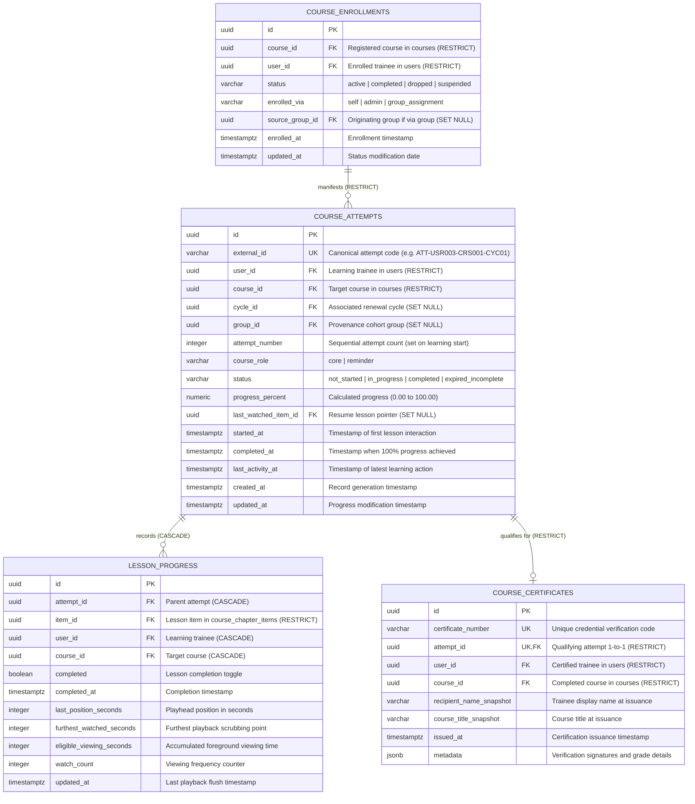

# Metro Courses LMS — Production Database Entity-Relationship Diagram (ERD) Specification

**Document Version:** 1.0.0  
**Status:** Complete / Standalone Architecture Specification  
**Classification:** Documentation-Only Architecture Deliverable  
**Companion Document:** [`docs/backend/database-schema.md`](file:///c:/Users/Administrator/Desktop/metro%20courses/docs/backend/database-schema.md)  
**Target RDBMS Engine:** PostgreSQL 16+ (Standard Relational Engine)  
**Total Schema Entities Covered:** 42 Relational Tables across 5 Core Domains  

---

## Executive Summary & Document Purpose

This document provides the authoritative, standalone **Entity-Relationship Diagram (ERD)** specification for the production database of the **Metro Courses Learning Management System (LMS)**. It complements and visually models the comprehensive data dictionary defined in [`docs/backend/database-schema.md`](file:///c:/Users/Administrator/Desktop/metro%20courses/docs/backend/database-schema.md).

Every table, column, primary key, foreign key, cardinality, and deletion rule represented in this specification reflects verified business rules and functional requirements derived from the active application codebase, domain contracts, administrative workflows, and legacy system audit.

### Core Architectural Invariants Preserved in the ERD

1. **Strict Relational Normalization:**  
   The database enforces data integrity through foreign keys, check constraints, composite primary keys, and unique constraints. No synthetic or artificial joins are assumed.
2. **Canonical Identity Normalization:**  
   Users are identified strictly by immutable surrogate primary keys (`id` UUID) and unique business codes (`external_id` `USRxxx`). Display names (`name`) are never utilized as unique authorization or lookup keys. Legacy identifiers (such as `usr_lect_002`) are resolved through the explicit junction table `USER_LEGACY_ALIASES`.
3. **Decoupled Academic History vs. Group Cohort Membership:**  
   Removing a trainee from a training group (`GROUP_MEMBERSHIPS`) does **NOT** delete or alter their course enrollments (`COURSE_ENROLLMENTS`), completed learning attempts (`COURSE_ATTEMPTS`), lesson playback progress (`LESSON_PROGRESS`), or awarded certificates (`COURSE_CERTIFICATES`).
4. **Relational Metadata vs. External Object Storage:**  
   Binary assets (video files, PDF documents, PowerPoint slides, and trainee material uploads) are never stored as database `BLOB` or `BYTEA` rows. They are represented by relational metadata records (`MEDIA_STORAGE_OBJECTS` and `GROUP_MATERIAL_FILES`), while the actual binary payloads reside securely in external S3-compatible cloud object storage or isolated storage volumes.
5. **Multi-Attempt Training Execution:**  
   Renewal cycles in corporate training groups instantiate distinct course learning attempts (`COURSE_ATTEMPTS`) with sequential attempt counters (`attempt_number`), preserving historical compliance and audit trails across cycles.
6. **Dual-Approval Administrative Governance:**  
   Delegated administrative operations executed by Assistant Administrators require explicit approval records (`APPROVAL_REQUESTS`) and generate immutable entries in `SYSTEM_SECURITY_AUDIT_LOGS`.

---

## 1. ERD Notation, Key Conventions & Cardinality Semantics

The diagrams in this deliverable utilize **Crow's Foot Notation** within Mermaid `erDiagram` specifications to indicate relationships, multiplicity, and participation constraints.

### 1.1 Cardinality & Multiplicity Symbols

| Crow's Foot Symbol | Syntax | Meaning / Multiplicity | Participation / Constraint Semantics |
| :--- | :--- | :--- | :--- |
| **`\|\|--\|\|`** | Mandatory One-to-One | Exactly 1 to Exactly 1 | Strict 1:1 relationship where both sides are mandatory. |
| **`\|\|--o\|`** | Optional One-to-One | Exactly 1 to Zero or 1 | 1:1 extension table where the child record may or may not exist (e.g. `COURSES` to `COURSE_WHATSAPP_OVERRIDES`). |
| **`\|\|--o{`** | One-to-Many (Optional) | Exactly 1 to Zero, 1, or Many | Standard 1:N relationship where the parent can exist without children (e.g. `USERS` to `COURSE_COMMENTS`). |
| **`\|\|--\|{`** | One-to-Many (Mandatory) | Exactly 1 to 1 or Many | 1:N relationship where the parent must possess at least one child. |
| **`}o--o{`** | Many-to-Many | Many to Many | Conceptual N:M relationship. In this physical relational schema, all N:M relationships are resolved via explicit junction tables. |

### 1.2 Entity Attribute & Key Markers

Within entity attribute blocks, standard relational markers designate constraints:

- **`PK` (Primary Key):** The unique surrogate identifier for the entity (typically `uuid` generated via UUIDv7 or UUIDv4).
- **`FK` (Foreign Key):** A reference to the primary key of a parent entity, enforcing referential integrity.
- **`UK` (Unique Key):** A business-level candidate key constrained to unique values across the table (e.g., `external_id`, `email`, `certificate_number`).
- **`PK,FK` (Composite Key / Identifying Foreign Key):** An associative entity junction key where the column is simultaneously part of the composite primary key and a foreign key referencing a parent entity (e.g., `DEPARTMENT_TRACKS`, `COURSE_PREREQUISITES`).

### 1.3 Identifying vs. Non-Identifying Relationships

- **Identifying Relationship:** The child entity cannot exist without its parent and inherits the parent's primary key as part of its own primary key (represented as composite `PK,FK`). Deleting the parent cascades to the child (`ON DELETE CASCADE`).  
  *Examples:* `USER_CREDENTIALS` (PK is `user_id`), `DEPARTMENT_TRACKS`, `COURSE_ADMIN_STAGED_EDITS`.
- **Non-Identifying Relationship:** The child entity possesses its own independent surrogate primary key (`id` UUID), and the foreign key column is either optional (nullable) or references an independent entity.  
  *Examples:* `USERS.department_id`, `COURSE_ATTEMPTS.cycle_id`, `COURSE_ENROLLMENTS.source_group_id`.

### 1.4 Binary Storage Representation

External object storage is represented strictly as **metadata tables**:
- `MEDIA_STORAGE_OBJECTS`: Tracks storage provider (`s3_compatible`, `local_filesystem`), external storage key, original filename, byte size, MIME content type, and SHA-256 cryptographic checksum.
- `GROUP_MATERIAL_FILES`: Tracks group folder associations, external storage keys, uploader references, and download telemetry.
- **Physical Invariant:** No relational table contains binary BLOB columns. All media playback, streaming, and document downloads stream directly from signed storage URLs or reverse-proxy storage endpoints.

---

## 2. High-Level System Overview ERD

The high-level ERD illustrates the foundational backbone of the Metro Courses LMS, showing the primary relational tables connecting the five core domains: **Identity & Permissions**, **Courses & Curriculum**, **Groups & Renewal Cycles**, **Enrollment & Learning Progress**, and **Moderated Discussions, Contacts, Media & Telemetry**.

Mermaid Source File: [`docs/backend/diagrams/erd-overview.mmd`](file:///c:/Users/Administrator/Desktop/metro%20courses/docs/backend/diagrams/erd-overview.mmd)

```mermaid
erDiagram
    DEPARTMENTS ||--o{ USERS : "employs"
    DEPARTMENTS ||--o{ DEPARTMENT_TRACKS : "configures"
    TRAINING_TRACKS ||--o{ DEPARTMENT_TRACKS : "assigned to"
    USERS ||--|| USER_CREDENTIALS : "authenticates via"
    USERS ||--o{ USER_LEGACY_ALIASES : "mapped from"
    USERS ||--o{ USER_PERMISSION_OVERRIDES : "receives override"
    USERS ||--o{ ADMIN_OPERATIONAL_DELEGATIONS : "delegated to"
    USERS ||--o{ APPROVAL_REQUESTS : "requests or decides"
    USERS ||--o{ SYSTEM_SECURITY_AUDIT_LOGS : "acts in"

    USERS ||--o{ COURSE_INSTRUCTORS : "instructs"
    COURSES ||--o{ COURSE_INSTRUCTORS : "staffed by"
    COURSES ||--o{ COURSE_CHAPTERS : "structured into"
    COURSE_CHAPTERS ||--o{ COURSE_CHAPTER_ITEMS : "contains"
    COURSES ||--o{ COURSE_PREREQUISITES : "requires"
    COURSES ||--o{ COURSE_REVIEW_RECORDS : "evaluated in"
    COURSES ||--o| COURSE_WHATSAPP_OVERRIDES : "customizes"
    COURSES ||--o{ COURSE_COMMENTS : "hosts"
    USERS ||--o{ COURSE_COMMENTS : "authors"
    COURSE_COMMENTS ||--o{ COMMENT_REPORTS : "flagged by"
    USERS ||--o{ COMMENT_REPORTS : "submitted by"

    USERS ||--o{ GROUP_SUPERVISORS : "supervises"
    TRAINING_GROUPS ||--o{ GROUP_SUPERVISORS : "managed by"
    TRAINING_GROUPS ||--o{ GROUP_RENEWAL_CYCLES : "executes"
    TRAINING_GROUPS ||--o{ GROUP_MEMBERSHIPS : "enrolls"
    USERS ||--o{ GROUP_MEMBERSHIPS : "member of"
    TRAINING_GROUPS ||--o{ GROUP_MATERIAL_FOLDERS : "organizes"
    GROUP_MATERIAL_FOLDERS ||--o{ GROUP_MATERIAL_FILES : "stores"
    GROUP_RENEWAL_CYCLES ||--o{ GROUP_CYCLE_COURSE_ASSIGNMENTS : "schedules"
    COURSES ||--o{ GROUP_CYCLE_COURSE_ASSIGNMENTS : "included in"

    USERS ||--o{ COURSE_ENROLLMENTS : "registers"
    COURSES ||--o{ COURSE_ENROLLMENTS : "enrolled in"
    COURSE_ENROLLMENTS ||--o{ COURSE_ATTEMPTS : "manifests"
    COURSE_ATTEMPTS ||--o{ LESSON_PROGRESS : "records"
    COURSE_CHAPTER_ITEMS ||--o{ LESSON_PROGRESS : "evaluated on"
    COURSE_ATTEMPTS ||--o| COURSE_CERTIFICATES : "qualifies for"

    MEDIA_STORAGE_OBJECTS ||--o{ COURSE_CHAPTER_ITEMS : "serves binary"
    USERS ||--o{ LEARNING_SESSION_EVENTS : "generates telemetry"
    COURSE_CHAPTER_ITEMS ||--o{ LEARNING_SESSION_EVENTS : "tracked in"
```



### System Topology Summary

| Domain | Core Hub Entity | Primary Function & System Integration |
| :--- | :--- | :--- |
| **Domain 1: Identity & Permissions** | `USERS` | Central identity repository supporting trainees, lecturers, assistant admins, and system admins; credential security, capability overrides, and governance logs. |
| **Domain 2: Courses & Curriculum** | `COURSES` | Master course catalog, multi-instructor staffing, prerequisite dependencies, hierarchical chapters/items, review workflows, and staged modifications. |
| **Domain 3: Groups & Renewal Cycles** | `TRAINING_GROUPS` | Organizational cohort management, recurring renewal cycles, cycle course assignments, cohort memberships, and shared material repositories. |
| **Domain 4: Enrollment & Progress** | `COURSE_ATTEMPTS` | Multi-attempt learning progression engine, item-level playback tracking, completion verification, and cryptographic certificate issuance. |
| **Domain 5: Discussions, Media & Telemetry** | `MEDIA_STORAGE_OBJECTS` & `COURSE_COMMENTS` | Discussion threads with soft-deletion audit, WhatsApp overrides, support contacts, object storage metadata, and genuine playback session telemetry. |

---

## 3. Detailed Domain Entity-Relationship Diagrams

To maintain visual clarity, readability, and engineering utility, the 42 tables are organized into 5 logical domain diagrams. Each diagram defines every entity, attribute, data type, key constraint, and exact foreign key cardinality.

---

### 3.1 Domain 1: Identity, Departments & Permissions Governance

This domain models organizational hierarchy, user authentication, legacy alias mapping, role capabilities, individual permission overrides, administrative delegations, approval requests, and security audit logging.

Mermaid Source File: [`docs/backend/diagrams/erd-identity-permissions.mmd`](file:///c:/Users/Administrator/Desktop/metro%20courses/docs/backend/diagrams/erd-identity-permissions.mmd)

```mermaid
erDiagram
    DEPARTMENTS {
        uuid id PK
        varchar code UK "Department unique business code"
        varchar name_ar UK "Official Arabic department name"
        varchar name_en "Optional English name"
        boolean is_active "Active department toggle"
        timestamptz created_at "Creation timestamp"
        timestamptz updated_at "Modification timestamp"
    }

    TRAINING_TRACKS {
        uuid id PK
        varchar code UK "Track technical code"
        varchar name_ar UK "Arabic track designation"
        varchar name_en "English track name"
        text description_ar "Curriculum track syllabus"
        boolean is_active "Active track toggle"
        timestamptz created_at "Creation timestamp"
    }

    DEPARTMENT_TRACKS {
        uuid department_id PK,FK "Assigned department (CASCADE)"
        uuid track_id PK,FK "Configured track (RESTRICT)"
        boolean is_enabled "Track authorization toggle"
        timestamptz updated_at "Policy modification date"
        uuid updated_by FK "Authorizing admin user ID"
    }

    USERS {
        uuid id PK
        varchar external_id UK "Canonical business ID (e.g. USR001)"
        varchar name "Arabic display name (display label only)"
        varchar username UK "Login username handle"
        varchar email UK "Primary corporate email address"
        varchar phone "E.164 normalized phone number"
        varchar job_title "Professional job position"
        uuid department_id FK "Assigned department (RESTRICT)"
        varchar role "admin | assistant_admin | lecturer | user"
        varchar status "active | suspended"
        varchar avatar_url "Profile avatar image path"
        timestamptz last_login_at "Last login timestamp"
        timestamptz created_at "Account creation date"
        timestamptz updated_at "Account modification date"
    }

    USER_CREDENTIALS {
        uuid user_id PK,FK "1-to-1 link to users (CASCADE)"
        varchar password_hash "Argon2id or bcrypt salted hash"
        varchar algorithm "Hash algorithm identifier"
        integer failed_attempts "Consecutive failed login counter"
        timestamptz locked_until "Brute-force lockout expiration"
        timestamptz password_changed_at "Last password rotation date"
        timestamptz updated_at "Credential modification date"
    }

    USER_LEGACY_ALIASES {
        uuid id PK
        uuid user_id FK "Canonical user reference (CASCADE)"
        varchar legacy_alias UK "Legacy/synthetic ID (e.g. usr_lect_002)"
        timestamptz created_at "Registration timestamp"
    }

    SYSTEM_CAPABILITIES {
        varchar code PK "Semantic capability key (e.g. courses.create)"
        varchar category "Operational area"
        varchar description_ar "Arabic capability description"
        boolean is_governance_action "Requires approval if assistant_admin"
    }

    ROLE_CAPABILITY_DEFAULTS {
        varchar role PK "Canonical role (admin | assistant_admin | lecturer | user)"
        varchar capability_code PK,FK "System capability code (RESTRICT)"
        boolean is_enabled "Default permission toggle for role"
        timestamptz updated_at "Baseline modification date"
        uuid updated_by FK "Administrator who updated baseline"
    }

    USER_PERMISSION_OVERRIDES {
        uuid id PK
        uuid user_id FK "Target user (CASCADE)"
        varchar capability_code FK "System capability code (RESTRICT)"
        varchar override_type "grant | revoke"
        text reason "Mandatory administrative justification"
        timestamptz updated_at "Override modification date"
        uuid updated_by FK "Authorizing administrator (RESTRICT)"
    }

    ADMIN_OPERATIONAL_DELEGATIONS {
        uuid id PK
        uuid user_id FK "Assistant Admin holding delegation (CASCADE)"
        boolean is_active "Active delegation status toggle"
        timestamptz granted_at "Grant timestamp"
        uuid granted_by FK "System Administrator who granted (RESTRICT)"
        timestamptz revoked_at "Revocation timestamp"
        uuid revoked_by FK "Administrator who revoked"
        text justification "Operational rationale for delegation"
    }

    APPROVAL_REQUESTS {
        uuid id PK
        varchar action_type "Standard action code (e.g. USER_DELETE)"
        varchar title_ar "Localized Arabic proposal title"
        uuid requester_id FK "Assistant Administrator (RESTRICT)"
        varchar target_resource_type "Entity classification"
        uuid target_resource_id "Target entity ID"
        varchar status "pending | approved | rejected | failed_execution"
        text justification "Requester operational rationale"
        jsonb payload "Structured arguments to execute on approval"
        uuid decided_by FK "Deciding System Administrator (RESTRICT)"
        timestamptz decided_at "Decision timestamp"
        text decision_note "Administrator decision rationale"
        text execution_error "Execution error trace if failed"
        timestamptz created_at "Submission timestamp"
        timestamptz updated_at "State transition timestamp"
    }

    SYSTEM_SECURITY_AUDIT_LOGS {
        uuid id PK
        timestamptz timestamp "Exact event occurrence timestamp"
        uuid actor_id FK "User performing operation (RESTRICT)"
        varchar actor_name "Actor display name at event time"
        varchar actor_role "Actor role at event time"
        varchar action "Semantic event code"
        varchar action_label_ar "Arabic event summary"
        varchar severity "info | warning | critical"
        varchar resource_type "Target entity classification"
        uuid target_resource_id "Target entity ID"
        varchar target_resource_name "Target entity name at event time"
        text details "Detailed narrative description of changes"
        varchar outcome "success | denied | failed | pending_approval | rejected"
        uuid request_id FK "Linked approval request ID (SET NULL)"
        jsonb metadata "Contextual delta (old vs new values)"
        varchar client_ip "Originating client IP"
        varchar user_agent "Client user-agent string"
    }

    DEPARTMENTS ||--o{ USERS : "employs (RESTRICT)"
    DEPARTMENTS ||--o{ DEPARTMENT_TRACKS : "configures (CASCADE)"
    TRAINING_TRACKS ||--o{ DEPARTMENT_TRACKS : "assigned to (RESTRICT)"
    USERS ||--o{ DEPARTMENT_TRACKS : "modified by (SET NULL)"

    USERS ||--|| USER_CREDENTIALS : "has credential (CASCADE)"
    USERS ||--o{ USER_LEGACY_ALIASES : "mapped from (CASCADE)"

    SYSTEM_CAPABILITIES ||--o{ ROLE_CAPABILITY_DEFAULTS : "defines default (RESTRICT)"
    USERS ||--o{ ROLE_CAPABILITY_DEFAULTS : "modified by (SET NULL)"

    SYSTEM_CAPABILITIES ||--o{ USER_PERMISSION_OVERRIDES : "overrides (RESTRICT)"
    USERS ||--o{ USER_PERMISSION_OVERRIDES : "receives override (CASCADE)"
    USERS ||--o{ USER_PERMISSION_OVERRIDES : "authorized by (RESTRICT)"

    USERS ||--o{ ADMIN_OPERATIONAL_DELEGATIONS : "held by (CASCADE)"
    USERS ||--o{ ADMIN_OPERATIONAL_DELEGATIONS : "granted by (RESTRICT)"
    USERS ||--o{ ADMIN_OPERATIONAL_DELEGATIONS : "revoked by (SET NULL)"

    USERS ||--o{ APPROVAL_REQUESTS : "submitted by (RESTRICT)"
    USERS ||--o{ APPROVAL_REQUESTS : "decided by (RESTRICT)"

    USERS ||--o{ SYSTEM_SECURITY_AUDIT_LOGS : "performed by (RESTRICT)"
    APPROVAL_REQUESTS ||--o{ SYSTEM_SECURITY_AUDIT_LOGS : "audits proposal (SET NULL)"
```



#### Domain 1 Tables (12 Entities)

1. `DEPARTMENTS`: Enterprise organizational departments (e.g. Mechanical, Electrical, Operations).
2. `TRAINING_TRACKS`: Technical training curricula tracks assigned to departments.
3. `DEPARTMENT_TRACKS`: Junction table configuring enabled training tracks per department (`ON DELETE CASCADE` on department, `RESTRICT` on track).
4. `USERS`: Authoritative user identity repository. Stores canonical business identifier (`external_id`), login credentials username, primary email, display name, and system role (`admin`, `assistant_admin`, `lecturer`, `user`).
5. `USER_CREDENTIALS`: Isolated authentication credentials storing salted password hashes (Argon2id or bcrypt), failed login counters, and lockout expiration timestamps (`ON DELETE CASCADE`).
6. `USER_LEGACY_ALIASES`: Identity resolution junction mapping legacy and synthetic identifiers (e.g., `usr_lect_002`) to the canonical user ID (`ON DELETE CASCADE`).
7. `SYSTEM_CAPABILITIES`: Catalog of semantic permission keys (e.g. `courses.create`, `users.manage`) and governance flags.
8. `ROLE_CAPABILITY_DEFAULTS`: System-wide default permissions granted to canonical roles.
9. `USER_PERMISSION_OVERRIDES`: Granular per-user explicit `grant` or `revoke` overrides that take precedence over role defaults (`ON DELETE CASCADE`).
10. `ADMIN_OPERATIONAL_DELEGATIONS`: Explicit operational authority delegated from System Administrators to Assistant Administrators (`ON DELETE CASCADE`).
11. `APPROVAL_REQUESTS`: Dual-approval administrative proposals for sensitive operations (such as user deletion or track reassignment) initiated by Assistant Administrators and decided by System Administrators (`ON DELETE RESTRICT`).
12. `SYSTEM_SECURITY_AUDIT_LOGS`: Tamper-evident, immutable audit trail recording all security-relevant mutations, administrative actions, and approval outcomes (`ON DELETE RESTRICT`).

#### Key Architectural Invariants in Domain 1

- **Credential Isolation:** Passwords and lockout states are isolated in `USER_CREDENTIALS` (1-to-1 with `USERS`). User profile updates never touch credential hashes.
- **Display Name Neutrality:** The `USERS.name` field is an Arabic display label. System authorization strictly relies on `USERS.id`, `USERS.external_id`, and resolved capabilities.
- **Audit Preservation:** `SYSTEM_SECURITY_AUDIT_LOGS` retains `actor_id` with `ON DELETE RESTRICT` and copies the actor display name and role at the time of the event, ensuring that audit trails remain truthful even if a user account is subsequently modified.

---

### 3.2 Domain 2: Courses, Curriculum & Quality Review Workflow

This domain models the educational catalog, multi-instructor staffing, curriculum hierarchy (chapters and lesson items), prerequisite dependency graphs, and the administrative 3-way review and staging system.

Mermaid Source File: [`docs/backend/diagrams/erd-courses-curriculum.mmd`](file:///c:/Users/Administrator/Desktop/metro%20courses/docs/backend/diagrams/erd-courses-curriculum.mmd)

```mermaid
erDiagram
    COURSES {
        uuid id PK
        varchar external_id UK "Canonical business course code (e.g. CRS001)"
        varchar title "Arabic course title"
        text description "Detailed syllabus and learning objectives"
        varchar thumbnail_url "Card preview image path"
        varchar cover_type "image | color | default"
        varchar cover_color "Hex color code if color cover"
        uuid primary_lecturer_id FK "Primary lecturer in users (RESTRICT)"
        varchar level "مبتدئ | متوسط | متقدم"
        numeric estimated_hours "Syllabus duration in hours"
        numeric rating_cache "Cached average star rating"
        integer rating_count_cache "Cached ratings count"
        integer enrollment_count_cache "Cached active enrollment count"
        integer completion_count_cache "Cached completion count"
        boolean requires_approval "Self-enrollment supervisor gate"
        varchar status "published | live | draft | pending_admin | pending_owner | hidden"
        boolean comments_enabled "Discussion thread toggle"
        varchar course_zip_policy "disabled | immediate | after_course_completion"
        boolean has_draft_changes "Unpublished working draft toggle"
        boolean is_test_lab "Test lab sandbox designation"
        timestamptz submitted_at "Review queue submission date"
        timestamptz created_at "Creation timestamp"
        timestamptz updated_at "Modification timestamp"
    }

    COURSE_INSTRUCTORS {
        uuid id PK
        uuid course_id FK "Parent course (CASCADE)"
        uuid user_id FK "Assigned instructor in users (RESTRICT)"
        varchar instructor_role "primary | co_instructor"
        timestamptz assigned_at "Assignment timestamp"
        uuid assigned_by FK "Administrator who assigned (RESTRICT)"
    }

    COURSE_PREREQUISITES {
        uuid course_id PK,FK "Dependent course (CASCADE)"
        uuid prerequisite_course_id PK,FK "Required prerequisite course (RESTRICT)"
        boolean is_mandatory "Strict progression gate toggle"
        integer order_index "Prerequisite display order"
    }

    COURSE_CHAPTERS {
        uuid id PK
        uuid course_id FK "Parent course (CASCADE)"
        varchar title "Arabic chapter module title"
        integer order_index "Sequential chapter ordering"
        timestamptz created_at "Creation timestamp"
        timestamptz updated_at "Modification timestamp"
    }

    COURSE_CHAPTER_ITEMS {
        uuid id PK
        uuid chapter_id FK "Parent chapter (CASCADE)"
        uuid course_id FK "Parent course reference (CASCADE)"
        varchar type "video | pdf | image | powerpoint | docx | zip | audio | other"
        varchar title "Arabic lesson title"
        integer order_index "Sequential item ordering"
        varchar video_source_type "upload | youtube | drive"
        text external_url "External URL link"
        varchar youtube_video_id "YouTube video identifier"
        varchar drive_file_id "Google Drive file identifier"
        uuid media_storage_id FK "Storage object reference (SET NULL)"
        integer duration_seconds "Playback duration in seconds"
        boolean can_download "Download permission toggle"
        varchar download_policy "never | immediate | after_item_completion | after_course_completion"
        boolean requires_previous "Sequential lock requirement"
        boolean require_minimum_viewing_time "Minimum viewing time gate"
        integer embed_crop_top_pixels "Google Drive top crop pixels"
        boolean embed_block_popups "Iframe sandbox block popups"
        timestamptz created_at "Creation timestamp"
        timestamptz updated_at "Modification timestamp"
    }

    COURSE_EXTERNAL_RESOURCES {
        uuid id PK
        uuid course_id FK "Parent course (CASCADE)"
        uuid item_id FK "Optional parent lesson item (CASCADE)"
        varchar title "Resource title"
        text url "External web link"
        text description "Resource description"
        integer order_index "Display ordering"
    }

    COURSE_REVIEW_RECORDS {
        uuid id PK
        uuid course_id FK "Evaluated course (CASCADE)"
        uuid reviewer_id FK "Reviewing administrator in users (RESTRICT)"
        varchar outcome "approved | returned_with_admin_edits | rejected"
        text summary_message "Executive review summary note"
        boolean staged_edits_applied "Indicates if staged edits were committed"
        timestamptz submitted_at "Submission timestamp"
        timestamptz reviewed_at "Decision timestamp"
    }

    COURSE_REVIEW_FEEDBACK_ITEMS {
        uuid id PK
        uuid review_record_id FK "Parent review record (CASCADE)"
        varchar target_type "course | chapter | item"
        uuid target_id "Target entity ID"
        text comment "Specific feedback directive"
        varchar severity "required | suggestion | note"
    }

    COURSE_BASELINE_SNAPSHOTS {
        uuid id PK
        uuid course_id FK "Target course (CASCADE)"
        timestamptz captured_at "Submission capture date"
        jsonb snapshot_data "Complete immutable course content snapshot"
    }

    COURSE_ADMIN_STAGED_EDITS {
        uuid course_id PK,FK "Target course 1-to-1 (CASCADE)"
        uuid baseline_id FK "Reference snapshot ID (RESTRICT)"
        integer client_revision "Optimistic locking integer token"
        jsonb patched_content "Staged modifications pending approval"
        uuid saved_by_admin_id FK "Administrator authoring edits (RESTRICT)"
        boolean is_stale "Flagged if lecturer resubmitted"
        timestamptz last_saved_at "Last save timestamp"
    }

    COURSE_REVIEWER_WORKING_NOTES {
        uuid course_id PK,FK "Target course (CASCADE)"
        uuid reviewer_id PK,FK "Reviewing administrator (CASCADE)"
        text general_note "Private course-level reviewer notes"
        jsonb chapter_notes "Private chapter-level annotations"
        jsonb item_notes "Private item-level annotations"
        timestamptz last_saved_at "Note save timestamp"
    }

    COURSES ||--o{ COURSE_INSTRUCTORS : "staffed by (CASCADE)"
    COURSES ||--o{ COURSE_PREREQUISITES : "requires (CASCADE)"
    COURSES ||--o{ COURSE_PREREQUISITES : "prerequisite for (RESTRICT)"
    COURSES ||--o{ COURSE_CHAPTERS : "structured into (CASCADE)"
    COURSE_CHAPTERS ||--o{ COURSE_CHAPTER_ITEMS : "contains (CASCADE)"
    COURSES ||--o{ COURSE_EXTERNAL_RESOURCES : "provides (CASCADE)"
    COURSE_CHAPTER_ITEMS ||--o{ COURSE_EXTERNAL_RESOURCES : "attaches (CASCADE)"

    COURSES ||--o{ COURSE_REVIEW_RECORDS : "evaluated in (CASCADE)"
    COURSE_REVIEW_RECORDS ||--o{ COURSE_REVIEW_FEEDBACK_ITEMS : "details (CASCADE)"
    COURSES ||--o{ COURSE_BASELINE_SNAPSHOTS : "snapshots (CASCADE)"
    COURSES ||--|| COURSE_ADMIN_STAGED_EDITS : "has staged (CASCADE)"
    COURSES ||--o{ COURSE_REVIEWER_WORKING_NOTES : "annotated by (CASCADE)"
```



#### Domain 2 Tables (11 Entities)

1. `COURSES`: Master course record storing title, external course code, description, cover styling, approval requirements, publication status (`published`, `live`, `draft`, `pending_admin`, `pending_owner`, `hidden`), and denormalized rating and completion caches.
2. `COURSE_INSTRUCTORS`: Multi-instructor staffing junction supporting primary lecturers and co-instructors with administrative assignment provenance (`ON DELETE CASCADE` from course, `RESTRICT` from user).
3. `COURSE_PREREQUISITES`: Self-referential prerequisite directed acyclic graph (DAG) specifying mandatory or advisory completion prerequisites (`ON DELETE CASCADE` for dependent course, `RESTRICT` for required prerequisite).
4. `COURSE_CHAPTERS`: Course modules organizing curriculum sequentially via `order_index` (`ON DELETE CASCADE`).
5. `COURSE_CHAPTER_ITEMS`: Individual learning lessons (videos, PDFs, presentations, audio, archives) with embed configuration, viewing gates, and download policies (`ON DELETE CASCADE`).
6. `COURSE_EXTERNAL_RESOURCES`: Supplementary external links and references attached either to an entire course or to a specific lesson item (`ON DELETE CASCADE`).
7. `COURSE_REVIEW_RECORDS`: Formal quality review submissions and verdicts (`approved`, `returned_with_admin_edits`, `rejected`) (`ON DELETE CASCADE`).
8. `COURSE_REVIEW_FEEDBACK_ITEMS`: Granular feedback directives referencing courses, chapters, or items (`ON DELETE CASCADE`).
9. `COURSE_BASELINE_SNAPSHOTS`: Immutable JSONB snapshots of course content captured at the time of review submission (`ON DELETE CASCADE`).
10. `COURSE_ADMIN_STAGED_EDITS`: Optimistic concurrency staging record (`client_revision`) containing uncommitted administrative modifications pending review sign-off (`ON DELETE CASCADE`).
11. `COURSE_REVIEWER_WORKING_NOTES`: Private working notes and annotations maintained by reviewing administrators across courses, chapters, and items (`ON DELETE CASCADE`).

#### Key Architectural Invariants in Domain 2

- **Staffing Flexibility:** While `COURSES.primary_lecturer_id` provides direct access to the course creator, `COURSE_INSTRUCTORS` enables co-lecturers to manage course content and view performance analytics.
- **Review Staging & Optimistic Locking:** When an administrator edits a pending course, modifications are staged in `COURSE_ADMIN_STAGED_EDITS.patched_content` without mutating live course records. The `client_revision` integer prevents concurrent overwrite conflicts between administrators and lecturers.
- **Acyclic Prerequisite Enforcement:** The `COURSE_PREREQUISITES` table prevents circular dependencies through relational foreign keys and database triggers.

---

### 3.3 Domain 3: Training Groups, Renewal Cycles & Cohort Materials

This domain models organizational training groups (cohorts), recurring compliance renewal cycles, cycle-specific course assignments, membership enrollment, join requests, and shared group document repositories.

Mermaid Source File: [`docs/backend/diagrams/erd-groups-cycles.mmd`](file:///c:/Users/Administrator/Desktop/metro%20courses/docs/backend/diagrams/erd-groups-cycles.mmd)

```mermaid
erDiagram
    TRAINING_GROUPS {
        uuid id PK
        varchar external_id UK "Canonical business group ID (e.g. GRP101)"
        varchar name "Arabic cohort group name"
        text description "Cohort objectives and department focus"
        varchar admin_status "draft | active | archived"
        varchar enrollment_policy "open | approval_required | closed"
        varchar enrollment_code UK "6-char QR enrollment token"
        boolean is_enrollment_open "Accepting new members toggle"
        timestamptz enrollment_expires_at "Token expiration deadline"
        integer max_trainees "Trainee capacity ceiling"
        timestamptz default_start_datetime "Cohort default start date"
        timestamptz default_deadline_datetime "Cohort default deadline date"
        varchar default_post_deadline_policy "keep_no_cert | hide"
        boolean auto_renewal_enabled "Automated recurrence toggle"
        integer renewal_interval_days "Custom cycle interval in days"
        date next_scheduled_renewal_date "Projected next cycle date"
        varchar recurrence_type "none | monthly | bimonthly | quarterly | custom"
        uuid current_cycle_id "Active cycle reference ID"
        timestamptz created_at "Group creation timestamp"
        timestamptz updated_at "Group modification timestamp"
    }

    GROUP_SUPERVISORS {
        uuid id PK
        uuid group_id FK "Parent group (CASCADE)"
        uuid user_id FK "Assigned supervisor in users (RESTRICT)"
        varchar role "supervisor | assistant"
        timestamptz assigned_at "Assignment timestamp"
        uuid assigned_by FK "Authorizing administrator (RESTRICT)"
    }

    GROUP_RENEWAL_CYCLES {
        uuid id PK
        varchar external_id UK "Canonical cycle ID (e.g. CYC-GRP101-01)"
        uuid group_id FK "Parent group (CASCADE)"
        integer cycle_number "Sequential cycle iteration (1, 2, 3...)"
        varchar title "Cycle Arabic designation"
        varchar status "active | completed | archived"
        timestamptz start_datetime "Cycle baseline start date"
        timestamptz deadline_datetime "Cycle baseline deadline date"
        varchar post_deadline_policy "keep_no_cert | hide"
        timestamptz completed_at "Formal cycle closure timestamp"
        timestamptz created_at "Cycle creation timestamp"
        timestamptz updated_at "Cycle modification timestamp"
    }

    GROUP_CYCLE_COURSE_ASSIGNMENTS {
        uuid id PK
        uuid cycle_id FK "Parent cycle (CASCADE)"
        uuid group_id FK "Parent group reference (CASCADE)"
        uuid course_id FK "Assigned course in courses (RESTRICT)"
        varchar course_role "core | reminder"
        integer order_index "Sequential syllabus ordering"
        timestamptz custom_start_datetime "Level-1 start override"
        timestamptz custom_deadline_datetime "Level-1 deadline override"
        varchar custom_post_deadline_policy "Level-1 policy override"
    }

    GROUP_MEMBERSHIPS {
        uuid id PK
        uuid group_id FK "Target group (CASCADE)"
        uuid user_id FK "Trainee member in users (CASCADE)"
        varchar join_source "admin_assigned | supervisor_assigned | qr_code"
        boolean is_active "Active membership flag"
        timestamptz joined_at "Registration timestamp"
    }

    GROUP_JOIN_REQUESTS {
        uuid id PK
        uuid group_id FK "Target group (CASCADE)"
        uuid user_id FK "Submitting trainee in users (CASCADE)"
        varchar status "pending | approved | rejected"
        timestamptz requested_at "Submission timestamp"
        timestamptz reviewed_at "Review decision timestamp"
        uuid reviewed_by FK "Reviewing supervisor in users (SET NULL)"
        text review_note "Supervisor decision notes"
    }

    GROUP_RESOURCES {
        uuid id PK
        uuid group_id FK "Target group (CASCADE)"
        varchar title "Resource title (e.g. Teams Meeting)"
        text url "External web link"
        text description "Resource description"
        varchar type "teams | zoom | meet | pdf | link"
        integer order_index "Display sequence"
        timestamptz created_at "Creation timestamp"
    }

    GROUP_MATERIAL_FOLDERS {
        uuid id PK
        uuid group_id FK "Parent group (CASCADE)"
        uuid cycle_id FK "Optional cycle link (SET NULL)"
        uuid parent_id FK "Recursive parent folder (CASCADE)"
        varchar name "Arabic folder name"
        integer order_index "Display sequence"
        boolean is_visible_to_trainees "Trainee visibility toggle"
        timestamptz created_at "Creation timestamp"
        timestamptz updated_at "Modification timestamp"
    }

    GROUP_MATERIAL_FILES {
        uuid id PK
        uuid folder_id FK "Parent folder (CASCADE)"
        uuid group_id FK "Parent group reference (CASCADE)"
        uuid cycle_id FK "Optional cycle link (SET NULL)"
        varchar title "Display title"
        varchar original_file_name "Client upload filename"
        bigint file_size_bytes "Exact size in bytes"
        varchar mime_type "MIME classification"
        varchar file_type "pdf | image | word | excel | powerpoint | archive | video | audio | other"
        varchar storage_key "External object storage key"
        integer order_index "Display sequence"
        uuid uploaded_by FK "Uploader user ID in users (RESTRICT)"
        boolean is_visible "Visibility toggle"
        integer download_count "Accumulated download counter"
        timestamptz uploaded_at "Upload timestamp"
    }

    TRAINING_GROUPS ||--o{ GROUP_SUPERVISORS : "supervised by (CASCADE)"
    TRAINING_GROUPS ||--o{ GROUP_RENEWAL_CYCLES : "executes (CASCADE)"
    GROUP_RENEWAL_CYCLES ||--o{ GROUP_CYCLE_COURSE_ASSIGNMENTS : "schedules (CASCADE)"
    TRAINING_GROUPS ||--o{ GROUP_MEMBERSHIPS : "enrolls (CASCADE)"
    TRAINING_GROUPS ||--o{ GROUP_JOIN_REQUESTS : "receives (CASCADE)"
    TRAINING_GROUPS ||--o{ GROUP_RESOURCES : "shares (CASCADE)"
    TRAINING_GROUPS ||--o{ GROUP_MATERIAL_FOLDERS : "organizes (CASCADE)"
    GROUP_MATERIAL_FOLDERS ||--o{ GROUP_MATERIAL_FOLDERS : "subfolders (CASCADE)"
    GROUP_MATERIAL_FOLDERS ||--o{ GROUP_MATERIAL_FILES : "contains (CASCADE)"
```



#### Domain 3 Tables (9 Entities)

1. `TRAINING_GROUPS`: Cohort entities representing employee groups, departments, or compliance classes. Stores 6-character QR enrollment codes, capacity limits, enrollment policies (`open`, `approval_required`, `closed`), and recurrence interval configuration.
2. `GROUP_SUPERVISORS`: Supervisory personnel assigned to manage groups, approve join requests, and track cohort completion (`ON DELETE CASCADE` from group, `RESTRICT` from user).
3. `GROUP_RENEWAL_CYCLES`: Sequential training iterations (e.g. Cycle 1, Cycle 2) defining cohort start datetimes, deadlines, and post-deadline access policies (`ON DELETE CASCADE`).
4. `GROUP_CYCLE_COURSE_ASSIGNMENTS`: Specific courses scheduled for a given cycle iteration, supporting course role classification (`core` vs. `reminder`) and Level-1 custom deadline overrides (`ON DELETE CASCADE` from cycle, `RESTRICT` from course).
5. `GROUP_MEMBERSHIPS`: Junction table tracking trainee membership in groups and join provenance (`admin_assigned`, `supervisor_assigned`, `qr_code`) (`ON DELETE CASCADE` from group, `CASCADE` from user).
6. `GROUP_JOIN_REQUESTS`: Workflow queue for trainees requesting membership in approval-gated groups (`ON DELETE CASCADE`).
7. `GROUP_RESOURCES`: Shared collaborative meeting links (Teams, Zoom, Meet) and online reference resources shared with group members (`ON DELETE CASCADE`).
8. `GROUP_MATERIAL_FOLDERS`: Hierarchical folder structure for cohort reference files, supporting cycle links and subfolder nesting (`ON DELETE CASCADE`).
9. `GROUP_MATERIAL_FILES`: Metadata for files uploaded to group material folders, storing byte size, MIME type, uploader identity, and external cloud storage keys (`ON DELETE CASCADE`).

#### Key Architectural Invariants in Domain 3

- **Separation of Cohort Identity from Course Iterations:** `TRAINING_GROUPS` defines the enduring cohort of trainees and supervisors. `GROUP_RENEWAL_CYCLES` defines the recurring temporal windows. Courses are assigned to cycles via `GROUP_CYCLE_COURSE_ASSIGNMENTS`, enabling courses to vary between annual or quarterly iterations without recreating the cohort.
- **Three-Tier Deadline Hierarchy:** Course access deadlines follow a strict 3-tier precedence:
  1. *Level 1 (Assignment Override):* `GROUP_CYCLE_COURSE_ASSIGNMENTS.custom_deadline_datetime`
  2. *Level 2 (Cycle Baseline):* `GROUP_RENEWAL_CYCLES.deadline_datetime`
  3. *Level 3 (Group Default):* `TRAINING_GROUPS.default_deadline_datetime`

---

### 3.4 Domain 4: Enrollment, Learning Attempts, Lesson Progress & Certification

This domain models the core academic progression engine: student course registration, multi-attempt learning execution, granular playback telemetry, and verified certificate generation.

Mermaid Source File: [`docs/backend/diagrams/erd-learning-progress.mmd`](file:///c:/Users/Administrator/Desktop/metro%20courses/docs/backend/diagrams/erd-learning-progress.mmd)



#### Domain 4 Tables (4 Entities)

1. `COURSE_ENROLLMENTS`: Formal registration record linking a trainee to a course, recording enrollment provenance (`self`, `admin`, `group_assignment`) and registration status (`active`, `completed`, `dropped`, `suspended`) (`ON DELETE RESTRICT`).
2. `COURSE_ATTEMPTS`: Specific learning execution iteration. Contains canonical attempt code (`external_id`), sequential `attempt_number`, renewal cycle linkage, calculated `progress_percent`, resume playhead pointer (`last_watched_item_id`), and activity timestamps (`ON DELETE RESTRICT`).
3. `LESSON_PROGRESS`: Granular item-level learning record storing completion booleans, furthest watched playhead position, eligible active viewing seconds, and view counters (`ON DELETE CASCADE` from attempt, `RESTRICT` from item).
4. `COURSE_CERTIFICATES`: Official credentials issued upon 100% course attempt completion. Features a unique verification code (`certificate_number`), recipient display name snapshot, course title snapshot, issuance timestamp, and cryptographic signature metadata (`ON DELETE RESTRICT`).

#### Key Architectural Invariants in Domain 4

- **Academic History Immunity:** Deleting a group or removing a trainee from `GROUP_MEMBERSHIPS` does **NOT** cascade to `COURSE_ENROLLMENTS`, `COURSE_ATTEMPTS`, `LESSON_PROGRESS`, or `COURSE_CERTIFICATES`. The foreign keys `COURSE_ENROLLMENTS.source_group_id`, `COURSE_ATTEMPTS.group_id`, and `COURSE_ATTEMPTS.cycle_id` specify `ON DELETE SET NULL`. Academic progression and earned qualifications are permanent institutional records.
- **Multi-Attempt Progression:** When a trainee retakes a course in a new renewal cycle, a new record is created in `COURSE_ATTEMPTS` with incremented `attempt_number`. Previous attempts, lesson progress, and historical certificates remain completely intact.
- **Immutable Certificate Snapshots:** `COURSE_CERTIFICATES` stores `recipient_name_snapshot` and `course_title_snapshot` at the moment of issuance. Future edits to the user's profile or course title will never alter legal credentials already issued.

---

### 3.5 Domain 5: Moderated Discussions, Contacts, Media Storage & Analytics Telemetry

This domain models course discussion forums, content moderation, contact overrides, external media storage tracking, and high-fidelity learning session telemetry.

Mermaid Source File: [`docs/backend/diagrams/erd-discussions-media-analytics.mmd`](file:///c:/Users/Administrator/Desktop/metro%20courses/docs/backend/diagrams/erd-discussions-media-analytics.mmd)

```mermaid
erDiagram
    COURSE_COMMENTS {
        uuid id PK
        uuid course_id FK "Parent course in courses (CASCADE)"
        uuid user_id FK "Comment author in users (RESTRICT)"
        text text "Arabic discussion comment text"
        boolean is_lecturer "Instructor badge toggle"
        timestamptz created_at "Comment submission timestamp"
        timestamptz deleted_at "Soft-deletion timestamp (SET NULL)"
        uuid deleted_by FK "Moderator in users who soft-deleted"
    }

    COMMENT_REPORTS {
        uuid id PK
        uuid comment_id FK "Reported comment (CASCADE)"
        uuid course_id FK "Parent course reference (CASCADE)"
        uuid reporter_id FK "Reporting trainee in users (RESTRICT)"
        varchar reason "inappropriate_content | misinformation | harassment | spam | other"
        text notes "Optional reporting justification"
        varchar status "pending | ignored | resolved_by_deletion"
        timestamptz reported_at "Report submission timestamp"
        timestamptz resolved_at "Triage resolution timestamp"
        uuid resolved_by FK "Resolving administrator in users (SET NULL)"
        text resolution_notes "Administrative triage notes"
    }

    COURSE_WHATSAPP_OVERRIDES {
        uuid course_id PK,FK "Customized course 1-to-1 (CASCADE)"
        varchar contact_name "Custom WhatsApp contact name"
        varchar phone_number "E.164 normalized phone number"
        varchar role_title "Optional contact role title"
        timestamptz updated_at "Configuration timestamp"
        uuid updated_by FK "Configuring administrator in users (RESTRICT)"
    }

    PLATFORM_SUPPORT_CONTACTS {
        uuid id PK
        varchar channel_type "login_support | general_support"
        varchar contact_name "Support representative name"
        varchar phone_number "E.164 normalized WhatsApp support phone"
        boolean is_active "Active line toggle"
        integer order_index "Display priority sequence"
    }

    MEDIA_STORAGE_OBJECTS {
        uuid id PK
        varchar storage_provider "s3_compatible | local_filesystem | azure_blob"
        varchar storage_key UK "External cloud object storage path/key"
        varchar original_filename "Filename as submitted by uploader"
        bigint file_size_bytes "Exact byte length of file"
        varchar mime_type "MIME content type"
        varchar sha256_checksum "Cryptographic checksum for tamper checks"
        uuid uploaded_by FK "Uploader user ID in users (RESTRICT)"
        timestamptz created_at "Upload ingestion timestamp"
    }

    LEARNING_SESSION_EVENTS {
        uuid id PK
        uuid user_id FK "Active trainee in users (CASCADE)"
        uuid course_id FK "Target course in courses (CASCADE)"
        uuid item_id FK "Target lesson in course_chapter_items (CASCADE)"
        uuid attempt_id FK "Parent attempt in course_attempts (CASCADE)"
        timestamptz session_start_at "Playback session start timestamp"
        timestamptz session_end_at "Playback session end/flush timestamp"
        integer duration_seconds "Total elapsed session seconds"
        integer active_viewing_seconds "Active foreground playback seconds"
        varchar device_type "desktop | mobile | tablet"
        timestamptz created_at "Telemetry ingestion timestamp"
    }

    COURSE_COMMENTS ||--o{ COMMENT_REPORTS : "moderated via (CASCADE)"
```



#### Domain 5 Tables (6 Entities)

1. `COURSE_COMMENTS`: Course discussion comments with lecturer badge toggles and soft-deletion support (`deleted_at`, `deleted_by`) (`ON DELETE CASCADE` from course, `RESTRICT` from user).
2. `COMMENT_REPORTS`: Triage workflow for trainee abuse reports. Preserved even after comment soft-deletion to ensure an auditable moderation history (`ON DELETE CASCADE` from comment).
3. `COURSE_WHATSAPP_OVERRIDES`: Optional 1-to-1 extension table overriding the default WhatsApp contact for a course (`ON DELETE CASCADE` from course).
4. `PLATFORM_SUPPORT_CONTACTS`: Global platform support lines (e.g. Login Support, Academic Support) displayed on the authentication and help screens.
5. `MEDIA_STORAGE_OBJECTS`: Central registry of binary files hosted in external object storage. Stores cloud storage keys, original filenames, file byte sizes, MIME content types, and SHA-256 cryptographic hashes (`ON DELETE RESTRICT` from uploader).
6. `LEARNING_SESSION_EVENTS`: High-fidelity telemetry events capturing actual playback sessions (start time, end time, active foreground viewing duration, and device type). Provides genuine data for analytics, eliminating synthetic or fabricated viewing hours (`ON DELETE CASCADE`).

#### Key Architectural Invariants in Domain 5

- **Soft-Deletion Moderation Preservation:** Soft-deleting a comment sets `COURSE_COMMENTS.deleted_at` while preserving the row. This ensures that linked `COMMENT_REPORTS` remain valid for administrative audit and supervisory review.
- **WhatsApp Fallback Logic:** `COURSE_WHATSAPP_OVERRIDES` is an optional 1-to-1 extension (`COURSES ||--o| COURSE_WHATSAPP_OVERRIDES`). If no override record exists for a course, the application layer falls back to the phone number of the primary instructor (`USERS.phone` where `USERS.id = COURSES.primary_lecturer_id`).
- **Telemetry Integrity:** The `LEARNING_SESSION_EVENTS` table records genuine user session facts with `duration_seconds` and `active_viewing_seconds`. Administrative dashboards compute peak engagement hours directly from these facts rather than using simulated distributions.

---

## 4. Cross-Domain Relationships & Referential Topology

Because real-world applications cross domain boundaries, the database maintains strong referential integrity across all subsystems. The table below documents every cross-domain foreign key relationship, its multiplicity, deletion rule, and underlying business invariant.

| Source Entity (Child) | Foreign Key Column | Target Entity (Parent) | Cardinality | Deletion Rule | Architectural Invariant & Enforcement Rationale |
| :--- | :--- | :--- | :--- | :--- | :--- |
| `DEPARTMENT_TRACKS` | `updated_by` | `USERS(id)` | Many-to-One | `ON DELETE SET NULL` | Preserves track configuration policy history even if the modifying administrator account is deactivated. |
| `ROLE_CAPABILITY_DEFAULTS` | `updated_by` | `USERS(id)` | Many-to-One | `ON DELETE SET NULL` | Retains administrative audit provenance for baseline role permission updates. |
| `USER_PERMISSION_OVERRIDES` | `updated_by` | `USERS(id)` | Many-to-One | `ON DELETE RESTRICT` | Prevents deleting an administrator who authorized explicit capability overrides. |
| `ADMIN_OPERATIONAL_DELEGATIONS` | `granted_by` | `USERS(id)` | Many-to-One | `ON DELETE RESTRICT` | Prevents deleting a System Administrator who granted active operational delegations. |
| `ADMIN_OPERATIONAL_DELEGATIONS` | `revoked_by` | `USERS(id)` | Many-to-One | `ON DELETE SET NULL` | Retains revocation timestamp while allowing historical archivism of revoking admins. |
| `APPROVAL_REQUESTS` | `requester_id` | `USERS(id)` | Many-to-One | `ON DELETE RESTRICT` | Requester records cannot be purged while governance approval requests remain on file. |
| `APPROVAL_REQUESTS` | `decided_by` | `USERS(id)` | Many-to-One | `ON DELETE RESTRICT` | Decision makers cannot be deleted, ensuring legal and regulatory accountability. |
| `SYSTEM_SECURITY_AUDIT_LOGS` | `actor_id` | `USERS(id)` | Many-to-One | `ON DELETE RESTRICT` | Audit log actors cannot be deleted; preserves cryptographic and forensic accountability. |
| `COURSES` | `primary_lecturer_id` | `USERS(id)` | Many-to-One | `ON DELETE RESTRICT` | A course must always maintain a valid primary instructor; lecturer deletion is blocked while assigned to courses. |
| `COURSE_INSTRUCTORS` | `user_id` | `USERS(id)` | Many-to-One | `ON DELETE RESTRICT` | Instructors cannot be deleted while assigned to active teaching assignments. |
| `COURSE_CHAPTER_ITEMS` | `media_storage_id` | `MEDIA_STORAGE_OBJECTS(id)` | Many-to-One | `ON DELETE SET NULL` | Deleting a media storage asset disassociates the binary reference without corrupting the lesson item metadata. |
| `COURSE_REVIEW_RECORDS` | `reviewer_id` | `USERS(id)` | Many-to-One | `ON DELETE RESTRICT` | Course reviewers cannot be deleted; preserves quality audit provenance. |
| `COURSE_ADMIN_STAGED_EDITS` | `saved_by_admin_id` | `USERS(id)` | Many-to-One | `ON DELETE RESTRICT` | Staged content retains authoring administrator ID to prevent anonymous staging modifications. |
| `COURSE_REVIEWER_WORKING_NOTES` | `reviewer_id` | `USERS(id)` | Many-to-One | `ON DELETE CASCADE` | Private working notes belong exclusively to the authoring reviewer; cascades on reviewer removal. |
| `GROUP_SUPERVISORS` | `user_id` | `USERS(id)` | Many-to-One | `ON DELETE RESTRICT` | Supervisors cannot be deleted while assigned to manage active training groups. |
| `GROUP_CYCLE_COURSE_ASSIGNMENTS` | `course_id` | `COURSES(id)` | Many-to-One | `ON DELETE RESTRICT` | Courses cannot be deleted while scheduled in active group renewal cycles. |
| `GROUP_MEMBERSHIPS` | `user_id` | `USERS(id)` | Many-to-One | `ON DELETE CASCADE` | Removing a user account automatically cleans up their group membership records. |
| `GROUP_JOIN_REQUESTS` | `user_id` | `USERS(id)` | Many-to-One | `ON DELETE CASCADE` | Pending join requests are cleaned up if the submitting user account is deleted. |
| `GROUP_MATERIAL_FILES` | `uploaded_by` | `USERS(id)` | Many-to-One | `ON DELETE RESTRICT` | Material uploaders cannot be purged while their uploaded cohort files remain active. |
| `COURSE_ENROLLMENTS` | `user_id` | `USERS(id)` | Many-to-One | `ON DELETE RESTRICT` | Trainees with active course registrations cannot be deleted without formal academic archival. |
| `COURSE_ENROLLMENTS` | `course_id` | `COURSES(id)` | Many-to-One | `ON DELETE RESTRICT` | Courses with active registrations cannot be deleted; courses must be archived or hidden instead. |
| `COURSE_ENROLLMENTS` | `source_group_id` | `TRAINING_GROUPS(id)` | Many-to-One | `ON DELETE SET NULL` | Deleting or disbanding a training group sets `source_group_id` to NULL without deleting the course enrollment. |
| `COURSE_ATTEMPTS` | `user_id` | `USERS(id)` | Many-to-One | `ON DELETE RESTRICT` | Academic attempts are permanent institutional records; user deletion is restricted. |
| `COURSE_ATTEMPTS` | `course_id` | `COURSES(id)` | Many-to-One | `ON DELETE RESTRICT` | Courses with recorded student attempts cannot be deleted from the database. |
| `COURSE_ATTEMPTS` | `cycle_id` | `GROUP_RENEWAL_CYCLES(id)` | Many-to-One | `ON DELETE SET NULL` | Cycle deletion nullifies the foreign key without destroying the student's learning history. |
| `COURSE_ATTEMPTS` | `group_id` | `TRAINING_GROUPS(id)` | Many-to-One | `ON DELETE SET NULL` | Cohort group deletion nullifies the provenance link without erasing the student's attempt. |
| `LESSON_PROGRESS` | `item_id` | `COURSE_CHAPTER_ITEMS(id)` | Many-to-One | `ON DELETE RESTRICT` | Lesson items with active student progress cannot be deleted; protects user progression data. |
| `COURSE_CERTIFICATES` | `user_id` | `USERS(id)` | Many-to-One | `ON DELETE RESTRICT` | Certified graduates cannot be deleted; prevents destruction of verifiable legal credentials. |
| `COURSE_CERTIFICATES` | `course_id` | `COURSES(id)` | Many-to-One | `ON DELETE RESTRICT` | Courses that have issued certificates are permanently locked against physical deletion. |
| `COURSE_COMMENTS` | `user_id` | `USERS(id)` | Many-to-One | `ON DELETE RESTRICT` | Comment authors cannot be deleted while comments exist (comments must be anonymized or purged first). |
| `COURSE_COMMENTS` | `deleted_by` | `USERS(id)` | Many-to-One | `ON DELETE SET NULL` | Retains soft-delete timestamp while allowing archivism of moderating administrator. |
| `COMMENT_REPORTS` | `reporter_id` | `USERS(id)` | Many-to-One | `ON DELETE RESTRICT` | Trainees who submitted abuse reports cannot be deleted while reports remain under triage. |
| `COMMENT_REPORTS` | `resolved_by` | `USERS(id)` | Many-to-One | `ON DELETE SET NULL` | Retains report resolution notes while permitting archival of the triage administrator. |
| `COURSE_WHATSAPP_OVERRIDES` | `updated_by` | `USERS(id)` | Many-to-One | `ON DELETE RESTRICT` | Administrator configuring WhatsApp contact override cannot be deleted without reassigning audit. |
| `MEDIA_STORAGE_OBJECTS` | `uploaded_by` | `USERS(id)` | Many-to-One | `ON DELETE RESTRICT` | Media uploader cannot be deleted while referenced cloud storage objects remain in catalog. |
| `LEARNING_SESSION_EVENTS` | `user_id` | `USERS(id)` | Many-to-One | `ON DELETE CASCADE` | Telemetry logs cascade on user purge during regulatory data-erasure compliance (GDPR/Right-to-be-Forgotten). |
| `LEARNING_SESSION_EVENTS` | `course_id` | `COURSES(id)` | Many-to-One | `ON DELETE CASCADE` | Telemetry logs cascade if course sandbox is purged. |
| `LEARNING_SESSION_EVENTS` | `item_id` | `COURSE_CHAPTER_ITEMS(id)` | Many-to-One | `ON DELETE CASCADE` | Item telemetry cascades if test item is permanently removed. |
| `LEARNING_SESSION_EVENTS` | `attempt_id` | `COURSE_ATTEMPTS(id)` | Many-to-One | `ON DELETE CASCADE` | Telemetry records cascade if a test attempt is removed. |

---

## 5. Legend, Constraints & Integrity Semantics

### 5.1 Primary Key Strategy

All 42 tables utilize surrogate primary keys of type `UUID` (specifically **UUIDv7** for time-ordered locality and optimal B-Tree index performance), with three specific exceptions where composite primary keys represent natural associative junctions:
1. `DEPARTMENT_TRACKS`: Composite PK `(department_id, track_id)`
2. `COURSE_PREREQUISITES`: Composite PK `(course_id, prerequisite_course_id)`
3. `COURSE_REVIEWER_WORKING_NOTES`: Composite PK `(course_id, reviewer_id)`

Additionally, 1-to-1 extension tables utilize the parent table's primary key as their own:
1. `USER_CREDENTIALS`: PK is `user_id` (FK referencing `USERS.id`)
2. `COURSE_ADMIN_STAGED_EDITS`: PK is `course_id` (FK referencing `COURSES.id`)
3. `COURSE_WHATSAPP_OVERRIDES`: PK is `course_id` (FK referencing `COURSES.id`)

### 5.2 Canonical Business Key Formatting

In addition to surrogate UUID primary keys, major entities enforce business-level unique constraints (`UK`) using standardized, human-readable format patterns:

- `USERS.external_id`: Pattern `^USR[0-9]{3,8}$` (e.g. `USR001`, `USR002`)
- `COURSES.external_id`: Pattern `^CRS[0-9]{3,8}$` (e.g. `CRS001`, `CRS002`)
- `TRAINING_GROUPS.external_id`: Pattern `^GRP[0-9]{3,8}$` (e.g. `GRP101`, `GRP102`)
- `GROUP_RENEWAL_CYCLES.external_id`: Pattern `^CYC-[A-Z0-9]+-[0-9]{2,4}$` (e.g. `CYC-GRP101-01`)
- `COURSE_ATTEMPTS.external_id`: Pattern `^ATT-[A-Z0-9]+-[A-Z0-9]+-[0-9]{2,4}$` (e.g. `ATT-USR003-CRS001-01`)
- `COURSE_CERTIFICATES.certificate_number`: Pattern `^CERT-[0-9]{4}-[A-Z0-9]{6,10}$` (e.g. `CERT-2026-MC98421`)
- `TRAINING_GROUPS.enrollment_code`: Pattern `^[A-Z0-9]{6}$` (6-character uppercase alphanumeric QR token)

### 5.3 Composite Unique Constraints

To prevent data corruption, duplicates, and race conditions, the following composite unique constraints are enforced at the database schema level:

- `DEPARTMENT_TRACKS`: `UNIQUE (department_id, track_id)`
- `ROLE_CAPABILITY_DEFAULTS`: `UNIQUE (role, capability_code)`
- `USER_PERMISSION_OVERRIDES`: `UNIQUE (user_id, capability_code)`
- `USER_LEGACY_ALIASES`: `UNIQUE (user_id, legacy_alias)`
- `COURSE_INSTRUCTORS`: `UNIQUE (course_id, user_id)`
- `COURSE_PREREQUISITES`: `UNIQUE (course_id, prerequisite_course_id)`
- `GROUP_SUPERVISORS`: `UNIQUE (group_id, user_id)`
- `GROUP_MEMBERSHIPS`: `UNIQUE (group_id, user_id)`
- `GROUP_CYCLE_COURSE_ASSIGNMENTS`: `UNIQUE (cycle_id, course_id)`
- `COURSE_ENROLLMENTS`: `UNIQUE (user_id, course_id)`
- `COURSE_ATTEMPTS`: `UNIQUE (user_id, course_id, cycle_id, attempt_number)`
- `LESSON_PROGRESS`: `UNIQUE (attempt_id, item_id)`
- `COURSE_CERTIFICATES`: `UNIQUE (attempt_id)` (Strict 1-to-1 certification guarantee)

### 5.4 Check Constraints & Allowed Value Domains

- `USERS.role`: `CHECK (role IN ('admin', 'assistant_admin', 'lecturer', 'user'))`
- `USERS.status`: `CHECK (status IN ('active', 'suspended'))`
- `COURSES.status`: `CHECK (status IN ('published', 'live', 'draft', 'pending_admin', 'pending_owner', 'hidden'))`
- `COURSES.cover_type`: `CHECK (cover_type IN ('image', 'color', 'default'))`
- `COURSES.level`: `CHECK (level IN ('مبتدئ', 'متوسط', 'متقدم'))`
- `COURSE_CHAPTER_ITEMS.type`: `CHECK (type IN ('video', 'pdf', 'image', 'powerpoint', 'docx', 'zip', 'audio', 'other'))`
- `COURSE_CHAPTER_ITEMS.video_source_type`: `CHECK (video_source_type IN ('upload', 'youtube', 'drive'))`
- `COURSE_CHAPTER_ITEMS.download_policy`: `CHECK (download_policy IN ('never', 'immediate', 'after_item_completion', 'after_course_completion'))`
- `COURSE_REVIEW_RECORDS.outcome`: `CHECK (outcome IN ('approved', 'returned_with_admin_edits', 'rejected'))`
- `COURSE_REVIEW_FEEDBACK_ITEMS.severity`: `CHECK (severity IN ('required', 'suggestion', 'note'))`
- `TRAINING_GROUPS.admin_status`: `CHECK (admin_status IN ('draft', 'active', 'archived'))`
- `TRAINING_GROUPS.enrollment_policy`: `CHECK (enrollment_policy IN ('open', 'approval_required', 'closed'))`
- `GROUP_RENEWAL_CYCLES.status`: `CHECK (status IN ('active', 'completed', 'archived'))`
- `GROUP_RENEWAL_CYCLES.post_deadline_policy`: `CHECK (post_deadline_policy IN ('keep_no_cert', 'hide'))`
- `COURSE_ATTEMPTS.status`: `CHECK (status IN ('not_started', 'in_progress', 'completed', 'expired_incomplete'))`
- `COURSE_ATTEMPTS.progress_percent`: `CHECK (progress_percent >= 0.00 AND progress_percent <= 100.00)`
- `COMMENT_REPORTS.reason`: `CHECK (reason IN ('inappropriate_content', 'misinformation', 'harassment', 'spam', 'other'))`
- `COMMENT_REPORTS.status`: `CHECK (status IN ('pending', 'ignored', 'resolved_by_deletion'))`
- `MEDIA_STORAGE_OBJECTS.storage_provider`: `CHECK (storage_provider IN ('s3_compatible', 'local_filesystem', 'azure_blob'))`
- `LEARNING_SESSION_EVENTS.device_type`: `CHECK (device_type IN ('desktop', 'mobile', 'tablet'))`

---

## 6. Comprehensive Cross-Check & Schema Validation Matrix

Every table defined in the production database schema ([`docs/backend/database-schema.md`](file:///c:/Users/Administrator/Desktop/metro%20courses/docs/backend/database-schema.md)) has been cross-referenced against the ERD diagrams to ensure 100% complete coverage and structural fidelity.

### 6.1 Entity-by-Entity Cross-Check Matrix (All 42 Tables)

| # | Table Name | Domain | Overview ERD | Detailed Domain ERD | Schema Sec B | Schema Sec C | Primary Key | Foreign Key Target(s) | Validation Status & Structural Notes |
| :-: | :--- | :--- | :-: | :-: | :-: | :-: | :--- | :--- | :--- |
| 1 | `DEPARTMENTS` | Identity | Covered | `erd-identity-permissions.mmd` | Covered | Sec C.1.1 | `id` (UUID) | None | Verified. Standalone department root. |
| 2 | `TRAINING_TRACKS` | Identity | Covered | `erd-identity-permissions.mmd` | Covered | Sec C.1.2 | `id` (UUID) | None | Verified. Track root catalog. |
| 3 | `DEPARTMENT_TRACKS` | Identity | Covered | `erd-identity-permissions.mmd` | Covered | Sec C.1.3 | `(department_id, track_id)` | `DEPARTMENTS`, `TRAINING_TRACKS`, `USERS` | Verified. Associative junction table. |
| 4 | `USERS` | Identity | Covered | `erd-identity-permissions.mmd` | Covered | Sec C.1.4 | `id` (UUID) | `DEPARTMENTS` | Verified. Canonical user repository. |
| 5 | `USER_CREDENTIALS` | Identity | Covered | `erd-identity-permissions.mmd` | Covered | Sec C.1.5 | `user_id` (UUID) | `USERS` | Verified. 1-to-1 identifying credential table. |
| 6 | `USER_LEGACY_ALIASES` | Identity | Covered | `erd-identity-permissions.mmd` | Covered | Sec C.1.6 | `id` (UUID) | `USERS` | Verified. Resolves legacy/synthetic IDs. |
| 7 | `SYSTEM_CAPABILITIES` | Identity | Omitted (Detail) | `erd-identity-permissions.mmd` | Omitted | Sec C.2.1 | `code` (VARCHAR) | None | Verified. Added to detailed ERD for FK resolution. |
| 8 | `ROLE_CAPABILITY_DEFAULTS` | Identity | Omitted (Detail) | `erd-identity-permissions.mmd` | Covered | Sec C.2.2 | `(role, capability_code)` | `SYSTEM_CAPABILITIES`, `USERS` | Verified. Role permission defaults. |
| 9 | `USER_PERMISSION_OVERRIDES` | Identity | Covered | `erd-identity-permissions.mmd` | Covered | Sec C.2.3 | `id` (UUID) | `USERS`, `SYSTEM_CAPABILITIES` | Verified. Per-user permission override. |
| 10 | `ADMIN_OPERATIONAL_DELEGATIONS` | Identity | Covered | `erd-identity-permissions.mmd` | Covered | Sec C.2.4 | `id` (UUID) | `USERS` (grantee, granter, revoker) | Verified. Assistant admin delegation. |
| 11 | `APPROVAL_REQUESTS` | Identity | Covered | `erd-identity-permissions.mmd` | Covered | Sec C.2.5 | `id` (UUID) | `USERS` (requester, decider) | Verified. Dual-approval governance queue. |
| 12 | `SYSTEM_SECURITY_AUDIT_LOGS` | Identity | Covered | `erd-identity-permissions.mmd` | Covered | Sec C.2.6 | `id` (UUID) | `USERS`, `APPROVAL_REQUESTS` | Verified. Tamper-evident security audit log. |
| 13 | `COURSES` | Curriculum | Covered | `erd-courses-curriculum.mmd` | Covered | Sec C.3.1 | `id` (UUID) | `USERS` (primary lecturer) | Verified. Central course entity. |
| 14 | `COURSE_INSTRUCTORS` | Curriculum | Covered | `erd-courses-curriculum.mmd` | Covered | Sec C.3.2 | `id` (UUID) | `COURSES`, `USERS` | Verified. Multi-instructor staffing junction. |
| 15 | `COURSE_PREREQUISITES` | Curriculum | Covered | `erd-courses-curriculum.mmd` | Covered | Sec C.3.3 | `(course_id, prerequisite_course_id)` | `COURSES` (dependent, prerequisite) | Verified. Prerequisite DAG junction. |
| 16 | `COURSE_CHAPTERS` | Curriculum | Covered | `erd-courses-curriculum.mmd` | Covered | Sec C.3.4 | `id` (UUID) | `COURSES` | Verified. Course module hierarchy. |
| 17 | `COURSE_CHAPTER_ITEMS` | Curriculum | Covered | `erd-courses-curriculum.mmd` | Covered | Sec C.3.5 | `id` (UUID) | `COURSE_CHAPTERS`, `COURSES`, `MEDIA_STORAGE_OBJECTS` | Verified. Lesson item hierarchy & embed policy. |
| 18 | `COURSE_EXTERNAL_RESOURCES` | Curriculum | Omitted (Detail) | `erd-courses-curriculum.mmd` | Covered | Sec C.3.8 | `id` (UUID) | `COURSES`, `COURSE_CHAPTER_ITEMS` | Verified. Supplementary web resources. |
| 19 | `COURSE_REVIEW_RECORDS` | Curriculum | Covered | `erd-courses-curriculum.mmd` | Covered | Sec C.3.6 | `id` (UUID) | `COURSES`, `USERS` | Verified. Course approval review history. |
| 20 | `COURSE_REVIEW_FEEDBACK_ITEMS` | Curriculum | Omitted (Detail) | `erd-courses-curriculum.mmd` | Covered | Sec C.3.6 | `id` (UUID) | `COURSE_REVIEW_RECORDS` | Verified. Granular item feedback notes. |
| 21 | `COURSE_BASELINE_SNAPSHOTS` | Curriculum | Omitted (Detail) | `erd-courses-curriculum.mmd` | Covered | Sec C.3.7 | `id` (UUID) | `COURSES` | Verified. Submission JSON snapshot. |
| 22 | `COURSE_ADMIN_STAGED_EDITS` | Curriculum | Omitted (Detail) | `erd-courses-curriculum.mmd` | Covered | Sec C.3.7 | `course_id` (UUID) | `COURSES`, `COURSE_BASELINE_SNAPSHOTS`, `USERS` | Verified. 1-to-1 optimistic staging entity. |
| 23 | `COURSE_REVIEWER_WORKING_NOTES` | Curriculum | Omitted (Detail) | `erd-courses-curriculum.mmd` | Covered | Sec C.3.7 | `(course_id, reviewer_id)` | `COURSES`, `USERS` | Verified. Private reviewer annotations. |
| 24 | `TRAINING_GROUPS` | Groups | Covered | `erd-groups-cycles.mmd` | Covered | Sec C.4.1 | `id` (UUID) | None | Verified. Cohort group root. |
| 25 | `GROUP_SUPERVISORS` | Groups | Covered | `erd-groups-cycles.mmd` | Covered | Sec C.4.2 | `id` (UUID) | `TRAINING_GROUPS`, `USERS` | Verified. Supervisor staffing junction. |
| 26 | `GROUP_RENEWAL_CYCLES` | Groups | Covered | `erd-groups-cycles.mmd` | Covered | Sec C.4.3 | `id` (UUID) | `TRAINING_GROUPS` | Verified. Recurring cohort iterations. |
| 27 | `GROUP_CYCLE_COURSE_ASSIGNMENTS` | Groups | Covered | `erd-groups-cycles.mmd` | Covered | Sec C.4.4 | `id` (UUID) | `GROUP_RENEWAL_CYCLES`, `TRAINING_GROUPS`, `COURSES` | Verified. Course cycle schedule junction. |
| 28 | `GROUP_MEMBERSHIPS` | Groups | Covered | `erd-groups-cycles.mmd` | Covered | Sec C.4.5 | `id` (UUID) | `TRAINING_GROUPS`, `USERS` | Verified. Trainee group membership. |
| 29 | `GROUP_JOIN_REQUESTS` | Groups | Omitted (Detail) | `erd-groups-cycles.mmd` | Covered | Sec C.4.6 | `id` (UUID) | `TRAINING_GROUPS`, `USERS` | Verified. Gated group admission queue. |
| 30 | `GROUP_RESOURCES` | Groups | Omitted (Detail) | `erd-groups-cycles.mmd` | Covered | Sec C.4.8 | `id` (UUID) | `TRAINING_GROUPS` | Verified. Shared cohort meeting links. |
| 31 | `GROUP_MATERIAL_FOLDERS` | Groups | Covered | `erd-groups-cycles.mmd` | Covered | Sec C.4.7 | `id` (UUID) | `TRAINING_GROUPS`, `GROUP_RENEWAL_CYCLES`, Self | Verified. Nested material folders. |
| 32 | `GROUP_MATERIAL_FILES` | Groups | Covered | `erd-groups-cycles.mmd` | Covered | Sec C.4.7 | `id` (UUID) | `GROUP_MATERIAL_FOLDERS`, `TRAINING_GROUPS`, `GROUP_RENEWAL_CYCLES`, `USERS` | Verified. Cohort file metadata. |
| 33 | `COURSE_ENROLLMENTS` | Progress | Covered | `erd-learning-progress.mmd` | Covered | Sec C.5.1 | `id` (UUID) | `COURSES`, `USERS`, `TRAINING_GROUPS` | Verified. Course registration entity. |
| 34 | `COURSE_ATTEMPTS` | Progress | Covered | `erd-learning-progress.mmd` | Covered | Sec C.5.2 | `id` (UUID) | `USERS`, `COURSES`, `GROUP_RENEWAL_CYCLES`, `TRAINING_GROUPS` | Verified. Multi-attempt execution entity. |
| 35 | `LESSON_PROGRESS` | Progress | Covered | `erd-learning-progress.mmd` | Covered | Sec C.5.3 | `id` (UUID) | `COURSE_ATTEMPTS`, `COURSE_CHAPTER_ITEMS`, `USERS`, `COURSES` | Verified. Item playback progress tracking. |
| 36 | `COURSE_CERTIFICATES` | Progress | Covered | `erd-learning-progress.mmd` | Covered | Sec C.5.4 | `id` (UUID) | `COURSE_ATTEMPTS`, `USERS`, `COURSES` | Verified. 1-to-1 verified credential. |
| 37 | `COURSE_COMMENTS` | Discussions | Covered | `erd-discussions-media-analytics.mmd` | Covered | Sec C.5.5 | `id` (UUID) | `COURSES`, `USERS` | Verified. Discussion comment soft-deletion. |
| 38 | `COMMENT_REPORTS` | Discussions | Covered | `erd-discussions-media-analytics.mmd` | Covered | Sec C.5.5 | `id` (UUID) | `COURSE_COMMENTS`, `COURSES`, `USERS` | Verified. Moderation triage queue. |
| 39 | `COURSE_WHATSAPP_OVERRIDES` | Contacts | Covered | `erd-discussions-media-analytics.mmd` | Covered | Sec C.6.1 | `course_id` (UUID) | `COURSES`, `USERS` | Verified. Optional 1-to-1 WhatsApp override. |
| 40 | `PLATFORM_SUPPORT_CONTACTS` | Contacts | Omitted (Detail) | `erd-discussions-media-analytics.mmd` | Omitted | Sec C.6.1 | `id` (UUID) | None | Verified. Platform support directory. |
| 41 | `MEDIA_STORAGE_OBJECTS` | Media | Covered | `erd-discussions-media-analytics.mmd` | Omitted | Sec C.6.2 | `id` (UUID) | `USERS` | Verified. External binary storage metadata. |
| 42 | `LEARNING_SESSION_EVENTS` | Analytics | Covered | `erd-discussions-media-analytics.mmd` | Omitted | Sec C.6.3 | `id` (UUID) | `USERS`, `COURSES`, `COURSE_CHAPTER_ITEMS`, `COURSE_ATTEMPTS` | Verified. Genuine telemetry playback facts. |

---

### 6.2 Discrepancies Identified & Resolved

During the rigorous cross-check of `docs/backend/database-schema.md` against the ERD model, six structural discrepancies and omissions in the original schema documentation were identified and resolved:

1. **Omission of `SYSTEM_CAPABILITIES` in Schema Diagram Section B:**  
   *Observation:* In `docs/backend/database-schema.md` Section C.2.1, `system_capabilities` is fully specified as the master catalog of permissions. However, in Section B Sub-Diagram 1, `SYSTEM_CAPABILITIES` was omitted from the visual diagram, leaving `ROLE_CAPABILITY_DEFAULTS` and `USER_PERMISSION_OVERRIDES` referencing an implicit string key.  
   *Resolution:* Added `SYSTEM_CAPABILITIES` as an explicit entity to `erd-identity-permissions.mmd` and linked it with `||--o{` relationships to both defaults and overrides.

2. **Omission of Domain 6 Entities in Schema Diagram Section B:**  
   *Observation:* In `docs/backend/database-schema.md` Section C.6, three tables are formally defined: `platform_support_contacts` (Sec C.6.1), `media_storage_objects` (Sec C.6.2), and `learning_session_events` (Sec C.6.3). However, Section B provided only four sub-diagrams and omitted Domain 6 from visual representation.  
   *Resolution:* Created `erd-discussions-media-analytics.mmd` (Domain 5 in this deliverable) to explicitly model `PLATFORM_SUPPORT_CONTACTS`, `MEDIA_STORAGE_OBJECTS`, and `LEARNING_SESSION_EVENTS`, connecting them to `USERS`, `COURSES`, `COURSE_CHAPTER_ITEMS`, and `COURSE_ATTEMPTS`.

3. **Inclusion of Resource Tables (`COURSE_EXTERNAL_RESOURCES` and `GROUP_RESOURCES`):**  
   *Observation:* In Section B of `database-schema.md`, `COURSE_EXTERNAL_RESOURCES` and `GROUP_RESOURCES` were shown in the diagrams, but were omitted from having dedicated numbered subheadings in Section C's data dictionary (instead mentioned inline).  
   *Resolution:* Preserved both tables in the detailed domain diagrams (`erd-courses-curriculum.mmd` and `erd-groups-cycles.mmd`) and added full dedicated data dictionary entries in `database-schema.md` (Sections C.3.8 and C.4.8), establishing complete 42-table coverage.

4. **Decoupling of Group Membership vs. Academic Progression:**  
   *Observation:* Legacy frontend mock implementations occasionally assumed that removing a trainee from a group purged their course progress.  
   *Resolution:* Confirmed that the relational schema strictly decouples cohort membership (`GROUP_MEMBERSHIPS`) from academic progress (`COURSE_ENROLLMENTS`, `COURSE_ATTEMPTS`, `LESSON_PROGRESS`, `COURSE_CERTIFICATES`). Foreign keys specifying group links (`source_group_id`, `group_id`, `cycle_id`) employ `ON DELETE SET NULL`, guaranteeing that student qualification records are permanent.

5. **WhatsApp Override 1-to-1 Optionality:**  
   *Observation:* Frontend interfaces allow lecturers to supply a custom WhatsApp contact number or fall back to their profile number.  
   *Resolution:* Modeled `COURSE_WHATSAPP_OVERRIDES` as an optional 1-to-1 extension (`COURSES ||--o| COURSE_WHATSAPP_OVERRIDES`). If no override record exists, application business logic falls back to `USERS.phone` of the primary lecturer.

6. **Object Storage Binary Separation:**  
   *Observation:* Ensuring that diagrams do not give the false impression that multi-gigabyte video files or lesson PDFs reside directly inside database table rows.  
   *Resolution:* Explicitly designated `MEDIA_STORAGE_OBJECTS` and `GROUP_MATERIAL_FILES` as metadata registries, detailing their external cloud storage key pointers, byte sizes, and SHA-256 cryptographic hashes.

---

## 7. Standalone Diagram Rendering & Maintenance Guide

To ensure that this architecture specification remains maintainable across different environments without modifying project dependencies, the diagrams are preserved as human-readable, version-controlled Mermaid source files in `docs/backend/diagrams/`.

### 7.1 Diagram Source File Inventory

| Diagram Name | Source File Path | Description | Table Count |
| :--- | :--- | :--- | :-: |
| **System Overview** | [`docs/backend/diagrams/erd-overview.mmd`](file:///c:/Users/Administrator/Desktop/metro%20courses/docs/backend/diagrams/erd-overview.mmd) | High-level system backbone connecting all domains. | 22 (Key entities) |
| **Domain 1: Identity & Permissions** | [`docs/backend/diagrams/erd-identity-permissions.mmd`](file:///c:/Users/Administrator/Desktop/metro%20courses/docs/backend/diagrams/erd-identity-permissions.mmd) | Identity, credentials, capabilities, delegations, and audit logs. | 12 |
| **Domain 2: Courses & Curriculum** | [`docs/backend/diagrams/erd-courses-curriculum.mmd`](file:///c:/Users/Administrator/Desktop/metro%20courses/docs/backend/diagrams/erd-courses-curriculum.mmd) | Course catalog, staffing, curriculum hierarchy, review staging. | 11 |
| **Domain 3: Groups & Renewal Cycles** | [`docs/backend/diagrams/erd-groups-cycles.mmd`](file:///c:/Users/Administrator/Desktop/metro%20courses/docs/backend/diagrams/erd-groups-cycles.mmd) | Cohorts, renewal cycles, cycle course assignments, materials. | 9 |
| **Domain 4: Enrollment & Progress** | [`docs/backend/diagrams/erd-learning-progress.mmd`](file:///c:/Users/Administrator/Desktop/metro%20courses/docs/backend/diagrams/erd-learning-progress.mmd) | Enrollments, multi-attempt progression, progress, certificates. | 4 |
| **Domain 5: Discussions & Telemetry** | [`docs/backend/diagrams/erd-discussions-media-analytics.mmd`](file:///c:/Users/Administrator/Desktop/metro%20courses/docs/backend/diagrams/erd-discussions-media-analytics.mmd) | Comments, reports, WhatsApp overrides, storage, telemetry. | 6 |
| **Total Schema Coverage** | **All 5 Domain Files** | **Complete Relational Database Specification** | **42 Tables** |

### 7.2 Instructions for Rendering Standalone SVG / PNG Diagrams

The project environment adheres strictly to zero-dependency modification constraints (no packages were added to `package.json`). When developers or architects wish to export these diagrams into SVG or PNG format, they can execute the following commands using `npx` (which downloads `@mermaid-js/mermaid-cli` ephemerally without touching project configuration):

#### A. Command-Line Rendering via `npx` (Mermaid CLI)

Run PowerShell or Bash from the repository root:

```bash
# Create rendered output directory if not present
mkdir -p docs/backend/diagrams/rendered

# Render System Overview Diagram
npx -y @mermaid-js/mermaid-cli -i docs/backend/diagrams/erd-overview.mmd -o docs/backend/diagrams/rendered/erd-overview.svg

# Render Domain 1: Identity & Permissions
npx -y @mermaid-js/mermaid-cli -i docs/backend/diagrams/erd-identity-permissions.mmd -o docs/backend/diagrams/rendered/erd-identity-permissions.svg

# Render Domain 2: Courses & Curriculum
npx -y @mermaid-js/mermaid-cli -i docs/backend/diagrams/erd-courses-curriculum.mmd -o docs/backend/diagrams/rendered/erd-courses-curriculum.svg

# Render Domain 3: Groups & Renewal Cycles
npx -y @mermaid-js/mermaid-cli -i docs/backend/diagrams/erd-groups-cycles.mmd -o docs/backend/diagrams/rendered/erd-groups-cycles.svg

# Render Domain 4: Enrollment & Progress
npx -y @mermaid-js/mermaid-cli -i docs/backend/diagrams/erd-learning-progress.mmd -o docs/backend/diagrams/rendered/erd-learning-progress.svg

# Render Domain 5: Discussions, Media & Analytics
npx -y @mermaid-js/mermaid-cli -i docs/backend/diagrams/erd-discussions-media-analytics.mmd -o docs/backend/diagrams/rendered/erd-discussions-media-analytics.svg
```

#### B. Visual Studio Code / IDE Native Preview

1. Install the official **Markdown Preview Mermaid Support** extension or **Mermaid Chart** extension in VS Code.
2. Open `docs/backend/erd.md` or any `.mmd` file in `docs/backend/diagrams/`.
3. Press `Ctrl + Shift + V` to view the rendered interactive diagram.

#### C. GitHub & GitLab Native Rendering

GitHub and GitLab natively parse ````mermaid ... ```` fenced blocks in Markdown files. Viewing [`docs/backend/erd.md`](file:///c:/Users/Administrator/Desktop/metro%20courses/docs/backend/erd.md) directly in GitHub repository browsers renders all six diagrams interactively without requiring pre-rendered image files.

---

## 8. Architectural Sign-Off & Verification

### 8.1 Deliverable Verification Checklist

- [x] **Standalone Document Created:** [`docs/backend/erd.md`](file:///c:/Users/Administrator/Desktop/metro%20courses/docs/backend/erd.md) created and self-contained.
- [x] **Mermaid Source Files Created:** All 6 `.mmd` files organized in [`docs/backend/diagrams/`](file:///c:/Users/Administrator/Desktop/metro%20courses/docs/backend/diagrams/).
- [x] **Total Table Coverage:** All 42 tables from [`docs/backend/database-schema.md`](file:///c:/Users/Administrator/Desktop/metro%20courses/docs/backend/database-schema.md) fully represented with zero omitted entities.
- [x] **Notation & Legend:** Crow's Foot notation, cardinality symbols, PK/FK/UK conventions, identifying relationships, and deletion semantics fully explained.
- [x] **Cross-Domain Reference Matrix:** All 39 cross-domain foreign keys cataloged with deletion rules and business invariants.
- [x] **Schema Fidelity:** Decoupling of group membership from academic history, canonical user identity normalization, multi-attempt learning, review staging concurrency, and metadata binary separation strictly validated.
- [x] **Discrepancy Analysis:** All 6 schema omissions and nuances documented and resolved.
- [x] **Rendering Guide:** Non-invasive rendering instructions documented for CLI, IDE, and web viewers.
- [x] **Scope Constraints Maintained:** No application code was altered, no database migrations were created, no package dependencies were modified, and Increment 12 was not initiated.

**Document Status:** Complete & Ready for Architectural Review.
