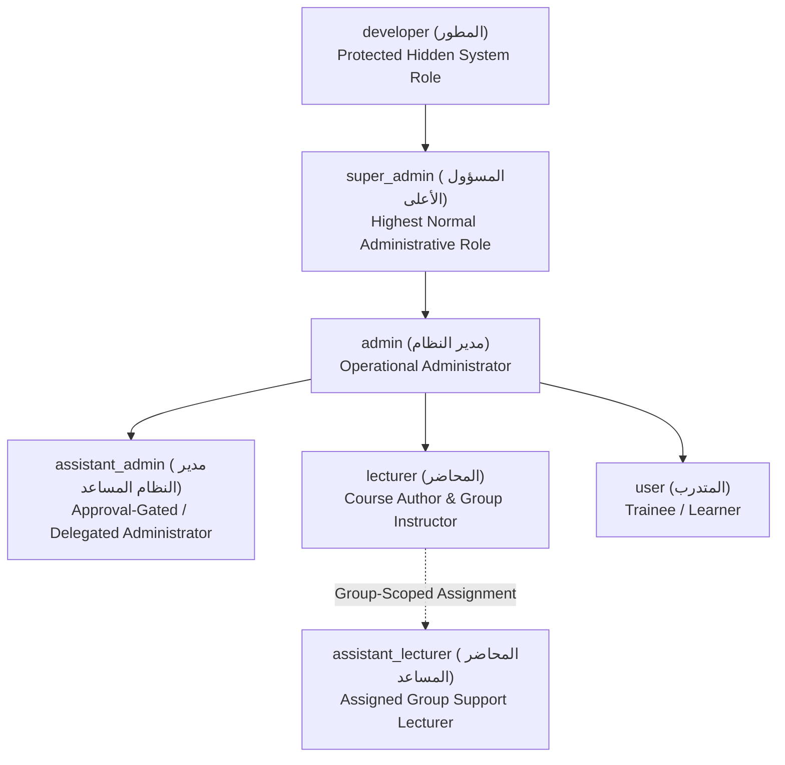
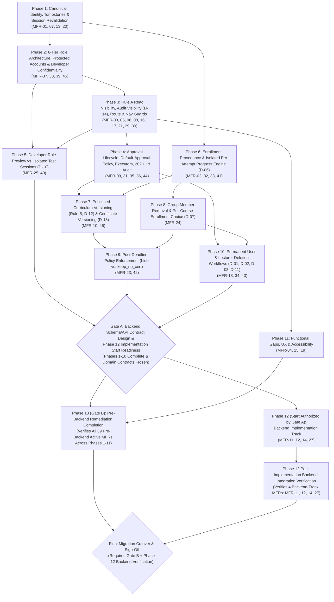

# MetroLMS — Official Pre-Backend Migration Remediation Roadmap

> [!IMPORTANT]
> **Approved Planning Baseline Only — Implementation Not Authorized.**
> This document is the single authoritative whole-system audit reconciliation, domain-contract specification, and dependency-aware remediation roadmap for MetroLMS prior to backend and persistent-database migration. **It does not authorize code implementation, test execution, or schema migration.** Every implementation phase and checklist item has initial status `Not Started` and requires explicit owner authorization before execution begins.

| Metadata Field | Value |
| :--- | :--- |
| **Document Status** | Official Planning Baseline (Incorporating Final Owner Decisions `D-01`–`D-14`, `OD-01`, and `OD-02`) |
| **Document Revision** | Revision 5 — Final Consistency Patch (Applicable Grant Access Scope, Per-Attempt Grant Aggregation, Scoped Gate B Certification, Staging Cutover Sequencing) |
| **Canonical Workspace** | `D:\LMS MEtro Project` (Legacy Desktop project and `legacy-reference/` are strictly out of scope) |
| **Inspection Methodology** | Evidence-based static source inspection across frontend routes, components, contexts, MSW handlers, and `inMemoryStore.ts`. Runtime-only behaviors are explicitly flagged as **Requires runtime verification**. |
| **Supersedes** | Whole-System Audit (`F-01`–`F-26`), Final Audit Reconciliation (`F-27`, `F-28`, `NEW-01`–`NEW-06`), Alignment Review (`NEW-07`, `NEW-08`), and Draft Roadmap v1–v3 (`MFR-01`–`MFR-46`). |
| **Canonical Finding IDs** | `MFR-01` through `MFR-46` (Master Finding Register). All prior `F-*` and `NEW-*` identifiers are preserved via 1:1 cross-reference. |

---

## Table of Contents

1. [Executive Summary](#1-executive-summary)
2. [Complete Role Hierarchy and Account-Management Matrix](#2-complete-role-hierarchy-and-account-management-matrix)
3. [Developer Confidentiality and Secure Provisioning](#3-developer-confidentiality-and-secure-provisioning)
4. [Developer Preview and Isolated Role Testing](#4-developer-preview-and-isolated-role-testing)
5. [Owner-Approved Decisions D-01 Through D-14](#5-owner-approved-decisions-d-01-through-d-14)
6. [Complete Stable Findings Register and Old-ID Mapping](#6-complete-stable-findings-register-and-old-id-mapping)
7. [Root-Cause and Domain-Model Dependency Map](#7-root-cause-and-domain-model-dependency-map)
8. [Enrollment Provenance and Group-Removal Behavior](#8-enrollment-provenance-and-group-removal-behavior)
9. [Progress, Attempt, Curriculum-Version, and Certificate Model](#9-progress-attempt-curriculum-version-and-certificate-model)
10. [Lecturer Deletion Workflow for Courses and Groups](#10-lecturer-deletion-workflow-for-courses-and-groups)
11. [User Deletion and Data-Retention Rules](#11-user-deletion-and-data-retention-rules)
12. [Post-Deadline Access Policy](#12-post-deadline-access-policy)
13. [Dependency-Aware Remediation Phases](#13-dependency-aware-remediation-phases)
14. [Detailed Acceptance and Future Verification Plan](#14-detailed-acceptance-and-future-verification-plan)
15. [Backend Migration Entry Criteria](#15-backend-migration-entry-criteria)
16. [Remaining Open Product Decisions](#16-remaining-open-product-decisions)

---

## 1. Executive Summary

### 1.1 Purpose and Scope

MetroLMS currently operates as a React/Vite single-page application backed by Mock Service Worker (MSW) handlers and a monolithic in-memory store ([`inMemoryStore.ts`](file:///d:/LMS%20MEtro%20Project/frontend/src/mocks/store/inMemoryStore.ts)). Before transitioning to a production backend and relational database, all authorization invariants, role hierarchies, approval workflows, progress/attempt domain models, enrollment provenance rules, and referential-integrity guarantees must be reconciled and aligned with the owner's final business rules.

This document consolidates all previous audit reports, incorporates the owner-approved **6-tier role architecture** (`developer`, `super_admin`, `admin`, `assistant_admin`, `lecturer` / group-scoped `assistant_lecturer`, and `user`) and **final decisions `D-01` through `D-14`**, resolves all prior finding-register numbering discrepancies, and defines a 13-phase dependency-ordered execution plan.

### 1.2 Key Architectural Findings

1. **Six-Tier Role Hierarchy & Protected-Account Gaps (`MFR-37`, `MFR-38`):**
   [`core/auth/types.ts`](file:///d:/LMS%20MEtro%20Project/frontend/src/core/auth/types.ts) and [`policy.ts`](file:///d:/LMS%20MEtro%20Project/frontend/src/core/permissions/policy.ts) only define four roles (`admin`, `assistant_admin`, `lecturer`, `user`). Neither `developer` (المطور) nor `super_admin` (المسؤول الأعلى) exists. Furthermore, `createUser` and `updateUserRole` in [`inMemoryStore.ts`](file:///d:/LMS%20MEtro%20Project/frontend/src/mocks/store/inMemoryStore.ts) currently permit a regular `admin` to create, promote, edit, and suspend other `admin` accounts, while `INVARIANT_ADMIN_ACCOUNT_NON_DELETABLE` blocks deleting `admin` accounts for all actors (blocking `developer` and `super_admin`).
2. **Developer Confidentiality & Provisioning Absence (`MFR-39`, `MFR-45`):**
   No non-disclosure filtering exists across user directories, counts/KPIs, lookup endpoints, role/instructor selectors, notifications, duplicate-email checks, or audit logs. While MSW handlers can simulate confidentiality contracts, true secrecy requires server-side enforcement and environment-bootstrapped provisioning.
3. **Developer Role Preview vs. Isolated Role Testing Conflation (`MFR-40`, `MFR-25`):**
   `switchDemoUser(role)` in [`AuthContext.tsx`](file:///d:/LMS%20MEtro%20Project/frontend/src/core/auth/AuthContext.tsx) mutates the active authenticated session instead of separating visual **Role Preview** (`معاينة الدور`) from **Isolated Role Test Sessions** (`اختبار الصلاحيات`) using dedicated test accounts (`D-10`). Additionally, `/design-system` is publicly accessible.
4. **Assistant Admin Governance & Rule A Gaps (`MFR-05`, `MFR-06`, `MFR-29`, `MFR-30`, `MFR-31`, `MFR-35`, `MFR-36`, `MFR-44`):**
   Legacy capability keys in handlers cause `403` errors on `assistant_admin` read endpoints (`MFR-29`); group and course review handlers hardcode `role === 'admin'` (`MFR-06`, `MFR-30`); six state-changing capabilities bypass approval by default (`MFR-35`); `approveApprovalRequest` lacks execution branches for group sub-resources and fails to merge `courseDrafts` on `courses.publish` (`MFR-31`); and 11 frontend mutation surfaces fail to handle `202 Accepted` without false optimistic UI updates (`MFR-36`).
5. **Cross-Group/Cycle Progress Leakage & Unversioned Certificates (`MFR-02`, `MFR-10`, `MFR-32`, `MFR-33`, `MFR-41`, `MFR-46`):**
   `this.userProgress[userId][courseId]` is keyed only by `(userId, courseId)`, causing progress to leak across independent group enrollments and renewal cycles in violation of **`D-06`**. Four separate progress calculators disagree with one another, substantive curriculum edits do not reset lesson completion (`Rule B`), and certificates are not bound to specific published course versions (`D-13`, `MFR-46`).
6. **Group Removal & Post-Deadline Provenance Gaps (`MFR-23`, `MFR-24`, `MFR-42`):**
   `EnrollmentRecord` does not track enrollment provenance (`self` vs. `group:<groupId>`). Removing a trainee from a group lacks the owner-approved per-course enrollment removal prompt (`D-07`, `MFR-24`), and `getMyEnrolledCourses` wrongly exempts completed trainees from `postDeadlinePolicy: 'hide'` (`MFR-42`).
7. **Permanent User & Lecturer Deletion Integrity (`MFR-18`, `MFR-34`, `MFR-43`):**
   `deleteUser` leaves dangling references across ~16 store collections and resurrects deleted demo users (`MFR-34`), lacks a UI button/modal (`MFR-18`), and lacks the mandatory lecturer pre-deletion supervision check and `مواصلة الحذف` workflow across courses and groups (`D-03`, `D-11`, `MFR-43`).

### 1.3 Mathematical Reconciliation of Findings

| Metric / Classification | Count | Canonical Register IDs (`MFR-*`) |
| :--- | :---: | :--- |
| **Total Master Register Observations** | **46** | `MFR-01`–`MFR-46` (`F-01`–`F-28` = 28; `NEW-01`–`NEW-08` = 8; New = 10) |
| **1. Confirmed Code Defects** (contradicts approved rule/contract) | **27** | `MFR-01, 02, 03, 04, 07, 08, 09, 13, 15, 16, 17, 19, 20, 21, 23, 25, 29, 31, 32, 33, 34, 35, 36, 38, 40, 41, 42` |
| **2. Missing Implementation / Approved Requirement Gaps** | **11** | `MFR-05, 06, 10, 18, 24, 30, 37, 39, 43, 45, 46` |
| **3. Requires Runtime Verification** (static inspection inconclusive) | **1** | `MFR-44` |
| **Subtotal — Active Pre-Backend Remediation MFRs** (`27 + 11 + 1`) | **39** | Assigned 1:1 across **Phases 1–11** (verified in **Phase 13** for **Gate B**) |
| **4. Backend Implementation-Track MFRs** (infrastructure/server-only) | **4** | `MFR-11, 12, 14, 27` (`MFR-27` merged into `MFR-11`; assigned to **Phase 12**) |
| **Subtotal — Total Active MFRs Across Both Tracks** (`39 + 4`) | **43** | `39 pre-backend active MFRs + 4 backend implementation MFRs = 43 total active MFRs` |
| **5. Deferred Features / Optional / No Action Required** | **3** | `MFR-22, 26, 28` (outside the active exit gates unless re-scoped by owner decision) |
| **6. Resolved Without Code Changes** | **0** | *(Note: `MFR-24` was previously resolved under simple Rule C, but is now an active gap under `D-07`)* |
| **Mathematical Total Check** (`39 + 4 + 3 + 0` = `27 + 11 + 1 + 4 + 3 + 0`) | **46** | **100% Reconciled** |

### 1.4 Conditional Backend Migration Readiness Verdict & Dual-Gate Model

**Current Status: NOT READY for production backend schema freeze or final migration sign-off.**
To avoid ambiguity between domain-contract readiness and full UI/prototype remediation completion, this roadmap enforces two distinct, sequential readiness gates (§15.2):

1. **Gate A — Backend Schema and API Contract Design Readiness:**
   - **Entry Requirement:** May begin once **Phases 1 through 10** are complete and their domain contracts are frozen (covering canonical identity, the 6-tier role hierarchy, permissions/delegation, multi-source enrollment provenance, attempts, progress calculation, group removal, user/lecturer deletion, audit projection, and versioned certificates).
   - **Phase 11 Non-Blocking Note:** Phase 11 UI-only remediation items (`MFR-04, 15, 19`) do not block backend schema or API contract design unless an issue is discovered to affect a core domain contract.
2. **Gate B — Pre-Backend Remediation Completion:**
   - **Scope & Completion Requirement:** Pre-backend remediation completion requires (1) completing all **39 active pre-backend remediation MFRs** across **Phases 1 through 11**, and (2) successfully passing the **Phase 13** verification test suites and production build checks.
   - **Distinction from Final Migration Cutover:** Gate B strictly certifies that all 39 active pre-backend remediation MFRs across Phases 1–11 are implemented and verified in the prototype/MSW and UI layer (it does not certify Phase 12 backend implementation MFRs or deferred MFRs). Gate B itself is **not** the final production migration sign-off. Final production migration cutover is a separate subsequent milestone requiring **both** Gate B completion and successful implementation and backend integration verification of the **4 backend implementation-track MFRs** (`MFR-11, 12, 14, 27` in **Phase 12**).

---

## 2. Complete Role Hierarchy and Account-Management Matrix

### 2.1 Authoritative Six-Tier Role Hierarchy



| Role Key | Arabic Label | Scope & Authority Summary |
| :--- | :--- | :--- |
| `developer` | المطور | Singleton/protected hidden system account. Full unrestricted access to all pages, routes, APIs, `/design-system`, Role Preview (`معاينة الدور`), and Isolated Role Test Sessions (`اختبار الصلاحيات`). Executes all operations directly without approval. Sole role allowed to create, edit, suspend, activate, or permanently delete `super_admin` accounts; can also create, edit, and delete `admin` and lower accounts. Manages own Developer profile subject to secure bootstrap/Ops CLI constraints. Completely undiscoverable to every role other than `developer`. |
| `super_admin` | المسؤول الأعلى | Highest normal administrative role. Full operational and administrative authority; executes directly without approval. Creates, edits, suspends, activates, and permanently deletes `admin` accounts and lower roles. Approves or rejects `assistant_admin` requests. **Can view** other `super_admin` accounts in read-only mode (`D-04` / `OD-01`), which never implies peer management permissions. **Cannot** create, edit, suspend, activate, or delete another `super_admin`. **Cannot** discover or manage `developer`. |
| `admin` | مدير النظام | Operational administrator. Executes permitted administrative operations directly. **Cannot** create, edit, suspend, activate, or delete `admin`, `super_admin`, or `developer` accounts. **Can view** `super_admin` accounts in read-only mode (`D-04`). **Can** create, edit, suspend, activate, manage operational delegation permissions for, and **permanently delete** `assistant_admin` accounts (`D-05` / `OD-02`), approve/reject `assistant_admin` requests, and manage `lecturer` and `user` accounts. |
| `assistant_admin` | مدير النظام المساعد | Same administrative **read** visibility as `admin` (including read-only Security Audit access per `D-14`, and read-only view of `super_admin` accounts per `D-04`), except never seeing `developer`. Initiates permitted mutations (`user`, `lecturer`, courses, groups, comments) via mandatory approval by default (`202 Accepted`), or executes directly **only** when explicitly granted operational delegation for that exact capability. Cannot approve own requests, grant self permissions, or manage `assistant_admin`, `admin`, `super_admin`, or `developer` accounts. |
| `lecturer` | المحاضر | Course builder/author for owned or co-instructed courses and supervisor for assigned groups. |
| `assistant_lecturer` | المحاضر المساعد | Group-scoped assignment (`group.assistantLecturerIds` / `groupAssistantAssignments`) held by a `lecturer` account. Grants scoped access to the assigned group's monitoring, roster, meetings, and materials. |
| `user` | المتدرب | Trainee. Accesses catalog, enrolled courses, assigned groups, learning player, and personal profile/certificates. |

### 2.2 Complete Role and Account-Management Matrix

**Legend:**
- **D** = Direct execution permitted.
- **A** = Requires approval by `admin`, `super_admin`, or `developer` by default; executes directly **only** if explicitly delegated (`delegatedOperationalAuthority`).
- **R** = Read-only visibility.
- **Self** = Permitted on the actor's own account only (profile metadata/password; never role escalation, self-deletion, or self-delegation).
- **✗** = Strictly forbidden (`403 Forbidden` at API/store layer; **`404 Not Found`** when any non-Developer targets `developer`).

| Target Account Tier | Action / Operation | `developer` | `super_admin` | `admin` | `assistant_admin` | `lecturer` | `user` |
| :--- | :--- | :---: | :---: | :---: | :---: | :---: | :---: |
| **`developer`** *(Hidden)* | View / Discover / Lookup / Count | Self | ✗ (`404`) | ✗ (`404`) | ✗ (`404`) | ✗ (`404`) | ✗ (`404`) |
| | Create / Assign `developer` Role | ✗ *(Bootstrap only)* | ✗ (`403`) | ✗ (`403`) | ✗ (`403`) | ✗ (`403`) | ✗ (`403`) |
| | Edit Profile / Rotate Credentials | Self | ✗ (`404`) | ✗ (`404`) | ✗ (`404`) | ✗ (`404`) | ✗ (`404`) |
| | Suspend / Delete / Change Role | ✗ *(Ops CLI only)* | ✗ (`404`) | ✗ (`404`) | ✗ (`404`) | ✗ (`404`) | ✗ (`404`) |
| **`super_admin`** | View in Directory & Details | R / D | R (`D-04`, `OD-01` peer read-only) | R (`D-04`) | R (`D-04`, Rule A) | ✗ | ✗ |
| | Create / Promote to `super_admin` | **D (Only)** | ✗ | ✗ | ✗ | ✗ | ✗ |
| | Edit Account Details | **D (Only)** | Self *(profile)* | ✗ | ✗ | ✗ | ✗ |
| | Change Role / Demote | **D (Only)** | ✗ | ✗ | ✗ | ✗ | ✗ |
| | Suspend / Activate | **D (Only)** | ✗ | ✗ | ✗ | ✗ | ✗ |
| | Permanently Delete (`D-01`) | **D (Only)** | ✗ | ✗ | ✗ | ✗ | ✗ |
| | Manage Permissions | **D (Only)** | ✗ | ✗ | ✗ | ✗ | ✗ |
| **`admin`** | View in Directory & Details | R / D | R / D | R | R (Rule A) | ✗ | ✗ |
| | Create / Promote to `admin` | **D** | **D** | ✗ | ✗ | ✗ | ✗ |
| | Edit Account Details | **D** | **D** | Self *(profile)* | ✗ | ✗ | ✗ |
| | Change Role / Demote | **D** | **D** | ✗ | ✗ | ✗ | ✗ |
| | Suspend / Activate | **D** | **D** | ✗ | ✗ | ✗ | ✗ |
| | Permanently Delete (`D-01`) | **D** | **D** | ✗ | ✗ | ✗ | ✗ |
| | Manage Permissions / Overrides | **D** | **D** | ✗ | ✗ | ✗ | ✗ |
| **`assistant_admin`** | View in Directory & Details | R / D | R / D | R / D | R (Rule A) | ✗ | ✗ |
| | Create / Promote to `assistant_admin` | **D** | **D** | **D** (`D-05`) | ✗ | ✗ | ✗ |
| | Edit Account Details | **D** | **D** | **D** (`D-05`) | Self *(profile)* | ✗ | ✗ |
| | Change Role (Demote to `lecturer`/`user`) | **D** | **D** | **D** (`D-05`) | ✗ | ✗ | ✗ |
| | Suspend / Activate | **D** | **D** | **D** (`D-05`) | ✗ | ✗ | ✗ |
| | Permanently Delete (`D-01`) | **D** | **D** | **D** (`D-05`, `OD-02`) | ✗ | ✗ | ✗ |
| | Manage Delegation & Overrides | **D** | **D** | **D** (`D-05`) | ✗ *(Never self/peer)* | ✗ | ✗ |
| **`lecturer`** *(and Group `assistant_lecturer`)* | View in Directory & Details | R / D | R / D | R / D | R (Rule A) | Self / Shared | Public bio |
| | Create / Promote to `lecturer` | **D** | **D** | **D** | **A** | ✗ | ✗ |
| | Edit Account Details | **D** | **D** | **D** | **A** | Self *(profile)* | ✗ |
| | Change Role (to `user`) | **D** | **D** | **D** | **A** | ✗ | ✗ |
| | Suspend / Activate | **D** | **D** | **D** | **A** | ✗ | ✗ |
| | Permanently Delete (`D-01`, `D-03`, `D-11`) | **D** *(§10 flow)* | **D** *(§10 flow)* | **D** *(§10 flow)* | **A** *(§10 flow)* | ✗ | ✗ |
| | Assign to Courses / Groups / Assistants | **D** | **D** | **D** | **A** | Group primary inst. (assistants) | ✗ |
| **`user`** *(Trainee)* | View in Directory & Transcript | R / D | R / D | R / D | R (Rule A) | Assigned groups/courses | Self |
| | Create Account | **D** | **D** | **D** | **A** | ✗ | Public signup |
| | Edit Account Details | **D** | **D** | **D** | **A** | ✗ | Self *(profile)* |
| | Change Role (Promote) | **D** *(up to `super_admin`)* | **D** *(up to `admin`)* | **D** *(up to `assistant_admin`)* | ✗ | ✗ | ✗ |
| | Suspend / Activate | **D** | **D** | **D** | **A** | ✗ | ✗ |
| | Permanently Delete (`D-01`) | **D** | **D** | **D** | **A** | ✗ | ✗ |
| | Enroll / Assign / Remove in Groups (`D-07`) | **D** | **D** | **D** | **A** | Assigned group sup. | Self-enroll |

### 2.3 Mandatory Authorization Invariants (`INV-R1`–`INV-R10`)

Every API handler, store method, bulk operation, and approval executor must enforce these invariants server-side (and in MSW/store during prototype remediation):

- **`INV-R1` (No In-App Developer Creation):** No API endpoint, form, role update, or approval request may ever create an account with `role: 'developer'` or transition any account to or from `developer`.
- **`INV-R2` (Super Admin Exclusivity & Read-Only Peer Visibility):** Only `developer` may create, edit, suspend, activate, change the role of, modify permissions for, or permanently delete a `super_admin` account (except a `super_admin` updating their own basic profile metadata). `super_admin` (as well as `admin` and `assistant_admin` under `D-04` / `OD-01`) may view other `super_admin` accounts in read-only mode; peer visibility never grants peer management permissions.
- **`INV-R3` (Admin Account Protection):** Only `developer` and `super_admin` may create, edit, suspend, activate, demote, modify permissions for, or permanently delete an `admin` account (except an `admin` updating their own basic profile metadata). Regular `admin` accounts are strictly blocked (`403`) from mutating any `admin` account.
- **`INV-R4` (Regular Admin Ceiling):** A regular `admin` may create, edit, suspend, activate, manage operational delegation permissions for, and permanently delete `assistant_admin` accounts (`D-05` / `OD-02`), as well as `lecturer` and `user` accounts, and may assign roles only within `{'assistant_admin', 'lecturer', 'user'}`.
- **`INV-R5` (Assistant Admin Ceiling):** An `assistant_admin` may never create, edit, suspend, delete, or change the role/permissions of `assistant_admin`, `admin`, `super_admin`, or `developer` accounts, and may never initiate role promotions to `assistant_admin` or higher.
- **`INV-R6` (Anti-Self-Dealing):** No user may delete their own account, suspend their own account, change their own role, grant themselves permissions/delegation, or approve their own `ApprovalRequest` (`approverCanonicalId !== requesterCanonicalId`).
- **`INV-R7` (Dual-State Role Transition Check):** Any role-change operation must validate the actor's authority against **both** `targetUser.currentRole` and `requestedNewRole`.
- **`INV-R8` (Uniform 404 Non-Disclosure for Developer):** Any read, write, or delete request by a non-Developer targeting the Developer's user ID must return an HTTP `404 Not Found` payload identical to a request for a non-existent user ID.
- **`INV-R9` (Default-Approval Enforcement for Assistant Admin):** Every state-changing capability invoked by `assistant_admin` defaults to `executionMode: 'requires_approval'` unless an active, explicit delegation record covers that exact capability key. Absence from a static list never grants direct execution.
- **`INV-R10` (Approval-Time Re-Validation):** `approveApprovalRequest` must re-verify `INV-R1`–`INV-R8`, target existence, and lecturer assignment pre-checks (`D-03`/`D-11`) at the moment of approval before mutating state.

---

## 3. Developer Confidentiality and Secure Provisioning

### 3.1 Eleven Mandatory Non-Disclosure Surfaces

To satisfy the owner's strict confidentiality rule, the `developer` account must be filtered and masked across all 11 data surfaces whenever `actor.role !== 'developer'`:

| # | Disclosure Surface | Prototype Files & Functions | Required Enforcement Contract |
| :---: | :--- | :--- | :--- |
| **1** | **User Directory, Search, Filters & Pagination** | `getManagedUsers` ([`inMemoryStore.ts`](file:///d:/LMS%20MEtro%20Project/frontend/src/mocks/store/inMemoryStore.ts)), `GET /api/admin/users` ([`userManagementHandlers.ts`](file:///d:/LMS%20MEtro%20Project/frontend/src/mocks/handlers/userManagementHandlers.ts)), [`UserManagementPage.tsx`](file:///d:/LMS%20MEtro%20Project/frontend/src/pages/UserManagementPage.tsx) | Exclude `role === 'developer'` **prior to** applying keyword search, role/status filters, total count badges, and pagination slicing. |
| **2** | **Direct User Lookup & Transcript APIs** | `getManagedUserById`, `getUserTranscript`, `GET /api/admin/users/:id*`, permission override & delegation endpoints | Enforce `INV-R8`: return `404 Not Found` with the exact same error message as an unknown ID. Never return `403`. |
| **3** | **Dashboard KPIs, Counts & Reports** | `getDashboardData`, `getCoursePerformanceReport`, `getGroupMetrics` | Exclude `developer` from total user counts, role distribution breakdowns, active user counts, and report rows. |
| **4** | **Role Selectors & Account Forms** | [`AddUserModal.tsx`](file:///d:/LMS%20MEtro%20Project/frontend/src/features/user-management/components/AddUserModal.tsx), [`UserTable.tsx`](file:///d:/LMS%20MEtro%20Project/frontend/src/features/user-management/components/UserTable.tsx) | Never render `developer` as an option. Render `super_admin` only for `developer`. Render `admin` only for `developer` and `super_admin`. |
| **5** | **Instructor, Supervisor & Trainee Pickers** | `getCandidateTrainees`, course lecturer pickers, group primary/assistant/supervisor selectors | Exclude `developer` from all candidate and staff selection lists. |
| **6** | **Notifications & Activity Feeds (`D-08`)** | `getActiveAdminRecipientIds`, `createNotification`, notification handlers | Keep Developer-targeted notifications strictly inside the Developer's private notification inbox. Never emit notifications to other users that name the Developer as actor; substitute the neutral system label (`النظام`). |
| **7** | **Security Audit Logs & Course History (`D-14`)** | `recordAuditLog`, `GET /api/admin/audit`, `course.auditLog`, approval history | Persist the true immutable `developer` actor ID internally, but project `actorId: 'SYSTEM'`, `actorRole: 'system'`, `actorName: 'النظام'` at read-serialization time for all non-Developer viewers. |
| **8** | **Entity Ownership & Reference Fields** | `createdBy`, `updatedBy`, `reviewedBy`, `requestedBy`, `approvedBy` across courses, groups, materials, approvals | Serialize Developer user references as `'SYSTEM'` / `'النظام'` when returned to non-Developer callers. |
| **9** | **Duplicate-Email & Validation Responses (`D-09`)** | `createUser`, `updateUser`, registration & profile email checks | Enforce uniqueness, but if a submitted email collides with the hidden Developer account, return the standard generic error (`البريد الإلكتروني مستخدم بالفعل أو غير متاح`) without revealing role or account details. |
| **10** | **Public Support & WhatsApp Contacts** | `getPublicSupportContacts`, `userWhatsAppAssignments`, [`useWhatsAppContacts.ts`](file:///d:/LMS%20MEtro%20Project/frontend/src/features/whatsapp/hooks/useWhatsAppContacts.ts) | Never include the Developer account in support or WhatsApp contact lists. |
| **11** | **Developer-Only Routes (`/design-system`)** | [`router/index.tsx`](file:///d:/LMS%20MEtro%20Project/frontend/src/app/router/index.tsx), `Navbar.tsx`, `Sidebar.tsx`, `LoginPage.tsx` | Remove all public/non-developer links to `/design-system`. Render the standard `NotFoundPage` (`404`) rather than `ForbiddenPage` (`403`) if a non-Developer navigates to `/design-system`. |

### 3.2 Prototype Simulation vs. Production Backend Enforcement

- **What the MSW Prototype Can Simulate:** Filtering `role === 'developer'` in `inMemoryStore` getters, projecting `'SYSTEM'` / `'النظام'` in MSW response serializers, gating the Developer seed fixture behind `import.meta.env.DEV`, and hiding UI links/routes.
- **What Requires Authoritative Backend Enforcement:** True confidentiality cannot be guaranteed in a client-side MSW architecture because browser DevTools can inspect memory and network mocks. In the production backend, confidentiality is enforced by server-side database query scopes (`WHERE role <> 'developer'`), server-side DTO serializers, and server-only environment bootstrap credentials.

### 3.3 Secure Developer Provisioning Process

1. **No Public or UI Creation:** Neither `/register` nor `POST /api/admin/users` nor `PUT /api/admin/users/:id/role` accepts `role: 'developer'`.
2. **Production Backend Bootstrap:** Provisioned exclusively via an idempotent server-side CLI command or startup migration (`pnpm db:bootstrap-developer`) reading server-only environment variables (`DEVELOPER_BOOTSTRAP_EMAIL`, `DEVELOPER_BOOTSTRAP_PASSWORD_HASH`). It enforces a database partial unique index (`CREATE UNIQUE INDEX idx_singleton_developer ON users ((role)) WHERE role = 'developer'`) so at most one Developer account can exist, and forces password rotation + MFA enrollment on first login.
3. **Frontend Prototype (Dev Mode Only):** Seeded in `inMemoryStore` **only** when `import.meta.env.DEV === true` using a synthetic dev-only fixture with no production credentials in source code or production builds.

---

## 4. Developer Preview and Isolated Role Testing

Per Section 3 and **Owner Decision `D-10`**, the Developer role is equipped with two strictly separated inspection and testing mechanisms:

| Dimension | A. Role Preview (`معاينة الدور`) | B. Isolated Role Test Session (`اختبار الصلاحيات`) |
| :--- | :--- | :--- |
| **Purpose** | Inspect how layouts, navigation menus, badges, and page variants render visually for another role (`super_admin`, `admin`, `assistant_admin`, `lecturer`, `assistant_lecturer`, `user`). | Exercise genuine end-to-end API authorization, `202 Accepted` approval flows, group/course permissions, and learner progress using a real test identity. |
| **Session & Identity** | Preserves `AuthContext.user` (`role: 'developer'`). Sets `RolePreviewContext.previewRole` (`effectiveUiRole = previewRole ?? user.role`). | Launches an isolated session authenticated as a dedicated synthetic **test persona account** (e.g., `test_super_admin`, `test_admin`, `test_assistant_admin`, `test_lecturer`, `test_trainee`), storing the Developer's return token in a separate `developerOriginSession` slot. |
| **API Authorization Context** | **Unchanged** (requests still carry the Developer token, or mutations are blocked in preview-only mode with a prompt to launch an Isolated Test Session). Never produces false positives about role-level API restrictions. | **Genuine role-level API enforcement.** Requests carry the dedicated test persona's token, hitting exact handler/backend authorization guards for that role. |
| **Targets Allowed** | Any UI role layout. | Dedicated synthetic test accounts only. **Never** impersonates real employee/trainee accounts in production (`D-10`). |
| **Visual Indicator & Exit** | Persistent top banner: `وضع معاينة الواجهة فقط: [الدور] — الصلاحيات البرمجية الحالية: المطور` with one-click `إنهاء المعاينة`. | Distinct warning banner: `جلسة اختبار صلاحيات معزولة (حساب اختباري: [الاسم / الدور])` with one-click `العودة إلى جلسة المطور`. |
---

## 5. Owner-Approved Decisions D-01 Through D-14

All fourteen owner decisions below are finalized and authoritative. Every downstream section of this roadmap enforces them directly:

| Decision ID | Domain Area | Authoritative Owner Decision | Roadmap Sections & Phases |
| :--- | :--- | :--- | :--- |
| **`D-01`** | **Permanent Deletion of a User's Training Records** | Permanently deleting a user account deletes the account identity, credentials, account-linked enrollments, course attempts, lesson progress, last-watched records, and transcript/training history, removes the user from group rosters and active assignments, revokes permissions/delegations, cancels pending requests, and blocks demo-account resurrection. Do **not** retain an anonymized transcript by default. Historical comments (`D-02`), immutable audit logs, and other users' courses/records remain intact. | §§11, 13 (Phase 10) |
| **`D-02`** | **Course Discussion Data After User Deletion** | Retain historical course comments and replies; strip the deleted user's identity association (`userId: null`, unresolvable via old ID or aliases) and display the author as `مستخدم محذوف`. | §§11, 13 (Phase 10) |
| **`D-03`** | **Lecturer Deletion: Course & Group Supervision Workflow** | When deleting a lecturer who participates in course or group supervision, block immediate deletion (`409 Conflict`), show the warning: `لا يمكن حذف هذا المحاضر لمشاركته في الإشراف على كورسات أو مجموعات. إن كنت تريد الحذف، يرجى إزالته من الإشراف أولاً.`, provide the `مواصلة الحذف` action button, list all supervised courses and groups as navigable links to their instructor/supervisor assignment screens, and allow deletion retry only after all supervision links are removed or reassigned (without deleting courses, groups, trainees, or unrelated records). | §§10, 13 (Phase 10) |
| **`D-04`** | **Visibility and Management of Super Admin Accounts (`OD-01` Confirmed)** | `super_admin` (peer read-only), regular `admin`, and `assistant_admin` (under Rule A) can **view** `super_admin` accounts in read-only mode, but cannot create, edit, suspend, activate, delete, or change their roles. Peer visibility never implies peer management. Only `developer` can create, edit, suspend, activate, or permanently delete `super_admin` accounts. | §§2, 13 (Phase 2), §16 |
| **`D-05`** | **Admin Management of Assistant Admin Accounts (`OD-02` Confirmed)** | Regular `admin` can create `assistant_admin` accounts, edit their ordinary details, suspend and activate them, manage their delegated operational permissions under the governance model, and **permanently delete** `assistant_admin` accounts (`OD-02`). `admin` cannot promote `assistant_admin` to `admin`, `super_admin`, or `developer`. | §§2, 13 (Phase 2, Phase 10), §16 |
| **`D-06`** | **Independent Progress Across Groups and Renewal Cycles** | Each independent enrollment/attempt has its own isolated progress context (`attemptId`). Enrolling in Course A through Group 1 and Course A through Group 2 creates two independent attempts; completing Course A in Group 1 **never** completes Course A in Group 2. A renewal cycle starts a fresh attempt at `0%` while preserving sealed historical attempts. `(userId, courseId)` is insufficient as a unique progress key. | §§9, 13 (Phase 6) |
| **`D-07`** | **Removing a Trainee from a Group & Per-Course Choice** | Removing a trainee from a group ends group membership and prompts the Admin with the group's assigned courses in which the trainee is enrolled: `هل تريد أيضًا إزالة تسجيل المتدرب من أي من المقررات التدريبية التابعة لهذه المجموعة؟ يمكنك تحديد المقررات التي تريد إزالة تسجيله منها.` Course choices are independent and unchecked by default. **For a kept course:** (1) revoke the old group-originated access source, (2) create or reactivate a distinct, idempotent standalone continuation access grant (`kind: 'self'`, `convertedFromGroupId: groupId`) bound to the **same active `attemptId`** (without overwriting, merging, or reusing any pre-existing independent standalone grant `S1` bound to a different attempt), (3) preserve existing progress, completed lessons, and learning position (continuing without resetting to `0%`), (4) remove the old group deadline constraint, and (5) preserve the attempt's original group and cycle attribution as immutable historical provenance. **For a removed course:** revoke only the relevant group-originated access source, preserve historical attempt/progress records, and retain access if another valid active access source exists. | §§8, 9, 13 (Phase 8) |
| **`D-08`** | **Developer Notifications** | Developer-related operational notifications stay strictly inside the protected Developer workspace. Never expose Developer identity, existence, or private notifications to other users. | §§3, 13 (Phases 2, 4) |
| **`D-09`** | **Developer Email Conflict Disclosure** | Enforce email uniqueness across all accounts, including `developer`, but return a generic validation message on collision so an ordinary user or admin can never infer that the email belongs to a hidden Developer account. | §§3, 13 (Phase 2) |
| **`D-10`** | **Preview vs. Impersonation** | Provide two distinct Developer tools: (1) visual **Role Preview** (`معاينة الدور`) preserving real Developer identity, and (2) **Isolated Role Test Sessions** (`اختبار الصلاحيات`) using dedicated test accounts. Real-user impersonation is forbidden in production. | §§4, 13 (Phase 5) |
| **`D-11`** | **Course & Group Ownership on Lecturer Deletion** | Never delete courses, groups, trainees, or unrelated records when a lecturer is deleted. Both course-level (`lecturerId`, `coLecturers`) and active group-level (`primaryInstructorId`, `assistantLecturerIds`, `supervisorIds`) assignments block deletion (`409`) with the `D-03` warning (`لا يمكن حذف هذا المحاضر لمشاركته في الإشراف على كورسات أو مجموعات. إن كنت تريد الحذف، يرجى إزالته من الإشراف أولاً.`) and `مواصلة الحذف` navigable links. Primary ownership must be reassigned or cleared to an explicit nullable unassigned state (`lecturerId: null` / `primaryInstructorId: null`, displayed as `غير معين`), never a magic `'unassigned'` user ID. | §§10, 13 (Phase 10) |
| **`D-12`** | **Progress Rounding** | Use `Math.round` for displayed integer completion percentages, clamped to `[0, 100]`. (`isCompleted` remains strictly gated on completing 100% of required items). | §§9, 13 (Phase 7) |
| **`D-13`** | **Certificate Versioning** | Certificates are bound to the specific published course version completed (`Certificate — Course Version 1`, `Certificate — Course Version 2`). Publishing a curriculum update (`Version 2`) never invalidates a `Version 1` certificate; completing the updated curriculum issues a new `Version 2` certificate. | §§9, 13 (Phase 7) |
| **`D-14`** | **Security Audit Visibility** | `assistant_admin` has read-only access to Security Audit (`/admin/audit`, `GET /api/admin/audit`) under Rule A. Audit logs are append-only and immutable, and Developer identity is masked (`النظام`) for all non-Developer viewers. | §§2, 3, 13 (Phase 3) |

---

## 6. Complete Stable Findings Register and Old-ID Mapping

### 6.1 Register Integrity Rules

1. **Canonical IDs (`MFR-01`–`MFR-46`):** Never reused or renumbered.
   - `MFR-01`–`MFR-28` correspond 1:1 to `F-01`–`F-28`.
   - `MFR-29`–`MFR-36` correspond 1:1 to `NEW-01`–`NEW-08`.
   - `MFR-37`–`MFR-46` are the 10 findings identified during the final role-architecture and `D-01`–`D-14` audit.
2. **Reconciliation of `MFR-24` (`F-24`):** Under the initial simple interpretation of Rule C, `removeGroupMember` preserving all enrollments required no code change. Under the owner's finalized **`D-07`** decision, group member removal requires enrollment-source provenance tracking and an interactive per-course removal modal/API contract. `MFR-24` is therefore classified as an active **Gap** (`P1`) assigned to **Phase 8**.
3. **Addition of `MFR-46` (`D-13`):** Static inspection confirmed that the codebase has no `CourseVersion` history table and no version-scoped `CertificateRecord` store. `MFR-46` (`Gap`, `P1`) tracks this requirement in **Phase 7**.

### 6.2 Master Finding Register (`MFR-01`–`MFR-46`)

| Canonical ID | Prior ID | Domain Area | Evidence-Based Finding Description | Classification | Priority | Assigned Phase | Root Cluster |
| :--- | :--- | :--- | :--- | :--- | :---: | :---: | :---: |
| **MFR-01** | `F-01` | Identity / Auth | Local `resolveAuthenticatedUser` copies in `learningHandlers.ts` and `enrollmentHandlers.ts` map non-synthetic `mock_jwt_*` tokens to `usr_trainee_001` instead of calling canonical [`resolveUser.ts`](file:///d:/LMS%20MEtro%20Project/frontend/src/mocks/handlers/resolveUser.ts). | Confirmed defect | P0 | Phase 1 | C1 |
| **MFR-02** | `F-02` | Progress / Attempts | `recordLessonActivity` and `markLessonComplete` write only to `this.userProgress` and never update `this.courseAttempts`, causing `GroupMonitoringPage`, `CoursePerformancePage`, and `UserDetailsPage` to diverge. | Confirmed defect | P0 | Phase 6 | C5 |
| **MFR-03** | `F-03` | Security / Groups | `POST /api/groups/:groupId/assistants` and `DELETE .../assistants/:assistantId` in `permissionsHandlers.ts` lack role/ownership checks; `GET` lacks authentication. | Confirmed defect | P0 | Phase 3 | C3 |
| **MFR-04** | `F-04` | Routing | Parameterized routes `groups/:groupId`, `builder/:courseId`, and `performance/:courseId` in [`router/index.tsx`](file:///d:/LMS%20MEtro%20Project/frontend/src/app/router/index.tsx) use static `<Navigate to="/.../:param" />`, navigating to literal `:groupId` / `:courseId`. | Confirmed defect | P2 | Phase 11 | C8 |
| **MFR-05** | `F-05` | Rule A / Dashboard | `getDashboardData` and `DashboardPage.tsx` route `assistant_admin` to the Trainee Dashboard (`role: 'user'`) instead of `AdminDashboard`. | Gap | P1 | Phase 3 | C3 |
| **MFR-06** | `F-06` | Rule A / Groups | `assistant_admin` is blocked from group read endpoints (`GET /api/admin/groups*` returns `[]` or `403`) and group pages; group sub-resource mutations hardcode `isGroupAdmin` (`role === 'admin'`). | Gap | P1 | Phase 3 | C3 |
| **MFR-07** | `F-07` | Identity / Comments | `getAllComments`, `ignoreCommentReport`, `deleteComment`, and `toggleCourseComments` compare `course.lecturerId !== actor.id` without canonical ID resolution (`usr_lect_001` vs. `USR003`). | Confirmed defect | P0 | Phase 1 | C1 |
| **MFR-08** | `F-08` | Navigation | `Sidebar.tsx` and `MobileDrawer.tsx` render all `NAVIGATION_SECTIONS` without filtering by the user's role. | Confirmed defect | P1 | Phase 3 | C3 |
| **MFR-09** | `F-09` | Audit Attribution | `createGroup`, `updateGroup`, `archiveGroup`, `deleteGroup`, `deleteUserPermissionOverride`, and `setDelegatedAuthority` hardcode `actorId: 'usr_admin_001'` in `recordAuditLog`. | Confirmed defect | P1 | Phase 4 | C4 |
| **MFR-10** | `F-10` | Rule B / Versioning | Substantive edits to published lessons (`type`, `videoUrl`, `pdfUrl`, `mediaId`, `content`, `durationSeconds`) do not increment `contentVersion` or reset completion for active attempts upon publication. | Gap | P1 | Phase 7 | C5 |
| **MFR-11** | `F-11` | Storage / Media | Application state is split across volatile RAM (`inMemoryStore`), `localStorage`, `IndexedDB`, and in-memory Blob URLs. | Backend | P2 | Phase 12 | C7 |
| **MFR-12** | `F-12` | Auth / Passwords | Directory users outside the 5 hardcoded credential entries can authenticate with any 4+ character password unless reset. | Backend | P1 | Phase 12 | C7 |
| **MFR-13** | `F-13` | Identity | Dual synthetic (`usr_*`) and directory (`USR*`) user ID namespaces require `resolveCanonicalUserId` normalization across all collections. | Confirmed defect | P0 | Phase 1 | C1 |
| **MFR-14** | `F-14` | Scheduling | Auto-renewal scheduler ([`useAutoRenewalScheduler.ts`](file:///d:/LMS%20MEtro%20Project/frontend/src/features/groups/hooks/useAutoRenewalScheduler.ts)) runs on a client-side `setInterval` in `AppLayout.tsx`. | Backend | P2 | Phase 12 | C7 |
| **MFR-15** | `F-15` | UX / Dashboard | Trainee Dashboard live-session `انضمام` button shows a static demo toast instead of opening `session.url`. | Confirmed defect | P2 | Phase 11 | C8 |
| **MFR-16** | `F-16` | Role Labels | `assistant_admin` is displayed raw or with wrong Arabic labels (`متدرب فني`, `صلاحيات محاضر معتمد`) in `AppLayout`, `ProfilePage`, `ForbiddenPage`, `CourseDetailPage`, and `UserDetailsPage`. | Confirmed defect | P2 | Phase 3 | C3 |
| **MFR-17** | `F-17` | Route Guards | Role-restricted routes (`admin/groups*`, `lecturer/courses`, `lecturer/builder/:courseId`, `approvals`, `admin/review/:courseId`) lack `<ProtectedRoute allowedRoles={...}>`. | Confirmed defect | P1 | Phase 3 | C3 |
| **MFR-18** | `F-18` | User Deletion UI | `DELETE /api/admin/users/:id` exists, but `UserTable.tsx` and `UserDetailsPage.tsx` have no Delete User button or confirmation modal. | Gap | P1 | Phase 10 | C6 |
| **MFR-19** | `F-19` | Telemetry | `GET /api/profile` and `getDashboardData` hardcode `totalLearningHours: 24` instead of aligning with `getUserTranscript` (`null` or verified completed duration). | Confirmed defect | P2 | Phase 11 | C8 |
| **MFR-20** | `F-20` | Session | `AuthContext.tsx` restores `session.user` from `localStorage` on mount without revalidating against `GET /api/auth/me`. | Confirmed defect | P1 | Phase 1 | C1 |
| **MFR-21** | `F-21` | Preview Isolation | `recordLessonActivity` and `markLessonComplete` skip trainee progress writes for `admin` and `lecturer`, but omit `assistant_admin`, `super_admin`, and `developer`. | Confirmed defect | P1 | Phase 3 | C3 |
| **MFR-22** | `F-22` | Catalog | Department-track catalog filtering in `CoursesCatalogPage` is explicitly documented as deferred in `DepartmentTracksPage.tsx`. | Deferred | P3 | — | — |
| **MFR-23** | `F-23` | Post-Deadline | Direct URL access to `/courses/:courseId/learn` and lesson completion APIs remain open for expired `postDeadlinePolicy: 'hide'` group courses. | Confirmed defect | P1 | Phase 9 | C5 |
| **MFR-24** | `F-24` | Group Removal (`D-07`) | `removeGroupMember` and `GroupMembersTab.tsx` lack enrollment provenance tracking and the mandatory `D-07` per-course enrollment removal prompt and API contract. | Gap | P1 | Phase 8 | C5 |
| **MFR-25** | `F-25` | Dev Surfaces | `/design-system` links and prototype phase badges are visible to all roles across `Navbar`, `Sidebar`, `MobileDrawer`, `Footer`, and `LoginPage`. | Confirmed defect | P2 | Phase 5 | C2 |
| **MFR-26** | `F-26` | Navigation | Disabled `الشهادات والتقارير (قريباً)` placeholder item in `navigation.ts`. | Deferred | P3 | — | — |
| **MFR-27** | `F-27` | Media Blobs | Uploaded group material files use a volatile in-memory `materialBlobRegistry` in `materialUtils.ts`. | Backend (merged into MFR-11) | P2 | Phase 12 | C7 |
| **MFR-28** | `F-28` | Routing | `/admin/groups/:groupId` and `/admin/groups/:groupId/edit` both mount `GroupEditorPage.tsx`. | Deferred (optional redirect) | P3 | — | — |
| **MFR-29** | `NEW-01` | Rule A / Keys | Legacy capability keys (`users.view`, `transcripts.view`, `permissions.view`, `permissions.manage`) in `userManagementHandlers.ts` and `permissionsHandlers.ts` mismatch `ROLE_CAPABILITY_CEILINGS`, returning `403` to `assistant_admin`. | Confirmed defect | P0 | Phase 3 | C3 |
| **MFR-30** | `NEW-02` | Rule A / Courses | `reviewHandlers.ts`, `getReviewQueue`, `getCourseReviewData`, `getLecturerCourses`, and `getCourseForEditing` check `user.role === 'admin'`, blocking `assistant_admin` visibility (`Rule A`) and `super_admin`/`developer`. | Gap | P1 | Phase 3 | C3 |
| **MFR-31** | `NEW-03` | Approvals Execution | `approveApprovalRequest` fails to merge `courseDrafts` on `courses.publish`, lacks execution branches for group sub-resource mutations, and hardcodes `targetUrl: '/admin/users'` on approval notifications. | Confirmed defect | P0 | Phase 4 | C4 |
| **MFR-32** | `NEW-04` | Progress / Reports | `getCoursePerformanceReport` reads only `this.courseAttempts` and ignores standalone enrollments, reporting `0%` for self-enrolled trainees. | Confirmed defect | P0 | Phase 6 | C5 |
| **MFR-33** | `NEW-05` | Progress / Transcript | `getUserTranscript` counts completed keys in `userProgress` without intersecting current `flatItems`, latches `isCompleted = true`, and uses `Math.max` so progress cannot decrease when new lessons are published. | Confirmed defect | P0 | Phase 6 | C5 |
| **MFR-34** | `NEW-06` | Deletion Integrity (`D-01`) | `deleteUser` leaves dangling references across ~16 store collections (`enrollments`, `courseAttempts`, `userProgress`, `groups`, `courseComments`, etc.), and `getManagedUserById` resurrects deleted demo users from `SYNTHETIC_DEMO_ACCOUNTS`. | Confirmed defect | P1 | Phase 10 | C6 |
| **MFR-35** | `NEW-07` | Rule A / Policy | Six state-changing capabilities (`groups.generate_qr`, `materials.manage_folders`, `materials.upload_files`, `materials.manage_meetings`, `reviews.submit_course`, `comments.ignore_report`) execute directly for `assistant_admin` by default because `evaluatePermission` defaults unlisted capabilities to `direct`. | Confirmed defect | P0 | Phase 4 | C4 |
| **MFR-36** | `NEW-08` | Approvals UI (`202`) | 11 frontend mutation surfaces (`GroupEditorPage`, `GroupQRModal`, `GroupMonitoringPage`, `GroupCoursesTab`, `GroupMembersTab`, `GroupMaterialsTab`, `GroupMeetingsTab`, `GroupAttachmentsTab`, `CourseBuilderPage`, `CourseReviewPage`, `CommentReportsPage`) do not handle `202 Accepted` (`approvalRequired: true`) and perform false optimistic state updates. | Confirmed defect | P1 | Phase 4 | C4 |
| **MFR-37** | — | Role Hierarchy | `developer` and `super_admin` roles are missing from `UserRole`, `policy.ts`, `ROLE_CANONICAL_LABELS_AR`, route guards, and handlers. | Gap | P0 | Phase 2 | C2 |
| **MFR-38** | — | Account Protection | Regular `admin` can create, promote, edit, and suspend `admin` accounts; `INVARIANT_ADMIN_ACCOUNT_NON_DELETABLE` blocks `developer` and `super_admin` from deleting `admin` accounts. | Confirmed defect | P0 | Phase 2 | C2 |
| **MFR-39** | — | Confidentiality (`D-08`, `D-09`) | No Developer non-disclosure filtering across the 11 surfaces (§3.1), no generic duplicate-email masking (`D-09`), no private notification isolation (`D-08`), and no neutral `'SYSTEM'` / `'النظام'` audit projection. | Gap | P0 | Phase 2 | C2 |
| **MFR-40** | — | Preview vs. Testing (`D-10`) | `switchDemoUser` replaces the real authenticated session instead of providing separate **Role Preview** (`معاينة الدور`) and **Isolated Role Test Sessions** (`اختبار الصلاحيات`). | Confirmed defect | P1 | Phase 5 | C2 |
| **MFR-41** | — | Attempt Isolation (`D-06`) | `this.userProgress[userId][courseId]` shares progress across all groups, standalone enrollments, and renewal cycles, violating `D-06` per-attempt isolation. | Confirmed defect | P0 | Phase 6 | C5 |
| **MFR-42** | — | Post-Deadline `hide` | `getMyEnrolledCourses` exempts completed trainees (`&& !progress.isCompleted`) from `postDeadlinePolicy: 'hide'`, and `EnrollmentRecord` lacks provenance to distinguish standalone vs. group access. | Confirmed defect | P1 | Phase 9 | C5 |
| **MFR-43** | — | Lecturer Deletion (`D-03`, `D-11`) | `deleteUser` lacks the pre-deletion supervision check (`409 Conflict`), the `مواصلة الحذف` interactive modal with clickable course/group deep links, and nullable `Course.lecturerId` / `Group.primaryInstructorId` (`غير معين`). | Gap | P1 | Phase 10 | C6 |
| **MFR-44** | — | Approval Hardening | Atomic single-execution lock, canonical self-approval block, and approval-time target/role/assignment revalidation across all `approveApprovalRequest` branches require explicit hardening and runtime verification. | Verify | P1 | Phase 4 | C4 |
| **MFR-45** | — | Provisioning | No secure Developer bootstrap contract exists, and synthetic demo credentials are bundled unconditionally. | Gap | P1 | Phase 2 | C2 |
| **MFR-46** | — | Certificate Versioning (`D-13`) | No `CourseVersion` entity or version-bound `CertificateRecord` (`Certificate — Course Version N`) exists to preserve prior certificates when curriculum updates are published. | Gap | P1 | Phase 7 | C5 |

### 6.3 Phase Assignment Verification Table

| Phase | Phase Title | Assigned Active MFRs | Item Count |
| :--- | :--- | :--- | :---: |
| **Phase 1** | Canonical Identity, Tombstones & Session Consistency | `MFR-01, 07, 13, 20` | 4 |
| **Phase 2** | Role Architecture (`developer`, `super_admin`), Account Protection & Confidentiality | `MFR-37, 38, 39, 45` | 4 |
| **Phase 3** | Assistant Admin Visibility (`Rule A`, `D-14`), Route Guards & Role Navigation | `MFR-03, 05, 06, 08, 16, 17, 21, 29, 30` | 9 |
| **Phase 4** | Approval Lifecycle, Delegation, Execution, Notifications & Audit Attribution | `MFR-09, 31, 35, 36, 44` | 5 |
| **Phase 5** | Developer Role Preview (`معاينة الدور`) & Isolated Role Testing (`اختبار الصلاحيات`, `D-10`) | `MFR-25, 40` | 2 |
| **Phase 6** | Unified Enrollment Provenance & Per-Attempt Progress Architecture (`D-06`) | `MFR-02, 32, 33, 41` | 4 |
| **Phase 7** | Curriculum Versioning (`Rule B`), Rounding (`D-12`) & Certificate Versioning (`D-13`) | `MFR-10, 46` | 2 |
| **Phase 8** | Group Member Removal & Per-Course Enrollment Choice (`D-07`) | `MFR-24` | 1 |
| **Phase 9** | Post-Deadline Access Enforcement (`hide` vs. `keep_no_cert`) | `MFR-23, 42` | 2 |
| **Phase 10** | Permanent User & Lecturer Deletion (`D-01`, `D-02`, `D-03`, `D-11`) | `MFR-18, 34, 43` | 3 |
| **Phase 11** | Functional Gaps, UX & Accessibility | `MFR-04, 15, 19` | 3 |
| **Subtotal (Pre-Backend Active)** | **Active Pre-Backend Remediation MFRs (Phases 1–11)** | `27 defects + 11 gaps + 1 runtime verify` | **39** |
| **Phase 12** | Persistent Files/Media, Server Auth & Background Scheduling *(Backend Implementation Track)* | `MFR-11, 12, 14, 27` | 4 *(Backend Track)* |
| **Subtotal (Total Active)** | **Total Active MFRs (`39 pre-backend active MFRs + 4 backend implementation MFRs = 43 total active MFRs`)** | Phases 1–12 | **43** |
| **Phase 13** | Pre-Backend Verification & Remediation Completion Gate (**Gate B**) | *(Verifies all 39 pre-backend active MFRs across Phases 1–11; the 4 Phase 12 backend implementation MFRs are verified after backend implementation)* | 0 *(Gate)* |
| **Deferred** | Deferred Features / Optional Route Alias (`MFR-22, 26, 28`) | `MFR-22, 26, 28` *(outside active exit gates)* | 3 *(Deferred)* |
| **Total** | **All 46 Master Register Observations Accounted For (`39 + 4 + 3 = 46`)** | `MFR-01`–`MFR-46` | **46** |

---

## 7. Root-Cause and Domain-Model Dependency Map



---

## 8. Enrollment Provenance and Group-Removal Behavior (`D-07`)

### 8.1 Multi-Source Enrollment Provenance & Immutable Attempt Origin Contract

Currently, `EnrollmentRecord` in [`inMemoryStore.ts`](file:///d:/LMS%20MEtro%20Project/frontend/src/mocks/store/inMemoryStore.ts) stores a flat `{ userId, courseId, enrolledAt }` record. It cannot distinguish whether a trainee enrolled themselves, was enrolled via Group 1, or was enrolled via Group 2.

Under **`D-06`** and **`D-07`**, the domain model strictly separates **current access entitlement** (`EnrollmentSourceGrant` in `EnrollmentRecord.sources`) from **immutable attempt origin provenance** (`originContext`, `originGroupId`, `originCycleId` on `CourseAttempt`), and treats `kind` as the **source category** rather than a globally unique source identifier:

```ts
export type EnrollmentSourceKind =
  | 'self'                        // Source category: independent self-enrollment from catalog OR standalone continuation grant after group removal (D-07)
  | 'group';                      // Source category: provisioned via membership in a specific training group

export interface EnrollmentSourceGrant {
  sourceId: string;               // Stable unique grant ID per source instance (e.g., `self:catalog:${attemptId}`, `self:continued:${groupId}:${attemptId}`, or `group:${groupId}:${cycleId}`)
  kind: EnrollmentSourceKind;     // Category ('self' | 'group'); multiple active grants of kind: 'self' are allowed when bound to distinct attempts/contexts
  groupId?: string;               // Present when kind === 'group'
  cycleId?: string;               // Active cycle when granted
  attemptId: string;              // Active CourseAttempt ID bound to this specific grant (D-06, D-07)
  convertedFromGroupId?: string;  // Present when this standalone continuation grant was created upon keeping a course during group removal (D-07)
  grantedAt: string;
  grantedBy?: string;
  revokedAt?: string;
  status: 'active' | 'revoked_by_group_removal' | 'expired';
}

export interface EnrollmentRecord {
  id: string;
  userId: string;                 // Canonical user ID
  courseId: string;
  enrolledAt: string;
  sources: EnrollmentSourceGrant[];
}
```

**Critical Domain Invariants (`D-06`, `D-07`):**
1. **`kind` Is a Category, Not a Singleton ID:** Each `EnrollmentSourceGrant` has its own stable, unique `sourceId` (for example, `'self:catalog:${attemptId}'` for direct catalog self-enrollment, `'self:continued:${groupId}:${attemptId}'` for a standalone continuation grant created during group removal, and `'group:${groupId}:${cycleId}'` for a group cycle grant). The system must **never** assume there can only be one grant whose `sourceId` is literally `'self'`.
2. **Multiple Active `kind: 'self'` Grants Are Allowed:** A trainee may hold multiple active grants of `kind: 'self'` simultaneously when they represent distinct independent enrollment or continuation contexts (for example, a pre-existing direct self-enrollment grant `S1` bound to `Attempt S1` alongside a converted standalone continuation grant bound to `Attempt G1`).
3. **Entitlement vs. Immutable Attempt Provenance:**
   - `EnrollmentRecord.sources` tracks the trainee's **current and historical access entitlements** to the course.
   - `CourseAttempt` records the **immutable historical origin** of the learning attempt (`originContext: 'standalone' | 'group_cycle'`, `originGroupId?: string`, `originCycleId?: string`).
   - When a trainee is removed from a group and the Admin chooses to **keep** a course, the old group access source is revoked (`status: 'revoked_by_group_removal'`) and a distinct standalone continuation grant (`kind: 'self'`, `sourceId: 'self:continued:${groupId}:${attemptId}'`, `convertedFromGroupId: groupId`) is created (or reactivated idempotently) pointing to the **exact same `attemptId`**. Any pre-existing independent standalone grant (`S1` with `sourceId: 'self:catalog:att_S1'`) and its attempt (`Attempt S1`) remain completely untouched, and the converted attempt's original `originGroupId` and `originCycleId` are preserved as immutable historical provenance.
4. **Consistency & Idempotency Rules for Source Grants:**
   - Every Source Grant has its own stable, unique `sourceId` bound deterministically to its corresponding `attemptId`.
   - Retrying the same enrollment operation for the same attempt reuses the same source identity rather than creating duplicates.
   - A new independent self-enrollment creates a new attempt and therefore a different unique source ID (`self:catalog:${newAttemptId}`).
   - Existing standalone grants (`self:catalog:${attemptId}`) and group-converted continuation grants (`self:continued:${groupId}:${attemptId}`) must never overwrite or merge with one another.

### 8.2 Interactive Group-Removal Workflow (`D-07`)

When an authorized administrator (`developer`, `super_admin`, `admin`, delegated/approved `assistant_admin`, or assigned group supervisor) initiates removing a trainee (`traineeId`) from a group (`groupId`):

1. **Inspection of Assigned Group Courses:**
   - The UI (`GroupMembersTab.tsx` / `GroupMonitoringPage.tsx`) identifies all courses assigned to `group` in which `traineeId` currently holds an active enrollment source for `groupId`.
2. **Per-Course Selection Modal (`D-07`):**
   - If the trainee is enrolled in one or more courses assigned to this group, the removal confirmation modal displays the exact prompt:
     > `هل تريد أيضًا إزالة تسجيل المتدرب من أي من المقررات التدريبية التابعة لهذه المجموعة؟ يمكنك تحديد المقررات التي تريد إزالة تسجيله منها.`
   - Renders a checklist of the group's assigned courses (showing the trainee's current progress in this group's attempt for each course).
   - **Default State:** All course checkboxes are **unchecked by default**, ensuring that confirming removal without checking courses never silently revokes course enrollments.
3. **API Contract (`DELETE /api/admin/groups/:groupId/members/:userId`):**
   - Accepts optional request body `{ removeCourseIds?: string[] }` (defaulting to `[]`).
   - For an un-delegated `assistant_admin`, `removeCourseIds` is persisted inside the `ApprovalRequest.payload` so that when an Admin or Super Admin approves the request, the exact per-course choices are executed.
4. **Execution Semantics per Assigned Course `C`:**
   - **Step A (Always):** Remove `traineeId` from `group.traineeIds`, `currentCycle.traineeIds`, and `groupMembers[groupId]`. Do not affect any other groups, and never migrate the removed trainee on future renewals of `groupId`.
   - **Case 1 — Course `C` is NOT in `removeCourseIds` (Admin Chooses to KEEP Course Access):**
     1. **Revoke Old Group Access Source:** Mark the existing group `EnrollmentSourceGrant` (`groupId === group.id`, bound to `groupAttemptId`) as `status: 'revoked_by_group_removal'` (with `revokedAt`), preserving the revoked grant in `enrollment.sources` for historical auditability.
     2. **Create or Reactivate a Distinct, Idempotent Standalone Continuation Grant:** Create (or reactivate if an identical continuation grant already exists for `(groupId, groupAttemptId)`) a dedicated standalone continuation `EnrollmentSourceGrant` with `sourceId: 'self:continued:${groupId}:${groupAttemptId}'`, `kind: 'self'`, `status: 'active'`, `convertedFromGroupId: groupId`, and `attemptId: groupAttemptId`.
     3. **Never Overwrite, Merge, or Reuse a Pre-Existing Independent Standalone Grant (`S1`):** If the trainee already holds a pre-existing standalone grant (e.g., `S1` with `sourceId: 'self:catalog:att_S1'` bound to `Attempt S1`), leave `S1` and `Attempt S1` completely unchanged. Never overwrite `S1.attemptId`, never reuse `S1` for the group conversion, and never merge progress between `Attempt S1` and `Attempt G1`. Repeating the group-removal conversion for the same `(groupId, groupAttemptId)` must be idempotent and never create duplicate continuation grants.
     4. **Continue Same Active Group `attemptId` (`Attempt G1`):** Bind the converted standalone continuation grant to the **exact same active `attemptId`** (`Attempt G1`) that the trainee was using in the group. Do **not** create a new zero-progress attempt.
     5. **Preserve Progress & Position:** Keep all existing `lessonProgress`, `completedItemIds`, `furthestSeconds`, and `lastPositionSeconds` on `Attempt G1` untouched so the trainee continues learning from the exact same point without restarting at `0%`.
     6. **Unbound from Old Group Deadline:** Because the old group source is revoked and continuation access to `Attempt G1` is now governed by the active standalone continuation grant (`kind: 'self'`), the former group's deadline and `postDeadlinePolicy` no longer restrict `Attempt G1`.
     7. **Preserve Immutable Historical Provenance:** Keep `originContext = 'group_cycle'`, `originGroupId = groupId`, and `originCycleId = cycleId` immutable on `Attempt G1` so historical attribution is never falsified.
   - **Case 2 — Course `C` IS in `removeCourseIds` (Admin Chooses to REMOVE Course Access):**
     1. **Revoke Only Relevant Group Source:** Mark the group `EnrollmentSourceGrant` for `groupId` as `status: 'revoked_by_group_removal'`. Do **not** revoke any unrelated enrollment sources (`S1`, other converted continuation grants, or other active groups).
     2. **Preserve Historical Attempt & Progress:** Keep the group `CourseAttempt` (`Attempt G1`) and its `lessonProgress` / `completedItemIds` history intact (sealing the group attempt as `'sealed'` if completed or `'expired_incomplete'` if incomplete so historical learning records are never erased).
     3. **Retain Access If Another Active Source Exists:** If the trainee holds another valid `status === 'active'` source in `enrollment.sources` (such as a pre-existing independent self-enrollment `S1`, a converted continuation grant from another group, or another active group enrollment `group:${otherGroupId}`), the trainee retains course access through that remaining active source and its bound attempt. Access to course `C` ends only when no active source remains.

> [!IMPORTANT]
> **Concrete Collision-Prevention Walkthrough (`S1` + `G1` Edge Case):**
> 1. Trainee self-enrolls in **Course A** from the catalog $\rightarrow$ receives standalone grant `S1` (`sourceId: 'self:catalog:att_S1'`, `kind: 'self'`, `status: 'active'`), bound to **`Attempt S1`** (`originContext: 'standalone'`, e.g., at `25%` progress).
> 2. Trainee later joins **Group 1** (which also assigns Course A) $\rightarrow$ receives group grant `G1` (`sourceId: 'group:grp_1:cyc_1'`, `kind: 'group'`, `groupId: 'grp_1'`, `status: 'active'`), bound to **`Attempt G1`** (`originContext: 'group_cycle'`, `originGroupId: 'grp_1'`, `originCycleId: 'cyc_1'`, e.g., at `60%` progress).
> 3. Admin removes the trainee from **Group 1** and leaves Course A **unchecked** (keeps Course A).
> 4. **Resulting State:**
>    - `G1` (`sourceId: 'group:grp_1:cyc_1'`) is marked `status: 'revoked_by_group_removal'`.
>    - A distinct standalone continuation grant `G1_cont` (`sourceId: 'self:continued:grp_1:att_G1'`, `kind: 'self'`, `convertedFromGroupId: 'grp_1'`, `status: 'active'`) is created and bound to **`Attempt G1`** (`60%` progress, no longer subject to Group 1's deadline, with `originGroupId: 'grp_1'` and `originCycleId: 'cyc_1'` preserved on `Attempt G1`).
>    - Pre-existing standalone grant `S1` (`sourceId: 'self:catalog:att_S1'`, `kind: 'self'`, `status: 'active'`) remains bound to **`Attempt S1`** (`25%` progress) without being overwritten, merged, or lost.

---

## 9. Progress, Attempt, Curriculum-Version, and Certificate Model

### 9.1 Per-Attempt Isolation, Attempt Continuity & Unambiguous Player Routing Contract (`D-06`, `D-07`)

Under **Owner Decisions `D-06` and `D-07`**, `(userId, courseId)` is **never** used as the primary key for lesson progress. Every independent enrollment context owns a distinct `CourseAttempt` with its own isolated `lessonProgress` and immutable historical origin attributes (`originContext`, `originGroupId`, `originCycleId`):

- **Trainee in Course A via Group 1 AND Course A via Group 2 (`D-06`):**
  - Owns `Attempt 1` (`originContext: 'group_cycle', originGroupId: 'grp_1', originCycleId: 'cyc_1'`) and `Attempt 2` (`originContext: 'group_cycle', originGroupId: 'grp_2', originCycleId: 'cyc_1'`).
  - Completing lessons or finishing 100% of Course A in `Attempt 1` updates **only** `Attempt 1`. `Attempt 2` remains at its own independent progress percentage until the trainee completes the lessons within Group 2's attempt context.
- **Trainee in Renewal Cycle 2 of Group 1 (`D-06`):**
  - When Cycle 1 closes/renews into Cycle 2, `Attempt 1` (`originCycleId: 'cyc_1'`) is permanently **sealed** (`AttemptSeal` snapshot written).
  - A fresh `Attempt 3` (`originContext: 'group_cycle', originGroupId: 'grp_1', originCycleId: 'cyc_2', attemptNumber: 2`) is created at **`0%`** (`lessonProgress: {}`, `completedItemIds: []`). Zero completion leaks from Cycle 1 into Cycle 2.
- **Trainee Removed from Group 1 with Course A Kept (`D-07`):**
  - The old `group:grp_1:cyc_1` access source is revoked and a distinct standalone continuation access grant (`kind: 'self'`, `sourceId: 'self:continued:grp_1:att_1'`, `convertedFromGroupId: 'grp_1'`) is created bound to the **same active `Attempt 1`**, without overwriting or merging any pre-existing independent standalone grant (`S1` with `sourceId: 'self:catalog:att_S1'`).
  - `Attempt 1` keeps its existing progress, completed lessons, and playback position without resetting to `0%`, is no longer governed by Group 1's deadline, and retains `originGroupId: 'grp_1'` and `originCycleId: 'cyc_1'` as immutable historical provenance.
- **Unambiguous Learning Player Attempt Selection & Access Mode Enforcement (`D-06`, `D-07`):**
  1. **Explicit Route `attemptId` Always Wins:** Entering `/courses/:courseId/learn?attemptId=<id>` resolves to that exact `attemptId` after verifying the attempt belongs to the authenticated user and resolving its effective access mode (`full` vs. `review_only`).
  2. **Access Mode Semantics (`full` vs. `review_only`):**
     - **`full` access:**
       - Allows viewing course content.
       - Allows reading progress (`getCourseProgress`).
       - Allows recording lesson activity (`POST /api/courses/:courseId/lessons/:itemId/activity`).
       - Allows completing lessons (`POST /api/courses/:courseId/lessons/:itemId/complete`).
       - Updates progress against the exact selected `attemptId`.
       - Certificate eligibility follows the standard rules (§9.3).
     - **`review_only` access:**
       - Allows viewing course content.
       - Allows reading existing progress (`getCourseProgress`).
       - **Does not allow** recording lesson activity.
       - **Does not allow** completing lessons.
       - **Does not allow** any progress modification (the attempt's progress remains completely unchanged throughout the review session).
       - **Does not allow** issuing new certificates.
  3. **API/Store Boundary Enforcement:**
     - Read-only behavior must be strictly enforced at the API/store boundary, not merely by disabling buttons in the UI.
     - Any request attempting to record lesson activity (`POST /api/courses/:courseId/lessons/:itemId/activity`) or mark a lesson complete (`POST /api/courses/:courseId/lessons/:itemId/complete`) against an attempt with `review_only` access **must be rejected** with HTTP `403 Forbidden` (`{ "code": "COURSE_ACCESS_REVIEW_ONLY", "message": "المقرر في وضع المراجعة فقط. لا يمكن تسجيل أنشطة أو إكمال دروس جديدة." }`).
     - Zero store mutations or progress writes occur on rejected requests.
  4. **Explicit Group Context (`?groupId=<groupId>`):** Navigating from a specific group page (`GroupDetailsPage` or group course card with `?groupId=<groupId>`) resolves deterministically to that group's active attempt (and redirects/normalizes the URL to include `?attemptId=<id>`).
  5. **Navigation from My Courses or Catalog Without Explicit Attempt Context:**
     - **Candidate Attempt Resolution:**
       1. **Per-Grant Evaluation:** The system first evaluates each enrollment source grant individually to determine its effective access level (`full`, `review_only`, or `'none'`). Individual grants that are revoked (`status: 'revoked_by_group_removal'`), expired under `postDeadlinePolicy: 'hide'`, or in un-enrolled states are excluded individually.
       2. **Per-Attempt Aggregation & Revoked-Source Non-Disqualification (`D-07`):** Crucially, under `D-07`, an individual revoked grant does **not** disqualify or exclude its bound `attemptId` wholesale if that same attempt is also bound to another active or review-eligible grant (such as a converted continuation grant `sourceId: 'self:continued:${groupId}:${attemptId}'` created upon group removal under `D-07`).
       3. **Group by `attemptId` & Retain Eligible Attempts:** The remaining eligible grants are grouped by `attemptId`. A course attempt is included as an eligible candidate if it is associated with at least one eligible grant (`full` or `review_only`). Candidates are deduplicated by `attemptId`.
       4. **Effective Access per Candidate Attempt:** Each candidate attempt's effective access mode is resolved to the highest access level among its own associated eligible grants (`full > review_only`). Attempt selection must **not** rely exclusively on `attempt.status === 'active'`.
     - **Single Eligible Attempt:** When **exactly one** eligible attempt (`full` or `review_only`) exists, the Learning Player resolves directly to that `attemptId`.
     - **Multiple Eligible Attempts (Mandatory Disambiguation Step):** When **more than one** eligible `attemptId` exists across active or review-eligible sources, the Learning Player **must not** silently pick an arbitrary attempt. Instead, it presents an explicit attempt/context selector modal displaying all eligible attempts (including review-only attempts) with each context's label, origin, access badge (`كامل` / `مراجعة فقط`), current progress `%`, and last activity timestamp:
       - Independent standalone attempt (`S1`, `sourceId: 'self:catalog:att_S1'`, `'تسجيل ذاتي مستقل'`) **+** converted standalone continuation attempt (`G1_cont`, `'تسجيل مستمر من مجموعة: <Group Name>'`).
       - Converted standalone continuation attempt (`G1_cont`) **+** active group attempt (`G2`, `'مجموعة: <Group 2 Name>'`).
       - Multiple active group attempts (`G1` **+** `G2`) or independent standalone attempt (`S1`) **+** active group attempt (`G1`).
       - Active standalone or group attempt (`full`) **+** expired/archived group review attempt (`review_only` under `keep_no_cert`).
     - **Strict Isolation on Selection:** Selecting an attempt binds the session URL (`?attemptId=<selectedId>`) to that chosen attempt and **never** merges, overwrites, or modifies any other attempt's progress.

### 9.2 Published Curriculum Versioning (`Rule B`) and Rounding (`D-12`)

```ts
export interface PublishedCourseVersion {
  courseId: string;
  versionNumber: number;          // 1, 2, 3... incremented only when a published course update is approved/published
  publishedAt: string;
  publishedBy: string;
  requiredItems: Array<{
    itemId: string;
    contentVersion: number;       // Incremented when substantive fields change
    type: ChapterItemType;
    durationSeconds?: number;
    contentFingerprint: string;   // Hash of (type, videoUrl, pdfUrl, mediaId, content, durationSeconds)
  }>;
}
```

- **Substantive vs. Metadata Classification:**
  - **Substantive fields** (change increments `item.contentVersion` on publication and resets completion of `itemId` in unsealed attempts): `type`, `videoUrl`, `pdfUrl`, `mediaId`, `content`, `durationSeconds`.
  - **Metadata-only fields** (change preserves `item.contentVersion` and completion): `title`, `description`, `order`, formatted `duration` string.
- **Draft Isolation:** Edits staged in `courseDrafts[courseId]` do not create a `PublishedCourseVersion` and do not affect any learner's denominator until approved and published.
- **Authoritative Calculation Formula (`D-12`):**
  For any active (unsealed) attempt $a$ on course $c$ with latest published version $V_k$:
  $$\text{Done}(a, V_k) = \{ i \in V_k.\text{requiredItems} \mid a.\text{lessonProgress}[i.\text{itemId}].\text{completed} \land a.\text{lessonProgress}[i.\text{itemId}].\text{contentVersion} = i.\text{contentVersion} \}$$
  $$\text{progressPercent}(a) = \begin{cases} 0 & \text{if } |V_k.\text{requiredItems}| = 0 \\ \text{clamp}\!\left(0, 100, \text{Math.round}\!\left(\frac{100 \times |\text{Done}(a, V_k)|}{|V_k.\text{requiredItems}|}\right)\right) & \text{otherwise} \end{cases}$$
  $$\text{isCompleted}(a) = |V_k.\text{requiredItems}| > 0 \land |\text{Done}(a, V_k)| = |V_k.\text{requiredItems}|$$
  *(Note: If `Math.round` yields `100` when `|Done| < |requiredItems|` on courses with >100 items, display is capped at `99%` until `isCompleted(a)` is true).*

### 9.3 Version-Scoped Certificates (`D-13`, `MFR-46`)

```ts
export interface CertificateRecord {
  id: string;                     // e.g. 'cert_001'
  userId: string;                 // Canonical user ID (deleted when user is deleted per D-01)
  courseId: string;
  attemptId: string;
  courseVersionNumber: number;    // e.g. 1 -> "Certificate — Course Version 1"
  courseTitleSnapshot: string;
  issuedAt: string;
}
```

1. **Issuance:** When an active attempt $a$ with `'full'` access reaches `isCompleted(a) === true` against currently published `PublishedCourseVersion` $V_k$, the system issues (or marks eligible) a `CertificateRecord` bound to `courseVersionNumber = k` (`شهادة إتمام — الإصدار k`).
2. **Preservation Across Curriculum Updates (`D-13`):**
   - Suppose a trainee completes `Course Version 1` (10 lessons) and earns `Certificate — Course Version 1`.
   - Later, the instructor adds 2 lessons and publishes `Course Version 2` (12 lessons).
   - The trainee's existing `Certificate — Course Version 1` **remains permanently valid** and downloadable for `Version 1`.
   - Meanwhile, the trainee's active curriculum progress against `Version 2` recalculates to $\text{Math.round}(10/12 \times 100) = 83\%$.
   - Once the trainee completes the 2 new lessons in `Version 2`, they reach `100%` on `Version 2` and earn `Certificate — Course Version 2`.
---

## 10. Lecturer Deletion Workflow for Courses and Groups (`D-03`, `D-11`)

### 10.1 Supervised Entities & Nullable Primary Ownership Contract

Courses and training groups must **never** be deleted when a lecturer account is deleted. Both course-level and active group-level supervision/ownership relationships block immediate deletion until resolved:

| Entity & Role | Domain Field | Required Resolution Before Deletion (`D-03`, `D-11`) | Direct Navigation Deep Link |
| :--- | :--- | :--- | :--- |
| **Course Primary Lecturer** | `Course.lecturerId: string \| null` | Reassign to another active `lecturer` **or** explicitly set to `null` (`غير معين` — Unassigned). Never use a magic string `'unassigned'`. | `/lecturer/builder/:courseId?tab=settings&returnTo=/admin/users/:userId` |
| **Course Co-Instructor / Supervisor** | `Course.coLecturers: string[]` | Remove the lecturer from `course.coLecturers`. | `/lecturer/builder/:courseId?tab=settings&returnTo=/admin/users/:userId` |
| **Group Primary Instructor** | `TrainingGroup.primaryInstructorId: string \| null` | Reassign to another active `lecturer` **or** explicitly set to `null` (`غير معين`). | `/admin/groups/:groupId/edit?tab=basic&returnTo=/admin/users/:userId` |
| **Group Assistant Lecturer** | `TrainingGroup.assistantLecturerIds: string[]`, `groupAssistantAssignments` | Remove the lecturer from `assistantLecturerIds` and `groupAssistantAssignments`. | `/admin/groups/:groupId/edit?tab=basic&returnTo=/admin/users/:userId` |
| **Group Supervisor** | `TrainingGroup.supervisorIds: string[]` | Remove the lecturer from `supervisorIds`. | `/admin/groups/:groupId/edit?tab=basic&returnTo=/admin/users/:userId` |

### 10.2 Step-by-Step UX & API Contract (`D-03`, `D-11`)

1. **Pre-Deletion Check (`DELETE /api/admin/users/:id` & `inMemoryStore.deleteUser`):**
   - After verifying actor permissions (`INV-R1`–`INV-R8`), inspect all courses (`course.lecturerId === canonicalId || course.coLecturers.includes(canonicalId)`) and all non-archived groups (`primaryInstructorId`, `assistantLecturerIds`, `supervisorIds`).
   - If `supervisedCourses.length > 0 || supervisedGroups.length > 0`, **block immediate deletion** and return `HTTP 409 Conflict`:
     ```json
     {
       "code": "LECTURER_HAS_ACTIVE_ASSIGNMENTS",
       "message": "لا يمكن حذف هذا المحاضر لمشاركته في الإشراف على كورسات أو مجموعات. إن كنت تريد الحذف، يرجى إزالته من الإشراف أولاً.",
       "courses": [{ "id": "crs_001", "title": "...", "role": "primary_lecturer", "manageUrl": "/lecturer/builder/crs_001?tab=settings" }],
       "groups": [{ "id": "grp_001", "name": "...", "role": "primary_instructor", "manageUrl": "/admin/groups/grp_001/edit" }]
     }
     ```
2. **Step 1 Warning Modal (`D-03`, `D-11`):**
   - Display the exact owner-approved warning text covering both courses and groups:
     > `لا يمكن حذف هذا المحاضر لمشاركته في الإشراف على كورسات أو مجموعات. إن كنت تريد الحذف، يرجى إزالته من الإشراف أولاً.`
   - Render two actions: **`مواصلة الحذف`** (Primary/Warning) and **`إلغاء`** (Secondary).
3. **Step 2 Interactive Association List (`مواصلة الحذف`):**
   - Clicking `مواصلة الحذف` transitions the modal to display the structured list of supervised courses and supervised groups as navigable links.
   - Each course row is clickable and navigates directly to its course-management / instructor-assignment screen.
   - Each group row is clickable and navigates directly to its group instructor/supervisor assignment screen.
4. **Step 3 Unassignment / Reassignment & Retry:**
   - The Admin must remove or reassign the lecturer from all listed course and group assignments before deletion can proceed. Where a primary owner is cleared rather than replaced, preserve the documented `null` / `غير معين` state (never introduce a magic `'unassigned'` string). Never delete courses, groups, trainees, or unrelated records as a side effect.
   - Once all listed course and group associations are removed or reassigned, returning and clicking Delete User again succeeds permanently (`200 OK` for `admin`/`super_admin`/`developer`, or `202 Accepted` for un-delegated `assistant_admin` — with `approveApprovalRequest` re-running the same `409` pre-check at approval time per `INV-R10`).

---

## 11. User Deletion and Data-Retention Rules (`D-01`, `D-02`)

Per **Owner Decisions `D-01` and `D-02`**, permanent user deletion (`DELETE /api/admin/users/:id`) is strictly distinct from account suspension (`status: 'suspended'`) and enforces the following deterministic retention and cascade matrix:

| # | Data Category / Store Collection | Action on Permanent User Deletion (`D-01`–`D-03`, `D-11`) |
| :---: | :--- | :--- |
| **1** | **Account Identity & Credentials** (`users`, `mockUserCredentials`) | **Permanently Delete.** Add canonical ID and all synthetic aliases to `deletedUserTombstones: Set<string>` so `getManagedUserById` and `SYNTHETIC_DEMO_ACCOUNTS` never resurrect the deleted account. |
| **2** | **Trainee Course Enrollments** (`enrollments`) | **Permanently Delete** all `EnrollmentRecord` entries for the deleted user and recompute `course.enrollmentCount` (`D-01`). |
| **3** | **Trainee Course Attempts & Seals** (`courseAttempts`) | **Permanently Delete** all `CourseAttempt` records belonging to the deleted user (`D-01`). |
| **4** | **Lesson Progress & Last-Watched** (`userProgress`, `lastWatched`) | **Permanently Delete** all lesson progress and playback state for the deleted user (`D-01`). |
| **5** | **Transcript, Training History & Certificates** (`getUserTranscript`, `certificates`) | **Permanently Delete** all associated training history and user certificate records (`D-01`). Do **not** retain an anonymized transcript. |
| **6** | **Group Memberships & Pending Join Requests** (`groups.traineeIds`, `renewalCycles.traineeIds`, `groupMembers`, `groupJoinRequests`) | **Cascade Remove** from all group rosters and active renewal cycles; delete/cancel pending join requests (`D-01`). |
| **7** | **Permissions, Overrides, Delegations & WhatsApp Contacts** (`userPermissionOverrides`, `delegatedOperationalAuthority`, `userWhatsAppAssignments`) | **Permanently Delete / Revoke** (`D-01`). |
| **8** | **Pending Approval Requests** (`approvalRequests` where `status === 'pending'`) | **Auto-Cancel** any pending request where `requestedBy` or `targetId` matches the deleted user (`D-01`). |
| **9** | **User Notifications** (`notifications`) | **Permanently Delete** all notifications addressed to the deleted user. |
| **10** | **Course Comments & Discussion Replies (`D-02`)** | **Retain & Anonymize.** Preserve comment/reply content and thread hierarchy; strip identity link (`userId: null`, `userEmail: null`, unresolvable via old ID/aliases) and set `userName: 'مستخدم محذوف'`. |
| **11** | **Security Audit Logs & Decided Approvals** (`systemAuditLogs`, `course.auditLog`, decided `approvalRequests`) | **Strictly Retain (Immutable).** Never delete or alter historical audit records (`D-01`). |
| **12** | **Lecturer Supervised Courses & Groups (`D-03`, `D-11`)** | **Block Deletion (`409 Conflict`)** until all active course/group supervision and primary ownership links are removed or set to `null` (`غير معين`). Never delete courses or other trainees' records. For archived/completed historical cycles, anonymize historical instructor display fallback as `مستخدم محذوف` while clearing the foreign key. |

---

## 12. Post-Deadline Access Policy

### 12.1 Authoritative `hide` vs. `keep_no_cert` Semantics

1. **Zero Completed-Trainee Exemption Under `hide`:**
   - Remove `&& !progress.isCompleted` from [`inMemoryStore.ts#L1583`](file:///d:/LMS%20MEtro%20Project/frontend/src/mocks/store/inMemoryStore.ts#L1583).
   - When a group course assignment expires and the effective `postDeadlinePolicy` is `'hide'`, that group-originated enrollment source grants **`'none'` access** to **every** trainee in that group — even if the trainee completed 100% of the course before the deadline.
2. **Multi-Source Access Precedence (`resolveCourseAccess`):**
   - Because a trainee can hold multiple enrollment sources in `EnrollmentRecord.sources` (§8.1), access to course $C$ at timestamp `now` is resolved across all applicable enrollment source grants (including active standalone, active group, and eligible expired or archived group sources):
     - Any active standalone source (`kind === 'self'`, `status === 'active'`) $\rightarrow$ grants **`'full'`**.
     - Any active group source (`kind === 'group'`, `status === 'active'`, group not archived, effective deadline `null` or `now <= deadline`) $\rightarrow$ grants **`'full'`**.
     - Any expired/archived group source whose effective policy is `'keep_no_cert'` $\rightarrow$ grants **`'review_only'`** (allows viewing course content and reading existing progress; lesson activity requests `POST .../activity` and completion requests `POST .../complete` are strictly rejected at the API/store boundary with HTTP `403 Forbidden` (`COURSE_ACCESS_REVIEW_ONLY`), resulting in zero progress modifications, zero store mutations, and no new certificate issuance).
     - Any expired/archived group source whose effective policy is `'hide'` $\rightarrow$ grants **`'none'`**.
     - Any revoked source (`status === 'revoked_by_group_removal'`) $\rightarrow$ does not grant access (`'none'`).
   - Effective access is $\max(\text{grants})$ ordered by `'full' > 'review_only' > 'none'`. Thus, an expired `'hide'` group or revoked source never blocks a valid independent `'self'` enrollment or another active group's assignment.
3. **Uniform Enforcement Across All 7 Surfaces:**
   - Enforced identically in: (1) `MyCoursesPage` (`getMyEnrolledCourses`), (2) `DashboardPage` (`getDashboardData`), (3) Trainee `GroupDetailsPage`, (4) `LearningPlayerPage` route guard (`/courses/:courseId/learn`), (5) `GET /api/courses/:courseId/progress`, (6) `POST /api/courses/:courseId/lessons/:itemId/activity` & `/complete` (rejecting mutations under `review_only` or `none`), and (7) Certificate issuance.

---

## 13. Dependency-Aware Remediation Phases

> [!IMPORTANT]
> Every phase below has initial status **`Not Started`**. Do not duplicate work items across phases; each active `MFR-*` belongs to **exactly one** phase.

---

### Phase 1 — Canonical Identity, Tombstones, and Session Consistency

- **Status:** `Completed`
- **Stable Findings Addressed:** `MFR-01` (`F-01`), `MFR-07` (`F-07`), `MFR-13` (`F-13`), `MFR-20` (`F-20`)
- **Dependencies:** None (Foundational prerequisite for all subsequent phases).
- **Sequencing Rationale:** Every authorization check, progress attempt, enrollment source, and deletion cascade depends on a single deterministic `canonicalUserId` and server-validated session state.
- **Objective & Scope:** Eliminate duplicate token resolvers, normalize all store collections and lookups to canonical user IDs (`USR*`), introduce a deleted-user tombstone set so deleted demo personas cannot resurrect, and revalidate client sessions against `GET /api/auth/me`.
- **Relevant Files, Functions, Types & Endpoints:**
  - [`frontend/src/mocks/handlers/resolveUser.ts`](file:///d:/LMS%20MEtro%20Project/frontend/src/mocks/handlers/resolveUser.ts) (`resolveAuthenticatedUser`)
  - [`frontend/src/mocks/handlers/learningHandlers.ts`](file:///d:/LMS%20MEtro%20Project/frontend/src/mocks/handlers/learningHandlers.ts) & [`enrollmentHandlers.ts`](file:///d:/LMS%20MEtro%20Project/frontend/src/mocks/handlers/enrollmentHandlers.ts) (remove local `resolveAuthenticatedUser` copies)
  - [`frontend/src/mocks/store/inMemoryStore.ts`](file:///d:/LMS%20MEtro%20Project/frontend/src/mocks/store/inMemoryStore.ts) (`resolveCanonicalUserId`, `deletedUserTombstones`, `getAllComments`, `ignoreCommentReport`, `deleteComment`, `toggleCourseComments`, `isUserAuthorizedCourseInstructor`)
  - [`frontend/src/core/auth/AuthContext.tsx`](file:///d:/LMS%20MEtro%20Project/frontend/src/core/auth/AuthContext.tsx) & `GET /api/auth/me`
- **Checklist (`Completed`):**
  - [x] `[Completed]` Replace local `resolveAuthenticatedUser` functions in `learningHandlers.ts` and `enrollmentHandlers.ts` with imports from `resolveUser.ts` (`MFR-01`).
  - [x] `[Completed]` Normalize all `inMemoryStore` maps (`enrollments`, `userProgress`, `courseAttempts`, `groupMembers`, `notifications`, `courseComments`) to canonical user IDs (`MFR-13`).
  - [x] `[Completed]` Update comment moderation methods (`getAllComments`, `ignoreCommentReport`, `deleteComment`, `toggleCourseComments`) to use `isUserAuthorizedCourseInstructor` / `resolveCanonicalUserId` (`MFR-07`).
  - [x] `[Completed]` Revalidate stored session in `AuthContext.tsx` on mount via `GET /api/auth/me`, clearing `localStorage` if the user is suspended, deleted, or invalid (`MFR-20`).
- **Expected Behavior & Acceptance Criteria:**
  - Directory users (`USR002`–`USR015`) and newly created users resolve to their own identity on all learning and enrollment endpoints.
  - Demo lecturer `usr_lect_001` resolves to `'USR003'` and can moderate comments on owned courses without `403` errors.
  - Suspended or deleted accounts have their active browser sessions invalidated upon `/api/auth/me` check.
- **Future Tests to Write/Update:**
  - *Unit:* `resolveAuthenticatedUser` resolution for synthetic, directory, unknown, and tombstoned tokens.
  - *Integration:* Enrollment and lesson completion for newly created users and directory users (`USR006`); lecturer comment moderation across synthetic/canonical IDs.
  - *Security:* Session invalidation on account suspension or deletion.
- **Regression Risks:** Existing tests that implicitly relied on unknown tokens falling back to `usr_trainee_001`.
- **Exit Gate:** Zero duplicate token resolvers in `src/mocks/handlers/`; all identity and session tests pass.

---

### Phase 2 — Role Architecture (`developer`, `super_admin`), Account Protection & Confidentiality

- **Status:** `Not Started`
- **Stable Findings Addressed:** `MFR-37`, `MFR-38`, `MFR-39`, `MFR-45`
- **Dependencies:** Phase 1.
- **Sequencing Rationale:** Route guards, Rule A visibility, approval workflows, and Developer preview all depend on the 6-tier `UserRole` definition, protected-account invariants `INV-R1`–`INV-R8`, and Developer non-disclosure filters.
- **Objective & Scope:** Introduce `developer` (المطور) and `super_admin` (المسؤول الأعلى), enforce the §2.2 account-management matrix (`D-04`, `D-05`), implement the 11 Developer confidentiality surfaces (§3.1, `D-08`, `D-09`), add neutral audit/reference projection (`النظام`), and gate the prototype Developer seed behind `import.meta.env.DEV`.
- **Relevant Files, Functions, Types & Endpoints:**
  - [`frontend/src/core/auth/types.ts`](file:///d:/LMS%20MEtro%20Project/frontend/src/core/auth/types.ts) & [`frontend/src/features/user-management/types.ts`](file:///d:/LMS%20MEtro%20Project/frontend/src/features/user-management/types.ts) (`UserRole`)
  - [`frontend/src/core/permissions/types.ts`](file:///d:/LMS%20MEtro%20Project/frontend/src/core/permissions/types.ts) & [`policy.ts`](file:///d:/LMS%20MEtro%20Project/frontend/src/core/permissions/policy.ts) (`ROLE_DEFAULT_CAPABILITIES`, `ROLE_CAPABILITY_CEILINGS`, `evaluateProtectedInvariant`, `canActorManageTargetAccount`, `ROLE_CANONICAL_LABELS_AR`)
  - [`frontend/src/mocks/store/inMemoryStore.ts`](file:///d:/LMS%20MEtro%20Project/frontend/src/mocks/store/inMemoryStore.ts) (`getManagedUsers`, `getManagedUserById`, `createUser`, `updateUser`, `updateUserRole`, `updateUserStatus`, `deleteUser`, `getDashboardData`, `getCandidateTrainees`, `getPublicSupportContacts`, `getActiveAdminRecipientIds`, `serializeAuditLogForViewer`)
  - [`frontend/src/mocks/handlers/userManagementHandlers.ts`](file:///d:/LMS%20MEtro%20Project/frontend/src/mocks/handlers/userManagementHandlers.ts), [`AddUserModal.tsx`](file:///d:/LMS%20MEtro%20Project/frontend/src/features/user-management/components/AddUserModal.tsx), [`UserTable.tsx`](file:///d:/LMS%20MEtro%20Project/frontend/src/features/user-management/components/UserTable.tsx)
- **Checklist (`Not Started`):**
  - [ ] `[Not Started]` Add `'developer'` and `'super_admin'` to `UserRole`, `ROLE_CANONICAL_LABELS_AR` (`المطور`, `المسؤول الأعلى`), `ROLE_DEFAULT_CAPABILITIES`, and `ROLE_CAPABILITY_CEILINGS` (`MFR-37`).
  - [ ] `[Not Started]` Replace `INVARIANT_ADMIN_ACCOUNT_NON_DELETABLE` with `INV-R1`–`INV-R8` in `policy.ts` and `inMemoryStore.ts` so: (a) only `developer` can create, edit, suspend, activate, or permanently delete `super_admin` accounts; (b) `super_admin` can view other `super_admin` accounts in read-only mode (`D-04` / `OD-01`) without any peer management permissions; (c) only `developer` and `super_admin` can create, edit, suspend, activate, or permanently delete `admin` accounts; (d) regular `admin` cannot create, edit, suspend, activate, or delete any `admin` or `super_admin`, can view `super_admin` read-only (`D-04`), and can create, edit, suspend, activate, manage operational delegation for, and permanently delete `assistant_admin` accounts (`D-05` / `OD-02`) (`MFR-38`).
  - [ ] `[Not Started]` Implement Developer non-disclosure across all 11 surfaces (§3.1): filter `role === 'developer'` before search/counts/pagination, return uniform `404` on direct lookup by non-developers (`INV-R8`), isolate Developer notifications (`D-08`), return generic duplicate-email errors on collision with the Developer email (`D-09`), and project `'SYSTEM'` / `'النظام'` in audit logs and reference fields for non-Developer viewers (`MFR-39`).
  - [ ] `[Not Started]` Gate the prototype `developer` and `super_admin` test fixtures behind `import.meta.env.DEV` and document the server CLI bootstrap specification (`MFR-45`).
- **Expected Behavior & Acceptance Criteria:**
  - Regular `admin` receives `403` when attempting to create, edit, change role of, suspend, activate, or delete an `admin` or `super_admin` account, can view `super_admin` accounts in read-only mode (`D-04`), and can create, edit, suspend, activate, manage delegation for, and permanently delete `assistant_admin` accounts (`D-05` / `OD-02`).
  - `super_admin` can view other `super_admin` accounts in read-only mode (`D-04` / `OD-01`), can create, edit, suspend, activate, and permanently delete `admin` accounts, and receives `403` when attempting to create, edit, suspend, activate, or delete another `super_admin`.
  - `developer` can create, edit, suspend, activate, and permanently delete both `super_admin` and `admin` accounts.
  - No non-Developer role can see, count, search, select, or infer the existence of the `developer` account on any endpoint or UI screen (`404` parity with unknown user IDs).
- **Future Tests to Write/Update:**
  - *Unit:* Exhaustive 6×6 role-management matrix test (`canActorManageTargetAccount`) covering View (including `super_admin` peer read-only view under `OD-01`), Create, Edit, Role Change, Suspend, Delete (including `admin` deleting `assistant_admin` under `OD-02`), and Delegation.
  - *Integration:* Directory listing, pagination counts, KPI totals, and audit log serialization as `developer` vs. `super_admin` vs. `admin` vs. `assistant_admin`.
  - *Security:* Role-escalation attempts via `POST /api/admin/users`, `PUT /api/admin/users/:id/role`, peer `super_admin` mutation rejection (`403`), and duplicate-email probing against the Developer email (`D-09`).
- **Regression Risks:** Existing tests that use a regular `admin` actor to create or mutate another `admin` account.
- **Exit Gate:** All 6×6 role matrix and Developer non-disclosure tests pass with zero leaks.

---

### Phase 3 — Assistant Admin Visibility (`Rule A`, `D-14`), Route Guards & Role Navigation

- **Status:** `Not Started`
- **Stable Findings Addressed:** `MFR-03` (`F-03`), `MFR-05` (`F-05`), `MFR-06` (`F-06`), `MFR-08` (`F-08`), `MFR-16` (`F-16`), `MFR-17` (`F-17`), `MFR-21` (`F-21`), `MFR-29` (`NEW-01`), `MFR-30` (`NEW-02`)
- **Dependencies:** Phase 2.
- **Sequencing Rationale:** Once all 6 roles exist, read visibility (`Rule A` & `D-14`), route protection, and navigation filtering must be aligned before wiring approval execution and UI `202` flows.
- **Objective & Scope:** Grant `assistant_admin`, `super_admin`, and `developer` full administrative read visibility across Dashboard, Users, Transcripts, Groups, Courses, Reviews, Permissions, Approvals, and Security Audit (`D-14`); fix legacy capability keys; secure group-assistant endpoints; add `<ProtectedRoute allowedRoles={...}>` to all role-restricted routes; filter Sidebar/MobileDrawer navigation by role; unify Arabic role labels; and isolate admin-class previews from mutating learner progress.
- **Relevant Files, Functions, Types & Endpoints:**
  - [`frontend/src/mocks/handlers/userManagementHandlers.ts`](file:///d:/LMS%20MEtro%20Project/frontend/src/mocks/handlers/userManagementHandlers.ts), [`permissionsHandlers.ts`](file:///d:/LMS%20MEtro%20Project/frontend/src/mocks/handlers/permissionsHandlers.ts), [`groupHandlers.ts`](file:///d:/LMS%20MEtro%20Project/frontend/src/mocks/handlers/groupHandlers.ts), [`reviewHandlers.ts`](file:///d:/LMS%20MEtro%20Project/frontend/src/mocks/handlers/reviewHandlers.ts)
  - [`frontend/src/mocks/store/inMemoryStore.ts`](file:///d:/LMS%20MEtro%20Project/frontend/src/mocks/store/inMemoryStore.ts) (`getDashboardData`, `getReviewQueue`, `getCourseReviewData`, `getLecturerCourses`, `getCourseForEditing`, `recordLessonActivity`, `markLessonComplete`)
  - [`frontend/src/app/router/index.tsx`](file:///d:/LMS%20MEtro%20Project/frontend/src/app/router/index.tsx), [`Sidebar.tsx`](file:///d:/LMS%20MEtro%20Project/frontend/src/shared/ui/Sidebar/Sidebar.tsx), [`MobileDrawer.tsx`](file:///d:/LMS%20MEtro%20Project/frontend/src/shared/ui/MobileDrawer/MobileDrawer.tsx), [`navigation.ts`](file:///d:/LMS%20MEtro%20Project/frontend/src/shared/config/navigation.ts)
  - [`DashboardPage.tsx`](file:///d:/LMS%20MEtro%20Project/frontend/src/pages/DashboardPage.tsx), [`AdminGroupsPage.tsx`](file:///d:/LMS%20MEtro%20Project/frontend/src/pages/AdminGroupsPage.tsx), [`GroupEditorPage.tsx`](file:///d:/LMS%20MEtro%20Project/frontend/src/pages/GroupEditorPage.tsx), [`GroupMonitoringPage.tsx`](file:///d:/LMS%20MEtro%20Project/frontend/src/pages/GroupMonitoringPage.tsx), [`AppLayout.tsx`](file:///d:/LMS%20MEtro%20Project/frontend/src/app/layouts/AppLayout.tsx), [`ProfilePage.tsx`](file:///d:/LMS%20MEtro%20Project/frontend/src/pages/ProfilePage.tsx), [`ForbiddenPage.tsx`](file:///d:/LMS%20MEtro%20Project/frontend/src/pages/ForbiddenPage.tsx)
- **Checklist (`Not Started`):**
  - [ ] `[Not Started]` Replace legacy capability strings (`users.view`, `transcripts.view`, `permissions.view`, `permissions.manage`) with canonical keys (`users.view_directory`, `users.view_transcript`, `permissions.view_matrix`, `permissions.configure_users`) (`MFR-29`).
  - [ ] `[Not Started]` Grant administrative read visibility across `getDashboardData` / `DashboardPage` (`MFR-05`), all `groupHandlers.ts` read endpoints and group pages (`MFR-06`), `reviewHandlers.ts` / course builder & review getters (`MFR-30`), and read-only Security Audit `GET /api/admin/audit` (`D-14`).
  - [ ] `[Not Started]` Enforce authentication and role/ownership authorization on `GET/POST/DELETE /api/groups/:groupId/assistants` (`MFR-03`).
  - [ ] `[Not Started]` Add `<ProtectedRoute allowedRoles={...}>` to all admin, lecturer, and trainee routes in `router/index.tsx` (`MFR-17`) and filter `NAVIGATION_SECTIONS` in `Sidebar.tsx` and `MobileDrawer.tsx` (`MFR-08`).
  - [ ] `[Not Started]` Render canonical Arabic labels from `ROLE_CANONICAL_LABELS_AR` across all layout and profile components (`MFR-16`) and skip trainee progress writes for `developer`, `super_admin`, `admin`, `assistant_admin`, and `lecturer` (`MFR-21`).
- **Expected Behavior & Acceptance Criteria:**
  - `assistant_admin` views the Admin Dashboard, User Directory, Transcripts, Groups, Group Monitoring, Courses, Review Queue, Permissions Matrix, Approvals, and Security Audit (`D-14`) without `403` errors.
  - Trainees cannot call group-assistant mutation endpoints (`403`) or see admin/lecturer sidebar links.
- **Future Tests to Write/Update:**
  - *Unit:* Navigation filtering per role; `ROLE_CANONICAL_LABELS_AR` rendering.
  - *Integration:* Read-endpoint matrix across all administrative APIs for `developer`, `super_admin`, `admin`, and `assistant_admin`.
  - *Security:* Unauthenticated and trainee `403` rejection on `/api/groups/:groupId/assistants` and admin routes.
- **Regression Risks:** Prior Increment 11 test cases that expected `403` for `assistant_admin` on `GET /api/admin/audit` (must be updated to reflect `D-14`).
- **Exit Gate:** 100% of administrative read endpoints return `200 OK` for `assistant_admin` (with Developer hidden), and all route/nav guard tests pass.

---

### Phase 4 — Approval Lifecycle, Delegation, Execution, Notifications & Audit Attribution

- **Status:** `Not Started`
- **Stable Findings Addressed:** `MFR-09` (`F-09`), `MFR-31` (`NEW-03`), `MFR-35` (`NEW-07`), `MFR-36` (`NEW-08`), `MFR-44`
- **Dependencies:** Phase 3.
- **Sequencing Rationale:** Complete approval gating, execution branches, and `202 Accepted` handling must be in place before curriculum publishing (Phase 7), group removal (Phase 8), and user deletion (Phase 10) rely on them.
- **Objective & Scope:** Enforce default-approval for every `assistant_admin` state-changing capability (`INV-R9`), complete all `approveApprovalRequest` execution branches (including `courses.publish` draft merging and group sub-resource mutations), harden approval replay/self-approval/stale-target validation (`INV-R6`, `INV-R10`), wire `202 Accepted` handling across all 11 UI surfaces without false optimistic state mutation, fix notification deep links (`/approvals`), and record accurate canonical audit actors.
- **Relevant Files, Functions, Types & Endpoints:**
  - [`frontend/src/core/permissions/policy.ts`](file:///d:/LMS%20MEtro%20Project/frontend/src/core/permissions/policy.ts) (`evaluatePermission`, `ASSISTANT_ADMIN_APPROVAL_REQUIRED_CAPABILITIES`)
  - [`frontend/src/mocks/handlers/utils/routeGuards.ts`](file:///d:/LMS%20MEtro%20Project/frontend/src/mocks/handlers/utils/routeGuards.ts) (`requireCapabilityOrApproval`)
  - [`frontend/src/mocks/store/inMemoryStore.ts`](file:///d:/LMS%20MEtro%20Project/frontend/src/mocks/store/inMemoryStore.ts) (`createApprovalRequest`, `approveApprovalRequest`, `rejectApprovalRequest`, `recordAuditLog`)
  - UI Mutation Surfaces: `GroupEditorPage.tsx`, `GroupQRModal.tsx`, `GroupMonitoringPage.tsx`, `GroupCoursesTab.tsx`, `GroupMembersTab.tsx`, `GroupMaterialsTab.tsx`, `GroupMeetingsTab.tsx`, `GroupAttachmentsTab.tsx`, `CourseBuilderPage.tsx`, `CourseReviewPage.tsx`, `CommentReportsPage.tsx`
- **Checklist (`Not Started`):**
  - [ ] `[Not Started]` Update `evaluatePermission` in `policy.ts` so every state-changing capability for `assistant_admin` (including `groups.generate_qr`, `materials.manage_folders`, `materials.upload_files`, `materials.manage_meetings`, `reviews.submit_course`, `comments.ignore_report`) defaults to `requires_approval` unless explicitly delegated (`MFR-35`).
  - [ ] `[Not Started]` Complete `approveApprovalRequest` execution branches for `courses.publish` (merging `courseDrafts[courseId]` and clearing `isUpdatePendingApproval`), course creation/editing, comment moderation, and all group sub-resource mutations (`MFR-31`).
  - [ ] `[Not Started]` Harden `approveApprovalRequest` (`MFR-44`): allow approval by `admin`, `super_admin`, and `developer`; block self-approval (`INV-R6`); enforce atomic single execution (`409 ALREADY_DECIDED` on replay); and revalidate target state and role invariants (`INV-R10`).
  - [ ] `[Not Started]` Wire `202 Accepted` (`res.approvalRequired === true`) handling across all 11 UI mutation surfaces so pending requests show an informative toast and never mutate local UI state before approval (`MFR-36`).
  - [ ] `[Not Started]` Replace hardcoded `'usr_admin_001'` in `recordAuditLog` with the true canonical actor (`MFR-09`) and point approval notifications to `targetUrl: '/approvals'` (`MFR-31`).
- **Expected Behavior & Acceptance Criteria:**
  - Un-delegated `assistant_admin` receives `202 Accepted` on every write endpoint; UI state remains unchanged until approved by `admin`, `super_admin`, or `developer`.
  - Once approved, the exact requested mutation executes immediately and notifies the requester.
  - Delegated capabilities execute directly (`200`/`201`) only for the specific granted capability keys.
- **Future Tests to Write/Update:**
  - *Unit:* `evaluatePermission` default-approval vs. scoped delegation for all write capabilities.
  - *Integration:* Request $\rightarrow$ Approve $\rightarrow$ Execute lifecycle test for every administrative mutation; `202 Accepted` UI tests verifying no premature state mutation.
  - *Security:* Self-approval rejection (`403`), duplicate approval replay rejection (`409`), and stale-target failure handling.
- **Regression Risks:** Existing tests that assumed direct execution for the 6 previously omitted capabilities in `MFR-35`.
- **Exit Gate:** Every state-changing capability passes the end-to-end Request $\rightarrow$ Approve $\rightarrow$ Execute integration suite.

---

### Phase 5 — Developer Role Preview (`معاينة الدور`) & Isolated Role Testing (`اختبار الصلاحيات`, `D-10`)

- **Status:** `Not Started`
- **Stable Findings Addressed:** `MFR-25` (`F-25`), `MFR-40`
- **Dependencies:** Phases 2, 3.
- **Sequencing Rationale:** Requires the `developer` role from Phase 2 and route/navigation guards from Phase 3.
- **Objective & Scope:** Implement the two distinct Developer tools specified in Section 4 and **`D-10`**: (A) visual **Role Preview** (`معاينة الدور`) via `RolePreviewContext` that preserves the authenticated Developer session and API context, and (B) **Isolated Role Test Sessions** (`اختبار الصلاحيات`) using dedicated synthetic test accounts with clear session boundaries and one-click return to the Developer session. Restrict `/design-system` and prototype chrome exclusively to `developer`.
- **Relevant Files, Functions, Types & Endpoints:**
  - `frontend/src/core/auth/RolePreviewContext.tsx` *(new)* & [`AuthContext.tsx`](file:///d:/LMS%20MEtro%20Project/frontend/src/core/auth/AuthContext.tsx)
  - [`frontend/src/app/layouts/AppLayout.tsx`](file:///d:/LMS%20MEtro%20Project/frontend/src/app/layouts/AppLayout.tsx), [`Navbar.tsx`](file:///d:/LMS%20MEtro%20Project/frontend/src/shared/ui/Navbar/Navbar.tsx), [`Sidebar.tsx`](file:///d:/LMS%20MEtro%20Project/frontend/src/shared/ui/Sidebar/Sidebar.tsx), [`MobileDrawer.tsx`](file:///d:/LMS%20MEtro%20Project/frontend/src/shared/ui/MobileDrawer/MobileDrawer.tsx), [`LoginPage.tsx`](file:///d:/LMS%20MEtro%20Project/frontend/src/pages/LoginPage.tsx)
  - [`frontend/src/pages/DesignSystemPreviewPage.tsx`](file:///d:/LMS%20MEtro%20Project/frontend/src/pages/DesignSystemPreviewPage.tsx) & [`router/index.tsx`](file:///d:/LMS%20MEtro%20Project/frontend/src/app/router/index.tsx)
- **Checklist (`Not Started`):**
  - [ ] `[Not Started]` Create `RolePreviewContext` (`معاينة الدور`) available only when `AuthContext.user.role === 'developer'`, driving UI layout/navigation preview without changing the authenticated Developer identity or API token (`MFR-40`).
  - [ ] `[Not Started]` Implement Isolated Role Test Sessions (`اختبار الصلاحيات`) using dedicated synthetic test personas (`test_super_admin`, `test_admin`, `test_assistant_admin`, `test_lecturer`, `test_trainee`) with an isolated session banner and `العودة إلى جلسة المطور` action (`D-10`, `MFR-40`).
  - [ ] `[Not Started]` Guard `/design-system` so non-developers receive `NotFoundPage` (`404`) and remove all `/design-system` links and prototype phase badges from non-developer views (`MFR-25`).
- **Expected Behavior & Acceptance Criteria:**
  - Selecting Role Preview changes UI layout/menus only; `AuthContext.user` remains `developer`.
  - Launching an Isolated Role Test Session switches API authorization to the dedicated test persona and never impersonates real employee/trainee accounts.
  - Non-Developer roles never see `/design-system` links or preview controls.
- **Future Tests to Write/Update:**
  - *Unit:* `RolePreviewContext` state isolation vs. `AuthContext` identity.
  - *Integration:* Launching and exiting an Isolated Role Test Session; verifying genuine `403`/`202` API responses as the test persona.
  - *Security:* Non-developer access to `/design-system` returns `404` and cannot activate preview or test sessions.
- **Regression Risks:** Existing tests that invoke `switchDemoUser` from `Navbar` or `DesignSystemPreviewPage`.
- **Exit Gate:** Role Preview and Isolated Role Test Sessions operate independently and pass all security and UI isolation tests.

---

### Phase 6 — Unified Enrollment Provenance & Per-Attempt Progress Architecture (`D-06`)

- **Status:** `Not Started`
- **Stable Findings Addressed:** `MFR-02` (`F-02`), `MFR-32` (`NEW-04`), `MFR-33` (`NEW-05`), `MFR-41`
- **Dependencies:** Phase 1.
- **Sequencing Rationale:** Establishing multi-source `EnrollmentRecord` provenance and isolated per-attempt progress (`D-06`) is the foundation for curriculum versioning (Phase 7), group removal per-course choice (Phase 8), and post-deadline access (Phase 9).
- **Objective & Scope:** Upgrade `EnrollmentRecord` with `sources: EnrollmentSourceGrant[]` (§8.1) where `kind: 'self' | 'group'` is the source category and each grant has its own stable unique `sourceId` (allowing multiple active `kind: 'self'` grants when they represent distinct independent enrollment or continuation contexts), create a dedicated `CourseAttempt` for every standalone enrollment and every group cycle assignment, store lesson progress per `attemptId` (`D-06`) so progress never leaks between Group 1, Group 2, standalone enrollments, or renewal cycles, implement unambiguous Learning Player attempt selection (§9.1), and unify all progress readers (`getCourseProgress`, `getGroupMetrics`, `getCoursePerformanceReport`, `getUserTranscript`) onto one authoritative attempt calculator.
- **Relevant Files, Functions, Types & Endpoints:**
  - [`frontend/src/mocks/store/inMemoryStore.ts`](file:///d:/LMS%20MEtro%20Project/frontend/src/mocks/store/inMemoryStore.ts) (`enrollUser`, `addGroupMember`, `createRenewalCycle`, `checkAndProcessAutoRenewal`, `getCourseProgress`, `recordLessonActivity`, `markLessonComplete`, `getGroupMetrics`, `getCoursePerformanceReport`, `getUserTranscript`, `getMyEnrolledCourses`)
  - [`frontend/src/mocks/handlers/learningHandlers.ts`](file:///d:/LMS%20MEtro%20Project/frontend/src/mocks/handlers/learningHandlers.ts), [`LearningPlayerPage.tsx`](file:///d:/LMS%20MEtro%20Project/frontend/src/pages/LearningPlayerPage.tsx), [`CoursePerformancePage.tsx`](file:///d:/LMS%20MEtro%20Project/frontend/src/pages/CoursePerformancePage.tsx), [`UserDetailsPage.tsx`](file:///d:/LMS%20MEtro%20Project/frontend/src/pages/UserDetailsPage.tsx)
- **Checklist (`Not Started`):**
  - [ ] `[Not Started]` Refactor `EnrollmentRecord` to maintain `sources: EnrollmentSourceGrant[]` where `kind: 'self' | 'group'` is the source category and each grant has its own unique `sourceId` (e.g., `'self:catalog:${attemptId}'`, `'self:continued:${groupId}:${attemptId}'`, `'group:${groupId}:${cycleId}'`) linked to its own `attemptId` (`MFR-41`).
  - [ ] `[Not Started]` Key lesson progress by `attemptId` (`AttemptLessonProgress`) rather than shared `(userId, courseId)` so completing Course A in Group 1 never completes Course A in Group 2, and renewal cycles start a fresh attempt at `0%` while sealing the prior cycle's attempt (`D-06`, `MFR-02`, `MFR-41`).
  - [ ] `[Not Started]` Implement unambiguous Learning Player attempt resolution and access mode enforcement (§9.1): explicit `?attemptId=<id>` in the route always wins and resolves access mode (`full` vs. `review_only`); `?groupId=<groupId>` resolves to that group's active attempt; and navigation from My Courses or Catalog without an explicit attempt context evaluates all eligible attempts (`full` or `review_only`), resolves directly when only one eligible attempt exists, or presents an explicit attempt/context selector modal displaying all eligible attempts when more than one exists (e.g., independent standalone `S1` with `sourceId: 'self:catalog:att_S1'` + converted continuation `G1_cont`, converted continuation + active group, multiple active groups, or active attempt + review attempt under `keep_no_cert`) without ever merging or overwriting another attempt's progress (`D-06`, `D-07`, `MFR-41`).
  - [ ] `[Not Started]` Provision a `standalone` `CourseAttempt` upon self-enrollment and update `getCoursePerformanceReport` to report progress across both standalone and group attempts (`MFR-32`).
  - [ ] `[Not Started]` Remove the sticky `isCompleted = true` latch, `Math.max` guard, and unfiltered key counting in `getUserTranscript` (`MFR-33`).
- **Expected Behavior & Acceptance Criteria:**
  - Trainee enrolled in Course A via Group 1 and Group 2 has two separate attempts; completing lessons in Group 1 leaves Group 2's attempt unchanged (`D-06`).
  - Renewing a group seals Cycle 1's attempt and starts Cycle 2's attempt at `0%`.
  - Opening the Learning Player with `?attemptId=<id>` binds all progress reads/writes to that exact attempt under `full` access, or restricts the attempt to read-only under `review_only` access; opening without `?attemptId` when multiple eligible attempts exist across active or review-eligible enrollment sources prompts the trainee to choose the target attempt context rather than guessing silently.
  - Learning Player, My Courses, Dashboard, Group Details, Group Monitoring, Course Performance, and User Transcript report identical percentages for the same attempt.
- **Future Tests to Write/Update:**
  - *Unit:* Per-attempt isolation tests (`Group 1` vs. `Group 2` vs. `Standalone` vs. `Renewal Cycle 2`); multi-grant `EnrollmentRecord.sources` uniqueness and resolution tests with deterministic `self:catalog:${attemptId}` IDs.
  - *Integration:* Cross-surface consistency test verifying identical progress across all 7 learner and admin views; Learning Player attempt disambiguation test across multiple active/review sources.
  - *Security:* Attempt ownership check ensuring a trainee cannot record progress against another user's `attemptId`.
- **Regression Risks:** High — existing fixtures and tests that seed `this.userProgress[userId][courseId]` without an `attemptId`.
- **Exit Gate:** Zero cross-group or cross-cycle progress leakage; unambiguous player attempt selection; all 7 surfaces agree on attempt progress.
---

### Phase 7 — Curriculum Versioning (`Rule B`), Rounding (`D-12`) & Certificate Versioning (`D-13`)

- **Status:** `Not Started`
- **Stable Findings Addressed:** `MFR-10` (`F-10`), `MFR-46`
- **Dependencies:** Phases 4, 6.
- **Sequencing Rationale:** Requires the `courses.publish` approval executor from Phase 4 and the attempt progress engine from Phase 6.
- **Objective & Scope:** Implement `PublishedCourseVersion` tracking (`versionNumber: 1, 2, ...`), per-item `contentVersion` fingerprinting across substantive fields (`type`, `videoUrl`, `pdfUrl`, `mediaId`, `content`, `durationSeconds`), dynamic `Rule B` denominator recalculation using `Math.round` clamped to `[0, 100]` (`D-12`), and version-bound `CertificateRecord` issuance (`Certificate — Course Version N`, `D-13`).
- **Relevant Files, Functions, Types & Endpoints:**
  - [`frontend/src/mocks/store/inMemoryStore.ts`](file:///d:/LMS%20MEtro%20Project/frontend/src/mocks/store/inMemoryStore.ts) (`saveCourseDraft`, `executeReviewDecision`, `approveApprovalRequest` [`courses.publish`], `computeAttemptProgress`, `issueCourseVersionCertificate`, `getUserCertificates`)
  - [`frontend/src/features/learning-player/components/VideoPlayer.tsx`](file:///d:/LMS%20MEtro%20Project/frontend/src/features/learning-player/components/VideoPlayer.tsx) & `useVideoProgressSync.ts`
- **Checklist (`Not Started`):**
  - [ ] `[Not Started]` Create a new `PublishedCourseVersion` snapshot only when a course or published-course update is approved/published; keep unapproved drafts in `courseDrafts` isolated from active progress (`MFR-10`).
  - [ ] `[Not Started]` Compare substantive `ChapterItem` fields (`type`, `videoUrl`, `pdfUrl`, `mediaId`, `content`, `durationSeconds`) on publication; increment `item.contentVersion` on substantive changes (resetting completion of that item in active unsealed attempts) while preserving completion on metadata-only edits (`title`, `description`, `order`, `duration`) (`MFR-10`).
  - [ ] `[Not Started]` Calculate displayed integer completion percentage via `Math.round` clamped to `[0, 100]` (`D-12`).
  - [ ] `[Not Started]` Implement `CertificateRecord` bound to `courseVersionNumber` (`Certificate — Course Version N`, `D-13`): preserve existing Version $N$ certificates when Version $N+1$ is published, and issue a Version $N+1$ certificate once the trainee completes Version $N+1$ (`MFR-46`).
- **Expected Behavior & Acceptance Criteria:**
  - Adding required lessons to a published course and approving publication lowers a 100% active attempt to `Math.round(completed / newTotal * 100)%`, while keeping the trainee's `Certificate — Course Version 1` valid (`D-13`).
  - Completing the newly added lessons in `Version 2` grants `Certificate — Course Version 2`.
  - Editing a lesson's `videoUrl` or `durationSeconds` resets that lesson's completion in active attempts; editing its `title` preserves completion.
- **Future Tests to Write/Update:**
  - *Unit:* Substantive vs. metadata diffing; `Math.round` clamping (`D-12`); `CertificateRecord` version binding (`D-13`).
  - *Integration:* Complete Version 1 $\rightarrow$ Issue Certificate V1 $\rightarrow$ Publish Version 2 $\rightarrow$ Verify V1 certificate remains valid & progress updates $\rightarrow$ Complete Version 2 $\rightarrow$ Issue Certificate V2.
  - *Security:* Unapproved draft edits cannot alter active completion percentages or certificate eligibility.
- **Regression Risks:** Existing course review tests that do not expect `versionNumber` increments or versioned certificate records.
- **Exit Gate:** All `Rule B`, `D-12`, and `D-13` curriculum and certificate versioning tests pass.

---

### Phase 8 — Group Member Removal & Per-Course Enrollment Choice (`D-07`)

- **Status:** `Not Started`
- **Stable Findings Addressed:** `MFR-24` (`F-24`)
- **Dependencies:** Phase 6.
- **Sequencing Rationale:** Depends on the multi-source `EnrollmentRecord.sources` and `CourseAttempt` provenance model introduced in Phase 6.
- **Objective & Scope:** Implement the owner-approved **`D-07`** workflow when removing a trainee from a group: display the group's assigned courses in which the trainee is enrolled, ask the Admin per course whether to also remove the course enrollment (unchecked by default), convert kept courses to a distinct, idempotent standalone continuation grant (`kind: 'self'`, `sourceId: 'self:continued:${groupId}:${attemptId}'`, `convertedFromGroupId: groupId`) bound to the **same active `attemptId`** (preserving progress, completed lessons, current learning position, and immutable historical group/cycle provenance while lifting the old group deadline, and never overwriting, merging, or reusing any pre-existing independent standalone grant `S1` with `sourceId: 'self:catalog:${attemptId}'`), and revoke only the group-originated access source for removed courses while preserving historical attempts and any other active access sources.
- **Relevant Files, Functions, Types & Endpoints:**
  - [`frontend/src/features/groups/components/GroupMembersTab.tsx`](file:///d:/LMS%20MEtro%20Project/frontend/src/features/groups/components/GroupMembersTab.tsx) & [`GroupMonitoringPage.tsx`](file:///d:/LMS%20MEtro%20Project/frontend/src/pages/GroupMonitoringPage.tsx)
  - [`frontend/src/features/groups/services/groupsApi.ts`](file:///d:/LMS%20MEtro%20Project/frontend/src/features/groups/services/groupsApi.ts) (`removeGroupMember(groupId, userId, { removeCourseIds })`)
  - [`frontend/src/mocks/handlers/groupHandlers.ts`](file:///d:/LMS%20MEtro%20Project/frontend/src/mocks/handlers/groupHandlers.ts) (`DELETE /api/admin/groups/:groupId/members/:userId`)
  - [`frontend/src/mocks/store/inMemoryStore.ts`](file:///d:/LMS%20MEtro%20Project/frontend/src/mocks/store/inMemoryStore.ts) (`removeGroupMember`, `approveApprovalRequest` [`GROUP_MEMBER_REMOVE`])
- **Checklist (`Not Started`):**
  - [ ] `[Not Started]` Upgrade the trainee removal modal in `GroupMembersTab.tsx` (and `GroupMonitoringPage.tsx` if removal is triggered there) to display the `D-07` prompt (`هل تريد أيضًا إزالة تسجيل المتدرب من أي من المقررات التدريبية التابعة لهذه المجموعة؟ يمكنك تحديد المقررات التي تريد إزالة تسجيله منها.`) with an independent, unchecked-by-default checkbox per enrolled group course (`MFR-24`).
  - [ ] `[Not Started]` Update `DELETE /api/admin/groups/:groupId/members/:userId` and `inMemoryStore.removeGroupMember` to accept `removeCourseIds?: string[]` (and persist `removeCourseIds` in `ApprovalRequest.payload` for `assistant_admin`) (`MFR-24`).
  - [ ] `[Not Started]` For courses **not** in `removeCourseIds` (kept courses): (1) revoke the old group access source (`status: 'revoked_by_group_removal'`), (2) create or reactivate idempotently a distinct standalone continuation access grant (`kind: 'self'`, `sourceId: 'self:continued:${groupId}:${attemptId}'`, `convertedFromGroupId: groupId`) bound to the **same active `attemptId`**, without overwriting, merging, or reusing any pre-existing independent standalone grant (`S1` with `sourceId: 'self:catalog:att_S1'` bound to `Attempt S1`), (3) preserve existing progress, completed lessons, and playback position on the converted group attempt so the trainee continues without restarting at `0%`, (4) unbind the converted attempt from the old group's deadline, and (5) preserve the attempt's `originGroupId` and `originCycleId` as immutable historical provenance (`D-07`, `MFR-24`).
  - [ ] `[Not Started]` For courses **in** `removeCourseIds` (removed courses): revoke only the relevant group access source, preserve historical attempt/progress records (sealing the group attempt), and retain active course access if another valid active access source exists (such as a pre-existing independent self-enrollment `S1`, another converted continuation grant, or another active group enrollment) (`D-07`, `MFR-24`).
- **Expected Behavior & Acceptance Criteria:**
  - Removing a trainee while keeping a course revokes the old group source, creates/reactivates a distinct standalone continuation grant on the **same active `attemptId`**, preserves exact progress and learning position without resetting to `0%`, lifts the old group deadline, and keeps `originGroupId`/`originCycleId` immutable on the attempt.
  - When a trainee had previously self-enrolled (`S1` with `sourceId: 'self:catalog:att_S1'` bound to `Attempt S1`) before joining Group 1 (`G1` bound to `Attempt G1`) and is removed from Group 1 with Course A kept, both `Attempt S1` (via `S1`) and `Attempt G1` (via the converted continuation grant `G1_cont`) remain active, independent, and unmerged; repeating the conversion is idempotent and does not create duplicate continuation grants.
  - Selecting Course A for removal revokes only `groupId`'s access source to Course A, preserves historical attempt records, and leaves Course B (kept) or Course A (if also enrolled via Group 2 or `S1`) active.
- **Future Tests to Write/Update:**
  - *Unit:* `removeGroupMember` source transition, same-`attemptId` continuity, collision prevention when a pre-existing standalone grant `S1` (`Attempt S1`) coexists with group grant `G1` (`Attempt G1`), idempotency on repeated conversion, progress/position preservation, deadline lifting, and immutable `originGroupId`/`originCycleId` provenance tests.
  - *Integration:* UI modal per-course selection, Learning Player attempt selector when both `S1` and `G1_cont` are active, and `assistant_admin` approval payload execution for `D-07`.
  - *Security:* Unauthorized actors cannot invoke group member removal.
- **Regression Risks:** Existing tests calling `removeGroupMember(groupId, traineeId)` without options (must default `removeCourseIds` to `[]` to preserve backward compatibility).
- **Exit Gate:** All `D-07` per-course choice, `S1` + `G1` collision-prevention, same-attempt continuity, and immutable provenance tests pass.

---

### Phase 9 — Post-Deadline Access Enforcement (`hide` vs. `keep_no_cert`)

- **Status:** `Not Started`
- **Stable Findings Addressed:** `MFR-23` (`F-23`), `MFR-42`
- **Dependencies:** Phases 7, 8.
- **Sequencing Rationale:** Relies on enrollment provenance (`EnrollmentRecord.sources`) from Phases 6 & 8 and certificate eligibility rules from Phase 7.
- **Objective & Scope:** Implement `resolveCourseAccess(userId, courseId, now)` (§12), remove the completed-trainee exemption (`&& !progress.isCompleted`) under `postDeadlinePolicy: 'hide'`, respect independent active standalone or multi-group enrollment sources, and enforce access restrictions across all 7 UI and API surfaces.
- **Relevant Files, Functions, Types & Endpoints:**
  - [`frontend/src/mocks/store/inMemoryStore.ts`](file:///d:/LMS%20MEtro%20Project/frontend/src/mocks/store/inMemoryStore.ts) (`resolveCourseAccess`, `getMyEnrolledCourses`, `getDashboardData`, `getCourseProgress`, `recordLessonActivity`, `markLessonComplete`)
  - [`frontend/src/mocks/handlers/learningHandlers.ts`](file:///d:/LMS%20MEtro%20Project/frontend/src/mocks/handlers/learningHandlers.ts), [`LearningPlayerPage.tsx`](file:///d:/LMS%20MEtro%20Project/frontend/src/pages/LearningPlayerPage.tsx), [`MyCoursesPage.tsx`](file:///d:/LMS%20MEtro%20Project/frontend/src/pages/MyCoursesPage.tsx), `GroupDetailsPage.tsx`
- **Checklist (`Not Started`):**
  - [ ] `[Not Started]` Remove `&& !progress.isCompleted` from `getMyEnrolledCourses` so `postDeadlinePolicy: 'hide'` hides expired group courses for all group trainees, including those at 100% completion (`MFR-42`).
  - [ ] `[Not Started]` Enforce `resolveCourseAccess` across `MyCoursesPage`, `DashboardPage`, `GroupDetailsPage`, `LearningPlayerPage` (`/courses/:courseId/learn`), and `learningHandlers.ts` (`403 COURSE_ACCESS_EXPIRED` when effective access is `'none'`; read-only access with zero progress writes, rejection of lesson activity/completion requests with `403 COURSE_ACCESS_REVIEW_ONLY`, and no new certificates when `'review_only'`) (`MFR-23`, `MFR-42`).
- **Expected Behavior & Acceptance Criteria:**
  - A trainee with 100% completion in an expired `'hide'` group loses access unless they also hold an active standalone enrollment or another active group assignment for that course.
  - Direct URL navigation to `/courses/:courseId/learn` and direct `POST` calls to lesson activity/completion APIs return `403` when access is `'none'`.
  - For courses with `review_only` access (such as expired or archived groups under `postDeadlinePolicy: 'keep_no_cert'`), trainees can view course content and read existing progress; lesson activity requests (`POST /api/courses/:courseId/lessons/:itemId/activity`) and completion requests (`POST /api/courses/:courseId/lessons/:itemId/complete`) are strictly rejected at the API/store boundary with HTTP `403 Forbidden` (`COURSE_ACCESS_REVIEW_ONLY`), existing attempt progress remains completely unchanged after rejection, and no new certificates are issued.
  - Expired/archived `keep_no_cert` review attempts remain visible and selectable in `MyCoursesPage` and the Learning Player attempt selector.
- **Future Tests to Write/Update:**
  - *Unit:* `resolveCourseAccess` truth-table tests (completed vs. incomplete, `hide` vs. `keep_no_cert`, multi-group, standalone override).
  - *Integration & Security:* Direct route and API `403` enforcement tests for expired `'hide'` assignments; `review_only` access tests verifying course content viewing and existing progress reads succeed while `POST .../activity` and `POST .../complete` are rejected with `403 Forbidden`, progress remains unmodified, and new certificate issuance is blocked; visibility and selection of expired/archived `keep_no_cert` review attempts in My Courses.
- **Regression Risks:** Tests that previously assumed 100%-completed courses remain visible under `hide`.
- **Exit Gate:** All 7 surfaces enforce `resolveCourseAccess` consistently.

---

### Phase 10 — Permanent User & Lecturer Deletion (`D-01`, `D-02`, `D-03`, `D-11`)

- **Status:** `Not Started`
- **Stable Findings Addressed:** `MFR-18` (`F-18`), `MFR-34` (`NEW-06`), `MFR-43`
- **Dependencies:** Phases 4, 8.
- **Sequencing Rationale:** Depends on approval execution hardening (Phase 4) and enrollment/attempt structures (Phases 6–8).
- **Objective & Scope:** Implement the permanent user deletion cascade (`D-01`), course discussion comment anonymization (`مستخدم محذوف`, `D-02`), the lecturer supervision pre-check (`409 Conflict`) and interactive `مواصلة الحذف` workflow with clickable course and group deep links (`D-03`, `D-11`), nullable primary ownership (`Course.lecturerId: string | null`, `TrainingGroup.primaryInstructorId: string | null` rendered as `غير معين`), and the Delete User UI in `UserTable.tsx` and `UserDetailsPage.tsx`.
- **Relevant Files, Functions, Types & Endpoints:**
  - [`frontend/src/mocks/store/inMemoryStore.ts`](file:///d:/LMS%20MEtro%20Project/frontend/src/mocks/store/inMemoryStore.ts) (`deleteUser`, `getLecturerActiveAssignments`, `getManagedUserById`, `approveApprovalRequest`)
  - [`frontend/src/mocks/handlers/userManagementHandlers.ts`](file:///d:/LMS%20MEtro%20Project/frontend/src/mocks/handlers/userManagementHandlers.ts) (`DELETE /api/admin/users/:id`)
  - [`frontend/src/features/user-management/components/UserTable.tsx`](file:///d:/LMS%20MEtro%20Project/frontend/src/features/user-management/components/UserTable.tsx), [`UserDetailsPage.tsx`](file:///d:/LMS%20MEtro%20Project/frontend/src/pages/UserDetailsPage.tsx), `DeleteUserModal.tsx` *(new)*
  - [`CourseBuilderPage.tsx`](file:///d:/LMS%20MEtro%20Project/frontend/src/pages/CourseBuilderPage.tsx) & [`GroupEditorPage.tsx`](file:///d:/LMS%20MEtro%20Project/frontend/src/pages/GroupEditorPage.tsx) (support clearing primary lecturer/instructor to `null` / `غير معين`)
- **Checklist (`Not Started`):**
  - [ ] `[Not Started]` Implement `D-01` & `D-02` in `inMemoryStore.deleteUser`: permanently delete the user account, credentials, enrollments, course attempts, lesson progress, last-watched records, transcript history, certificates, group memberships, permissions/delegations, WhatsApp assignments, and notifications; auto-cancel pending approval/join requests; anonymize course comments as `مستخدم محذوف` with `userId: null`; preserve immutable security audit logs; and record the deleted ID/aliases in `deletedUserTombstones` (`MFR-34`).
  - [ ] `[Not Started]` Support `Course.lecturerId: string | null` and `TrainingGroup.primaryInstructorId: string | null` (`غير معين`) without magic strings (`D-11`, `MFR-43`).
  - [ ] `[Not Started]` Implement the `D-03` & `D-11` lecturer deletion guard (`409 LECTURER_HAS_ACTIVE_ASSIGNMENTS`) when the lecturer participates in any course (`lecturerId`, `coLecturers`) or active group (`primaryInstructorId`, `assistantLecturerIds`, `supervisorIds`) (`MFR-43`).
  - [ ] `[Not Started]` Add the Delete User action and multi-step modal in `UserTable.tsx` and `UserDetailsPage.tsx`, showing the exact `D-03`/`D-11` warning covering both courses and groups (`لا يمكن حذف هذا المحاضر لمشاركته في الإشراف على كورسات أو مجموعات. إن كنت تريد الحذف، يرجى إزالته من الإشراف أولاً.`), the `مواصلة الحذف` button, and clickable deep links to each supervised course and group (`MFR-18`, `MFR-43`).
- **Expected Behavior & Acceptance Criteria:**
  - Deleting a trainee or ordinary user (or an `assistant_admin` deleted by `admin`, `super_admin`, or `developer` under `D-05` / `OD-02`) removes all their training records (`D-01`), anonymizes their comments to `مستخدم محذوف` (`D-02`), keeps audit logs intact, and never resurrects demo users.
  - Attempting to delete a lecturer with course or group assignments returns `409`, displays the `D-03`/`D-11` warning (`لا يمكن حذف هذا المحاضر لمشاركته في الإشراف على كورسات أو مجموعات. إن كنت تريد الحذف، يرجى إزالته من الإشراف أولاً.`), reveals clickable course and group links upon clicking `مواصلة الحذف`, never deletes courses, groups, trainees, or unrelated records as a side effect, and succeeds once all assignments are removed or set to `null` (`غير معين`).
- **Future Tests to Write/Update:**
  - *Unit:* Complete store referential-integrity sweep verifying zero dangling references across all 16 collections after `deleteUser`.
  - *Integration:* Lecturer deletion `409` block $\rightarrow$ `مواصلة الحذف` deep-link navigation $\rightarrow$ unassign/reassign $\rightarrow$ successful deletion retry.
  - *Security:* Protected-account deletion blocks (`INV-R2`–`INV-R8`) and approval-time revalidation for `assistant_admin` deletion requests.
- **Regression Risks:** Components that assume `course.lecturerId` is always a non-null string.
- **Exit Gate:** Referential-integrity sweep and lecturer deletion workflow tests pass 100%.

---

### Phase 11 — Functional Gaps, UX & Accessibility

- **Status:** `Not Started`
- **Stable Findings Addressed:** `MFR-04` (`F-04`), `MFR-15` (`F-15`), `MFR-19` (`F-19`)
- **Dependencies:** Phase 3.
- **Sequencing Rationale:** Independent UI/routing defects that can be completed cleanly after route guards are in place.
- **Objective & Scope:** Fix parameterized route redirects in `router/index.tsx`, wire the Trainee Dashboard live-session `انضمام` button to open `session.url`, remove the hardcoded `totalLearningHours: 24` in profile/dashboard handlers, and verify keyboard/RTL accessibility on all newly added modals.
- **Relevant Files, Functions, Types & Endpoints:**
  - [`frontend/src/app/router/index.tsx`](file:///d:/LMS%20MEtro%20Project/frontend/src/app/router/index.tsx) (`groups/:groupId`, `builder/:courseId`, `performance/:courseId`)
  - [`frontend/src/pages/DashboardPage.tsx`](file:///d:/LMS%20MEtro%20Project/frontend/src/pages/DashboardPage.tsx) (`انضمام` button)
  - [`frontend/src/mocks/handlers/dashboardHandlers.ts`](file:///d:/LMS%20MEtro%20Project/frontend/src/mocks/handlers/dashboardHandlers.ts) & [`inMemoryStore.ts`](file:///d:/LMS%20MEtro%20Project/frontend/src/mocks/store/inMemoryStore.ts) (`totalLearningHours`)
- **Checklist (`Not Started`):**
  - [ ] `[Not Started]` Replace static `<Navigate to="/.../:param" />` routes with `useParams()` redirect wrapper components (`MFR-04`).
  - [ ] `[Not Started]` Wire the Trainee Dashboard live-session `انضمام` button to `window.open(session.url, '_blank', 'noopener,noreferrer')` (`MFR-15`).
  - [ ] `[Not Started]` Remove hardcoded `totalLearningHours: 24` in `GET /api/profile` and `getDashboardData`, aligning with `getUserTranscript` (`null` or verified completed lesson duration) (`MFR-19`).
  - [ ] `[Not Started]` Verify focus trapping, `aria-labelledby`, Escape key handling, and RTL layout on the `D-03` Lecturer Deletion modal, `D-07` Group Member Removal modal, and `D-10` Role Preview / Test Session banners *(Requires runtime verification)*.
- **Expected Behavior & Acceptance Criteria:**
  - Navigating to `/groups/grp_001`, `/builder/crs_001`, or `/performance/crs_001` redirects with the actual ID interpolated.
  - Clicking `انضمام` opens the meeting URL; profile and dashboard never show a fabricated `24` learning hours value.
- **Future Tests to Write/Update:**
  - *Unit & Integration:* Parameterized redirect tests; live-session link click test; profile/dashboard `totalLearningHours` consistency test.
- **Regression Risks:** Low — isolated to legacy redirect paths and dashboard widgets.
- **Exit Gate:** All redirect, dashboard, and accessibility checks pass.

---

### Phase 12 — Persistent Files/Media, Server Auth & Background Scheduling *(Backend Implementation Track)*

- **Status:** `Not Started`
- **Stable Findings Addressed:** `MFR-11` (`F-11`), `MFR-12` (`F-12`), `MFR-14` (`F-14`), `MFR-27` (`F-27`) *(4 Backend Implementation-Track MFRs, tracked separately from the 39 pre-backend active MFRs)*
- **Dependencies:**
  - **For Phase 12 Implementation Start (`GA --> P12` in §7):** **Gate A** (Phases 1–10 completed and domain contracts frozen). Phase 12 backend implementation does **not** wait for Phase 11 UI polish or Phase 13 (**Gate B**) to start.
  - **For Final Migration Cutover (`P13 + P12V --> CUTOVER` in §7):** Both **Gate B** (Phase 13 pre-backend remediation completion verifying all 39 pre-backend MFRs) **and** Phase 12 post-implementation backend integration verification (verifying the 4 backend-track MFRs) are required before final production cutover.
- **Sequencing Rationale:** These four items represent prototype infrastructure limitations (`inMemoryStore`, `localStorage`, `IndexedDB`, `materialBlobRegistry`, mock password fallback, and client `setInterval` auto-renewal) that are replaced by server-side infrastructure during the backend migration. While **Gate A** authorizes starting Phase 12 backend implementation in parallel with Phase 11 / Phase 13, these 4 MFRs must only be marked verified after their backend implementation and corresponding backend integration tests actually exist and pass.
- **Objective & Scope:** Replace volatile browser storage with a persistent relational database and S3-compatible object storage, replace mock password fallback with `argon2id`/`bcrypt` credential verification and server-side JWT/session validation, and move `useAutoRenewalScheduler` to an idempotent server-side cron/worker job.
- **Checklist (`Not Started`):**
  - [ ] `[Not Started]` Migrate `inMemoryStore`, `localStorage`, `IndexedDB` video blobs, and `materialBlobRegistry` (`materialUtils.ts`) to persistent backend database tables and object storage with signed URLs (`MFR-11`, `MFR-27`).
  - [ ] `[Not Started]` Enforce uniform server-side password hashing (`argon2id`/`bcrypt`) and remove the 4+ character mock directory fallback (`MFR-12`).
  - [ ] `[Not Started]` Migrate group auto-renewal and deadline reminder polling from client-side `useAutoRenewalScheduler.ts` to a server-side background scheduler (`MFR-14`).
- **Expected Behavior & Acceptance Criteria:**
  - Uploaded course videos and group materials survive browser reloads and across devices; auto-renewal executes on schedule with zero open browser tabs; all accounts authenticate against hashed server credentials.
- **Future Tests to Write/Update:**
  - *Integration & Security:* Server auth hash verification; signed media upload/download authorization; idempotent background renewal worker tests.
- **Regression Risks:** Data migration between prototype fixtures and relational database seed scripts.
- **Exit Gate (Post-Backend Integration Gate):** Marked verified only after the production backend database, object storage, authentication, and background scheduler are implemented and pass backend integration tests in staging.

---

### Phase 13 — Pre-Backend Verification & Remediation Completion Gate (**Gate B**)

- **Status:** `Not Started`
- **Stable Findings Addressed:** Pre-backend verification gate for the **39 active pre-backend remediation MFRs** across Phases 1–11 (`27 defects + 11 gaps + 1 runtime verification item = 39`).
  - *Scope Distinction:* `39 pre-backend active MFRs + 4 backend implementation MFRs (Phase 12) = 43 total active MFRs` (plus `3 deferred MFRs: MFR-22, 26, 28` = `46 total MFRs`). Phase 13 verifies the **39 pre-backend active MFRs** only; the **4 backend implementation MFRs** (`MFR-11, 12, 14, 27`) are verified in Phase 12 after their backend implementation and backend integration tests pass, and the **3 deferred MFRs** remain outside the active exit gate.
- **Dependencies:**
  - **Gate A (Phases 1–10 Complete & Domain Contracts Frozen):** Authorizes backend schema/API contract design **and** starting the Phase 12 backend implementation track (`GA --> P12` in §7). Phase 11 UI-only items do not block Gate A.
  - **Gate B (Phase 13 — Phases 1–11 Complete):** Verifies all 39 pre-backend active MFRs (`GA + P11 --> P13` in §7) to achieve **Gate B (Pre-Backend Remediation Completion)**. Gate B completion strictly certifies that all 39 active pre-backend remediation MFRs across Phases 1–11 are implemented and verified, and that the prototype/MSW and UI layer fulfills all pre-backend requirements (Gate B does not certify the four Phase 12 backend implementation MFRs or the three deferred MFRs). Gate B is a mandatory prerequisite — alongside Phase 12 backend verification — for final migration cutover (`P13 + P12V --> CUTOVER` in §7).
- **Sequencing Rationale:** Final pre-backend quality gate verifying that all 39 active pre-backend remediation items pass automated unit, integration, security, and build checks (**Gate B**), completing the pre-backend remediation phase before production cutover.
- **Checklist (`Not Started`):**
  - [ ] `[Not Started]` **Gate A Check:** After Phases 1–10 pass their exit gates, freeze the finalized domain schemas (§§2–12) as the authoritative contract for [`docs/backend/database-schema.md`](file:///d:/LMS%20MEtro%20Project/docs/backend/database-schema.md) so backend schema/API contract design and Phase 12 backend implementation may begin.
  - [ ] `[Not Started]` **Gate B Verification Suite:** After Phases 1–11 are complete, execute the complete Vitest unit, integration, RBAC matrix, confidentiality, approval lifecycle, progress isolation, group removal, and user/lecturer deletion test suites (§14) covering all **39 active pre-backend remediation MFRs**.
  - [ ] `[Not Started]` **Gate B Build & Static Verification:** Run `tsc --noEmit`, ESLint, and production build (`vite build`), verifying zero TypeScript/lint errors and confirming that production bundles exclude dev-only Developer seed credentials.
- **Exit Gate:** All 39 pre-backend active MFRs are verified passing, build checks pass, and **Gate B (Pre-Backend Remediation Completion)** criteria in §15.2 (Milestone 1) are satisfied. *(Final production migration cutover is governed separately by Milestone 2 in §15.2, requiring both Gate B and Phase 12 backend integration verification).*

---

## 14. Detailed Acceptance and Future Verification Plan

When the owner authorizes verification in subsequent increments, the following test suites must be written and executed:

| Verification Suite | Target Scope & Invariants Verified | Key Test Scenarios |
| :--- | :--- | :--- |
| **1. Six-Tier Role & Escalation Suite** | §2.2 Matrix, `INV-R1`–`INV-R8`, `D-04` (`OD-01`), `D-05` (`OD-02`) (`MFR-37`, `MFR-38`) | Full 6×6 actor-vs-target matrix across View, Create, Edit, Role Change, Suspend, Delete, and Delegation; verify `super_admin` can view peer `super_admin` accounts read-only (`OD-01`) but cannot create/edit/suspend/delete `super_admin`; verify `admin` can view `super_admin` read-only (`D-04`), can create/edit/suspend/activate/delegate/permanently delete `assistant_admin` (`D-05` / `OD-02`), and cannot create/edit/suspend/delete `admin` or `super_admin`; verify only `developer` can manage `super_admin`; verify no endpoint accepts `role: 'developer'`. |
| **2. Developer Confidentiality Suite** | §3.1 Surfaces 1–11, `D-08`, `D-09`, `D-14` (`MFR-39`) | Verify non-Developer calls to `GET /api/admin/users`, counts/KPIs, candidate/lecturer selectors, WhatsApp contacts, and notifications never include `developer`; verify `GET/PUT/DELETE /api/admin/users/<devId>` returns a `404` identical to an unknown ID; verify duplicate-email check against Developer email returns a generic error (`D-09`); verify audit logs project `'SYSTEM'` / `'النظام'` for non-developers while preserving the true Developer actor for `developer`. |
| **3. Preview vs. Isolated Test Session Suite** | §4, `D-10` (`MFR-25`, `MFR-40`) | Verify Role Preview (`معاينة الدور`) changes UI layout only while preserving `AuthContext.user.role === 'developer'`; verify Isolated Role Test Session (`اختبار الصلاحيات`) switches to dedicated synthetic test personas and returns to the Developer session on exit; verify `/design-system` returns `404` for all non-Developer roles. |
| **4. Rule A & Approval Lifecycle Suite** | §2.2, `INV-R6`, `INV-R9`, `INV-R10`, `D-14` (`MFR-05`, `06`, `29`, `30`, `31`, `35`, `36`, `44`) | Verify `assistant_admin` receives `200 OK` on all admin read endpoints including `/api/admin/audit` (`D-14`); verify every write capability returns `202 Accepted` by default without mutating UI state; verify approval by `admin`, `super_admin`, or `developer` executes the exact mutation; verify self-approval returns `403` and replay returns `409`. |
| **5. Attempt Isolation, Curriculum & Certificate Suite** | §9, `Rule B`, `D-06`, `D-12`, `D-13` (`MFR-02`, `10`, `32`, `33`, `41`, `46`) | Verify completing Course A in Group 1 does not alter progress for Course A in Group 2 (`D-06`); verify renewal cycles start at `0%` with prior cycle sealed; verify `Math.round` clamping (`D-12`); verify substantive edits reset active item completion on publish while metadata edits preserve it; verify `Certificate — Course Version 1` remains valid after `Version 2` is published and `Certificate — Course Version 2` issues upon completing `Version 2` (`D-13`). |
| **6. Group Removal, Multi-Source Collision, Review Permissions & Player Attempt Selection Suite** | §§8, 9.1, 12, `D-06`, `D-07` (`MFR-23`, `24`, `41`, `42`) | Verify removing a trainee from a group while keeping a course revokes the old group source, creates/reactivates an idempotent standalone continuation grant (`sourceId: 'self:continued:${groupId}:${attemptId}'`, `kind: 'self'`, `convertedFromGroupId: groupId`) bound to the **same active `attemptId`**, preserves progress/completed lessons/position without resetting to `0%`, lifts the old group deadline, and preserves `originGroupId`/`originCycleId` as immutable historical provenance (`D-07`); verify that when a pre-existing independent standalone grant `S1` (`sourceId: 'self:catalog:att_S1'`, `Attempt S1`) coexists with group grant `G1` (`Attempt G1`), keeping the course on group removal preserves **both** `S1` (`Attempt S1`) and `G1_cont` (`Attempt G1`) without overwriting, merging, or reusing `S1`; verify that an individual revoked grant does not disqualify its bound `attemptId` when an active continuation grant exists for that same attempt; verify Learning Player routing: explicit `?attemptId=<id>` always wins and resolves access mode (`full` vs. `review_only`), `?groupId=<groupId>` resolves to that group's active attempt, single eligible attempt resolves directly, and >1 eligible attempts across active/review sources (`S1 + G1_cont`, `G1_cont + G2`, `G1 + G2`, or active attempt + review attempt) presents the explicit attempt/context selector without merging progress; verify `review_only` permissions: content viewing and progress reading succeed, but `POST .../activity` and `POST .../complete` are rejected with HTTP `403 Forbidden`, progress remains unchanged, and new certificates are blocked; verify visibility and selection of expired/archived `keep_no_cert` review attempts in My Courses; verify removing a course revokes only that group's source while preserving historical attempts and any other active access source; verify `postDeadlinePolicy: 'hide'` blocks 100%-completed group trainees unless another active source exists. |
| **7. Permanent User & Lecturer Deletion Suite** | §§10, 11, `D-01`–`D-03`, `D-11` (`MFR-18`, `34`, `43`) | Verify deleting a trainee deletes all enrollments, attempts, progress, transcript history, and certificates (`D-01`), anonymizes comments to `مستخدم محذوف` (`D-02`), preserves audit logs, and prevents demo user resurrection; verify deleting a lecturer with active course or group assignments returns `409` with the exact warning (`لا يمكن حذف هذا المحاضر لمشاركته في الإشراف على كورسات أو مجموعات. إن كنت تريد الحذف، يرجى إزالته من الإشراف أولاً.`) and clickable `مواصلة الحذف` links for both courses and groups, and succeeds after unassigning (`lecturerId: null` / `primaryInstructorId: null` / `غير معين`) or reassigning (`D-11`). |

---

## 15. Backend Migration Entry Criteria

### 15.1 Pre-Migration vs. During-Migration vs. Post-Migration Responsibilities

| Must Be Resolved **Before** Backend Schema / API Design & Phase 12 Start (**Gate A**: Phases 1–10) & Pre-Backend Remediation Completion (**Gate B**: Phases 1–11) | Implemented **During** Backend Migration Track (Phase 12: 4 Backend-Track MFRs — Start Authorized by **Gate A**, Verified Before **Final Cutover**) | Safe **Post-Migration** Enhancements (3 Deferred MFRs) |
| :--- | :--- | :--- |
| Canonical user identity & deleted-user tombstone contract (Phase 1) | Persistent PostgreSQL/relational schema & migrations (`MFR-11`) | Department-track catalog filtering (`MFR-22`) |
| 6-tier role hierarchy & protected-account invariants `INV-R1`–`INV-R10`, including `OD-01` & `OD-02` (Phase 2) | Server-side authentication, `argon2id`/`bcrypt` hashing (`MFR-12`), JWT/session invalidation & MFA | Dedicated Certificates & Reports hub (`MFR-26`) |
| Developer confidentiality contract & neutral audit serializer (`D-08`, `D-09`, `D-14`) | Server-side query scopes (`WHERE role <> 'developer'`) & idempotent CLI Developer bootstrap (`MFR-45`) | Optional redirect from `/admin/groups/:groupId` to `/edit` (`MFR-28`) |
| Rule A read visibility, default-approval policy & complete approval executors (Phases 3–4) | Transactional server-side approval state machine & append-only audit table | |
| Role Preview vs. Isolated Role Test Session separation (`D-10`, Phase 5) | Object storage (S3/MinIO) with signed URLs for videos & group materials (`MFR-11`, `MFR-27`) | |
| Multi-source `EnrollmentRecord` provenance (multiple active `kind: 'self'` grants with unique `sourceId`), collision-free standalone continuation & immutable attempt origin (`D-07`, Phases 6, 8) | Server-side cron/worker for group auto-renewal & deadline reminders (`MFR-14`) | |
| Per-attempt progress isolation (`D-06`), unambiguous Learning Player attempt selection (§9.1), `Math.round` (`D-12`), curriculum & certificate versioning (`D-13`, Phases 6–7) | | |
| Post-deadline `hide` vs. `keep_no_cert` access resolution (Phase 9) | | |
| Permanent deletion cascade (`D-01`), comment anonymization (`D-02`) & lecturer `مواصلة الحذف` workflow across courses and groups (`D-03`, `D-11`, Phase 10) | | |
| Functional UI/routing fixes (`MFR-04, 15, 19`, Phase 11 — required for **Gate B**, non-blocking for **Gate A**) | | |

### 15.2 Dual-Gate Backend Migration Readiness Checklist

To keep backend schema/API design and Phase 12 implementation start clearly separated from pre-backend remediation completion and final migration cutover, two explicit gates govern migration readiness (matching the §7 dependency flowchart):

#### Gate A — Backend Schema/API Contract Design & Phase 12 Implementation Start Readiness (`GA` in §7)
Backend database schema design, server API contract authoring, and the **Phase 12 backend implementation track** (`GA --> P12`) may begin when:
- [ ] **Gate A.1:** **Phases 1 through 10** are complete and their domain contracts in §§2–12 (roles, permissions, enrollment source grants with unique `sourceId`, isolated attempts, unambiguous player routing, progress calculation, group removal continuation, user/lecturer deletion, audit projection, and versioned certificates) are frozen. *(Phase 11 UI-only remediation items `MFR-04, 15, 19` do not block Gate A unless an issue affects a core domain contract).*
- [ ] **Gate A.2:** All owner decisions (`D-01`–`D-14`, `OD-01`, and `OD-02`) are confirmed and integrated (complete in this baseline).

#### Milestone 1: Gate B — Pre-Backend Remediation Completion (`P13` in §7)
Pre-backend remediation is complete at **Gate B** (`Phase 13`) when:
- [ ] **Gate B.1 (Phase 13 Pre-Backend Verification):** All **39 active pre-backend remediation MFRs** (`27 defects + 11 gaps + 1 runtime verification item`) across **Phases 1 through 11** are implemented and verified by the Phase 13 test and build suites (§14).
- [ ] **Gate B.2 (Independent from Phase 12 Completion):** Pre-backend remediation completion (**Gate B**) strictly certifies that all 39 active pre-backend remediation MFRs across Phases 1 through 11 are implemented and verified, and that the prototype MSW and UI layer fulfills all pre-backend requirements. Gate B does not certify the four Phase 12 backend implementation MFRs (`MFR-11, 12, 14, 27`) or the three deferred MFRs (`MFR-22, 26, 28`), and **Gate B does not require Phase 12 backend implementation to be completed.**
- [ ] **Gate B.3 (Deferred Items Outside Exit Gate):** The **3 deferred MFRs** (`MFR-22, 26, 28`) remain outside the active exit gates unless explicitly re-scoped by an owner decision.

#### Milestone 2: Final Migration Cutover (`CUTOVER` in §7)
Final production migration cutover and sign-off is permitted only when **BOTH** of the following conditions are satisfied:
- [ ] **Cutover Requirement 1 (Gate B Complete):** **Gate B** has been successfully completed and signed off, confirming that all 39 active pre-backend remediation MFRs across Phases 1–11 are verified and passing.
- [ ] **Cutover Requirement 2 (Phase 12 Backend Implementation Verified):** All **4 backend implementation-track MFRs** (`MFR-11, 12, 14, 27` in **Phase 12**) follow the strict four-step sequence: (1) fully implemented in the target backend environment, (2) deployed and made available in the staging environment, (3) pass all backend integration tests in staging, and (4) only then is final production migration cutover authorized (`P13 + P12V --> CUTOVER`).

---

## 16. Remaining Open Product Decisions

**None — All Product and Architecture Decisions Are Resolved.**

All fourteen primary owner decisions (`D-01` through `D-14`) and both follow-up role-matrix clarifications (`OD-01` and `OD-02`) have been confirmed by the owner and integrated across this roadmap:

| Resolved ID | Decision Summary | Resolution Status | Integrated In |
| :--- | :--- | :---: | :--- |
| **`OD-01`** | **Super Admin Peer Visibility:** A `super_admin` may view other `super_admin` accounts in read-only mode. Only `developer` may create, edit, suspend, activate, delete, or otherwise manage `super_admin` accounts; peer visibility never implies peer management permissions. | **Confirmed & Resolved** | §2.1, §2.2, §2.3 (`INV-R2`), §5 (`D-04`), §13 (Phase 2), §14 (Suite 1) |
| **`OD-02`** | **Admin Deletion of Assistant Admin:** A regular `admin` (alongside `super_admin` and `developer`) is permitted to permanently delete an `assistant_admin` account, consistent with `admin`'s authority to create, edit, suspend, activate, and manage operational delegation for `assistant_admin` accounts. | **Confirmed & Resolved** | §2.1, §2.2, §2.3 (`INV-R4`), §5 (`D-05`), §13 (Phases 2, 10), §14 (Suite 1) |

---

*End of official pre-backend migration remediation roadmap. No code changes or test runs are authorized by this document.*
