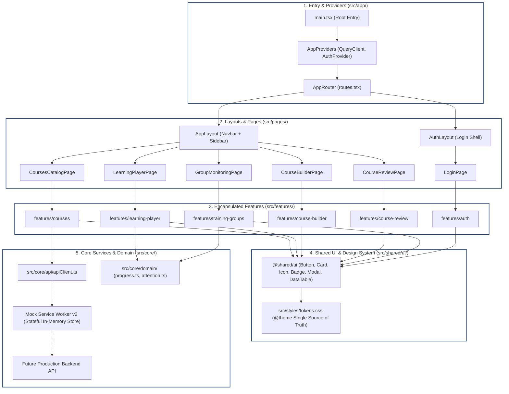
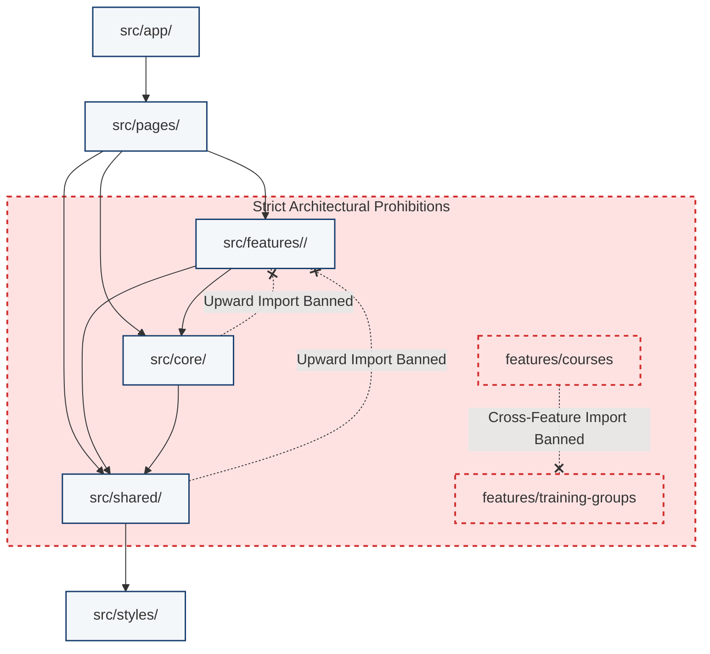
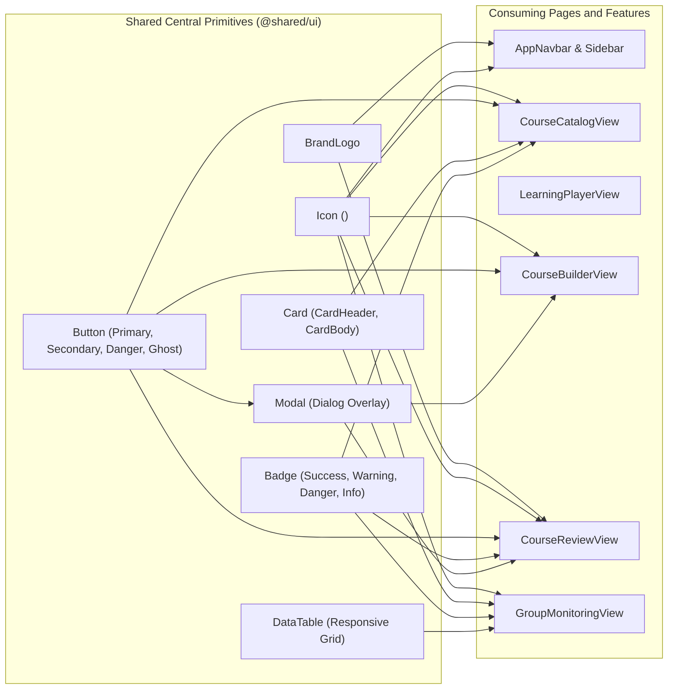
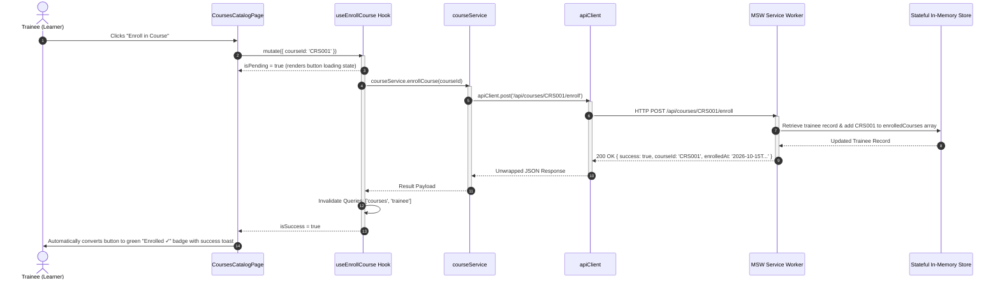
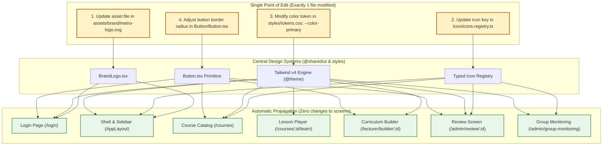
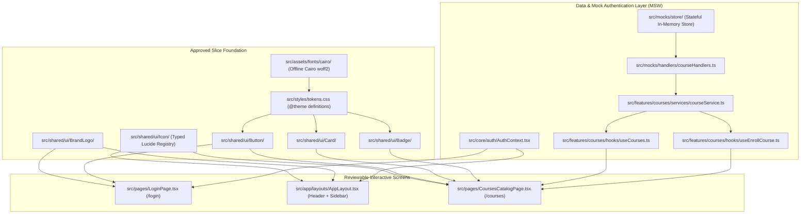

# Cairo Metro LMS — Frontend Architecture Specification

---

## 1. Architectural Philosophy: Maintainability First

The primary requirement of this architecture is **change localization**. In enterprise systems, long-term costs are dominated by maintenance rather than initial development.

When a design, business, or infrastructural change is requested:
* **Shared Visual Changes** (e.g., logo, brand color, button elevation, typography) must be modified in **exactly one file**.
* **Feature Logic Changes** (e.g., modifying section builder workflows) must have **zero blast radius** on unrelated features (e.g., user management or group monitoring).
* **Layer Dependencies** must flow in a **single, strict direction** enforced at compile time.

---

## 2. Target Directory Structure (`frontend/src/`)

```
frontend/
├── index.html                           # HTML entry with dir="rtl" and lang="ar"
├── package.json                         # Dependencies & npm scripts
├── tsconfig.json                        # Strict TypeScript with path aliases (@/*)
├── vite.config.ts                       # Vite build config with Tailwind v4 plugin
├── eslint.config.js                     # ESLint configuration with boundary enforcement
└── src/
    ├── app/                             # Application Root & Initialization
    │   ├── main.tsx                     # React root & MSW worker registration
    │   ├── App.tsx                      # Top-level providers tree
    │   ├── routes.tsx                   # Central route table definition
    │   └── layouts/                     # Shell layouts
    │       ├── AppLayout.tsx            # Authenticated shell (Navbar + Sidebar + Content)
    │       └── AuthLayout.tsx           # Unauthenticated standalone login shell
    │
    ├── assets/                          # Static Offline Assets
    │   ├── brand/                       # Metro emblem and logo files
    │   └── fonts/                       # Local Cairo font files (woff2/woff)
    │
    ├── styles/                          # Design System Tokens & Base Resets
    │   ├── tokens.css                   # Single Source of Truth: @theme token definitions
    │   └── globals.css                  # Font-face declarations, base CSS resets
    │
    ├── shared/                          # Domain-Agnostic Reusable Building Blocks
    │   │                                # (RULE: Never imports from features or pages)
    │   ├── ui/                          # Reusable UI Primitives (Design System)
    │   │   ├── BrandLogo/               # Centralized BrandLogo component
    │   │   ├── Icon/                    # Typed semantic Icon registry (<Icon name="..." />)
    │   │   ├── Button/                  # Button primitive with standard variants
    │   │   ├── Card/                    # Card container primitives (Header, Body, Footer)
    │   │   ├── Badge/                   # Status badges with WCAG-verified contrast
    │   │   ├── Modal/                   # Accessible dialog overlay
    │   │   ├── ConfirmDialog/           # Standardized accessible confirmation modal
    │   │   ├── DataTable/               # Standardized table with sorting/pagination
    │   │   ├── Form/                    # FormInput, Select, Textarea, FormField
    │   │   ├── ProgressBar/             # Visual progress indicator
    │   │   ├── Alert/                   # Contextual banner alerts (success, info, warning, danger)
    │   │   └── EmptyState/              # Placeholder for empty data lists
    │   ├── hooks/                       # Generic utility hooks (useDebounce, useMediaQuery)
    │   ├── utils/                       # Generic utilities (date formatting, classNames, math)
    │   └── types/                       # Shared utility types (Result, Pagination, SortOrder)
    │
    ├── core/                            # Foundational Cross-Cutting Infrastructure
    │   │                                # (RULE: Never imports from features or pages)
    │   ├── api/                         # HTTP Transport Layer
    │   │   ├── apiClient.ts             # Centralized fetch client with interceptors
    │   │   └── endpoints.ts             # REST URL endpoint constants
    │   ├── auth/                        # Session & Role Management
    │   │   ├── AuthContext.tsx          # Current user session state
    │   │   ├── useAuth.ts               # Hook exposing auth state and actions
    │   │   └── ProtectedRoute.tsx       # Route guard validating roles
    │   └── domain/                      # Pure Business Rules (Zero UI dependencies)
    │       ├── progress.ts              # calculateTraineeProgress()
    │       ├── attention.ts             # checkTraineeAttention()
    │       ├── certEligibility.ts      # evaluateCertEligibility()
    │       └── groupMetrics.ts          # calculateGroupMetrics()
    │
    ├── features/                        # Self-Contained Business Modules
    │   │                                # (RULE: Never import internal files from sibling features)
    │   ├── auth/                        # Authentication feature
    │   │   ├── components/LoginForm.tsx
    │   │   ├── hooks/useLogin.ts
    │   │   └── index.ts                 # Public API barrel
    │   │
    │   ├── courses/                     # Course catalog & enrollment
    │   │   ├── components/              # CourseCard, CourseFilterBar, CourseGrid
    │   │   ├── hooks/                   # useCourses, useCourseDetail, useEnrollCourse
    │   │   ├── services/courseService.ts
    │   │   ├── types/course.types.ts
    │   │   └── index.ts                 # Public API barrel
    │   │
    │   ├── learning-player/             # Video/text player & quiz execution
    │   │   ├── components/              # VideoPlayer, DocumentViewer, QuizRunner
    │   │   ├── hooks/useLessonProgress.ts
    │   │   └── index.ts
    │   │
    │   ├── course-builder/              # Lecturer curriculum authoring
    │   │   ├── components/              # ChapterList, ItemEditor, MediaUploader
    │   │   ├── hooks/useCourseDraft.ts
    │   │   └── index.ts
    │   │
    │   ├── course-review/               # Admin quality audit & approvals
    │   │   ├── components/              # ReviewTree, SectionCommentBox, DecisionModal
    │   │   ├── hooks/useCourseReview.ts
    │   │   └── index.ts
    │   │
    │   ├── training-groups/             # Cohort scheduling & deadline monitoring
    │   │   ├── components/              # GroupTable, DeadlineCountdown, TraineeAttentionBadge
    │   │   ├── hooks/useGroupMonitoring.ts
    │   │   └── index.ts
    │   │
    │   ├── user-management/             # Enterprise user administration & permissions
    │   │   ├── components/              # UserTable, RolePicker, UserDetailCard
    │   │   ├── hooks/useUsers.ts
    │   │   └── index.ts
    │   │
    │   └── notifications/               # Notification bell feed & toast triggers
    │       ├── components/NotificationList.tsx
    │       ├── hooks/useNotifications.ts
    │       └── index.ts
    │
    ├── pages/                           # Thin Route Assemblers
    │   ├── LoginPage.tsx                # /login
    │   ├── DashboardPage.tsx            # /dashboard (role-aware orchestrator)
    │   ├── CoursesCatalogPage.tsx       # /courses
    │   ├── CourseDetailPage.tsx         # /courses/:courseId
    │   ├── LearningPlayerPage.tsx       # /courses/:courseId/learn
    │   ├── CourseBuilderPage.tsx        # /lecturer/builder/:courseId
    │   ├── CourseReviewPage.tsx         # /admin/review/:courseId
    │   ├── GroupMonitoringPage.tsx      # /admin/group-monitoring
    │   ├── UserManagementPage.tsx       # /admin/users
    │   └── NotFoundPage.tsx             # 404
    │
    └── mocks/                           # Isolated Mock Infrastructure (MSW v2)
        ├── browser.ts                   # Service Worker initialization
        ├── handlers/                    # REST route interceptors (/api/*)
        ├── store/                       # Stateful in-memory repository (reads & mutations)
        └── fixtures/                    # Sanitized synthetic data fixtures
```

---

## 3. Directory Responsibilities and Ownership

### `src/styles/`
* **Single Source of Truth** for all design decisions.
* `tokens.css`: Contains the `@theme` block defining colors, border radii, shadows, and fonts.
* `globals.css`: Contains local font-face definitions and standard RTL base rules.
* **Rule:** No raw hexadecimal color codes or arbitrary pixel margins may exist outside this directory.

### `src/shared/ui/`
* Domain-agnostic UI primitives adhering strictly to design system tokens.
* Components receive data via props; they **never trigger domain API calls** or import domain models.
* Includes the typed semantic icon registry (`Icon.tsx`), centralized brand logo (`BrandLogo.tsx`), and interaction controls (`Button.tsx`, `Modal.tsx`, `DataTable.tsx`).

### `src/core/`
* Foundational infrastructure consumed across features.
* `core/api/apiClient.ts`: **The single location for HTTP transport**, request headers, and response error normalization.
* `core/auth/`: Context and hooks providing `currentUser`, role validation, and login/logout orchestration.
* `core/domain/`: Pure, framework-agnostic mathematical algorithms for calculating progress, deadline warnings, and certificate eligibility.

### `src/features/<feature-name>/`
* Encapsulated domain business units.
* Contains internal UI components, custom hooks, API service calls, and domain schemas.
* **Encapsulation Rule:** Exposes its public functionality exclusively through `index.ts`. No internal file may be imported by another feature.

### `src/pages/`
* Thin route-level orchestrators.
* Responsibilities are limited to:
  1. Extracting URL route parameters (e.g., `useParams()`).
  2. Invoking the appropriate feature hooks to load data.
  3. Composing feature components within page layout containers.
  4. Handling high-level loading skeletons and error boundaries.

---

## 4. Architectural Boundary Enforcement (`eslint-plugin-boundaries`)

To guarantee that modularity is strictly maintained, the build system enforces the following ESLint configuration:

```javascript
// eslint.config.js
import boundaries from 'eslint-plugin-boundaries';

export default [
  {
    plugins: { boundaries },
    settings: {
      'boundaries/elements': [
        { type: 'app', pattern: 'src/app/*' },
        { type: 'pages', pattern: 'src/pages/*' },
        { type: 'features', pattern: 'src/features/*', capture: ['featureName'] },
        { type: 'core', pattern: 'src/core/*' },
        { type: 'shared', pattern: 'src/shared/*' },
        { type: 'styles', pattern: 'src/styles/*' }
      ]
    },
    rules: {
      'boundaries/element-types': [
        'error',
        {
          default: 'disallow',
          rules: [
            // app can import everything
            { from: 'app', allow: ['pages', 'features', 'core', 'shared', 'styles'] },
            // pages can import features, core, shared, styles
            { from: 'pages', allow: ['features', 'core', 'shared', 'styles'] },
            // features can import core, shared, styles, but NOT other features
            { from: 'features', allow: ['core', 'shared', 'styles'] },
            { 
              from: 'features', 
              disallow: [['features', { featureName: '!${from.featureName}' }]],
              message: 'Cross-feature imports are strictly forbidden. Elevate shared concepts to @core or @shared.'
            },
            // core can import shared, styles
            { from: 'core', allow: ['shared', 'styles'] },
            // shared can ONLY import styles
            { from: 'shared', allow: ['styles'] }
          ]
        }
      ],
      'boundaries/entry-point': [
        'error',
        {
          default: 'disallow',
          rules: [
            // Importing from features must go through public barrel index.ts
            { target: 'features', allow: 'index.ts' }
          ]
        }
      ]
    }
  }
];
```

---

## 5. Architectural Diagrams (Mermaid)

### Diagram 1: Overall Application Architecture
Shows the layered architecture from application entry down to the data persistence layer with explicit dependency directions:



---

### Diagram 2: Folder and Module Dependency Direction
Illustrates the strict unidirectional flow of imports. Upward imports are strictly prohibited:



---

### Diagram 3: Shared-Component Dependency Graph
Demonstrates how central primitives in `@shared/ui` are composed across multiple feature pages:



---

### Diagram 4: Data Flow from Page to Backend (Read & Mutation)
Traces the lifecycle of a course enrollment request through custom hooks, services, and the MSW mock layer:



---

### Diagram 5: Design-System Change-Propagation Diagram
Illustrates how centralized edits propagate automatically without touching consuming screens:



---

### Diagram 6: Proposed First Vertical Slice and Dependencies
Shows the exact dependency chain for the initial reviewable functional increment:



---

## 6. Concrete Change-Management Proofs (Five Verified Scenarios)

### Scenario 1: Replacing the Application Logo
* **Requirement:** The organization updates its official training emblem.
* **Legacy Situation:** The image path was duplicated across `app.html`, `preview.html`, `index.html`, and hardcoded in various JS template strings.
* **New Architecture:**
  1. Replace the asset at `src/assets/brand/training-logo.svg` (or update `src/shared/ui/BrandLogo/BrandLogo.tsx`).
  2. **Total Files Modified:** **1 file**.
  3. **Verification:** The logo automatically updates on the Login Page hero, Navbar, mobile drawer, and review screens without touching a single page.

### Scenario 2: Replacing a Semantic Icon
* **Requirement:** The icon representing "courses" must change from `BookOpen` to `GraduationCap`.
* **Legacy Situation:** Emojis and inline SVG strings were scattered throughout 6 different JavaScript files.
* **New Architecture:**
  1. Open `src/shared/ui/Icon/icons.registry.ts`.
  2. Change line: `courses: BookOpen` to `courses: GraduationCap`.
  3. **Total Files Modified:** **1 file**.
  4. **Verification:** The icon updates in the Sidebar, Course Cards, Metric Cards, and Action Dropdowns simultaneously.

### Scenario 3: Modifying a Global Color Token
* **Requirement:** Adjust the primary brand color from `#5BBFDE` to `#0284C7` to meet stricter corporate guidelines.
* **Legacy Situation:** Hex codes were hardcoded inside CSS files, JS styles, and SVG fill attributes.
* **New Architecture:**
  1. Open `src/styles/tokens.css`.
  2. Change: `--color-primary: #0284C7;` inside `@theme`.
  3. **Total Files Modified:** **1 file**.
  4. **Verification:** All primary buttons, focus rings, progress bars, active navigation links, and badges update instantly via the Tailwind v4 engine.

### Scenario 4: Changing Shared Button Styling
* **Requirement:** Corporate design standards require all buttons to change from `radius-sm (6px)` to `radius-lg (16px)` with an updated hover shadow.
* **Legacy Situation:** Button classes and inline styles were duplicated across 20+ page templates.
* **New Architecture:**
  1. Open `src/shared/ui/Button/Button.tsx`.
  2. Update the base class definition: `rounded-md` $\rightarrow$ `rounded-lg shadow-sm hover:shadow-md`.
  3. **Total Files Modified:** **1 file**.
  4. **Verification:** Hundreds of buttons across all 15+ screens inherit the new border radius and shadow uniformly.

### Scenario 5: Modifying Course-Builder Logic
* **Requirement:** Add an autosave draft mechanism and a quiz question reordering feature to the course builder.
* **Legacy Situation:** `builder.js` directly mutated global window objects and interacted with uncoordinated DOM selectors.
* **New Architecture:**
  1. All edits are confined strictly inside `src/features/course-builder/`.
  2. Sibling features (`training-groups`, `user-management`, `auth`) do not import or depend on internal builder files.
  3. The `eslint-plugin-boundaries` rule strictly prevents leakage.
  4. **Verification:** Course builder functionality is enhanced with zero regression risk to student dashboards or administrative group monitoring.

---

## 7. Source-Aware Video Embed Policies Architecture

### A. Problem Statement & Design Objectives
External video providers (Google Drive, YouTube) embed interactive web applications via iframes. Unrestricted iframes present two key challenges in an enterprise LMS:
1. **Unintended Pop-Outs & External Navigation:** Google Drive and YouTube players contain external pop-out icons and navigational links that distract trainees or expose unmonitored browsing contexts.
2. **Provider-Specific Layout Quirks:** Google Drive displays a prominent upper title bar containing a pop-out button that conflicts with the platform's locked learning experience.

To solve this without fragile DOM hacking, bloated overlays, or duplicated logic across components, the system integrates a **centralized, source-aware video embed policy layer**.

### B. Core Architecture & Boundary Placement
Per Section 4 boundary rules, cross-feature imports are prohibited. Because video embedding logic is required across:
* **Course Builder (`features/course-builder`)**: configuring new video items and live preview.
* **Learning Player (`features/learning-player`)**: runtime trainee playback.
* **Design Lab (`features/design-lab`)**: comparative security and interaction experiments.

The domain policy and calculation utilities are elevated to:
* **Entity Types:** `src/core/courses/types.ts` (`VideoEmbedPolicy`, extended `ChapterItem`).
* **Domain Policy Logic:** `src/core/courses/videoEmbedPolicy.ts`.

### C. Mandatory Production Platform Policies Matrix

| Provider | Mandatory Top Crop | Mandatory Popup Blocking | Sandbox Tokens Applied | Production Policy Character |
| :--- | :--- | :--- | :--- | :--- |
| **Google Drive** (`drive`, `google-drive`) | `55px` (Mandatory) | `true` (Enabled) | `allow-scripts allow-same-origin allow-presentation allow-forms` | Clips upper player title bar and pop-out control via responsive CSS negative margin; removes `allow-popups` and `allow-popups-to-escape-sandbox`. Enforced automatically as platform invariant. |
| **YouTube** (`youtube`) | `0px` (Strictly Uncropped) | `true` (Enabled) | `allow-scripts allow-same-origin allow-presentation allow-forms` | Strict preservation of native YouTube player layout and controls. Popup blocking enforced on mounted iframe. Top crop is strictly prohibited. |
| **Upload / Direct Video** (`upload`, `direct-video`) | `0px` (Uncropped) | `false` (Disabled) | Unrestricted native playback | Standard HTML5 `<video>` playback without iframe restrictions or sandboxing. |

### D. Sandbox Token & Permissions Policy Derivation Rules
1. **Sandbox Derivation (`deriveEffectiveSandbox`):**
   * Starts with `BASELINE_IFRAME_SANDBOX_TOKENS` (`allow-scripts`, `allow-same-origin`, `allow-presentation`, `allow-forms`, `allow-popups`, `allow-popups-to-escape-sandbox`).
   * When popup blocking is enabled, removes **only** `POPUP_BLOCKING_REMOVED_TOKENS` (`allow-popups`, `allow-popups-to-escape-sandbox`).
   * Top navigation tokens (`allow-top-navigation`, `allow-top-navigation-by-user-activation`) are strictly omitted, preventing the iframe from navigating the top-level parent window.
   * **Pre-Navigation Enforcement:** The sandbox attribute is applied to the iframe element *before* setting its `src` and before initial content loading. In modern browser engines (Chromium, WebKit, Gecko), retroactively modifying the sandbox attribute on an already-navigated iframe does not alter the active document's sandboxed flags. Pre-navigation assignment guarantees that browser engines enforce popup and top-navigation blocks from the initial load.
2. **Permissions Policy Derivation (`deriveEffectivePermissions`):**
   * Starts with `BASELINE_PLAYER_PERMISSIONS` (`accelerometer`, `autoplay`, `clipboard-write`, `encrypted-media`, `gyroscope`, `picture-in-picture`, `web-share`).
   * When popup blocking is active, strictly removes `picture-in-picture` from the iframe `allow` attribute.
   * This disables the web-platform Picture-in-Picture API (`video.requestPictureInPicture()`) and YouTube's floating-player option, closing the floating miniplayer pop-out vector.
   * Crucial playback permissions (`autoplay`, `encrypted-media` for DRM/EME streams, `accelerometer`, `gyroscope`) and standard `allowfullscreen` are preserved.

### E. Runtime Enforcement & Clean Presentation
1. **Zero Bulk Data Migration:** Historical course items lacking an `embedPolicy` and newly configured videos automatically receive the correct mandatory runtime policy in the production Learning Player.
2. **Inviolable Platform Policies:** Editable item metadata or stale saved settings cannot weaken or override the mandatory Google Drive (55px + popup blocking) or YouTube (0px + popup blocking) policies in production.
3. **Clean, Provider-Neutral Trainee Experience:** All technical implementation exposure is excised from trainee-facing components:
   * No Google Drive or YouTube provider badges.
   * No crop amount labels (e.g., `55px`).
   * No popup-blocking status indicators or sandbox tokens.
   * No custom application-supplied pop-out or external open links.
   * Ordinary playback controls and completion confirmation actions remain intact.
4. **Administrator UI Simplicity:** In `ItemEditorModal`, technical policy panels, crop sliders, crop presets, and sandbox toggles are removed. Administrators supply the video URL or file, and provider detection and mandatory policy configuration occur automatically.
5. **Design Lab Isolation:** The Design Lab (`features/design-lab`) operates as an independent internal development environment. Its 6 experimental comparison modes, custom crop controls, visual guides, preset sources, and diagnostics remain fully functional and isolated from production.
6. **Technical Platform Boundaries & Invariants:**
   * **Popups & Top-Level Navigation:** Reliably blocked by the browser engine via pre-navigation sandbox enforcement.
   * **Web-Platform Floating/PiP Player:** Reliably blocked within the DOM and YouTube player via Permissions Policy omission of `picture-in-picture`.
   * **Browser Chrome Native PiP:** Proprietary browser-level chrome features (e.g., Firefox's external desktop PIP toggle or Safari's OS picture-in-picture menu) operate at the browser UI layer outside the web document sandbox and cannot be completely suppressed by any web page without disabling video entirely. Within the web application boundary, all web-accessible pop-out mechanisms are blocked.

---

## 11. Google Drive Minimum Viewing-Time Policy & Course Outline Layout

### A. Problem Statement & Domain Boundary
Google Drive video lessons previously relied on an immediate manual confirmation action (`drive-mark-complete-btn`) without any requirement on lesson engagement. To prevent learners from bypassing content while maintaining a clean, provider-appropriate architecture:
1. **Reuse Existing Duration:** The platform reuses the existing video-duration value on `ChapterItem` (`duration`, e.g. `"18:30"`) as the required threshold. No secondary duration field is introduced.
2. **Dedicated Completion Policy Property:** The domain model specifies an independent `completionPolicy?: LessonCompletionPolicy` property (`{ requireMinimumViewingTime?: boolean }`) on `ChapterItem`. This setting is strictly decoupled from `embedPolicy` (which governs iframe presentation and sandbox security).
3. **Administrator Simplicity:** In `ItemEditorModal`, a standard, clearly worded toggle (**اشتراط الحد الأدنى لوقت المشاهدة**) is provided under the Google Drive source configuration. No technical embed controls, crop values, or sandbox parameters are exposed.
4. **Defaults & Historical Compatibility:**
   - Newly created Google Drive lessons default to enabled (`true`), with administrator override.
   - Explicitly saved settings are preserved during editing.
   - Historical lessons lacking this property default to disabled (`false`), preventing unexpected lockouts of existing learners.
   - Validation requires a usable duration (`parseDurationToSeconds(duration) > 0`) when enabled; invalid or zero durations (`00:00`) are blocked from saving.

### B. Learner-Side Timing & Dedicated Eligible Viewing Time Property
1. **Dedicated Progress Metric (`eligibleViewingSeconds`):** Cumulative eligible foreground time is stored in an independent domain property on `LessonProgress` (`eligibleViewingSeconds`). It is strictly decoupled from actual video playback metrics (`lastPositionSeconds` and `furthestWatchedSeconds`), which are reserved for authentic media timeline tracking and resume positions (e.g. YouTube and native video).
2. **Foreground Accumulation:** The player tracks cumulative elapsed time exclusively when the lesson page is active and visible (`document.visibilityState === 'visible'`). Accumulation pauses immediately on tab backgrounding (`visibilitychange`) or navigation.
3. **Persistence & Return:** Cumulative eligible time is retained across lesson switching and in-app page navigation using local lesson activity state and the existing LMS progress API (`recordActivity({ itemId, eligibleViewingSeconds })`). In the current mock architecture, progress is backed by module-level memory (`inMemoryStore`), surviving all in-app client-side navigation within the active browser session, but resetting upon a full browser reload unless backed by persistent storage.
4. **Sequential Completion Gate:** Until the required duration is satisfied, `drive-mark-complete-btn` remains visible but disabled, providing concise remaining wait time feedback (e.g. `الحد الأدنى للمشاهدة: متبقي 05:30 لتأكيد الإكمال`).
5. **Explicit Confirmation Invariant:** Timer expiration never auto-completes the lesson. Once the threshold is met, the button is enabled for the learner to explicitly confirm and complete the lesson.
6. **No Subsequent Wait:** On subsequent visits after completion, the lesson displays its completed status without re-imposing a wait timer.

### C. Technical Platform Limitation & Domain Integrity
Google Drive `/preview` iframes are cross-origin and do not expose an authoritative playback-progress API to the host window. Consequently:
* The platform can strictly enforce **active foreground time spent on the lesson page**, recorded into `eligibleViewingSeconds`.
* The platform **does not claim to prove actual video frame playback** or continuous trainee visual attention.
* Actual playback position fields (`lastPositionSeconds`, `furthestWatchedSeconds`) remain untouched and are never polluted with elapsed page time.
* Elapsed page time is presented honestly as foreground lesson viewing duration, not verified playback telemetry.

### D. Course Outline Content-Type & Lock Layout (RTL Invariant)
In the learner-facing course outline (`CurriculumSidebar.tsx`), the content-type icon and locked status indicators serve independent purposes:
* **Right Side (RTL Start):** The content-type icon (`video`, `fileText`, `info`, `download`) remains visible at all times, regardless of whether the lesson is locked or unlocked, preserving content visibility for the learner.
* **Left-Side Metadata Area (RTL End):** The duration and lock indicators are grouped compactly on the left:
  * Locked video item visual order: `[duration] [lock] ... [title] [video icon]`
  * Unlocked video item visual order: `[duration] ... [title] [video icon]`
  * Locked non-video item (e.g., PDF): `[lock] ... [title] [fileText icon]`
  * Unlocked non-video item: `... [title] [fileText icon]`

## 12. Course Builder Refresher Version Feature ("النسخة التذكيرية")

### A. Architectural Integration & Builder Component Reuse
1. **Natural Extension of Course Builder:** The Refresher Version is integrated directly into the authoring workflow as the fourth and final tab (**"النسخة التذكيرية"**) in `CourseBuilderPage.tsx`.
2. **Zero Parallel Design System:** The tab reuses the exact same `CurriculumTreeEditor` layout, card containers, badge components, icon registry, and RTL styling conventions. No parallel editing dashboard, modal-based workflow, or duplicated visual tree representation is introduced.
3. **Master Enable Checkbox:** Positioned at the top of the tab (**"تفعيل النسخة التذكيرية لهذا الكورس"**):
   - **When Disabled:** Renders the original course structure as a read-only preview with an informational alert, disabling all refresher visibility and name customization controls. Original content edit controls are omitted to prevent accidental modification.
   - **When Enabled:** Activates inline visibility checkboxes and custom display name overrides within the existing content tree, displaying concise summary metrics (`visibleRefresherItems`, `activeChaptersCount`, and `customTitlesCount`).
   - Toggling the master checkbox preserves previously saved configuration without discarding administrator settings.

### B. Single Source of Truth Domain Model
1. **Separation from Original Content:** The refresher configuration is stored in a dedicated, decoupled domain property on `Course`:
   ```typescript
   export interface RefresherItemConfig {
     itemId: string;        // Stable reference to ChapterItem.id
     isVisible: boolean;    // Defaults to true when unconfigured
     customTitle?: string;  // Optional refresher display name override
   }

   export interface RefresherCourseConfig {
     enabled: boolean;
     items?: Record<string, RefresherItemConfig>;
   }
   ```
2. **Zero Media Duplication:** Videos, PDFs, diagrams, external resources, durations, and download policies remain single-sourced from the original course structure.
3. **Propagation of Original Edits:** Updates to original media files, descriptions, or URLs immediately apply to both versions.
4. **Display Name Override Invariant:**
   - If an item does not have a `customTitle` override, it automatically uses the original item's `title`.
   - If an item has a `customTitle` override, modifying the original item's title leaves the refresher-specific title intact.
5. **Empty Section Suppression:** Sections with 100% hidden refresher items display a guidance note in the builder and are completely excluded from the effective refresher curriculum (`getEffectiveRefresherChapters`) to prevent empty sections from appearing to learners.

### C. Comprehensive Protective Impact Assessment Warnings
1. **Context-Aware Confirmation:** In the primary Curriculum tab, destructive operations (deleting an item or chapter), additions, reordering, and property modifications to original content evaluate `assessRefresherImpact`.
2. **Exhaustive Operation Coverage:**
   - **Deleting Content (`delete_item`, `delete_chapter`):** Warns if the item or chapter contains active content in the refresher version; confirming safely removes references from `refresherConfig.items`.
   - **Adding Content (`add_item`):** Warns that newly added content will default to visible and automatically become part of the enabled refresher version.
   - **Reordering Content (`move_item`, `move_chapter`):** Warns before swapping items or chapters whenever the operation affects the relative sequence in the refresher version.

## 13. Unsaved Changes Navigation Guard & React Router Data Router Architecture

### A. Architectural Context & Data Router Migration
Previously, client-side routing utilized React Router v7's legacy `BrowserRouter` declarative component tree. Under this model, the modern `useBlocker` hook throws a runtime invariant error because it requires an active Data Router (`createBrowserRouter` or `createMemoryRouter`).
To provide bulletproof, declarative route interception when authoring courses with unsaved edits:
1. **Migration to Data Router:** The primary routing table (`src/app/router/index.tsx`) was upgraded to `createBrowserRouter`, rendered via `<RouterProvider router={router} />`.
2. **Backward-Compatible Bridge:** A dedicated `DataRouterBlockerBridge` safely mounts `useBlocker` when running under a Data Router, while gracefully bypassing blocker registration in non-Data Router unit test environments.
3. **Multi-Vector Protection:**
   - **Internal In-App Navigation:** Catches `<Link>`, `<NavLink>`, programmatic `navigate()`, and browser History back/forward navigation.
   - **External Navigation & Browser Refresh:** Native `beforeunload` event handler intercepts window close, tab close, and page reload when `isDirty` is true.

### B. Navigation Guard Lifecycle (`useUnsavedChangesGuard`)
1. **Dirty State Tracking:** The hook accepts `isDirty: boolean` reflecting in-memory modifications compared to the stored draft.
2. **Unified Confirmation Modal:** Rather than native browser `confirm()` prompts, route blocking displays the accessible Phase 2 `ConfirmDialog` primitive with approved Arabic copy:
   - Title: **"تغييرات غير محفوظة"**
   - Body: **"لديك تعديلات غير محفوظة في منشئ الدورة. هل أنت متأكد من رغبتك في مغادرة الصفحة وفقدان هذه التغييرات؟"**
   - Confirm Label: **"نعم، مغادرة الصفحة"** (variant: `danger`)
   - Cancel Label: **"البقاء في الصفحة"**
3. **Clean Discard vs. Cancel:**
   - **Canceling:** Cancels the blocker (`blocker.reset()`) and stays on the Course Builder with all edits preserved.
   - **Confirming Leave:** Proceeds with navigation (`blocker.proceed()`) and discards unsaved in-memory edits.
4. **Immediate Navigation on Clean State:** If the user saves their draft successfully (`isDirty` transitions to `false`), navigation is allowed immediately without displaying any warning dialog.
