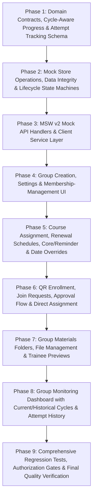

# Increment 10 — Training Groups Management & Follow-up
## Implementation & Verification Checklist

**Target Milestone:** Milestone 4 (Enterprise Operations & Full Parity)  
**Modern Routes Planned:**  
- `/admin/groups` (Administrator Training Groups & Monitoring Overview)  
- `/admin/groups/new` (Group Creation Workspace)  
- `/admin/groups/:groupId/edit` (Group Configuration, Course Assignment & Member Management)  
- `/admin/groups/:groupId/monitoring` (Group Follow-up & Trainee Progress Monitoring Dashboard)  
- `/groups/join` (Trainee QR-Code Self-Enrollment Landing Route)  
- Canonical Redirect Aliases:  
  - `/admin/create-group` → `/admin/groups/new`  
  - `/admin/group-monitoring` → `/admin/groups`  
  - `/admin/group-monitoring/:groupId` → `/admin/groups/:groupId/monitoring`  
  - `/groups` → Role-adaptive: `/admin/groups` for admins; `/my-groups` for trainees & lecturers  
**Status:** **PHASE 9 AUTOMATED GATES COMPLETE (719/719 Tests, Zero Lint, Clean Build) — MANUAL ACCEPTANCE PENDING USER REVIEW**  

---

## 1. Scope, Boundaries & Strict Exclusions

- [ ] **Implementation Boundaries & Charter:**
  - [ ] Implement an administrator-facing workspace to create, configure, and manage training groups (`/admin/groups/new`, `/admin/groups/:groupId/edit`).
  - [ ] Support assigning multiple courses to a training group with group-wide defaults (`startDateTime`, `deadlineDateTime`, `postDeadlinePolicy`) and granular per-course overrides.
  - [ ] Implement group membership management with three configurable enrollment policies: **Automatic joining** via QR code, **Approval required** via join requests, and **Direct assignment** by administrators or designated supervisors.
  - [ ] Implement **Group Renewal Cycles** (e.g. monthly or bi-monthly) with cycle-specific course roles (**Core courses** vs. **Reminder courses**), preserving full historical records of previous cycles.
  - [ ] Implement **Cycle-Aware Course Attempt Tracking**: when a course repeats in a new renewal cycle, the trainee starts a fresh attempt at 0% while all previous attempts, progress, lesson completions, and timestamps remain preserved in an independent historical ledger.
  - [ ] Implement course attempt history indicators visible to trainees and administrators: "محاولتك رقم [N] لهذا المقرر", previous attempt count, and successful completion count.
  - [ ] Implement an independent **Group Materials Library** allowing administrators and supervisors to create custom folders (e.g., "ماتريال اليوم الأول", "تعليمات التشغيل"), upload multiple files, manage visibility, preview PDFs/images in-app, and download assets.
  - [ ] Implement **Supervisor Scoped Permissions**: designated lecturers (`supervisorIds`) can monitor assigned groups, add trainees directly, review join requests, and manage materials, without gaining global administrative privileges.
  - [ ] Implement safe **Group Archival Policy**: groups with members, learning progress, renewal cycles, or materials are archived rather than permanently deleted; permanent deletion is restricted to empty draft groups.
  - [ ] Implement secure QR-code generation and validation using the existing pure TypeScript QR generator (`@/core/utils/qrGenerator.ts`), encoding zero learner PII and supporting token rotation/revocation.
  - [ ] Implement an administrator and supervisor Group Follow-up Dashboard (`/admin/groups/:groupId/monitoring`) with current-cycle progress, historical cycle inspection, drilldown progress matrices, attention flags, and trainee attempt breakdowns.
  - [ ] Maintain 100% Arabic-first RTL layout, local Cairo typography, centralized design tokens, and typed icon registry.
  - [ ] Maintain absolute zero changes to legacy prototype source files (`js/*.js`, `data/*.json`, `server.py`).
  - [ ] Zero browser automation by Antigravity (no browser subagents or automated screenshots; all visual verifications reserved exclusively for the user).
- [ ] **Explicitly Deferred Issues & Out-of-Scope Items:**
  - [ ] **Certificates:** Automated certificate PDF issuance, certificate validation, and digital signatures remain strictly deferred to Increment 11.
  - [ ] **System-Wide User Account Administration:** Creating/editing global user accounts, password resets, and user deletion remain strictly deferred to Increment 11 (`/admin/users`).
  - [ ] **Course Pricing:** Strict exclusion; course pricing functionality is explicitly prohibited in accordance with the corporate training mandate.
  - [ ] **External QR Services / Heavy NPM Libraries:** Strict prohibition against adding external third-party QR libraries or network APIs. All QR generation must strictly reuse the existing pure TypeScript ISO/IEC 18004 generator in `@/core/utils/qrGenerator.ts`.
  - [ ] **Multi-Tenant / Multi-Company Silos:** Out of scope; all training operations represent Egyptian National Railways & Cairo Metro operational sectors.

---

## 2. Canonical Routes, Navigation, Role Guarding & Authorization Architecture

- [ ] **Canonical Route Registration (`src/app/router/index.tsx`):**
  - [ ] `/admin/groups`: Accessible exclusively to authenticated `admin` role within `AppLayout`. Displays table of all training groups, status filters, renewal cycle indicators, aggregate member counts, and quick actions. Strictly blocks trainees and lecturers with Arabic 403 Forbidden screen.
  - [ ] `/admin/groups/new`: Accessible exclusively to authenticated `admin` role within `AppLayout`. Multi-step group creation workspace.
  - [ ] `/admin/groups/:groupId/edit`: Accessible exclusively to authenticated `admin` role within `AppLayout`. Group configuration, course assignment, date override matrix, renewal schedule, and member management.
  - [ ] `/admin/groups/:groupId/monitoring`: Accessible to authenticated `admin` role AND authorized designated supervisors (`supervisorIds` where `currentUser.id === sid`) within `AppLayout`. Follow-up dashboard displaying group-wide metrics, attention alerts, per-trainee progress for current cycle, and historical cycle selector. Other lecturers and trainees receive 403 Forbidden.
  - [ ] `/groups/join`: Accessible to authenticated trainees (`user` role). QR-code landing page allowing instant enrollment (if policy is `open`) or submission of join request (if policy is `approval_required`). If unauthenticated, redirects to `/login` with `returnUrl`.
  - [ ] **Exact Canonical Redirect Aliases:**
    - [ ] `/admin/create-group` → `/admin/groups/new`
    - [ ] `/admin/group-monitoring` → `/admin/groups`
    - [ ] `/admin/group-monitoring/:groupId` → `/admin/groups/:groupId/monitoring`
    - [ ] `/groups` → Role-adaptive redirect: `/admin/groups` for `admin`; `/my-groups` for `user` and `lecturer`.
- [ ] **Navigation & Shell Configuration (`src/shared/config/navigation.ts`):**
  - [ ] Update `training-groups` navigation item:
    - [ ] Mark `status: 'implemented'`.
    - [ ] Set `path: '/admin/groups'`.
    - [ ] Role-adaptive visibility: Visible in `management` section for `admin` role.
  - [ ] Preserve existing trainee navigation item `my-groups` (`/my-groups`) under `learning` section for `user` role without breaking existing Increment 7 workflows.
- [ ] **Layered Defense-in-Depth Authorization:**
  - [ ] **Route Guard Layer:** `ProtectedRoute` validates role credentials prior to mounting administrator group pages.
  - [ ] **UI Component Layer:** Group creation buttons, course assignment controls, member deletion buttons, and QR rotation triggers render exclusively when current user has `role === 'admin'`. Supervisor-specific controls (e.g. approve join requests, add members) render for authorized supervisors.
  - [ ] **MSW Request Handler Layer:** Mock API endpoints inspect `user.role` and `user.id` from request session; reject unauthorized access with HTTP 403 Forbidden.
  - [ ] **Mock Store Layer:** `inMemoryStore` methods assert permissions on operations; throw typed `MockStoreError(403)` on violation.

---

## 3. Findings from Inspecting Existing Architecture & Reusability Matrix

### Architectural Findings
1. **Existing Domain Foundations (`src/core/groups/types.ts` & `src/core/domain/groups.ts`):**
   - The repository already contains authoritative domain types: `TrainingGroup`, `GroupCourseAssignment`, `GroupResource`, `GroupStatus`, `PostDeadlinePolicy`, `EffectiveCourseSettings`, `TraineeAttentionResult`, `TraineeGroupMetrics`, and `GroupMetrics`.
   - The authoritative mathematical algorithms for `getEffectiveCourseSettings`, `checkTraineeAttention`, and `formatRemainingTime` are already implemented and tested in `src/core/domain/groups.ts`.
2. **Existing Progress Engine Limitation (`inMemoryStore.ts`):**
   - `this.userProgress: Record<string, Record<string, Record<string, LessonProgress>>>` is keyed as `[userId][courseId][itemId]`.
   - In its current form, repeating a course in a new renewal cycle would overwrite the single `[userId][courseId]` map, destroying historical progress.
   - **Resolution:** Introduce an authoritative `CourseAttempt` entity keyed by `id` and linked to `userId`, `courseId`, and `cycleId`. Historical cycles retrieve progress from frozen attempts. For current player playback, `userProgress` mirrors the active attempt, preserving full backward compatibility.
3. **In-House Pure TypeScript QR Code Generator (`src/core/utils/qrGenerator.ts`):**
   - Pure TypeScript, zero external dependencies, 100% offline-compatible implementation of ISO/IEC 18004 (Model 2, Byte mode, EC Level M).
   - Exports `generateQrSvg(url, options)` and `downloadQrCodeImage(url, filename, pixelSize)`.
   - Already wrapped by the accessible modal primitive `src/shared/ui/QRCodeModal.tsx`.
   - **Conclusion:** No external QR library (such as `qrcode.react` or `qr-code-styling`) is needed or permitted.
4. **Existing Mock Store Storage (`src/mocks/store/inMemoryStore.ts`):**
   - Contains `groups: TrainingGroup[]` initialized from `INITIAL_MOCK_GROUPS` (`GRP-101`, `GRP-102`, `GRP-103`).
   - Read methods exist: `getGroups(userId, userRole)`, `getGroupById(groupId, userId, userRole)`, and `getGroupMetrics(groupId)`.
   - Requires mutation methods for groups, renewal cycles, attempts, join requests, and materials.
5. **Existing Trainee Group Views (`src/pages/TraineeGroupsPage.tsx` & `src/pages/GroupDetailPage.tsx`):**
   - Trainee-facing views are fully implemented and verified (Increment 7).
   - They consume `GET /api/groups/my` and `GET /api/groups/:groupId`.
   - Must remain 100% backward-compatible and functional without regression.

### Component Reusability Matrix

| Layer | Existing Asset to Reuse | Role in Increment 10 |
| :--- | :--- | :--- |
| **Domain Logic** | `src/core/domain/groups.ts` (`getEffectiveCourseSettings`, `checkTraineeAttention`, `formatRemainingTime`) | Reuse directly for deadline calculations, date override evaluations, and attention alerts. |
| **QR Utility** | `src/core/utils/qrGenerator.ts` (`generateQrSvg`, `downloadQrCodeImage`) | Pure TypeScript QR SVG rendering and high-res PNG downloads for training group enrollment. |
| **Shared UI** | `src/shared/ui/QRCodeModal.tsx` | Specialized as `GroupQRModal` with token rotation, enrollment link copying, and policy indicator. |
| **Shared UI** | `Button`, `Card`, `Badge`, `Modal`, `FormInput`, `ProgressBar`, `Alert`, `Icon`, `Tooltip`, `useToast` | Core building blocks for all forms, tables, progress indicators, and status chips. |
| **Auth & Guards** | `src/core/auth/ProtectedRoute.tsx`, `useAuth` | Enforce admin-only and supervisor-scoped access to group management and monitoring. |
| **Store Fixtures** | `src/mocks/fixtures/mockGroups.ts` (`INITIAL_MOCK_GROUPS`) | Baseline mock data (`GRP-101`, `GRP-102`, `GRP-103`) extended with cycles, materials, and policies. |

---

## 4. Domain Data Contracts, Entities, DTOs & Privacy Boundaries

- [ ] **Domain Entity Extensions (`src/core/groups/types.ts`):**
  - [ ] **Administrative Lifecycle State (`adminStatus`):**
    ```typescript
    export type GroupAdminStatus = 'draft' | 'active' | 'archived';
    ```
    - `draft`: Group is being configured by administrator; hidden from trainees; QR enrollment disabled.
    - `active`: Group is published; open for enrollment and training activity; included in monitoring.
    - `archived`: Training cohort concluded; read-only historical record; excluded from default active monitoring filters.
  - [ ] **Group Enrollment Policy (`GroupEnrollmentPolicy`):**
    ```typescript
    export type GroupEnrollmentPolicy = 'open' | 'approval_required' | 'closed';
    ```
    - `open`: Authenticated trainees with valid QR token join instantly.
    - `approval_required`: Trainees submit a join request; admin or assigned supervisor approves/rejects.
    - `closed`: Self-joining via QR is disabled; additions occur exclusively via direct assignment.
  - [ ] **Course Role in Renewal Cycle (`CourseRole`):**
    ```typescript
    export type CourseRole = 'core' | 'reminder';
    ```
    - `core`: Primary required curriculum for this cycle.
    - `reminder`: Refresher / reinforcement course intended for revision.
  - [ ] **Cycle-Aware Course Assignment (`GroupCycleCourseAssignment`):**
    ```typescript
    export interface GroupCycleCourseAssignment {
      courseId: string;
      courseRole: CourseRole; // 'core' | 'reminder'
      order: number;
      customStartDateTime?: string | null;
      customDeadlineDateTime?: string | null;
      customPostDeadlinePolicy?: PostDeadlinePolicy | null;
    }
    ```
  - [ ] **Group Renewal Schedule (`GroupRenewalSchedule`):**
    ```typescript
    export interface GroupRenewalSchedule {
      recurrenceType?: 'none' | 'monthly' | 'bimonthly' | 'quarterly' | 'custom';
      intervalDays?: number | null;
      renewalIntervalDays?: number | null; // Custom day-based recurrence interval (1–730 calendar days)
      nextScheduledRenewalDate?: string | null; // ISO 8601 UTC timestamp
      autoRenewalEnabled: boolean;
      lastAutoRenewedCycleId?: string | null; // Idempotency token of last processed cycle
    }
    ```
  - [ ] **Group Renewal Cycle Record (`GroupRenewalCycle`):**
    ```typescript
    export interface GroupRenewalCycle {
      id: string; // e.g. "CYC-GRP101-01"
      groupId: string;
      cycleNumber: number; // 1, 2, 3...
      title: string; // e.g. "دورة تدريب أبريل - مايو 2026"
      status: 'active' | 'completed' | 'archived';
      startDateTime: string; // ISO 8601
      deadlineDateTime: string; // ISO 8601
      postDeadlinePolicy: PostDeadlinePolicy;
      courses: GroupCycleCourseAssignment[];
      traineeIds: string[];
      completedAt?: string | null;
      createdAt: string;
      updatedAt: string;
    }
    ```
  - [ ] **Cycle-Aware Course Attempt Ledger (`CourseAttempt`):**
    ```typescript
    export type CourseAttemptStatus =
      | 'not_started'
      | 'in_progress'
      | 'completed'
      | 'expired_incomplete';

    export interface CourseAttempt {
      id: string; // e.g. "ATT-USR003-CRS001-CYC01"
      userId: string;
      courseId: string;
      groupId?: string | null;
      cycleId?: string | null; // Associated renewal cycle ID
      attemptNumber: number; // 1, 2, 3...
      courseRole?: CourseRole; // 'core' | 'reminder'
      status: CourseAttemptStatus;
      startedAt?: string | null; // Set ONLY when trainee views first lesson / begins progress
      completedAt?: string | null;
      lastActivityAt?: string | null;
      progressPercent: number; // 0..100
      completedItemIds: string[];
      lastWatchedItemId?: string | null;
      lessonProgress: Record<string, LessonProgress>;
      createdAt: string;
      updatedAt: string;
    }
    ```
  - [ ] **Trainee Attempt Summary (Cross-Cycle & Course Level):**
    ```typescript
    export interface TraineeCourseAttemptSummary {
      courseId: string;
      courseTitle: string;
      currentAttemptNumber: number;
      previousStartedAttemptsCount: number; // Attempts where startedAt !== null
      previousCompletionsCount: number; // Attempts with status === 'completed'
      currentAttempt: CourseAttempt | null;
      historicalAttempts: {
        attemptId: string;
        attemptNumber: number;
        cycleTitle?: string;
        startedAt?: string | null;
        completedAt?: string | null;
        progressPercent: number;
        status: CourseAttemptStatus;
      }[];
    }
    ```
  - [ ] **Group Materials Library Entities:**
    ```typescript
    export type MaterialFileType =
      | 'pdf'
      | 'image'
      | 'word'
      | 'excel'
      | 'powerpoint'
      | 'archive'
      | 'other';

    export interface GroupMaterialFolder {
      id: string; // e.g. "FLD-GRP101-01"
      groupId: string;
      cycleId?: string | null; // Optional association with a renewal cycle
      name: string; // e.g. "ماتريال اليوم الأول", "تعليمات التشغيل"
      order: number;
      isVisibleToTrainees: boolean;
      filesCount: number;
      createdAt: string;
      updatedAt: string;
    }

    export interface GroupMaterialFile {
      id: string; // e.g. "FIL-GRP101-001"
      folderId: string;
      groupId: string;
      cycleId?: string | null;
      title: string; // Display name
      originalFileName: string;
      fileSizeBytes: number;
      mimeType: string;
      fileType: MaterialFileType;
      url: string; // Blob URL / base64 simulation
      order: number;
      uploadedBy: string; // User ID
      uploadedByName: string;
      uploadedAt: string;
      isVisible: boolean;
      downloadCount: number;
    }
    ```
  - [ ] **Join Request Entity (`GroupJoinRequest`):**
    ```typescript
    export interface GroupJoinRequest {
      id: string; // e.g. "REQ-GRP101-USR004"
      groupId: string;
      groupName: string;
      userId: string;
      userName: string;
      userEmail: string;
      department?: string;
      jobTitle?: string;
      status: 'pending' | 'approved' | 'rejected';
      requestedAt: string;
      reviewedAt?: string | null;
      reviewedBy?: string | null;
      reviewedByName?: string | null;
      reviewNote?: string | null;
    }
    ```
  - [ ] **Updated Authoritative `TrainingGroup` Entity:**
    ```typescript
    export interface TrainingGroup {
      id: string; // e.g. "GRP-101"
      name: string;
      description: string;
      adminStatus: GroupAdminStatus; // 'draft' | 'active' | 'archived'
      enrollmentPolicy: GroupEnrollmentPolicy; // 'open' | 'approval_required' | 'closed'
      courses: GroupCourseAssignment[]; // Legacy baseline
      courseId: string; // Legacy fallback primary course
      traineeIds: string[]; // Current active member IDs
      supervisorIds: string[]; // Designated lecturer/supervisor IDs
      startDateTime: string; // ISO 8601 group-wide baseline default
      deadlineDateTime: string; // ISO 8601 group-wide baseline default
      postDeadlinePolicy: PostDeadlinePolicy; // 'keep_no_cert' | 'hide'
      resources: GroupResource[];
      // Renewal Cycles
      renewalSchedule: GroupRenewalSchedule;
      currentCycleId?: string | null;
      // QR Code Enrollment
      enrollmentCode: string; // Cryptographically random opaque token
      isEnrollmentOpen: boolean; // Master toggle
      enrollmentExpiresAt?: string | null; // Optional explicit expiration
      maxTrainees?: number | null; // Optional capacity limit
      // Materials
      foldersCount?: number;
      filesCount?: number;
      createdAt?: string;
      updatedAt?: string;
    }
    ```
- [ ] **Authoritative Increment 10 DTOs (`src/core/groups/dtos.ts`):**
  - [ ] `CreateGroupRequestDTO`: Name, description, baseline dates, policy, initial courses with role (`core`/`reminder`), supervisors, initial trainees, renewal schedule, enrollment policy.
  - [ ] `UpdateGroupRequestDTO`: Partial update for metadata, dates, policies, supervisors, renewal schedule.
  - [ ] `AssignCycleCoursesDTO`: Array of courses with `courseRole: 'core' | 'reminder'` and custom date overrides.
  - [ ] `RenewGroupCycleRequestDTO`: Creates new renewal cycle with new start/deadline, designated core/reminder courses, and renewal notes.
  - [ ] `SubmitJoinRequestDTO`: `{ enrollmentCode: string; note?: string }`.
  - [ ] `ReviewJoinRequestDTO`: `{ requestId: string; decision: 'approved' | 'rejected'; reviewNote?: string }`.
  - [ ] `CreateMaterialFolderDTO`: `{ name: string; isVisibleToTrainees?: boolean; cycleId?: string | null }`.
  - [ ] `UploadMaterialFileDTO`: `{ folderId: string; title: string; file: File; isVisible?: boolean; cycleId?: string | null }`.

---

## 5. Dual-Tier Group Lifecycle, Renewal Cycles & Date Precedence Engine

- [ ] **Dual-Tier State Model:**
  - [ ] **Tier 1 — Administrative Lifecycle (`group.adminStatus`):**
    - Governed manually by the administrator: `'draft' | 'active' | 'archived'`.
    - If `adminStatus === 'draft'`, trainees cannot see the group, and QR code scans fail with HTTP 403 / "المجموعة التدريبية ما زالت في مرحلة الإعداد".
    - If `adminStatus === 'archived'`, group is locked from new enrollments, course attempts become read-only, and group is marked read-only.
  - [ ] **Tier 2 — Temporal Schedule State (`group.timeStatus`):**
    - Evaluated dynamically relative to current time (`now`):
      - `now < startDateTime` $\rightarrow$ `'scheduled'` (`مجدولة`)
      - `startDateTime <= now <= deadlineDateTime` $\rightarrow$ `'active'` (`نشطة`)
      - `now > deadlineDateTime` $\rightarrow$ `'expired'` (`منتهية`)
- [ ] **Scheduled Groups Enrollment Permission:**
  - [ ] Scheduled groups (`now < startDateTime`) **may accept members before training begins** when `isEnrollmentOpen === true` and policy is not `closed`.
  - [ ] Enrolled trainees can view the group details and countdown timer, but course content access respects the effective course start date.
- [ ] **Three-Level Date Precedence and Overrides Algorithm:**
  - [ ] For any assigned course in a group cycle, effective parameters are resolved in strict priority order:
    1. **Course-Specific Override (Highest Precedence):** `assignment.customStartDateTime`, `assignment.customDeadlineDateTime`, `assignment.customPostDeadlinePolicy`.
    2. **Renewal Cycle Defaults (Intermediate Precedence):** `cycle.startDateTime`, `cycle.deadlineDateTime`, `cycle.postDeadlinePolicy`.
    3. **Group Baseline Defaults (Fallback Precedence):** `group.startDateTime`, `group.deadlineDateTime`, `group.postDeadlinePolicy`.
  - [ ] **Dynamic Default Mutation Rule:**
    - If administrator changes cycle or group defaults:
      - All assigned courses with `null`/`undefined` custom overrides **immediately and automatically inherit** the new defaults.
      - Courses with explicit non-null overrides strictly retain their configured custom dates/policies.
  - [ ] **Date Validation Rules (Enforced in UI, API Handler & Store):**
    - `startDateTime < deadlineDateTime` (minimum duration: 1 hour).
    - Course custom overrides: `customStartDateTime < customDeadlineDateTime` (if both specified).
    - If only `customDeadlineDateTime` is specified: effective start date $<$ `customDeadlineDateTime`.
    - Negative or zero-duration date ranges are rejected with HTTP 422 Unprocessable Entity.

---

## 6. Group Enrollment Policies, Join Approval Workflow & Idempotent Enrollment

- [ ] **Three Configurable Enrollment Policies:**
  1. **Automatic Joining (`open`):**
     - Trainee scans QR code $\rightarrow$ system validates token, expiration, capacity $\rightarrow$ trainee is enrolled instantly into group and all active cycle courses.
  2. **Approval Required (`approval_required`):**
     - Trainee scans QR code $\rightarrow$ system displays group info and "إرسال طلب انضمام" button.
     - On submission, creates a `GroupJoinRequest` in `'pending'` status.
     - Group administrators and designated group supervisors receive notification and view requests in the "طلبات الانضمام المعلقة" drawer/tab.
     - On approval: trainee is added to `group.traineeIds` and auto-enrolled into assigned courses.
     - On rejection: request marked `'rejected'`; trainee receives explanation alert on next scan.
  3. **Direct Assignment (`closed` / direct):**
     - Self-joining via QR code is disabled (`الانضمام الذاتي غير متاح`).
     - Authorized administrators or designated supervisors add trainees directly from the employee directory.
- [ ] **Idempotent Course Enrollment Synthesis:**
  - [ ] When a trainee becomes a group member (via auto-join, approved request, or direct assignment):
    - For each assigned course in the active cycle:
      - Check `this.enrollments.find(e => e.userId === traineeId && e.courseId === courseId)`.
      - **If not enrolled:** Create `CourseEnrollment` with `status: 'active'`, `enrolledAt: new Date().toISOString()`, and increment course enrollment count.
      - **If already enrolled:** Retain existing enrollment record without duplication.
      - Provision a cycle-specific `CourseAttempt` in `'not_started'` status if not already present.
- [ ] **Duplicate Membership & Safe State Guards:**
  - [ ] Attempting to join an already-joined group returns HTTP 200 with notice `أنت عضو بالفعل في هذه المجموعة التدريبية` and smoothly navigates to the group.
  - [ ] Attempting to submit a join request when one is already pending returns HTTP 200 with notice `طلب انضمامك قيد المراجعة حالياً من قبل مشرف المجموعة`.
- [ ] **Data Preservation Guarantees:**
  - [ ] **Removing a Trainee from Group:** Removes trainee ID from `group.traineeIds` and active cycle; **strictly preserves** their `CourseEnrollment` records, completed certificates, and all historical `CourseAttempt` records.
  - [ ] **Removing a Course from Group:** Removes assignment from `group.courses` and cycle; base course entity and trainee enrollments/progress remain **100% intact**.

---

## 7. QR Code Enrollment Protocol & Zero-PII Security Architecture

- [ ] **QR Code Content & Payload Structure:**
  - [ ] Encodes direct URL: `https://[domain]/groups/join?code=[enrollmentCode]`
  - [ ] **Zero-PII Guarantee:** Contains **NO** trainee IDs, names, emails, national IDs, or sensitive administrative metadata. Strictly encodes public domain and opaque token.
- [ ] **Token Rotation & Security Controls:**
  - [ ] Provisioned with cryptographically random token (e.g. `GRP101-SEC-A9F3E2`).
  - [ ] "إعادة توليد رمز الاستجابة السريعة" generates fresh token; immediately invalidates previous link with zero impact on existing members.
  - [ ] Master toggle `isEnrollmentOpen` allows pausing self-enrollment at any time.
  - [ ] Optional explicit expiration timestamp `enrollmentExpiresAt` supported (no mandatory registration windows forced).
- [ ] **Validation Protocol on Scan (`POST /api/groups/join`):**
  - [ ] **Step 1 — Authentication:** User must be logged in with role `user`.
  - [ ] **Step 2 — Token Lookup:** Find group by `enrollmentCode`. If missing/invalid, return HTTP 404.
  - [ ] **Step 3 — Admin Status:** If `adminStatus === 'draft'`, return HTTP 403 `المجموعة التدريبية ما زالت في مرحلة الإعداد`. If `'archived'`, return HTTP 403 `المجموعة مؤرشفة وغير متاحة للانضمام`.
  - [ ] **Step 4 — Master Toggle:** If `isEnrollmentOpen === false`, return HTTP 403 `الانضمام مغلق حالياً لهذه المجموعة`.
  - [ ] **Step 5 — Token Expiry:** If `enrollmentExpiresAt` configured and in the past, return HTTP 410 `انتهت صلاحية رمز الانضمام`.
  - [ ] **Step 6 — Capacity Check:** If `maxTrainees` set and `group.traineeIds.length >= maxTrainees`, return HTTP 409 `عذراً، اكتمل العدد الأقصى للمتدربين`.
  - [ ] **Step 7 — Policy Routing:**
    - If `policy === 'open'`: execute instant join and course enrollment synthesis.
    - If `policy === 'approval_required'`: create `GroupJoinRequest` and return HTTP 202 `تم إرسال طلب الانضمام بنجاح وهو بانتظار موافقة المشرف`.
    - If `policy === 'closed'`: return HTTP 403 `الانضمام الذاتي غير متاح لهذه المجموعة`.

---

## 8. Group Renewal Cycles, Core vs. Reminder Courses & Repeated Course Rules

- [ ] **Group Renewal Architecture:**
  - [ ] Groups support recurring renewal cycles (e.g., monthly, bi-monthly, quarterly, or on-demand).
  - [ ] Each renewal cycle is assigned a dedicated `GroupRenewalCycle` entity with unique `id` (e.g., `CYC-GRP101-01`, `CYC-GRP101-02`).
  - [ ] The administrator designates each assigned course as either:
    - **Core Course (`core`):** Essential required training for that specific cycle.
    - **Reminder Course (`reminder`):** Refresher training for revision/reinforcement.
  - [ ] **Validation:** The same course cannot be assigned as both core and reminder within the same cycle (HTTP 422).
- [ ] **Critical Repeated-Course Isolation Rule:**
  - [ ] When a course repeats in a new renewal cycle:
    - The trainee starts a **fresh course attempt** (`CourseAttempt`) for that new cycle with `progressPercent: 0`, `completedItemIds: []`, and `status: 'not_started'`.
    - Previous attempts, completed lessons, completion timestamps, and certificate eligibility from prior cycles are **strictly preserved** in their respective `CourseAttempt` records.
    - Current monitoring dashboards inspect **only the current cycle's attempt**, preventing old completions from falsely marking the new cycle as complete.
    - Historical cycle dashboards inspect only the attempts linked to that historical `cycleId`.
- [ ] **Lifecycle of a Renewal Cycle:**
  - [ ] Triggering renewal: Admin clicks "بدء دورة تجديد جديدة" (Start New Renewal Cycle).
  - [ ] System seals current cycle: sets `status = 'completed'`, records `completedAt`. Incomplete attempts in the closing cycle are finalized as `'expired_incomplete'`.
  - [ ] System initializes new cycle: sets `cycleNumber = N + 1`, configures dates, copies or customizes course assignments with `core`/`reminder` designations, and creates fresh `CourseAttempt` records for active trainees.
  - [ ] Cycle history remains permanently accessible through a cycle selector in both the monitoring dashboard and trainee group view.

---

## 9. Course Attempt Tracking & Attempt History Indicators

- [ ] **Definition of When an Attempt Begins:**
  - [ ] Assigning a course or adding a trainee to a group/cycle creates a `CourseAttempt` record with `status: 'not_started'`, `startedAt: null`, `progressPercent: 0`.
  - [ ] **Strict Rule:** An attempt does **NOT** count as a started attempt until the trainee actually begins learning (opens a lesson item, records playback progress, or completes an item).
  - [ ] Upon first lesson interaction, `startedAt` is set to `new Date().toISOString()`, and `status` transitions to `'in_progress'`.
  - [ ] Merely assigning a course or belonging to a group never inflates the trainee's attempt counter.
- [ ] **Course Attempt Counter & History Rules:**
  - [ ] Attempts are tracked at the **course level across all cycles and groups**:
    - `previousStartedAttemptsCount`: Number of previous attempts where `startedAt !== null`.
    - `previousCompletionsCount`: Number of previous attempts where `status === 'completed'`.
    - `currentAttemptNumber`: `previousStartedAttemptsCount + (currentAttemptStarted ? 1 : 0)`.
- [ ] **User-Facing UI Attempt Indicator:**
  - [ ] In the Course Player, Group Course Card, and Monitoring Trainee Detail Modal, render a dedicated attempt badge:
    - Example: `محاولتك رقم 3 لهذا المقرر` ("Your 3rd attempt at this course").
    - Accompanying context chips:
      - `إكمالات سابقة ناجحة: 2`
      - `تاريخ آخر إكمال: 15 مارس 2026`
  - [ ] Clickable "سجل المحاولات السابقة" opens a drawer showing date, completion percentage, and status for each historical attempt.
- [ ] **Acceptance Criteria for Attempt Scenarios:**
  1. *First-time course start:* Attempt #1, previous started = 0, previous completed = 0.
  2. *Repeating previously completed course in new cycle:* Attempt #2, previous started = 1, previous completed = 1, current progress starts at 0%.
  3. *Starting new attempt after incomplete attempt:* Attempt #2, previous started = 1, previous completed = 0, prior attempt recorded as incomplete.
  4. *Multiple groups containing same course:* Each group renewal cycle links to its own attempt ID, preventing cross-group progress leakage.

---

## 10. Group Materials Library (Folders, Uploads & Previews)

- [ ] **Independent Materials Architecture:**
  - [ ] Group materials operate completely independently of course curriculum and lesson items.
  - [ ] Scoped to the training group, with optional association to a specific renewal cycle.
- [ ] **Folder & File Capabilities:**
  - [ ] **Custom Folders:** Administrators and assigned supervisors can create multiple folders with arbitrary names (e.g., "ماتريال اليوم الأول", "تعليمات التشغيل والسلامة", "نماذج الفحص الدوري").
  - [ ] **File Management:** Upload multiple files into each folder. Actions: rename, replace file binary, toggle visibility, reorder, delete.
  - [ ] **Upload Validation:** Enforce maximum file size (50MB in mock), allowed extensions (`.pdf`, `.png`, `.jpg`, `.docx`, `.xlsx`, `.pptx`, `.zip`), and clean Arabic file names.
- [ ] **Trainee Experience & Previews:**
  - [ ] Trainees view folder cards in the "حقيبة المواد والمستندات" tab of their group interface.
  - [ ] Clicking a folder opens `GroupFolderModal` displaying file cards with file type icon, size, upload date, and action buttons:
    - **In-App Preview:** For PDF documents (embedded viewer) and images (lightbox).
    - **Browser Open / Download Fallback:** For Office documents (`.docx`, `.pptx`, `.xlsx`) and `.zip` archives.
    - No false promises of inline preview for non-previewable Office binaries.
- [ ] **Archived & Historical Cycle Materials:**
  - [ ] Materials linked to previous completed renewal cycles remain accessible in read-only mode to authorized former members and supervisors.

---

## 11. Supervisor Permissions Matrix & Authorization Boundaries

- [ ] **Role / Action / Ownership Authorization Matrix:**

| Capability / Action | Administrator | Assigned Group Supervisor | Unassigned Lecturer | Trainee Member |
| :--- | :---: | :---: | :---: | :---: |
| **Create New Training Group** | Yes | No (403) | No (403) | No (403) |
| **Edit Group Metadata & Baseline Dates** | Yes | No (403) | No (403) | No (403) |
| **Configure Renewal Cycles & Schedules** | Yes | No (403) | No (403) | No (403) |
| **Assign / Remove Courses & Overrides** | Yes | No (403) | No (403) | No (403) |
| **Rotate QR Token / Change Policy** | Yes | No (403) | No (403) | No (403) |
| **View Group Monitoring Dashboard** | Yes | Yes (Assigned Groups Only) | No (403) | No (403) |
| **Direct-Add Trainees to Group** | Yes | Yes (Assigned Groups Only) | No (403) | No (403) |
| **Review & Approve/Reject Join Requests** | Yes | Yes (Assigned Groups Only) | No (403) | No (403) |
| **Create Folders & Upload Materials** | Yes | Yes (Assigned Groups Only) | No (403) | No (403) |
| **View & Download Group Materials** | Yes | Yes (Assigned Groups Only) | No (403) | Yes (Visible Only) |
| **View Group Overview & Own Progress** | Yes | Yes | Yes | Yes (Member Only) |

- [ ] **Strict Scoping:** Supervisors do **NOT** inherit global administrator rights. Their access to `/admin/groups/:groupId/monitoring` is strictly verified against `group.supervisorIds.includes(currentUser.id)`. Accessing other groups yields HTTP 403.

---

## 12. Group Removal, Archival & Data Preservation Policy

- [ ] **Archival vs. Permanent Deletion Policy:**
  - [ ] **Permanent Deletion:** Permitted **ONLY** for empty draft groups (`adminStatus === 'draft'` with 0 members, 0 cycles, 0 attempts, and 0 materials).
  - [ ] **Safe Archival (`adminStatus: 'archived'`):** Mandatory for any group with existing members, course enrollments, learning progress, renewal cycles, or uploaded materials.
  - [ ] Attempting to delete a group with history triggers a confirmation modal that safely archives the group instead of deleting dependent records.
- [ ] **Behavior of Archived Groups:**
  - [ ] Excluded from default active lists and active alert counts.
  - [ ] Joining via QR code or direct assignment is strictly rejected (HTTP 403).
  - [ ] Historical learning records, attempts, completions, certificates, and materials remain **100% accessible** for compliance inspection and audits.

---

## 13. Group Follow-up & Progress Monitoring Dashboard Architecture

- [x] **Admin Groups Overview Dashboard (`/admin/groups`):**
  - [x] Metric Cards: Total Groups, Active Cohorts, Total Enrolled Trainees, Trainees Requiring Follow-up, Pending Join Requests.
  - [x] Filter & Search Bar: Search by name/course, filter by status (`الكل`, `نشطة`, `مجدولة`, `منتهية`, `مسودة`, `مؤرشفة`), filter by enrollment policy.
  - [x] Groups Table: Name, ID, status pills, current cycle badge, assigned courses tags, trainee count / capacity, average progress bar, attention badge, quick actions (Monitoring, Edit, QR Modal, Pending Requests).
- [x] **Group Progress Monitoring Dashboard (`/admin/groups/:groupId/monitoring`):**
  - [x] **Header:** Group name, current renewal cycle title, temporal badge, countdown strip (`CountdownStrip`).
  - [x] **Renewal Cycle Selector:** Dropdown to switch between the current active cycle and previous completed cycles.
  - [x] **Cohort Statistics Cards:**
    - [x] "نسبة إنجاز الدورة الحالية" (Current Cycle Average Progress %).
    - [x] "المكتملون للبرنامج بالكامل" (100% completion in current cycle).
    - [x] "قيد التدريب" (In-progress trainees in current cycle).
    - [x] "لم يبدأوا بعد" (Not started in current cycle).
    - [x] "تنبيهات الانتباه والمتابعة" (Total Warning & Danger alerts).
  - [x] **Trainee Progress Matrix Table:**
    - [x] Trainee name, job title, department.
    - [x] Overall cycle progress bar.
    - [x] Per-course progress columns with `core` vs `reminder` badge chips and mini progress bars.
    - [x] Attention status badge (`AttentionBadge`):
      - [x] Danger: `لم يكتمل بالموعد` (expired incomplete) or `موعد قريب` ($\le 48\text{h}$, $< 60\%$).
      - [x] Warning: `لم يبدأ بعد` ($\ge 20\%$ time elapsed, $0\%$) or `متأخر في الإنجاز` ($\ge 50\%$ time, $< 25\%$).
      - [x] Success: `مكتمل بنجاح` ($100\%$).
      - [x] Normal: `منتظم` (on track).
    - [x] Action: "عرض تفاصيل المتدرب" (opens `TraineeProgressModal.tsx`).
  - [x] **Trainee Detail Progress Modal (`TraineeProgressModal.tsx`):**
    - [x] Item-by-item completion breakdown for current cycle.
    - [x] Dedicated **Course Attempt History** section showing previous attempts count, previous completions, and expandable timeline of historical attempts.

---

## 14. MSW v2 Mock API Handlers & Client Service Layer Plan

- [x] **API Endpoint Specifications (`src/mocks/handlers/groupHandlers.ts`):**
  - [x] `GET /api/admin/groups`: List all groups with aggregate metrics and pending request counts.
  - [x] `POST /api/admin/groups`: Create new training group with baseline schedule, policies, and initial courses.
  - [x] `GET /api/admin/groups/:groupId`: Detailed group model with current cycle, supervisors, and materials.
  - [x] `PUT /api/admin/groups/:groupId`: Update group metadata, policies, or baseline schedule.
  - [x] `DELETE /api/admin/groups/:groupId`: Safe archival (or hard deletion if empty draft).
  - [x] `POST /api/admin/groups/:groupId/renew`: Start a new renewal cycle with fresh core/reminder course assignments.
  - [x] `GET /api/admin/groups/:groupId/cycles/:cycleId`: Retrieve historical cycle details and attempt snapshots.
  - [x] `POST /api/admin/groups/:groupId/courses`: Update assigned courses, core/reminder roles, and date overrides.
  - [x] `POST /api/admin/groups/:groupId/members`: Direct-add trainees (idempotently synthesizes course enrollments).
  - [x] `DELETE /api/admin/groups/:groupId/members/:userId`: Remove trainee from group (preserves enrollments and attempt history).
  - [x] `POST /api/admin/groups/:groupId/qr-code/rotate`: Regenerate `enrollmentCode`.
  - [x] `POST /api/admin/groups/:groupId/qr-code/toggle`: Toggle `isEnrollmentOpen`.
  - [x] `POST /api/groups/join`: Trainee joins or requests to join via QR code token.
  - [x] `GET /api/groups/join/:code/info`: Public preview of group metadata before confirming join.
  - [x] `GET /api/admin/groups/:groupId/join-requests`: List pending join requests for group.
  - [x] `POST /api/admin/groups/:groupId/join-requests/:requestId/review`: Approve or reject join request.
  - [x] `GET /api/admin/groups/:groupId/materials`: List folders and files for group.
  - [x] `POST /api/admin/groups/:groupId/materials/folders`: Create material folder.
  - [x] `POST /api/admin/groups/:groupId/materials/files`: Upload file to folder.
  - [x] `DELETE /api/admin/groups/:groupId/materials/files/:fileId`: Remove file.
  - [x] `GET /api/users/:userId/courses/:courseId/attempts`: Get trainee attempt history for course.
  - [x] Preserve existing endpoints: `GET /api/groups/my` and `GET /api/groups/:groupId`.

---

## 15. Dependency-Aware 9-Phase Implementation Sequence



### Phase 1: Domain Contracts, Cycle-Aware Progress & Attempt Tracking Schema
- [x] Extend `src/core/groups/types.ts` with `GroupAdminStatus`, `GroupEnrollmentPolicy`, `CourseRole`, `GroupRenewalSchedule`, `GroupRenewalCycle`, `CourseAttempt`, `TraineeCourseAttemptStats`, `GroupMaterialFolder`, `GroupMaterialFile`, and `GroupJoinRequest`.
- [x] Create `src/core/groups/dtos.ts` with all DTO contracts.
- [x] Update `src/core/domain/groups.ts` to support 3-level date precedence (Course override > Cycle default > Group default), cycle course assignment validation, attempt lifecycle factory and statistics helpers, and material file helpers.
- [x] **Acceptance Gate 1:** Domain types compile cleanly; 18 focused unit tests in `src/test/training-groups-domain.test.ts` pass (100%), full suite (39 files, 578 tests) passes with zero regressions, ESLint passes with 0 errors/0 warnings, production build (`tsc -b && vite build`) compiles cleanly in 13.25s.

### Phase 2: Mock Store Operations, Data Integrity & Lifecycle State Machines
- [x] In `src/mocks/store/inMemoryStore.ts`, implement storage for `renewalCycles: GroupRenewalCycle[]`, `courseAttempts: CourseAttempt[]`, `groupMembers: Record<string, GroupMember[]>`, `groupJoinRequests: GroupJoinRequest[]`, `materialFolders: GroupMaterialFolder[]`, and `materialFiles: GroupMaterialFile[]`.
- [x] Implement group lifecycle methods: `createGroup`, `updateGroup`, `archiveGroup`, `deleteGroup` (with dependent data check & safe archival fallback), `addGroupMember`, `removeGroupMember`, and `getGroupMembers`.
- [x] Implement renewal cycle methods: `createRenewalCycle`, `getGroupCycles`, `getGroupCycleById`, `getCurrentGroupCycle`, and `assignCoursesToCycle`.
- [x] Implement attempt ledger: `getOrCreateCurrentAttempt`, `startAttempt`, `recordAttemptLessonActivity`, `completeAttemptLessonItem`, `getTraineeAttempts`, `getCourseAttemptStatsForTrainee`, and `getCycleAttempts`.
- [x] Implement join request & QR methods: `validateGroupEnrollmentToken`, `joinGroupByQRCode`, `submitGroupJoinRequest`, `getGroupJoinRequests`, `reviewGroupJoinRequest`, `rotateGroupEnrollmentCode`, and `toggleGroupEnrollment`.
- [x] Implement materials library methods: `createMaterialFolder`, `updateMaterialFolder`, `deleteMaterialFolder`, `addMaterialFile`, `replaceMaterialFile`, `deleteMaterialFile`, and `getGroupMaterials`.
- [x] Update store reset to cleanly purge and re-seed all Increment 10 mock data with deterministic baseline records.
- [x] **Acceptance Gate 2:** State tests verify cycle creation, attempt isolation, attempt count calculation, idempotent enrollment, and soft-archival safeguards; 33 focused unit tests in `src/test/training-groups-state.test.ts` pass (100%), full suite (40 files, 611 tests) passes with zero regressions, ESLint passes with 0 errors/0 warnings, production build (`tsc -b && vite build`) compiles cleanly in 9.50s.

### Phase 3: MSW v2 Mock API Handlers & Client Service Layer
- [x] Implement all Increment 10 mock endpoints in `src/mocks/handlers/groupHandlers.ts`.
- [x] Implement supervisor and admin role checks; enforce 403 on non-supervisor/non-admin requests.
- [x] Create strongly typed client service functions in `src/features/groups/services/groupsApi.ts`.
- [x] **Acceptance Gate 3:** API integration tests verify all endpoints, HTTP status codes, and authorization barriers; 39 focused API integration tests in `src/test/training-groups-api.test.tsx` pass (100%), full suite (41 files, 650 tests) passes with zero regressions, ESLint passes with 0 errors/0 warnings, production build (`tsc -b && vite build`) compiles cleanly in 8.85s.

### Phase 4: Group Creation, Settings & Membership-Management UI
- [x] Implement `src/pages/AdminGroupsPage.tsx` (`/admin/groups`) with metrics, filters, and groups table.
- [x] Implement `src/pages/GroupEditorPage.tsx` (`/admin/groups/new` and `/admin/groups/:groupId/edit`).
- [x] Implement general settings form: metadata, capacity, enrollment policy (`open`, `approval_required`, `closed`), and supervisor assignment.
- [x] Register routes and canonical aliases in `src/app/router/index.tsx`.
- [x] Navigation: Retain planned state in `navigation.ts` to satisfy shell test assertion while adaptively routing `/groups` via router.
- [x] **Acceptance Gate 4:** Component tests verify group creation, validation errors, dirty state unsaved changes guard, edit mode loading/update, safe archival confirmation, 404 handling, and role-adaptive access; 17 focused UI tests in `src/test/training-groups-ui.test.tsx` pass (100%), full regression suite (42 files, 666 tests) passes with zero regressions, ESLint passes with 0 errors/0 warnings, production build (`tsc -b && vite build`) compiles cleanly in 11.10s.

### Phase 5: Course Assignment, Renewal Schedules, Core/Reminder & Date Overrides
- [x] Implement Course Assignment tab in `GroupEditorPage.tsx`:
  - [x] Multi-course selector with `core` vs `reminder` role toggle.
  - [x] Course ordering controls.
  - [x] Date override modal (`CourseOverrideModal.tsx`) for custom start/deadline/policy.
  - [x] Renewal schedule configuration section:
    - [x] Custom Day-Based Automatic Group Renewal extension supporting user-defined intervals (1–730 calendar days).
    - [x] Preset shortcuts (30, 60, 90 days) updating the same numeric input field.
    - [x] Live preview of next renewal date anchored at current cycle start (`Current cycle start + N calendar days`), using UTC day arithmetic (`setUTCDate`) to prevent DST/timezone drift.
    - [x] Backward compatibility: `migrateLegacyRecurrenceType` maps legacy recurrence types (`monthly` → 30, `bimonthly` → 60, `quarterly` → 90).
    - [x] Mock store auto-renewal engine (`checkAndProcessAutoRenewal`) sealing previous cycle (`completed`), marking unfinished attempts `expired_incomplete`, rolling over course assignments, provisioning unstarted attempts (`0%`, `attemptNumber: null`), advancing `nextScheduledRenewalDate`, and preventing duplicate cycle creation via `lastAutoRenewedCycleId` idempotency token and while-loop overdue advancement.
  - [x] "بدء دورة تجديد جديدة" (Start New Renewal Cycle) modal (`StartRenewalCycleModal.tsx`) with interval chip distinguishing manual from scheduled renewal.
- [x] **Acceptance Gate 5:** Tests verify core/reminder designation, validation rejecting same course as both, date override precedence, and renewal cycle creation; 9 focused integration tests in `src/test/training-groups-course-assignment.test.tsx` pass (100%), full regression suite (43 files, 676 tests) passes with zero regressions, ESLint passes with 0 errors/0 warnings, production build (`tsc -b && vite build`) compiles cleanly in 10.93s.

### Phase 6: QR Enrollment, Join Requests, Approval Flow & Direct Assignment
- [x] Implement `GroupQRModal.tsx`: live SVG via `generateQrSvg`, token rotation, policy indicator, PNG download.
- [x] Implement `src/pages/JoinGroupPage.tsx` (`/groups/join`):
  - [x] Preview group card.
  - [x] If policy is `open`: one-click join and auto-enrollment.
  - [x] If policy is `approval_required`: join request submission form with note.
  - [x] Friendly alerts for expired, revoked, full, or closed tokens.
- [x] Implement Join Requests Drawer / Tab in `GroupEditorPage.tsx` and `GroupMonitoringPage.tsx`:
  - [x] Lists pending requests with applicant details.
  - [x] "قبول" (Approve) and "رفض" (Reject) actions with review note.
- [x] Implement Direct Member Assignment table with user search and safe member removal.
- [x] **Acceptance Gate 6:** Tests verify QR generation, token rotation, instant join, join request approval/rejection, and member direct assignment; 11 focused integration tests in `src/test/training-groups-enrollment.test.tsx` pass (100%), full Increment 10 suites (6 files, 127 tests) pass (100%), full regression suite (44 files, 687 tests) passes with zero regressions, ESLint passes with 0 errors/0 warnings, production build (`tsc -b && vite build`) compiles cleanly in 9.03s.

### Phase 7: Group Materials Folders, File Management & Trainee Previews
- [x] Implement Group Materials Tab in `GroupEditorPage.tsx` and `GroupDetailPage.tsx`:
  - [x] Create folder modal with arbitrary naming.
  - [x] Upload file modal with format and size validation.
  - [x] Folder grid displaying file counts and visibility chips.
- [x] Implement `GroupFolderModal.tsx`, `GroupUploadFilesModal.tsx`, `GroupMoveFileModal.tsx`, and `GroupMaterialViewerModal.tsx`:
  - [x] Lists files with type icons and download buttons.
  - [x] Embedded PDF viewer modal for `.pdf` documents.
  - [x] Image preview lightbox for images.
  - [x] Video and audio in-modal playback previewers.
  - [x] Fallback browser open/download for Office documents and archives with real blob fallback.
- [x] **Acceptance Gate 7:** Tests verify folder creation, folder rename, visibility toggles, folder safe deletion, file multi-upload, file type & size validation, file move between folders, PDF/image/video/audio preview triggers, genuine byte blob download, and trainee read-only access; 17 focused integration tests in `src/test/training-groups-materials.test.tsx` pass (100%), full regression suite (45 files, 704 tests) passes with zero regressions, ESLint passes with 0 errors/0 warnings, production build (`tsc -b && vite build`) compiles cleanly in 10.18s.

### Phase 8: Group Monitoring Dashboard with Current/Historical Cycles & Attempt History
- [x] Implement `src/pages/GroupMonitoringPage.tsx` (`/admin/groups/:groupId/monitoring`):
  - [x] Accessible to admins and assigned supervisors.
  - [x] Countdown strip and cohort statistics cards.
  - [x] Renewal cycle selector dropdown to switch between current and historical cycles.
  - [x] Trainee progress matrix with `core` vs `reminder` indicators and `AttentionBadge`.
  - [x] Trainee detail progress modal (`TraineeProgressModal.tsx`).
- [x] Implement **Course Attempt History Indicator**:
  - [x] Displays "محاولتك رقم [N] لهذا المقرر" with badges for previous completions and dates.
  - [x] Expandable historical timeline of prior attempts.
- [x] **Acceptance Gate 8:** Tests verify current-cycle calculation, historical cycle isolation, attempt count fidelity, attention badge conditions, and supervisor access guards; 13 focused integration tests in `src/test/training-groups-monitoring.test.tsx` pass (100%), full Increment 10 suites (8 files, 157 tests) pass (100%), full regression suite (46 files, 717 tests) passes with zero regressions, ESLint passes with 0 errors/0 warnings, production build (`tsc -b && vite build`) compiles cleanly in 10.53s.

### Phase 9: Comprehensive Regression Tests, Authorization Gates & Final Quality Verification
- [x] Run full automated test suite (`npm test -- --fileParallelism=false`) ensuring zero regressions across all test files — 47 test files, 719 tests pass (100%).
- [x] Run ESLint (`npm run lint`) ensuring 0 errors and 0 warnings.
- [x] Run production build (`npm run build`) ensuring clean TypeScript (`tsc -b`) and Vite compilation.
- [x] Seed rich Increment 10 demo fixtures (`src/mocks/fixtures/trainingGroupsDemoFixtures.ts` & `src/test/training-groups-demo-seeding.test.tsx`):
  - [x] Group with multiple renewal cycles (Cycle 1 completed, Cycle 2 active with core & reminder courses — `GRP-201`).
  - [x] Trainee repeating a course (100% in Cycle 1, 0% in Cycle 2, showing Attempt #2 badge — `usr_trainee_003` on `CRS001`).
  - [x] Group with pending join requests (`REQ-DEMO-201-01` from `USR006`).
  - [x] Group with uploaded materials in multiple folders (`FLD-GRP-201-01` & `FLD-GRP-201-02`).
  - [x] Scheduled group accepting pre-training enrollments (`GRP-202` with `isEnrollmentOpen: true`).
- [x] Prepare comprehensive manual acceptance checklist: `docs/frontend/checklists/increment-10-manual-acceptance-checklist.md` (49 actionable scenarios covering all 12 workflows).
- [ ] **Acceptance Gate 9 (Manual User Audit):** Pending reviewer browser execution of `increment-10-manual-acceptance-checklist.md`. Automated quality gates 100% verified.

---

## 16. Comprehensive Automated Testing Plan

- [x] **Unit & State Management Tests (`src/test/training-groups-state.test.ts`):**
  - [x] Group creation with default schedule and draft/active status.
  - [x] Date precedence resolution: Course override > Cycle default > Group default.
  - [x] Dynamic default updates: changing cycle defaults updates courses without overrides; courses with overrides remain unchanged.
  - [x] Multi-course assignment with `core` vs `reminder` roles; rejection of same course assigned to both.
  - [x] Renewal cycle creation: seals previous cycle as completed; creates fresh cycle.
  - [x] Cycle-aware attempt tracking:
    - [x] Trainee repeating course in Cycle 2 starts at 0% with Attempt #2.
    - [x] Cycle 1 attempt remains preserved with 100% completion.
    - [x] An unstarted course assignment has `startedAt: null` and does not increment previous started attempts count.
  - [x] Join request workflow: submission creates pending request; approval adds member and synthesizes enrollments; rejection records note.
  - [x] Idempotent course enrollment synthesis: assigning member twice produces zero duplicate enrollments.
  - [x] Safe removal: removing member from group leaves `CourseEnrollment` and historical `CourseAttempt` records intact.
  - [x] Soft archival: attempting deletion on active group with members executes archival instead.
  - [x] Materials library: folder creation, file upload, visibility toggles, and deletion.
  - [x] QR code token rotation and invalidation of old tokens.
- [x] **API Handler Tests (`src/test/training-groups-api.test.tsx`):**
  - [x] Test role authorization on all admin routes (403 for trainees; 403 for unassigned lecturers).
  - [x] Test assigned supervisor permissions: allowed to monitor, add members, review join requests, and manage materials; blocked from group editing or cycle creation.
  - [x] Test `POST /api/groups/join` for `open` vs `approval_required` vs `closed` policies.
  - [x] Test error status codes: 400 (bad dates), 403 (unauthorized/policy closed), 404 (invalid token), 409 (capacity full), 410 (expired token), 422 (validation error).
- [x] **Component & Integration Tests (`src/test/training-groups-ui.test.tsx`, `src/test/training-groups-course-assignment.test.tsx`):**
  - [x] `/admin/groups` renders metrics, filters, and groups table.
  - [x] `/admin/groups/new` form creation and validation.
  - [x] `/admin/groups/:groupId/edit` basic configuration loading, update mutation, unsaved changes guard, and not-found states.
  - [x] `/admin/groups/:groupId/edit?tab=courses` course assignment tab renders cycle details, course list, core/reminder roles.
  - [x] Role toggles between core and reminder with duplicate prevention.
  - [x] Independent date override modal configuration, inheritance previews, and date-range validation.
  - [x] Start renewal cycle modal sealing prior cycle, isolating historical attempts, and persisting fresh cycle.
  - [x] `GroupQRModal` displays QR SVG, copies link, downloads PNG, and rotates token (Phase 6).
  - [x] `/groups/join` renders preview card, handles instant join vs request submission (Phase 6).
  - [x] Group Materials library: folder CRUD, multi-file uploads/validation, moving files, in-modal previews (PDF/image/video/audio), real blob downloads, and trainee read-only access (Phase 7 — `src/test/training-groups-materials.test.tsx`).
  - [x] `/admin/groups/:groupId/monitoring` renders countdown strip, cycle switcher, trainee matrix, and attention badges (Phase 8 — `src/test/training-groups-monitoring.test.tsx`).
  - [x] `TraineeProgressModal` displays attempt history indicator ("محاولتك رقم 3") and timeline (Phase 8).
- [x] **Regression & System Integrity Gates:**
  - [x] All existing test suites pass with zero regressions (`npm test -- --fileParallelism=false`) — 46 test files, 717 tests passing (100%).
  - [x] Zero ESLint errors and warnings (`npm run lint`).
  - [x] Clean Vite production build (`npm run build`).

---

## 17. Manual Browser Verification Protocol (Reserved Exclusively for User)

> [!IMPORTANT]
> **Strict Policy:** Antigravity must never run automated browser subagents, take screenshots, or execute automated browser clicking for this increment. The following manual verification protocol is provided for the user to perform in their own browser upon implementation completion.

1. **Admin Groups Overview & Metric Cards (`/admin/groups`):**
   - Log in as Administrator (`admin@cairo-metro.com`).
   - Navigate to `/admin/groups`. Verify the groups table lists active, scheduled, and draft groups with accurate member counts, current cycle badge, and progress bars.
   - Filter by status tabs (`نشطة`, `مجدولة`, `منتهية`, `مسودة`, `مؤرشفة`); verify table updates accurately.
2. **Create New Training Group with Core/Reminder Courses (`/admin/groups/new`):**
   - Click "إنشاء مجموعة تدريبية جديدة".
   - Enter group name, description, start date, and deadline date.
   - Set enrollment policy to "موافقة المشرف مطلوبة" (Approval Required).
   - Assign Course A as "دورة أساسية" (Core) and Course B as "دورة تنشيطية" (Reminder).
   - Configure a custom deadline on Course B.
   - Assign a designated lecturer as group supervisor; click "إنشاء وتفعيل المجموعة".
3. **QR Code Joining with Approval Workflow:**
   - In `/admin/groups/:groupId/edit`, open the QR Code tab.
   - Click "نسخ رابط الانضمام".
   - Log out and log in as Trainee (`trainee@cairo-metro.com`).
   - Navigate to the join URL (`/groups/join?code=...`).
   - Verify preview card shows group info and button "إرسال طلب انضمام".
   - Click "إرسال طلب انضمام"; verify confirmation message.
   - Log back in as the assigned supervisor or admin.
   - Open `/admin/groups/:groupId/edit` $\rightarrow$ "طلبات الانضمام".
   - Click "قبول الطلب"; verify trainee is added to group members.
   - Log back in as Trainee; verify group appears under `/my-groups` and assigned courses appear under `/my-courses`.
4. **Group Renewal Cycle & Repeated Course Attempt History:**
   - As Trainee, complete 100% of Course A.
   - As Administrator, open `/admin/groups/:groupId/edit` $\rightarrow$ "دورات التجديد".
   - Click "بدء دورة تجديد جديدة" (Start Cycle 2).
   - Keep Course A in Cycle 2. Submit renewal.
   - In `/admin/groups/:groupId/monitoring`, verify Cycle 2 shows trainee's progress on Course A as 0% for the new cycle.
   - Switch cycle dropdown to Cycle 1; verify Cycle 1 historical view shows 100% completion intact.
   - As Trainee, open Course A in learning player; verify badge reads: "محاولتك رقم 2 لهذا المقرر — إكمالات سابقة ناجحة: 1".
5. **Group Materials Library (Folders, Uploads & Previews):**
   - As Administrator or Supervisor, open `/admin/groups/:groupId/edit` $\rightarrow$ "حقيبة المواد".
   - Create folder "تعليمات التشغيل والسلامة".
   - Upload a sample PDF and an image file.
   - As Trainee, navigate to `/my-groups/:groupId` $\rightarrow$ "حقيبة المواد".
   - Open the folder; click "معاينة" on the PDF to verify embedded preview.
   - Click "تحميل" to verify file download.
6. **Supervisor Access Scoping:**
   - Log in as the assigned lecturer. Verify access to `/admin/groups/:groupId/monitoring`.
   - Attempt to access an unassigned group monitoring URL; verify 403 Forbidden screen.
7. **Safe Archival & Data Preservation:**
   - As Administrator, attempt to delete the active group.
   - Verify confirmation modal warns that group contains members and will be archived.
   - Confirm archival; verify group status changes to `مؤرشفة`.
   - Log in as Trainee; verify Course A enrollment and historical attempt record remain completely intact under `/my-courses`.

---

## 18. Known Limitations, Assumptions & Unresolved Business Decisions

### Documented Assumptions
1. **Mock User Directory:** The application currently relies on `SYNTHETIC_DEMO_ACCOUNTS` (`usr_admin_001`, `usr_lect_002`, `usr_trainee_003`) and `data/users.json` (`USR001` through `USR010`). For member selection and supervisor assignment, the store provides a mock lookup resolving names, job titles, and departments from these established fixtures. Full user account CRUD is deferred to Increment 11.
2. **In-House Pure TypeScript QR Code Generator:** Uses `@/core/utils/qrGenerator.ts` (ISO/IEC 18004 Model 2) with zero external network dependencies. Works offline and in mock mode.
3. **Frontend Prototype Mock File Storage:** In the absence of a cloud object store (e.g. S3), uploaded files are managed via in-memory Object URLs (`URL.createObjectURL`) and mock metadata. This accurately simulates upload validation, file typing, size constraints, and downloads without creating fictitious backend claims.
4. **Automatic Renewal Scheduler Limitation (Frontend Prototype):** In this client-side prototype (React + MSW + in-memory store), automatic renewal checks are triggered transparently upon application requests and group/cycle retrievals (`checkAndProcessAutoRenewal`). True out-of-band background scheduled execution without any active browser sessions requires an independent backend task runner or server cron (e.g. Node-cron, Celery, or systemd timer).

### Confirmed Business Rules Summary (Resolved)
1. **Enrollment Windows vs. Policies:** Mandatory registration start/end dates are **omitted**. Instead, groups support configurable enrollment policies (`open`, `approval_required`, `closed`) and an optional token expiration timestamp.
2. **Scheduled Groups:** Groups in `scheduled` state may accept members prior to training start if enrollment is open; course access respects effective start dates.
3. **Repeated Course Attempts:** When a course repeats across renewal cycles, a fresh attempt begins at 0%, while prior attempts are preserved in an independent multi-attempt ledger. Attempts are counted at the course level and begin only when a trainee actually starts learning.
4. **Group Removal:** Active groups with data are archived rather than permanently deleted. Hard deletion is restricted to empty draft groups.
5. **Supervisor Scope:** Designated lecturers have read-only monitoring and group-level administrative permissions (direct-add members, approve requests, manage materials) exclusively for groups assigned to them.
