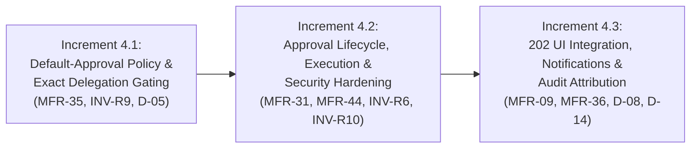

# Phase 4 Planning Checklist: Approval Lifecycle, Delegation, Execution, Notifications & Audit Attribution

**Document Version:** 1.3  
**Status:** Completed (Increments 4.1, 4.2 & 4.3 Fully Implemented & Verified)  
**Authoritative Reference:** `docs/backend/pre-backend-migration-remediation-roadmap.md`, Revision 5  
**Governing Phase:** Phase 4 — Approval Lifecycle, Delegation, Execution, Notifications & Audit Attribution  
**Date:** November 2, 2026  

---

## 1. Phase Objective & Scope

### 1.1 Objective
Establish the complete, secure, and authoritative approval lifecycle for all state-changing operations invoked by `assistant_admin`. Enforce the cardinal rule of Phase 4:
> **Every state-changing capability invoked by `assistant_admin` requires approval by default (`INV-R9`) unless an active, explicit delegation record covers that exact capability key. Absence of a capability from a static approval list must never result in direct execution.**

The intended end-to-end lifecycle is:
$$\text{assistant\_admin mutation} \longrightarrow \text{HTTP 202 Accepted} \longrightarrow \text{Pending ApprovalRequest} \longrightarrow \text{Authorized Approver Decision} \longrightarrow \text{Revalidation (INV-R10)} \longrightarrow \text{Exact Mutation Execution} \longrightarrow \text{Notification \& Immutable Audit}$$

### 1.2 Master Register Findings (MFR) Addressed
- **`MFR-09` (`F-09`):** Audit Attribution — `createGroup`, `updateGroup`, `archiveGroup`, `deleteGroup`, `deleteUserPermissionOverride`, and `setDelegatedAuthority` hardcode `actorId: 'usr_admin_001'` in `recordAuditLog`.
- **`MFR-31` (`NEW-03`):** Approval Execution Branches — `approveApprovalRequest` lacks execution branches for group sub-resources (members, courses, materials, meetings, attachments, assistants, QR), comment moderation (`comments.ignore_report`), and fails to merge `courseDrafts[courseId]` and clear `isUpdatePendingApproval` upon `courses.publish`.
- **`MFR-35` (`NEW-07`):** Default-Approval Policy Gap — Six state-changing capabilities (`groups.generate_qr`, `materials.manage_folders`, `materials.upload_files`, `materials.manage_meetings`, `reviews.submit_course`, `comments.ignore_report`) execute directly for `assistant_admin` by default because `evaluatePermission` in `policy.ts` defaults unlisted capabilities to `direct`.
- **`MFR-36` (`NEW-08`):** UI `202 Accepted` Integration — 11 frontend mutation surfaces do not handle `202 Accepted` (`approvalRequired: true`) and perform false optimistic UI updates.
- **`MFR-44`:** Approval Hardening — Replay prevention (`409 ALREADY_DECIDED`), canonical self-approval prevention (`INV-R6`), approver role authorization (`admin`, `super_admin`, `developer`), and approval-time target/role revalidation (`INV-R10`).

---

## 2. Dependencies & Frozen Scope

- **Upstream Dependencies:**
  - Phase 1: Canonical User IDs, tombstone ledger, and session consistency (`MFR-01`, `07`, `13`, `20`). [APPROVED & FROZEN]
  - Phase 2: Six-tier role hierarchy, protected-account invariants (`INV-R1`–`INV-R8`), Developer confidentiality across 11 surfaces (`MFR-37`, `38`, `39`, `45`). [APPROVED & FROZEN]
  - Phase 3: Administrative read visibility (`Rule A`, `D-14`), route guards, role navigation, and preview progress isolation (`MFR-03`, `05`, `06`, `08`, `16`, `17`, `21`, `29`, `30`). [APPROVED & FROZEN]
- **Downstream Phases Blocked by Phase 4:**
  - Phase 7: Published Curriculum Versioning (`Rule B`, `D-12`, `D-13`) relies on complete `courses.publish` approval execution.
  - Phase 8: Group Member Removal (`D-07`) relies on approval execution of member removal payloads.
  - Phase 10: Permanent User Deletion (`D-01`, `D-03`, `D-11`) relies on approval execution of user deletion payloads.
- **Out of Scope for Phase 4:**
  - Legacy Vanilla JS code.
  - Modifying Roadmap Revision 5.
  - Implementing multi-source enrollment provenance or per-attempt progress engines (reserved for Phase 6).
  - Curriculum versioning or certificate issuance (reserved for Phase 7).
  - Permanent user deletion or lecturer deletion warnings (reserved for Phase 10).
  - Production backend infrastructure, databases, or Redis schedulers (reserved for Phase 12).

---

## 3. Discovered Files, Functions & Components

### 3.1 Policy & Route Guard Layer
- [`frontend/src/core/permissions/policy.ts`](file:///d:/LMS%20MEtro%20Project/frontend/src/core/permissions/policy.ts)
  - `evaluatePermission` (lines 1350–1387): Fix default-to-approval behavior for `assistant_admin`.
  - `ASSISTANT_ADMIN_APPROVAL_REQUIRED_CAPABILITIES` (lines 579–600): Add missing capabilities.
  - `IMMUTABLE_BLOCKED_FOR_ASSISTANT_ADMIN` (lines 606–610): Preserve immutable ceilings.
  - `canActorManageTargetAccount` (lines 665–750): Ensure approval-time revalidation.
- [`frontend/src/mocks/handlers/resolveUser.ts`](file:///d:/LMS%20MEtro%20Project/frontend/src/mocks/handlers/resolveUser.ts)
  - `resolveAuthenticatedUser`: Authoritative actor extraction for audit attribution.

### 3.2 Mock Store & Approval Execution Layer
- [`frontend/src/mocks/store/inMemoryStore.ts`](file:///d:/LMS%20MEtro%20Project/frontend/src/mocks/store/inMemoryStore.ts)
  - `createApprovalRequest` (lines 8989–9061): Point notifications to `/approvals` (line 9054).
  - `approveApprovalRequest` (lines 9063–9320):
    - Expand approvers to `admin`, `super_admin`, `developer` (line 9088).
    - Throw `409 ALREADY_DECIDED` on replay (lines 9072–9084).
    - Implement `courses.publish` draft merge and flags reset (lines 9228–9249).
    - Implement missing execution branches (courses, group sub-resources, comments, reviews).
    - Enforce `INV-R10` approval-time revalidation.
  - `rejectApprovalRequest` (lines 9340–9409):
    - Expand approvers to `admin`, `super_admin`, `developer`.
    - Throw `409 ALREADY_DECIDED` on replay.
    - Point notifications to `/approvals` (line 9402).
  - `recordAuditLog` (lines 9435–9480): Pass authentic actor from handlers.
  - `createGroup`, `updateGroup`, `archiveGroup`, `deleteGroup` (lines 4020–4350): Remove hardcoded `'usr_admin_001'` (line 4030, 4140, 4240, 4340).
  - `deleteUserPermissionOverride`, `setDelegatedAuthority` (lines 8655, 8761, 8813, 8823): Remove hardcoded fallback `'usr_admin_001'`.

### 3.3 MSW Request Handlers
- [`frontend/src/mocks/handlers/groupHandlers.ts`](file:///d:/LMS%20MEtro%20Project/frontend/src/mocks/handlers/groupHandlers.ts)
- [`frontend/src/mocks/handlers/courseHandlers.ts`](file:///d:/LMS%20MEtro%20Project/frontend/src/mocks/handlers/courseHandlers.ts)
- [`frontend/src/mocks/handlers/builderHandlers.ts`](file:///d:/LMS%20MEtro%20Project/frontend/src/mocks/handlers/builderHandlers.ts)
- [`frontend/src/mocks/handlers/commentsHandlers.ts`](file:///d:/LMS%20MEtro%20Project/frontend/src/mocks/handlers/commentsHandlers.ts)
- [`frontend/src/mocks/handlers/permissionsHandlers.ts`](file:///d:/LMS%20MEtro%20Project/frontend/src/mocks/handlers/permissionsHandlers.ts)

### 3.4 The 11 UI Mutation Surfaces (MFR-36)
1. [`frontend/src/pages/GroupEditorPage.tsx`](file:///d:/LMS%20MEtro%20Project/frontend/src/pages/GroupEditorPage.tsx) (lines 489–510)
2. [`frontend/src/features/groups/components/GroupQRModal.tsx`](file:///d:/LMS%20MEtro%20Project/frontend/src/features/groups/components/GroupQRModal.tsx)
3. [`frontend/src/pages/GroupMonitoringPage.tsx`](file:///d:/LMS%20MEtro%20Project/frontend/src/pages/GroupMonitoringPage.tsx) (lines 209–256)
4. [`frontend/src/features/groups/components/GroupCoursesTab.tsx`](file:///d:/LMS%20MEtro%20Project/frontend/src/features/groups/components/GroupCoursesTab.tsx)
5. [`frontend/src/features/groups/components/GroupMembersTab.tsx`](file:///d:/LMS%20MEtro%20Project/frontend/src/features/groups/components/GroupMembersTab.tsx)
6. [`frontend/src/features/groups/components/GroupMaterialsTab.tsx`](file:///d:/LMS%20MEtro%20Project/frontend/src/features/groups/components/GroupMaterialsTab.tsx)
7. [`frontend/src/features/groups/components/GroupMeetingsTab.tsx`](file:///d:/LMS%20MEtro%20Project/frontend/src/features/groups/components/GroupMeetingsTab.tsx)
8. [`frontend/src/features/groups/components/GroupAttachmentsTab.tsx`](file:///d:/LMS%20MEtro%20Project/frontend/src/features/groups/components/GroupAttachmentsTab.tsx)
9. [`frontend/src/pages/CourseBuilderPage.tsx`](file:///d:/LMS%20MEtro%20Project/frontend/src/pages/CourseBuilderPage.tsx)
10. [`frontend/src/pages/CourseReviewPage.tsx`](file:///d:/LMS%20MEtro%20Project/frontend/src/pages/CourseReviewPage.tsx)
11. [`frontend/src/features/comments/pages/CommentModerationPage.tsx`](file:///d:/LMS%20MEtro%20Project/frontend/src/features/comments/pages/CommentModerationPage.tsx)

---

## 4. Mandatory Business Rules & Security Invariants

- **`INV-R6` (Anti-Self-Dealing):** No user may approve their own `ApprovalRequest`. Verified using canonical identity comparison: `resolveCanonicalUserId(approver.id) !== resolveCanonicalUserId(requester.id)`.
- **`INV-R9` (Default Approval for Assistant Admin):** Every state-changing capability invoked by `assistant_admin` must evaluate to `executionMode: 'requires_approval'` unless an active, explicit delegation record covers that exact capability key.
- **`INV-R10` (Approval-Time Re-Validation):** `approveApprovalRequest` must revalidate all protected invariants (`INV-R1`–`INV-R8`), target existence, current target state, and lecturer assignment preconditions at the moment of approval.
- **`D-05` (Delegation Authority):** Regular `admin` may manage operational delegation for `assistant_admin`. `super_admin` and `developer` retain approved higher authority. `assistant_admin` cannot grant itself delegation or modify its own operational authority.
- **`D-08` / `D-09` / `D-14` (Developer Confidentiality & Immutability):** Persist true canonical actor internally in the immutable audit ledger, but project `'SYSTEM'` / `'النظام'` at read-time for non-developer viewers.
- **Notification Deep Links:** All approval notifications must link to `/approvals`, never `/admin/users`.

---

## 5. Proposed 3-Increment Execution Sequence

---

## 6. Implementation Checklist (All Items Marked `Not Started`)

### Increment 4.1 — Default Approval Policy & Exact-Capability Delegation
- [x] `[Completed]` **4.1.1 — Default-to-Approval Invariant (`INV-R9`):** Refactored `evaluatePermission` in [`policy.ts`](file:///d:/LMS%20MEtro%20Project/frontend/src/core/permissions/policy.ts) so any non-read capability for `assistant_admin` defaults to `requires_approval` unless `context.hasDelegationBypass` is explicitly active.
- [x] `[Completed]` **4.1.2 — Update Static Capability Sets:** Added omitted capabilities (`groups.generate_qr`, `materials.manage_folders`, `materials.upload_files`, `materials.manage_meetings`, `reviews.submit_course`, `comments.ignore_report`) and aliases to `ASSISTANT_ADMIN_APPROVAL_REQUIRED_CAPABILITIES`.
- [x] `[Completed]` **4.1.3 — Exact Capability Delegation Matching:** Enhanced `hasDelegatedCapability` and `EvaluationContext` in [`inMemoryStore.ts`](file:///d:/LMS%20MEtro%20Project/frontend/src/mocks/store/inMemoryStore.ts) and [`policy.ts`](file:///d:/LMS%20MEtro%20Project/frontend/src/core/permissions/policy.ts) to verify that delegation grants match the exact `targetCapability`, have not expired, and match any active `resourceScope.groupId`.
- [x] `[Completed]` **4.1.4 — Delegation Governance Integrity (`D-05`):** Ensured `assistant_admin` cannot grant delegation to itself or peers, and only `admin`, `super_admin`, or `developer` can administer delegations.
- [x] `[Completed]` **4.1.5 — Handler 202 Contract Verification:** Verified write handlers return HTTP `202 Accepted` with payload `{ approvalRequired: true, requestId, message }` via `requireCapabilityOrApproval` in [`routeGuards.ts`](file:///d:/LMS%20MEtro%20Project/frontend/src/mocks/handlers/utils/routeGuards.ts) when `evaluatePermission` yields `executionMode === 'requires_approval'`.

### Increment 4.2 — Approval Lifecycle, Execution & Security Hardening
- [x] `[Completed]` **4.2.1 — Authorized Approver Expansion & Role Ceilings (`MFR-44`, `INV-R10`):** Updated `approveApprovalRequest` and `rejectApprovalRequest` to permit `admin`, `super_admin`, and `developer` as approvers, rejecting non-admin roles with `403 Forbidden`. Enforced approver capability ceiling: regular `admin` cannot approve operations exceeding `ROLE_CAPABILITY_CEILINGS.admin` (e.g. creating admin accounts or sovereign capabilities).
- [x] `[Completed]` **4.2.2 — Fail-Closed Anti-Self-Dealing & Canonical Identity Resolution (`INV-R6`, `INV-R10`):** Enforced authoritative user directory lookup (`getManagedUserById(id, 'developer')`) for both requester and approver without unverified fallback; unresolvable, unregistered, synthetic, or blank IDs fail closed with `403 INVARIANT_IDENTITY_RESOLUTION_FAILED`. Canonical alias comparison blocks all self-approval attempts across Developer, Super Admin, and Admin aliases with `403 INVARIANT_ANTI_SELF_APPROVAL`.
- [x] `[Completed]` **4.2.3 — Privileged Account Invariant Enforcement (`INV-R1`, `INV-R2`, `INV-R3`):** In `approveApprovalRequest`, enforced `evaluateProtectedInvariant` and `canActorManageTargetAccount` across all account mutations (`users.create`, `users.change_role`, `users.change_status`, `users.delete`). Enforced `INV-R1` (Developer immutable in-app for all approvers, `403 INVARIANT_DEVELOPER_IMMUTABLE`), `INV-R2` (Super Admin mutatable only by Developer, `403 INVARIANT_SUPER_ADMIN_EXCLUSIVITY`), and `INV-R3` (Admin mutatable only by Super Admin/Developer, peer admin blocked with `403 INVARIANT_ADMIN_PROTECTED`). Blocked Assistant Admin from requesting or managing admin accounts (`403 INVARIANT_ASSISTANT_CANNOT_CREATE_ADMIN`).
- [x] `[Completed]` **4.2.4 — Atomic Concurrency, In-Progress Claim Latching & Async Execution (`MFR-44`):** Synchronous `in_progress` latch claimed before any async boundary. Implemented `approveApprovalRequestAsync` and `rejectApprovalRequestAsync` with true concurrent invocation safety tested via `Promise.allSettled`. Returns HTTP `409 Conflict` (`DECISION_IN_PROGRESS`) on concurrent review attempts, and `409 ALREADY_DECIDED` on previously decided requests. Failed executions transition to `failed_execution` without leaving requests in `in_progress` or `approved`.
- [x] `[Completed]` **4.2.5 — Transactional Snapshot Rollback & Batch Pre-Validation Architecture (`INV-R10`):** Implemented `captureExecutionSnapshot` and `restoreExecutionSnapshot` in `approveApprovalRequest`. Pre-validates all targets in multi-item/batch operations (`groups.manage_members`, `groups.assign_courses`, `materials.delete_files`). On runtime mutation failure, store state is completely restored to pre-execution state, and request status is set to `failed_execution`.
- [x] `[Completed]` **4.2.6 — Course Draft Version Integrity & Publishing (`MFR-31`):** Monotonic `draftVersion` incremented on every draft modification in `saveCourseDraft`. Implemented `computeDraftContentDigest` calculating a deterministic 64-bit content hash of all nested course structures (chapters, items, sections, lessons, resources, config). Enforced uniform draft integrity verification on both `courses.publish` and `reviews.submit_course` execution paths (rejecting modified drafts with `409 DRAFT_MODIFIED_CONFLICT`, missing drafts with `404 DRAFT_NOT_FOUND`). Added explicit `discardCourseDraft`.
- [x] `[Completed]` **4.2.7 — Course Creation & Editing Execution Branches:** Implemented execution branches for `courses.create`, `courses.edit_metadata`, `courses.edit_curriculum`, `courses.upload_lectures`, `courses.delete_lectures`, `reviews.submit_course`.
- [x] `[Completed]` **4.2.8 — Group Sub-Resource Execution Branches (`MFR-31`):** Implemented execution branches for `groups.create`, `groups.edit_config`, `groups.archive`, `groups.manage_members`, `groups.review_join_requests`, `groups.assign_courses`, `materials.manage_folders`, `materials.upload_files`, `materials.delete_files`, `materials.manage_meetings`, and QR operations.
- [x] `[Completed]` **4.2.9 — Comment Moderation Execution Branch:** Implemented execution branches for `comments.ignore_report`, `comments.delete`, and `comments.toggle`.
- [x] `[Completed]` **4.2.10 — Notification Deep Link Correction:** Updated notification creation in `createApprovalRequest`, `approveApprovalRequest`, and `rejectApprovalRequest` to set `targetUrl: '/approvals'`.

### Increment 4.3 — 202 UI Integration, Notifications & Audit Attribution
- [x] `[Completed]` **4.3.1 — UI Surface 1: `GroupEditorPage`:** Handled `res.approvalRequired === true`, shows pending approval toast (`toast.info`), cleanly avoids false navigation to `/admin/groups/REQ_PENDING/edit`, and prevents optimistic `loadedGroup` state overwrite.
- [x] `[Completed]` **4.3.2 — UI Surface 2: `GroupQRModal`:** Handled 202 on QR toggle, rotate token, and enrollment policy update, showing pending approval info toasts and suppressing optimistic local state mutations.
- [x] `[Completed]` **4.3.3 — UI Surface 3: `GroupMonitoringPage`:** Handled 202 on join-request reviews (approval and rejection), displaying pending approval feedback and suppressing optimistic trainee enrollment refetch.
- [x] `[Completed]` **4.3.4 — UI Surfaces 4 & 5: `GroupCoursesTab` & `GroupMembersTab` (`DirectAssignModal`):** Handled 202 on post-deadline policy changes, cycle course assignments, member removals, and direct member assignments without premature table additions or cycle state mutations.
- [x] `[Completed]` **4.3.5 — UI Surfaces 6, 7, 8: `GroupMaterialsTab` (`GroupUploadFilesModal`), `GroupMeetingsTab`, `GroupAttachmentsTab`:** Handled 202 on folder creation/update/deletion, file uploading/deletion, meeting scheduling/deletion, and attachment linking/deletion with pending toasts and zero optimistic list/blob mutations.
- [x] `[Completed]` **4.3.6 — UI Surface 9: `CourseBuilderPage`:** Handled 202 on curriculum draft saving and review submission initiated by assistant roles, avoiding premature published state updates or local storage purges.
- [x] `[Completed]` **4.3.7 — UI Surface 10: `CourseReviewPage` (`DecisionModal`):** Handled 202 on course review decision execution (`executeReviewDecision`), showing informative pending approval feedback, suppressing premature success alerts, and safely redirecting to `/approvals`.
- [x] `[Completed]` **4.3.8 — UI Surface 11: `CommentModerationPage`:** Handled 202 on comment ignoring (`handleIgnoreReport`), comment deletion, and discussion toggle, displaying pending approval notices and preserving the reported moderation queue.
- [x] `[Completed]` **4.3.9 — Audit Attribution Rectification (`MFR-09`):** Updated `createGroup`, `updateGroup`, `archiveGroup`, `deleteGroup`, `createUser`, `setUserStatus`, `setUserRole`, `deleteUser`, `setRolePermissions`, `setUserPermissionOverride`, `deleteUserPermissionOverride`, and `setDelegatedAuthority` to resolve and record canonical authenticated actors (`actor.id`, `actor.role`), replacing hardcoded `'usr_admin_001'`. Automated system processes (such as `advanceRenewalCycle`) explicitly record `'SYSTEM'` (`actorRole: 'system'`, `actorName: 'النظام'`).
- [x] `[Completed]` **4.3.10 — Developer Confidentiality in Audit (`INV-R8`, `D-08`, `D-14`):** Guaranteed genuine developer attribution (`USR_DEV_001`, `developer`) in authoritative store logs, while deterministically projecting `'SYSTEM'` / `'النظام'` (with email masked as `system@metro.local`) to all non-developer viewers (super_admin, admin, lecturer, user). All 11 UI surfaces and permission overrides preserve developer confidentiality.

---

## 7. Acceptance Criteria

1. **Default Approval Enforcement:** Every state-changing API call by an un-delegated `assistant_admin` returns HTTP `202 Accepted` with `{ approvalRequired: true, requestId, message }`.
2. **Exact Delegation Gating:** An `assistant_admin` with an active, unexpired delegation for capability `C1` executes `C1` directly (`200`/`201`), but capability `C2` continues to require approval (`202 Accepted`).
3. **Approver Role Parity:** `admin`, `super_admin`, and `developer` can successfully decide approval requests. Non-admin roles receive HTTP `403`.
4. **Anti-Self-Dealing:** A requester attempting to approve their own request receives HTTP `403 Forbidden` (`INV-R6`).
5. **Replay Invariant:** Approving or rejecting an already decided request returns HTTP `409 Conflict` with code `'ALREADY_DECIDED'`.
6. **Execution Integrity:** Approved requests execute the exact requested mutation atomically. Stale requests (target deleted) fail safely with `failed_execution` status and clear audit logging.
7. **Curriculum Publish Draft Merge:** Approving `courses.publish` merges `courseDrafts[courseId]` into the active course, clears `isUpdatePendingApproval`, sets `publishedAt`, and notifies the author.
8. **UI Optimistic State Protection:** Across all 11 surfaces, receiving `202 Accepted` leaves local data unchanged, shows an informative pending notification, and provides navigation to `/approvals`.
9. **Accurate Audit Attribution:** Security audit logs for group and permission operations record the actual authenticated user ID, eliminating hardcoded `'usr_admin_001'`.

---

## 8. Test Scenarios to Author (Execution Deferred to Phase 13)

Classification: **`WRITTEN — NOT YET EXECUTED — DEFERRED TO PHASE 13`**

1. **Unit Test Suite — Policy & Delegation:**
   - Verify un-delegated `assistant_admin` defaults to `requires_approval` for all 20+ state-changing capabilities.
   - Verify exact-capability matching: grant for `groups.create` does not grant `groups.archive`.
   - Verify delegation expiration and resource scoping.
2. **Integration Test Suite — Approval Lifecycle:**
   - Full mutation lifecycle: Request $\rightarrow$ `202 Accepted` $\rightarrow$ Pending in Queue $\rightarrow$ Admin Decision $\rightarrow$ Store Mutation Executed $\rightarrow$ Requester Notified.
   - Course publishing lifecycle: Submit update $\rightarrow$ Draft stored $\rightarrow$ Approve $\rightarrow$ Draft merged into live course $\rightarrow$ Flag cleared.
   - Replay protection: Submitting approval for approved request returns `409 ALREADY_DECIDED`.
3. **Security Test Suite — Invariants:**
   - Self-approval attempt returns `403 Forbidden` (`INV-R6`).
   - Non-admin approver attempt returns `403 Forbidden`.
   - Stale target deletion revalidation returns `404` with `failed_execution` status (`INV-R10`).
   - Audit log inspection: verify accurate actor ID and role recorded without `'usr_admin_001'`.
4. **UI Integration Test Suite — 11 Surfaces:**
   - Mock 202 response on each of the 11 surfaces: verify zero optimistic updates, verify pending toast displayed, verify deep link to `/approvals`.

---

## 9. Regression Risks & Mitigation

| Risk | Impact | Mitigation Strategy |
|---|---|---|
| Existing tests expecting direct execution for `assistant_admin` | Test failure during Phase 13 | Identify legacy tests that assumed direct execution for `MFR-35` capabilities; update test setups with explicit delegation grants or expected 202 handling. |
| Incomplete draft merging on `courses.publish` | Data corruption in course catalog | Rigorously define the draft-to-published merge contract; preserve all non-draft course fields (ratings, enrollment counts). |
| Race conditions in approval execution | Duplicate entity creation | Enforce strict state latching (`status !== 'pending' -> throw 409`) before executing any payload mutation. |
| Leak of Developer identity in audit logs | Violation of Developer Confidentiality | Utilize the established `recordAuditLog` projection logic to mask Developer as `'SYSTEM'` / `'النظام'` for non-developers. |

---

## 10. Explicit Exclusions & Approvals Boundary

- **No Code Modifications:** No application source files, test files, or configurations have been modified during this planning step.
- **Phase 4 Implementation:** Strictly blocked until explicit written approval of this checklist and the companion planning report is granted by the owner.

