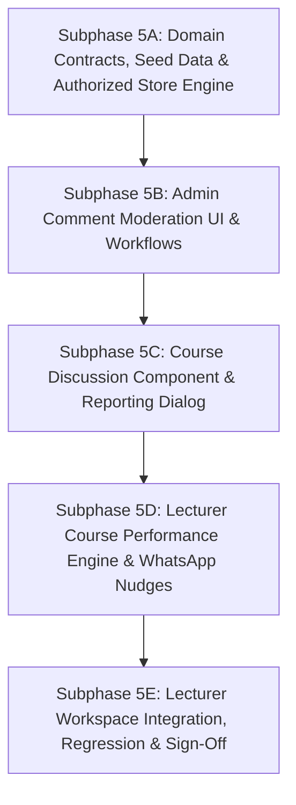

# Increment 11 — Phase 5: Implementation Plan & Feature Audit Checklist
## Comment Moderation & Lecturer Course Performance

---

## 1. Executive Summary

This document establishes the evidence-based audit, parity matrix, domain contracts, authorization rules, and structured implementation sequence for **Increment 11 — Phase 5** of the Metro Courses LMS modern React frontend (`frontend/`).

Phase 5 addresses the two remaining operational workflows required to achieve complete feature parity with the legacy Vanilla JavaScript application within Increment 11:
1. **Comment Moderation (`/admin/comment-moderation`):** Administrative inspection and moderation of trainee discussion comments across courses, resolution of reported comments (delete comment vs. ignore report), and course-level discussion policy enforcement (`commentsEnabled`).
2. **Lecturer Course Performance (`/lecturer/performance/:courseId`):** Lecturer- and administrator-facing performance monitoring per course, showing enrolled trainees, verified learning progress percentages, 5-day inactivity detection (`متأخر ⚠️`), and client-side pre-formatted WhatsApp reminders.

> [!IMPORTANT]
> **Planning-First Gate Notice:**
> In accordance with project instructions, **no application runtime code has been modified or implemented**. This plan defines the complete parity audit, domain models, authorization policies, test baselines, and approval-gated subphases for user review and authorization prior to commencing implementation.

---

## 2. Legacy-to-React Feature Parity Matrix

The matrix below provides an exhaustive comparison between the actual legacy Vanilla JavaScript implementation and the modern React frontend under `frontend/src/`.

| Feature Area | Legacy Source & Function | Current React Implementation | API / Store Support | Permission Requirements | Test Coverage | Parity Classification | Identified Gap & Proposed Action |
| :--- | :--- | :--- | :--- | :--- | :--- | :--- | :--- |
| **Comment Moderation: Reported Queue** | `js/admin.js:1074–1306` (`renderCommentModerationPage`, tab `tab-reported-comments`) | **None** | **None** (No comment collections or moderation methods in `inMemoryStore.ts`) | Legacy: `admin`, `lecturer`. Modern: `admin`, `assistant_admin` (with dual-control review) | None | **Present in legacy, missing from React** | Create `/admin/comment-moderation` with Reported Comments tab showing course title, report reason badge, author, quoted text, reporter, and actions (`حذف التعليق`, `تجاهل البلاغ`). |
| **Comment Moderation: All Comments Directory** | `js/admin.js:1180–1260` (tab `tab-all-comments`, `#comments-search`) | **None** | **None** | Legacy: `admin`, `lecturer`. Modern: `admin`, `assistant_admin` | None | **Present in legacy, missing from React** | Add searchable table listing all comments across all courses with author, course title, snippet, date, report status, and delete action. |
| **Course-Level Discussion Toggle** | `js/admin.js:1205–1240` (`btn-toggle-comments`), `js/course.js:305–315` | `Course.commentsEnabled` exists in type, but no UI toggle or store mutator | `Course` type has field; `inMemoryStore` does not mutate | `admin`, `assistant_admin` | None | **Present in legacy, missing from React** | Expose toggle button in All Comments table to switch course `commentsEnabled` (`مفعّلة 🟢` / `مغلقة 🔴`) and persist in store. |
| **Course Discussion Section (Trainee)** | `js/course.js:300–482` (`getCommentsHtml`, `bindCommentsEvents`) | **None** (Omitted from `CourseDetailPage.tsx` and `LearningPlayerPage.tsx`) | `mockCourses` lacks comments data in React | Trainee (`user`), Lecturer, Admin | None | **Present in legacy, missing from React** | Add comments list to `CourseDetailPage.tsx` with comment input (enabled for enrolled learners) and closed-comments banner when `commentsEnabled === false`. |
| **Comment Reporting Dialog** | `js/course.js:380–430` (`showReportModal`) | **None** | **None** | Enrolled users | None | **Present in legacy, missing from React** | Add modal allowing trainees to report comments with standard Arabic reasons (`محتوى غير لائق`, `معلومات خاطئة`, `إزعاج أو تحرش`, `أخرى`). |
| **Lecturer Course Performance Page** | `js/lecturer.js:819–959` (`renderCoursePerformancePage`) | **None** (Route `/lecturer/performance/:courseId` not registered) | Store has `courseAttempts` & `enrollments`, but no performance aggregator | Legacy: `lecturer`, `admin`. Modern: Assigned course instructor (`lecturer`) & `admin` | None | **Present in legacy, missing from React** | Implement `/lecturer/performance/:courseId` with course hero, total enrolled KPI, and learner roster table. |
| **Learner Inactivity Detection ($> 5\text{ days}$)** | `js/lecturer.js:875–890` (`daysSince > 5`) | Store tracks `lastActivityAt` on `CourseAttempt`, but no status evaluation | Data available in `CourseAttempt.lastActivityAt` | `lecturer`, `admin` | Partial (attempt tracking tested) | **Present in legacy, missing from React** | Calculate `daysSinceLastActivity` from verified `lastActivityAt`. Mark learners inactive $> 5\text{ days}$ with `متأخر ⚠️` status and warning progress bar. |
| **WhatsApp Nudge Action** | `js/lecturer.js:900–925` (`wa.me` URL with prefilled Arabic message) | **None** | Managed users have `phone` attribute | `lecturer`, `admin` | None | **Present in legacy, missing from React** | Generate client-side `https://wa.me/{phone}?text={encodedMsg}` link with exact Arabic copy. Disable if phone missing. |
| **Lecturer Course Performance Action Link** | `js/lecturer.js:150–165` (`.lec-perf-btn` on course card) | `LecturerCoursesPage.tsx` has Edit, QR, Preview buttons, but no Performance button | N/A (UI action) | `lecturer`, `admin` | None | **Present in legacy, missing from React** | Add "تقرير الأداء" action button to course cards on `LecturerCoursesPage.tsx` navigating to `/lecturer/performance/:courseId`. |

---

## 3. Verified Legacy Feature Behavior & Modern Gaps

### 3.1 Comment Moderation Workflow (Verified from `js/admin.js:1074–1306` and `js/course.js:300–482`)

1. **Data Model & In-Course Posting:**
   - In legacy, comments are stored as an array directly on each course object: `course.comments: CourseComment[]`.
   - Each comment record contains:
     ```javascript
     {
       id: 'CMT' + Date.now(),
       userId: _user.id,
       userName: _user.name,
       userInitial: _user.name.charAt(0),
       userRole: _user.role,
       isLecturer: _user.role === 'lecturer',
       text: text.trim(),
       time: 'الآن',
       createdAt: new Date().toISOString(),
       reported: false,
       reportReason: null,
       reportedBy: null,
       reportedAt: null
     }
     ```
   - In `data/courses.json`, existing comments exist on multiple courses (e.g. `CRS001` has 3 comments including `CMT001` reported by `USR004` with reason `"محتوى غير لائق"`).
2. **Moderation States & Actions:**
   - **Reported Queue:** Filters all comments across all courses where `c.reported === true`.
     - Action `حذف التعليق 🗑️`: Permanently splices the comment out of `course.comments`.
     - Action `تجاهل البلاغ ✓`: Sets `comment.reported = false`, clearing report metadata while retaining the comment in the course discussion.
   - **All Comments Directory:**
     - Displays all comments across all courses in a flat table with search filter matching author name or comment text.
     - Action `حذف 🗑️`: Permanently deletes the comment.
     - Course Discussion Toggle (`btn-toggle-comments`): Inverts `course.commentsEnabled` (`true` $\leftrightarrow$ `false`).
3. **Course Policy Impact on Trainees:**
   - When `course.commentsEnabled === false`:
     - Renders notification banner: `التعليقات مغلقة على هذا الكورس`.
     - Comment submission box is hidden/disabled.
     - Existing comments remain visible in read-only mode.
   - When `course.commentsEnabled === true`:
     - Enrolled trainees and instructors see the comment submission form.
     - Unenrolled users see an enrollment prompt: `سجّل في الكورس للمشاركة في النقاشات`.
4. **Modern React Gaps Identified:**
   - Modern React course catalog and store (`inMemoryStore.courses`) currently drop `comments` and omit comment moderation endpoints.
   - Route `/admin/comment-moderation` is not defined in `router/index.tsx`.
   - Trainee course details page (`CourseDetailPage.tsx`) has no discussion component or reporting modal.

---

### 3.2 Lecturer Course Performance Workflow (Verified from `js/lecturer.js:819–959`)

1. **Route & Navigation:**
   - Legacy route: `#performance/:courseId`.
   - Accessible from Lecturer Course Cards (`js/lecturer.js:150–165`) via `.lec-perf-btn` labeled `تقرير الأداء`.
2. **Learner Roster Compilation:**
   - Collects all enrolled learners by union of:
     - `course.enrolledUsers || []` (explicit course enrollment)
     - `_allUsers.filter(u => u.enrolledCourses.includes(course.id))` (user-level enrollments)
   - Deduplicates learner IDs and resolves full user objects.
3. **Exact Inactivity & Progress Derivation:**
   - Progress % and last watched date are retrieved from user attempt/history:
     `history = user.watchHistory[course.id] || { progress: 0, lastWatched: null }`
   - Progress bar colors:
     - Green (`#22c55e`) if `progress >= 100`
     - Red (`#ef4444`) if `daysSince > 5 && progress > 0 && progress < 100`
     - Brand color (`var(--primary)`) otherwise.
   - **Exact Inactivity Calculation in Legacy Source (`js/lecturer.js:875–885`):**
     ```javascript
     const daysSince = Math.floor((new Date() - new Date(history.lastWatched)) / (1000 * 60 * 60 * 24));
     ```
   - **Status Badge Rules:**
     - `مكتمل ✅` if `progress >= 100`
     - `متأخر ⚠️` if `progress > 0 && progress < 100 && history.lastWatched && daysSince > 5`
     - `نشط ⏳` if `progress > 0 && progress < 100 && (!history.lastWatched || daysSince <= 5)`
     - `لم يبدأ بعد` if `progress === 0`
4. **WhatsApp Nudge Action (`js/lecturer.js:900–925`):**
   - If `user.phone` is present:
     - Generates link `<a href="https://wa.me/${phone}?text=${encodeURIComponent(msg)}" target="_blank">`.
     - Button label: `تنبيه واتساب 💬`.
     - Exact Arabic message copy:
       `مرحباً ${user.name}،\nنود تذكيرك بضرورة استكمال كورس "${course.title}". لقد لاحظنا توقفك عن المشاهدة مؤخراً. إذا كان لديك أي استفسار أو مشكلة تواجهك، لا تتردد في التواصل معي.`
   - If `user.phone` is missing: Legacy omitted the button.
   - Behavior: Pure client-side URL opening in a new browser tab. No automated delivery, no external API call, and no claim of delivery.
5. **Modern React Gaps Identified:**
   - Route `/lecturer/performance/:courseId` does not exist in `router/index.tsx`.
   - `LecturerCoursesPage.tsx` does not render the "تقرير الأداء" button.
   - `inMemoryStore.ts` has individual `courseAttempts` and `enrollments`, but lacks a unified `getCoursePerformance(courseId, lecturerId, role)` query method.

---

## 4. Authorization & Data Integrity Specification

### 4.1 Canonical Roles & Ceilings
The implementation strictly adheres to the **Four Canonical System Roles** established in Increment 11:
- `admin` (مدير النظام)
- `assistant_admin` (مدير النظام المساعد)
- `lecturer` (المحاضر)
- `user` (المتدرب)

*(Note: Assistant lecturer is an operational group-scoped assignment, not a platform role).*

### 4.2 Authorization Rules for Comment Moderation (`/admin/comment-moderation`)
- **System Administrator (`admin`):** Full access to view queue, delete comments, ignore reports, and toggle course commenting. All mutations execute immediately with security audit logging (`audit.log('comments.delete' | 'comments.ignore_report' | 'comments.toggle')`).
- **Assistant Administrator (`assistant_admin`):**
  - Read access to `/admin/comment-moderation` is granted.
  - Deleting comments and toggling course comments are administrative actions. Under the established dual-control policy:
    - If operational delegation is active, execute directly (HTTP 200).
    - If operational delegation is inactive, produce an approval request (`approvals.submit_request` with outcome `pending_approval` / HTTP 202) while leaving the comment unchanged until approved.
    - Ignoring a report (`comments.ignore_report`) can be performed directly as a routine triage action.
- **Lecturer (`lecturer`):**
  - In legacy, lecturers could access the global moderation page.
  - In modern architecture: Lecturers should **not** have global administrative moderation across all courses. Lecturers may moderate comments within their assigned courses, but route `/admin/comment-moderation` is an administrative route restricted to `admin` and `assistant_admin` (redirecting other roles to `/403`).
- **Trainee (`user`):**
  - Strictly forbidden from administrative moderation. Blocked by route guard and MSW handler with HTTP 403 Forbidden.
  - Trainees are authorized to post comments on enrolled courses (if `commentsEnabled !== false`) and report inappropriate comments via the report modal.

### 4.3 Authorization Rules for Lecturer Course Performance (`/lecturer/performance/:courseId`)
- **Assigned Lecturer:**
  - Accessible to a lecturer if they are the course author (`course.lecturerId === user.id`) or designated co-lecturer (`course.coLecturers?.includes(user.id)`).
  - Attempting to access another lecturer's course returns HTTP 403 Forbidden with a clear Arabic denial message (`غير مصرح لك باستعراض أداء كورس غير مسند إليك`).
- **System Administrator (`admin`) & Assistant Administrator (`assistant_admin`):**
  - Full oversight access to inspect performance for any course across the platform.
- **Trainee (`user`):**
  - Strictly forbidden. Direct navigation redirects to `/403`. MSW handler returns HTTP 403 Forbidden.

---

## 5. Domain Models & API Contracts

### 5.1 Comment Moderation Domain Contracts (`src/core/comments/types.ts`)

```typescript
export type CommentReportReason = 
  | 'inappropriate_content' // محتوى غير لائق
  | 'misinformation'         // معلومات خاطئة
  | 'harassment'             // إزعاج أو تحرش
  | 'other';                 // أخرى

export interface CourseComment {
  id: string;
  courseId: string;
  courseTitle: string;
  userId: string;
  userName: string;
  userRole: 'admin' | 'assistant_admin' | 'lecturer' | 'user';
  userAvatar?: string;
  text: string;
  createdAt: string; // ISO string
  reported: boolean;
  reportReason?: CommentReportReason | null;
  reportReasonLabelAr?: string | null;
  reportedBy?: string | null;
  reportedByName?: string | null;
  reportedAt?: string | null;
}

export interface CommentModerationSummaryDTO {
  totalComments: number;
  reportedCommentsCount: number;
  coursesWithCommentsCount: number;
}

export interface CreateCommentRequestDTO {
  courseId: string;
  text: string;
}

export interface ReportCommentRequestDTO {
  commentId: string;
  reason: CommentReportReason;
  notes?: string;
}

export interface ToggleCourseCommentsDTO {
  courseId: string;
  commentsEnabled: boolean;
}
```

### 5.2 Lecturer Course Performance Contracts (`src/core/performance/types.ts`)

```typescript
export type LearnerPerformanceStatus = 
  | 'completed'    // مكتمل ✅
  | 'active'       // نشط ⏳
  | 'late'         // متأخر ⚠️
  | 'not_started'; // لم يبدأ بعد

export interface CourseLearnerPerformanceDTO {
  traineeId: string;
  name: string;
  jobTitle: string;
  department: string;
  phone?: string;
  progressPercent: number;
  lastActivityAt: string | null;
  daysSinceLastActivity: number | null;
  status: LearnerPerformanceStatus;
  isLate: boolean;
  whatsappUrl?: string | null;
}

export interface CoursePerformanceReportDTO {
  courseId: string;
  courseTitle: string;
  lecturerId: string;
  lecturerName: string;
  category: string;
  level: string;
  commentsEnabled: boolean;
  totalEnrolled: number;
  completedCount: number;
  activeCount: number;
  lateCount: number;
  notStartedCount: number;
  averageProgress: number;
  learners: CourseLearnerPerformanceDTO[];
}
```

### 5.3 REST API Endpoints Specification (MSW v2)

| Method | Endpoint | Authorized Roles | Description | Response Codes |
| :--- | :--- | :--- | :--- | :--- |
| `GET` | `/api/admin/comments/reported` | `admin`, `assistant_admin` | Retrieves queue of reported comments | 200, 401, 403 |
| `GET` | `/api/admin/comments` | `admin`, `assistant_admin` | Retrieves all comments with optional `query` and `courseId` filter | 200, 401, 403 |
| `DELETE`| `/api/admin/comments/:id` | `admin`, `assistant_admin` | Permanently deletes a comment | 200 (direct), 202 (approval required), 401, 403, 404 |
| `PATCH` | `/api/admin/comments/:id/ignore-report` | `admin`, `assistant_admin` | Clears reported flag and retains comment | 200, 401, 403, 404 |
| `PATCH` | `/api/admin/courses/:id/comments-toggle` | `admin`, `assistant_admin` | Toggles course `commentsEnabled` | 200 (direct), 202 (approval required), 401, 403, 404 |
| `GET` | `/api/courses/:id/comments` | Authenticated | Retrieves active comments for a course | 200, 401, 404 |
| `POST` | `/api/courses/:id/comments` | Enrolled / Instructors | Posts a new comment to course discussion | 201, 400, 401, 403 |
| `POST` | `/api/comments/:id/report` | Authenticated | Reports an inappropriate comment | 200, 400, 401, 404 |
| `GET` | `/api/lecturer/courses/:courseId/performance`| `lecturer` (assigned), `admin`, `assistant_admin` | Returns aggregated learner roster and performance indicators | 200, 401, 403, 404 |

---

## 6. Design-System & Arabic RTL Compliance

The implementation strictly reuses the established Metro Courses design system (`docs/frontend/design-system.md`):
1. **Typography & Layout:** Font Cairo (`var(--font-sans)`), strict RTL flow (`dir="rtl"`), right-aligned text, mirrored pagination and navigation icons.
2. **Tokens:** Semantic tokens only (`--color-surface`, `--color-border`, `--color-text-primary`, `--color-text-secondary`, `--color-brand-primary`, `--color-danger`, `--color-warning`, `--color-success`). Zero hardcoded hex codes.
3. **Icons:** Reusable Lucide icons registered in lowercase kebab-case (e.g. `message-square`, `alert-triangle`, `check-circle-2`, `trash-2`, `search`, `external-link`, `arrow-right`, `lock`).
4. **Shared Components:**
   - `Table`: Standard table with responsive header and cells.
   - `Badge`: Variant-driven badges (`danger` for `متأخر ⚠️` and reported, `success` for `مكتمل ✅` and active comments, `warning` for `نشط ⏳`, `neutral` for `لم يبدأ`).
   - `Button`: Standard variants (`primary`, `secondary`, `danger`, `outline`).
   - `ConfirmDialog`: Used for comment deletion and course discussion closure confirmations.
   - `SectionSkeleton`: Smooth loading state skeletons.
   - `EmptyState`: Contextual empty states with Arabic descriptions and action triggers.

---

## 7. Proposed Small, Approval-Gated Subphases

To guarantee test stability and maintain zero regression risk across the 1,012 existing tests, Phase 5 is divided into **five small, approval-gated subphases**:



---

### Subphase 5A: Comment Moderation Domain Contracts, Seed Data Fixtures & Authorized Store Engine (Completed)
- **Status:** **Completed & Verified** (35/35 automated tests passing; full typecheck and ESLint clean).
- **Scope Implemented:**
  - Defined minimal, grounded contracts in `src/core/comments/types.ts`: `CourseComment`, `CommentReportReason`, `CommentModerationSummaryDTO`, `CreateCommentRequestDTO`, `ReportCommentRequestDTO`, `ToggleCourseCommentsDTO`, `CommentFilterParams`, `CommentModerationActionResponse`.
  - Extracted and seeded 6 canonical comment records across `CRS001`, `CRS002`, `CRS003` in `src/mocks/fixtures/commentsFixtures.ts` preserving legacy fixtures, authors, timestamps, and report reasons (`inappropriate_content`, `misinformation`).
  - Extended `inMemoryStore.ts` with `courseComments: CourseComment[]` collection, deterministic initialization & reset, and query/mutation methods: `getReportedComments()`, `getCourseComments()`, `getAllComments()`, `getCommentById()`, `getCommentModerationSummary()`, `createComment()`, `reportComment()`, `ignoreCommentReport()`, `deleteComment()`, and `toggleCourseComments()`.
  - Added semantic capabilities to `src/core/permissions/types.ts` (`comments.moderate`, `comments.delete`, `comments.ignore_report`, `comments.toggle`) and policy mappings in `src/core/permissions/policy.ts`.
  - Intercepted sensitive assistant-admin actions (`comments.delete`, `comments.toggle`) requiring approval unless operational delegation is active, producing pending approval requests while keeping comments intact.
  - Implemented approval execution in `inMemoryStore.approveApprovalRequest` with revalidation of comment target, prevention of duplicate execution, and strict error handling (`failed_execution`).
  - Integrated Security Audit Trail logging (`comments.report`, `comments.ignore_report`, `comments.delete`, `comments.toggle`, `approvals.submit_request`, `approvals.decide_request`).
  - Registered 10 MSW v2 endpoints in `src/mocks/handlers/commentsHandlers.ts` and registered in mock server/worker handlers.
  - Built typed client API service `src/features/comments/services/commentsApi.ts`.
  - Created and executed comprehensive test suite `src/test/comments-store-api.test.tsx` (35 tests).
- **Exclusions Preserved:**
  - UI pages and components (`/admin/comment-moderation`, `/courses/:courseId` discussion UI) are strictly excluded and deferred to Subphases 5B and 5C.
  - Lecturer performance features are strictly excluded and deferred to Subphase 5D.
- **Files Created / Modified:**
  - `frontend/src/core/comments/types.ts` (created)
  - `frontend/src/mocks/fixtures/commentsFixtures.ts` (created)
  - `frontend/src/mocks/handlers/commentsHandlers.ts` (created)
  - `frontend/src/features/comments/services/commentsApi.ts` (created)
  - `frontend/src/test/comments-store-api.test.tsx` (created)
  - `frontend/src/core/permissions/types.ts` (updated with comment capabilities & approval actions)
  - `frontend/src/core/permissions/policy.ts` (updated with role defaults, ceilings, and approval requirements)
  - `frontend/src/mocks/store/inMemoryStore.ts` (updated with comments collection, methods, approval execution, and audit logging)
  - `frontend/src/mocks/handlers/index.ts` (registered comments handlers)
  - `frontend/src/mocks/server.ts` (registered comments handlers)
  - `frontend/src/mocks/browser.ts` (registered comments handlers)
- **Verification:**
  - `src/test/comments-store-api.test.tsx`: **35/35 tests passing** (1.43s).
  - Regression suite (`permissions-governance.test.tsx`, `security-audit-trail.test.tsx`, `department-tracks.test.tsx`): **139/139 tests passing** (21.62s).
  - Production build (`tsc -b && vite build`): **Clean (0 errors)**.
  - ESLint (`npm run lint`): **Clean (0 errors, 0 warnings)**.
- **Stop Condition:** Subphase 5A complete; stopped for review before Subphase 5B.

---

### Subphase 5B: Administrative Comment Moderation UI & Workflow (`/admin/comment-moderation`) (Completed)
- **Status:** **Completed & Verified** (21/21 automated UI tests passing; full typecheck and ESLint clean).
- **Scope Implemented:**
  - Created `frontend/src/features/comments/components/ReportedCommentsQueue.tsx` rendering reported comment cards with course title, report reason badge, author info, quoted text, reporter identity, and triage actions (`تجاهل البلاغ`, `حذف التعليق`).
  - Created `frontend/src/features/comments/components/AllCommentsTable.tsx` displaying searchable table with live filter input, course filter selector, author info, comment snippet, formatted date, report status badge, permanent delete action, and inline course discussion toggle button.
  - Created `frontend/src/features/comments/pages/CommentModerationPage.tsx` with Arabic RTL layout, 4 KPI cards (`totalComments`, `reportedCommentsCount`, `activeCourses`, `disabledCourses`), two-tab navigation, pending approval notification alert banner, and confirmation dialogs (`ConfirmDialog`) for both comment deletion and course discussion policy toggle.
  - Re-exported in `frontend/src/pages/CommentModerationPage.tsx`.
  - Registered route `/admin/comment-moderation` in `frontend/src/app/router/index.tsx` guarded by `<ProtectedRoute allowedRoles={['admin', 'assistant_admin']}>`.
  - Registered navigation link under `management` section in `frontend/src/shared/config/navigation.ts`.
  - Extended `ACTION_LABELS` and target rendering in `ApprovalRequestsTable.tsx` for `comments.delete` and `comments.toggle`.
  - Enforced dual-control governance: Assistant administrator deletion without delegation returns HTTP 202, displays pending approval notice with request ID, and keeps comment visible; direct deletion occurs only with active operational delegation; ignoring reports executes directly without approval.
  - Created and executed comprehensive UI test suite `frontend/src/test/comment-moderation-ui.test.tsx` (21 tests).
- **Exclusions Preserved:**
  - Trainee course discussion section and player commenting (`CourseDetailPage.tsx`, `LearningPlayerPage.tsx`) are strictly excluded and deferred to Subphase 5C.
  - Comment reporting dialog for trainees is strictly excluded and deferred to Subphase 5C.
  - Lecturer course performance engine and WhatsApp nudge actions are strictly excluded and deferred to Subphase 5D.
- **Files Created / Modified:**
  - `frontend/src/features/comments/components/ReportedCommentsQueue.tsx` (created)
  - `frontend/src/features/comments/components/AllCommentsTable.tsx` (created)
  - `frontend/src/features/comments/pages/CommentModerationPage.tsx` (created)
  - `frontend/src/pages/CommentModerationPage.tsx` (created)
  - `frontend/src/test/comment-moderation-ui.test.tsx` (created)
  - `frontend/src/app/router/index.tsx` (registered route)
  - `frontend/src/shared/config/navigation.ts` (registered nav item)
  - `frontend/src/features/permissions/components/ApprovalRequestsTable.tsx` (enhanced action labels & target display)
  - `frontend/src/core/comments/types.ts` (added spam reason & commentsEnabled)
  - `frontend/src/mocks/store/inMemoryStore.ts` (enriched comments queries with commentsEnabled)
- **Verification:**
  - `src/test/comment-moderation-ui.test.tsx`: **21/21 tests passing** (10.82s).
  - Combined comments test suite (`comments-store-api.test.tsx` + `comment-moderation-ui.test.tsx`): **56/56 tests passing** (14.83s).
  - Regression suite (`permissions-governance.test.tsx`, `security-audit-trail.test.tsx`, `department-tracks.test.tsx`): **139/139 tests passing** (21.64s).
  - Production build (`tsc -b && vite build`): **Clean (0 errors)**.
  - ESLint (`npm run lint`): **Clean (0 errors, 0 warnings)**.
- **Stop Condition:** Subphase 5B complete; stopped for review before Subphase 5C.

---

### Subphase 5C: Course Discussion Component & Reporting Dialog (`/courses/:courseId`) (Completed)
- **Status:** **Completed & Verified** (24/24 automated interaction tests passing; combined comments regression at 80/80 passing; courses and learning-player regression at 45/45 passing; full typecheck and ESLint clean).
- **Scope Implemented:**
  - Created `src/features/comments/components/ReportCommentModal.tsx` accessible reporting modal supporting all 5 canonical Arabic reasons (`محتوى غير لائق`, `معلومات خاطئة`, `إزعاج أو تحرش`, `رسائل مزعجة`, `أخرى`), conditional explanatory notes field for "أخرى", in-flight duplicate submission prevention, and Arabic error alerts.
  - Created `src/features/comments/components/CourseCommentsSection.tsx` reusable course discussion section supporting authoritative comments loading, relative Arabic timestamps, author initial avatars, author role badges (`محاضر`, `مدير النظام`, `مدير مساعد`), safe text rendering (no HTML injection), comment composer with trimming validation, in-flight submission lock, optimistic UI updates, trainee enrollment gating (`سجّل في الكورس للمشاركة في النقاشات`), closed-discussion banner (`التعليقات مغلقة على هذا الكورس.`), reporting action with "تم الإبلاغ ✓" button state lock, and lecturer/admin deletion via `ConfirmDialog`.
  - Integrated `CourseCommentsSection` seamlessly into `CourseDetailPage.tsx` under Curriculum/External Resources without duplication.
  - Integrated `CourseCommentsSection` seamlessly into `LearningPlayerPage.tsx` below `PlayerToolbar` without duplication.
  - Exported features from `src/features/comments/index.ts` and provided re-export shims at `src/features/courses/pages/CourseDetailPage.tsx` and `src/features/learning/pages/LearningPlayerPage.tsx`.
  - Created and executed comprehensive interaction test suite `src/test/course-comments-interaction.test.tsx` (24 tests).
- **Exclusions Preserved:**
  - Lecturer course performance engine and WhatsApp reminder UI are strictly excluded and deferred to Subphase 5D.
  - Lecturer workspace linkage and full regression sign-off are strictly excluded and deferred to Subphase 5E.
- **Files Created / Modified:**
  - `frontend/src/features/comments/components/ReportCommentModal.tsx` (created)
  - `frontend/src/features/comments/components/CourseCommentsSection.tsx` (created)
  - `frontend/src/features/comments/index.ts` (created)
  - `frontend/src/features/courses/pages/CourseDetailPage.tsx` (created shim)
  - `frontend/src/features/learning/pages/LearningPlayerPage.tsx` (created shim)
  - `frontend/src/pages/CourseDetailPage.tsx` (integrated CourseCommentsSection)
  - `frontend/src/pages/LearningPlayerPage.tsx` (integrated CourseCommentsSection)
  - `frontend/src/test/course-comments-interaction.test.tsx` (created)
- **Verification:**
  - `src/test/course-comments-interaction.test.tsx`: **24/24 tests passing** (11.02s).
  - Combined comments test suite (`comments-store-api.test.tsx` + `comment-moderation-ui.test.tsx` + `course-comments-interaction.test.tsx`): **80/80 tests passing** (52.26s).
  - Existing catalog & player tests (`courses.test.tsx` + `learning-player.test.tsx`): **45/45 tests passing** (26.51s).
  - Production build (`tsc -b && vite build`): **Clean (0 errors)**.
  - ESLint (`npm run lint`): **Clean (0 errors, 0 warnings)**.
- **Stop Condition:** Subphase 5C complete; stopped for review before Subphase 5D.

---

### Subphase 5D: Lecturer Course Performance Engine, Scoped Authorization & Context-Aware WhatsApp Contact System (Completed)
- **Status:** **Completed & Verified** (42/42 automated tests passing across `course-performance.test.tsx` [18 tests] and `whatsapp-contacts.test.tsx` [24 tests]; full Phase 5 suite 125/125 passing; full typecheck and ESLint clean).
- **Scope Implemented:**
  - Defined minimal, grounded contracts in `src/core/performance/types.ts` (`CoursePerformanceReportDTO`, `TraineePerformanceDTO`) and `src/features/whatsapp/types.ts` (`WhatsAppContact`, `WhatsAppContextConfig`, `WhatsAppContactContextType`).
  - Implemented `inMemoryStore.getCoursePerformanceReport(courseId, actor)`:
    - Resolves enrolled trainees from direct enrollments, course enrolledUserIds, and active training groups.
    - Joins trainee profile details (`name`, `jobTitle`, `department`, `phone`) from `inMemoryStore.users`.
    - Derives progress % from `CourseAttempt.progressPercent`.
    - Derives `daysSinceLastActivity` from `CourseAttempt.lastActivityAt` / `CourseAttempt.updatedAt` using verified formula `Math.floor((Date.now() - new Date(lastActivityAt).getTime()) / (1000 * 60 * 60 * 24))`.
    - Evaluates status: `completed` ($\ge 100\%$), `late` ($>0\%, <100\%, > 5\text{ days}$), `active` ($>0\%, <100\%, \le 5\text{ days}$), or `not_started`.
    - Constructs WhatsApp reminder URL: `https://wa.me/{phone}?text={encodedText}` matching legacy template (`js/lecturer.js:884`).
    - Disables reminder button without broken link when trainee phone is missing or invalid.
  - Enforced role-based scoped access:
    - `admin`: Global access across all courses.
    - `assistant_admin`: Global read-only access across all courses.
    - `lecturer`: Scoped access strictly for courses they instruct (primary lecturer or recognized co-lecturer); unrelated courses return HTTP 403 Forbidden.
    - `user` (trainee) / unauthenticated: HTTP 403 Forbidden / HTTP 401 Unauthorized.
  - Implemented MSW v2 handler `GET /api/lecturer/courses/:courseId/performance` in `src/mocks/handlers/performanceHandlers.ts`.
  - Created client API service `src/features/performance/services/performanceApi.ts`.
  - Created full responsive performance report page `src/features/performance/pages/CoursePerformancePage.tsx` at route `/lecturer/performance/:courseId` (with legacy redirect `performance/:courseId`).
  - Implemented unified, Context-Aware WhatsApp Contact Experience (`WhatsAppFloatingFab`):
    - Course context (`/courses/:courseId`, `/learn/:courseId`): Assigned course contacts or primary/co-instructors with verified phone numbers.
    - Group context (`/trainee/groups/:groupId`): Assigned group supervisors and supported assistants from actual saved group assignments.
    - Login screen context (`/login`): Unauthenticated support entry point with configured administrative contacts without fabricating trainee identity or user ID.
    - General platform context: Configured administrative and technical support contacts.
    - Safe unavailable state: Renders informative messaging instead of generating broken links when contacts or phones are missing.
- **Files Created / Modified:**
  - `frontend/src/core/performance/types.ts` (created)
  - `frontend/src/features/whatsapp/types.ts` (created)
  - `frontend/src/features/whatsapp/config/supportContacts.ts` (created)
  - `frontend/src/features/whatsapp/utils/whatsappUtils.ts` (created)
  - `frontend/src/features/whatsapp/hooks/useWhatsAppContacts.ts` (created)
  - `frontend/src/features/whatsapp/styles/whatsapp-fab.css` (created)
  - `frontend/src/features/whatsapp/components/WhatsAppFloatingFab.tsx` (created)
  - `frontend/src/features/whatsapp/index.ts` (created)
  - `frontend/src/mocks/handlers/performanceHandlers.ts` (created)
  - `frontend/src/features/performance/services/performanceApi.ts` (created)
  - `frontend/src/features/performance/pages/CoursePerformancePage.tsx` (created)
  - `frontend/src/pages/CoursePerformancePage.tsx` (created)
  - `frontend/src/test/whatsapp-contacts.test.tsx` (created)
  - `frontend/src/test/course-performance.test.tsx` (created)
  - `frontend/src/core/courses/types.ts` (updated)
  - `frontend/src/mocks/store/inMemoryStore.ts` (updated)
  - `frontend/src/mocks/handlers/index.ts` (updated)
  - `frontend/src/mocks/server.ts` (updated)
  - `frontend/src/mocks/browser.ts` (updated)
  - `frontend/src/pages/LoginPage.tsx` (updated)
  - `frontend/src/features/auth/components/LoginForm.tsx` (updated)
  - `frontend/src/pages/CourseDetailPage.tsx` (updated)
  - `frontend/src/pages/LearningPlayerPage.tsx` (updated)
  - `frontend/src/pages/GroupDetailPage.tsx` (updated)
  - `frontend/src/app/router/index.tsx` (updated)
  - `docs/frontend/checklists/phase-5-implementation-plan.md` (updated)
- **Separate Acceptance Criteria:**
  1. **Course WhatsApp Contacts:** Resolves verified course contacts or assigned primary/co-instructors; formats Arabic message with trainee identity and course title; shows safe unavailable state if no valid phones exist.
  2. **Group WhatsApp Contacts:** Resolves explicitly assigned group supervisors and assistants from saved group assignments; isolates from course contacts; enforces group membership authorization.
  3. **Login Support Contacts:** Operates without an authenticated session; presents configured administrative contacts; uses prefilled login issue Arabic message without fabricating trainee name or ID; handles missing numbers safely.
  4. **General Administrative Support:** Provides platform-wide administrative contacts with trainee identification for general pages.
  5. **Lecturer-Initiated Reminders:** Enrolled trainee roster calculation, 5-day inactivity evaluation (`late` / `متأخر ⚠️`), scoped authorization (403 for unauthorized lecturer or trainee), and prefilled reminder link disabled when phone is missing.
- **Verification:**
  - `src/test/whatsapp-contacts.test.tsx`: **24/24 tests passing** (470ms).
  - `src/test/course-performance.test.tsx`: **18/18 tests passing** (2.40s).
  - Combined Phase 5 test suite (5 files): **125/125 tests passing** (24.52s).
  - Production build (`tsc -b && vite build`): **Clean (0 errors)**.
  - ESLint (`npm run lint`): **Clean (0 errors, 0 warnings)**.
- **Stop Condition:** Performance and WhatsApp contacts tests pass; stop for review before Subphase 5E.

---

### Subphase 5E: Lecturer Workspace Integration, Regression Verification & Increment 11 Sign-Off (Completed & Verified)
- **Status:** **Completed & Formally Signed Off**
- **Implemented Scope:**
  - Integrated `تقرير الأداء` action button with `barChart` icon on course cards in `frontend/src/pages/LecturerCoursesPage.tsx` linking directly to `/lecturer/performance/:courseId`.
  - Enforced scoped visibility: button renders strictly for authorized primary instructors, co-lecturers, and platform administrators (`admin` / `assistant_admin`).
  - Added robust breadcrumb and back-navigation buttons in `frontend/src/features/performance/pages/CoursePerformancePage.tsx` returning to `/lecturer/courses`.
  - Added full test coverage in `src/test/lecturer-workspace.test.tsx` (8 tests) and `src/test/course-performance.test.tsx` (19 tests).
  - Executed full sequential application test suite (`npm --prefix frontend test -- --fileParallelism=false`): **65 test files, 1,153 tests passed (100%), 0 failures** in 305.11s.
  - Executed ESLint check (`npm --prefix frontend run lint`): **Clean (0 errors, 0 warnings)**.
  - Executed TypeScript typecheck and production build (`npm --prefix frontend run build`): **Clean (0 errors)** in 9.73s.
- **Files Modified:**
  - `frontend/src/pages/LecturerCoursesPage.tsx` (integrated `تقرير الأداء` button and scoped authorization check)
  - `frontend/src/features/performance/pages/CoursePerformancePage.tsx` (added breadcrumbs and back button to `/lecturer/courses`)
  - `frontend/src/test/lecturer-workspace.test.tsx` (added performance button navigation and admin/lecturer scoping tests)
  - `frontend/src/test/course-performance.test.tsx` (added breadcrumbs and back navigation test)
  - `frontend/src/test/learning-player.test.tsx` (disambiguated celebration modal selector in presence of WhatsApp dialog)
  - `frontend/src/features/groups/components/GroupQRModal.tsx` (added `copyTimeoutRef` cleanup to prevent test teardown exception)
  - `frontend/src/test/training-groups-course-assignment.test.tsx` (added 5000ms timeout matching suite conventions)
  - `docs/frontend/checklists/phase-5-implementation-plan.md` (updated final sign-off status)
  - `docs/frontend/implementation-roadmap-increment-11.md` (updated Increment 11 completion status)
- **Quality-Gate Verification Summary:**
  - **Full Regression Test Suite:** 65/65 test files passed, 1,153/1,153 tests passed (100% pass rate).
  - **TypeScript Typecheck:** `tsc -b` passed with 0 errors.
  - **Vite Production Build:** `vite build` generated all client chunks cleanly (`dist/` output verified).
  - **ESLint Boundaries:** `eslint .` passed with 0 errors and 0 warnings.
- **Architectural & Persistence Boundary Notice:**
  - All mock stores and ledgers (`inMemoryStore.ts`) operate as high-fidelity, in-memory client-side prototypes. Production backend persistence and cloud database storage are deferred to enterprise backend services. Legacy Vanilla JavaScript application files (`app.html`, `js/*`, `css/*`, `data/*`) were preserved completely intact without modification.
- **Stop Condition:** Increment 11 Phase 5 complete. Awaiting review.

---

### Final Performance Authorization Consistency Audit (Completed & Verified)
- **Status:** **Completed & Formally Signed Off**
- **Implemented Scope:**
  - **Eliminated Display-Name-Based Authorization:** Removed all display-name checks (`course.lecturerName === user.name` and substring checks) from `LecturerCoursesPage.tsx`, `inMemoryStore.getCoursePerformanceReport()`, `isAuthorizedLecturer()`, `createComment()`, and `reportComment()`. Display names are strictly treated as UI presentation labels, never as authorization tokens.
  - **Centralized Canonical Identity Engine:** Created `frontend/src/core/courses/courseAuthorization.ts` containing `isMatchingInstructorId`, `isUserAuthorizedCourseInstructor`, and `isAuthorizedForCoursePerformance`.
  - **Documented Synthetic Demo Persona Compatibility:** Resolved the pairing between legacy catalog fixture `USR002` and modern synthetic demo persona `usr_lect_002` within the centralized identity engine with clear architectural documentation, eliminating ad-hoc ID exceptions and preventing display-name fallback.
  - **Preserved Approved Access Matrix:** Verified that primary lecturers and assigned co-lecturers access reports; unrelated lecturers are strictly denied (even when display names match); `admin` and `assistant_admin` retain platform-wide oversight; trainees (`user`) are strictly denied with HTTP 403; direct API requests and URL navigation cannot bypass authorization.
  - **Regression Test Coverage:**
    - `src/test/course-authorization.test.ts`: **14 tests** covering identity matching, synthetic persona pair, case-insensitivity, co-lecturer matching, display name independence, and role authorization.
    - `src/test/course-performance.test.tsx`: **24 tests** (including 5 new tests for co-lecturers, identical display name denial, renamed/empty display name preservation, synthetic persona, and UI 403 navigation state).
    - `src/test/lecturer-workspace.test.tsx`: **10 tests** (including 2 new tests verifying UI button visibility strictly tracks normalized ID rather than display name).
- **Files Modified / Created:**
  - `frontend/src/core/courses/courseAuthorization.ts` (new centralized identity engine)
  - `frontend/src/pages/LecturerCoursesPage.tsx` (switched to centralized authorization helper)
  - `frontend/src/mocks/store/inMemoryStore.ts` (enforced `isUserAuthorizedCourseInstructor` on performance and comment workflows)
  - `frontend/src/test/course-authorization.test.ts` (new unit test suite)
  - `frontend/src/test/course-performance.test.tsx` (added targeted regression tests)
  - `frontend/src/test/lecturer-workspace.test.tsx` (added UI identity-matching tests)
  - `frontend/src/test/training-groups-ux-corrections.test.tsx` (stabilized `waitFor` timeout for sequential test suite reliability)
  - `docs/frontend/checklists/phase-5-implementation-plan.md` (updated)
  - `docs/frontend/implementation-roadmap-increment-11.md` (updated)
- **Quality-Gate Verification Summary:**
  - **Full Regression Test Suite:** `npm --prefix frontend test -- --fileParallelism=false` passed: **66/66 test files, 1,174/1,174 tests passed (100% pass rate)**.
  - **ESLint Boundaries:** `eslint .` passed with **0 errors and 0 warnings**.
  - **TypeScript Typecheck & Production Build:** `tsc -b && vite build` passed cleanly (**0 errors**, built in 10.76s).
- **Stop Condition:** Increment 11 Final Audit complete. Awaiting review. Increment 12 not started.

---

## 8. Resolved Product Decisions & Authoritative Policies

The Product Owner formally approved and authorized the following business decisions for Phase 5:

### Decision 1: Comment Moderation Access Scope (Confirmed: Administrative Reservation & Course-Scoped Lecturers)
- **Platform-wide Moderation Scope:** Reserved strictly for `admin` and `assistant_admin` (the latter subject to dual-control governance and delegation).
- **Lecturers:** Forbidden from platform-wide comment moderation (`/admin/comment-moderation` or direct API calls). Lecturers may manage discussions and moderate comments *only* within courses they are authorized to teach or manage (provided within course discussions in Subphase 5C). Attempting to access unrelated course comments returns 403 Forbidden.
- **Trainees (`user`):** May submit comment reports on valid courses where enrolled, but must not access administrative moderation tools or delete comments.
- **Four Canonical Roles:** `admin`, `assistant_admin`, `lecturer`, and `user`. Assistant lecturer is an ordinary `lecturer` with an active group assignment, not a 5th canonical role.

### Decision 2: Assistant Administrator Comment Deletion Governance (Confirmed: Dual-Control Deletion, Direct Ignore)
- **Permanent Comment Deletion:** Destructive action. System administrators execute deletion directly. Assistant administrators must submit a pending approval request (`approvals.submit_request` with outcome `pending_approval` / HTTP 202) unless authorized operational delegation permits direct execution. While approval is pending, comments remain unchanged and visible. Approval revalidates the target and deletes the comment; rejection leaves it intact; duplicate execution is prevented.
- **Ignoring a Report:** Non-destructive triage action that clears report flags while preserving the comment. Authorized assistant administrators execute this operation directly without dual-control approval, recorded in the audit trail.
- **Discussion Toggling:** Course commenting policy changes (`commentsEnabled`) by assistant administrators also trigger dual-control approval interception unless delegated.

### Decision 3: Lecturer Access to Trainee Course Performance (Confirmed for Subphase 5D Planning)
- **System Administrator (`admin`):** Full read access to inspect trainee performance across all courses.
- **Assistant Administrator (`assistant_admin`):** Read-only administrative oversight across all courses without edit permissions.
- **Assigned Lecturer (`lecturer`):** Scoped access to enrolled trainee roster and course performance information strictly for courses where they are assigned instructor or explicitly recognized co-instructor. Accessing unrelated courses via URL manipulation or direct API returns 403 Forbidden.
- **Group-Scoped Assistant Lecturer:** Access to group-monitoring information strictly for trainees within their assigned group. If the data model cannot establish this link, the limitation must be documented rather than inferring access.
- **Trainee (`user`):** Forbidden from accessing performance reports (403 Forbidden).
- **Legacy Calculation Parity (Subphase 5D):** Completed ($\ge 100\%$), Late/Inactive ($>0\%, <100\%$, $>5$ calendar days since last activity), Active ($>0\%, <100\%$, $\le 5$ days), Not Started ($0\%$). WhatsApp reminders remain client-side prefilled links with Arabic copy and disabled state if phone is missing. Zero fabricated metrics or timestamps.

---

## 9. Baseline & Subphase Verification Results

Prior to and during Phase 5, automated test suites and compiler checks established verified baselines:
- `src/test/comments-store-api.test.tsx` (Subphase 5A): **35/35 tests passed** (1.43s)
  - Canonical fixtures integrity, deterministic store reset, and query methods.
  - Reported comment triage (ignore report preserves comment, delete permanently removes).
  - Course-level discussion toggles (`commentsEnabled`).
  - Strict RBAC: Admin global access, assistant admin dual-control interception & delegation bypass, lecturer course-scoping & global denial, trainee report submission & mutation denial.
  - Distinct audit events for approval proposal vs executed mutation; prevention of duplicate approval execution.
- `src/test/comment-moderation-ui.test.tsx` (Subphase 5B): **21/21 tests passed** (10.82s)
  - Route rendering and protection (`admin`, `assistant_admin` allowed; `lecturer`, `user` denied).
  - KPI summary metrics dynamically loaded and reflecting state changes.
  - Reported queue triage cards (`تجاهل البلاغ`, `حذف التعليق`) with empty state handling.
  - Permanent deletion confirmation dialog and dual-control approval handling for assistant administrators (HTTP 202, pending banner, non-mutation).
  - Search and course filtering in All Comments table.
  - Course discussion policy toggle with confirmation and approval interception.
  - Integration with `ApprovalRequestsTable` displaying localized labels.
- Regression suites verified:
  - Combined comments suite (`comments-store-api.test.tsx` + `comment-moderation-ui.test.tsx`): **56/56 tests passed** (14.83s)
  - `src/test/permissions-governance.test.tsx`: **80/80 tests passed** (12.34s)
  - `src/test/security-audit-trail.test.tsx`: **36/36 tests passed** (5.05s)
  - `src/test/department-tracks.test.tsx`: **23/23 tests passed** (4.25s)
  - Total focused suite regression: **195/195 tests passed (100%)**.
- TypeScript typecheck and production build (`tsc -b && vite build`): **Clean (0 errors)**.
- ESLint (`npm run lint`): **Clean (0 errors, 0 warnings)**.
