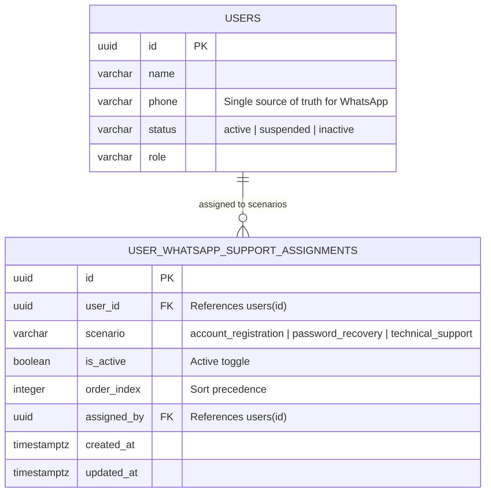
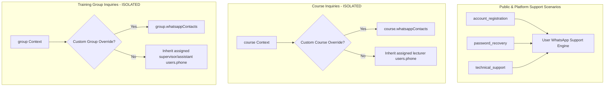

# MetroLMS — Architectural Plan: Configurable WhatsApp Contact Visibility in User Permissions

> **Document Status:** Architectural Master Plan & Implementation Specification  
> **Governance State:** Approved Business Decisions Incorporated (Documentation & Design Phase)  
> **Target File:** `docs/frontend/checklists/whatsapp-contact-visibility-plan.md`  
> **Workspace:** `D:\LMS MEtro Project`  
> **Governing Surface:** User Management Directory & Individual Permissions Dialog (`UserPermissionsModal`)  

---

## 1. Executive Summary & Approved Owner Decisions

This master specification details the architecture, data models, and user experience for allowing administrators to configure where each verified employee's WhatsApp contact number appears across MetroLMS public and authenticated surfaces.

The project owner has reviewed and explicitly approved the core business and governance rules governing this feature, specifically establishing **`users.phone` as the single source of truth**:

### Approved Decision Matrix

| Area | Approved Decision | Scope & Operational Rule |
| :--- | :--- | :--- |
| **1. Single Source of Truth** | **Reuse Existing `users.phone`** | Use the existing `users.phone` field as the **sole, authoritative source of truth** for each user's WhatsApp contact number. |
| **2. No Separate Contacts Entity** | **Reject `user_whatsapp_contacts`** | Do **not** introduce a separate `user_whatsapp_contacts` entity or database table. No secondary phone records. |
| **3. Support Assignments Model** | **Retain `user_whatsapp_support_assignments`** | Retain the proposed `user_whatsapp_support_assignments` model for independently assigning a user to:<br>• `account_registration` (Login page account-creation dialog)<br>• `password_recovery` (Login page password-recovery dialog)<br>• `technical_support` (Floating general-support WhatsApp button)<br>A user may hold any combination (0, 1, 2, or all 3). Multiple users can be assigned to the same scenario. |
| **4. Conditional Public Visibility** | **Three Mandatory Gates** | A user's phone number appears publicly **only** when all three conditions are satisfied simultaneously:<br>1. The user has an active assignment for that scenario (`is_active: true`).<br>2. The user has a valid phone number conforming to the supported Egyptian mobile numbering prefixes (normalized to canonical 12-digit URL format `2010XXXXXXXX`, `2011XXXXXXXX`, `2012XXXXXXXX`, `2015XXXXXXXX`).<br>3. The user account is not suspended (`status !== 'suspended'`). |
| **5. Dynamic Phone Resolution** | **No Duplicate Phone Storage** | **Do not store duplicate copies of the phone number in assignment records.** Assignment records only store `user_id`, `scenario`, `is_active`, and audit metadata. All contact resolution joins `users` on `user_id` and reads `users.phone` directly. When an administrator or user updates `users.phone`, all contact links automatically and immediately use the new value. |
| **6. Arabic Guidance in Phone Edit** | **Explicit WhatsApp Guidance** | Add clear Arabic guidance to the existing phone-number entry/edit interface (such as `AddUserModal` and user profile editing) explaining that users must provide a number with an active WhatsApp account and that administrators may enable its visibility in designated contact scenarios. |
| **7. Validation & Notation Clarification** | **Three-Tier Separation & Representation Distinction** | The plan strictly distinguishes between:<br>1. **Normalization:** formatting digits for WhatsApp link generation vs. human display notation.<br>2. **Validation:** verifying the number against supported Egyptian mobile prefixes (`010`, `011`, `012`, `015`) and rejecting malformed/unsupported inputs (not merely checking $\ge 8$ digits).<br>3. **Account Existence:** confirming an active WhatsApp account actually exists.<br>Prefixes are supported numbering plan prefixes only (not reliable carrier indicators due to Mobile Number Portability). Format normalization and syntactic validation **never prove or verify that an active WhatsApp account exists on that number**, nor does having $\ge 8$ digits guarantee validity. |
| **8. UI Placement & Decoupling** | **Inside Existing Permissions Dialog** | Keep the administrator's three contact-visibility assignments inside the existing `"تحديد الصلاحيات الفردية للمستخدم"` modal (`UserPermissionsModal.tsx`), visually separate from RBAC permissions. Contact visibility settings are administrative routing configurations and must not alter roles, capabilities, or role ceilings. |
| **9. Domain Isolation** | **Preserve Course & Group Separation** | Course-specific contact resolution (`course.whatsappContacts` or assigned lecturers) and group-specific contact resolution (`group.whatsappContacts` or assigned supervisors/assistants) remain completely isolated in their respective domains and are never merged into general support routing. |
| **10. Future Backend Horizon** | **Specification Only (No Migrations Now)** | Document the proposed assignment model for the future backend without modifying database schemas or creating migrations now. Phase 1 implementation executes purely against frontend types, in-memory store, and MSW mock handlers. |

---

## 2. Current-State Audit & Codebase Findings

The following table documents verified implementation facts and exact source references in the current repository:

| Subsystem / Surface | Exact File Reference | Verified Current Implementation | Architectural Application & Audit Gap |
| :--- | :--- | :--- | :--- |
| **User Domain Model** | [`user-management/types.ts`](file:///D:/LMS%20MEtro%20Project/frontend/src/core/user-management/types.ts#L17-L44) | `ManagedUserDTO` includes `id`, `name`, `email`, `phone?`, `jobTitle`, `department`, `role`, `status`. | `phone` is confirmed as the **single source of truth** for WhatsApp communications. No new phone field is required. |
| **User Directory Table** | [`UserTable.tsx`](file:///D:/LMS%20MEtro%20Project/frontend/src/features/user-management/components/UserTable.tsx#L224-L267) | Displays `{u.phone || '—'}` in column; action button `"تحديد الصلاحيات"` opens permissions dialog for any selected user record. | Context menu remains unchanged. Selecting a user and opening permissions allows managing their 3 scenario assignments. |
| **User Creation Modal** | [`AddUserModal.tsx`](file:///D:/LMS%20MEtro%20Project/frontend/src/features/user-management/components/AddUserModal.tsx#L259-L283) | Phone field currently has a plain label: `رقم الهاتف (اختياري)` with placeholder `010XXXXXXXX` and regex check `/^[0-9+\s-]{8,15}$/`. | Will receive explicit Arabic guidance explaining that the number must link to an active WhatsApp account for potential support visibility. |
| **Individual Permissions Dialog** | [`UserPermissionsModal.tsx`](file:///D:/LMS%20MEtro%20Project/frontend/src/features/permissions/components/UserPermissionsModal.tsx#L448-L685) | Modal titled `"تحديد الصلاحيات الفردية للمستخدم"`. Manages 9 capability categories, evaluates role ceilings, records audit reasons. | Host for the new section `"مسؤوليات التواصل عبر واتساب"`, placed as a distinct card below identity header, separated from RBAC. |
| **Authorization Policy Engine** | [`policy.ts`](file:///D:/LMS%20MEtro%20Project/frontend/src/core/permissions/policy.ts#L16-L100) & [`types.ts`](file:///D:/LMS%20MEtro%20Project/frontend/src/core/permissions/types.ts#L8-L85) | Baseline role capabilities and immutable ceilings for 34 capabilities. Validated via `validatePermissionOverride`. | Contact visibility is routing metadata, not an authorization capability. It must not be mixed into `SystemCapability` or role ceilings. |
| **Phone Sanitization Utility** | [`whatsappUtils.ts`](file:///D:/LMS%20MEtro%20Project/frontend/src/features/whatsapp/utils/whatsappUtils.ts#L12-L24) | `cleanPhoneNumber(rawPhone)` strips `\D`, validates $\ge 8$ digits, standardizes `0...` (length 11) to `20...`, else returns `digitsOnly`. | **Audit Finding:** The current utility is a permissive sanitizer rather than a strict Egyptian numbering plan validator. It does not verify mobile numbering prefixes (`010`, `011`, `012`, `015`), accepts arbitrary 8+ digit sequences, and does not reject landlines. Required validation improvements are specified in Section 5. |
| **Course WhatsApp Contacts** | [`inMemoryStore.ts`](file:///D:/LMS%20MEtro%20Project/frontend/src/mocks/store/inMemoryStore.ts#L7654-L7704) & [`useWhatsAppContacts.ts`](file:///D:/LMS%20MEtro%20Project/frontend/src/features/whatsapp/hooks/useWhatsAppContacts.ts#L52-L109) | Priority A: `course.whatsappContacts` override; Priority B: assigned primary/co-lecturers (`users.phone`). | Operates independently for pedagogical inquiries; must remain strictly isolated. |
| **Group WhatsApp Contacts** | [`useWhatsAppContacts.ts`](file:///D:/LMS%20MEtro%20Project/frontend/src/features/whatsapp/hooks/useWhatsAppContacts.ts#L112-L201) | Priority A: `group.whatsappContacts`; Priority B: `group.supervisorIds`; Priority C: `group.assistantIds`. Enforces trainee membership. | Operates independently for group cohort inquiries; must remain strictly isolated. |
| **Login Page Dialogs** | [`LoginForm.tsx`](file:///D:/LMS%20MEtro%20Project/frontend/src/features/auth/components/LoginForm.tsx#L38-L50) | Forgot password & signup modals open WhatsApp via single number from `CONFIGURED_ADMIN_SUPPORT_CONTACTS[0]`. | Hardcoded number replaced with dynamic resolution of users with active `account_registration` and `password_recovery` assignments. |
| **Floating Support Widget** | [`WhatsAppFloatingFab.tsx`](file:///D:/LMS%20MEtro%20Project/frontend/src/features/whatsapp/components/WhatsAppFloatingFab.tsx#L11-L45) | Reads `useWhatsAppContacts({ context: 'general' })`. Displays contact list popover menu. | Statically tied list replaced with dynamic resolution of users with active `technical_support` assignments. |

---

## 3. UI Layout Inside the Individual Permissions Dialog

### 3.1 Dialog Placement & Visual Hierarchy
In [`UserPermissionsModal.tsx`](file:///D:/LMS%20MEtro%20Project/frontend/src/features/permissions/components/UserPermissionsModal.tsx), the new section is inserted as a dedicated, visually distinct card positioned immediately below the **User Identity Header Card** and above the **Role Boundary Notice / Capability Categories**:

```
┌────────────────────────────────────────────────────────────────────────┐
│  تحديد الصلاحيات الفردية للمستخدم                                        │
├────────────────────────────────────────────────────────────────────────┤
│  [Identity Card] م. أحمد محمود (USR002) • كبير مدربي التشغيل • محاضر    │
├────────────────────────────────────────────────────────────────────────┤
│  ⭐ مسؤوليات التواصل عبر واتساب                                         │
│  ┌──────────────────────────────────────────────────────────────────┐  │
│  │ ℹ️ حوكمة قنوات التواصل:                                          │  │
│  │   تحدد هذه الخيارات ظهور المستخدم كجهة تواصل معتمدة لمساعدة       │  │
│  │   الزوار والمتدربين عبر واتساب. هذه الإعدادات تنظيمية ومستقلة     │  │
│  │   تماماً عن صلاحيات النظام (RBAC)، ولا تؤثر على الدور الوظيفي.   │  │
│  ├──────────────────────────────────────────────────────────────────┤  │
│  │ رقم الهاتف المسجل: [ +20 101 234 5678 ] [حالة الرقم: محمول مصري صالح]│  │
│  │ مصدر الرقم: ملف المستخدم الأساسي (users.phone)                    │  │
│  │ لتعديل هذا الرقم، يرجى تحديث بيانات المستخدم من جدول الحسابات.     │  │
│  ├──────────────────────────────────────────────────────────────────┤  │
│  │ [Toggle ON]  1. إنشاء حساب جديد (account_registration)            │  │
│  │    الظهور في نافذة "إنشاء حساب جديد" بصفحة الدخول لمساعدة الجدد   │  │
│  │                                                                  │  │
│  │ [Toggle OFF] 2. استعادة كلمة المرور (password_recovery)           │  │
│  │    الظهور في نافذة "استعادة كلمة المرور" بصفحة تسجيل الدخول       │  │
│  │                                                                  │  │
│  │ [Toggle ON]  3. الدعم الفني والتقني العام (technical_support)     │  │
│  │    الظهور ضمن قائمة الدعم في الزر العائم بجميع صفحات المنصة      │  │
│  └──────────────────────────────────────────────────────────────────┘  │
├────────────────────────────────────────────────────────────────────────┤
│  [Role Ceiling Notice] سياسة السقف الأقصى للأدوار...                  │
│  [Capability Categories 1 - 9] استعراض الدليل، إنشاء المجموعات...       │
│  [Audit Reason Textarea] مبرر التخصيص الفردي...                       │
├────────────────────────────────────────────────────────────────────────┤
│  [استعادة الصلاحيات الأساسية]                      [إلغاء] [حفظ التعديلات] │
└────────────────────────────────────────────────────────────────────────┘
```

### 3.2 Visual Specifications & Interaction Rules

1. **Section Header:**
   - Arabic Title: **`مسؤوليات التواصل عبر واتساب`**
   - Icon: Semantic WhatsApp chat bubble (`messageSquare` or verified SVG icon).
   - Badge: `"إدارة قنوات التواصل المعتمدة"`.
2. **Governance Notice Callout:**
   - Visual Style: Light emerald/teal container (`bg-emerald-50 dark:bg-emerald-950/20`), emerald border (`border-emerald-200 dark:border-emerald-800`), readable high-contrast text.
   - Text:
     > `"تحدد هذه الإعدادات قنوات التواصل الرسمية التي يظهر فيها رقم هاتف هذا المستخدم لمساعدة الزوار والمتدربين عبر واتساب. هذه الإعدادات تنظيمية بالكامل ولا تمنح المستخدم أي صلاحيات تشغيلية إضافية في النظام."`
3. **User Phone Display (Single Source of Truth):**
   - The card reads and displays the user's registered phone number directly from `user.phone`.
   - **No Editable Phone Input in this Modal:** Because `users.phone` is the single source of truth, administrators do not enter a duplicate phone number here.
   - **Display Notation:** Validated against supported Egyptian mobile prefixes and formatted in international display notation: `+20 10X XXX XXXX`.
   - **Explanatory Subtitle:**
     > `"رقم الهاتف معتمد من الملف التعريفي للمستخدم (users.phone). لتعديل الرقم، يرجى تحديث بيانات المستخدم من جدول الحسابات، وستنعكس التعديلات تلقائياً وفورياً على جميع قنوات التواصل."`
   - **Missing or Invalid Number Guard:** If `user.phone` is missing or fails validation against the supported Egyptian mobile numbering prefixes, the 3 scenario toggles are rendered in a **disabled state**, accompanied by an amber prompt:
     > `⚠️ "لا يوجد رقم هاتف محمول مصري صالح ومسجل لهذا المستخدم. يرجى إضافة رقم محمول مصري صالح (يبدأ بـ 010 / 011 / 012 / 015) من شاشة تعديل بيانات المستخدم لتفعيل مسؤوليات التواصل عبر واتساب."`
4. **Suspended Account Notice:**
   - If `user.status === 'suspended'`, the section renders an explicit danger callout:
     > `⛔ "الحساب موقوف إدارياً حالياً. لن يظهر هذا الحساب في أي قناة من قنوات واتساب العامة طالما استمر الإيقاف، حتى لو تم تفعيل التعيينات أدناه."`
5. **The Three Independent Scenario Toggles:**
   - Each scenario card features an icon, title, operational description, and an accessible toggle switch:
     - **`account_registration`**:
       - Icon: `userPlus`
       - Title: `"استقبال طلبات إنشاء الحسابات الجديدة"`
       - Subtitle: `"الظهور كجهة تواصل معتمدة عند نقر الزائر على 'إنشاء حساب جديد' بصفحة الدخول."`
       - Prefill message: `"مرحبًا، أرغب في إنشاء حساب جديد على منصة التدريب الإلكتروني. يرجى إرشادي إلى خطوات التسجيل."`
     - **`password_recovery`**:
       - Icon: `lock`
       - Title: `"استقبال طلبات استعادة كلمة المرور"`
       - Subtitle: `"الظهور كجهة تواصل معتمدة عند نقر المستخدم على 'نسيت كلمة المرور؟' بصفحة الدخول."`
       - Prefill message: `"مرحبًا، أحتاج إلى المساعدة في استعادة كلمة المرور لحسابي على منصة التدريب الإلكتروني."`
     - **`technical_support`**:
       - Icon: `helpCircle`
       - Title: `"الدعم الفني والتقني العام"`
       - Subtitle: `"الظهور ضمن قائمة مسؤولي الدعم الفني في الزر العائم بجميع صفحات المنصة."`
       - Prefill message: `"السلام عليكم، أواجه مشكلة فنية في منصة التدريب الإلكتروني وأحتاج إلى مساعدة."`

---

## 4. Arabic Guidance in the Phone-Number Entry/Edit Interface

In accordance with Owner Decision 6, clear Arabic guidance must be added to all interfaces where users or administrators enter or update phone numbers (e.g., [`AddUserModal.tsx`](file:///D:/LMS%20MEtro%20Project/frontend/src/features/user-management/components/AddUserModal.tsx#L259-L283) and future profile edit modals).

### 4.1 Mandated Arabic Guidance Copy
Underneath the phone input field, render the following helper text:

> 💬 **تنبيه رقم واتساب:**  
> `"يرجى إدخال رقم هاتف محمول يرتبط بحساب واتساب نشط وصالح لاستقبال الرسائل. قد يتيح مدير النظام ظهور هذا الرقم في قنوات التواصل المعتمدة بالمنصة (مثل دعم التسجيل أو استعادة كلمة المرور)."`

### 4.2 UI Representation in `AddUserModal`
```tsx
<div className="flex flex-col gap-1.5">
  <label htmlFor="add-user-phone" className="text-xs font-semibold text-text">
    رقم الهاتف المحمول <span className="text-text-muted text-[11px]">(اختياري)</span>
  </label>
  <input
    id="add-user-phone"
    data-testid="add-user-phone-input"
    type="tel"
    dir="ltr"
    placeholder="010XXXXXXXX"
    value={formData.phone}
    onChange={...}
    className="..."
  />
  {/* Mandated WhatsApp Guidance Notice */}
  <p className="text-[11px] text-text-muted leading-relaxed mt-0.5 flex items-start gap-1">
    <span className="text-primary font-bold">ℹ️</span>
    <span>
      يرجى إدخال رقم هاتف محمول يرتبط بحساب واتساب نشط وصالح لاستقبال الرسائل. قد يتيح مدير النظام ظهور هذا الرقم في قنوات التواصل المعتمدة بالمنصة (مثل دعم التسجيل أو استعادة كلمة المرور).
    </span>
  </p>
  {errors.phone && <span className="text-[11px] text-danger">{errors.phone}</span>}
</div>
```

---

## 5. Phone Normalization, Validation Rules, and Three-Tier Verification Boundary

In accordance with the owner's explicit requirements, this plan establishes a rigorous distinction between:
1. **Normalizing** a phone number into the formats required for system display versus WhatsApp link generation.
2. **Validating** the number against supported national numbering plan prefixes.
3. **Confirming** whether the number actually has an active WhatsApp account.

---

### 5.1 The Three Separate Conceptual Tiers

```
┌────────────────────────────────────────────────────────────────────────┐
│  Tier 1: Normalization & Output Representations                        │
│  - Presentation: International notation with '+' for display           │
│    e.g. '+20 101 234 5678' or '+201012345678'                          │
│  - Link Construction: Digits-only canonical string for wa.me URL       │
│    e.g. '201012345678' (strictly 12 digits, NO '+' sign)               │
├────────────────────────────────────────────────────────────────────────┤
│  Tier 2: Syntactic & National Prefix Validation (Numbering Plan)       │
│  - Enforces Egypt National Telecom Regulatory Authority (NTRA) plan    │
│  - Supported prefixes: 010, 011, 012, 015                              │
│  - Invariant: Prefixes are NUMBERING CODES ONLY, not carrier indicators │
│    (Mobile Number Portability allows subscribers to retain numbers)    │
│  - Exact lengths: 11 digits national / 12 digits international         │
│  - REJECTS landlines, invalid prefixes, or random 8+ digit strings     │
├────────────────────────────────────────────────────────────────────────┤
│  Tier 3: WhatsApp Account Existence & Activity (External Reality)      │
│  - Whether a WhatsApp account is actually registered and active        │
│  - Whether the user device is powered on, online, and accepting chats  │
│  - CANNOT be verified by regex, string length, or client validation    │
│  - Governed by administrative oversight and explicit Arabic guidance   │
└────────────────────────────────────────────────────────────────────────┘
```

---

### 5.2 Two Distinct Output Representations: International Notation vs. WhatsApp Digits-Only URL

The system explicitly differentiates between two distinct representations of a validated Egyptian mobile phone number:

| Dimension | International Phone-Number Notation | Normalized Digits-Only WhatsApp Value |
| :--- | :--- | :--- |
| **Example Output** | `+201012345678` or `+20 101 234 5678` | `201012345678` |
| **Leading `+` Symbol** | **Present** (`+`) representing international dialing exit code | **Strictly Forbidden** (no `+` allowed by WhatsApp API) |
| **Separators / Spaces** | Optional formatting spaces for human legibility | **Strictly Prohibited** (continuous unbroken digits) |
| **Character Length** | 13 characters (`+20...`) or 16 characters (spaced) | **Exactly 12 numeric digits** |
| **Primary System Use** | User interface display, permissions modal badges, employee directory columns, tooltip previews | URL parameter in `https://wa.me/{phone_number}` Universal Links |
| **Standard / Specification** | ITU-T E.164 international presentation standard | WhatsApp Universal Links API specification (`wa.me`) |

> **WhatsApp URL Specification Rule:**  
> The WhatsApp Universal Link syntax `https://wa.me/<number>` explicitly mandates:  
> *"Use the phone number in full international format, but do not include any zeroes, brackets, dashes, or plus signs."*  
> Therefore, while human users view international notation (e.g., `+20 101 234 5678`), the link builder must always inject the **normalized digits-only string** without the `+` sign (e.g., `https://wa.me/201012345678?text=...`).

---

### 5.3 Supported Numbering Prefixes & Mobile Number Portability (MNP)

MetroLMS is an internal enterprise platform for the **Cairo Metro Organization (Egypt)**. Platform support channels across login modals and floating widgets route exclusively to official Egyptian mobile lines capable of WhatsApp messaging.

#### Mobile Number Portability (MNP) Invariant
> **Critical Architectural Rule:**  
> In the Egyptian telecommunications market, the National Telecommunications Regulatory Authority (NTRA) mandates **Mobile Number Portability (MNP)**. Under MNP, subscribers are legally entitled to switch their service provider (e.g. from Vodafone to Orange or WE, or vice versa) while retaining their full phone number and prefix.  
> 
> **Therefore, MetroLMS treats the prefixes `010`, `011`, `012`, and `015` strictly as supported national numbering prefixes.**  
> **The platform does NOT assume or claim that a prefix identifies the user's current mobile network operator.**  
> These prefixes serve solely to validate that a given number belongs to the national mobile allocation rather than a fixed landline, emergency service, or non-mobile series.

#### Supported National Mobile Prefixes

| Supported Numbering Prefix | Historical Network Allocation (Informational Only — Subject to MNP) | National Mobile Format (11 Digits) | International Display Notation (E.164) | Normalized Digits-Only Value (`wa.me` URL) |
| :---: | :--- | :--- | :--- | :--- |
| **`010`** | Originally Vodafone Egypt | `010XXXXXXXX` | `+20 10XXXXXXXX` / `+2010XXXXXXXX` | `2010XXXXXXXX` (12 digits) |
| **`011`** | Originally Etisalat Misr | `011XXXXXXXX` | `+20 11XXXXXXXX` / `+2011XXXXXXXX` | `2011XXXXXXXX` (12 digits) |
| **`012`** | Originally Orange Egypt | `012XXXXXXXX` | `+20 12XXXXXXXX` / `+2012XXXXXXXX` | `2012XXXXXXXX` (12 digits) |
| **`015`** | Originally WE (Telecom Egypt) | `015XXXXXXXX` | `+20 15XXXXXXXX` / `+2015XXXXXXXX` | `2015XXXXXXXX` (12 digits) |

#### Permitted Input Formats
- Standard national digits: `01012345678`, `01123456789`, `01234567890`, `01598765432` (11 digits).
- Punctuation & spacing: `010-1234-5678`, `(011) 2345 6789`, `012 3456 7890`.
- International prefix: `+20 101 234 5678`, `+201012345678`, `00201012345678`, `201012345678` (12 digits excluding `+` or `00`).

#### Explicitly Rejected Formats (Malformed or Unsupported)
- **Arbitrary $\ge 8$ digit numbers:** e.g. `'12345678'`, `'9876543210'` $\rightarrow$ **REJECTED (`null`)**. A string is not valid simply because it has 8 or more digits.
- **Egyptian fixed landlines:** e.g. `02XXXXXXXX` (Cairo/Giza landline), `03XXXXXXXX` (Alexandria landline) $\rightarrow$ **REJECTED (`null`)**. Landlines cannot receive WhatsApp chats.
- **Invalid Egyptian mobile prefixes:** e.g. `013...`, `014...`, `016...`, `017...`, `018...`, `019...` $\rightarrow$ **REJECTED (`null`)**.
- **Incorrect digit counts:** Strings with fewer than 11 digits national / 12 digits international, or overflow strings $> 12$ digits $\rightarrow$ **REJECTED (`null`)**.
- **Empty or non-numeric strings:** `''`, `'   '`, `'abc'` $\rightarrow$ **REJECTED (`null`)**.

---

### 5.4 Tier 3 Invariant: Syntactic Validation $\neq$ Account Existence

> **Architectural & Operational Warning:**  
> **Syntactic validation standardizes digits and verifies numbering plan compliance, but DOES NOT and CANNOT confirm or verify that an active WhatsApp account exists on that number.**
>
> 1. No regex, character check, or format validation can interrogate WhatsApp servers or determine whether an account is registered on that number.
> 2. No client-side code can verify whether the user's phone is powered on, active on the cellular network, or capable of receiving WhatsApp messages.
> 3. Therefore, MetroLMS relies on **administrative governance** (an admin explicitly assigns the user) combined with **mandatory Arabic user guidance** at the point of phone entry (advising users that the number must link to an active WhatsApp account). The system must never falsely claim to visitors or administrators that validation guarantees an active WhatsApp account.

---

### 5.5 Current Implementation Behavior vs. Required Implementation Phase Improvement

#### Audit of Current `cleanPhoneNumber(rawPhone)` in [`whatsappUtils.ts`](file:///D:/LMS%20MEtro%20Project/frontend/src/features/whatsapp/utils/whatsappUtils.ts#L12-L24)
The current utility in the codebase is implemented as follows:
```ts
export function cleanPhoneNumber(rawPhone?: string | null): string | null {
  if (!rawPhone || typeof rawPhone !== 'string') return null;

  const digitsOnly = rawPhone.replace(/\D/g, '');
  if (!digitsOnly || digitsOnly.length < 8) return null;

  // Local Egyptian mobile prefix standardisation (010, 011, 012, 015)
  if (digitsOnly.startsWith('0') && digitsOnly.length === 11) {
    return `20${digitsOnly.slice(1)}`;
  }

  return digitsOnly;
}
```

#### Identified Limitations of the Current Utility
1. **Permissive Fallback:** If an input has 8 or more digits and does not start with `'0'` (e.g., `'12345678'`, `'99999999'`), the function executes `return digitsOnly;`. It naively returns the raw digits, erroneously accepting arbitrary numbers solely because `length >= 8`.
2. **Missing Operator Prefix Check:** The check `digitsOnly.startsWith('0') && digitsOnly.length === 11` converts any 11-digit number starting with `0` to `20...`. It does not verify that the prefix is actually `010`, `011`, `012`, or `015`, meaning invalid prefixes (like `013...` or landlines padded to 11 digits) could be improperly transformed.
3. **Unvalidated International Input:** If a number starts with `20`, it does not verify that the total length is 12 digits or that the subsequent digits match `10`, `11`, `12`, or `15`.

#### Required Validation Improvement for the Implementation Phase
During the upcoming implementation phase (without adding external dependencies or modifying application code now), the utility will be upgraded to enforce strict Egyptian mobile validation and normalization:

```ts
/**
 * Strict Egyptian mobile validation and normalization for WhatsApp support routing.
 * Enforces NTRA numbering plan:
 * - National: 010, 011, 012, 015 followed by 8 digits (exactly 11 digits).
 * - International: 2010, 2011, 2012, 2015 followed by 8 digits (exactly 12 digits).
 * 
 * Rejects landlines, invalid prefixes, or arbitrary numbers regardless of length.
 * Note: Prefixes are numbering codes only and do not indicate current carrier due to MNP.
 * 
 * Returns canonical 12-digit digits-only string for wa.me URLs (e.g. '201012345678') or null.
 */
export function validateAndNormalizeEgyptianMobile(rawPhone?: string | null): string | null {
  if (!rawPhone || typeof rawPhone !== 'string') return null;

  // 1. Strip all non-digit characters
  let digits = rawPhone.replace(/\D/g, '');
  if (!digits) return null;

  // 2. Strip leading international access code '00' if present (e.g. 002010... -> 2010...)
  if (digits.startsWith('0020')) {
    digits = digits.slice(2);
  }

  // 3. Match against national Egyptian mobile format: 01[0125]XXXXXXXX (exactly 11 digits)
  //    Prefix: 0 + (10 | 11 | 12 | 15) [3 digits] + 8 subscriber digits = 11 digits total
  if (/^0(10|11|12|15)\d{8}$/.test(digits)) {
    return `20${digits.slice(1)}`; // Canonical 12-digit digits-only string
  }

  // 4. Match against international Egyptian mobile format: 201[0125]XXXXXXXX (exactly 12 digits)
  //    Prefix: 20 + (10 | 11 | 12 | 15) [4 digits] + 8 subscriber digits = 12 digits total
  if (/^20(10|11|12|15)\d{8}$/.test(digits)) {
    return digits; // Canonical 12-digit digits-only string
  }

  // 5. Reject all other inputs (landlines, foreign numbers, arbitrary digits, invalid prefixes)
  return null;
}

/**
 * Formats a canonical 12-digit string into international presentation notation.
 * e.g. '201012345678' -> '+20 101 234 5678'
 */
export function formatInternationalDisplay(cleanPhone: string): string {
  if (!cleanPhone || cleanPhone.length !== 12) return cleanPhone;
  return `+${cleanPhone.slice(0, 2)} ${cleanPhone.slice(2, 5)} ${cleanPhone.slice(5, 8)} ${cleanPhone.slice(8)}`;
}
```

*Note: This pure-regex solution requires zero third-party packages, keeping the bundle clean and eliminating any external dependency overhead.*

---

### 5.6 Normalization & Validation Verification Matrix

| Raw Input (`users.phone`) | Current `cleanPhoneNumber` | Planned Strict Validator | International Display Notation | Normalized Digits-Only (`wa.me`) | Validation Result | Numbering Rule & Rationale |
| :--- | :--- | :--- | :--- | :--- | :--- | :--- |
| `'01010000001'` | `'201010000001'` | `'201010000001'` | `+20 101 000 0001` | `201010000001` | **Valid** | National prefix `010` (11 digits) $\rightarrow$ 12 digits |
| `'01123456789'` | `'201123456789'` | `'201123456789'` | `+20 112 345 6789` | `201123456789` | **Valid** | National prefix `011` (11 digits) $\rightarrow$ 12 digits |
| `'01234567890'` | `'201234567890'` | `'201234567890'` | `+20 123 456 7890` | `201234567890` | **Valid** | National prefix `012` (11 digits) $\rightarrow$ 12 digits |
| `'01598765432'` | `'201598765432'` | `'201598765432'` | `+20 159 876 5432` | `201598765432` | **Valid** | National prefix `015` (11 digits) $\rightarrow$ 12 digits |
| `'+20 (101) 000-0001'` | `'201010000001'` | `'201010000001'` | `+20 101 000 0001` | `201010000001` | **Valid** | International notation with punctuation |
| `'  010-9988-7766  '` | `'201099887766'` | `'201099887766'` | `+20 109 988 7766` | `201099887766` | **Valid** | National with whitespace and hyphens |
| `'00201234567890'` | `'00201234567890'` *(Permissive)* | `'201234567890'` | `+20 123 456 7890` | `201234567890` | **Valid** | International notation with `00` exit code |
| `'12345678'` | `'12345678'` *(Flaw: accepted)* | `null` | `—` | `—` | **REJECTED** | Arbitrary 8-digit sequence; not a valid mobile |
| `'9876543210'` | `'9876543210'` *(Flaw: accepted)* | `null` | `—` | `—` | **REJECTED** | Arbitrary 10-digit sequence |
| `'0225757575'` | `'20225757575'` *(Flaw: accepted)* | `null` | `—` | `—` | **REJECTED** | Fixed landline (Cairo `02`); cannot receive WhatsApp |
| `'01312345678'` | `'201312345678'` *(Flaw: accepted)* | `null` | `—` | `—` | **REJECTED** | Invalid prefix (`013` is not a mobile prefix) |
| `'12345'` | `null` | `null` | `—` | `—` | **REJECTED** | Less than 8 digits |
| `''` or `'   '` | `null` | `null` | `—` | `—` | **REJECTED** | Empty or whitespace-only string |
| `null` / `undefined` | `null` | `null` | `—` | `—` | **REJECTED** | Missing value |

---

## 6. Dynamic Contact Resolution & Workflow

All contact resolution dynamically resolves the user's current `users.phone` at query time. Because **no duplicate phone number is stored in assignment records**, any change to `users.phone` automatically and instantly propagates to all public contact links.

```mermaid
flowchart TD
    A[Visitor Triggers Contact Action] --> B{Scenario Context}
    
    B -->|Click 'إنشاء حساب جديد'| C1[Resolve 'account_registration' Contacts]
    B -->|Click 'نسيت كلمة المرور؟'| C2[Resolve 'password_recovery' Contacts]
    B -->|Click Floating FAB Widget| C3[Resolve 'technical_support' Contacts]
    
    C1 --> F1[Eligibility Filter Engine]
    C2 --> F1
    C3 --> F1
    
    subgraph F1 [Eligibility Filter Engine - Three Mandatory Gates]
        Assignment[user_whatsapp_support_assignments] --> G1{assignment.is_active == true?}
        G1 -->|No| Exclude[Excluded from Public Resolution]
        G1 -->|Yes| JoinUser[Join users ON users.id = assignment.user_id]
        
        JoinUser --> G2{users.status !== 'suspended'?}
        G2 -->|No / Suspended| Exclude
        G2 -->|Yes| G3{Validate Egyptian Mobile: 201[0125]XXXXXXXX?}
        G3 -->|No / Invalid| Exclude
        G3 -->|Yes| Include[Eligible Contact with Fresh users.phone]
    end
    
    Include --> D{Count Eligible Contacts}
    
    D -->|Count == 0| S0[Zero-Contact State: Clear Informational Notice - No Hardcoded Fallbacks]
    D -->|Count == 1| S1[Single Contact: Direct Green WhatsApp Button]
    D -->|Count > 1| SM[Multiple Contacts: Arabic Contact Picker Modal]
    
    S1 --> OpenWA["Prepare URL: wa.me/{12-digit-cleanPhone}?text={encodedMsg}"]
    SM --> Pick[Visitor Selects Desired Coordinator] --> OpenWA
    
    OpenWA --> WAClient[Open WhatsApp in New Tab with Prepared Draft Message - NEVER Auto-Sent]
```

### 6.1 Resolution Outcomes Detail

#### 1. Exactly One Eligible Contact (`Count == 1`)
- **Action:** Renders the prominent green `"تواصل مع الدعم"` button.
- **Display Details:** In login dialogs, displays the representative's name and title as secondary text (e.g., `"المسؤول: م. أحمد محمود - إدارة التدريب"`).
- **Execution:** Clicking opens `https://wa.me/{cleanPhone}?text={encodedArabicMessage}` in a new tab (`target="_blank"`, `rel="noopener noreferrer"`), where `{cleanPhone}` is the **12-digit digits-only value** without the `+` sign.
- **Message Draft Guarantee:** The message is prepared in the WhatsApp chat draft. It is **never** automatically submitted.

#### 2. Multiple Eligible Contacts (`Count > 1`)
- **Action:** Renders an intuitive, accessible Arabic contact-selection dialog:
  - Header: `"اختر منسق الدعم المناسب للتواصل:"`
  - Subheader: `"يتوفر أكثر من مسؤول لمساعدتك، يرجى اختيار المسؤول المختص بقطاعك:"`
  - Contact Item Cards:
    - Right: Avatar initial circle with emerald accent.
    - Middle: Full Arabic Name (`name`), Job Title (`jobTitle`), and Department (`department`).
    - Left: Green WhatsApp chat button with icon (`"مراسلة"`).
  - Selection: Clicking any item opens that specific coordinator's `wa.me` URL with the scenario's mandated Arabic prefill message.

#### 3. Zero Eligible Contacts (`Count == 0`)
- **Approved Invariant:** **Do not use an invented or hardcoded fallback number.**
- **Action:** If no active users satisfy all three gates for the requested scenario, the dialog renders a clean, professional unavailable notice:
  - **Account Registration:**
    > `ℹ️ "لا تتوفر جهات اتصال نشطة حالياً لاستقبال طلبات إنشاء الحسابات عبر واتساب. يرجى التوجه إلى منسق التدريب بالقطاع التابع لك أو مراجعة إدارة التدريب المركزية بالشركة."`
  - **Password Recovery:**
    > `ℹ️ "لا تتوفر جهات اتصال نشطة حالياً لاستقبال طلبات استعادة كلمة المرور عبر واتساب. يرجى مراجعة إدارة التدريب أو التواصل عبر القنوات الداخلية المعتمدة."`
  - **Technical Support (Floating FAB):**
    > `ℹ️ "لا تتوفر أرقام دعم فني نشطة حالياً. يرجى مراجعة إدارة التدريب."`
  - **Modal Dismissal:** The dialog's `"إغلاق"` button and `X` close icon remain fully interactive and accessible.

---

## 7. Recommended Data Model (Future Backend Specification)

In accordance with Owner Decisions 1, 2, 3, and 10, **no separate `user_whatsapp_contacts` table is introduced**. The data model consists of a single associative assignment table that references `users(id)`:

### 7.1 Entity Relationship Diagram



### 7.2 Proposed Backend DDL Specification (Future Horizon)

```sql
-- MetroLMS Future Backend Migration Specification
-- Single Table: user_whatsapp_support_assignments
-- Note: users.phone is the single source of truth; no duplicate phone is stored here.

CREATE TABLE user_whatsapp_support_assignments (
    id UUID PRIMARY KEY DEFAULT gen_random_uuid(),
    user_id UUID NOT NULL REFERENCES users(id) ON DELETE CASCADE,
    scenario VARCHAR(50) NOT NULL CHECK (scenario IN (
        'account_registration', 
        'password_recovery', 
        'technical_support'
    )),
    is_active BOOLEAN NOT NULL DEFAULT TRUE,
    order_index INTEGER NOT NULL DEFAULT 0,
    assigned_by UUID NOT NULL REFERENCES users(id) ON DELETE RESTRICT,
    created_at TIMESTAMPTZ NOT NULL DEFAULT CURRENT_TIMESTAMP,
    updated_at TIMESTAMPTZ NOT NULL DEFAULT CURRENT_TIMESTAMP,
    CONSTRAINT uq_user_scenario UNIQUE (user_id, scenario)
);

CREATE INDEX idx_wa_assignments_scenario_active 
    ON user_whatsapp_support_assignments (scenario, is_active);

CREATE INDEX idx_wa_assignments_user_id 
    ON user_whatsapp_support_assignments (user_id);
```

### 7.3 Why Phone Numbers Are Not Duplicated in Assignments
1. **Single Source of Truth:** `users.phone` is the canonical record of the user's phone. Storing a duplicate `phone` column in `user_whatsapp_support_assignments` introduces data drift, where editing the user's phone in the directory leaves stale numbers in public contact links.
2. **Instant Propagation:** Contact resolution queries execute:
   ```sql
   SELECT u.id AS user_id, u.name, u.phone, u.job_title, u.department, a.scenario
   FROM user_whatsapp_support_assignments a
   JOIN users u ON a.user_id = u.id
   WHERE a.scenario = $1
     AND a.is_active = TRUE
     AND u.status = 'active'
     AND u.phone IS NOT NULL
   ORDER BY a.order_index ASC, a.created_at ASC;
   ```
   Updating `users.phone` immediately updates all scenario links platform-wide with zero extra synchronization queries.

### 7.4 Assessment of `platform_support_contacts`
- The existing [`platform_support_contacts`](file:///D:/LMS%20MEtro%20Project/docs/backend/database-schema.md#L1399) table in Section 6.1 was designed for anonymous, static platform hotlines. It lacks a `user_id` foreign key and only recognizes `'login_support'` and `'general_support'`.
- **Verdict:** Do not alter or force `platform_support_contacts` to represent individual user assignments. User-linked visibility should use the normalized `user_whatsapp_support_assignments` table above.

---

## 8. Implementation Horizon: Frontend & Mock Architecture

In accordance with Owner Decisions 9 and 10, the first implementation phase will be executed purely against the frontend in-memory store and MSW mock handlers. No PostgreSQL migrations or backend DDL changes will be run now.

### 8.1 TypeScript DTOs & Interfaces (`core/user-management/types.ts` or `features/whatsapp/types.ts`)

```ts
export type WhatsAppSupportScenario =
  | 'account_registration'
  | 'password_recovery'
  | 'technical_support';

export interface UserWhatsAppAssignmentItemDTO {
  scenario: WhatsAppSupportScenario;
  isActive: boolean;
  assignedAt?: string;
  assignedBy?: string;
}

export interface UserWhatsAppVisibilityConfigDTO {
  userId: string;
  userName: string;
  userPhone?: string;          // Directly from users.phone
  cleanPhone: string | null;   // Normalized digits-only 12-digit string (e.g. '201012345678')
  displayPhone?: string;       // International notation for display (e.g. '+20 101 234 5678')
  isPhoneValid: boolean;       // Boolean(cleanPhone)
  isAccountActive: boolean;    // user.status !== 'suspended'
  assignments: UserWhatsAppAssignmentItemDTO[];
}

export interface SaveUserWhatsAppVisibilityPayload {
  userId: string;
  // NOTE: No phone field in payload. Phone is managed in user profile.
  assignments: Array<{
    scenario: WhatsAppSupportScenario;
    isActive: boolean;
  }>;
}

export interface ResolvedSupportContactDTO {
  id: string;
  userId: string;
  name: string;
  jobTitle: string;
  department: string;
  number: string;              // Strictly 12 digits-only for wa.me URL (e.g. '201012345678')
  displayNumber: string;        // International notation for UI display (e.g. '+20 101 234 5678')
  avatarInitial: string;
  scenario: WhatsAppSupportScenario;
}
```

### 8.2 In-Memory Store Implementation (`inMemoryStore.ts`)
The `InMemoryStore` class will maintain a single assignment record map:
```ts
// Inside InMemoryStore class
private userWhatsAppAssignments: Record<string, UserWhatsAppAssignmentItemDTO[]> = {};

public getUserWhatsAppVisibility(userId: string): UserWhatsAppVisibilityConfigDTO {
  const user = this.users.find(u => u.id === userId);
  if (!user) throw new Error('User not found');
  
  const rawPhone = user.phone || null;
  // Validates strictly against Egyptian mobile numbering plan (see Section 5.5)
  const clean = cleanPhoneNumber(rawPhone);
  const assignments = this.userWhatsAppAssignments[userId] || [
    { scenario: 'account_registration', isActive: false },
    { scenario: 'password_recovery', isActive: false },
    { scenario: 'technical_support', isActive: false },
  ];

  return {
    userId: user.id,
    userName: user.name,
    userPhone: user.phone,
    cleanPhone: clean,
    displayPhone: clean ? `+${clean.slice(0, 2)} ${clean.slice(2, 5)} ${clean.slice(5, 8)} ${clean.slice(8)}` : undefined,
    isPhoneValid: Boolean(clean),
    isAccountActive: user.status !== 'suspended',
    assignments,
  };
}

public setUserWhatsAppVisibility(payload: SaveUserWhatsAppVisibilityPayload, actorId: string): void {
  // Save assignments for userId
  this.userWhatsAppAssignments[payload.userId] = payload.assignments.map(a => ({
    scenario: a.scenario,
    isActive: a.isActive,
    assignedAt: new Date().toISOString(),
    assignedBy: actorId,
  }));
}

public resolveEligibleContactsByScenario(scenario: WhatsAppSupportScenario): ResolvedSupportContactDTO[] {
  const eligible: ResolvedSupportContactDTO[] = [];

  for (const [userId, assignments] of Object.entries(this.userWhatsAppAssignments)) {
    const match = assignments.find(a => a.scenario === scenario && a.isActive);
    if (!match) continue;

    // Gate 1: Check user existence and non-suspension
    const user = this.users.find(u => u.id === userId);
    if (!user || user.status === 'suspended') continue;

    // Gate 2: Clean and validate user.phone strictly against Egyptian mobile numbering plan
    const clean = cleanPhoneNumber(user.phone);
    if (!clean) continue;

    eligible.push({
      id: `${user.id}-${scenario}`,
      userId: user.id,
      name: user.name,
      jobTitle: user.jobTitle || 'مسؤول الدعم',
      department: user.department || 'إدارة التدريب',
      number: clean, // 12-digit digits-only string for wa.me URL
      displayNumber: `+${clean.slice(0, 2)} ${clean.slice(2, 5)} ${clean.slice(5, 8)} ${clean.slice(8)}`, // International notation for UI
      avatarInitial: user.name.slice(0, 1),
      scenario,
    });
  }

  return eligible;
}
```

### 8.3 REST API Endpoints & MSW Handlers (`permissionsHandlers.ts`)
1. `GET /api/admin/users/:userId/whatsapp-visibility`
   - Authentication: Admin or `permissions.configure_users`.
   - Returns: `UserWhatsAppVisibilityConfigDTO`.
2. `PUT /api/admin/users/:userId/whatsapp-visibility`
   - Authentication: Admin or `permissions.configure_users`.
   - Body: `SaveUserWhatsAppVisibilityPayload`.
   - Emits audit log entry: `action: 'users.configure_whatsapp_visibility'`.
3. `GET /api/public/support-contacts?scenario={account_registration|password_recovery|technical_support}`
   - Authentication: Unauthenticated (Public).
   - Returns: `{ contacts: ResolvedSupportContactDTO[], count: number }`.

---

## 9. Isolation of Existing Course & Group Contact Rules

In accordance with Owner Decision 9, existing WhatsApp routing behaviors remain completely isolated:



- **Course Isolation:** Course queries continue to be handled via `useWhatsAppContacts({ context: 'course', course })` using [`resolveCourseWhatsAppContacts()`](file:///D:/LMS%20MEtro%20Project/frontend/src/mocks/store/inMemoryStore.ts#L7660).
- **Group Isolation:** Group queries continue to enforce trainee group membership validation and inherit supervisor IDs.
- Neither subsystem will query or be affected by `account_registration`, `password_recovery`, or `technical_support` assignments.

---

## 10. UI States & Edge-Case Behavior Matrix

| Operational State | Admin Modal (`UserPermissionsModal.tsx`) | Login Dialogs (`LoginForm.tsx`) | Floating Button (`WhatsAppFloatingFab.tsx`) |
| :--- | :--- | :--- | :--- |
| **Loading State** | Skeleton toggle bars with subtle pulse animation inside the card. | Spinner inside modal content area (`"جارٍ تحميل بيانات مسؤولي التواصل..."`). | Spinner inside the popover menu header. |
| **User Suspended** | Danger alert banner: `"الحساب موقوف إدارياً — التعيينات محجوبة تلقائياً"`. Toggles viewable but visually dimmed. | Automatically excluded from resolution query in real time. | Automatically excluded from resolution query in real time. |
| **Missing Phone in `users.phone`** | Amber warning: `"لا يوجد رقم هاتف مسجل"`. Scenario toggles disabled until phone is added in user profile. | Excluded from resolution (cannot be chosen). | Excluded from resolution. |
| **Invalid Format (Landline / Arbitrary Digits / Bad Prefix)** | Amber warning: `"رقم الهاتف المسجل غير صالح (يجب أن يكون رقم محمول مصري 010/011/012/015)"`. Scenario toggles disabled. | Excluded from resolution. | Excluded from resolution. |
| **Phone Number Updated** | Instantly reflects new `user.phone` on modal open. | Subsequent clicks instantly use updated `user.phone`. | Subsequent clicks instantly use updated `user.phone`. |
| **Zero Eligible Contacts** | All 3 scenario toggles displayed in OFF state. | Renders clear informational unavailable notice. **No hardcoded fallback.** | Displays established `wa-unavailable-message` notice. |
| **Exactly 1 Eligible Contact** | 1 toggle ON. Previews target scenario with green indicator. | Renders prominent full-width green `"تواصل مع الدعم"` button. | Renders direct contact card in popover menu. |
| **Multiple Eligible Contacts** | Multiple users assigned across directory. | Renders contact selection list with avatar, name, title, department, and chat button. | Lists all eligible contacts chronologically by `order_index`. |
| **Network / Server Error** | Alert with `"إعادة المحاولة"` retry button. | Clear Arabic error notice with retry option. | Displays `"تعذر تحميل بيانات الدعم"` with retry option. |

---

## 11. RTL & Responsive Design Specifications

1. **Arabic RTL Standard:**
   - Direction: `dir="rtl"`.
   - Typography: Font family `'Cairo', sans-serif`.
   - Alignment: Strict right-to-left visual alignment. Icons and avatars appear on the right side of cards; toggle switches appear on the left side.
2. **Responsive Mobile Adaptations ($\le 640\text{px}$):**
   - Toggle Cards: In `UserPermissionsModal`, cards stack vertically with responsive padding (`padding: 12px 14px`).
   - Contact Selection Cards: In login dialogs, selection cards span 100% of dialog width with a minimum touch target height of $48\text{px}$ to ensure comfortable tapping on touchscreens.
   - Rectangular Green Buttons: Styled with WhatsApp green (`#25D366`, hover `#20BA5A`), white text (`#FFFFFF`), rounded corners (`12px`), and subtle elevation shadows.

---

## 12. Phased Implementation Sequence & Acceptance Criteria

```
┌─────────────────────────────────────────────────────────────────┐
│ Phase 1: Domain Types, DTOs & In-Memory Store Engine            │
│ - Add TypeScript types in core/user-management/types.ts         │
│ - Implement assignment map & resolver in inMemoryStore.ts       │
│ - Upgrade phone validation to strict Egyptian mobile regex      │
│ - Distinguish international notation from digits-only URLs     │
│ - Verify single source of truth joins directly on user.phone    │
└────────────────────────────────┬────────────────────────────────┘
                                 ▼
┌─────────────────────────────────────────────────────────────────┐
│ Phase 2: Mock API Handlers & MSW Integration                    │
│ - Add GET/PUT /api/admin/users/:userId/whatsapp-visibility      │
│ - Add GET /api/public/support-contacts?scenario=...             │
└────────────────────────────────┬────────────────────────────────┘
                                 ▼
┌─────────────────────────────────────────────────────────────────┐
│ Phase 3: Permissions Modal & User Creation Guidance             │
│ - Add 'مسؤوليات التواصل عبر واتساب' in UserPermissionsModal    │
│ - Connect 3 toggles to user.phone presence and mobile validation│
│ - Add Arabic guidance helper text to AddUserModal.tsx           │
└────────────────────────────────┬────────────────────────────────┘
                                 ▼
┌─────────────────────────────────────────────────────────────────┐
│ Phase 4: Login Dialogs & Floating Widget Multi-Contact UX       │
│ - Integrate useWhatsAppContacts with dynamic public endpoint    │
│ - Implement Single-Contact vs Multi-Contact selection dialog    │
│ - Implement zero-contact clear unavailable state                │
└────────────────────────────────┬────────────────────────────────┘
                                 ▼
┌─────────────────────────────────────────────────────────────────┐
│ Phase 5: Verification, Automated Testing & Documentation        │
│ - Author and run full unit and integration test suite           │
│ - Validate non-regression of course/group WhatsApp rules        │
│ - Confirm updating user.phone immediately updates contact URLs  │
└─────────────────────────────────────────────────────────────────┘
```

### Explicit Acceptance Criteria

- [ ] **AC-1 (Single Source of Truth):** The feature uses `users.phone` as the single source of truth. No separate `user_whatsapp_contacts` table or entity is created.
- [ ] **AC-2 (No Phone Duplication):** Assignment records (`user_whatsapp_support_assignments`) do not store a copy of the phone number.
- [ ] **AC-3 (Dynamic Phone Updates):** Modifying `users.phone` in user management immediately updates all contact URLs generated for active assignments without requiring reassignment.
- [ ] **AC-4 (Arabic Phone Guidance):** The phone entry/edit interface in `AddUserModal.tsx` displays clear Arabic guidance advising users to enter a mobile number with an active WhatsApp account.
- [ ] **AC-5 (Three-Tier Separation & Representation Distinction):**
  - The plan explicitly distinguishes between: (1) normalization of digits for `wa.me` URLs vs. international display notation, (2) syntactic validation against supported Egyptian mobile prefixes (`010`, `011`, `012`, `015`), and (3) external WhatsApp account existence.
  - Egyptian mobile prefixes are documented strictly as supported numbering plan prefixes and **not** as reliable carrier indicators, in compliance with Mobile Number Portability (MNP).
  - The plan explicitly distinguishes between **international display notation** (e.g. `+20 101 234 5678`) and the **normalized digits-only string** injected into `wa.me` URLs (e.g. `201012345678`, exactly 12 digits, without `+`).
  - Testing $\ge 8$ digits is recognized as insufficient for validity, arbitrary digit strings are rejected, and no claim is made that format validity proves WhatsApp account registration.
- [ ] **AC-6 (Three Mandatory Gates):** A contact appears in public resolution if and only if: (1) scenario assignment is active, (2) `users.phone` is a valid Egyptian mobile number conforming to `201[0125]XXXXXXXX`, and (3) `user.status !== 'suspended'`.
- [ ] **AC-7 (Decoupled from RBAC):** The `"مسؤوليات التواصل عبر واتساب"` section resides in `UserPermissionsModal.tsx` as a distinct section and does not modify `SystemCapability`, role ceilings, or user roles.
- [ ] **AC-8 (Contact Resolution Dynamics):** Exactly 1 contact renders a direct green action button; $>1$ contacts renders an Arabic contact picker; $0$ contacts renders an explicit unavailable message without hardcoded fallbacks.
- [ ] **AC-9 (Draft Preparation):** Clicking WhatsApp opens `wa.me` in a new tab with prepared Arabic draft text; messages are never sent automatically.
- [ ] **AC-10 (Domain Isolation):** Course-specific and group-specific WhatsApp routing continue to operate completely independently without interference.

---

## 13. Summary of Files for Future Modification

When the owner authorizes implementation to commence, the following files will be modified or created:

| File Path | Nature of Modification |
| :--- | :--- |
| `frontend/src/core/user-management/types.ts` | Export `WhatsAppSupportScenario`, assignment DTOs, and contact interfaces. |
| `frontend/src/features/user-management/components/AddUserModal.tsx` | Add mandated Arabic WhatsApp guidance helper text below the phone input field. |
| `frontend/src/features/permissions/components/UserPermissionsModal.tsx` | Render **`مسؤوليات التواصل عبر واتساب`** section, show `user.phone`, and 3 scenario toggles. |
| `frontend/src/features/permissions/styles/user-permissions.css` | Add styling for scenario cards, phone status badge, and suspension alert. |
| `frontend/src/features/whatsapp/utils/whatsappUtils.ts` | Upgrade `cleanPhoneNumber()` or add strict Egyptian mobile validator rejecting landlines and arbitrary digits; add separate display formatter. |
| `frontend/src/features/whatsapp/hooks/useWhatsAppContacts.ts` | Connect `login` and `general` contexts to dynamic scenario resolver. |
| `frontend/src/features/auth/components/LoginForm.tsx` | Add multi-contact selection dialog and zero-contact unavailable notice. |
| `frontend/src/mocks/store/inMemoryStore.ts` | Implement `userWhatsAppAssignments` map and dynamic resolver joining on `users.phone`. |
| `frontend/src/mocks/handlers/permissionsHandlers.ts` | Implement admin management endpoints and public support contacts query. |
| `frontend/src/test/whatsapp-visibility.test.tsx` | Automated test suite validating all scenarios, privacy rules, phone updates, MNP prefix independence, and UI states. |
