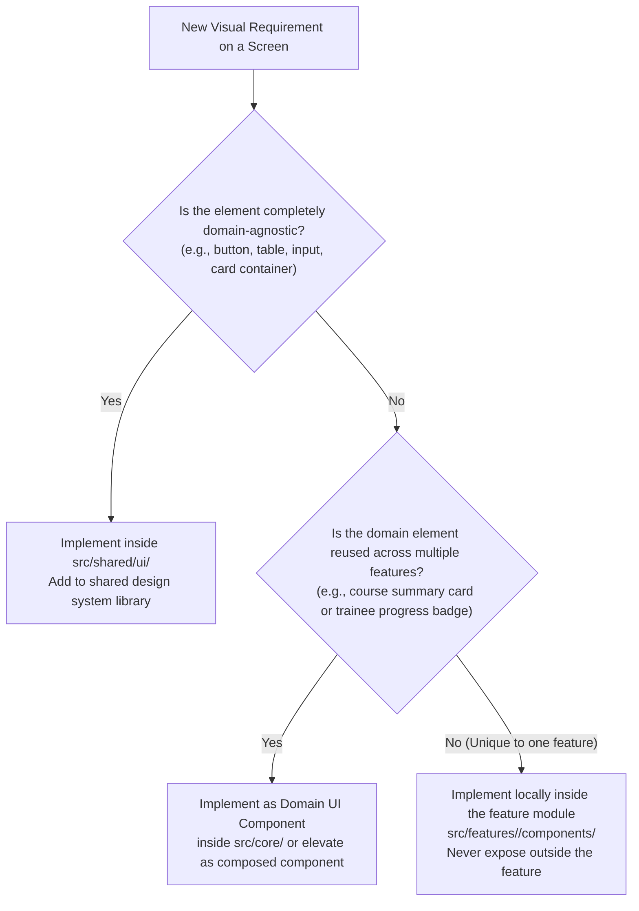

# Cairo Metro LMS — Design System Specification

---

## 1. Branding & Visual Assets

### A. Organization & Product Naming
* **Official Application Title:** Cairo Metro E-Learning Platform
* **Operating Authority:** Egyptian Company for Metro Management and Operation — General Administration for Training Centers (Tura El-Balad / Shubra El-Kheima).
* **Scope:** Enterprise training, compliance tracking, operational certification, and safety qualification.

---

### B. Approved Brand Assets

| Asset Identifier | Legacy File Location | Usage & Placement Guidelines |
| :--- | :--- | :--- |
| `training-emblem` | `assets/logos/training-logo.png` | **Primary System Emblem:** Combines the metro train front, technical gear, and official Arabic typography. Displayed in the main Navbar, Login hero container, and official report/certificate headers. |
| `metro-corporate-logo` | `assets/logos/metro-logo.png` | **Parent Enterprise Logo:** Used in the application footer and global corporate analytics dashboards. |
| `favicon` | `assets/brand/favicon.ico` | Browser tab icon representing the Cairo Metro wheel seal. |

---

### C. Centralized Brand Logo Component (`src/shared/ui/BrandLogo/BrandLogo.tsx`)

To eliminate hardcoded `` tags and disparate image links across templates, all screens consume the centralized component:

```tsx
// src/shared/ui/BrandLogo/BrandLogo.tsx
import React from 'react';

export type LogoVariant = 'training-emblem' | 'metro-corporate' | 'compact-mark';

export interface BrandLogoProps {
  variant?: LogoVariant;
  height?: number;
  className?: string;
  showText?: boolean;
}

export const BrandLogo: React.FC<BrandLogoProps> = ({
  variant = 'training-emblem',
  height = 38,
  className = '',
  showText = true,
}) => {
  const assetMap: Record<LogoVariant, { src: string; alt: string; title: string; subtitle: string }> = {
    'training-emblem': {
      src: '/assets/logos/training-logo.png',
      alt: 'Cairo Metro Training Administration',
      title: 'E-Learning Platform',
      subtitle: 'Cairo Metro'
    },
    'metro-corporate': {
      src: '/assets/logos/metro-logo.png',
      alt: 'Egyptian Company for Metro Management and Operation',
      title: 'Cairo Metro',
      subtitle: 'Operations & Management'
    },
    'compact-mark': {
      src: '/assets/logos/training-logo.png',
      alt: 'Cairo Metro Training Mark',
      title: 'Training',
      subtitle: 'Metro'
    }
  };

  const current = assetMap[variant];

  return (
    <div className={`inline-flex items-center gap-3 select-none ${className}`}>
      
      {showText && (
        <div className="flex flex-col text-start">
          <span className="font-bold text-sm md:text-base text-primary-dark leading-tight">
            {current.title}
          </span>
          <span className="text-xs text-text-muted leading-tight">
            {current.subtitle}
          </span>
        </div>
      )}
    </div>
  );
};
```

#### Asset Placement Rules:
* **Top Navbar:** Standard height $38\text{px}$ with complete brand titles.
* **Login Hero:** Height $56\text{px}$ to $64\text{px}$ centered above the authentication card.
* **Mobile Drawer:** Compact height $32\text{px}$.
* **Background Constraints:** Logos must always sit on pure white (`#FFFFFF`) or light neutral surfaces (`#F5F7FA` or `#EEF2F7`). Displaying logos directly on dark or saturated colored backgrounds without a container is prohibited.

---

## 2. Iconography Specification

### A. Library & Visual Style
* **Chosen Library:** `lucide-react` (pure, offline SVG vector icons bundled locally; zero external network requests).
* **Visual Language:**
  * **Stroke Width:** `2px` for sizes $14\text{px}$ through $20\text{px}$; `1.75px` for large icons ($24\text{px}$ and above).
  * **Stroke Color:** Always `stroke="currentColor"` to inherit the surrounding text or icon color token.
  * **Fill:** `none` (clean geometric line aesthetic matching railway engineering precision).

---

### B. Typed Semantic Icon Registry (`src/shared/ui/Icon/icons.registry.ts`)

Importing arbitrary icons across pages is strictly prevented. Every functional UI concept maps to a typed semantic name:

```ts
// src/shared/ui/Icon/icons.registry.ts
import {
  Home, BookOpen, GraduationCap, Users, User, Bell, BellOff,
  Settings, LogOut, Search, Clock, Check, CheckCircle2, XCircle,
  X, AlertTriangle, ShieldCheck, Info, Award, Lock, Unlock,
  Edit3, Trash2, Save, Send, Plus, Eye, EyeOff, Filter,
  Download, BarChart3, LineChart, FileText, File, Video,
  ChevronDown, ChevronRight, ChevronLeft, ArrowRight, ArrowLeft,
  Palette, AlertCircle, HelpCircle, type LucideIcon
} from 'lucide-react';

export const ICON_REGISTRY = {
  // Navigation & Shell
  home: Home,
  courses: BookOpen,
  myCourses: GraduationCap,
  trainingGroups: Users,
  user: User,
  users: Users,
  notifications: Bell,
  notificationsOff: BellOff,
  settings: Settings,
  logout: LogOut,
  search: Search,

  // Status & Workflow
  pending: Clock,
  check: Check,
  checkCircle: CheckCircle2,
  xCircle: XCircle,
  close: X,
  alert: AlertTriangle,
  shield: ShieldCheck,
  info: Info,
  award: Award,
  lock: Lock,
  unlock: Unlock,

  // Actions & Management
  edit: Edit3,
  trash: Trash2,
  save: Save,
  send: Send,
  plus: Plus,
  eye: Eye,
  eyeOff: EyeOff,
  filter: Filter,
  download: Download,
  palette: Palette,

  // Analytics & Content Types
  chart: LineChart,
  barChart: BarChart3,
  video: Video,
  fileText: FileText,
  file: File,

  // Directional & Navigation (RTL-Aware)
  arrowRight: ArrowRight,
  arrowLeft: ArrowLeft,
  chevronDown: ChevronDown,
  chevronRight: ChevronRight,
  chevronLeft: ChevronLeft,

  // Fallbacks
  fallback: AlertCircle,
  unknown: HelpCircle
} as const satisfies Record<string, LucideIcon>;

export type SemanticIconName = keyof typeof ICON_REGISTRY;
```

---

### C. Reusable Icon Component (`src/shared/ui/Icon/Icon.tsx`)

```tsx
// src/shared/ui/Icon/Icon.tsx
import React from 'react';
import { ICON_REGISTRY, type SemanticIconName } from './icons.registry';

export interface IconProps extends React.SVGProps<SVGSVGElement> {
  name: SemanticIconName | string;
  size?: number | string;
  className?: string;
  strokeWidth?: number;
  'aria-label'?: string;
}

export const Icon: React.FC<IconProps> = ({
  name,
  size = 20,
  className = '',
  strokeWidth = 2,
  'aria-label': ariaLabel,
  ...rest
}) => {
  const IconComponent = (ICON_REGISTRY as Record<string, React.ElementType>)[name];

  if (!IconComponent) {
    if (process.env.NODE_ENV !== 'production') {
      console.warn(`[DesignSystem:Icon] Semantic icon name "${name}" is not registered in ICON_REGISTRY. Rendering fallback.`);
    }
    const Fallback = ICON_REGISTRY.fallback;
    return <Fallback size={size} strokeWidth={strokeWidth} className={`inline-block text-warning ${className}`} aria-hidden="true" {...rest} />;
  }

  const isAccessibleAction = Boolean(ariaLabel);

  return (
    <IconComponent
      size={size}
      strokeWidth={strokeWidth}
      className={`inline-block align-middle shrink-0 ${className}`}
      aria-hidden={!isAccessibleAction}
      aria-label={ariaLabel}
      role={isAccessibleAction ? 'img' : undefined}
      {...rest}
    />
  );
};
```

#### Standard Icon Size Hierarchy:
* **$14\text{px}$ (Micro/Badge):** Embedded inline metadata inside course cards (duration, enrolled count).
* **$16\text{px}$ (Inline Action):** Standard size inside buttons, input fields, and filter chips.
* **$20\text{px}$ (Standard UI):** Default size for sidebar navigation links and card headers.
* **$24\text{px}$ (Section Header):** Major dashboard titles and metric summary cards.
* **$48\text{px}$ (Empty State):** Large illustrations for empty search lists or zero notifications.

---

## 3. Color System & Accessibility

### A. Authoritative Color Tokens (`src/styles/tokens.css`)

All color values are defined in a single authoritative `@theme` block:

```css
/* src/styles/tokens.css */
@import "tailwindcss";

@theme {
  /* ── Core Brand Colors ── */
  --color-primary: #5BBFDE;           /* Baseline Cairo Metro Cyan */
  --color-primary-dark: #1A3F6F;      /* Enterprise Navy Blue */
  --color-primary-light: #E8F6FB;     /* Soft Cyan Tint */
  --color-primary-hover: #49B0D1;     /* Cyan Interactive Hover */

  /* ── Backgrounds & Surfaces ── */
  --color-bg: #FFFFFF;                /* Pure Page Background */
  --color-bg-alt: #EEF2F7;            /* Alternative Table Header / Sidebar Background */
  --color-surface: #F5F7FA;           /* Elevated Card Surface */

  /* ── Typography & Borders ── */
  --color-text: #1C1C1E;              /* High-Contrast Primary Text */
  --color-text-muted: #6B7280;        /* Secondary Metadata Text */
  --color-border: #E5E7EB;            /* Structural Borders and Dividers */

  /* ── Semantic Status Colors & Light Tints ── */
  --color-success: #2E7D32;           /* Success / Completion Green */
  --color-success-light: #E8F5E9;
  --color-warning: #F9A825;           /* Warning / Due Soon Amber */
  --color-warning-dark: #B45309;      /* Dark Amber for Text on Light Background (4.51:1 AA) */
  --color-warning-light: #FEF3C7;
  --color-danger: #D32F2F;            /* Danger / Overdue / Rejected Red */
  --color-danger-dark: #B91C1C;       /* Accessible Dark Red for Text on Light Background (5.30:1 AA) */
  --color-danger-light: #FEE2E2;
  --color-info: #0284C7;              /* Information / Mandatory Path Blue */
  --color-info-dark: #0369A1;         /* Accessible Dark Blue for Text on Light Background (5.17:1 AA) */
  --color-info-light: #E0F2FE;

  /* ── Border Radii ── */
  --radius-sm: 6px;
  --radius-md: 10px;
  --radius-lg: 16px;
  --radius-xl: 20px;
  --radius-full: 9999px;

  /* ── Elevation Shadows ── */
  --shadow-sm: 0 1px 2px 0 rgba(0, 0, 0, 0.05);
  --shadow-md: 0 4px 6px -1px rgba(0, 0, 0, 0.07), 0 2px 4px -2px rgba(0, 0, 0, 0.05);
  --shadow-lg: 0 10px 15px -3px rgba(0, 0, 0, 0.08), 0 4px 6px -4px rgba(0, 0, 0, 0.04);
}
```

---

### B. WCAG 2.1 AA Contrast Matrix & Combination Rules

> [!CRITICAL]
> **Strict Contrast Rule for Baseline Cyan `#5BBFDE`:**
> `#5BBFDE` against white text (`#FFFFFF`) produces an exact contrast ratio of **2.11:1** (severely failing the 4.5:1 WCAG AA minimum).  
> **Mandatory Architectural Rule:** White text on `#5BBFDE` is strictly prohibited.  
> * Primary interactive action buttons (`btn-primary`) use **`#1A3F6F` (Dark Primary)** as the background with `#FFFFFF` text (**10.58:1 ratio**, exceeding WCAG AAA).  
> * When `#5BBFDE` is used as an accent background or pill, foreground text and icons must use `#1A3F6F` (**5.01:1 ratio**, passing WCAG AA).

> [!NOTE]
> **Contrast Verification & Accessible Token Adjustments:**
> Mathematical evaluation under WCAG 2.1 relative luminance reveals that legacy status text colors fail when paired with standard light background tints:
> * Legacy `#D32F2F` on `#FEE2E2` produces an exact ratio of **4.08 : 1** (fails 4.5:1 AA for normal text).
> * Legacy `#0284C7` on `#E0F2FE` produces an exact ratio of **3.57 : 1** (fails 4.5:1 AA for normal text).
> 
> To guarantee full WCAG 2.1 AA compliance without altering the approved brand identity or light background surfaces, accessible dark text tokens are established:
> * **Accessible Danger Text:** `--color-danger-dark: #B91C1C` on `#FEE2E2` produces an exact ratio of **5.30 : 1** (Pass AA).
> * **Accessible Info Text:** `--color-info-dark: #0369A1` on `#E0F2FE` produces an exact ratio of **5.17 : 1** (Pass AA).

| Visual Element | Background Color | Text / Foreground Color | Exact Contrast Ratio | WCAG Compliance | Approved System Application |
| :--- | :--- | :--- | :---: | :---: | :--- |
| **Primary Action Button** | `#1A3F6F` | `#FFFFFF` | **10.58 : 1** | **Pass (AAA)** | Primary actions: "Enroll", "Login", "Approve". |
| **Cyan Accent Badge** | `#5BBFDE` | `#1A3F6F` | **5.01 : 1** | **Pass (AA)** | Filter chips, counters, and progress highlights. |
| **Primary Page Content** | `#FFFFFF` | `#1C1C1E` | **17.01 : 1** | **Pass (AAA)** | Main headlines, body copy, and data values. |
| **Secondary Metadata** | `#FFFFFF` | `#6B7280` | **4.83 : 1** | **Pass (AA)** | Instructor names, dates, course metadata. |
| **Success Badge** | `#E8F5E9` | `#2E7D32` | **4.56 : 1** | **Pass (AA)** | "Completed", "Approved", "Eligible for Cert". |
| **Warning Badge** | `#FEF3C7` | `#B45309` | **4.51 : 1** | **Pass (AA)** | "Approaching Deadline", "Not Started". |
| **Danger Badge** | `#FEE2E2` | `#B91C1C` | **5.30 : 1** | **Pass (AA)** | "Overdue", "Rejected", "Suspended" (Updated from `#D32F2F`). |
| **Information Badge** | `#E0F2FE` | `#0369A1` | **5.17 : 1** | **Pass (AA)** | "Mandatory Program", announcements (Updated from `#0284C7`). |

---

## 4. Typography & Layout System

### A. Offline Cairo Font Dependency & Packaging
* **Font Family:** `Cairo` for Arabic typography and Latin characters.
* **Workspace Verification Finding:** An inspection of the legacy workspace confirms that **no local Cairo font files** (`.woff2`, `.ttf`, etc.) currently exist in the repository. The legacy prototype loaded Cairo dynamically via Google Fonts CDN (`https://fonts.googleapis.com/css2?family=Cairo`).
* **Outstanding Asset Dependency:** Packaging local `.woff2` font files is an **outstanding pre-implementation asset requirement**. During **Increment 0**, verified Cairo `.woff2` files (Regular 400, SemiBold 600, Bold 700) must be supplied or downloaded locally into `frontend/src/assets/fonts/cairo/` before air-gapped intranet deployment.
* **Target Definition in `src/styles/globals.css`:**
```css
@font-face {
  font-family: 'Cairo';
  src: url('/assets/fonts/cairo/cairo-regular.woff2') format('woff2');
  font-weight: 400;
  font-style: normal;
  font-display: swap;
}

@font-face {
  font-family: 'Cairo';
  src: url('/assets/fonts/cairo/cairo-semibold.woff2') format('woff2');
  font-weight: 600;
  font-style: normal;
  font-display: swap;
}

@font-face {
  font-family: 'Cairo';
  src: url('/assets/fonts/cairo/cairo-bold.woff2') format('woff2');
  font-weight: 700;
  font-style: normal;
  font-display: swap;
}

body {
  font-family: 'Cairo', system-ui, -apple-system, sans-serif;
  direction: rtl;
  text-align: right;
  background-color: var(--color-bg);
  color: var(--color-text);
  line-height: 1.6;
}
```

---

### B. Standard Type Scale

| Scale Token | Font Size | Line Height | Weight | Typical Usage |
| :--- | :--- | :--- | :--- | :--- |
| **Display 2XL** | $32\text{px}$ (`2rem`) | $1.25$ | 700 (Bold) | Dashboard welcome headlines, hero headers. |
| **Heading XL** | $24\text{px}$ (`1.5rem`) | $1.3$ | 700 (Bold) | Page headers, course catalog titles. |
| **Heading LG** | $20\text{px}$ (`1.25rem`) | $1.35$ | 700 (Bold) | Section headings, modal titles, metric card titles. |
| **Heading MD** | $18\text{px}$ (`1.125rem`) | $1.4$ | 600 (SemiBold) | Course card titles, curriculum chapter headings. |
| **Body Base** | $16\text{px}$ (`1rem`) | $1.6$ | 400 / 600 | Standard paragraphs, input field text, button labels. |
| **Body SM** | $14\text{px}$ (`0.875rem`) | $1.5$ | 400 / 600 | Table cell content, sidebar links, helper texts. |
| **Caption XS** | $12\text{px}$ (`0.75rem`) | $1.4$ | 600 (SemiBold) | Badges, timestamps, small card metadata. |

---

### C. Arabic RTL Layout Rules
1. **CSS Logical Properties:**
   * Direct `margin-left` or `padding-right` declarations are forbidden. All layouts use:
     * `ms-*` (`margin-inline-start`) and `me-*` (`margin-inline-end`).
     * `ps-*` (`padding-inline-start`) and `pe-*` (`padding-inline-end`).
     * `text-start` and `text-end`.
2. **Directional Icons:**
   * "Back / Return" icon in RTL is `arrowRight` or `chevronRight`.
   * "Forward / Next" icon in RTL is `arrowLeft` or `chevronLeft`.
3. **Responsive Breakpoints:**
   * `sm: 640px` (Mobile landscape)
   * `md: 768px` (Tablet; collapses persistent sidebar to mobile drawer)
   * `lg: 1024px` (Desktop; enables persistent $260\text{px}$ sidebar)
   * `xl: 1280px` (Wide desktop; constrains content container to $1200\text{px}$)

---

## 5. Reusable Component Specifications

### A. Button Primitive (`Button`)
* **Variants:**
  * `primary`: `#1A3F6F` background, `#FFFFFF` text, `radius-md` ($10\text{px}$), $42\text{px}$ height.
  * `secondary`: `#FFFFFF` background, `1px solid #1A3F6F` border, `#1A3F6F` text.
  * `danger`: `#D32F2F` background, `#FFFFFF` text, used for destructive actions (Delete, Reject).
  * `ghost`: Transparent background, `#1A3F6F` text with light hover tint.
* **States:** Default, Hover, Active, Focus Ring (`outline: 2px solid rgba(26, 63, 111, 0.25)`), Disabled (`opacity: 0.5`, `cursor: not-allowed`), Loading (rotates spinner, disables clicks).

---

### B. Course Card (`CourseCard`)
* **Container:** `#FFFFFF` background, `1px solid #E5E7EB` border, `radius-lg` ($16\text{px}$), `shadow-sm`.
* **Cover Area:** $160\text{px}$ gradient background with course level badge in top-right corner.
* **Body:** $18\text{px}$ bold title, instructor name with `<Icon name="user" size={14} />`, duration with `<Icon name="pending" size={14} />`, and student count with `<Icon name="users" size={14} />`.
* **Action Footer:** "Enroll in Course" for non-enrolled students, or green "Enrolled ✓" badge with "Resume Learning" button.

---

### C. Status Badge (`Badge`)
* **Geometry:** `radius-full`, padding `4px 12px`, font size $12\text{px}$ with weight 600.
* **Approved Semantic Types:**
  * `success`: Background `#E8F5E9`, text `#2E7D32` (Completed, Approved).
  * `warning`: Background `#FEF3C7`, text `#B45309` (Approaching deadline, In progress).
  * `danger`: Background `#FEE2E2`, text `#D32F2F` (Overdue, Rejected).
  * `info`: Background `#E0F2FE`, text `#0284C7` (Mandatory, Announcement).

---

### D. Modal Dialog (`Modal`) & Standardized Confirmation (`ConfirmDialog`)
* **Backdrop:** `rgba(0, 0, 0, 0.6)` with `backdrop-blur-xs`.
* **Card Container:** Surface background, `border border-border`, rounded corners, shadow, max width $520\text{px}$.
* **Internal Structure:** Header with title and `<Icon name="close" size={20} />`, scrollable body container, and action footer.
* **Standardized ConfirmDialog (`ConfirmDialog`):**
  - Specialized, accessible confirmation dialog composing `Modal` with `hideHeader`.
  - Supports variants: `danger` (destructive deletes), `warning` (unsaved changes, refresher impacts, test lab resets), and `info`.
  - Fully accessible with `role="dialog"`, `aria-labelledby="confirm-dialog-title"`, and `aria-describedby="confirm-dialog-message"`.
  - Strict RTL button layout: Cancel button (`variant="outline"`) on the right, Confirm button (`variant="destructive"` or `variant="primary"`) on the left (the end).
  - Replaces all legacy `window.confirm()` and `window.prompt()` browser popups across the platform.

---

### E. Component Reuse Decision Tree



---

## 7. Embedded Video Players & Responsive Top-Crop Design Standards

### A. Google Drive Responsive Top-Crop Technique (Mandatory Production Standard)
To minimize visual distraction and external pop-out temptation on embedded Google Drive lectures without fragile SVG overlays or DOM injection:
* **Mandatory Production Crop:** `55px` (enforced as an internal platform invariant, not an administrator preference).
* **Container Geometry:** Outer container `.gdrive-top-crop-wrapper` uses `position: relative; width: 100%; height: 100%; overflow: hidden;`.
* **Iframe Shift:** Embedded iframe uses responsive inline CSS derived by `getTopCropIframeStyle(55)`:
  ```css
  position: absolute;
  top: 0;
  left: 0;
  width: 100%;
  height: calc(100% + 55px);
  margin-top: -55px;
  border: 0;
  ```
* **Provider Scoping:** Top-crop styling is strictly scoped to Google Drive embeds. It is **never applied to YouTube** or standard HTML5 video elements.

### B. Sandbox-Based Popup Blocking Standard (Mandatory Production Standard)
For all Google Drive and YouTube embeds in production, sandbox popup blocking is active on initial iframe load:
* **Active Tokens:** `allow-scripts allow-same-origin allow-presentation allow-forms`
* **Removed Tokens:** `allow-popups` and `allow-popups-to-escape-sandbox` are omitted.
* **Iframe Attributes Preserved:** Standard `allow="autoplay; encrypted-media; fullscreen"` and `allowFullScreen` remain intact.

### C. Clean, Provider-Neutral Trainee Experience
* **No Provider Identity Exposure:** Trainee views never display "Google Drive" or "YouTube" badges, version/mode labels, crop pixel measurements (`55px`), or popup-blocking status badges.
* **No Custom Pop-Out Links:** Application-supplied external links (such as "Open in new window") are removed from trainee views.
* **Ordinary Playback Controls Intact:** Play, pause, scrub, fullscreen, volume, and lesson completion buttons remain accessible and uninhibited.

### D. Production Platform vs. Design Lab Separation
* **Production Environment:** Platform policies (Drive = 55px + popup blocking, YouTube = 0px + popup blocking, Upload = 0px + native playback) are mandatory and inviolable. Administrator UI does not expose technical sliders or toggles.
* **Design Lab Environment:** The internal Design Lab (`VideoInteractionLab`) preserves all 6 experimental modes, custom crop sliders (0px–150px), crop presets, visual cut-out guides, and real-time architectural assessment cards for ongoing comparative research.

---

## 8. Curriculum Outline Item Layout Standards (RTL)

In course outlines and curriculum sidebars (e.g., `CurriculumSidebar.tsx`), item rows display content metadata and access status using strict horizontal zoning:

```
[Left-Side Metadata Area]                                          [Right-Side Title Area]
[duration] [lock]                                                  [title] [content-type icon]
```

### Visual and Behavioral Rules
1. **Right Side (RTL Start) — Content-Type Visibility:**
   - The content-type icon (`video`, `fileText`, `info`, `download`) identifies the resource type and **must remain visible regardless of lock state**.
   - The lock state never replaces the content-type icon.
   - For completed lessons, the completion indicator (`checkCircle`) reflects verified achievement.
2. **Left Side (RTL End) — Metadata & Lock Indicator:**
   - The video duration remains in the left metadata area.
   - When an item is locked, a lock icon (`Icon name="lock"`) is rendered beside the duration in the same compact metadata group.
   - When an item is unlocked, the duration is rendered without the lock icon.
   - For items without duration (e.g. PDFs, documents), the lock icon renders in the left metadata area when locked without affecting the right-side content icon.
3. **Spacing & Truncation Invariants:**
   - Right-side title area uses `flex: 1; overflow: hidden; text-overflow: ellipsis; white-space: nowrap;`.
   - Left-side metadata area uses `flex-shrink: 0; display: flex; align-items: center; gap: 0.35rem;`.
   - This prevents overlapping on narrow viewports while maintaining consistent alignment.

