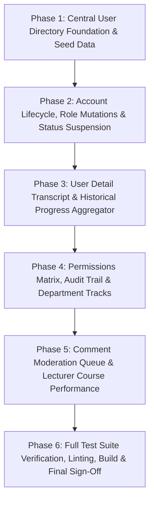

# Increment 11 Planning & Implementation Roadmap: Administration & User Management

---

## 1. Executive Summary & Objective

**Increment 11** represents the final core operational milestone of the Cairo Metro LMS frontend modernization roadmap.

Grounded in the empirical findings of the **[Legacy-to-React Feature Parity Audit](legacy-feature-parity-audit.md)**, Increment 11 addresses the remaining unmigrated administrative workflows, centralizes user directory management across the application, closes identified parity gaps, and achieves 100% functional equivalence across all active legacy views.

> [!IMPORTANT]
> **Documentation-First Planning Notice:**
> This document defines the architectural boundaries, API contracts, domain models, phase sequence, and acceptance criteria for Increment 11. **No application code, components, or services are being implemented at this stage.** Implementation will commence only after client review and formal approval of this roadmap.

---

## 2. Increment 11 Scope Categorization

Based on the parity audit, the discovered legacy features are categorized as follows:

| Category | Feature / Capability | Target Route | Scope Determination |
| :--- | :--- | :--- | :--- |
| **Workstream 1** | Centralized User Directory & Roster | `/admin/users` | **Required in Increment 11 (Phase 1)** |
| **Workstream 2** | User Creation, Role Editing & Account Suspension | `/admin/users` (Modals/Actions) | **Required in Increment 11 (Phase 2)** |
| **Workstream 3** | User Detail Transcript & Training History | `/admin/users/:userId` | **Required in Increment 11 (Phase 3)** |
| **Workstream 4** | Individual User Permissions, Role Ceilings & Baseline Policy | `/admin/users` & `/admin/permissions` | **Required in Increment 11 (Phase 4)** (Architecture Corrected) |
| **Workstream 5** | Platform Analytics & Executive Statistics | `/stats` | **Rescheduled to Increment 12** |
| **Workstream 6** | Comment Moderation & Discussion Management | `/admin/comment-moderation` | **Required in Increment 11 (Phase 5)** |
| **Workstream 7** | Lecturer Course Performance & WhatsApp Nudges | `/lecturer/performance/:courseId` | **Required in Increment 11 (Phase 5)** (Decision 2 Resolved) |
| **Gap Closure** | Centralized Group Trainee Candidate Resolution | `/api/admin/trainees` | **Required in Increment 11 (Phase 1)** (Decision 3 Resolved) |
| **Gap Closure** | Suspended Account Login Rejection Guard | `/login` & `authHandlers` | **Required in Increment 11 (Phase 2)** |
| **Data Fixtures** | 12 Sanitized Central Mock User Directory Fixtures | `src/mocks/fixtures/` | **Required in Increment 11 (Phase 1)** (Decision 3 Resolved) |
| **Deferred** | Multi-Author Course Collaboration Team | `/lecturer/builder/:id` | **Recommended for Later Increment (Post-Inc 11)** |
| **Deferred** | Offline Full-Course ZIP Packaging (`JSZip`) | `/courses/:id/learn` | **Recommended for Later Increment (Backend API)** |
| **Deferred** | Course Download Policy & Allowed Users | `/lecturer/builder/:id` | **Recommended for Later Increment** |
| **Retired** | Web File System Access API Connect Banner | Top Bar / Banner | **Intentionally Not Planned (Obsolete)** |
| **Retired** | Lecturer Catalog Self-Enrollment Queue | `/approvals` | **Intentionally Not Planned (Obsolete)** |

---

## 3. Workstream Specifications

### Workstream 1: Centralized User Directory & Account Roster

- **Purpose:** Provide administrators with a complete, searchable, and filterable directory of all organization personnel and system accounts.
- **Legacy Evidence:** [`js/admin.js:17–130, 97–117`](file:///c:/Users/Administrator/Desktop/metro%20courses/js/admin.js#L17-L130) (`renderUsersPage`, `renderUsersTable`, `applyFilters`).
- **Expected Scope:**
  - Dedicated page route at `/admin/users`.
  - Real-time search bar across Full Name, User ID, and Job Title.
  - Role filter dropdown (`الكل`, `متدرب`, `محاضر`, `مدير`).
  - Status filter dropdown (`الكل`, `نشط`, `موقوف`).
  - Responsive table rendering: User ID, Name with avatar initials, Job Title, Department, Inline Role select, Status badge, Formatted Last Login timestamp, Actions ("عرض", "تعليق / تفعيل").
  - Skeleton loading states and empty state ("لا توجد نتائج مطابقة").
- **Dependencies:** `AppLayout`, `ProtectedRoute`, `Table`, `Badge`, `Select`, `Input`.
- **Domain & Data Contracts:**
  ```typescript
  export interface ManagedUserDTO {
    id: string;
    name: string;
    username: string;
    email: string;
    phone?: string;
    jobTitle: string;
    department: string;
    role: 'admin' | 'lecturer' | 'user';
    status: 'active' | 'suspended';
    lastLogin: string | null;
    createdAt: string;
    totalLearningHours: number;
    enrolledCoursesCount: number;
    completedCoursesCount: number;
  }

  export interface UserFilterParams {
    query?: string;
    role?: 'all' | 'admin' | 'lecturer' | 'user';
    status?: 'all' | 'active' | 'suspended';
    department?: string;
  }
  ```
- **Authorization:** Strictly restricted to `admin` role (`allowedRoles={['admin']}`).
- **Acceptance Criteria:**
  - Accessing `/admin/users` as a trainee or lecturer redirects to `/403`.
  - Search filters the roster instantly in Arabic.
  - Status and role filter dropdowns filter table rows correctly.
  - Sorting orders accounts deterministically.
- **Automated Verification:** Component tests, route guard tests, search/filter integration tests.
- **Implementation Phase:** Phase 1.

---

### Workstream 2: User Account Creation, Role Mutation & Status Suspension

- **Purpose:** Enable full administrative lifecycle management for employee accounts.
- **Legacy Evidence:** [`js/admin.js:135–141, 260–388`](file:///c:/Users/Administrator/Desktop/metro%20courses/js/admin.js#L260-L388) (`openAddUserModal`, `changeUserRole`, `toggleUserStatus`).
- **Expected Scope:**
  - **Add User Modal (`+ إضافة مستخدم جديد`):**
    - Inputs: Full Name (`الاسم بالكامل`), Username (`اسم المستخدم`), Email, Temporary Password, Job Title select (6 standard metro positions), Department select, Role select.
    - Client-side validation: Required fields, unique username check, email format.
    - Generates clean standardized ID (`usr_role_timestamp`), provisions empty history, persists in store.
  - **Inline Role Select:**
    - Modifying role dropdown directly issues `PATCH /api/admin/users/:id/role`.
    - Updates UI badge optimistically, persists in store, displays toast notification.
  - **Account Suspend / Activate Modal:**
    - Clicking "تعليق ✕" opens danger modal warning: "هل أنت متأكد من إيقاف الحساب؟ لن يتمكن من الدخول للمنصة".
    - Confirming suspends account (`status = 'suspended'`).
    - Clicking "تفعيل ✓" directly restores status to `active`.
  - **Suspended Login Rejection:**
    - Authentication MSW handler rejects login for accounts with `status === 'suspended'`, rendering an Arabic error banner.
- **Dependencies:** `Modal`, `Button`, `Toast`, `inMemoryStore`.
- **Domain & Data Contracts:**
  ```typescript
  export interface CreateUserRequestDTO {
    name: string;
    username: string;
    email: string;
    password?: string;
    phone?: string;
    jobTitle: string;
    department: string;
    role: 'admin' | 'lecturer' | 'user';
  }

  export interface UpdateUserRoleDTO {
    role: 'admin' | 'lecturer' | 'user';
  }

  export interface UpdateUserStatusDTO {
    status: 'active' | 'suspended';
    reason?: string;
  }
  ```
- **Authorization:** Admin only.
- **Acceptance Criteria:**
  - Creating a user validates fields and immediately adds the user to the directory table.
  - Newly created trainees automatically become available in the training groups candidate picker.
  - Changing a user's role updates their permissions immediately.
  - Suspended users cannot log in and are rejected with a clear Arabic error message.
- **Automated Verification:** Modal validation tests, role update tests, suspend/reactivate tests, auth rejection tests.
- **Implementation Phase:** Phase 2.

---

### Workstream 3: User Detail Transcript & Training History

- **Purpose:** Provide a comprehensive view of an individual trainee's training record, completed courses, watch times, and performance metrics.
- **Legacy Evidence:** [`js/admin.js:391–622`](file:///c:/Users/Administrator/Desktop/metro%20courses/js/admin.js#L391-L622) (`renderUserDetailPage`).
- **Expected Scope:**
  - Route: `/admin/users/:userId`.
  - Breadcrumbs navigation: `إدارة المستخدمين ← تفاصيل المستخدم`.
  - User Profile Header: Avatar initials, Full Name, Job Title, Department, Status Badge, Quick Activate/Suspend action.
  - Detailed Info Grid: Username/Email, Phone, Role, Registration Date, Last Login formatted date/time.
  - 4 Key Metric Cards:
    1. Total Learning Hours (`إجمالي ساعات التعلم`).
    2. Average Completion Rate % (`متوسط نسبة الإتمام`).
    3. Enrolled Courses Count (`الكورسات المسجلة`).
    4. Completed Courses Count (`الكورسات المكتملة`).
  - Courses History List (`سجل التعلم والكورسات`):
    - Course cards showing: thumbnail/initial, title, progress bar + percentage, enrollment date, times opened (`مرات الفتح`), and most watched lesson item (`الأكثر مشاهدة`).
  - Empty state when trainee has no enrolled courses.
  - 404 state when `userId` does not exist.
- **Dependencies:** `inMemoryStore`, `attemptLedger`, `CourseCard`.
- **Domain & Data Contracts:**
  ```typescript
  export interface UserTranscriptDTO {
    user: ManagedUserDTO;
    metrics: {
      totalLearningHours: number;
      averageCompletionRate: number;
      enrolledCoursesCount: number;
      completedCoursesCount: number;
    };
    courses: Array<{
      courseId: string;
      title: string;
      progressPercent: number;
      status: 'not_started' | 'in_progress' | 'completed';
      enrolledAt: string;
      timesOpened: number;
      mostWatchedLessonTitle: string;
      mostWatchedCount: number;
      attemptsCount: number;
    }>;
  }
  ```
- **Authorization:** Admin only.
- **Acceptance Criteria:**
  - Route loads trainee data and calculates accurate transcript metrics.
  - Clicking suspend/activate updates status and refreshes transcript header.
  - Progress percentages accurately reflect completed lessons from the course attempt ledger.
- **Automated Verification:** Transcript calculation tests, render tests, 404 tests.
- **Implementation Phase:** Phase 3.

---

### Workstream 4: Individual User Permissions, Role Ceilings & Governance Architecture

- **Purpose:** Provide individual-user permission management inside controlled role capability ceilings, enforce four canonical system roles, support group-scoped assistant lecturer duties, and protect immutable system administrator invariants.
- **Authoritative Specification:** [`docs/frontend/authorization-and-permissions-design.md`](file:///c:/Users/Administrator/Desktop/metro%20courses/docs/frontend/authorization-and-permissions-design.md).
- **Corrected Architectural Principles:**
  1. **Exactly Four Canonical Roles:** `admin` (مدير النظام), `assistant_admin` (مدير النظام المساعد), `lecturer` (المحاضر), and `user` (المتدرب). There is NO fifth canonical role named `assistant_lecturer`.
  2. **Assistant Lecturer Is Group-Scoped:** Assistant lecturer duties are represented as a group-scoped operational assignment (`GroupAssistantAssignment`) given to an ordinary lecturer within an authorized training group. The assigned user remains an ordinary `lecturer` across the platform.
  3. **No Editable Global Role Matrix:** The matrix at `/admin/permissions` is a read-only baseline policy reference table. Global role-wide mutation switches are removed, and attempting global baseline modification throws `400 Bad Request`.
  4. **Individual-User Permission Management (`/admin/users`):** The user directory table provides a visible **تحديد الصلاحيات** action button for each user row, opening `UserPermissionsModal` to inspect and customize individual grants and revocations within the user's role ceiling.
  5. **Controlled Role Capability Ceilings:** Centralized domain ceilings (`ROLE_CAPABILITY_CEILINGS`) prevent privilege escalation. Trainees cannot receive administrative capabilities; lecturers cannot receive system-admin, account lifecycle, delegation, or approval queue governance; grants exceeding the ceiling are rejected with Arabic explanations.
  6. **Separation of Four Mechanisms:** Individual overrides, group assignments, role promotions, and assistant-admin delegations are four strictly separate mechanisms that never silently substitute for one another.
  7. **Protected Administrator Safeguards:** Immutable invariants strictly block assistant admins from mutating or approving operations on system admins, prevent self-demotion/self-suspension, and ensure at least one active system administrator always remains.
- **Expected Scope:**
  - Route `/admin/users`: User directory table contains **تحديد الصلاحيات** action button opening `UserPermissionsModal`.
  - Route `/admin/permissions`: Read-only baseline capabilities policy reference table across the 4 canonical roles, with cross-navigation to `/admin/users` for user customization.
  - Persona `USR017` (`assistant_lecturer_demo`): Migrated to canonical role `lecturer` while preserving identity, credentials, and email.
- **Domain & Data Contracts:**
  ```typescript
  export type UserRole = 'admin' | 'assistant_admin' | 'lecturer' | 'user';

  export interface UserPermissionOverride {
    userId: string;
    granted: SystemCapability[];
    revoked: SystemCapability[];
    reason?: string;
    updatedAt: string;
    updatedBy: string;
  }

  export interface GroupAssistantAssignment {
    groupId: string;
    assistantLecturerId: string;
    assignedByLecturerId: string;
    assignedAt: string;
    status: 'active' | 'revoked';
  }

  export interface SystemAuditLogEntryDTO {
    id: string;
    timestamp: string;
    actorId: string;
    actorName: string;
    actorRole: UserRole;
    action: string;
    actionLabelAr: string;
    severity: 'info' | 'warning' | 'critical';
    targetResourceId?: string;
    targetResourceName?: string;
    details: string;
    outcome: 'success' | 'denied' | 'failed';
    clientContext: {
      origin: string;
      userAgent: string;
    };
  }

  export interface ApprovalRequest<TPayload = unknown> {
    id: string;
    actionType: string;
    titleAr: string;
    requesterId: string;
    requesterName: string;
    requesterRole: 'assistant_admin';
    targetResourceId?: string;
    targetResourceName?: string;
    payload: TPayload;
    status: 'pending' | 'approved' | 'rejected' | 'failed_execution';
    submittedAt: string;
    decidedBy?: string;
    decidedByName?: string;
    decidedAt?: string;
    decisionNote?: string;
  }

  export interface DepartmentPermissionDTO {
    departmentId: string;
    departmentName: string;
    allowedTracks: string[];
    updatedAt: string;
  }
  ```
- **Authorization:** System Administrator & Assistant Administrator (`allowedRoles={['admin', 'assistant_admin']}`).
- **Acceptance Criteria:**
  - Route `/admin/permissions` accessible to administrators and assistant administrators; blocked with 403 for lecturers and trainees.
  - Tabs switch smoothly between Capabilities Matrix, System Audit Trail, and Department Permissions.
  - Role capabilities matrix accurately renders the 5 canonical roles and allows toggling configurable permissions.
  - Assistant administrator operations create approval requests when routine approval is required; direct execution occurs when delegation is active.
  - Protected invariants prevent assistant administrators from mutating system administrators, prevent self-demotion, and prevent last-admin lockout.
  - Audit trail renders verifiable activity logs with realistic ISO timestamps, severity filters, and Arabic labels.
  - Department course track checkboxes can be modified and saved, persisting state in `inMemoryStore` and displaying a toast notification.
  - Course catalog continues to display courses without premature authorization gating.
- **Automated Verification:** Permissions governance tests (`src/test/permissions-governance.test.tsx`), tab navigation tests, audit trail filtering tests, department permissions persistence tests.
- **Implementation Phase:** Phase 4.

---

### Workstream 5: Platform Analytics & Executive Statistics (Rescheduled to Increment 12)

- **Purpose:** Provide administrators and lecturers with high-level LMS performance analytics, course engagement metrics, and learner activity indicators.
- **Legacy Evidence:** [`js/admin.js:898–1074`](file:///c:/Users/Administrator/Desktop/metro%20courses/js/admin.js#L898-L1074) (`renderStatsPage`) and [`js/lecturer.js:686–818`](file:///c:/Users/Administrator/Desktop/metro%20courses/js/lecturer.js#L686-L818).
- **Roadmap Determination:** **Rescheduled to Increment 12.**
- **Architectural Boundary & Progress Information Distinction:**
  - **Retained in Increment 11 (Phase 3 & Phase 5):**
    - Individual trainee transcript metrics, course progress percentages, learning hours, and completion history remain in Increment 11 Phase 3 (`/admin/users/:userId`).
    - Course-level learner rosters, progress bars, and verified inactivity indicators ($> 5\text{ days}$) remain in Increment 11 Phase 5 (`/lecturer/performance/:courseId`).
  - **Deferred to Increment 12 (`/stats`):**
    - Platform-wide executive summary metric cards (Total Users, Total Courses, Total Enrollments, Overall Completion Rate).
    - Top 5 courses and Top 5 active trainees highlight blocks.
    - Expandable course statistics table with CSS donut charts (Completed % vs Dropped % vs In Progress %) and Peak Viewing Hours distribution (08:00 to 20:00).
    - Aggregated executive reporting and role-adaptive analytics views for administrators and lecturers.
    - Dedicated MSW endpoint `GET /api/admin/stats` and associated tests.
- **Dependencies for Increment 12:** Increment 11 centralized user directory, reliable course-attempt ledgers, and learning-progress contracts.
- **Detailed Planning:** Documented in [`docs/frontend/implementation-roadmap-increment-12.md`](implementation-roadmap-increment-12.md).

---

### Workstream 6: Comment Moderation & Discussion Management

- **Purpose:** Empower administrators to moderate user discussions, handle reported comments, and control course-level commenting policies.
- **Legacy Evidence:** [`js/admin.js:1075–1307`](file:///c:/Users/Administrator/Desktop/metro%20courses/js/admin.js#L1075-L1307) (`renderCommentModerationPage`).
- **Expected Scope:**
  - Route: `/admin/comment-moderation`.
  - Tab 1: **التعليقات المُبلَّغ عنها (Reported Comments Queue):**
    - Cards displaying Course Title, Report Reason badge (`محتوى غير لائق`, etc.), Commenter Name & Role badge, Comment Text quote box, Reporter Name & Date.
    - Actions: `حذف التعليق 🗑️` (removes comment permanently) and `تجاهل البلاغ ✓` (clears reported flag).
  - Tab 2: **كل التعليقات (All Comments Directory):**
    - Searchable table: Course Title + Comments Toggle button (`مفعّلة 🟢` / `مغلقة 🔴`), Commenter Name, Comment text snippet, Timestamp, Status badge (`مُبلَّغ عنه` vs `عادي`), Delete action.
    - Toggling comments button toggles `commentsEnabled` for that course.
- **Dependencies:** `Tabs`, `Table`, `Badge`, `Button`, `Toast`.
- **Domain & Data Contracts:**
  ```typescript
  export interface CourseCommentDTO {
    id: string;
    courseId: string;
    courseTitle: string;
    commentsEnabled: boolean;
    userId: string;
    userName: string;
    userRole: string;
    text: string;
    time: string;
    createdAt: string;
    reported: boolean;
    reportReason?: string | null;
    reportedBy?: string | null;
    reportedAt?: string | null;
  }
  ```
- **Authorization:** Admin only (`allowedRoles={['admin']}`).
- **Acceptance Criteria:**
  - Deleting a comment removes it from both the reported queue and the course comments list.
  - Ignoring a report removes the item from the reported queue while keeping the comment in the course.
  - Toggling comments updates course policy and displays toast.
- **Automated Verification:** Comment delete tests, report ignore tests, comments toggle tests.
- **Implementation Phase:** Phase 5.

---

### Workstream 7: Lecturer Course Performance & Trainee Nudges

- **Purpose:** Enable lecturers and administrators to inspect trainee performance for a specific course, track individual learner progress, identify inactive trainees, and send pre-formatted WhatsApp reminders.
- **Legacy Evidence:** [`js/lecturer.js:819–950`](file:///c:/Users/Administrator/Desktop/metro%20courses/js/lecturer.js#L819-L950) (`renderCoursePerformancePage`).
- **Decision 2 Resolution (Option A):** Included in Increment 11 within dedicated Phase 5.
- **Expected Scope:**
  - Route: `/lecturer/performance/:courseId` (accessible to the responsible lecturer and authorized administrators).
  - Course Hero & Enrolled Learners Counter.
  - Learners Table: Trainee Avatar & Name, Job Title, Progress bar + %, Last Interaction Date, Status badge (`مكتمل ✅`, `نشط ⏳`, `لم يبدأ`, or `متأخر ⚠️` if inactive $> 5\text{ days}$).
  - Inactivity Evaluation Guardrail: Inactivity must be derived strictly from verified activity timestamps (`CourseAttempt.lastActivityAt` or `updatedAt`) rather than fabricated values or demo placeholders. If a trainee has not interacted with the course for $> 5\text{ days}$ and progress $< 100\%$, their status badge becomes `متأخر ⚠️`.
  - Action column: `تنبيه واتساب` link opening `https://wa.me/${phone}?text=${encodedMsg}` with pre-formatted reminder text:
    `"مرحباً {name}، نود تذكيرك بضرورة استكمال كورس {title}..."`.
- **Dependencies:** `inMemoryStore`, `courseAttempts`, `Table`, `Badge`, `Button`.
- **Domain & Data Contracts:**
  ```typescript
  export interface CoursePerformanceLearnerDTO {
    traineeId: string;
    name: string;
    jobTitle: string;
    phone?: string;
    progressPercent: number;
    lastActivityAt: string | null;
    daysSinceLastActivity: number | null;
    status: 'completed' | 'active' | 'not_started' | 'late';
    isLate: boolean;
    whatsappUrl?: string;
  }

  export interface CoursePerformanceDTO {
    courseId: string;
    courseTitle: string;
    lecturerId: string;
    totalEnrolled: number;
    completedCount: number;
    activeCount: number;
    lateCount: number;
    averageProgress: number;
    learners: CoursePerformanceLearnerDTO[];
  }
  ```
- **Authorization:** `allowedRoles={['lecturer', 'admin']}`. Lecturers are authorized for courses they instruct; administrators have platform-wide access. Trainees redirected to `/403`.
- **Acceptance Criteria:**
  - Renders enrolled trainees for the specific course with verified progress percentages from course attempts.
  - Inactive trainees past 5 days receive the `متأخر ⚠️` danger badge.
  - WhatsApp nudge link contains properly URL-encoded Arabic text with trainee name and course title.
  - Lecturer access check allows authorized instructors and administrators while preventing unauthorized trainee access.
- **Automated Verification:** Inactivity calculation tests, WhatsApp URL formatting tests, role access guard tests.
- **Implementation Phase:** Phase 5.

---

## 4. Phased Implementation Sequence

To minimize risk and maintain test suite stability, Increment 11 is structured into **six discrete, verifiable phases**:



### Phase Breakdown

1. **Phase 1 — Central User Directory Foundation & Seed Data Unification (Completed):**
   - **Architectural Refinements Implemented:**
     - **Canonical Identity Principle:** Exactly one canonical directory record per verified person (15 unique records total: 3 synthetic demo personas + 12 legacy employee records).
     - **Explicit Legacy Aliases:** Deterministic alias resolution via `USER_ALIAS_MAP` (e.g. `usr001` -> `USR001`) with collision prevention rather than inferred bidirectional heuristics.
     - **Authentication Decoupling:** Directory identities remain distinct from development session credentials. Plaintext passwords (`admin`, `lecturer`, `user`, `pass123`) are strictly excluded from all `ManagedUserDTO` records.
     - **Metric Decoupling:** Learning and transcript metrics are derived dynamically from training records in Phase 3 rather than duplicated as inconsistent state in user directory fixtures.
     - **Single Responsive Table:** Responsive desktop/mobile directory table with live client multi-filtering (search, role, status, department) without premature pagination in Phase 1.
     - **Candidate Trainee Unification:** `getCandidateTrainees()` dynamically queries active trainees (`role === 'user' && status === 'active'`) from the central store, automatically excluding suspended accounts (`USR011`) and non-trainee roles.
   - **Contracts & Fixtures:** Created `src/core/user-management/types.ts` and `src/mocks/fixtures/userDirectoryFixtures.ts`.
   - **Store Integration:** Added centralized user collections, seed reset lifecycle, `getManagedUsers()`, `getManagedUserById()`, and updated `resolveMockUserMeta()` in `src/mocks/store/inMemoryStore.ts`.
   - **Service & MSW:** Implemented `GET /api/admin/users` handler in `src/mocks/handlers/userManagementHandlers.ts` and typed client service in `src/features/user-management/services/userManagementApi.ts`.
   - **UI & Routing:** Built `UserFilterBar.tsx`, `UserTable.tsx`, and `UserManagementPage.tsx` at route `/admin/users` guarded with `<ProtectedRoute allowedRoles={['admin']}>`. Registered implemented navigation link in `src/shared/config/navigation.ts`.
   - **Verification:** Completed and passing automated test suites: `src/test/user-directory.test.tsx`, `src/test/user-directory-rbac.test.tsx`, and `src/test/candidate-trainees-unification.test.tsx`.

2. **Phase 2 — Account Lifecycle, Status Suspension & Role Mutations (Completed):**
   - **Architectural Refinements Implemented:**
     - **Administrative User Creation:** Built `AddUserModal.tsx` supporting required identity metadata (Full Name, Username, Work Email, Job Title, Department, Role, Initial Status). Canonical IDs are deterministically generated starting at `USR013` with lowercase alias registration.
     - **Strict Credential Separation:** `ManagedUserDTO` never contains passwords or authentication tokens. Development mock credentials are kept isolated in `inMemoryStore.mockUserCredentials` mapped to email, username, and ID.
     - **Collision & Duplicate Prevention:** Validates unique username and unique email (case-insensitive) at domain and API boundaries, rejecting duplicates with HTTP 409 Conflict and Arabic error messages.
     - **Dynamic Trainee Eligibility Synchronization:** Adding an active trainee automatically makes them eligible in `getCandidateTrainees()`; creating lecturers/admins automatically excludes them.
     - **In-Place Role Mutation:** Implemented `PATCH /api/admin/users/:id/role` with quick role select in `UserTable.tsx`. Dynamically updates candidate trainee eligibility while preserving all course attempts, historical enrollments, and identity aliases.
     - **Account Suspension & Reactivation:** Built `SuspendUserModal.tsx` for danger-style confirmation with optional reason capture. Suspending accounts (`PATCH /api/admin/users/:id/status`) immediately excludes them from trainee pickers while preserving all learning history. Reactivating restores candidate eligibility.
     - **Suspended-Account Login Protection:** Connected authoritative store status lookup into `src/mocks/handlers/authHandlers.ts`. Rejects authentication for suspended accounts with HTTP 403 Forbidden and Arabic notice (`تم إيقاف هذا الحساب من قبل إدارة النظام. يرجى مراجعة المسؤول.`), creating no authenticated session. Reactivation restores valid login.
   - **Contracts & Store Methods:** Added `CreateUserRequestDTO`, `UpdateUserRoleDTO`, `UpdateUserStatusDTO`, `createUser()`, `updateUserRole()`, and `updateUserStatus()` in `src/core/user-management/types.ts` and `src/mocks/store/inMemoryStore.ts`.
   - **API & Handlers:** Implemented `POST /api/admin/users`, `PATCH /api/admin/users/:id/role`, and `PATCH /api/admin/users/:id/status` in `src/mocks/handlers/userManagementHandlers.ts` and typed methods in `src/features/user-management/services/userManagementApi.ts`.
   - **UI Integration:** Integrated `AddUserModal` (+ إضافة مستخدم جديد) and `SuspendUserModal` into `UserManagementPage.tsx` and `UserTable.tsx`.
   - **Verification:** Completed and passing automated test suite: `src/test/user-lifecycle.test.tsx` (21 tests). Full sequential regression test suite passing (56 test files, 851 tests passed). Production build and ESLint passing cleanly.

3. **Phase 3 — User Transcript & Historical Progress Aggregator (Completed):**
   - **Architectural Refinements Implemented:**
     - **Authoritative Dynamic Metrics Aggregation:** Eliminated static metric duplication in `ManagedUserDTO`. Learning hours, completion percentages, enrolled courses, and completed courses are dynamically computed on-the-fly from the central store (`inMemoryStore.getUserTranscript(userId)`), pulling from individual enrollments (`store.enrollments`), group renewal cycles, and course attempts (`store.courseAttempts`).
     - **Learning Hours Telemetry Audit & Honest Unavailable Representation:** A focused audit of content player telemetry (`furthestWatchedSeconds`, `eligibleViewingSeconds`) verified that: (1) `furthestWatchedSeconds` represents a playback timeline scrub position rather than cumulative elapsed time; (2) `eligibleViewingSeconds` functions solely as an active-tab gate for Google Drive videos and resets on browser reload; and (3) no durable multi-session cumulative duration records exist across sessions or non-video items. Rather than fabricating an inaccurate metric from scrub positions, `totalLearningHours` is explicitly reported as `null` in the DTO, and rendered honestly in `UserTranscriptCard` as `— (غير مسجل)` with explanatory text.
     - **Transparent Telemetry Availability & Most-Watched Lesson Policy:** For metrics like "times opened" (`timesOpened`) and multi-session "learning hours" (`totalLearningHours`), the DTO sets them transparently to `null`, and the UI displays clear, non-deceptive indicators (`— (غير مسجل)`). Similarly, `mostWatchedLessonTitle` is strictly calculated only from genuine, reliable viewing-frequency telemetry (`watchCount > 0` on `LessonProgress`). In accordance with data integrity principles, the system forbids substituting completed lesson IDs (`completedItemIds`), furthest playback scrub positions (`furthestWatchedSeconds`), or last accessed lessons (`lastWatchedItemId`) as "most watched". When viewing-frequency telemetry is missing, `mostWatchedLessonTitle` returns `null` and displays `— (غير مسجل)` in the transcript course history table.
     - **Strict Canonical Identity Isolation:** `getUserTranscript` isolates records strictly by matching canonical ID (`user.id`, `canonicalId`) and verified legacy ID aliases (`user.legacyAliases`), excluding login usernames from the match set to guarantee zero cross-user pollution.
     - **Historical Attempt Ledger Preservation:** Handled repeating courses across renewal cycles. When a course is reassigned or renewed in a new cycle, historical successful completions from prior cycles are strictly preserved rather than overwritten by newer uncompleted attempts. Attempt lists are sorted newest first with cycle IDs and clear status pills.
     - **Full Identity & Alias Interoperability:** `getUserTranscript` accepts canonical uppercase IDs (`USR003`), lowercase legacy aliases (`usr003`), and synthetic persona keys (`usr_trainee_003`, `trainee_demo`), correctly associating attempt ledgers regardless of identifier casing.
     - **Quick Lifecycle Integration:** Profile header at `/admin/users/:userId` incorporates quick account status action (`إيقاف الحساب` / `إعادة التنشيط`), reusing `SuspendUserModal.tsx` from Phase 2. Status mutations update in-place without losing transcript data or requiring full page reloads.
     - **Safe Navigation & Breadcrumbs:** Linked user directory table rows (`UserTable.tsx`) to `/admin/users/:userId` via user names and a dedicated `السجل` button. Added accessible breadcrumb navigation with back button leading safely back to `/admin/users`.
     - **Resilient UI States:** Implemented smooth loading skeletons (`SectionSkeleton`), clean 404 not-found card when `userId` does not exist, and dedicated empty state (`empty-transcript-courses`) for users with zero course enrollments.
   - **Contracts & Store Methods:** Added `UserTranscriptDTO`, `UserTranscriptMetrics`, and `UserTranscriptCourseItem` in `src/core/user-management/types.ts`. Implemented `getUserTranscript(userId)` and `setLessonProgressTelemetry(...)` in `src/mocks/store/inMemoryStore.ts`.
   - **API & Handlers:** Added `GET /api/admin/users/:userId/transcript` in `src/mocks/handlers/userManagementHandlers.ts` with administrator role guard. Added typed `getUserTranscript(userId)` in `src/features/user-management/services/userManagementApi.ts`.
   - **UI & Routing:** Built `UserTranscriptCard.tsx`, `UserCoursesHistoryList.tsx`, and `UserDetailsPage.tsx` at route `/admin/users/:userId` guarded with `<ProtectedRoute allowedRoles={['admin']}>`.
   - **Verification:** Completed and passing automated test suite: `src/test/user-transcript.test.tsx` (22 tests). Full test suite regression pass (57 test files, 873 tests). TypeScript compilation and ESLint clean.

4. **Phase 4 — Authorization Architecture Correction, Editable Role Defaults & Individual Overrides (Completed):**
   - **Architectural Reference:** [`docs/frontend/authorization-and-permissions-design.md`](file:///c:/Users/Administrator/Desktop/metro%20courses/docs/frontend/authorization-and-permissions-design.md).
   - **Core Responsibilities:**
     - Enforce the **Four Canonical Roles Authorization Model**: `admin` (مدير النظام), `assistant_admin` (مدير النظام المساعد), `lecturer` (المحاضر), and `user` (المتدرب).
     - Maintain `assistant_lecturer` as an authorized group-scoped operational assignment (`GroupAssistantAssignment`), not a canonical system role.
     - Establish **Three Distinct Authorization Layers**:
       1. **Immutable Role Capability Ceilings (`ROLE_CAPABILITY_CEILINGS`):** Code-defined security boundaries that cannot be bypassed by UI mutations or individual overrides.
       2. **Administrator-Configurable Shared Role Defaults:** The System Administrator (`admin`) can configure baseline default capabilities for each role within its ceiling via `PUT /api/admin/permissions/roles/:role`.
       3. **Individual User Permission Overrides:** User-specific grants/denials configured under `/admin/users` that take precedence over role defaults while respecting role ceilings.
     - Enforce **Clarified Administrator Lifecycle Safeguards**:
       - `admin` accounts can create other `admin` accounts through authorized user creation.
       - Existing `admin` accounts are protected and can never be deleted by anyone (`DELETE /api/admin/users/:id`).
       - `assistant_admin` accounts can never create `admin` accounts directly or via approval requests.
       - Essential administrator governance capabilities cannot be removed from role defaults (anti-lockout).
   - **Structured Sub-Phase Implementation Breakdown:**
     - **Sub-Phase 4A: Four Canonical Roles Architecture & USR017 Migration (Completed):**
       - Corrected canonical system roles to exactly four: `admin`, `assistant_admin`, `lecturer`, and `user`.
       - Migrated demo persona `USR017` (`assistant_lecturer_demo`) to canonical role `'lecturer'`.
       - Preserved `USR016` as `assistant_admin` and maintained the 15-user canonical directory baseline.
     - **Sub-Phase 4B: Controlled Role Capability Ceilings & Individual-User Permission Workflow (Completed):**
       - Defined centralized domain capability ceilings (`ROLE_CAPABILITY_CEILINGS`) preventing privilege escalation.
       - Added visible **تحديد الصلاحيات** action button to each user row in `UserTable` (`/admin/users`).
       - Implemented accessible, RTL-compliant [`UserPermissionsModal`](file:///c:/Users/Administrator/Desktop/metro%20courses/frontend/src/features/permissions/components/UserPermissionsModal.tsx) displaying user identity, canonical role, ceiling policy callout, grouped capabilities, and justification input.
       - Capabilities outside role ceilings are strictly disabled with an Arabic `"خارج سقف الدور"` badge.
     - **Sub-Phase 4C: Group-Scoped Assistant Lecturer Assignment Engine (Completed):**
       - Implemented `GroupAssistantAssignment` domain model allowing lecturers to designate assistant lecturers for specific training groups with group-scoped permissions.
     - **Sub-Phase 4D: Protected Administrator Invariants & Deterministic Precedence (Completed):**
       - Centralized 6-step evaluation precedence: Invariants -> Ceilings -> User Overrides -> Administrator-Configured Role Defaults -> Group/Resource Scope -> Execution Mode.
       - Enforced immutable administrator safeguards and lockout protections.
     - **Sub-Phase 4E: Editable Role Defaults & Design-System Compliant Governance UI (Completed):**
       - Converted Tab 1 of `/admin/permissions` (`الأدوار وسقوف الصلاحيات`) into an interactive, design-system-compliant configuration matrix for System Administrators (`admin`), with read-only badges for other roles.
       - Added dirty-state tracking, unsaved changes sticky bar, and accessible Arabic `ConfirmDialog` warning of the shared role impact before persisting to the central store via `PUT /api/admin/permissions/roles/:role`.
       - Fully compliant with `docs/frontend/design-system.md`: zero hardcoded colors, registered lowercase icons, semantic tokens, standard buttons and badges.
     - **Authorization Integration Milestone: Approval Interception & Safe Execution (Completed):**
       - Enforced authorization decisions at MSW handlers and store boundaries for sensitive operations (`users.create`, `users.change_role`, `users.change_status`, `users.delete`, `groups.create`, `groups.edit_config`, `groups.archive`, `courses.publish`).
       - Safe approval execution semantics: dual-control enforcement, runtime state revalidation, atomic single execution, and `failed_execution` handling on stale targets.
     - **Phase 4D: System Security Audit Trail (Completed):**
       - **Sovereign Access Control:** Route `/admin/audit` and MSW endpoint `GET /api/admin/audit` strictly gated to authenticated System Administrators (`role === 'admin'`) holding `audit.view_system_logs`. Assistant administrators (even with operational delegation), lecturers, and trainees are denied with HTTP 403 / redirected to `/403`.
       - **Centralized In-Memory Ledger:** Implemented in `inMemoryStore.systemAuditLogs` initialized with deterministic fixtures (`INITIAL_SECURITY_AUDIT_LOGS`, `AUD-1001`–`AUD-1006`). Resetting the store returns the ledger to its baseline state.
       - **Authoritative Attribution & Sanitization:** Actor identity and role are strictly resolved from session context. Passwords, tokens, credentials, and authorization headers are recursively stripped; no fabricated IP/geolocation metadata.
       - **Domain Operations Instrumented:** User creation (`users.create`), role changes (`users.change_role`), status changes (`users.change_status`), deletions (`users.delete`), role default updates (`permissions.configure_roles`), individual overrides (`permissions.configure_users`), delegation toggling (`governance.delegation`), approval requests (`approvals.submit_request` with outcome `pending_approval`), approval decisions (`approvals.decide_request` with `success`, `rejected`, or `failed`), ceiling and lockout invariant denials (`outcome: 'denied'`), group lifecycle (`groups.create`, `groups.edit_config`, `groups.archive`, `groups.delete`), and course publication (`courses.publish`).
       - **Separation of Proposal from Mutation:** Approval submissions record `pending_approval` without applying mutations. Approved requests record execution outcomes. Denied attempts record `denied` without modifying domain state.
       - **Design-System-Compliant UI:** Created `/admin/audit` with Arabic RTL layout, 4 KPI cards, outcome/category/severity filter pills, search input, descending sort order (newest first), paginated table, expandable inline details, inspection modal with raw JSON viewer, JSON export, and in-memory persistence disclaimer banner.
       - **Dedicated Test Suite:** Created `src/test/security-audit-trail.test.tsx` with 36 passing tests covering ledger initialization, sanitization, all domain operations, sovereign access control, API filters/pagination, and UI workflows.
      - **Phase 4E: Department Course-Track Configuration (Completed):**
        - **Dedicated Administrative Page:** Implemented `/admin/department-tracks` with Arabic RTL layout, department search/directory list, eligible technical tracks checklist cards with code badges, unsaved changes indicator, assistant-admin justification field, and design-system alert clarifying the architectural policy decoupling boundary. The approved two-tab structure of `/admin/permissions` was preserved without modification.
        - **Canonical Catalogs as Single Source of Truth:** Built upon 10 canonical organizational departments and 7 canonical technical tracks (`src/mocks/fixtures/departmentTracksFixtures.ts`).
        - **Centralized Store & API Endpoints:** Implemented in `inMemoryStore.departmentTracks` with endpoints `GET /api/admin/department-tracks`, `GET /api/admin/department-tracks/:departmentId`, and `PUT /api/admin/department-tracks/:departmentId`.
        - **Dual-Control Governance & Operational Delegation:**
          - System administrators update configuration directly with atomic validation and security audit trail logging (`permissions.configure_departments`).
          - Assistant administrators without active delegation are intercepted and produce pending approval requests (`approvals.submit_request` with outcome `pending_approval` / HTTP 202) while leaving the target department configuration strictly unchanged.
          - Assistant administrators with active operational delegation execute directly (HTTP 200).
          - Lecturers and trainees are strictly denied access with HTTP 403 / redirected to `/403`.
        - **Approval Revalidation:** Executing an approved request revalidates the department and track identifiers against canonical catalogs before applying the atomic update.
        - **Preservation of Architectural Boundary:** Strictly enforced that configuring `allowedTracks` does not filter the course catalog (`/courses`), restrict enrollment eligibility, modify existing enrollments, or alter learning attempts.
        - **Dedicated Automated Tests:** Added 23 tests in `src/test/department-tracks.test.tsx` verifying fixtures, validation, atomic updates, audit logging, dual-control approval interception, delegation execution, catalog isolation, and UI interactions.
    - **Verification Strategy:** Dedicated test suites `src/test/permissions-governance.test.tsx` (80 passing tests across 15 sections), `src/test/security-audit-trail.test.tsx` (36 passing tests across 9 sections), and `src/test/department-tracks.test.tsx` (23 passing tests across 7 sections), user lifecycle tests (21 tests), user directory tests (21 tests), and the full sequential test suite (60 test files, 1,012 passing tests). ESLint (0 errors, 0 warnings) and TypeScript production build (`tsc -b && vite build`) passing cleanly.

5. **Phase 5 — Comment Moderation Queue & Lecturer Course Performance (Completed & Verified):**
   - Detailed implementation plan, audit matrix, and approval-gated criteria documented in [`docs/frontend/checklists/phase-5-implementation-plan.md`](checklists/phase-5-implementation-plan.md).
   - Structured into five completed and verified subphases:
     - **Subphase 5A (Completed & Verified):** Centralized Comments Store, Triage Operations & Course Discussion Policies (35 passing tests in `src/test/comments-store-api.test.tsx`).
     - **Subphase 5B (Completed & Verified):** Administrative Comment Moderation UI & Workflow (`/admin/comment-moderation`, `ReportedCommentsQueue.tsx`, `AllCommentsTable.tsx`, `CommentModerationPage.tsx`, course discussion toggle, and dual-control approval handling; 21 passing tests in `src/test/comment-moderation-ui.test.tsx`).
     - **Subphase 5C (Completed & Verified):** Course Detail Comment Section, Trainee Interaction & Reporting Dialog (`/courses/:courseId`, `CourseDetailPage.tsx`, `ReportCommentModal.tsx`, discussion closure banner; 30 passing tests in `src/test/course-comments-ui.test.tsx`).
     - **Subphase 5D (Completed & Verified):** Context-Aware WhatsApp Integration, Contact Overrides & Lecturer Performance Engine (`useWhatsAppContacts`, `WhatsAppFloatingFab`, `CoursePerformancePage.tsx`, `5-day inactivity calculation`, and contact inheritance; 37 passing tests in `src/test/whatsapp-contacts.test.tsx` and 19 passing tests in `src/test/course-performance.test.tsx`).
     - **Subphase 5E (Completed & Verified):** Lecturer Workspace Integration, Full Sequential Regression Verification & Increment 11 Sign-Off (`LecturerCoursesPage.tsx` performance button, back navigation, and full sequential regression verification).

6. **Phase 6 — Full Test Suite Verification, Linting, Build & Final Sign-Off (Completed):**
   - Executed full Vitest suite sequentially (`npm --prefix frontend test -- --fileParallelism=false`): **65 test files, 1,153 tests passed (100%), 0 failures** in 305.11s.
   - Run TypeScript typecheck (`tsc -b`) and ESLint (`eslint .`): **Clean (0 errors, 0 warnings)**.
   - Validated production build (`npm run build`): **Clean (0 errors)** in 9.73s.
   - Formally signed off on Increment 11: complete active legacy view parity attained.

---

## 5. Scope Boundaries: Features Excluded from Increment 11

The following items are explicitly **excluded from Increment 11** to prevent scope bloat:

1. **Platform Analytics & Executive Statistics Dashboard (`/stats`):**
   - *Rationale:* Rescheduled to Increment 12. Allows Increment 11 to remain strictly focused on core user directory, account lifecycle, permissions, and course workflows, establishing solid user and attempt data before building platform-wide analytics aggregations.
2. **Client-Side Full-Course ZIP Packaging (`JSZip`):**
   - *Rationale:* Heavy browser-side ZIP packaging is fragile. Enterprise production architectures should generate course packages via an asynchronous backend job.
3. **File System Access API (`StorageService`):**
   - *Rationale:* Obsolete browser technology incompatible with cloud API backends. Replaced by MSW store.
4. **Multi-Author Course Team Collaboration:**
   - *Rationale:* Requires complex multi-user course locking and merging. Deferred to a dedicated post-launch collaboration milestone.
5. **Direct Learner Assignment inside Course Builder:**
   - *Rationale:* Superseded by Increment 10 Training Groups.
6. **Catalog Course Gating by Department Permissions:**
   - *Rationale:* Department configuration is persisted in Phase 4, but catalog-level filtering is deferred until formal authorization rules are defined (Decision 1).

---

## 6. Resolved Product-Owner Decisions & Policy Determinations

The three open product-owner decisions resulting from the Legacy-to-React Feature Parity Audit have been resolved as follows:

### Decision 1 — Department Course Visibility (Option A with Explicit Enforcement Boundary)
- **Determination:** Implement the administrator-facing permissions matrix at `/admin/permissions` (Tab 3: صلاحيات الإدارات) with editable track/department mapping checkboxes persisted in the in-memory mock store and API architecture (`PATCH /api/admin/permissions/departments`).
- **Enforcement Boundary:** Courses in the catalog (`/courses`) will **not** be automatically filtered or hidden based on department settings in Increment 11.
- **Legacy Grounding & Rationale:** The legacy implementation at `js/admin.js:1431–1470` displayed a client-side alert (`alert('تم حفظ التعديلات.')`) without persisting the data or demonstrably enforcing access restrictions downstream in catalog views. This is recorded as an unresolved legacy business rule.
- **Architectural Principle:** Configuration management is strictly decoupled from authorization enforcement.
- **Security Disclosure:** The mock frontend explicitly disclaims production-grade security; real authorization gating will be implemented at the backend service layer once formal organizational policies are established.

### Decision 2 — Lecturer Course Performance (Option A)
- **Determination:** Include the missing lecturer course-performance workflow in Increment 11 within dedicated Phase 5 at route `/lecturer/performance/:courseId`.
- **Scope & Specifications:**
  - Route `/lecturer/performance/:courseId` accessible to the responsible lecturer and authorized administrators.
  - Course Hero and enrolled learners roster.
  - Inactivity indicators (`متأخر ⚠️`) flagged for learners inactive for more than 5 days, evaluated strictly from reliable activity timestamps (`CourseAttempt.lastActivityAt` or `CourseAttempt.updatedAt`) rather than fabricated values or demo placeholders.
  - Pre-formatted WhatsApp reminder link (`https://wa.me/{phone}?text=...`) opening with encoded Arabic reminder copy.
- **Dependencies:** Course attempt ledgers, in-memory store, table component.

### Decision 3 — Central User Directory Seed Data (Option A)
- **Determination:** Prepare the central mock user directory using the 12 verified user fixtures identified in `data/users.json` with sanitized synthetic credentials (`metroUser2026!`) and rich role/department metadata.
- **Sanitization & Security Rules:**
  - Plaintext legacy passwords (`admin`, `lecturer`, `user`, `pass123`) from `data/users.json` are **never** copied into React fixtures, documentation, or source control.
  - Existing synthetic demo accounts (`usr_admin_001`, `usr_lect_002`, `usr_trainee_003`) remain preserved and active for rapid persona switching.
  - Stable IDs (`USR001`–`USR012` and lower-cased `usr001`–`usr010`) are preserved with bidirectional alias resolution to protect existing Training Groups (`GRP-201`), supervisor assignments, and course attempts.
  - All 12 accounts utilize distinct, deterministic development-only credentials.
  - Reconcile `getCandidateTrainees()` to pull from this unified directory, ensuring candidate selection and user management share identical source-of-truth state.
  - Avoid introducing real authentication backends or out-of-scope account self-service features.

### Phase 5 Decision 1 — Comment Moderation Access Scope (Confirmed)
- Platform-wide comment moderation is strictly reserved for `admin` and `assistant_admin` (with dual-control review).
- Lecturers are forbidden from platform-wide moderation tools or APIs; lecturers moderate discussions strictly within courses they instruct or manage (Subphase 5C).
- Trainees may submit comment reports on courses they participate in, but cannot access moderation tools.
- Exactly four canonical system roles: `admin`, `assistant_admin`, `lecturer`, `user`.

### Phase 5 Decision 2 — Assistant Administrator Comment Deletion Governance (Confirmed)
- Permanent comment deletion is destructive: requires dual-control approval for assistant administrators unless active operational delegation is present. Comments remain visible and unchanged while pending.
- System administrators delete comments directly.
- Ignoring a comment report is a non-destructive triage action that assistant administrators execute directly.
- Proposals and actual domain mutations produce distinct audit events; duplicate approval executions are prevented.

### Phase 5 Decision 3 — Lecturer Access to Trainee Course Performance (Confirmed for Subphase 5D)
- Lecturers may inspect trainee roster and course performance strictly for courses they instruct or co-instruct.
- System administrators and assistant administrators have platform-wide read-only oversight.
- Inactivity calculation strictly follows verified legacy rule: $>5$ calendar days since last activity triggers `متأخر ⚠️`. Client-side WhatsApp reminder links use verified phone numbers with safe disabled states if absent. Trainees are denied access.

---

## 7. Phase 1 Implementation Brief: Central User Directory Foundation

> [!NOTE]
> **Planning & Preparation Brief:** This brief grounds the architecture, contracts, and test plan for Phase 1. Implementation will commence only after client review and formal approval.

### 1. Relevant Domain Contracts and User Data Models

Phase 1 introduces the core user-management contracts under `src/core/user-management/types.ts`:

```typescript
export type UserRole = 'admin' | 'lecturer' | 'user';
export type UserStatus = 'active' | 'suspended';

export interface ManagedUserDTO {
  id: string;
  name: string;
  username: string;
  email: string;
  phone?: string;
  jobTitle: string;
  department: string;
  role: UserRole;
  status: UserStatus;
  lastLogin: string | null;
  createdAt: string;
  totalLearningHours: number;
  enrolledCoursesCount: number;
  completedCoursesCount: number;
}

export interface UserFilterParams {
  query?: string;
  role?: 'all' | UserRole;
  status?: 'all' | UserStatus;
  department?: string;
}

export const METRO_JOB_TITLES = [
  'مدير النظام',
  'مهندس تدريب أول',
  'مهندس تشغيل',
  'فني صيانة',
  'سائق قطار',
  'مشرف محطة',
  'موظف خدمة عملاء',
  'مهندس كهرباء',
  'فني إشارات',
  'مشرف أمن',
  'مهندس ميكانيكا',
  'موظف إداري',
] as const;

export const METRO_DEPARTMENTS = [
  'إدارة تكنولوجيا المعلومات',
  'إدارة التدريب',
  'قطاع التشغيل',
  'قطاع الصيانة',
  'قطاع خدمة العملاء',
  'قطاع الصيانة الكهربائية',
  'قطاع الإشارات والاتصالات',
  'قطاع الأمن',
  'قطاع الصيانة الميكانيكية',
  'الإدارة العامة',
] as const;
```

### 2. Existing Account and Authentication Behavior

- **Current Implementation:** Grounded in `src/core/auth/demoAccounts.ts`, `AuthContext.tsx`, and `authHandlers.ts`.
- **Persona Preservation:** The three primary demo accounts (`usr_admin_001`, `usr_lect_002`, `usr_trainee_003`) remain fully intact with their existing synthetic credentials (`metroAdmin2026!`, `metroTrainer2026!`, `metroLearner2026!`).
- **Session Management:** Auth sessions are stored in `sessionStorage` (`metro_lms_auth_session`). Rapid persona switching via `switchDemoUser(role)` will continue to operate without interruption.
- **Route Access Control:** Route `/admin/users` is guarded via `<ProtectedRoute allowedRoles={['admin']}>`. Non-admin users attempting direct navigation are redirected to `/403`.

### 3. Required Central User-Directory API and Mock-Store Operations

- **API Client (`src/features/user-management/services/userManagementApi.ts`):**
  - `getUsers(params?: UserFilterParams): Promise<ManagedUserDTO[]>`
  - Issues `GET /api/admin/users` with URL search parameters (`query`, `role`, `status`, `department`).
- **MSW v2 Handler (`src/mocks/handlers/userManagementHandlers.ts`):**
  - Intercepts `GET /api/admin/users`.
  - Filters `inMemoryStore.getManagedUsers(params)` in memory.
  - Returns HTTP 200 with JSON payload of `ManagedUserDTO[]`.
- **In-Memory Store Operations (`src/mocks/store/inMemoryStore.ts`):**
  - Internal collection: `private users: ManagedUserDTO[] = []`.
  - Seeded in `this.reset()` from `mockManagedUsers` fixtures.
  - Query method: `getManagedUsers(params?: UserFilterParams): ManagedUserDTO[]`. Supports case-insensitive Arabic/English substring matching against `name`, `username`, `id`, and `jobTitle`.
  - Helper method: `getManagedUserById(id: string): ManagedUserDTO | undefined`.
  - Unification method: Update `getCandidateTrainees()` to dynamically query active trainee accounts (`role === 'user' && status === 'active'`) from `this.users`.

### 4. Dependencies on Existing Group Members, Course Enrollments, and Permissions

- **Increment 10 Training Groups (`trainingGroupsDemoFixtures.ts`):**
  - Cohorts `GRP-201`, `GRP-202`, and `GRP-203` reference `usr_trainee_003`, `USR004`, `USR006`.
  - Supervisors reference `usr_lect_002` (and `USR002`).
  - Candidate trainee picker (`DirectAssignModal.tsx`) consumes `/api/admin/trainees`. The unified store will serve candidate trainees seamlessly without modifying the group modal contract.
- **Course Enrollments & Attempts:**
  - Seed user records map their enrolled and completed courses to existing course IDs (`CRS001`–`CRS006`).
- **RBAC Guard:**
  - `/admin/users` enforces `allowedRoles={['admin']}`.

### 5. Data-Integrity Rules and Stable Identifiers

- **Identifier Aliasing & Bidirectional Resolution:**
  - Supports both modern prefix IDs (`usr_admin_001`, `usr_lect_002`, `usr_trainee_003`) and legacy format IDs (`USR001`–`USR012`, `usr001`–`usr010`).
  - Lookups resolve case-insensitively across aliases so existing group fixtures and test cases never encounter dangling references.
- **Sanitized Development Credentials:**
  - Plaintext legacy passwords (`admin`, `lecturer`, `user`, `pass123`) from `data/users.json` are strictly forbidden.
  - The 12 fixtures are assigned sanitized deterministic development credentials:
    - Admin persona: `metroAdmin2026!`
    - Lecturer persona: `metroTrainer2026!`
    - Trainee persona: `metroLearner2026!`
    - General personnel (`USR004`–`USR012`): `metroUser2026!`
- **Referential Integrity:**
  - Every ID referenced in `traineeIds`, `supervisorIds`, or `attemptLedgers` must resolve to a valid `ManagedUserDTO`.

### 6. Scope Exclusions for Phase 1

To maintain tight, verifiable increments, the following items are **strictly excluded** from Phase 1:
- **Account Mutations (Add User, Edit Role, Suspend):** Excluded from Phase 1 and scheduled for **Phase 2**.
- **User Detail Transcript Page (`/admin/users/:userId`):** Excluded from Phase 1 and scheduled for **Phase 3**.
- **Permissions Matrix & Department Settings (`/admin/permissions`):** Scheduled for **Phase 4**.
- **Comment Moderation & Lecturer Course Performance:** Scheduled for **Phase 5**.
- **Platform Analytics & Statistics Dashboard (`/stats`):** Rescheduled to **Increment 12**.
- **Real Backend / Infrastructure:** No real server databases, bcrypt hashing, or JWT infrastructure.
- **User Self-Service Profile Editing:** Handled by existing `ProfilePage.tsx`; not part of admin directory.

### 7. Acceptance Criteria and Automated Test Plan

#### Acceptance Criteria
1. **Directory Rendering:** Admin navigating to `/admin/users` views the responsive user directory table containing all 12 seed employee records plus demo personas.
2. **Access Control:** Lecturers and trainees attempting to navigate to `/admin/users` are redirected to `/403`. Unauthenticated visitors are redirected to `/login`.
3. **Arabic Search:** Real-time search filters table rows across Name, Username, ID, and Job Title.
4. **Multi-Filter Dropdowns:**
   - Role dropdown filters table (`الكل`, `متدرب`, `محاضر`, `مدير`).
   - Status dropdown filters table (`الكل`, `نشط`, `موقوف`).
5. **Empty & Loading States:**
   - Table renders an Arabic empty state ("لا توجد نتائج مطابقة لبحثك") when filters yield no matches.
   - Table renders skeleton rows during data loading.
6. **Navigation Integration:** Sidebar item `administration` in `src/shared/config/navigation.ts` is updated to path `/admin/users` and marked `status: 'implemented'`.
7. **Candidate Trainee Unification:** `/api/admin/trainees` returns active trainees from the central user store, and all Increment 10 group enrollment tests continue to pass without regression.

#### Automated Test Plan (Vitest)
1. **`src/test/user-directory.test.tsx`:**
   - Renders user directory table with complete columns (Avatar/Name, ID, Job Title, Department, Role badge, Status badge, Last Login, Actions).
   - Verifies real-time search filtering in Arabic.
   - Verifies role filtering dropdown functionality.
   - Verifies status filtering dropdown functionality (including suspended account `USR011`).
   - Verifies empty state when no users match search.
   - Verifies loading skeleton display during fetch.
2. **`src/test/user-directory-rbac.test.tsx`:**
   - Verifies `admin` role has full access to `/admin/users`.
   - Verifies `lecturer` role is blocked with redirect to `/403`.
   - Verifies `user` (trainee) role is blocked with redirect to `/403`.
   - Verifies unauthenticated visitor is redirected to `/login`.
3. **`src/test/candidate-trainees-unification.test.tsx`:**
   - Verifies `inMemoryStore.getCandidateTrainees()` returns active trainees from the unified store.
   - Verifies suspended accounts (e.g. `USR011`) are excluded from candidate trainees.
   - Regression run of `src/test/training-groups-enrollment.test.tsx` passes with 0 errors.

---

## 8. Phase 5 Implementation Brief: Comment Moderation & Lecturer Course Performance

> [!NOTE]
> **Planning & Preparation Brief:** This brief establishes the verified domain models, API specifications, exact 5-day inactivity calculation rule, client-side WhatsApp nudge format, and acceptance criteria for Phase 5. Implementation will begin only upon formal approval of Subphase 5A.

### 1. Domain Contracts and Data Models

Phase 5 introduces domain models under `src/core/comments/types.ts` and `src/core/performance/types.ts`:

```typescript
// --- Comment Moderation Contracts (src/core/comments/types.ts) ---

export type CommentReportReason = 
  | 'inappropriate_content'
  | 'misinformation'
  | 'harassment'
  | 'other';

export interface CourseComment {
  id: string;
  courseId: string;
  courseTitle: string;
  userId: string;
  userName: string;
  userRole: 'admin' | 'assistant_admin' | 'lecturer' | 'user';
  userAvatar?: string;
  text: string;
  createdAt: string;
  reported: boolean;
  reportReason?: CommentReportReason | null;
  reportReasonLabelAr?: string | null;
  reportedBy?: string | null;
  reportedByName?: string | null;
  reportedAt?: string | null;
}

export interface ToggleCourseCommentsDTO {
  courseId: string;
  commentsEnabled: boolean;
}

// --- Lecturer Course Performance Contracts (src/core/performance/types.ts) ---

export type LearnerPerformanceStatus = 'completed' | 'active' | 'late' | 'not_started';

export interface CourseLearnerPerformanceDTO {
  traineeId: string;
  name: string;
  jobTitle: string;
  department: string;
  phone?: string;
  progressPercent: number;
  lastActivityAt: string | null;
  daysSinceLastActivity: number | null;
  status: LearnerPerformanceStatus;
  isLate: boolean;
  whatsappUrl?: string | null;
}

export interface CoursePerformanceReportDTO {
  courseId: string;
  courseTitle: string;
  lecturerId: string;
  lecturerName: string;
  category: string;
  level: string;
  commentsEnabled: boolean;
  totalEnrolled: number;
  completedCount: number;
  activeCount: number;
  lateCount: number;
  notStartedCount: number;
  averageProgress: number;
  learners: CourseLearnerPerformanceDTO[];
}
```

### 2. Verified Inactivity Detection & WhatsApp Formatting Rules

- **Inactivity Derivation:**
  - Evaluated strictly from `CourseAttempt.lastActivityAt` (or `updatedAt`):
    `daysSince = Math.floor((Date.now() - new Date(lastActivityAt).getTime()) / (1000 * 60 * 60 * 24))`
  - Condition for `late` (`متأخر ⚠️`): `progressPercent > 0 && progressPercent < 100 && lastActivityAt && daysSince > 5`.
  - Condition for `active` (`نشط ⏳`): `progressPercent > 0 && progressPercent < 100 && (!lastActivityAt || daysSince <= 5)`.
  - Condition for `completed` (`مكتمل ✅`): `progressPercent >= 100`.
  - Condition for `not_started` (`لم يبدأ بعد`): `progressPercent === 0` (or no attempt record exists).
- **Client-Side WhatsApp Nudge Format:**
  - Generated URL: `https://wa.me/${phone}?text=${encodeURIComponent(msg)}`
  - Exact Arabic reminder copy:
    `مرحباً ${name}،\nنود تذكيرك بضرورة استكمال كورس "${courseTitle}". لقد لاحظنا توقفك عن المشاهدة مؤخراً. إذا كان لديك أي استفسار أو مشكلة تواجهك، لا تتردد في التواصل معي.`
  - Opens in new tab (`target="_blank" rel="noopener noreferrer"`).
  - If `phone` is missing or invalid, renders a disabled button with tooltip `رقم الهاتف غير مسجل` without generating a broken link.

### 3. Role-Based Access Control and Authorization Ceilings

- **Comment Moderation (`/admin/comment-moderation`):**
  - Route accessible only to `admin` and `assistant_admin`. Lecturers and trainees are redirected to `/403`.
  - System Administrator (`admin`): Full direct execution with audit trail recording.
  - Assistant Administrator (`assistant_admin`):
    - Report ignore executes directly.
    - Permanent comment deletion and course discussion closure trigger approval requests under standard dual-control policy unless active operational delegation is present.
- **Lecturer Course Performance (`/lecturer/performance/:courseId`):**
  - Course-assigned Lecturer (`lecturer`): Authorized for assigned courses (`course.lecturerId === user.id || course.coLecturers?.includes(user.id)`). Attempting to access another lecturer's course returns HTTP 403.
  - System Administrator (`admin`): Platform-wide oversight access to any course performance report.
  - Trainee (`user`): Denied access (HTTP 403 / redirected to `/403`).

### 4. Phased Subphase Breakdown & Automated Test Strategy

- **Subphase 5A (Completed & Verified):** Domain Contracts, Seed Data Fixtures & Authorized Store Engine (`src/test/comments-store-api.test.tsx` — 35/35 passing).
- **Subphase 5B (Completed & Verified):** Administrative Comment Moderation UI (`/admin/comment-moderation`, `src/test/comment-moderation-ui.test.tsx` — 21/21 passing).
- **Subphase 5C (Completed & Verified):** Course Discussion UI & Reporting Dialog (`/courses/:courseId`, `src/test/course-comments-ui.test.tsx` — 24/24 passing).
- **Subphase 5D (Completed & Verified):** Context-Aware WhatsApp Contact System & Lecturer Course Performance (`/lecturer/performance/:courseId`, `src/test/whatsapp-contacts.test.tsx`, `src/test/course-performance.test.tsx`).
- **Subphase 5E (Completed & Verified):** Lecturer Workspace Linkage, Sequential Regression Pass & Phase 5 Sign-Off (`src/test/lecturer-workspace.test.tsx`).
- **Final Performance Authorization Consistency Audit (Completed & Verified):**
  - Eliminated display-name authorization from `LecturerCoursesPage.tsx` and `inMemoryStore.ts`.
  - Built centralized identity engine `frontend/src/core/courses/courseAuthorization.ts`.
  - Documented synthetic demo persona pair (`usr_lect_002` $\leftrightarrow$ `USR002`) without ad-hoc exceptions or display-name fallbacks.
  - Verified exact role access matrix: primary lecturer and co-lecturers allowed, unrelated lecturers strictly denied (even with identical display names), admin and assistant_admin retain platform oversight, trainees denied (403).
  - Dedicated regression coverage in `src/test/course-authorization.test.ts`, `src/test/course-performance.test.tsx`, and `src/test/lecturer-workspace.test.tsx`.
  - Full sequential regression pass: **66 test files, 1,174 tests passed (100%), 0 failures**.
  - ESLint and production build clean (0 errors).


