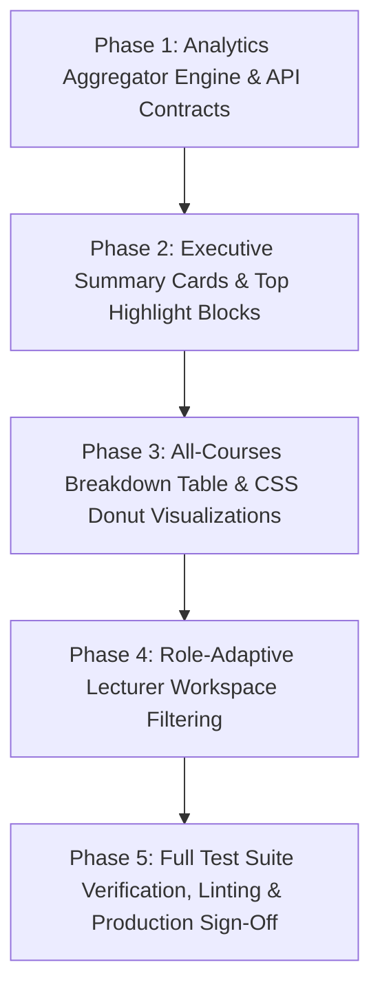

# Increment 12 Planning & Implementation Roadmap: Platform Analytics & Executive Reporting

---

## 1. Executive Summary & Objective

**Increment 12** establishes enterprise platform analytics, high-level learning engagement reporting, and executive dashboards for the Cairo Metro Learning Management System.

During the Increment 11 planning review, the **Platform Analytics & Executive Statistics Dashboard** was rescheduled from Increment 11 to Increment 12. This deliberate adjustment allows Increment 11 to remain strictly focused on the core administrative foundation:
1. Centralized user directory and roster management.
2. Account lifecycle, role editing, and status suspension.
3. Individual trainee transcripts and learning history.
4. Role permissions matrix, audit trails, and department tracks.
5. Discussion moderation and lecturer course performance tracking.

By deferring platform analytics to Increment 12, the reporting engine can build upon a stable, centralized user directory and verified course attempt data rather than premature mocks.

> [!IMPORTANT]
> **Documentation-First Planning Notice:**
> This document defines the architectural boundaries, API contracts, domain models, phase sequence, and acceptance criteria for Increment 12. **No application code, components, or services are being implemented at this stage.** Implementation will commence only after Increment 11 has been fully verified and signed off.

---

## 2. Distinction Between Progress Information and Platform Analytics

A critical architectural distinction is maintained across the modernization roadmap:

| Domain Area | Target Route | Increment | Primary Responsibility |
| :--- | :--- | :--- | :--- |
| **Individual Trainee Transcript** | `/admin/users/:userId` | **Increment 11 (Phase 3)** | Personal learning record for an individual employee: total hours, courses enrolled/completed, times opened, most-watched lesson item, attempt history. |
| **Course Learner Performance** | `/lecturer/performance/:courseId` | **Increment 11 (Phase 5)** | Cohort roster for a single course: enrolled trainees, progress percentages, verified inactivity alerts ($> 5\text{ days}$), and pre-formatted WhatsApp reminders. |
| **Group Cohort Monitoring** | `/admin/groups/:groupId/monitoring` | **Increment 10** | Cohort pacing, countdown strips, and attention alerts ($20\%$, $50\%$, $\le 48\text{h}$) tied to group deadlines and renewal cycles. |
| **Platform Executive Analytics** | `/stats` | **Increment 12** | Organization-wide aggregated metrics across all courses, departments, and personnel: executive summary cards, Top 5 courses/trainees, expandable breakdown table, completion donut charts, return rates, and peak viewing hours distribution. |

**Guiding Rule:** Increment 11 delivers all operational progress tracking required for user management and lecturer supervision. Increment 12 delivers the aggregated, platform-wide analytics and visual reporting dashboards.

---

## 3. Verified Legacy Evidence & Parity Mapping

- **Legacy Controller Implementation:**
  - Administrative Statistics: [`js/admin.js:898–1074`](file:///c:/Users/Administrator/Desktop/metro%20courses/js/admin.js#L898-L1074) (`renderStatsPage`).
  - Lecturer Statistics: [`js/lecturer.js:686–818`](file:///c:/Users/Administrator/Desktop/metro%20courses/js/lecturer.js#L686-L818) (`renderStatsPage`).
- **Feature Parity Audit Reference:** Row `LEG-038` in [`docs/frontend/legacy-feature-parity-audit.md`](legacy-feature-parity-audit.md).
- **Target Modern Route:** `/stats` (Role-adaptive presentation for `admin` and `lecturer`).

### Legacy Capabilities to Port in Increment 12:
1. **Four Top Summary Metric Cards:**
   - Total Users (`إجمالي المستخدمين`)
   - Total Courses (`إجمالي الكورسات`)
   - Total Enrollments (`إجمالي التسجيلات`)
   - Overall Completion Rate % (`معدل الإتمام العام`)
2. **Executive Highlight Blocks:**
   - **Top 5 Courses:** Title, enrollment count, completion percentage, rating.
   - **Top Active Trainees:** Name, avatar initials, learning hours, completed courses count, with clickable link to `/admin/users/:userId`.
3. **All-Courses Analytics Breakdown Table:**
   - Columns: Course Title, Lecturer Name, Enrolled Count, Completion Rate progress bar + %, Dropouts Count, Rating ⭐.
   - Expandable Accordion Rows revealing:
     - Donut Chart: Completed % vs Dropped % vs In Progress %.
     - Return Rate Counter (`معدل العودة: X مرة`).
     - Peak Viewing Hours Bar Distribution (08:00 to 20:00).
4. **Role-Adaptive Context:**
   - Administrators view organization-wide statistics across all departments.
   - Lecturers view aggregated performance across their authored courses.

---

## 4. Domain Models & API Contracts

### Domain Types (`src/core/analytics/types.ts`)

```typescript
export interface TopCourseItemDTO {
  id: string;
  title: string;
  category: string;
  enrollmentCount: number;
  completionRate: number;
  rating: number;
}

export interface TopTraineeItemDTO {
  id: string;
  name: string;
  jobTitle: string;
  department: string;
  learningHours: number;
  completedCoursesCount: number;
}

export interface CourseAnalyticsBreakdownDTO {
  courseId: string;
  courseTitle: string;
  lecturerName: string;
  enrolledCount: number;
  completionRate: number;
  dropoutCount: number;
  rating: number;
  returnRate: number;
  completionBreakdown: {
    completedPercent: number;
    inProgressPercent: number;
    droppedPercent: number;
  };
  peakViewingHours: Array<{
    hourLabel: string; // e.g., '08:00', '12:00', '16:00', '20:00'
    count: number;
  }>;
}

export interface PlatformStatsOverviewDTO {
  totalUsers: number;
  totalCourses: number;
  totalEnrollments: number;
  overallCompletionRate: number;
  topCourses: TopCourseItemDTO[];
  topTrainees: TopTraineeItemDTO[];
  coursesBreakdown: CourseAnalyticsBreakdownDTO[];
  generatedAt: string;
}
```

### Mock API Service (`src/features/analytics/services/analyticsApi.ts`)

- `getPlatformStats(params?: { scope?: 'platform' | 'lecturer'; lecturerId?: string }): Promise<PlatformStatsOverviewDTO>`
  - Issues `GET /api/admin/stats` with optional query parameters.
- Registered in MSW v2 handler `src/mocks/handlers/analyticsHandlers.ts`.

---

## 5. Architectural Dependencies & Prerequisites

Increment 12 strictly depends on artifacts and data models established in earlier increments:

1. **Centralized User Directory (Increment 11 Phase 1 & 2):**
   - Provides verified employee accounts (`ManagedUserDTO[]`), departments, and active statuses.
   - Supplies the candidate pool for top active trainees and department breakdowns.
2. **Reliable Course Attempt Ledgers (Increments 6 & 10):**
   - Provides `CourseAttempt` records containing verified `progressPercent`, `lastActivityAt`, `completedAt`, and `status`.
   - Ensures completion rates and dropouts are computed from authentic historical data rather than hardcoded mock constants.
3. **Course Catalog & Builder Metadata (Increments 4 & 8):**
   - Supplies course titles, lecturer relationships, chapter counts, and ratings.
4. **Design System & Charting Tokens (Increments 1 & 2):**
   - Utilizes CSS variables and vanilla CSS graphing utilities (`--color-primary`, `--color-accent`, `--color-success`, `--color-warning`).

---

## 6. Data-Integrity Requirements

To avoid fabricating metrics or presenting misleading information, Increment 12 must adhere to the following calculation rules:

1. **Total Users:** Calculated directly from `inMemoryStore.users.length` (excluding suspended accounts from active counts).
2. **Total Courses:** Calculated from published courses in `inMemoryStore.courses` (`status === 'published'`).
3. **Total Enrollments:** Sum of unique course enrollments across all trainees.
4. **Overall Completion Rate:** Mathematical average of `progressPercent` across all active course attempts.
5. **Dropout Calculation:** Defined consistently as enrolled trainees with $< 10\%$ progress whose last activity exceeds 30 days, or who missed group deadlines with policy `keep_no_cert`.
6. **Peak Viewing Hours Distribution:** Generated by aggregating lesson interaction timestamps (`lastActivityAt` / attempt logs) into hourly buckets between 08:00 and 20:00 (the active operating hours of the Cairo Metro network).
7. **Top Trainees Navigation:** Every trainee listed in the top active trainees block must link directly to their transcript at `/admin/users/:userId`.

---

## 7. Proposed Phased Implementation Sequence



### Phase Details

1. **Phase 1 — Analytics Aggregator Engine & API Contracts:**
   - Define contracts in `src/core/analytics/types.ts`.
   - Implement `statsAggregator.ts` in `src/core/domain/analytics.ts` to compute metrics from `inMemoryStore` collections.
   - Implement MSW endpoint `GET /api/admin/stats`.
   - Implement `analyticsApi.ts` client.
   - Create route `/stats` in `src/app/router/index.tsx` guarded by `<ProtectedRoute allowedRoles={['admin', 'lecturer']}>`.

2. **Phase 2 — Executive Summary Cards & Top Highlight Blocks:**
   - Build `StatsOverviewCards.tsx` (Total Users, Total Courses, Total Enrollments, Completion Rate).
   - Build `TopCoursesList.tsx` and `TopTraineesList.tsx`.
   - Wire clickable navigation from top trainees to `/admin/users/:userId`.
   - Implement skeleton loading states.

3. **Phase 3 — All-Courses Breakdown Table & CSS Donut Visualizations:**
   - Build `CourseAnalyticsTable.tsx` with sorting and search.
   - Implement expandable accordion rows per course.
   - Implement pure CSS donut chart component (`CompletionDonutChart.tsx`) displaying Completed % vs In Progress % vs Dropped %.
   - Implement pure CSS bar chart component (`PeakHoursChart.tsx`) displaying viewing activity from 08:00 to 20:00.

4. **Phase 4 — Role-Adaptive Lecturer Workspace Integration:**
   - Adapt `/stats` presentation based on `user.role`:
     - Administrators see platform-wide enterprise data.
     - Lecturers see metrics filtered exclusively to their authored courses.
   - Add navigation item in `src/shared/config/navigation.ts` pointing to `/stats`.

5. **Phase 5 — Full Test Suite Verification, Linting & Production Sign-Off:**
   - Author component and calculation tests (`stats-aggregation.test.tsx`, `stats-page.test.tsx`, `stats-rbac.test.tsx`).
   - Run complete Vitest suite sequentially (`npm --prefix frontend test -- --run --fileParallelism=false`).
   - Run `tsc -b` and ESLint.
   - Validate production build (`npm run build`).

---

## 8. Acceptance Criteria & Automated Test Plan

### Acceptance Criteria
1. **Route Access:** Administrators and lecturers can access `/stats`. Trainees navigating to `/stats` are redirected to `/403`.
2. **Accurate Aggregations:** Summary metric cards reflect authentic counts from the central user directory and course attempt ledgers.
3. **Visual Integrity:** CSS donut charts and peak viewing hour bars render cleanly without layout shift or external chart library dependencies.
4. **Expandable Rows:** Clicking a row in the courses analytics table expands to reveal the donut chart, return rate, and peak hours distribution.
5. **Interactive Navigation:** Clicking a top active trainee navigates directly to `/admin/users/:userId`.
6. **Role Filtering:** A logged-in lecturer sees metrics scoped only to courses they instruct.

### Automated Test Plan (Vitest)
1. **`src/test/stats-aggregation.test.tsx`:**
   - Verifies mathematical formulas for completion rate, dropout percentage, and peak hour distribution.
   - Verifies handling of edge cases (zero enrollments, all completed, empty attempt ledgers).
2. **`src/test/stats-page.test.tsx`:**
   - Renders 4 top metric cards with formatted Arabic labels and numerals.
   - Verifies Top 5 courses and Top 5 trainees rendering.
   - Tests row expansion and CSS chart rendering.
3. **`src/test/stats-rbac.test.tsx`:**
   - Verifies `admin` access with platform-wide scope.
   - Verifies `lecturer` access with scoped metrics.
   - Verifies `user` (trainee) redirection to `/403`.
   - Verifies unauthenticated redirection to `/login`.
