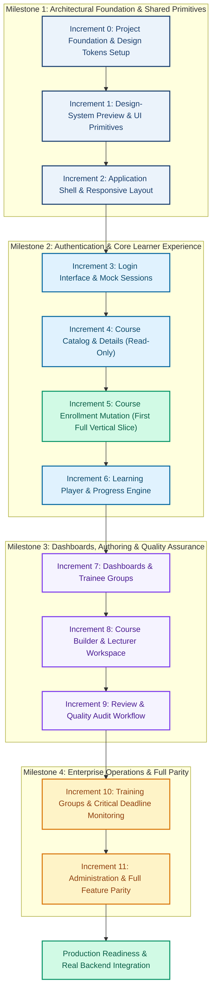

# Cairo Metro LMS — Incremental Implementation Roadmap

---

## 1. Execution Governance and Implementation Principles

This implementation roadmap defines the sequenced, phased delivery of the modernized **Cairo Metro Learning Management System (LMS)** React frontend. To guarantee engineering quality, maintainability, and predictable progress, development follows five core governance principles:

1. **Independent Vertical Slices:**
   * Features are delivered as complete, thin, end-to-end vertical slices spanning UI components, state management, mock API handlers, and domain logic.
   * Monolithic horizontal layers (such as building all screens without data, or mock endpoints without consumers) are strictly avoided.
2. **Strict Incremental Gating:**
   * Each increment represents an independent, user-reviewable delivery unit. No increment begins until the previous increment has passed its automated test suite, satisfied all acceptance criteria, and received explicit client sign-off.
3. **Reconciled Roadmap Hierarchy:**
   * **Strategic Feature Milestones (Phases 1–4):** Group broad capabilities and domain boundaries.
   * **Implementation Increments (Increments 0–11):** Small, atomic, user-reviewable delivery units with explicit acceptance checkpoints.
4. **Absolute Preservation of Legacy Prototype:**
   * The existing prototype files ([`app.html`](file:///c:/Users/Administrator/Desktop/metro%20courses/app.html), [`preview.html`](file:///c:/Users/Administrator/Desktop/metro%20courses/preview.html), [`js/*.js`](file:///c:/Users/Administrator/Desktop/metro%20courses/js/app.js), [`data/*.json`](file:///c:/Users/Administrator/Desktop/metro%20courses/data/courses.json), and [`server.py`](file:///c:/Users/Administrator/Desktop/metro%20courses/server.py)) remain untouched in their original locations.
   * The legacy prototype serves as the running behavioral baseline throughout the modernization effort.
5. **Deferred Business-Logic Migration & Incremental Verification:**
   * Legacy domain rules (`calculateTraineeProgress`, `checkTraineeAttention`, `evaluateCertEligibility`, `calculateGroupMetrics`) are preserved as requirements for future verification.
   * Business logic is **not rewritten, modified, or ported during pre-implementation**. Detailed regression testing and characterization verification will occur incrementally when each corresponding feature increment is reached.

---

## 2. Reconciled Roadmap Structure & Increments Overview



---

## 3. Detailed Increment Specifications

---

### Milestone 1: Architectural Foundation & Shared Primitives

#### Increment 0: Project Foundation & Design Tokens Setup

1. **Goal & Scope:**
   * Initialize a clean React 19 + TypeScript + Vite project inside the isolated `frontend/` directory.
   * Integrate Tailwind CSS v4 using CSS-first configuration and `@theme` directives inside `src/styles/tokens.css`.
   * Configure `eslint-plugin-boundaries` to enforce architecture layer hierarchy at lint/build time.
   * Set up Vitest and React Testing Library for automated unit and component testing.
   * **Outstanding Asset Requirement:** Sourcing local Cairo font files in `.woff2` format (weights 400, 600, 700) into `src/assets/fonts/cairo/`. A workspace inspection verified that no local font files exist in the repository (legacy relied on Google Fonts CDN); this dependency must be fulfilled during this setup increment.
2. **Components & Files Created:**
   * `frontend/vite.config.ts`, `frontend/tsconfig.json`, `frontend/eslint.config.js`.
   * `frontend/src/styles/tokens.css`, `frontend/src/styles/globals.css`.
   * `frontend/src/assets/fonts/cairo/` font files and `@font-face` declarations.
3. **Dependencies:** None.
4. **User-Visible Result:**
   * A clean starter page running on `http://localhost:5173` demonstrating the Cairo typography and brand color tokens via native Tailwind utility classes.
5. **Testing Strategy:**
   * Run `npm run build` to verify zero TypeScript errors and clean bundle creation.
   * Run `npm run lint` to verify zero linting errors.
   * Verify font loading and rendering in developer tools with network disabled (offline simulation).
6. **Key Risks & Mitigations:**
   * *Tailwind v4 integration issues:* Follow the official `@tailwindcss/vite` plugin documentation with direct CSS `@theme` declarations.
7. **Acceptance Criteria:**
   * Zero external network requests made during initial page load.
   * Both primary palette colors (`#1A3F6F` and `#5BBFDE`) and Cairo font correctly apply via Tailwind classes.
8. **Intentionally Unimplemented:**
   * No application layouts, reusable components, business logic, or mock services.
9. **Approval Checkpoint:**
   * Verify build passes, lint passes, and offline font rendering is confirmed before proceeding to Increment 1.

---

#### Increment 1: Design-System Preview & UI Primitives

1. **Goal & Scope:**
   * Implement the semantic, typed icon registry in `src/shared/ui/Icon/` wrapping `lucide-react`.
   * Build all core UI primitive components in `src/shared/ui/` with full RTL logical properties and verified WCAG 2.1 AA accessible contrast ratios.
   * Create an isolated design system preview route (`/design-system-preview`) to visually inspect all primitive states (default, hover, active, disabled, loading).
2. **Components & Files Created:**
   * `src/shared/ui/BrandLogo/BrandLogo.tsx`.
   * `src/shared/ui/Icon/Icon.tsx`, `src/shared/ui/Icon/registry.ts`, `src/shared/ui/Icon/types.ts`.
   * `src/shared/ui/Button/Button.tsx`.
   * `src/shared/ui/Card/Card.tsx`.
   * `src/shared/ui/Badge/Badge.tsx`.
   * `src/shared/ui/Modal/Modal.tsx`.
   * `src/shared/ui/FormInput/FormInput.tsx`.
   * `src/shared/ui/ProgressBar/ProgressBar.tsx`.
   * `src/shared/ui/Alert/Alert.tsx`.
   * `src/pages/DesignSystemPreviewPage.tsx`.
3. **Dependencies:** Increment 0.
4. **User-Visible Result:**
   * An interactive component laboratory at `/design-system-preview` displaying every button variant, badge status, modal dialog, form field, and icon in Arabic RTL alignment.
5. **Testing Strategy:**
   * Vitest component tests verifying click handlers, disabled states, and accessibility attributes.
   * Automated test verifying that unregistered icon names trigger the fallback warning icon without crashing the UI.
   * Automated contrast validation asserting that white text is never rendered on `#5BBFDE` surfaces, and that Danger (`#B91C1C` on `#FEE2E2` at 5.30:1) and Info (`#0369A1` on `#E0F2FE` at 5.17:1) pass AA standards.
6. **Key Risks & Mitigations:**
   * *Contrast violations in status badges:* Strictly enforce the verified contrast token matrix defined in `design-system.md`.
7. **Acceptance Criteria:**
   * All UI primitives render correctly in RTL layout with correct logical margins (`ps-*`, `pe-*`).
   * The icon registry supports all required icons with 100% TypeScript autocomplete.
8. **Intentionally Unimplemented:**
   * Application shell, navigation menus, authentication state, and backend mock endpoints.
9. **Approval Checkpoint:**
   * Review and approve the visual appearance, interaction fidelity, and accessibility compliance of the shared component primitives.

---

#### Increment 2: Application Shell & Responsive Layout

1. **Goal & Scope:**
   * Implement the authenticated application shell (`AppLayout`) consisting of the top navbar, persistent desktop sidebar, mobile sliding drawer, and footer.
   * Set up React Router DOM with foundational route placeholders.
   * Support seamless responsive behavior: fixed $260\text{px}$ sidebar for desktop viewports ($\ge 1024\text{px}$), and a sliding modal drawer with dark backdrop for mobile viewports ($< 1024\text{px}$).
2. **Components & Files Created:**
   * `src/app/layouts/AppLayout.tsx`.
   * `src/shared/ui/Navbar/Navbar.tsx`.
   * `src/shared/ui/Sidebar/Sidebar.tsx`, `SidebarItem.tsx`.
   * `src/shared/ui/Footer/Footer.tsx`.
   * `src/app/router/index.tsx`.
3. **Dependencies:** Increment 1.
4. **User-Visible Result:**
   * A responsive application layout featuring the official Cairo Metro branding, structured navigation links with icons, active link highlighting, and a working mobile hamburger toggle.
5. **Testing Strategy:**
   * Browser viewport testing at desktop (`1280px`), tablet (`768px`), and mobile (`375px`) widths.
   * Unit tests verifying drawer open/close behavior and click-outside dismissal.
6. **Key Risks & Mitigations:**
   * *Layout shifting or scroll lock bugs on mobile menu open:* Manage document body overflow cleanly inside a custom hook (`useLockBodyScroll`).
7. **Acceptance Criteria:**
   * The sidebar anchors strictly on the right side of the screen in RTL mode.
   * Active route highlights update automatically as navigation links are clicked.
8. **Intentionally Unimplemented:**
   * Authentication checks, user session persistence, dynamic notification counters, and course content.
9. **Approval Checkpoint:**
   * Review responsive layout behavior, drawer transitions, and RTL navigation ergonomics across desktop and mobile devices.

---

### Milestone 2: Authentication & Core Learner Experience

#### Increment 3: Login Interface & Mock Sessions

* **Status:** **Completed & Verified** (October 2026).
  * 38/38 automated tests passing across components, layout shell, foundation tokens, and authentication lifecycle.
  * Zero ESLint warnings; architectural boundary rules enforced.
  * Production bundle compiled cleanly with zero TypeScript errors.
  * Complete browser verification executed in desktop and mobile viewports with MSW mock API.

1. **Goal & Scope:**
   * Create the standalone login page (`/login`) with dedicated `AuthLayout`.
   * Implement the `AuthContext` state provider with login, logout, and current user tracking.
   * Configure Mock Service Worker (MSW v2) to intercept `POST /api/auth/login` and validate against sanitized mock user credentials.
   * Implement quick-switch testing buttons for standard demo personas (`admin`, `lecturer`, `user`).
   * Implement route guard `ProtectedRoute` enforcing authenticated access and role-based access control.
2. **Components & Files Created:**
   * `src/pages/LoginPage.tsx`.
   * `src/app/layouts/AuthLayout.tsx`.
   * `src/features/auth/components/LoginForm.tsx`.
   * `src/features/auth/components/DemoAccountPicker.tsx`.
   * `src/features/auth/hooks/useAuth.ts`.
   * `src/core/auth/AuthContext.tsx`, `ProtectedRoute.tsx`, `authStorage.ts`, `demoAccounts.ts`, `authApi.ts`.
   * `src/mocks/handlers/authHandlers.ts`, `src/mocks/browser.ts`, `src/mocks/server.ts`.
3. **Dependencies:** Increment 2.
4. **User-Visible Result:**
   * A polished Cairo Metro login screen. Entering valid credentials transitions the user to `/dashboard` with their name, role, and avatar rendered in the top navbar. Entering invalid credentials renders clear Arabic error messages.
5. **Testing Strategy:**
   * Form validation tests (empty inputs, incorrect password, successful authentication).
   * Guard tests confirming unauthenticated users are redirected to `/login` when accessing protected routes.
   * Quick-switch tests verifying immediate persona and role swapping.
6. **Key Risks & Mitigations:**
   * *Plaintext password leakage from legacy `data/users.json`:* Do not expose legacy passwords; use sanitized synthetic mock fixtures in `src/mocks/data/mockUsers.ts`.
7. **Acceptance Criteria:**
   * Logging in as `admin`, `lecturer`, or `user` correctly assigns the corresponding permissions and persists across page reloads via `sessionStorage`.
   * Logging out clears session state and redirects to `/login`.
8. **Intentionally Unimplemented:**
   * Persistent database registration, course catalog, learning player, and group management.
9. **Approval Checkpoint:**
   * Test login workflows across all three demo roles and verify route guarding.

---

#### Increment 4: Course Catalog & Details (Read-Only)

* **Status:** **Completed & Verified** (October 2026).
  * 52/52 automated tests passing across components, layout shell, foundation tokens, authentication lifecycle, and courses catalog/details.
  * Zero ESLint warnings; architectural boundary rules enforced.
  * Production bundle compiled cleanly with zero TypeScript errors (`tsc -b && vite build`).
  * Verified in browser subagent: catalog search, level tabs, details syllabus accordion, 404 state, mobile layout, and drawer navigation.

1. **Goal & Scope:**
   * Implement the dedicated course catalog view (`/courses`) and detailed course view (`/courses/:courseId`).
   * Intercept catalog requests via MSW v2 (`GET /api/courses`, `GET /api/courses/:courseId`) using sanitized synthetic fixtures derived from legacy `data/courses.json`.
   * Provide title search, level filtering (الكل, مبتدئ, متوسط, متقدم), and sorting (newest, rating, enrollment).
   * Render course cards with authentic thumbnail/initials, level badges, duration, ratings, lecturer metadata, and skeleton loaders.
   * Render course details with hero banner, syllabus chapter/lesson accordion, target job roles, lecturer profile, and read-only status notices.
2. **Components & Files Created:**
   * `src/core/courses/types.ts`: Central course domain interfaces.
   * `src/mocks/fixtures/mockCourses.ts`: Sanitized synthetic fixtures for published courses CRS001–CRS006.
   * `src/mocks/handlers/courseHandlers.ts`: MSW v2 handlers for `/api/courses` and `/api/courses/:courseId`.
   * `src/features/courses/services/coursesApi.ts`: Decoupled API service calling `/api/courses`.
   * `src/features/courses/hooks/useCourses.ts`: Hook for catalog querying, filtering, and loading/error states.
   * `src/features/courses/hooks/useCourseDetail.ts`: Hook for individual course detail and 404 state handling.
   * `src/features/courses/components/CourseCard.tsx`: Course card component with badges and details link.
   * `src/features/courses/components/CourseFilterBar.tsx`: Search input, level pills, sort dropdown, and counter.
   * `src/features/courses/components/CourseGrid.tsx`: Responsive grid with skeleton loaders and empty state.
   * `src/features/courses/components/CourseHero.tsx`: Course detail hero banner with breadcrumbs and metadata.
   * `src/features/courses/components/CourseCurriculum.tsx`: Interactive syllabus accordion with chapters and lessons.
   * `src/features/courses/styles/courses.css`: CSS styling matching legacy prototype aesthetics.
   * `src/features/courses/index.ts`: Public feature barrel export.
   * `src/pages/CoursesCatalogPage.tsx`: Course catalog route page at `/courses`.
   * `src/pages/CourseDetailPage.tsx`: Course details route page at `/courses/:courseId`.
   * `src/test/courses.test.tsx`: 14 comprehensive unit, integration, and route-guarding tests.
3. **Dependencies:** Increment 3.
4. **User-Visible Result:**
   * An interactive course catalog displaying real course metadata, searchable in real-time with responsive grid layout and smooth navigation into detailed course syllabus views.
5. **Testing Strategy:**
   * Unit and integration tests covering catalog loading, filtering, search, sorting, empty states, detail rendering, chapter accordion toggle, 404 not-found, and authentication redirects.
   * Regression tests ensuring `/dashboard` and `/design-system` continue passing.
6. **Key Risks & Mitigations:**
   * *Search lag on large catalog lists:* Lightweight client-side and mock-query filtering with zero lag.
7. **Acceptance Criteria:**
   * Course data correctly populates cards and detail views based strictly on legacy schema.
   * Filter bars and search inputs work cohesively without layout shift.
   * Route guards redirect unauthenticated users to `/login`.
8. **Intentionally Unimplemented:**
   * Course enrollment mutation (`POST /api/courses/:id/enroll`) deferred strictly to Increment 5.
   * Video lesson playback and learning progress tracking deferred to Increment 6.
9. **Approval Checkpoint:**
   * Review search responsiveness, catalog presentation, and course detail rendering.

---

#### Increment 5: Course Enrollment Mutation (First Complete Mutation Vertical Slice)

* **Status:** **Completed & Verified** (October 2026).
  * 62/62 automated tests passing across components, layout shell, foundation tokens, authentication lifecycle, course catalog/details, and course enrollment mutation.
  * Zero ESLint warnings; architectural boundary rules enforced.
  * Production bundle compiled cleanly with zero TypeScript errors (`tsc -b && vite build`).
  * Complete browser verification executed in desktop and mobile viewports: trainee enrollment, loading state, success feedback, already-enrolled badge consistency between catalog and details, duplicate submission prevention, and role-based access restrictions for instructors and admins.

1. **Goal & Scope:**
   * **Complete the first end-to-end data mutation vertical slice:**
   * Enable the "Enroll Now" action on course details and catalog cards.
   * Intercept `POST /api/courses/:id/enrollments` (and `/enroll` alias), `GET /api/courses/:id/enrollment`, and `GET /api/enrollments/my` in MSW v2.
   * Mutate the active user's enrollment state in the stateful in-memory mock store (`inMemoryStore.ts`), incrementing `enrollmentCount` consistently.
   * Immediately update client state via shared `EnrollmentContext` and `useEnrollment` hook: transform button into a green "مسجل ✓" badge, disable duplicate submissions, and display contextual alerts.
   * Enforce business rules: permit trainee (`user`) enrollment, display informative notices for non-trainee roles (`lecturer`, `admin`), reject duplicate attempts with 409 Conflict, and provide clear Arabic error messages with retry options on failure.
2. **Components & Files Created / Modified:**
   * `src/core/courses/types.ts`: Domain models (`CourseEnrollment`, `EnrollmentResponse`, `EnrollmentStatusResponse`).
   * `src/mocks/fixtures/mockEnrollments.ts`: Sanitized synthetic enrollment fixtures for initial state.
   * `src/mocks/store/inMemoryStore.ts`: Stateful in-memory mock repository managing courses, enrollments, validation, duplicate prevention, and counter aggregation.
   * `src/mocks/handlers/enrollmentHandlers.ts`: MSW v2 mutation and status handlers.
   * `src/mocks/handlers/courseHandlers.ts`: Updated to read from stateful mock repository.
   * `src/features/courses/services/coursesApi.ts`: Client service functions for enrollment mutation and status queries.
   * `src/features/courses/context/context.ts` & `EnrollmentContext.tsx`: Shared enrollment state provider wrapped inside `AppLayout`.
   * `src/features/courses/hooks/useEnrollment.ts` & `useEnrollCourse.ts`: Context consumer and mutation execution hooks.
   * `src/features/courses/components/CourseCard.tsx`: Updated with enrollment badge and status button.
   * `src/features/courses/components/CourseHero.tsx`: Updated hero action area for enrolled state and role notices.
   * `src/pages/CourseDetailPage.tsx`: Interactive enrollment action card with loading, success feedback, error retries, and role-based notices.
   * `src/test/enrollment.test.tsx`: 9 comprehensive automated tests verifying enrollment creation, duplicate rejection, role limitations, network errors, and cross-view state synchronization.
3. **Dependencies:** Increment 4.
4. **User-Visible Result:**
   * A trainee navigates to an unenrolled course, clicks "التسجيل في الدورة", observes a loading spinner, and sees the action transform into an enrolled state with "أنت مسجل بالفعل في هذه الدورة". Navigating back to the catalog immediately reflects the "مسجل ✓" badge on the course card. Instructors and admins see clear notices explaining that enrollment is reserved for trainees.
5. **Testing Strategy:**
   * Integration tests with React Testing Library verifying user click, MSW network call, state mutation, duplicate prevention (409), retry on network error, and role checks (403).
   * Regression test suite ensuring all 62 tests across Increment 0–5 pass without regressions.
6. **Key Risks & Mitigations:**
   * *State desynchronization across catalog and detail views:* Managed via global `EnrollmentProvider` in `AppLayout` so enrollment changes propagate instantly across all rendered components without requiring full page reloads.
   * *Duplicate submissions:* Disabled button and pending state guard against rapid clicks, reinforced by server-side 409 Conflict validation in `inMemoryStore`.
7. **Acceptance Criteria:**
   * Enrolling in a course updates both the catalog card and the detail page immediately.
   * Navigating between routes preserves enrolled status within the session.
   * Lecturers and admins do not receive trainee enrollment actions.
   * API failures display user-readable Arabic error messages and allow retrying.
8. **Intentionally Unimplemented:**
   * Video player playback, lesson progress tracking calculations, and quiz completions (strictly deferred to Increment 6).
   * Group management, trainee assignments, and full "My Courses" dashboard (deferred to later increments).
9. **Approval Checkpoint:**
   * **Major Milestone Checkpoint:** Review and formally approve Increment 5 before proceeding to Increment 6.

---

#### Increment 6: Learning Player & Progress Engine

> [!NOTE]
> **Status:** Implemented & Fully Verified (106/106 automated tests passing; clean lint & build; ready for client review).

1. **Goal & Scope:**
   * Build the interactive learning player route (`/courses/:courseId/learn` and `/courses/:courseId/learn/:itemId`).
   * Custom HTML5 video player with custom React controls (`controls={false}`), forward-seeking clamping to `furthestWatchedSeconds`, playback speeds (1x, 1.25x, 1.5x, 2x), volume controls, and container-level Fullscreen API with Escape-key synchronization.
   * Document viewer for PDF lesson items with document metadata, download gating (`canDownload`), and 5-second timer requiring trainee manual confirmation click to complete.
   * Authoritative domain algorithms for `calculateTraineeProgress`, `isLessonLocked`, `resolveResumeLesson`, and `clampSeekingPosition`.
   * Sequential lesson locking enforcement for trainees, with lecturer and administrator preview bypass (isolated from trainee progress records).
   * 100% course completion celebration modal with course title and informational certificate notice.
   * *Quizzes Deferred:* Comprehension quizzes are temporarily deferred pending a separate product discussion.
2. **Components & Files Created:**
   * `src/pages/LearningPlayerPage.tsx`
   * `src/features/learning-player/components/VideoPlayer.tsx`
   * `src/features/learning-player/components/DocumentViewer.tsx`
   * `src/features/learning-player/components/CurriculumSidebar.tsx`
   * `src/features/learning-player/components/LearningHeader.tsx`
   * `src/features/learning-player/components/PlayerToolbar.tsx`
   * `src/features/learning-player/components/CompletionCelebrationModal.tsx`
   * `src/features/learning-player/hooks/useLearningPlayer.ts`, `useCourseProgress.ts`, `useVideoProgressSync.ts`
   * `src/features/learning-player/services/learningApi.ts`
   * `src/features/learning-player/types/index.ts`
   * `src/features/learning-player/styles/learningPlayer.css`
   * `src/core/domain/progress.ts`
   * `src/mocks/handlers/learningHandlers.ts`
3. **Dependencies:** Increment 5.
4. **User-Visible Result:**
   * An immersive learning workspace with header progress indicators, hierarchical curriculum sidebar, custom video/PDF player stages, previous/next lesson toolbar, and completion celebration modal.
5. **Testing Strategy:**
   * 24 unit characterization tests in `src/test/progress.test.ts` for progress calculation, rounding, sequential locking, resume fallback, and clamping.
   * 20 component and integration tests in `src/test/learning-player.test.tsx` for video controls, speed change, forward-seeking lock, PDF 5s timer, sidebar navigation, modal celebration, and route guarding.
   * All 86 previous automated tests passing (106 tests total across 8 test suites).
6. **Acceptance Criteria & Verification:**
   * All checklist criteria in `docs/frontend/checklists/increment-06-learning-player-checklist.md` implemented and verified.
   * `npm run test`: 106/106 tests passing.
   * `npm run lint`: 0 errors, 0 warnings.
   * `npm run build`: Clean production bundle compiled.
7. **Approval Checkpoint:**
   * Implemented and verified; awaiting client review and explicit approval before starting Increment 7.

---

### Milestone 3: Dashboards, Authoring & Quality Assurance

#### Increment 7: Dashboards & Trainee Groups

1. **Goal & Scope:**
   * Implement the adaptive dashboard (`/dashboard`) tailored to the authenticated user's role:
     * **Trainee:** Enrolled courses, overall hours completed, attention alerts, and next scheduled sessions.
     * **Lecturer:** Assigned courses, student enrollment counts, and review queue summary.
     * **Admin:** System-wide training statistics, active group metrics, and attention alerts across metro lines.
   * Implement trainee personal views: `/my-courses`, `/my-groups`, and group details `/my-groups/:id` (lecture links and handouts).
   * Implement user profile `/profile` and notifications center `/notifications`.
2. **Components & Files Created:**
   * `src/pages/DashboardPage.tsx`.
   * `src/pages/MyCoursesPage.tsx`, `src/pages/TraineeGroupsPage.tsx`.
   * `src/pages/ProfilePage.tsx`, `src/pages/NotificationsPage.tsx`.
   * `src/features/dashboard/components/StatCard.tsx`.
   * `src/features/dashboard/components/RecentActivityList.tsx`.
3. **Dependencies:** Increment 6.
4. **User-Visible Result:**
   * Role-specific dashboard hubs providing comprehensive overviews of learning progress, group schedules, operational alerts, and profile management.
5. **Testing Strategy:**
   * Role-based rendering tests verifying that trainees see personal metrics while admins see operational statistics.
   * Notification badge tests verifying read/unread status toggles.
6. **Key Risks & Mitigations:**
   * *Complex statistical calculations slowing down page load:* Wrap aggregations inside memoized selectors (`useMemo`).
7. **Acceptance Criteria:**
   * All metrics on the dashboard match data returned from the stateful mock layer.
   * Trainee group views display correct lecture links and materials.
8. **Intentionally Unimplemented:**
   * Course authoring and administrative group creation forms.
9. **Approval Checkpoint:**
   * Validate role-specific dashboard views and trainee group navigation.

---

#### Increment 8: Course Builder & Lecturer Workspace

1. **Goal & Scope:**
   * Implement the lecturer course management dashboard (`/lecturer/courses`) with draft, published, and archived tabs.
   * Implement the comprehensive course builder (`/lecturer/builder/:courseId`):
     * Chapter and lesson tree reordering.
     * Video URL and lesson attachment editor.
     * Quiz question builder with multiple-choice configuration.
     * Draft autosaving and state transition to `pending_approval`.
   * Implement the course performance analytics view (`/lecturer/performance/:courseId`).
2. **Components & Files Created:**
   * `src/pages/CourseBuilderPage.tsx`, `src/pages/LecturerCoursesPage.tsx`.
   * `src/pages/CoursePerformancePage.tsx`.
   * `src/features/course-builder/components/CurriculumTreeEditor.tsx`.
   * `src/features/course-builder/components/LessonEditorModal.tsx`.
   * `src/features/course-builder/components/QuizEditor.tsx`.
3. **Dependencies:** Increment 6.
4. **User-Visible Result:**
   * An intuitive course creation suite enabling instructors to build structured curricula, upload materials, create quizzes, save drafts, and submit courses for quality review.
5. **Testing Strategy:**
   * Builder state tests ensuring adding, updating, and removing chapters updates the in-memory curriculum hierarchy correctly.
   * Validation tests preventing course submission when required fields or lessons are missing.
6. **Key Risks & Mitigations:**
   * *Accidental data loss during editing:* Implement autosave to `localStorage` drafts every 30 seconds.
7. **Acceptance Criteria:**
   * A lecturer can assemble a complete multi-chapter course and transition its status from `draft` to `pending_approval`.
8. **Intentionally Unimplemented:**
   * Administrative approval and review queue actions.
9. **Approval Checkpoint:**
   * Review and test the course builder workflow with sample multi-chapter course curricula.

---

#### Increment 9: Review & Quality Audit Workflow

1. **Goal & Scope:**
   * Implement the centralized approvals dashboard (`/approvals`):
     * Lecturer view: Track status of submitted courses and read reviewer feedback.
     * Admin view: Pending approval queue with priority badges.
   * Implement the full administrative course audit route (`/admin/review/:courseId`):
     * Chapter-by-chapter curriculum inspection.
     * Granular audit comment box per lesson/chapter.
     * Decision action modal: "Approve & Publish" or "Reject with Required Changes".
2. **Components & Files Created:**
   * `src/pages/ApprovalsPage.tsx`, `src/pages/CourseReviewPage.tsx`.
   * `src/features/course-review/components/AuditSidebar.tsx`.
   * `src/features/course-review/components/AuditNotesBox.tsx`.
   * `src/features/course-review/components/DecisionModal.tsx`.
3. **Dependencies:** Increment 8.
4. **User-Visible Result:**
   * A structured quality audit interface enabling training directors to inspect submitted courses, attach specific feedback, and approve or reject courses with clear status indicators.
5. **Testing Strategy:**
   * Workflow state machine tests verifying the complete review cycle: Submit $\rightarrow$ Reject with comments $\rightarrow$ Resubmit $\rightarrow$ Approve.
6. **Key Risks & Mitigations:**
   * *Audit comment synchronization conflicts:* Define strict TypeScript interfaces for audit notes tied to explicit lesson IDs.
7. **Acceptance Criteria:**
   * Approving a course updates its status to `published` and makes it visible in the public course catalog.
   * Rejecting a course returns it to the lecturer's draft workspace with all audit notes visible.
8. **Intentionally Unimplemented:**
   * Training group scheduling and deadline alerts.
9. **Approval Checkpoint:**
   * Demonstrate the complete authoring-to-approval lifecycle across lecturer and administrator roles.

---

### Milestone 4: Enterprise Operations & Full Parity

#### Increment 10: Training Groups & Critical Deadline Monitoring

1. **Goal & Scope:**
   * Implement group creation workspace (`/admin/create-group`): assigning trainees, instructors, setting group-wide defaults, custom course deadlines, and policy selection (`keep_no_cert` vs `hide`).
   * Implement group monitoring overview (`/admin/group-monitoring`) and group detail drill-down (`/admin/group-monitoring/:id`).
   * Implement lecturer group oversight (`/lecturer/groups` and `/lecturer/group/:id`).
   * **Domain Business-Logic Verification:** Verify and implement the authoritative domain algorithms for `checkTraineeAttention` and `calculateGroupMetrics`:
     * Display live countdown timers toward deadlines.
     * Highlight critical danger alerts ($\le 48\text{h}$ remaining and progress $< 60\%$).
     * Highlight inactivity warning alerts (elapsed time $\ge 20\%$ with $0\%$ progress).
2. **Components & Files Created:**
   * `src/pages/CreateGroupPage.tsx`, `src/pages/GroupMonitoringPage.tsx`, `src/pages/LecturerGroupsPage.tsx`.
   * `src/features/training-groups/components/GroupTable.tsx`.
   * `src/features/training-groups/components/AttentionBadge.tsx`.
   * `src/features/training-groups/components/CountdownStrip.tsx`.
   * `src/core/domain/attention.ts`, `src/core/domain/groupMetrics.ts`.
3. **Dependencies:** Increment 6 and Increment 7.
4. **User-Visible Result:**
   * An operational monitoring dashboard giving administrators and supervisors instant visibility into group progress, highlighting at-risk employees who require immediate intervention.
5. **Testing Strategy:**
   * Characterization tests validating that `checkTraineeAttention` warning and danger conditions produce exact matches with legacy alerts across synthetic date ranges.
   * Unit tests for custom course deadline overrides taking precedence over group default deadlines.
6. **Key Risks & Mitigations:**
   * *Timezone or clock skew in countdown calculations:* Standardize all calculations on ISO UTC timestamps with deterministic test time mocks.
7. **Acceptance Criteria:**
   * Countdown timers and attention badges dynamically reflect correct status based on group deadlines and trainee progress.
8. **Intentionally Unimplemented:**
   * System-wide user role administration and comment moderation.
9. **Approval Checkpoint:**
   * Review deadline calculation fidelity and monitoring dashboard ergonomics.

---

#### Increment 11: Administration & Full Feature Parity

1. **Goal & Scope:**
   * Implement user and account management (`/admin/users`) with user creation, editing, and training history transcript (`/admin/user/:id`).
   * Implement role permissions matrix (`/admin/permissions`).
   * Implement comment and community moderation (`/admin/comment-moderation`).
   * Implement executive reports and analytics dashboard (`/stats`).
   * **Achieve 100% functional equivalence with the legacy LMS prototype across all 25 views.**
2. **Components & Files Created:**
   * `src/pages/UserManagementPage.tsx`, `src/pages/UserDetailsPage.tsx`.
   * `src/pages/PermissionsPage.tsx`.
   * `src/pages/CommentModerationPage.tsx`.
   * `src/pages/ReportsPage.tsx`.
   * `src/features/user-management/components/UserTable.tsx`.
   * `src/features/user-management/components/UserModal.tsx`.
3. **Dependencies:** All previous increments (Increment 0 through Increment 10).
4. **User-Visible Result:**
   * A complete, enterprise-grade LMS frontend addressing every administrative, instructional, and operational requirement of Cairo Metro.
5. **Testing Strategy:**
   * Comprehensive side-by-side audit comparing every screen, modal, and button against the legacy prototype.
   * End-to-end integration test suites across full user journeys.
   * Bundle size, accessibility, and Lighthouse performance audits.
6. **Key Risks & Mitigations:**
   * *Overlooked legacy edge cases:* Cross-reference against the comprehensive feature inventory table in `legacy-inventory.md`.
7. **Acceptance Criteria:**
   * Every user workflow demonstrable in `app.html` is fully operational in the new React frontend.
   * Zero TypeScript errors, zero lint warnings, and 100% passing test suites.
8. **Intentionally Unimplemented:**
   * Nothing in the frontend scope; 100% completed.
9. **Approval Checkpoint:**
   * **Final Project Acceptance Sign-off:** Client review and approval signifying frontend readiness for real backend API integration.

---

## 4. Domain Logic Characterization Test Plan (Deferred Verification Requirements)

> [!IMPORTANT]
> **Deferred Business-Logic Migration Policy:**
> The mathematical formulas and rules detailed below represent behavioral requirements to be preserved and verified during feature implementation. **No legacy business logic is being ported or rewritten now.** Comprehensive regression and characterization tests will be implemented incrementally when each corresponding feature is built (Increment 6 for progress tracking and certification eligibility, Increment 10 for attention alerts and group metrics).

### 1. Trainee Course Progress Calculation (`calculateTraineeProgress` — Increment 6)
* **Legacy Behavior:**
  * If the course ID is present in the user's `completedCourses` list, progress is immediately $100\%$.
  * Otherwise, progress is calculated by counting completed lesson items across all course chapters:
    $$\text{Progress} = \text{round}\left(\frac{\text{Completed Items Count}}{\text{Total Course Items Count}} \times 100\right)$$
  * If a course contains 0 items, progress is $0\%$.
* **Characterization Test Scenarios to Verify in Increment 6:**
  * Course with 10 total items, 3 completed $\rightarrow 30\%$.
  * Course with 7 total items, 3 completed $\rightarrow 43\%$.
  * Course marked in `completedCourses` with only 1 item completed $\rightarrow 100\%$.
  * Empty course with 0 items $\rightarrow 0\%$.

### 2. Trainee Attention & Warning Engine (`checkTraineeAttention` — Increment 10)
* **Legacy Behavior:**
  * Computes total allocated duration ($T_{\text{total}} = \text{Deadline} - \text{Start}$) and elapsed duration ($T_{\text{elapsed}} = \text{Now} - \text{Start}$).
  * Computes time elapsed ratio: $R_{\text{time}} = T_{\text{elapsed}} / T_{\text{total}}$.
  * **Warning 1 (Inactivity):** If $R_{\text{time}} \ge 0.20$ ($20\%$ time elapsed) and course has not been started (progress $= 0\%$).
  * **Warning 2 (Pacing):** If $R_{\text{time}} \ge 0.50$ ($50\%$ time elapsed) and progress $< 25\%$.
  * **Danger Alert (Critical Deadline):** If remaining time is $\le 48\text{ hours}$ and progress $< 60\%$.
* **Characterization Test Scenarios to Verify in Increment 10:**
  * 30 days total, 7 days elapsed ($23.3\%$), progress $0\% \rightarrow \text{Warning: Not Started}$.
  * 30 days total, 16 days elapsed ($53.3\%$), progress $20\% \rightarrow \text{Warning: Slow Progress}$.
  * 24 hours remaining, progress $55\% \rightarrow \text{Danger: Critical Deadline}$.
  * 12 hours remaining, progress $90\% \rightarrow \text{OK: On Track}$.

### 3. Certificate Eligibility Evaluation (`evaluateCertEligibility` — Increment 6)
* **Legacy Behavior:**
  * Course progress must equal $100\%$.
  * If course is associated with a training group, evaluate policy when deadline has passed:
    * If policy is `keep_no_cert`, overdue completions allow continued study but block certificate generation.
    * If policy is `hide`, the course is completely inaccessible past deadline.
  * If the course includes an exit quiz, the trainee's score must meet or exceed the passing threshold (default $\ge 70\%$).
* **Characterization Test Scenarios to Verify in Increment 6:**
  * Progress $100\%$, within deadline, quiz passed ($85\%$) $\rightarrow \text{Eligible}$.
  * Progress $100\%$, within deadline, quiz failed ($60\%$) $\rightarrow \text{Not Eligible (Quiz)}$.
  * Progress $100\%$, past deadline under `keep_no_cert` $\rightarrow \text{Not Eligible (Deadline Passed)}$.

### 4. Group Aggregated Metrics (`calculateGroupMetrics` — Increment 10)
* **Legacy Behavior:**
  * Calculates group average progress:
    $$\text{Average Progress} = \text{round}\left(\frac{\sum \text{Member Course Progress}}{\text{Member Count} \times \text{Assigned Courses Count}}\right)$$
  * Counts members requiring attention (sum of danger and warning flags).
  * Counts members who have achieved $100\%$ completion across all assigned courses.
* **Characterization Test Scenarios to Verify in Increment 10:**
  * Group of 5 trainees, assigned 2 courses each: total progress correctly aggregated and rounded.

---

## 5. Dual-Run Verification and Legacy Preservation Protocol

To guarantee that modernization causes zero disruption to ongoing client evaluations, the following operational rules are strictly enforced:

1. **Port Isolation:**
   * Legacy prototype remains permanently operational on port `8000`:
     ```powershell
     python server.py
     ```
   * Modern React frontend runs independently on Vite default port `5173`:
     ```powershell
     npm run dev
     ```
2. **Zero Modification Guarantee:**
   * The following directories and files are read-only and must never be altered during frontend implementation:
     * `app.html`, `preview.html`, `server.py`
     * `js/**`, `css/**`, `data/**`, `assets/**`
3. **Side-by-Side Acceptance Audits:**
   * At each increment review checkpoint, the evaluator opens the legacy system on screen left (`:8000`) and the new React application on screen right (`:5173`).
   * The evaluator verifies visual fidelity, data accuracy, and user interaction parity before providing increment sign-off.
