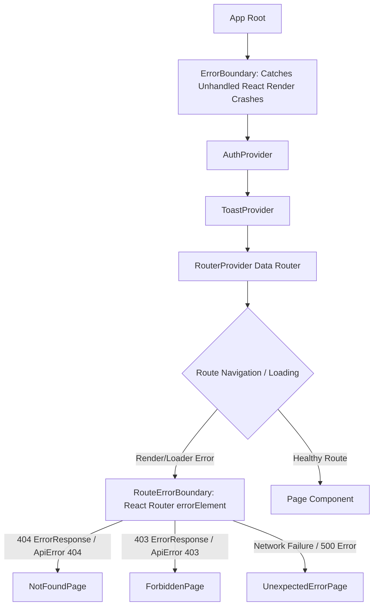

# Metro Courses — Loading System & Error Handling Architecture

## 1. Overview & Architectural Philosophy

This document defines the production loading, error containment, and recovery architecture for the Metro Courses React frontend.

The system is organized into a clear hierarchy that separates:
1. **Full-page bootstrap/session verification** (`LoadingScreen`).
2. **Local component/page data fetching** (`PageLoading`, `SectionSkeleton`).
3. **Unexpected client-side runtime errors** (`ErrorBoundary`).
4. **React Router route exceptions** (`RouteErrorBoundary`).
5. **Dedicated standalone and in-shell error pages** (`NotFoundPage`, `ForbiddenPage`, `UnexpectedErrorPage`).
6. **Hardened HTTP and network error normalization** (`apiClient`, `ApiError`).

---

## 2. Shared Loading Components Context Matrix

| Loading Component | Scope & Intended Context | Accessibility & UX Characteristics |
| :--- | :--- | :--- |
| **`LoadingScreen`** (`src/shared/ui/Loading/LoadingScreen.tsx`) | Initial application bootstrap, session verification in `ProtectedRoute`, top-level `Suspense` fallbacks. | `role="status"`, `aria-live="polite"`, `aria-busy="true"`. Renders official Metro brand logo, Cairo typography, restrained dual-ring spinner. Respects `prefers-reduced-motion`. |
| **`PageLoading`** (`src/shared/ui/Loading/PageLoading.tsx`) | Inside page shells (e.g. data fetching within `GroupDetailPage`, `ApprovalsPage`). | Preserves application shell, navigation, and breadcrumbs. Prevents screen flickering. `role="status"`, `aria-live="polite"`. |
| **`SectionSkeleton`** (`src/shared/ui/Loading/SectionSkeleton.tsx`) | Content placeholder for cards, tables, metrics, and paragraphs. | `variant="card \| table \| metric \| text"`. Uses `animate-pulse` with `bg-border/60`. Respects `prefers-reduced-motion`. Exposes `aria-busy="true"`. |
| **`InlineLoading`** (`src/shared/ui/Loading/InlineLoading.tsx`) | Compact spinner for button submit states, chips, or inline action buttons. | Inline SVG spinner with optional compact Arabic label. Never blocks the screen. |

---

## 3. Dedicated Error Pages & Route Hierarchy

### A. 404 — Not Found (`src/pages/NotFoundPage.tsx`)
- **Route registration**:
  - Catch-all route `<Route path="*" element={<NotFoundPage />} />` inside the application shell for unknown authenticated paths.
  - Dedicated route `<Route path="/404" element={<NotFoundPage standalone />} />` with official brand header for unauthenticated or direct access.
- **Role-Aware Navigation**:
  - Automatically targets the user's role:
    - **Administrator / Trainee**: Returns to Dashboard (`/dashboard`).
    - **Lecturer / Supervisor**: Returns to Lecturer Workspace (`/lecturer/courses`).
    - **Unauthenticated / Standalone**: Offers login link (`/login`).
  - **Browser History**: Automatically offers `"الرجوع للصفحة السابقة"` when `window.history.length > 1`.

### B. 403 — Forbidden (`src/pages/ForbiddenPage.tsx`)
- **Route registration**:
  - `<Route path="/403" element={<ForbiddenPage />} />` (standalone) and `<Route path="403" element={<ForbiddenPage />} />` (inside shell).
- **Security & UX**:
  - Explains permission restriction in clear Arabic without disclosing restricted internal details.
  - Displays the user's currently registered role (مسؤول النظام، محاضر معتمد، متدرب فني).
  - Offers safe, role-authorized return destinations. Never grants unauthorized access.

### C. 500 — Unexpected Error (`src/pages/UnexpectedErrorPage.tsx`)
- **Route registration**:
  - `<Route path="/500" element={<UnexpectedErrorPage />} />` (standalone) and `<Route path="500" element={<UnexpectedErrorPage />} />` (inside shell).
- **Diagnostics & Protection**:
  - Distinguishes HTTP server errors (500–599) from client-side runtime errors.
  - Generates an opaque error reference code (`data-testid="error-reference-id"`, format `ERR-XXXXXX`) for customer support reference.
  - Never leaks raw stack traces, API tokens, or SQL/database errors to the end-user.
  - Provides a safe retry action and return action to `/dashboard`.

---

## 4. Error Boundaries & React Router Data Router Integration

### 1. `ErrorBoundary` (`src/shared/ui/Error/ErrorBoundary.tsx`)
- Top-level React error boundary wrapped around `AuthProvider` and `RouterProvider`.
- Catches runtime rendering exceptions that would otherwise produce a blank white screen.
- Provides `"إعادة المحاولة"` which resets the error boundary state and re-mounts the children.
- In `import.meta.env.DEV`, renders an expandable debug disclosure showing sanitized error text.

### 2. `RouteErrorBoundary` (`src/app/router/RouteErrorBoundary.tsx`)
- Configured as `errorElement` on top-level routes and protected shell routes in React Router Data Router.
- Uses `useRouteError()` and `isRouteErrorResponse()` to dynamically inspect the failure:
  - Surfaces 404 as `NotFoundPage`.
  - Surfaces 403 as `ForbiddenPage`.
  - Surfaces network offline errors or server 500 as `UnexpectedErrorPage`.

---

## 5. HTTP Status Code & Network Error Surface Mapping

Handled uniformly in `src/core/api/apiClient.ts` through `getLocalizedStatusMessage()` and `sanitizeErrorMessage()`:

| HTTP Status | Category | User-Facing Arabic Message | UI Handling Behavior |
| :--- | :--- | :--- | :--- |
| **0 / Network** | Connection lost / offline | `تعذر الاتصال بالخادم. يرجى التحقق من اتصال الإنترنت والمحاولة مرة أخرى.` | Surface `ErrorState` with retry. Form values preserved. `isNetworkError: true`. |
| **400** | Bad Request | `طلب غير صالح. يرجى مراجعة البيانات المدخلة.` | Local inline field validation feedback. Does not navigate away from the form. |
| **401** | Unauthenticated | `جلسة العمل انتهت أو غير مصرح بها. يرجى تسجيل الدخول.` | `ProtectedRoute` redirects to `/login` preserving `location.state.from`. |
| **403** | Forbidden | `ليس لديك صلاحية للوصول إلى هذا المحتوى.` | Renders `ForbiddenPage` or container warning (`ForbiddenState`). |
| **404** | Not Found | `المورد المطلوب غير موجود أو تم نقله.` | Renders `NotFoundPage` or container empty state. |
| **409** | Conflict | `تعارض في معالجة الطلب. قد تكون العملية مسجلة بالفعل.` | Alert/Toast feedback. Prevents duplicate submission. |
| **422** | Unprocessable Entity | `تعذر معالجة البيانات المدخلة. يرجى التحقق من صحة المدخلات.` | Form-level validation alert. Form input values preserved. |
| **429** | Rate Limited | `تم تجاوز الحد المسموح من الطلبات. يرجى الانتظار قليلاً والمحاولة مرة أخرى.` | Warning Toast or retry-delay notice. |
| **500–504** | Server Failure | `حدث خطأ داخلي في الخادم. يرجى المحاولة مرة أخرى لاحقاً.` | Renders `UnexpectedErrorPage` or retryable `ErrorState`. |

---

## 6. Safe Recovery Actions & Mutation Safeguards

To prevent race conditions, duplicate enrollments, or infinite retry loops:
1. **Safe Retry Targets**: Retries are only offered on idempotent read operations (e.g. data queries, folder listing, metric refreshes).
2. **Form State Preservation**: When API submission fails with 400, 422, or network error, the form stays open with all user-typed inputs intact; passwords/tokens are wiped only when required by security.
3. **No Automatic Infinite Polling**: If an API endpoint repeatedly fails, the UI stops polling and displays a static `ErrorState` with manual user-triggered retry.

---

## 7. Known Prototype & Mock Limitations

- **MSW Service Worker**: Under client-side MSW v2, simulated errors are mocked in-memory. Genuine operating-system network disconnects (e.g. physical cable pull) fall back to the browser's native `fetch` failure which triggers `isNetworkError: true`.
- **Server Rate Limiting (429)**: The frontend apiClient provides full support and Arabic translation for 429, though default mock handlers do not enforce burst request limits.
