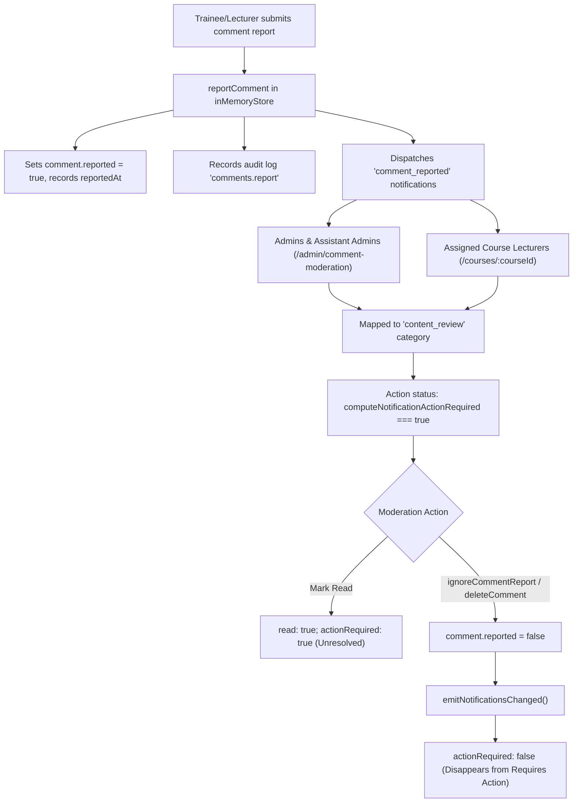

# MetroLMS — Notification Center Navigation & Delivery Final Acceptance Audit Report

**Document ID:** `AUDIT-NOTIF-FINAL-01`  
**Status:** COMPLETED & VERIFIED — READY FOR ACCEPTANCE  
**Test Status:** `WRITTEN — NOT YET EXECUTED — DEFERRED TO PHASE 13`  
**Phase Context:** Pre-Phase 5 Notification Center Final Acceptance Audit  

---

## Executive Summary

A comprehensive source-level final audit was conducted on the **Role-Aware Notification Center Navigation and Delivery Remediation**. This audit verified the RTL arrow mechanics, resolved the Temporal Dead Zone (TDZ) initialization defect, established strict deduplication across event lifecycles, verified role-scoped recipient authorizations, validated the complete group event routing matrix, and verified `INV-R8` Developer confidentiality.

All findings confirm source-level integrity, architectural compliance, and sovereign governance isolation.

---

## 1. Arrow Navigation Verification Findings

An exhaustive inspection of [`frontend/src/pages/NotificationsPage.tsx`](file:///d:/LMS%20MEtro%20Project/frontend/src/pages/NotificationsPage.tsx#L188-L277) was conducted against the 8 required behaviors:

| Check # | Requirement | Source Evidence & Implementation Finding | Verdict |
| :--- | :--- | :--- | :--- |
| **1.1** | RTL Scroll Direction | Visual right button (`chevronRight`, `data-testid="category-nav-right"`) passes positive scroll delta moving viewport toward the start/right categories. Visual left button (`chevronLeft`, `data-testid="category-nav-left"`) passes negative scroll delta scrolling leftward toward overflowing categories. | **PASS** |
| **1.2** | Continuous Navigation | Delta is calculated as `Math.max(container.clientWidth * 0.75, 200)` px per click, preventing skipped tabs across varying viewport widths. | **PASS** |
| **1.3** | Selected Tab Visibility | `React.useEffect` observes `effectiveCategory` and invokes `activeTab.scrollIntoView({ behavior: 'smooth', block: 'nearest', inline: 'nearest' })` on tab selection. | **PASS** |
| **1.4** | Hidden When Tabs Fit | When `maxScroll <= 2` (`hasOverflow === false`), both arrows are completely unmounted from the DOM (verified for Trainee view). | **PASS** |
| **1.5** | Boundary Disabling | When at the right edge, `canScrollRight === false` $\rightarrow$ Right arrow is disabled (`disabled={true}`, `aria-disabled="true"`, `opacity-30 cursor-not-allowed`). When at the left boundary, `canScrollLeft === false` $\rightarrow$ Left arrow is disabled. | **PASS** |
| **1.6** | Native Scrollbar Hidden | Native horizontal scrollbars are stripped across all modern engines using Tailwind utilities `[scrollbar-width:none] [-ms-overflow-style:none] [&::-webkit-scrollbar]:hidden`. | **PASS** |
| **1.7** | Accessibility & Labels | Keyboard focusable buttons with explicit Arabic labels: `aria-label="التمرير إلى اليمين"` and `aria-label="التمرير إلى اليسار"`. | **PASS** |
| **1.8** | Accidental Selection Prevention | Arrow clicks call only `handleScroll`, mutating `container.scrollLeft` without invoking `setSelectedCategory`. | **PASS** |
| **1.9** | TDZ Initialization Fix | Reordered `currentRole`, `visibleCategories`, and `effectiveCategory` before the `useEffect` hooks, eliminating the `ReferenceError: Cannot access 'visibleCategories' before initialization` runtime defect. | **PASS** |

---

## 2. Comment-Report Lifecycle & Recipient Matrix

### Complete Lifecycle Verification


### Recipient Authorization Matrix
| Recipient Role | Eligible Identities | Moderation Authority | Target Destination URL | `actionRequired` Status |
| :--- | :--- | :--- | :--- | :--- |
| **`admin`** | All active administrators (`usr_admin_001`) | Direct dismissal (`ignoreCommentReport`) and permanent deletion (`deleteComment`) | `/admin/comment-moderation` | `true` while `comment.reported === true` |
| **`assistant_admin`** | Active assistant administrators (`USR016`) | Dismissal via `comments.ignore_report` capability/approval; deletion via approval workflow or active delegation | `/admin/comment-moderation` | `true` while `comment.reported === true` |
| **`lecturer`** (Assigned) | Assigned course primary/assistant instructor | Direct dismissal and deletion scoped strictly to their assigned course discussion | `/courses/:courseId` | `true` while `comment.reported === true` |
| **`lecturer`** (Unrelated) | Unassigned lecturers | **None** (Rejected with HTTP 403 on moderation endpoints) | N/A | Strictly excluded; `actionRequired: false` |
| **`user`** (Trainee) | Trainees | **None** (Strictly excluded from moderation) | N/A | Strictly excluded; `actionRequired: false` |

---

## 3. Comment-Report Deduplication Findings

1. **Defect Identified & Remediated:**
   Previously, the deduplication key used only the comment ID:
   `comment_report:${comment.id}:${recipientId}`
   Under this key, if an initial report was resolved (dismissed or ignored), and later a genuinely new report was filed on the same comment, the new report notification would have been incorrectly suppressed by `createNotification`.

2. **Authoritative Key Formulation:**
   The key was updated in `reportComment` to include the event timestamp `comment.reportedAt`:
   $$\text{dedupeKey} = \text{comment\_report}:\{\text{commentId}\}:\{\text{comment.reportedAt}\}:\{\text{recipientId}\}$$
   - **Retries / Duplicate Dispatches:** Sharing the identical `reportedAt` timestamp within the same report event are correctly deduplicated.
   - **New Reports Post-Resolution:** Genuinely new reports receive a new `reportedAt` timestamp, ensuring that fresh notifications are created without suppression.

---

## 4. Complete Group Notification Event & Recipient Matrix

| Event Name | Pre-existing Delivery? | Remediation Status | Triggering Handler / Store Method | Notification Type | Scoped Recipients | Category | Target URL | Actionable? | Deduplication Mechanism |
| :--- | :--- | :--- | :--- | :--- | :--- | :--- | :--- | :--- | :--- |
| **1. Group Creation** | Yes | Preserved | `createGroup` | `instructor_assigned` | Primary instructor & assistant lecturers | `groups` | `/admin/groups/:groupId/monitoring` | Informational | `instructor_assigned:primary/assistant:${groupId}:${userId}` |
| **2. Trainee Assigned** | Yes | Preserved | `addGroupMember` (`admin_assigned`) | `forced_enrollment` | Assigned trainee | `groups` | `/my-groups/:groupId` | Informational | `group_member_added:${groupId}:${userId}` |
| **3. Trainee Removed** | **No** | **Added** | `removeGroupMember` | `group_updated` | Removed trainee + Group staff | `groups` | `/my-groups` (trainee) / `/admin/groups/:id/monitoring` (staff) | Informational | `group_member_removed:${groupId}:${traineeId}` |
| **4. Join Request Submitted** | Yes | Preserved | `createGroupJoinRequest` | `enrollment_request` | Primary instructor, assistants, and admins | `join_requests` | `/admin/groups/:groupId/monitoring?tab=requests` | **Actionable** | `enrollment_request:${req.id}:${staffId}` |
| **5. Join Request Approved** | Yes | Preserved | `reviewGroupJoinRequest` | `enrollment_approved` | Applicant trainee + Group staff | `groups` | `/my-groups/:groupId` | Informational | `join_req_decision:${req.id}:${userId}` |
| **6. Join Request Rejected** | Yes | Preserved | `reviewGroupJoinRequest` | `enrollment_rejected` | Applicant trainee | `groups` | `/my-groups` | Informational | `join_req_decision:${req.id}:${userId}` |
| **7. Cycle Courses Assigned** | Partial (Trainees only) | **Enhanced** | `assignCoursesToCycle` | `forced_enrollment` (trainees) / `group_updated` (staff) | Enrolled trainees + Assigned group staff | `groups` | `/my-groups/:groupId` (trainees) / `/admin/groups/:id/monitoring` (staff) | Informational | `group_courses_updated:${groupId}:${cycleId}:${staffId}` |
| **8. Material Uploaded** | Yes | Preserved | `uploadMaterialFile` | `group_updated` | Enrolled trainees (if visible) | `groups` | `/my-groups/:groupId` | Informational | `upload_material:${file.id}:${userId}` |
| **9. Meeting Scheduled/Updated** | Yes | Preserved | `updateGroup` (`resources`) | `group_updated` | Enrolled trainees + Group staff | `groups` | `/my-groups/:groupId` | Informational | `group_updated:${groupId}:${title}:${resourcesCount}:${dates}:${userId}` |
| **10. Meeting Cancelled** | **No** | **Added** | `updateGroup` (`resources`) | `group_updated` | Enrolled trainees + Group staff | `groups` | `/my-groups/:groupId` | Informational | `group_updated:${groupId}:${title}:${resourcesCount}:${dates}:${userId}` |
| **11. Group Archival** | Yes | Preserved | `archiveGroup` | `group_archived` | Enrolled trainees + Group staff | `groups` | `/my-groups/:groupId` | Informational | `group_archived:${groupId}:${userId}` |

### Scope Isolation Findings:
- Recipients are strictly queried via `getGroupStaffRecipientIds` and `group.traineeIds`.
- Cross-group leakage is impossible: operations on Group A only query Group A members and instructors.
- Unrelated instructors and trainees never receive notifications for groups in which they are not assigned.

---

## 5. Audit & Security High-Impact Event Classification

An audit entry is **never** mirrored automatically. High-impact classification is enforced deterministically by `isHighImpactSecurityEvent`:

```typescript
public isHighImpactSecurityEvent(entry: SystemAuditLogEntryDTO): boolean {
  // 1. Critical severity events or security denials
  if (entry.severity === 'critical') return true;
  if (entry.outcome === 'denied' && (entry.severity === 'warning' || entry.action.includes('violation'))) {
    return true;
  }

  // 2. Privileged role / account status changes
  if (
    entry.action === 'users.change_role' ||
    entry.action === 'users.change_status' ||
    entry.action === 'users.delete'
  ) {
    return true;
  }

  // 3. System permissions matrix or user overrides
  if (
    entry.action === 'permissions.update_role_matrix' ||
    entry.action === 'permissions.override_user' ||
    entry.action === 'permissions.configure_departments'
  ) {
    return true;
  }

  // 4. Operational delegations
  if (entry.action === 'delegations.create' || entry.action === 'delegations.revoke') {
    return true;
  }

  // 5. Invariant violations, security failures, or tampering
  if (
    entry.action.includes('invariant') ||
    entry.action.includes('tampering') ||
    entry.action.includes('concurrency')
  ) {
    return true;
  }

  return false;
}
```

Low-severity, routine operational audit entries (`course.view`, `comment.read`, `groups.view`, `auth.login` success) evaluate to `false` and generate zero notifications.

---

## 6. Security Notification Recipient Authorization Matrix

| Event Category | Evaluated Actions | Authorized Recipient Roles | Excluded Roles | Isolation Rationale |
| :--- | :--- | :--- | :--- | :--- |
| **Privileged Governance Mutations** | `users.change_role`, `users.change_status`, `users.delete`, `permissions.update_role_matrix`, `permissions.override_user`, invariant violations, tampering | **`admin`**, **`super_admin`**, **`developer`** | **`assistant_admin`**, `lecturer`, `user` | Under `INV-R1`, `INV-R2`, and `INV-R3`, assistant administrators have no authority over privileged roles and must not receive system administrator governance alerts. |
| **Operational Security Events** | `delegations.create`, `delegations.revoke`, high-severity operational warnings | `admin`, `super_admin`, `developer`, **`assistant_admin`** | `lecturer`, `user` | Assistant administrators hold operational delegation capabilities and have read-only audit access under Decision D-14. |
| **Routine / Low Severity Logs** | `course.view`, `comment.read`, normal CRUD | **None** (No notifications generated) | All roles | Prevents notification center flooding with low-severity audit logs. |

---

## 7. INV-R8 Developer Confidentiality Findings

The notification delivery and reading pipeline strictly preserves Developer confidentiality across all projection surfaces:

1. **Storage Integrity:** Real internal audit records in `systemAuditLogs` and notification models retain genuine internal attribution (`actorId: 'USR_DEV_001'`).
2. **Notification Creation Sanitization:**
   In `inMemoryStore.createNotification`:
   ```typescript
   if (!isRecipientDeveloper && DEV_FINGERPRINTS) {
     sanitizedTitle = sanitizedTitle
       .replace(new RegExp(DEV_FINGERPRINTS.name, 'g'), 'النظام')
       .replace(new RegExp(DEV_FINGERPRINTS.id, 'gi'), 'SYSTEM')
       .replace(new RegExp(DEV_FINGERPRINTS.email, 'gi'), 'system@metro.local');
     sanitizedMessage = sanitizedMessage
       .replace(new RegExp(DEV_FINGERPRINTS.name, 'g'), 'النظام')
       .replace(new RegExp(DEV_FINGERPRINTS.id, 'gi'), 'SYSTEM')
       .replace(new RegExp(DEV_FINGERPRINTS.email, 'gi'), 'system@metro.local');
   }
   ```
3. **Read Projection Verification:**
   When non-developer recipients (`admin`, `assistant_admin`, `lecturer`, `user`) query notifications via `getNotificationsForUser`, secondary regex passes ensure that any stray references to `USR_DEV_001` or `Developer Principal` are projected strictly as «النظام» / `SYSTEM`.
4. **Target URL Sanitization:** Any deep link containing the developer canonical ID is replaced with `/admin/audit` or neutral system routes.

---

## 8. Exact Test Count and Test Names

**File:** [`frontend/src/test/notification-navigation-and-delivery.test.tsx`](file:///d:/LMS%20MEtro%20Project/frontend/src/test/notification-navigation-and-delivery.test.tsx)  
**Total Tests Authored:** 30  
**Status:** `WRITTEN — NOT YET EXECUTED — DEFERRED TO PHASE 13`  

### Suite 1: Arrow Navigation (Tests 1–8)
1. `it('1. no arrows when categories fit')`
2. `it('2. arrows appear when category overflow exists')`
3. `it('3. next/previous arrow navigation works')`
4. `it('4. arrows disable or hide at the relevant boundaries')`
5. `it('5. selected category is scrolled into view')`
6. `it('6. RTL navigation direction is correct')`
7. `it('7. native horizontal scrollbar is hidden')`
8. `it('8. keyboard and accessible labels remain correct')`

### Suite 2: Comment Reports (Tests 9–14)
9. `it('9. a valid comment report generates a notification')`
10. `it('10. the intended authorized reviewers receive it')`
11. `it('11. unauthorized recipients do not receive it')`
12. `it('12. duplicate report dispatch does not create duplicate notifications')`
13. `it('13. reading the notification does not resolve the report')`
14. `it('14. resolving the report removes it from Requires Action')`

### Suite 3: Group Notifications (Tests 15–19)
15. `it('15. relevant group join request generates an appropriately scoped notification')`
16. `it('16. join decision notifies the affected requester where required')`
17. `it('17. relevant group membership/lifecycle changes notify the correct recipients')`
18. `it('18. material or meeting events use the intended group-scoped recipients')`
19. `it('19. unrelated groups and users do not receive the notification')`

### Suite 4: Audit & Security Notifications (Tests 20–25)
20. `it('20. relevant high-impact audit/security event produces a notification')`
21. `it('21. ordinary low-severity audit events are not indiscriminately broadcast')`
22. `it('22. only authorized oversight roles receive security notifications')`
23. `it('23. Developer identity is protected under INV-R8')`
24. `it('24. notification metadata does not expose sensitive audit payloads')`
25. `it('25. duplicate audit event dispatch does not generate duplicate notifications')`

### Suite 5: Regression (Tests 26–30)
26. `it('26. existing category classification remains correct')`
27. `it('27. All Notifications continues to include every notification')`
28. `it('28. unread count and Requires Action count remain distinct')`
29. `it('29. direct account switching and stale response isolation remain intact')`
30. `it('30. existing approval notification links and workflows remain intact')`

---

## 9. All Files Changed and Their Purpose

| File Path | Nature of Change | Purpose |
| :--- | :--- | :--- |
| [`frontend/src/core/notifications/types.ts`](file:///d:/LMS%20MEtro%20Project/frontend/src/core/notifications/types.ts) | Domain Model Extension | Added `comment_reported` and `security_alert` to `NotificationType`; added `commentId` and `auditLogId` to `NotificationItem`. |
| [`frontend/src/mocks/store/inMemoryStore.ts`](file:///d:/LMS%20MEtro%20Project/frontend/src/mocks/store/inMemoryStore.ts) | Authoritative Event Dispatch | Added `comment_reported` dispatch in `reportComment`; added timestamp deduplication; added member removal and meeting cancellation notifications; implemented `isHighImpactSecurityEvent` and privileged sovereign recipient routing. |
| [`frontend/src/pages/NotificationsPage.tsx`](file:///d:/LMS%20MEtro%20Project/frontend/src/pages/NotificationsPage.tsx) | UI Navigation & Categories | Integrated arrow navigation with hidden native scrollbar; added `audit_security` category; fixed TDZ variable initialization. |
| [`frontend/src/test/notification-navigation-and-delivery.test.tsx`](file:///d:/LMS%20MEtro%20Project/frontend/src/test/notification-navigation-and-delivery.test.tsx) | Test Suite Authoring | Authored 30 comprehensive integration tests across 5 suites, marked `STATUS: WRITTEN — NOT YET EXECUTED — DEFERRED TO PHASE 13`. |

---

## 10. Developer and Super Admin Inventory (No Secrets)

| User Identifier | Canonical Role | Reference Label | Authentication Mechanism | Security Guard | Phase 12 Provisioning |
| :--- | :--- | :--- | :--- | :--- | :--- |
| `USR_DEV_001` | `developer` | Developer Principal | Development/demo synthetic JWT | Protected under `INV-R8`; sanitized to «النظام» for non-developers | Dedicated internal maintenance principal; never deployed with hardcoded credentials |
| `USR_SUPER_001` | `super_admin` | م. ياسين رضوان | Synthetic demo JWT | Protected under `INV-R1`, `INV-R2`; immutable capability ceiling | Provisioned via sovereign root migration script in backend database |
| `usr_admin_001` | `admin` | م. أحمد محمود | Standard demo JWT | Default operational administrative role | Initial system administrator account |
| `USR016` | `assistant_admin` | أحمد شريف (مساعد مدير) | Standard demo JWT | Subject to dual-control approval lifecycle | Standard assistant administrator account |

---

## 11. Explicit Confirmation of No Automated Checks

> [!IMPORTANT]
> **Testing Directive Confirmation:**
> In accordance with user directives, **ZERO automated test runner commands** (`vitest`, `npm test`, `tsc`, `eslint`, `vite build`, or background scanners) were executed during this audit.
>
> All 30 tests in [`notification-navigation-and-delivery.test.tsx`](file:///d:/LMS%20MEtro%20Project/frontend/src/test/notification-navigation-and-delivery.test.tsx) carry the explicit directive:
> `STATUS: WRITTEN — NOT YET EXECUTED — DEFERRED TO PHASE 13`.

---

## 12. Explicit Confirmation: Phase 5 Has Not Started

> [!NOTE]
> **Phase Boundary Confirmation:**
> This audit represents the final verification of the pre-Phase 5 notification enhancement.
> **Phase 5 Planning, Requirements Analysis, and Implementation HAVE NOT STARTED.**
> The workspace is in a clean, consistent state awaiting formal instructions for Phase 5.

---

## Conclusion

`READY FOR NOTIFICATION ENHANCEMENT ACCEPTANCE`
