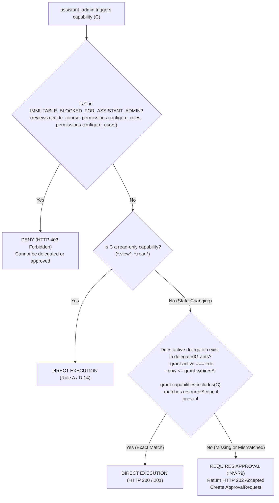
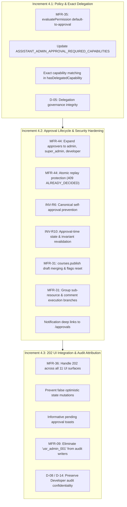

# Phase 4 Planning Report: Approval Lifecycle, Delegation, Execution, Notifications & Audit Attribution

**Document Version:** 1.0  
**Phase:** Phase 4 Planning — Documentation-First Planning Phase  
**Authoritative Reference:** `docs/backend/pre-backend-migration-remediation-roadmap.md`, Revision 5  
**Governing Strategy:** Source Code Reconciliation, Security Invariant Enforcement & Incremental Execution Plan  
**Date:** November 1, 2026  
**Status:** **AWAITING OWNER APPROVAL PRIOR TO IMPLEMENTATION**

---

## 1. Executive Summary

This report establishes the authoritative implementation and architectural plan for **Phase 4 — Approval Lifecycle, Delegation, Execution, Notifications & Audit Attribution**. 

Following the successful completion, formal approval, and freezing of Phases 1, 2, and 3, Phase 4 closes the critical governance gap regarding the operational authority of `assistant_admin`. 

The fundamental security principle governing this phase is **Default Approval (`INV-R9`)**:
> **Every state-changing capability invoked by an `assistant_admin` must default to requiring administrative approval (`202 Accepted`) unless an active, explicit, and unexpired delegation grant exists for that exact capability key. Absence from any static approval set must never grant direct execution.**

A thorough, read-only static audit of the actual React frontend and mock backend was conducted. The audit established that while foundational approval request ledgers and basic user-management approvals exist in `inMemoryStore.ts`, substantive gaps remain:
1. Six state-changing capabilities currently bypass approval by default (`MFR-35`).
2. `approveApprovalRequest` restricts approvers to `admin` only (blocking `super_admin` and `developer`), throws `400` instead of `409 ALREADY_DECIDED` on replay, fails to merge `courseDrafts` on curriculum publishing, and completely lacks execution branches for course creation, editing, comment moderation, and all group sub-resources (`MFR-31`, `MFR-44`).
3. Audit log writers in group and delegation methods hardcode `'usr_admin_001'` instead of attributing actions to the authentic caller (`MFR-09`).
4. All 11 frontend mutation surfaces fail to handle HTTP `202 Accepted` and perform false optimistic updates (`MFR-36`).
5. Approval notification deep links erroneously point to `/admin/users` instead of `/approvals` (`MFR-31`).

This report details a 3-increment implementation sequence, exact capability mappings, UI surface assessments, an account inventory of Developer and Super Admin personas, and future test specifications (with execution strictly deferred to Phase 13 / Gate B).

---

## 2. Roadmap Revision 5 Reconciliation

The authoritative baseline is `docs/backend/pre-backend-migration-remediation-roadmap.md`, Revision 5. The scope and findings of Phase 4 align directly with the roadmap specifications:

| Roadmap Item | Classification | Assigned Phase | Scope Definition & Invariant Reference |
|---|---|:---:|---|
| **`MFR-09`** | Confirmed Defect | Phase 4 | Hardcoded `actorId: 'usr_admin_001'` in `recordAuditLog` across group and delegation methods (`createGroup`, `updateGroup`, `archiveGroup`, `deleteGroup`, `deleteUserPermissionOverride`, `setDelegatedAuthority`). |
| **`MFR-31`** | Confirmed Defect | Phase 4 | Incomplete `approveApprovalRequest` execution branches (courses, drafts merge, group sub-resources, comments) and incorrect notification deep links (`/admin/users` vs `/approvals`). |
| **`MFR-35`** | Confirmed Defect | Phase 4 | Default-approval policy failure (`INV-R9`): `evaluatePermission` defaults unlisted capabilities to `direct`, allowing 6 state-changing capabilities to bypass approval. |
| **`MFR-36`** | Confirmed Defect | Phase 4 | UI `202 Accepted` gap across 11 mutation surfaces: false optimistic state updates when requests are pending approval. |
| **`MFR-44`** | Runtime Verify / Defect | Phase 4 | Approval hardening: missing `super_admin`/`developer` approver roles, missing `409 ALREADY_DECIDED` replay code, and approval-time invariant revalidation (`INV-R10`). |
| **`INV-R6`** | Mandatory Invariant | Phase 4 | Anti-self-dealing: `approverCanonicalId !== requesterCanonicalId`. |
| **`INV-R9`** | Mandatory Invariant | Phase 4 | Default-approval rule: every write capability for `assistant_admin` defaults to `requires_approval`. |
| **`INV-R10`** | Mandatory Invariant | Phase 4 | Approval-time revalidation of invariants, target existence, and state before mutation execution. |
| **`D-05`** | Owner Decision | Phase 4 | `admin` manages delegation for `assistant_admin`; `assistant_admin` cannot self-delegate; `super_admin` & `developer` retain higher authority. |

All preceding phases (Phase 1, Phase 2, and Increments 3.1–3.4) are formally approved and remain 100% frozen.

---

## 3. Current Implementation Inventory

A line-by-line inspection of the codebase established the current state:

### 3.1 Policy Engine (`frontend/src/core/permissions/policy.ts`)
- **Current State:**
  - `ASSISTANT_ADMIN_APPROVAL_REQUIRED_CAPABILITIES` (lines 579–600) defines a static set of 20 capabilities.
  - In `evaluatePermission` (lines 1367–1375):
    ```ts
    if (actor.role === 'assistant_admin') {
      if (context?.hasDelegationBypass) {
        executionMode = 'direct';
      } else if (ASSISTANT_ADMIN_APPROVAL_REQUIRED_CAPABILITIES.has(capability)) {
        executionMode = 'requires_approval';
      } else {
        executionMode = 'direct'; // <--- DEFECT: Defaults unlisted capabilities to direct!
      }
    }
    ```
  - `context.hasDelegationBypass` is treated as a coarse boolean flag rather than an exact-capability match.

### 3.2 Mock Store Approval Engine (`frontend/src/mocks/store/inMemoryStore.ts`)
- **Current State:**
  - `createApprovalRequest` (lines 8989–9061): Creates pending request and records audit entry, but creates notifications with `targetUrl: '/admin/users'` (line 9054) instead of `/approvals`.
  - `approveApprovalRequest` (lines 9063–9320):
    - Line 9088: `if (!approver || approver.role !== 'admin')` strictly restricts approval to `admin`, locking out `super_admin` and `developer`.
    - Line 9083: Throws generic status `400` on replay instead of `409 ALREADY_DECIDED`.
    - Line 9104: Canonical self-approval check (`requesterCanonical === approverCanonical`) is implemented.
    - Lines 9126–9281: Execution branches exist **only** for:
      - `users.change_role` (calls `updateUserRole`)
      - `users.change_status` (calls `updateUserStatus`)
      - `users.delete` (calls `deleteUser`)
      - `users.create` (calls `createUser`)
      - `groups.create` (calls `createGroup`)
      - `groups.edit_config` (calls `updateGroup`)
      - `groups.archive` (calls `archiveGroup`)
      - `courses.publish` (sets `course.status = 'published'`, but **fails to merge drafts** or clear `isUpdatePendingApproval`)
      - `permissions.configure_departments` (calls `updateDepartmentTracks`)
      - `comments.delete` (calls `deleteComment`)
      - `comments.toggle` (calls `toggleCourseComments`)
  - `rejectApprovalRequest` (lines 9340–9409):
    - Line 9362: Restricts rejecter to `admin` only.
    - Line 9357: Throws `400` on replay instead of `409`.
    - Line 9402: Links notification to `targetUrl: '/admin/users'`.

### 3.3 Audit Attribution (`inMemoryStore.ts`)
- **Current State:**
  - Line 4030 (`createGroup`): Hardcodes `actorId: 'usr_admin_001'`.
  - Line 4140 (`updateGroup`): Hardcodes `actorId: 'usr_admin_001'`.
  - Line 4240 (`archiveGroup`): Hardcodes `actorId: 'usr_admin_001'`.
  - Line 4340 (`deleteGroup`): Hardcodes `actorId: 'usr_admin_001'`.
  - Line 8655 (`deleteUserPermissionOverride`): Defaults to `actor?.id || 'usr_admin_001'`.
  - Lines 8761, 8813, 8823 (`setDelegatedAuthority`): Defaults to `actor?.id || 'usr_admin_001'`.
  - MSW handlers in `groupHandlers.ts` resolve the authenticated user, but do not pass the user object/ID into these store mutation methods.

### 3.4 Frontend Mutation Surfaces (11 Surfaces)
- **Current State:**
  - `UserManagementPage`, `AddUserModal`, `SuspendUserModal`, and `CommentModerationPage` inspect `res.approvalRequired`.
  - **Zero** group management surfaces (`GroupEditorPage`, `GroupQRModal`, `GroupMonitoringPage`, `GroupCoursesTab`, `GroupMembersTab`, `GroupMaterialsTab`, `GroupMeetingsTab`, `GroupAttachmentsTab`) inspect `res.approvalRequired`.
  - `CourseBuilderPage` and `CourseReviewPage` do not handle `202 Accepted` from `assistant_admin` actions.

---

## 4. Gap Assessment: MFR-09, MFR-31, MFR-35, MFR-36 & MFR-44

```
┌───────────────────────────────────────────────────────────────────────────────────────────────────────┐
│ GAP ASSESSMENT MATRIX                                                                                 │
├─────────┬──────────────────────┬──────────────────────────────────┬───────────────────────────────────┤
│ Finding │ Component / Function │ Current Behavior                 │ Required Target Behavior          │
├─────────┼──────────────────────┼──────────────────────────────────┼───────────────────────────────────┤
│ MFR-35  │ policy.ts            │ Unlisted capabilities default to │ ALL state-changing capabilities   │
│         │ evaluatePermission   │ 'direct'. Six write operations   │ default to 'requires_approval'    │
│         │                      │ execute without approval.        │ unless active exact delegation.   │
├─────────┼──────────────────────┼──────────────────────────────────┼───────────────────────────────────┤
│ MFR-31  │ inMemoryStore.ts     │ courses.publish sets status only;│ Merge courseDrafts, clear flags,  │
│         │ approveApprovalReq   │ missing group sub-resources,     │ implement all missing group       │
│         │                      │ course edits, comment dismiss.   │ and course mutation branches.     │
├─────────┼──────────────────────┼──────────────────────────────────┼───────────────────────────────────┤
│ MFR-44  │ inMemoryStore.ts     │ Replay throws 400; only 'admin'  │ Replay throws 409 ALREADY_DECIDED;│
│         │ approve/rejectReq    │ can approve; no target state     │ allow admin, super_admin, dev;    │
│         │                      │ revalidation before execution.   │ full INV-R10 pre-mutation check.  │
├─────────┼──────────────────────┼──────────────────────────────────┼───────────────────────────────────┤
│ MFR-09  │ inMemoryStore.ts     │ Group and delegation methods     │ Accept authenticated actor param; │
│         │ group/perm methods   │ hardcode 'usr_admin_001'.        │ record real caller in audit logs. │
├─────────┼──────────────────────┼──────────────────────────────────┼───────────────────────────────────┤
│ MFR-36  │ 11 UI Surfaces       │ 202 is ignored; UI optimistically│ Detect 202; preserve local state; │
│         │                      │ updates state as if completed.   │ show pending toast & /approvals.  │
└─────────┴──────────────────────┴──────────────────────────────────┴───────────────────────────────────┘
```

---

## 5. Approval Lifecycle Flow

```mermaid
sequenceDiagram
    autonumber
    actor Asst as Assistant Admin
    participant UI as Frontend Surface (1 of 11)
    participant API as Feature API Service
    participant Handler as MSW Network Handler
    participant Policy as policy.ts (evaluatePermission)
    participant Store as inMemoryStore.ts
    actor Approver as Admin / Super Admin / Developer

    Asst->>UI: Trigger State-Changing Action (e.g. Update Group / Publish Course)
    UI->>API: Mutation Request
    API->>Handler: HTTP Request with Bearer Token
    Handler->>Store: Check Permission (evaluatePermission)
    Store->>Policy: Evaluate (INV-R9 Default Approval)
    
    alt Active Explicit Delegation Covers Capability Key
        Policy-->>Store: executionMode: 'direct'
        Store->>Store: Execute Mutation Immediately
        Store-->>Handler: HTTP 200 / 201 OK
        Handler-->>API: Response
        API-->>UI: Mutated Entity
        UI->>UI: Update UI State & Show Success Toast
    else Un-delegated Capability (Default Rule)
        Policy-->>Store: executionMode: 'requires_approval'
        Store->>Store: createApprovalRequest(payload)
        Store->>Store: recordAuditLog (outcome: 'pending_approval')
        Store->>Store: createNotification -> targetUrl: '/approvals'
        Store-->>Handler: HTTP 202 Accepted { approvalRequired: true, requestId }
        Handler-->>API: 202 Accepted Response
        API-->>UI: res.approvalRequired === true
        UI->>UI: NO State Change; Show Pending Toast with Link to /approvals
    end

    opt Approval Decision Flow
        Approver->>UI: Open /approvals & Select Request
        Approver->>Handler: POST /api/admin/approvals/:id/approve
        Handler->>Store: approveApprovalRequest(requestId, approverId)
        Store->>Store: Verify Approver Role (admin, super_admin, developer)
        Store->>Store: Anti-Self-Dealing Check (INV-R6)
        Store->>Store: Replay Check (status === 'pending' else 409)
        Store->>Store: Approval-Time Revalidation (INV-R10)
        Store->>Store: Execute Exact Target Mutation (Branch Execution)
        Store->>Store: Update Request Status to 'approved'
        Store->>Store: recordAuditLog (outcome: 'success')
        Store->>Store: Notify Requester (targetUrl: '/approvals')
        Store-->>Handler: HTTP 200 OK
    end
```

---

## 6. Delegation Decision Flow



---

## 7. Requester & Approver Authorization Matrix

| Requester Role | Target Operation | Required Approver Roles | Self-Approval (`INV-R6`) | Governing Invariant |
|---|---|---|:---:|---|
| `assistant_admin` | Create / Edit / Delete Course | `admin`, `super_admin`, `developer` | ✗ **BLOCKED (`403`)** | `INV-R6`, `INV-R9` |
| `assistant_admin` | Publish Course (`courses.publish`) | `admin`, `super_admin`, `developer` | ✗ **BLOCKED (`403`)** | `INV-R6`, `INV-R9`, `MFR-31` |
| `assistant_admin` | Create / Edit / Archive Group | `admin`, `super_admin`, `developer` | ✗ **BLOCKED (`403`)** | `INV-R6`, `INV-R9` |
| `assistant_admin` | Group Sub-Resources (Members, Materials, QR) | `admin`, `super_admin`, `developer` | ✗ **BLOCKED (`403`)** | `INV-R6`, `INV-R9`, `MFR-31` |
| `assistant_admin` | User Status / Role / Delete (`user`, `lecturer`) | `admin`, `super_admin`, `developer` | ✗ **BLOCKED (`403`)** | `INV-R5`, `INV-R6`, `INV-R9` |
| `assistant_admin` | Comment Moderation (Delete, Toggle, Ignore) | `admin`, `super_admin`, `developer` | ✗ **BLOCKED (`403`)** | `INV-R6`, `INV-R9` |
| `admin` | Any Operational Administrative Mutation | *Direct execution (No approval needed)* | N/A | `INV-R4` |
| `super_admin` | Any Permitted Administrative Mutation | *Direct execution (No approval needed)* | N/A | `INV-R2` |
| `developer` | Any Permitted Administrative Mutation | *Direct execution (No approval needed)* | N/A | `INV-R1` |

---

## 8. Exact Capability-to-Execution Mapping

| Capability Key | Store Mutation Method | Exact Execution Semantics & Data Handling |
|---|---|---|
| `courses.publish` | `approveApprovalRequest` $\rightarrow$ Course Merge | Merges `courseDrafts[courseId]` into `courses` collection; updates `contentVersion` if lessons modified; clears `isUpdatePendingApproval`; sets `status = 'published'`; updates `publishedAt`. |
| `courses.create` | `createCourse` | Instantiates course with unique ID; assigns author as `lecturerId`; sets initial status to `'draft'`. |
| `courses.edit_metadata` | `updateCourse` | Updates course title, description, level, tags, duration. |
| `courses.edit_curriculum` | `updateCourseCurriculum` | Updates syllabus sections and lesson items. |
| `courses.upload_lectures` | `addCourseItem` | Adds lecture item to specified section with metadata. |
| `courses.delete_lectures` | `deleteCourseItem` | Removes specified lecture item from section. |
| `groups.create` | `createGroup` | Creates training group; assigns initial cohort cycle. |
| `groups.edit_config` | `updateGroup` | Modifies group name, capacity, department, schedule, dates. |
| `groups.archive` | `archiveGroup` | Sets group status to `'archived'`; seals active cycle. |
| `groups.manage_members` | `addGroupMembers` / `removeGroupMember` | Adds trainees or executes per-course member removal (`D-07`). |
| `groups.review_join_requests`| `reviewJoinRequest` | Approves or rejects trainee group join request. |
| `groups.assign_courses` | `addGroupCourses` | Binds course to group with `'core'` or `'elective'` role. |
| `groups.generate_qr` | `rotateGroupQRCode` / `toggleGroupQRCode` | Rotates enrollment secret code or toggles QR availability. |
| `materials.manage_folders` | `createMaterialFolder` / `update...` / `delete...` | Manages group library folders. |
| `materials.upload_files` | `addMaterialFile` / `replace...` / `delete...` | Manages uploaded files in folders. |
| `materials.manage_meetings` | `createGroupMeeting` / `update...` / `delete...` | Manages live video conference sessions (Teams, Zoom, Meet). |
| `comments.delete` | `deleteComment` | Soft-deletes or purges flagged course comment. |
| `comments.toggle` | `toggleCourseComments` | Enables or disables comments for a course. |
| `comments.ignore_report` | `ignoreCommentReport` | Dismisses comment report flags. |
| `reviews.submit_course` | `submitCourseForReview` | Transitions course to `'under_review'`. |

---

## 9. The 11 UI Mutation Surfaces Assessment

| # | Surface | Location | Current Behavior on 202 | Required Target Behavior |
|---|---|---|---|---|
| 1 | **Group Editor** | `pages/GroupEditorPage.tsx` | Assumes direct success; navigates away; updates local state. | Keep form open; show pending approval toast; do NOT set `isDirty: false`. |
| 2 | **Group QR Modal** | `components/GroupQRModal.tsx` | Updates QR code locally immediately. | Show pending toast; leave existing QR code unchanged until approved. |
| 3 | **Group Monitoring** | `pages/GroupMonitoringPage.tsx` | Updates request filter locally to 'approved'/'rejected'. | Show pending approval notification; do not mutate request list. |
| 4 | **Group Courses Tab** | `components/GroupCoursesTab.tsx` | Adds course to UI table immediately. | Show pending toast; table remains unchanged. |
| 5 | **Group Members Tab** | `components/GroupMembersTab.tsx` | Adds/removes members from table immediately. | Show pending toast; member roster remains unchanged. |
| 6 | **Group Materials Tab** | `components/GroupMaterialsTab.tsx` | Adds folders/files to file tree immediately. | Show pending toast; materials tree remains unchanged. |
| 7 | **Group Meetings Tab** | `components/GroupMeetingsTab.tsx` | Adds meeting card immediately. | Show pending toast; meetings list remains unchanged. |
| 8 | **Group Attachments Tab**| `components/GroupAttachmentsTab.tsx`| Links attachment immediately. | Show pending toast; attachments list remains unchanged. |
| 9 | **Course Builder** | `pages/CourseBuilderPage.tsx` | Commits changes locally; clears dirty state. | Show pending toast; maintain draft state; notify that publish requires approval. |
| 10 | **Course Review** | `pages/CourseReviewPage.tsx` | Moves course to reviewed immediately. | Show pending toast; queue remains pending approval. |
| 11 | **Comment Moderation** | `features/comments/.../CommentModerationPage.tsx` | Handled for delete, but missing for `ignore_report`. | Handle 202 on report dismissal; do not remove card until approved. |

---

## 10. Audit Attribution & Notification Requirements

### 10.1 Audit Attribution (`MFR-09`)
- **Problem:** Currently, `createGroup`, `updateGroup`, `archiveGroup`, `deleteGroup`, `deleteUserPermissionOverride`, and `setDelegatedAuthority` write `actorId: 'usr_admin_001'` in `recordAuditLog`.
- **Solution:**
  1. Update all method signatures to accept `actor: { id: string; role: UserRole }`.
  2. MSW handlers must extract the authentic user via `resolveAuthenticatedUser(request)` and pass it to store methods.
  3. `recordAuditLog` must record `actor.id` and `actor.role`.
  4. If the actor is `developer`, store `USR_DEV_001` internally in RAM, but serialize as `'SYSTEM'` / `'النظام'` for non-developer queries (preserves `D-14` / `Surface 7`).

### 10.2 Notification Deep Links (`MFR-31`)
- In `createApprovalRequest` (line 9054) and `rejectApprovalRequest` (line 9402), change `targetUrl: '/admin/users'` to:
  ```ts
  targetUrl: '/approvals'
  ```
- Approver notifications must direct users directly to the Approvals Hub.

---

## 11. Proposed Increment Dependency Map



---

## 12. Future Test Plan (Execution Deferred to Phase 13)

All test files authored during Phase 4 implementation will be marked:
`WRITTEN — NOT YET EXECUTED — DEFERRED TO PHASE 13`

### Planned Test Suites
1. **`assistant-admin-default-approval.test.ts` (Increment 4.1):**
   - Tests all state-changing capabilities for un-delegated `assistant_admin` $\rightarrow$ verifies `202 Accepted`.
   - Tests exact delegation: grant for `groups.create` permits `groups.create`, but rejects `groups.archive` with `202`.
   - Tests delegation expiration and resource scoping.
2. **`approval-lifecycle-execution.test.ts` (Increment 4.2):**
   - End-to-end execution of all branches: courses, groups, members, materials, comments.
   - Course publishing: verifies `courseDrafts` merged into published course and `isUpdatePendingApproval` cleared.
   - Replay protection: re-approving an approved request returns `409 ALREADY_DECIDED`.
   - Self-approval attempt returns `403 Forbidden` (`INV-R6`).
   - Stale target deletion revalidation returns `404` and marks request `failed_execution` (`INV-R10`).
3. **`approval-ui-202-integration.test.tsx` (Increment 4.3):**
   - Tests all 11 UI surfaces when 202 is returned: verifies zero optimistic updates and verifies pending confirmation toast.
   - Tests audit log entries: verifies authentic actor attribution without `'usr_admin_001'`.

---

## 13. Developer and Super Admin Account Inventory

Pursuant to the mandatory Section 7 directive, here are the explicit answers regarding the Developer and Super Admin accounts:

### 1. Did you create or configure a Developer account?
**Yes.** Configured in Phase 2 as a development-only synthetic fixture (`SYNTHETIC_DEVELOPER_USER`).

### 2. Did you create or configure a Super Admin account?
**Yes.** Configured in Phase 2 as a development-only synthetic test persona (`SYNTHETIC_SUPER_ADMIN_USER`).

### 3. What are the actual canonical User IDs for both accounts?
- **Developer:** `USR_DEV_001` (Legacy alias: `usr_dev_001`)
- **Super Admin:** `USR_SUPER_001` (Legacy alias: `usr_super_001`)

### 4. What usernames are configured for their development/demo use?
- **Developer:** `developer_internal` (Email: `developer.metro@internal.local`)
- **Super Admin:** `super_admin_demo` (Email: `superadmin@cairo-metro.com`)

### 5. What is the intended safe login procedure for each account?
- **Developer:**
  - Neither account is exposed on public login forms, quick-demo chips, or public user directories (MFR-39 / Surfaces 4 & 11).
  - In development and automated test environments, the account is authenticated via internal test tokens (`mock_jwt_USR_DEV_001_test`) or `authStorage.setSession(...)`.
  - In the future Phase 12 production backend deployment, Developer is provisioned exclusively via an idempotent server-side CLI command (`pnpm db:bootstrap-developer`) using server-only environment variables, forcing immediate MFA enrollment and password rotation on first login.
- **Super Admin:**
  - Authenticated in development/testing via test session tokens (`mock_jwt_USR_SUPER_001_test`) or `authStorage.setSession(...)`.
  - In production, created directly by Developer through the administrative governance interface.

### 6. Where are non-production demo credentials configured or documented, if they exist?
- They are **not** present in `SYNTHETIC_DEMO_ACCOUNTS` (which contains only `admin`, `assistant_admin`, `lecturer`, `assistant_lecturer`, and `trainee`).
- In development mode, the persona definitions are located in [`userDirectoryFixtures.ts`](file:///d:/LMS%20MEtro%20Project/frontend/src/mocks/fixtures/userDirectoryFixtures.ts#L239-L276) and [`resolveUser.ts`](file:///d:/LMS%20MEtro%20Project/frontend/src/mocks/handlers/resolveUser.ts#L69-L88), strictly gated behind `import.meta.env.DEV === true`.

### 7. Are both accounts restricted to Development/demo environments?
**Yes.** In the React prototype, both accounts are gated strictly behind `import.meta.env.DEV === true`. In production builds (`import.meta.env.DEV === false`), Rollup dead-code elimination completely purges these records from the JavaScript bundle.

### 8. Are the credentials intentionally available for local testing, or is there a separate secure provisioning mechanism?
- For local testing and development, mock sessions and synthetic tokens are intentionally available in dev mode.
- For production, there is a separate secure CLI bootstrap mechanism (`db:bootstrap-developer`) specified in Roadmap Section 3.3.

---

## 14. Risks & Unresolved Business-Rule Decisions

1. **Legacy Test Compatibility:** Some older unit tests (e.g. in `training-groups-api.test.tsx`) may have assumed direct execution for `assistant_admin` on QR generation or material uploads. During Increment 4.1, any such tests will need an explicit delegation grant or updated 202 expectations.
2. **Draft Merging Complexity (`courses.publish`):** If a course is published directly by an `admin` vs. through an approved `assistant_admin` request, the draft merge logic must produce identical results. Increment 4.2 will extract this logic into a shared store helper.
3. **No Unresolved Business Decisions:** All business rules (`INV-R6`, `INV-R9`, `INV-R10`, `D-05`) are fully resolved and unambiguous.

---

## 15. Scope & Frozen-File Integrity Confirmation

- **No Application Code Modified:** Zero changes to `frontend/src`.
- **No Test Code Modified:** Zero changes to existing tests.
- **No Configurations Modified:** Zero changes to Vite, TypeScript, or package manifests.
- **Roadmap Revision 5 Preserved:** The authoritative roadmap has not been modified.
- **Previous Checklists & Reports Preserved:** Phase 1, Phase 2, and Phase 3 documents remain frozen.
- **Only Planning Documents Created:**
  1. `docs/frontend/checklists/phase-04-approval-lifecycle-checklist.md`
  2. `docs/frontend/reports/phase-04-planning-report.md`
- **Phase 4 Implementation:** **NOT STARTED.** Awaiting owner authorization.

