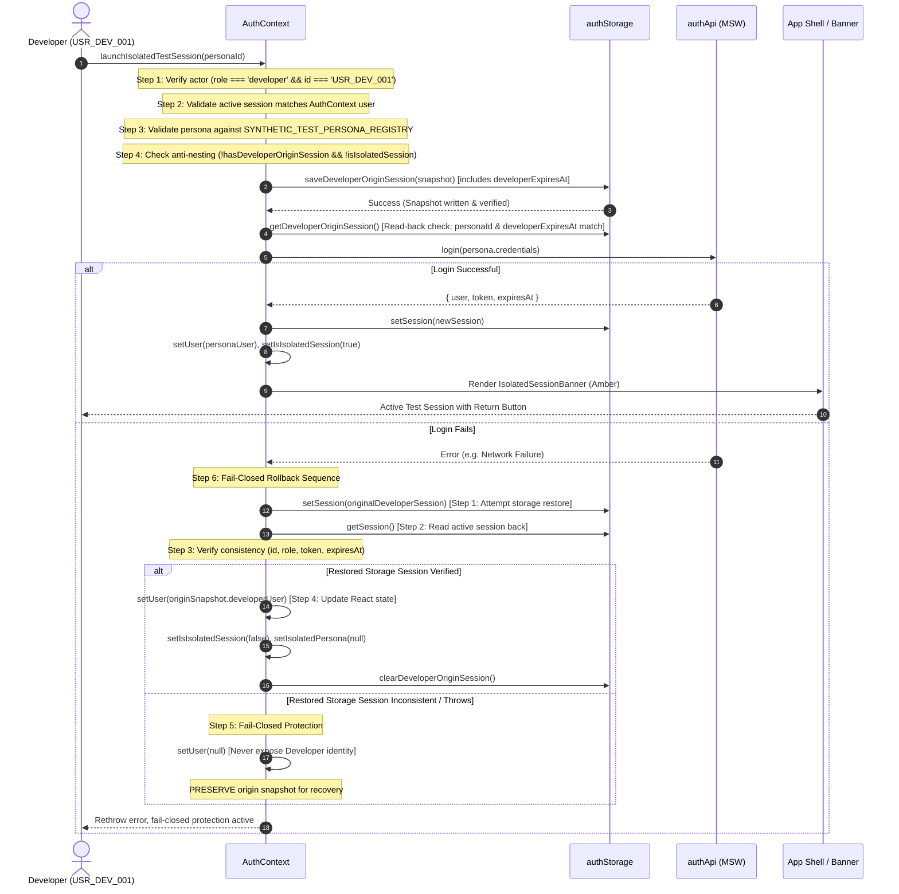

# MetroLMS — Increment 5.3 Implementation Report
# Synthetic Personas & Complete Isolated Session Round-Trip (Security Hardened)

**Project:** MetroLMS React Frontend  
**Authoritative Baseline:** Pre-Backend Migration Remediation Roadmap — Revision 5  
**Governing Phase:** Phase 5 — Developer Role Preview & Isolated Role Testing  
**Increment:** 5.3 — Synthetic Personas & Complete Isolated Session Round-Trip  
**Owner Decisions:** `D-10` (Isolated Role Testing vs. Visual Preview Separation)  
**Master Findings Addressed:** `MFR-40` (Session Switching Defect & Visual Role Preview Separation), `MFR-25`  
**Security Invariants Enforced:** `INV-R1`, `INV-R2`, `INV-R8`, `INV-D10-1`, `INV-P5-1`, `INV-P5-2`, `INV-P5-3`, `INV-P5-4`, `INV-P5-5`, `INV-P5-6`, `INV-P5-7`  
**Date:** November 3, 2026  
**Status:** IMPLEMENTED & HARDENED — COMPLETE SESSION ROUND-TRIP OPERATIONAL (Deferred Verification to Phase 13)

---

## 1. Architecture and Source Inspection Findings

### 1.1 Previous Baseline (Increment 5.2)
In Increment 5.2, **Visual Role Preview** (`معاينة الدور`) was established under `RolePreviewContext`. It provided purely client-side layout, navigation, and component simulation without modifying `AuthContext.user`, the authenticated token, or network headers. A mutation barrier in `apiClient.ts` blocked mutating HTTP verbs (POST, PUT, PATCH, DELETE) to protect data integrity during visual preview.

### 1.2 The Core Problem Addressed by Increment 5.3
While Visual Role Preview allows the Developer to inspect role layouts safely, it cannot be used to test genuine role capabilities, workflow permissions, or API-level mutation policies. Previously, the application contained an unsafe legacy helper: `AuthContext.switchDemoUser(role)`.

Source inspection revealed three critical defects in `switchDemoUser`:
1. **Developer Session Loss:** It immediately replaced the authenticated Developer user and token with a demo account without saving the Developer session. The Developer had to log out and re-enter credentials to return.
2. **Unchecked Impersonation Risk (`MFR-40`):** It accepted an arbitrary `UserRole` string and logged in directly without allowlist verification or development-environment gating.
3. **No Transactional Rollback:** If demo authentication failed, the user was left in a partially disconnected or corrupted authentication state.

### 1.3 Increment 5.3 Architectural Solution & Targeted Hardening
Increment 5.3 implements **Isolated Role Test Sessions** (`اختبار الصلاحيات`) under Owner Decision `D-10` and Stable Finding `MFR-40`. Following targeted security audit reconciliation, the architecture enforces:
1. **Canonical Developer Identity Check:** Launch requires `user.role === 'developer'` AND explicit canonical identity `user.id === 'USR_DEV_001'`, preventing reliance on role strings alone.
2. **Context & Storage Session Agreement:** Active session in `authStorage` must agree with `AuthContext.user` in ID, role, and token before launch is permitted.
3. **Strict Synthetic Persona Registry (`SYNTHETIC_TEST_PERSONA_REGISTRY`):** An allowlist of exactly five approved synthetic personas, DEV-only gated, with strict canonical IDs and roles.
4. **Separate Origin Session Slot (`metro_lms_developer_origin_session`):** A dedicated storage slot in `sessionStorage` that immutably preserves the Developer's original session snapshot (`user`, `token`, `savedAt`, `schemaVersion: 1`).
5. **Strict Snapshot Validation (`isValidDeveloperOriginSession`):** Enforces schema version 1, Developer ID `USR_DEV_001`, Developer role, valid non-empty token, valid timestamp, and approved persona ID.
6. **Full Round-Trip Lifecycle:**
   $$\text{Developer Session} \xrightarrow{\text{Launch (Preserve Snapshot)}} \text{Active Test Persona Session} \xrightarrow{\text{Return (One-Click Restore)}} \text{Developer Session}$$
7. **Genuine API Authorization:** The active test persona token replaces the Developer token in `metro_lms_auth_session` and `apiClient`. All network requests exercise the persona's actual role authorization rules in MSW handlers.
8. **Consistent Transaction Rollback & Return:** Rollback verifies consistency before purging the origin snapshot; return verifies active storage before updating React identity, and never deletes the origin snapshot on failure.

---

## 2. Persona Registry Definition and Environment Restrictions

### 2.1 Registry Implementation (`frontend/src/core/auth/testPersonas.ts`)
The persona registry is implemented in `frontend/src/core/auth/testPersonas.ts`. It registers exactly five synthetic personas corresponding to the core platform roles:

| Canonical ID | Username | Canonical Role | Arabic Job Title | Synthetic Email |
|---|---|---|---|---|
| `USR_TEST_SUPER_001` | `test_super_admin` | `super_admin` | المدير العام (بيئة الاختبار) | `test.superadmin@cairo-metro.internal` |
| `USR_TEST_ADMIN_001` | `test_admin` | `admin` | مدير النظام (بيئة الاختبار) | `test.admin@cairo-metro.internal` |
| `USR_TEST_AST_001` | `test_assistant_admin` | `assistant_admin` | مساعد مدير نظام (بيئة الاختبار) | `test.assistant.admin@cairo-metro.internal` |
| `USR_TEST_LEC_001` | `test_lecturer` | `lecturer` | محاضر ومدرب معتمد (بيئة الاختبار) | `test.lecturer@cairo-metro.internal` |
| `USR_TEST_TRN_001` | `test_trainee` | `user` | متدرب فني (بيئة الاختبار) | `test.trainee@cairo-metro.internal` |

### 2.2 Strict Environment Gating (`INV-D10-1`)
The registry is strictly gated to development mode:
```typescript
export const SYNTHETIC_TEST_PERSONA_REGISTRY: Record<string, SyntheticTestPersona> =
  import.meta.env.DEV ? Object.freeze({ ...BASE_TEST_PERSONAS }) : Object.freeze({});
```
In non-development or production builds, `SYNTHETIC_TEST_PERSONA_REGISTRY` evaluates to an empty frozen object, completely eliminating test accounts from production bundles.

### 2.3 Canonical Developer ID Constant
Exported in `testPersonas.ts`:
```typescript
export const CANONICAL_DEVELOPER_ID = 'USR_DEV_001';
```

### 2.4 Reconciliation of `assistant_lecturer`
Per Roadmap Revision 5, Section 4 and Phase 5 planning reconciliation:
- `assistant_lecturer` is **not** a canonical global `UserRole`.
- It is **not** included in `SYNTHETIC_TEST_PERSONA_REGISTRY`.
- It remains a group-scoped instructor assignment tested via `RolePreviewContext` or group-member domain relationships.

---

## 3. Developer-Origin Session Schema and Storage Boundaries

### 3.1 Dedicated Storage Slot (`INV-P5-4`)
To guarantee that test-session data never contaminates or overwrites Developer credentials, two separate session keys are maintained in `sessionStorage`:
- Active Session Slot: `metro_lms_auth_session` (read by `authStorage.getSession()` and consumed by `apiClient`).
- Developer Origin Snapshot Slot: `metro_lms_developer_origin_session` (managed exclusively by `authStorage` origin methods).

### 3.2 Schema Definition
```typescript
export interface DeveloperOriginSession {
  schemaVersion: 1;
  savedAt: string;
  developerUser: User;
  developerToken: string;
  developerExpiresAt: number;
  personaId: string;
}
```

### 3.3 Strengthened Validation Helper (`isValidDeveloperOriginSession`)
```typescript
export function isValidDeveloperOriginSession(origin: unknown): origin is DeveloperOriginSession {
  if (!origin || typeof origin !== 'object') return false;
  const snap = origin as Partial<DeveloperOriginSession>;
  if (snap.schemaVersion !== 1) return false;
  if (!snap.savedAt || typeof snap.savedAt !== 'string' || Number.isNaN(Date.parse(snap.savedAt))) return false;
  if (!snap.developerUser || typeof snap.developerUser !== 'object') return false;
  if (snap.developerUser.id !== 'USR_DEV_001' || snap.developerUser.role !== 'developer') return false;
  if (!snap.developerToken || typeof snap.developerToken !== 'string' || snap.developerToken.trim() === '') return false;
  if (
    typeof snap.developerExpiresAt !== 'number' ||
    !Number.isFinite(snap.developerExpiresAt) ||
    snap.developerExpiresAt <= 0
  ) {
    return false;
  }
  if (!snap.personaId || typeof snap.personaId !== 'string') return false;
  const validPersonaIds = [
    'USR_TEST_SUPER_001',
    'USR_TEST_ADMIN_001',
    'USR_TEST_AST_001',
    'USR_TEST_LEC_001',
    'USR_TEST_TRN_001',
  ];
  return validPersonaIds.includes(snap.personaId);
}
```

### 3.4 Storage Protection Methods (`frontend/src/core/auth/authStorage.ts`)
- `saveDeveloperOriginSession(origin: DeveloperOriginSession): boolean`:
  - Enforces `isValidDeveloperOriginSession(origin)`.
  - Rejects if `hasDeveloperOriginSession()` is true OR raw storage already contains a key (anti-nesting / anti-overwrite).
  - Performs immediate read-back and re-validation before returning `true`.
- `getDeveloperOriginSession(): DeveloperOriginSession | null`:
  - Reads raw string, parses JSON, and validates via `isValidDeveloperOriginSession(origin)`.
  - Does NOT delete storage on read error (preserves raw data for diagnostic recovery in Increment 5.4).
- `clearDeveloperOriginSession(): void`:
  - Safely removes the origin snapshot from storage and in-memory cache.
- `hasDeveloperOriginSession(): boolean`:
  - Returns `Boolean(this.getDeveloperOriginSession())`.

---

## 4. Launch Transaction Sequence & Consistency Guarantees

Implemented in `frontend/src/core/auth/AuthContext.tsx` within `launchIsolatedTestSession(personaId)`:



---

## 5. Rollback Behavior (Fail-Closed Ordering)

If `authApi.login(persona.credentials)` or active session setup encounters an error:

1. **Step 1: Storage Restoration Attempt First:** The application attempts to restore the original Developer session in `authStorage.setSession(currentSession)`.
2. **Step 2: Storage Read-Back:** The active session is read back from `authStorage.getSession()`.
3. **Step 3: Comprehensive Consistency Verification:**
   ```typescript
   storageRestorationSucceeded = Boolean(
     restoredSession &&
     restoredSession.user &&
     restoredSession.user.id === CANONICAL_DEVELOPER_ID &&
     restoredSession.user.role === 'developer' &&
     restoredSession.token === originSnapshot.developerToken &&
     restoredSession.expiresAt === originSnapshot.developerExpiresAt
   );
   ```
4. **Step 4: State Reset Only On Verified Success:**
   - ONLY after all storage consistency checks pass: `setUser(originSnapshot.developerUser)`, `setIsIsolatedSession(false)`, `setIsolatedPersona(null)`, and `authStorage.clearDeveloperOriginSession()`.
   - Descriptive message: `فشل تسجيل الدخول بحساب الشخصية الاختبارية، وتم التراجع واستعادة جلسة المطور بنجاح.`
5. **Step 5: Fail-Closed Protection On Failure:**
   - If restoration to storage throws or returns inconsistent data:
     - **Preserve origin snapshot:** The snapshot remains intact in `sessionStorage` for subsequent recovery.
     - **Clear React identity (`setUser(null)`):** The Developer identity is NEVER exposed in React state while storage has a test persona token or an invalid session.
     - **Prevent privileged Developer UI:** No privileged actions can be triggered.
     - **Descriptive recovery error:**
       `فشل تفعيل جلسة الشخصية الاختبارية وتعذر تأكيد استعادة جلسة المطور في التخزين. تم تأمين التطبيق وإيقاف الصلاحيات، مع الاحتفاظ ببيانات الجلسة الأصلية للاسترداد.`

---

## 6. Isolated-Session Banner and Return Flow

### 6.1 Persistent Warning Banner (`IsolatedSessionBanner.tsx`)
Rendered at top of `AppLayout`:
- **Visual Distinction:** Amber gradient background (`bg-gradient-to-r from-amber-600 via-amber-700 to-amber-800`).
- **Approved Arabic Text:**
  `جلسة اختبار صلاحيات معزولة (حساب اختباري: [الاسم] ([الدور]))`
- **Return Action Button:**
  `العودة إلى جلسة المطور` (`data-testid="return-to-developer-btn"`).
- **Banner Precedence:** While an isolated session is active, the Visual Role Preview banner is suppressed.

### 6.2 Return Operation with Exact Expiration, Core State Consistency & Token Binding (`returnToDeveloperSession()`)
The `returnToDeveloperSession()` transaction enforces an 8-point security and consistency boundary before touching storage or credentials:
1. **Origin Snapshot Verification:** Retrieves origin snapshot via `authStorage.getDeveloperOriginSession()`. Validates snapshot structure, `schemaVersion === 1`, `developerUser.id === 'USR_DEV_001'`, `developerUser.role === 'developer'`, non-empty `developerToken`, and `Number.isFinite(developerExpiresAt) && developerExpiresAt > 0`.
2. **Core Return-State Consistency (MFR-40):**
   - Verifies `isIsolatedSession === true` in React `AuthContext` state.
   - Verifies `isolatedPersona` exists in React `AuthContext` state.
   - Verifies `isolatedPersona.id === origin.personaId`.
3. **Actor Validation & Containment Barrier (INV-P5-3, INV-R8):**
   - The origin snapshot **never authorizes restoration by itself**.
   - Verifies `AuthContext.user` exists and `user.id === origin.personaId`.
   - Resolves `origin.personaId` against `SYNTHETIC_TEST_PERSONA_REGISTRY` (`getSyntheticTestPersona`) and verifies `user.role === persona.role`.
4. **Active Storage Session Verification:**
   - Verifies active storage session (`authStorage.getSession()`) exists.
   - Verifies `currentSession.user.id === user.id` and `currentSession.user.role === user.role`.
   - Verifies `currentSession.token` is non-empty, a string, and strictly distinct from `origin.developerToken`.
5. **Strict Token Format & Persona Binding Verification (Finding MFR-40):**
   - The active storage token must strictly conform to the exact structure generated by MSW login:
     `^mock_jwt_<escaped-origin.personaId>_(\d{13})$`
   - **Rejection Mechanics & Defense-in-Depth:**
     - The exact 13-digit format constraint `(\d{13})` serves as the primary structural regex perimeter; it immediately rejects empty tokens, missing prefixes, missing subjects, short numeric suffixes (<13 digits), and oversized numeric suffixes (>13 digits, including 20-digit strings) at the pattern-matching stage before numeric parsing.
     - The subsequent check `Number.isSafeInteger(parsedTimestamp) && parsedTimestamp > 0` provides defense-in-depth verification for the parsed timestamp scalar.
     - The suffix represents an issuance identifier (epoch milliseconds), not session expiration.
   - Prevents unverified, crafted, malformed, or foreign-persona tokens from satisfying the restoration precondition.
6. **Runtime Expiration Verification (Distinguishing Snapshot Validity from Session Validity):**
   - Checks whether `Date.now() >= origin.developerExpiresAt`.
   - If the Developer session has expired during the isolated test session:
     - Developer identity is **NOT** restored into `AuthContext` (`setUser(null)` / unchanged).
     - Storage session is not overwritten or restored with an expired token.
     - No replacement or extended expiration timestamp is created.
     - The origin snapshot is **preserved** in `sessionStorage` for safe diagnosis and recovery.
     - Fails closed and throws a clear recoverable error:
       `انتهت صلاحية جلسة المطور الأصلية أثناء جلسة الاختبار المعزولة. تم تأمين التطبيق والاحتفاظ ببيانات الجلسة الأصلية للاسترداد دون تمديد غير مصرح به.`
7. **Storage-First Restoration & Read-Back Confirmation:**
   - Restores exact Developer session in `authStorage.setSession` **first** using exact `expiresAt: origin.developerExpiresAt` (no 24-hour fallback duration).
   - Reads back `authStorage.getSession()` and confirms that restored storage session matches `USR_DEV_001`, `developer`, `origin.developerToken`, and `origin.developerExpiresAt`.
8. **State Finalization Only After Verified Success:**
   - Updates `setUser(origin.developerUser)` only after storage confirmation.
   - Clears origin snapshot (`authStorage.clearDeveloperOriginSession()`) and isolated session state (`setIsIsolatedSession(false)`, `setIsolatedPersona(null)`).
   - If any step throws, the origin snapshot is **preserved** in storage for subsequent retry.

### 6.3 Expiration Boundary Review: Passive Read vs. Restorative Transaction
Source inspection confirms the boundary semantics across the authentication subsystem:
1. **Passive Read Boundary (`authStorage.getSession()`):**
   `if (session.expiresAt && Date.now() > session.expiresAt)`
   Evaluates an already-active session in storage. The session remains readable throughout its entire designated lifetime, up to and including $T = \text{expiresAt}$.
2. **Restorative Transaction Boundary (`returnToDeveloperSession()` & rollback):**
   `if (Date.now() >= origin.developerExpiresAt)`
   Evaluates whether to establish a new active session from preserved credentials. Reactivating an identity requires positive remaining validity ($T_{\text{expires}} > T_{\text{now}}$). If $T_{\text{now}} = T_{\text{expires}}$, the session has exactly zero milliseconds of validity remaining; establishing it in storage would immediately cause `authStorage.getSession()` to clear it on the subsequent tick ($T + 1$).
3. **Conclusion:**
   The `>=` operator in restorative transactions is an intentional, strictly defensive check that prevents reviving expired or zero-lifetime sessions. It does not conflict with passive storage reads and requires no changes to global authentication policies.

---

## 7. The Actual MSW Authentication Contract & Cases A–D Matrix

Source inspection of `apiClient.ts`, `authStorage.ts`, `resolveUser.ts`, and `authHandlers.ts` establishes the precise mechanism:

1. **Frontend Request Dispatch:**
   `apiClient.ts` reads `const session = authStorage.getSession();` and attaches:
   `headers['Authorization'] = 'Bearer ' + session.token;`
2. **MSW Request Interception:**
   MSW handlers extract the token from `request.headers.get('Authorization')`.
3. **Session Verification & Fallback Hierarchy (Cases A–D):**
   - **Case A (Matching Browser Session):** Storage session exists and `session.token === token`. Resolves the authoritative active session user from storage/directory.
   - **Case B (Mismatched Browser Session):** Storage session exists, but `session.token !== token`. **Critical Security Rule:** Fails closed immediately (`return null` in `resolveAuthenticatedUser` / `401 Unauthorized` in `authHandlers.ts`). It NEVER falls through to candidate token decoding!
   - **Case C (Absent Browser Session or Storage Exception in Browser Runtime):** Browser storage is active, but no active session exists (detected via genuine browser runtime or `X-Enforce-Browser-Session: true`), OR access to `authStorage.getSession()` throws a browser storage exception (`SecurityError` in iframe, private browsing mode, quota restriction). **Critical Security Rule:** Fails closed immediately (`return null` in `resolveAuthenticatedUser` / `401 Unauthorized` in `authHandlers.ts`). Storage exceptions in a browser environment are NEVER treated as headless environments, and CANNOT bypass the session boundary or fall through to token decoding!
   - **Case D (Approved Vitest / Headless Test Runner Environment):** Controlled fallback token decoding is strictly restricted to the approved Vitest test runner (`isApprovedTestRunner()`, requiring `process.env.VITEST`). In all other runtimes (genuine browser, arbitrary Node processes outside the approved test runner, SSR, or when browser session is explicitly enforced via `enforceBrowserSession: true` or `X-Enforce-Browser-Session: true`), execution fails closed immediately (`return null` in `resolveAuthenticatedUser` / `401 Unauthorized` in `authHandlers.ts`). Arbitrary non-browser execution is NEVER treated as a permitted test runner context.
4. **Architectural Distinction:**
   In development/MSW mock mode, authorization verification operates via browser-level mock session state coupled with bearer token verification. In future Phase 12 production, MSW is replaced by a backend server validating cryptographically signed JWTs independently of client-side storage.

---

## 8. `switchDemoUser` Audit and Decommission/Restriction Status

1. `frontend/src/core/auth/AuthContext.tsx`: Decommissioned. Logs deprecation warning and throws descriptive Error:
   `تم إلغاء آلية التبديل التجريبي المباشر (switchDemoUser). يرجى استخدام «جلسات اختبار الصلاحيات المعزولة» (launchIsolatedTestSession).`
2. `frontend/src/pages/DashboardPreviewPage.tsx`: Decommissioned swapper UI replaced with informational security notice.
3. `types.ts` & `useAuthContext.ts`: Maintained with safe fallback signatures to prevent external compilation breakage.

---

## 9. Session Boundary and Logout Behavior

### 9.1 Explicit Logout Purge Semantics (`INV-P5-7`)
```typescript
authStorage.clearSession();
authStorage.clearDeveloperOriginSession();
setUser(null);
setIsIsolatedSession(false);
setIsolatedPersona(null);
```
Both the active test session and the saved Developer origin snapshot are purged simultaneously. The application redirects to `/login`. No orphaned Developer credentials remain in storage.

---

## 10. Tests Authored and Deferred (46 Total Specifications)

Test suite authored in `frontend/src/test/isolated-role-session.test.tsx` containing **46 comprehensive test scenarios** across 4 groups:

| Group | Test ID | Description | Status |
|---|---|---|:---:|
| **Persona Registry** | `P5-T08-1` | Exactly the five approved synthetic personas are registered | Deferred (Phase 13) |
| | `P5-T08-2` | Each persona has correct canonical ID, username, and canonical role | Deferred (Phase 13) |
| | `P5-T08-3` | `assistant_lecturer` is not treated as a global synthetic test persona | Deferred (Phase 13) |
| | `P5-T08-4` | Non-development environments cannot expose or activate registry | Deferred (Phase 13) |
| | `P5-T08-5` | Arbitrary real account IDs and unregistered personas are rejected | Deferred (Phase 13) |
| **Launch Transaction** | `P5-T09-1` | Only an actual authenticated Developer can launch an isolated session | Deferred (Phase 13) |
| | `P5-T09-3` | User with role: developer but ID other than USR_DEV_001 cannot launch | Deferred (Phase 13) |
| | `P5-T09-4` | Mismatch between AuthContext.user and active authStorage session is rejected | Deferred (Phase 13) |
| | `P5-T09-2` | Selected persona becomes the actual authenticated identity in `AuthContext` | Deferred (Phase 13) |
| | `P5-T10-1` | Original Developer session is saved before active session is replaced | Deferred (Phase 13) |
| | `P5-T11-1` | Isolated persona token becomes active `apiClient` session token | Deferred (Phase 13) |
| | `P5-T10-2` | Developer-origin snapshot cannot be overwritten | Deferred (Phase 13) |
| | `P5-T10-3` | **[NEW]** Launch rejects origin snapshot whose personaId does not match selected persona | Deferred (Phase 13) |
| | `P5-T14-1` | Nested isolated-session launch is rejected | Deferred (Phase 13) |
| | `P5-T22-1` | Visual Role Preview is ended before isolated-session activation | Deferred (Phase 13) |
| **Return Round-Trip** | `P5-T13-1` | One-click return restores exact Developer user ID and original token | Deferred (Phase 13) |
| | `P5-T13-2` | Successful return clears origin snapshot and isolated-session state | Deferred (Phase 13) |
| | `P5-T13-3` | Return action is available throughout session via `IsolatedSessionBanner` | Deferred (Phase 13) |
| | `P5-T13-4` | Stale persona-specific UI state is cleared after return | Deferred (Phase 13) |
| | `P5-T18-1` | Restoration failure does not silently destroy saved origin snapshot | Deferred (Phase 13) |
| | `P5-T18-2` | Snapshot with wrong Developer ID is rejected | Deferred (Phase 13) |
| | `P5-T18-3` | Malformed or unsupported snapshot schema is rejected | Deferred (Phase 13) |
| | `P5-T18-4` | Snapshot is not deleted if Developer restoration cannot be confirmed | Deferred (Phase 13) |
| | `P5-T13-5` | One-click return restores exact original future expiresAt and rejects expired sessions | Deferred (Phase 13) |
| | `P5-T18-5` | Missing or invalid expiration data is rejected by snapshot validation | Deferred (Phase 13) |
| | `P5-T13-6` | Active authenticated user ID differing from origin.personaId is rejected | Deferred (Phase 13) |
| | `P5-T13-7` | Mismatch between active storage session and AuthContext.user is rejected | Deferred (Phase 13) |
| | `P5-T13-8` | Active user role differing from registered persona role is rejected | Deferred (Phase 13) |
| | `P5-T13-9` | Unregistered or real account cannot use orphaned snapshot to restore Developer | Deferred (Phase 13) |
| | `P5-T13-10` | Failed actor reconciliation preserves origin snapshot without exposing Developer | Deferred (Phase 13) |
| | `P5-T13-11` | Mismatched rehydrated user cannot use return banner to restore Developer | Deferred (Phase 13) |
| | `P5-T13-12` | **[NEW]** Strict token format validation rejects invalid subjects, missing timestamps, format deviations, and non-13-digit suffixes in returnToDeveloperSession | Deferred (Phase 13) |
| | `P5-T13-13` | **[NEW]** Token associated with a different registered persona is rejected | Deferred (Phase 13) |
| | `P5-T13-14` | **[NEW]** Missing or inconsistent isolated-session state in AuthContext is rejected | Deferred (Phase 13) |
| | `P5-T13-15` | **[NEW]** isolatedPersona.id differing from origin.personaId is rejected | Deferred (Phase 13) |
| | `P5-T13-16` | **[NEW]** Direct invocation of returnToDeveloperSession is rejected when banner is hidden or isolated state is invalid | Deferred (Phase 13) |
| **Failure & Security** | `P5-T15-1` | Failed persona authentication rolls back to original Developer session | Deferred (Phase 13) |
| | `P5-T12-1` | Non-Developer users cannot access launch/return controls | Deferred (Phase 13) |
| | `P5-T20-1` | `switchDemoUser` cannot bypass registry and session-boundary rules | Deferred (Phase 13) |
| | `P5-T17-1` | Explicit logout from isolated session clears both session slots | Deferred (Phase 13) |
| | `P5-T11-2` | API requests during isolated sessions exercise genuine role authorization | Deferred (Phase 13) |
| | `P5-T11-3` | API/MSW identity resolution matches documented auth contract across Cases A, B, C, and D (including non-test Node fail-closed, storage exception fail-closed, and Vitest fallback) | Deferred (Phase 13) |
| | `P5-T15-2` | Rollback storage restoration failure fails closed and does not expose Developer identity (user === null) | Deferred (Phase 13) |
| | `P5-T15-3` | Rollback storage token mismatch preserves origin snapshot | Deferred (Phase 13) |
| | `P5-T15-4` | Isolated-session state is not cleared when Developer restoration fails | Deferred (Phase 13) |
| | `P5-T15-5` | Successful rollback updates Developer identity only after storage verification | Deferred (Phase 13) |

**Status Header:** `STATUS: WRITTEN — NOT YET EXECUTED — DEFERRED TO PHASE 13`  
**Strict Directive Upheld:** No test runners (`vitest`, `npm test`), TypeScript compilers (`tsc`), linters, or scanners were executed.

---

## 11. Mandatory Privileged and Synthetic Account Inventory

| Account | Canonical ID | Username | Role | Environment / Provisioning |
|---|---|---|---|---|
| **Developer** | `USR_DEV_001` | `developer_internal` | `developer` | DEV fixture (`userDirectoryFixtures.ts`); future server bootstrap `pnpm db:bootstrap-developer` |
| **Super Admin** | `USR_SUPER_001` | `super_admin_demo` | `super_admin` | DEV fixture (`userDirectoryFixtures.ts`); future secured bootstrap with first-login password rotation |
| **Test Super Admin** | `USR_TEST_SUPER_001` | `test_super_admin` | `super_admin` | Explicit synthetic registry (`testPersonas.ts`); DEV-only |
| **Test Admin** | `USR_TEST_ADMIN_001` | `test_admin` | `admin` | Explicit synthetic registry (`testPersonas.ts`); DEV-only |
| **Test Assistant Admin** | `USR_TEST_AST_001` | `test_assistant_admin` | `assistant_admin` | Explicit synthetic registry (`testPersonas.ts`); DEV-only |
| **Test Lecturer** | `USR_TEST_LEC_001` | `test_lecturer` | `lecturer` | Explicit synthetic registry (`testPersonas.ts`); DEV-only |
| **Test Trainee** | `USR_TEST_TRN_001` | `test_trainee` | `user` | Explicit synthetic registry (`testPersonas.ts`); DEV-only |

*Confirmation: `assistant_lecturer` is NOT a global synthetic persona; it remains a group-scoped visual instructor assignment preview.*

---

## 12. Exact Files Created and Modified

### 12.1 Created Files (6)
1. `frontend/src/core/auth/testPersonas.ts` — Synthetic test persona registry, CANONICAL_DEVELOPER_ID export, allowlist validation.
2. `frontend/src/core/auth/useIsolatedSession.ts` — Hook encapsulating isolated session state, canonical ID check, and actions.
3. `frontend/src/features/auth/components/IsolatedSessionBanner.tsx` — Amber warning banner with one-click return.
4. `frontend/src/features/auth/components/IsolatedSessionModal.tsx` — Persona selection modal for Developer.
5. `frontend/src/test/isolated-role-session.test.tsx` — 46 deferred test specifications across 4 groups.
6. `docs/frontend/reports/phase-05-increment-03-implementation-report.md` — Authoritative increment implementation report.

### 12.2 Modified Files (12)
1. `frontend/src/core/auth/authStorage.ts` — Added `isValidDeveloperOriginSession`, required `developerExpiresAt: number`, hardened `saveDeveloperOriginSession` and `getDeveloperOriginSession`.
2. `frontend/src/core/auth/types.ts` — Added isolated session properties to `AuthContextValue`.
3. `frontend/src/core/auth/useAuthContext.ts` — Added fallback defaults for isolated session properties.
4. `frontend/src/core/auth/AuthContext.tsx` — Hardened actor checks (`USR_DEV_001`), fail-closed rollback sequence, exact expiration restoration, 8-condition actor check in `returnToDeveloperSession`.
5. `frontend/src/core/auth/index.ts` — Exported `testPersonas` and `useIsolatedSession`.
6. `frontend/src/features/auth/index.ts` — Exported `IsolatedSessionBanner` and `IsolatedSessionModal`.
7. `frontend/src/mocks/handlers/resolveUser.ts` — Connected mock JWT resolver to `SYNTHETIC_TEST_PERSONA_REGISTRY` with Cases A–D session verification.
8. `frontend/src/mocks/handlers/authHandlers.ts` — Allowed synthetic persona credentials in mock login and enforced Cases A–D fail-closed verification in `GET /api/auth/me`.
9. `frontend/src/shared/ui/Navbar/Navbar.tsx` — Added Developer "اختبار الصلاحيات" trigger button.
10. `frontend/src/app/layouts/AppLayout.tsx` — Mounted `IsolatedSessionBanner` and `IsolatedSessionModal`.
11. `frontend/src/pages/DashboardPreviewPage.tsx` — Decommissioned legacy `switchDemoUser` swapper UI.
12. `docs/frontend/checklists/phase-05-developer-preview-and-isolated-testing-checklist.md` — Updated Increment 5.3 checklist to reflect 46 deferred tests; preserved Increment 5.4 as `[Not Started]`.

---

## 13. Known Limitations Deferred to Increment 5.4

The following advanced lifecycle and hardening concerns are explicitly deferred to **Increment 5.4** per Roadmap Revision 5:
1. **Multi-Tab Synchronization:** Resolving cross-tab storage event conflicts if an isolated session is manipulated in another tab.
2. **Browser Refresh / Reload Persistence:** Deep rehydration hardening of origin snapshots across full browser cold reloads.
3. **Expired Developer-Origin Sessions:** Handling scenarios where the Developer token expires during an extended test session.
4. **Cache Invalidation & Query Flushing:** Automatic eviction of React Query / client-side cache stores when switching identities to prevent memory leakages.
5. **Corrupted Snapshot Recovery Dialogs:** Advanced UI fallbacks when storage data is manually tampered with externally.
6. **Full Security Regression Matrix Execution:** Running the Phase 5 test matrix during Phase 13 integration.

---

## 14. Scope-Preservation Confirmation

- **Visual Role Preview (Increment 5.2):** Remains fully intact, accepted, and frozen.
- **Increment 5.4:** Explicitly preserved as `[Not Started]`.
- **Phases 1–4:** Intact and untouched.
- **Authoritative Baseline:** Roadmap Revision 5 remains unchanged.
- **Legacy Vanilla JavaScript:** Intact and untouched.
- **Test Runner Directive:** ZERO automated test runners (`vitest`, `jest`, `npm test`, `tsc`, `eslint`, `vite build`) were executed.
