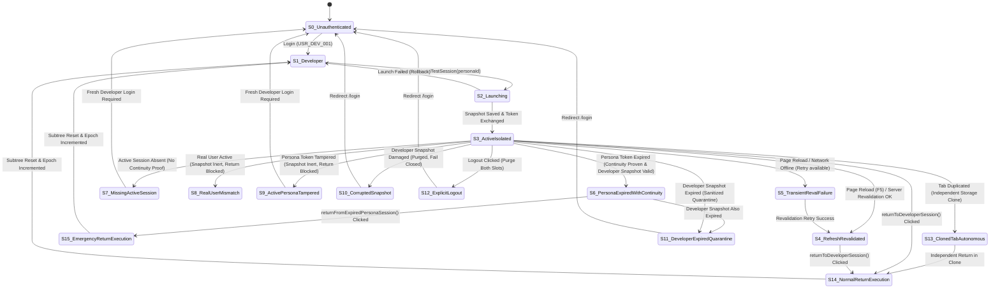
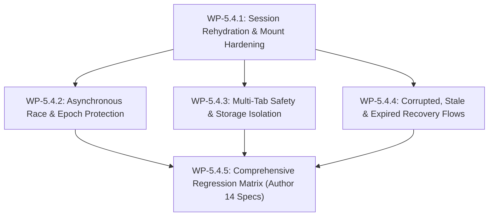

# MetroLMS — Increment 5.4 Reconciled Planning & Readiness Assessment
## Session Lifecycle Hardening, Edge Cases & Security Regression Matrix

**Document Version:** 3.0 (Authoritative Final Planning Reconciliation Baseline)  
**Status:** Planning Fully Reconciled & Ready for Final Owner Authorization  
**Canonical Increment Title:** `Session Lifecycle Hardening, Edge Cases & Security Regression Matrix`  
**Governing Phase:** Phase 5 — Developer Role Preview (`معاينة الدور`) & Isolated Role Testing (`اختبار الصلاحيات`, `D-10`)  
**Implementation Status:** `[Not Started]` (Strict Planning Phase — Zero code or test changes applied)  
**Authoritative Roadmap Reference:** `docs/backend/pre-backend-migration-remediation-roadmap.md`, Revision 5, Sections 3 and 4  
**Date:** November 4, 2026  

---

## 1. Executive Summary & Formally Approved Owner Decisions

Increment 5.3 delivered the complete, functional minimum viable isolated session round-trip: strict Developer actor validation (`USR_DEV_001`), synthetic test persona allowlisting (`SYNTHETIC_TEST_PERSONA_REGISTRY`), transactional snapshot preservation (`metro_lms_developer_origin_session`), active session replacement, fail-closed rollback, strict bearer token structure validation (`mock_jwt_${personaId}_${timestamp}`), fail-closed browser storage exception handling, and one-click return to Developer identity.

Following owner review, **all four operational decisions are formally APPROVED**:

### Approved Decision A — Emergency Return on Synthetic Persona Expiration
- **Approved Policy:** **Option A — Emergency Return**
- **Core Principle:** When an active synthetic test persona session expires or is invalidated during testing, emergency return to Developer identity is permitted **strictly if and only if** trustworthy continuity with the original synthetic persona has been established, the Developer origin snapshot is structurally authentic, and the Developer session has not expired (`developerExpiresAt > Date.now()`).
- **Inviolable Boundary:** The expired persona token is inspected solely as historical metadata to establish continuity before passive eviction. It must **NEVER** be attached to API requests or treated as an active authorization credential.

### Approved Decision B — Multi-Tab Coordination
- **Approved Policy:** **Option A — Autonomous Per-Tab**
- **Core Principle:** Each browser tab manages its own isolated session and Developer origin snapshot independently inside `sessionStorage`.
- **Inviolable Boundary:** No global cross-tab mutex locks, single-tab ownership barriers, or `BroadcastChannel` coordinators are introduced. Tab duplication clones `sessionStorage`; thereafter, tabs diverge autonomously. Strictly zero authentication tokens, snapshots, or secrets are written to `localStorage`.

### Approved Decision C — Expired Developer Snapshot Handling
- **Approved Policy:** **Option A — Sanitized Diagnostic Quarantine**
- **Core Principle:** When an isolated test session terminates or is evaluated after the Developer's original token has already expired (`developerExpiresAt <= Date.now()`), the snapshot is moved to `metro_lms_quarantined_snapshot` in `sessionStorage`.
- **Inviolable Boundary:** The quarantine record contains **strictly sanitized diagnostic metadata**. Under NO circumstances may Developer tokens, persona tokens, passwords, credentials, authorization headers, or reusable authentication secrets be retained in quarantine. Quarantine applies strictly to conclusively expired snapshots.

### Approved Decision D — Valid Inert Snapshot on Real-User Account Switch
- **Approved Policy:** **Option 1 — Preserve Inert Snapshot Until Tab/Session Termination**
- **Core Principle:** When a different real-user account (such as `USR_SUPER_001` or a real trainee) successfully authenticates in a tab where a structurally valid Developer origin snapshot exists in storage:
  1. The Developer origin snapshot is preserved in an **inert state** until tab termination.
  2. Developer identity is **never restored** while the real user is active.
  3. The isolated-session banner and return controls are **completely hidden**.
  4. Zero Developer privileges or test-session controls are exposed.
  5. The snapshot is **not automatically deleted or quarantined** solely because another account is active.
  6. The snapshot must **never independently authorize restoration**.
  7. A subsequent Developer login must **not silently inherit or reactivate** the old snapshot without explicit lifecycle reconciliation.

---

## 2. Separate Normal Return and Emergency Return Architecture

To ensure architectural clarity, robust security, and strict fail-closed boundaries, Increment 5.4 formally separates the return lifecycle into two dedicated, distinct operations:

```mermaid
flowchart TD
    subgraph ActiveSessionFlow["Normal Return Path: returnToDeveloperSession()"]
        A1["Active Persona Authenticated"] --> A2["Verify Active Token Matches Persona Contract"]
        A2 --> A3["Verify origin.personaId === activeUser.id"]
        A3 --> A4["Verify Developer Snapshot Valid & Unexpired"]
        A4 --> A5["Restore USR_DEV_001 Session & Clear Snapshot"]
    end

    subgraph ExpiredSessionFlow["Emergency Return Path: returnFromExpiredPersonaSession()"]
        E1["Persona Token Expired (Passive Eviction Intercepted)"] --> E2["inspectSessionContinuity() (Read-Only Raw Peek)"]
        E2 --> E3["Verify Historical Persona ID & Token Structure"]
        E3 --> E4["Verify Developer Snapshot Valid & Unexpired"]
        E4 --> E5["Issue Ephemeral Emergency Continuity Proof"]
        E5 --> E6["Clear Expired Persona Session from Storage"]
        E6 --> E7["Display Amber Emergency Return Banner"]
        E7 --> E8["User Clicks Emergency Return"]
        E8 --> E9["Validate Proof & Execute Emergency Return"]
        E9 --> E10["Restore USR_DEV_001 Session & Invalidate Proof"]
    end
```



### 2.1 Normal Return Operation: `returnToDeveloperSession()`
Preserved exactly from Increment 5.3 with zero weakening of security checks:
- **Prerequisites:**
  - A registered synthetic persona is actively authenticated (`AuthContext.user` matches allowlist).
  - Active user ID matches `origin.personaId`.
  - Active storage session matches the authenticated user.
  - Active token strictly matches the anchored format: `^mock_jwt_${origin.personaId}_(\d{13})$`.
  - Isolated-session marker (`isIsolatedSession === true`) and persona metadata agree.
  - Developer origin snapshot is structurally authentic (`isValidDeveloperOriginSession(origin) === true`) and unexpired (`origin.developerExpiresAt > Date.now()`).
- **Behavior:** Restores exact Developer user `USR_DEV_001`, Developer token, and original expiration; purges origin snapshot from storage; increments `sessionEpoch`; resets page component subtree.

### 2.2 Emergency Return Operation: `returnFromExpiredPersonaSession()`
A dedicated, narrowly scoped recovery transaction designed specifically for expired synthetic persona sessions:
- **Planned Execution Sequence (13 Strict Steps):**
  1. **Intercept Passive Eviction:** Inspect the retained raw active session record in `sessionStorage` before the existing expiration logic destructively deletes it.
  2. **Parse & Validate Schema:** Safely parse and structurally validate the stored JSON record.
  3. **Allowlist Validation:** Validate the canonical persona ID against `SYNTHETIC_TEST_PERSONA_REGISTRY`.
  4. **Strict Token Format Validation:** Validate the historical token subject and timestamp format against `^mock_jwt_${origin.personaId}_(\d{13})$`.
  5. **Snapshot Continuity Matching:** Verify that the historical session persona ID matches `origin.personaId`.
  6. **Conclusive Expiration Check:** Verify that the persona session is conclusively expired (`Date.now() > expiresAt`).
  7. **Developer Snapshot Validation:** Validate the Developer origin snapshot schema, canonical ID (`USR_DEV_001`), original token structure, and unexpired timestamp (`origin.developerExpiresAt > Date.now()`).
  8. **Establish Ephemeral Continuity Proof:** Generate an internal, non-forgeable continuity proof bound to the AuthProvider instance and tab lifecycle.
  9. **Evict Expired Token:** Remove the expired persona session from storage so the expired token cannot be attached to API requests.
  10. **Render Emergency Banner:** Display the amber emergency return prompt:  
      *"انتهت صلاحية جلسة الحساب الاختباري. الرجوع إلى جلسة المطور؟"*.
  11. **User Action:** On explicit user click, execute `returnFromExpiredPersonaSession()`.
  12. **Restoration Verification:** Restore the exact original Developer user, token, and expiration timestamp only after all checks re-succeed.
  13. **Clean Snapshot Clearance:** Clear the Developer origin snapshot from storage only after successful Developer restoration.

### 2.3 Ephemeral Continuity Proof Security Contract
The continuity proof is a strictly internal runtime object:
- **Bound Scope:** Bound to the exact `personaId`, origin snapshot hash, active browser tab, and current `AuthProvider` instance lifecycle.
- **Non-Forgeable:** Created internally by the approved storage inspection flow; cannot be supplied by external callers or API payloads.
- **Zero Raw Tokens:** Contains strictly non-sensitive validation markers; **NEVER** contains raw tokens, passwords, or credentials.
- **Auto-Invalidation:** Instantly invalidated upon successful return, explicit logout, real-user account switch, or tab closure.
- **Prototype Boundary Notice:** In this prototype environment (`sessionStorage`), client-side metadata does not provide cryptographic hardware protection against arbitrary memory/storage modification by a local browser user. In production (Phase 12), session state and origin separation must be enforced via server-managed sessions and HttpOnly SameSite cookies.

---

## 3. Sanitized Public Continuity Descriptor (Raw Token Excluded)

To maintain absolute non-disclosure of authentication secrets, the raw token is strictly excluded from the public descriptor. Raw token parsing and regex validation remain strictly internal and local to `authStorage.inspectSessionContinuity()`:

```typescript
/**
 * Non-authorizing public inspection descriptor for historical session verification.
 * STRICT SECURITY REQUIREMENT:
 * Under NO circumstances does this descriptor expose raw tokens, credentials,
 * or authorization headers to AuthContext consumers, UI components, or logs.
 */
export interface SessionContinuityDescriptor {
  isRawSessionPresent: boolean;
  isExpired: boolean;
  userId: string | null;
  role: string | null;
  tokenSubject: string | null;
  tokenTimestamp: number | null;
  expiresAt: number | null;
  hasStructuralIntegrity: boolean;
}
```

---

## 4. Mandatory Seven-Account Inventory

The system enforces strict identity isolation across seven distinct accounts. Only the five synthetic personas are selectable for isolated testing:

| Account | Canonical ID | Username | Role | Category | Selectable in D-10 Registry? |
|---|---|---|---|---|:---:|
| **Developer** | `USR_DEV_001` | `developer_internal` | `developer` | Internal System Actor | No (Launch Origin Only) |
| **Super Admin** | `USR_SUPER_001` | `super_admin_demo` | `super_admin` | Real Platform Account | **No (Protected Real Account)** |
| **Test Super Admin** | `USR_TEST_SUPER_001` | `test_super_admin` | `super_admin` | Synthetic Test Persona | **Yes (Allowlisted)** |
| **Test Admin** | `USR_TEST_ADMIN_001` | `test_admin` | `admin` | Synthetic Test Persona | **Yes (Allowlisted)** |
| **Test Assistant Admin** | `USR_TEST_AST_001` | `test_assistant_admin` | `assistant_admin` | Synthetic Test Persona | **Yes (Allowlisted)** |
| **Test Lecturer** | `USR_TEST_LEC_001` | `test_lecturer` | `lecturer` | Synthetic Test Persona | **Yes (Allowlisted)** |
| **Test Trainee** | `USR_TEST_TRN_001` | `test_trainee` | `user` | Synthetic Test Persona | **Yes (Allowlisted)** |

> [!IMPORTANT]
> - `assistant_lecturer` is not a global system role or synthetic persona. It exists strictly as a visual assignment preview layout mode within `RolePreviewContext`.
> - Real user accounts (`USR_SUPER_001`, real instructors, real trainees) are completely excluded from `SYNTHETIC_TEST_PERSONA_REGISTRY`.

---

## 5. Reconciled 12-Case Lifecycle Decision Table

| Case # | Scenario Description | Restore Developer? | Show Return Banner? | Preserve Origin Snapshot? | Quarantine Diagnostic Metadata? | Purge Any Data? | Require Fresh Auth? | Expected `AuthContext` State |
|:---:|---|:---:|:---:|:---:|:---:|:---:|:---:|---|
| **1** | **Normal Active Persona Session** (Matching persona, active token valid) | ✅ Yes (on click) | ✅ Standard Return Banner | ✅ **Yes** | ❌ No | ❌ None | ❌ No | `user: persona`, `isIsolatedSession: true`, amber banner with *"الرجوع إلى جلسة المطور"* |
| **2** | **Expired Persona with Verified Continuity** (Continuity proven; Developer snapshot unexpired) | ✅ **Yes (Emergency Return)** | ⚠️ **Emergency Return Banner** | ✅ **Yes (Preserve)** | ❌ No | ✅ Purge expired persona token from storage | ⚠️ Only if return declined or snapshot expired | `user: null` (session expired), `isIsolatedSession: true`, `isEmergencyReturnEligible: true`, emergency prompt active |
| **3** | **Expired Persona without Verified Continuity** (Subject mismatch / missing timestamp) | ❌ **No (Strictly Blocked)** | ❌ **No (Hidden)** | ✅ **Yes (Preserved / Inert)** | ❌ No | ✅ Purge untrusted session record | ✅ **Yes (Fresh Login Required)** | `user: null`, `isIsolatedSession: false`, fail closed to `/login` (snapshot does NOT authorize return) |
| **4** | **Completely Missing Active Session** (Active session absent; Developer snapshot present) | ❌ **No (Strictly Blocked)** | ❌ **No (Hidden)** | ✅ **Yes (Preserved / Inert)** | ❌ No | ❌ None | ✅ **Yes (Fresh Login Required)** | `user: null`, `isIsolatedSession: false`, fail closed to `/login` (snapshot does NOT authorize return) |
| **5** | **Temporary Network Revalidation Failure** (Network offline / 500 / timeout on `/api/auth/me`) | ❌ No | ⚠️ Retry prompt only | ✅ **Yes (Preserve intact)** | ❌ No | ❌ None | ❌ No (Retry available) | `user`: cached persona or `null`; `isIsolatedSession: true`; banner displays: *"تعذر التحقق من الاتصال بالخادم. يرجى إعادة المحاولة"* |
| **6** | **Browser Storage Unavailable** (`SecurityError` / quota / private browsing restriction) | ❌ No | ❌ No | ❌ Cannot access | ❌ Cannot write | ❌ None | ✅ Yes | `user: null`, `isIsolatedSession: false`, fail closed with error alert |
| **7** | **Real-User Account Switch with Valid Snapshot** (Real user active, e.g. `USR_SUPER_001`) | ❌ **No (Strictly Blocked)** | ❌ **No (Hidden)** | ✅ **Yes (Preserved / Inert)** | ❌ **No (Not Expired)** | ❌ **None (Non-destructive)** | ❌ No (Real user keeps active session) | `user: realUser`, `isIsolatedSession: false`, banner hidden, origin inert until tab termination (Approved Decision D) |
| **8** | **Structurally Corrupted Developer Snapshot** (Invalid JSON / missing required fields) | ❌ No | ❌ No | ❌ Discard | ❌ No (Credentials not retained) | ✅ Purge corrupt snapshot | ✅ Yes (if active session invalid) | `user`: active persona (if valid) or `null`; error alert logged; corrupt snapshot wiped |
| **9** | **Conclusively Expired Developer Snapshot** (`developerExpiresAt <= Date.now()`) | ❌ **No (Expired)** | ❌ No | ❌ Discard | ✅ **Yes (`DEVELOPER_SNAPSHOT_EXPIRED`)** | ✅ Purge origin snapshot | ✅ **Yes (Redirect `/login`)** | `user: null`, `isIsolatedSession: false`, redirect to `/login` with notification: *"انتهت صلاحية جلسة المطور. يرجى تسجيل الدخول مجدداً"* |
| **10** | **Persona Token Tampering** (Active token violates `mock_jwt_${personaId}_${ts}`) | ❌ **No (Strictly Blocked)** | ❌ **No (Hidden)** | ✅ **Yes (Preserved / Inert)** | ❌ **No (No secrets in quarantine)** | ✅ Purge untrusted active persona session only | ✅ **Yes (Fail closed to `/login`)** | `user: null`, `isIsolatedSession: false`, immediate fail-closed termination; Developer snapshot preserved inert |
| **11** | **Autonomous Duplicated Tab** (Cloned `sessionStorage` in new tab context) | ✅ Yes (Autonomous) | ✅ Standard Return Banner | ✅ **Yes (Cloned snapshot)** | ❌ No | ❌ None | ❌ No | `user: persona`, `isIsolatedSession: true`, operates independently of parent tab |
| **12** | **Explicit Logout from Isolated Session** (User clicks Logout in navbar/menu) | ❌ No | ❌ No | ❌ Discard | ❌ No | ✅ Purge both active session & origin snapshot | ✅ **Yes (Redirect `/login`)** | `user: null`, `isIsolatedSession: false`, complete cleanup of both session slots |

---

## 6. Sanitized Quarantine Schema & Storage Policy

### 6.1 Storage Key and Boundary
- **Diagnostic Key:** `metro_lms_quarantined_snapshot`
- **Storage Target:** `sessionStorage` (strictly per-tab; zero cross-tab exposure).

### 6.2 TypeScript Data Contract
```typescript
/**
 * Sanitized diagnostic record of a rejected or expired Developer origin snapshot.
 * STRICT SECURITY REQUIREMENT:
 * Under NO circumstances may this record contain developerToken, personaToken,
 * passwords, authorization headers, or any reusable credentials.
 */
export interface SanitizedQuarantinedOriginSnapshot {
  schemaVersion: '1.0';
  developerId: 'USR_DEV_001';
  personaId: string;
  savedAt: number;
  developerExpiresAt: number;
  quarantinedAt: number;
  rejectionReason:
    | 'DEVELOPER_SNAPSHOT_EXPIRED'
    | 'CORRUPTED_SNAPSHOT_STRUCTURE';
}
```

### 6.3 Quarantine Invariants
1. **Conclusively Expired Snapshots Only:** Sanitized quarantine is triggered strictly when `developerExpiresAt <= Date.now()` has been confirmed.
2. **Prohibited Triggers:** Quarantine is **never triggered** by:
   - Temporary network failures or timeouts.
   - Storage access restrictions or `SecurityError`.
   - Incomplete mount rehydration.
   - Stale asynchronous responses.
   - Real-user account switch mismatches (Case 7).
   - Persona token tampering (Case 10).

---

## 7. Complete State Transition Model (16 States: S0 to S15)



### Complete 16-State Inventory Table

| State ID | State Name | Authenticated User | Active Storage Session | Origin Snapshot Status | Isolated Marker | Emergency Return Eligibility | User-Visible UI Banner | Allowed Transitions | Forbidden Transitions |
|:---:|---|---|---|---|:---:|:---:|---|---|---|
| **S0** | Unauthenticated | `null` | None | None | `false` | `false` | None (`/login` screen) | $\rightarrow$ S1 | $\rightarrow$ S3, $\rightarrow$ S14, $\rightarrow$ S15 |
| **S1** | Authenticated Developer | `USR_DEV_001` (`developer`) | Valid Developer token | None | `false` | `false` | None (or visual preview bar if active) | $\rightarrow$ S2, $\rightarrow$ S0 (logout) | $\rightarrow$ S14, $\rightarrow$ S15 |
| **S2** | Isolated Launch in Progress | `USR_DEV_001` (transient) | In transition | Writing snapshot | `false` | `false` | Loading spinner | $\rightarrow$ S3 (success), $\rightarrow$ S1 (rollback) | Direct return |
| **S3** | Active Isolated Persona | Persona (e.g. `USR_TEST_AST_001`) | Valid persona token | Valid unexpired Developer snapshot | `true` | `false` | Amber Banner: *"جلسة اختبار معزولة"* with Return Button | $\rightarrow$ S4, S5, S6, S7, S8, S9, S10, S11, S12, S13, S14 | $\rightarrow$ S15 (requires S6 first) |
| **S4** | Active Isolated Post-Refresh | Persona | Valid persona token | Valid unexpired Developer snapshot | `true` | `false` | Amber Banner: *"جلسة اختبار معزولة"* with Return Button | $\rightarrow$ S14, $\rightarrow$ S12 | Elevation to Developer without return |
| **S5** | Transient Reval Failure | Cached persona or `null` | Persona token preserved | Valid unexpired Developer snapshot | `true` | `false` | Yellow Warning Banner: *"تعذر التحقق من الاتصال بالخادم. إعادة المحاولة"* | $\rightarrow$ S4 (retry success), $\rightarrow$ S14 (if persona active) | Auto-quarantine |
| **S6** | Expired Persona (Continuity Proven) | `null` (session expired) | Wiped / expired persona token | Valid unexpired Developer snapshot | `true` | `true` | Amber Warning Banner: *"انتهت صلاحية جلسة الحساب الاختباري. الرجوع إلى جلسة المطور؟"* | $\rightarrow$ S15 (emergency return), $\rightarrow$ S11, $\rightarrow$ S0 | $\rightarrow$ S14 (requires active session) |
| **S7** | Missing Active Session (Continuity Lost) | `null` | None | Valid unexpired Developer snapshot (inert) | `false` | `false` | None (Return hidden; snapshot inert) | $\rightarrow$ S0 (Fresh Developer login required) | $\rightarrow$ S14, $\rightarrow$ S15 |
| **S8** | Real-User Identity Mismatch | Real user (`USR_SUPER_001` / trainee) | Real user token | Developer snapshot (inert until tab close) | `false` | `false` | None (Return hidden; snapshot inert) | Real user operations; snapshot remains inert | $\rightarrow$ S14, $\rightarrow$ S15 |
| **S9** | Active Persona Token Tampered | `null` | Wiped untrusted persona token | Developer snapshot (inert until tab close) | `false` | `false` | None (Return hidden; snapshot inert) | $\rightarrow$ S0 (Fresh Developer login required) | $\rightarrow$ S14, $\rightarrow$ S15 |
| **S10** | Structurally Corrupted Snapshot | Persona or `null` | Persona token | Wiped / purged | `false` | `false` | Red Error Alert: *"تم إلغاء الجلسة بسبب تلف بيانات الاستعادة"* | $\rightarrow$ S0 | $\rightarrow$ S14, $\rightarrow$ S15 |
| **S11** | Expired Developer Snapshot | `null` | Wiped | Quarantined (`metro_lms_quarantined_snapshot`) | `false` | `false` | Red Error Alert: *"انتهت صلاحية جلسة المطور. يرجى تسجيل الدخول مجدداً"* | $\rightarrow$ S0 | Token extension |
| **S12** | Explicit Logout | `null` | Wiped | Wiped | `false` | `false` | None (navigates to `/login`) | $\rightarrow$ S0 | Silent Developer restoration |
| **S13** | Cloned Tab Autonomous | Persona | Cloned persona token | Cloned Developer snapshot | `true` | `false` | Amber Banner: *"جلسة اختبار معزولة"* (Operates autonomously) | $\rightarrow$ S14 (in Tab B) | Mutating Tab A |
| **S14** | Normal Return Execution | `USR_DEV_001` (`developer`) | Restored Developer token | Wiped (`null`) | `false` | `false` | Transitioning... (Developer UI cleanly restored) | $\rightarrow$ S1 | Calling with expired token |
| **S15** | Emergency Return Execution | `USR_DEV_001` (`developer`) | Restored Developer token | Wiped (`null`) | `false` | `false` | Transitioning... (Developer UI cleanly restored) | $\rightarrow$ S1 | Execution without proof |

---

## 8. Complete Security Regression Matrix & Traceable Test Count

### 8.1 Source Audit of Existing Increment 5.3 Specifications (46 Tests)
Source inspection of `frontend/src/test/isolated-role-session.test.tsx` confirms exactly 46 test specifications:
- **Group 1: Persona Registry Validation (5 tests):** `P5-T08-1`, `P5-T08-2`, `P5-T08-3`, `P5-T08-4`, `P5-T08-5`.
- **Group 2: Launch Transaction Flow (10 tests):** `P5-T09-1`, `P5-T09-3`, `P5-T09-4`, `P5-T09-2`, `P5-T10-1`, `P5-T11-1`, `P5-T10-2`, `P5-T10-3`, `P5-T14-1`, `P5-T22-1`.
- **Group 3: Return to Developer Round-Trip (21 tests):**
  - `P5-T13-1`–`P5-T13-16` (Return assertions, actor checks, strict token regex).
  - `P5-T18-1`–`P5-T18-5` (Snapshot restoration failure & schema corruption checks).
- **Group 4: Failure Handling & Invariants (10 tests):**
  - `P5-T15-1`–`P5-T15-5`, `P5-T12-1`, `P5-T20-1`, `P5-T17-1`, `P5-T11-2`, `P5-T11-3`.

All 46 existing specifications are strictly:  
`WRITTEN — NOT YET EXECUTED — DEFERRED TO PHASE 13`.

### 8.2 Comprehensive 14 Planned Increment 5.4 Test Specifications

To guarantee exhaustive verification across all 20 required behaviors without ambiguity, 14 explicit planned specifications are defined:

| Test ID | Category | Target Component / Workflow | Verification Objective | Planned Status |
|---|---|---|---|:---:|
| `P5-T16-1` | Integration | Session Rehydration | Cold rehydration restores active persona & snapshot; transient network timeout preserves snapshot with retry action | Planned |
| `P5-T16-2` | Integration | Session Rehydration | Normal one-click return (`returnToDeveloperSession`) cleanly restores Developer session following cold page reload | Planned |
| `P5-T16-3` | Integration | Session Rehydration | Dual-session expiration on cold reload fails closed to `/login` and creates sanitized quarantine | Planned |
| `P5-T13-17` | Unit / Security | Session Epoch | Monotonic `sessionEpoch` increments on launch, normal return, emergency return, and logout transitions | Planned |
| `P5-T13-18` | Security | Race Condition Barrier | Stale asynchronous responses and post-logout network races are strictly discarded and cannot repopulate user state | Planned |
| `P5-T13-19` | Integration | Subtree & Cache Reset | Application route outlet subtree remounts (`<Outlet key="..." />`) and context caches flush across session transitions | Planned |
| `P5-T18-6` | Security | Recovery Flows | Real-user active identity mismatch preserves origin snapshot in an inert state, hides return banner, and blocks Developer elevation | Planned |
| `P5-T18-7` | Security | Recovery Flows | Conclusively expired Developer snapshot creates sanitized quarantine in `metro_lms_quarantined_snapshot` with strictly zero secrets | Planned |
| `P5-T18-8` | Security | Recovery Flows | Persona token tampering clears active session, hides return controls, and preserves valid Developer snapshot inert | Planned |
| `P5-T18-9` | Security | Secret Non-Disclosure | Raw token is strictly excluded from public `SessionContinuityDescriptor` and sanitized diagnostic quarantine payload | Planned |
| `P5-T23-1` | Security | Multi-Tab Safety | Duplicated tab operates independently with autonomous return and zero `localStorage` exposure | Planned |
| `P5-T24-1` | Integration | Emergency Return | Dedicated `returnFromExpiredPersonaSession()` restores Developer with exact original expiration and purges origin snapshot | Planned |
| `P5-T24-2` | Security | Emergency Return | Emergency return is strictly rejected when persona continuity cannot be verified (missing session, invalid token format, or expired snapshot) | Planned |
| `P5-T24-3` | Security | Proof Invalidation & Replay | Forged, stale, or reused continuity proofs are strictly rejected; failed emergency return preserves Developer origin snapshot | Planned |

### 8.3 Exact Transparent Arithmetic Reconciliation
- **Increment 5.3 Existing Specifications:**  
  $$\mathbf{46\text{ specifications authored in \texttt{isolated-role-session.test.tsx}}}$$  
  *Status:* `WRITTEN — NOT YET EXECUTED — DEFERRED TO PHASE 13`
- **Increment 5.4 Planned Specifications:**  
  $$\mathbf{14\text{ new test specifications planned:}}$$
  1. `P5-T16-1`: Clean Cold Rehydration & Revalidation Timeout Handling
  2. `P5-T16-2`: Developer Return Post-Reload Execution
  3. `P5-T16-3`: Dual-Session Expiration on Cold Rehydration
  4. `P5-T13-17`: Monotonic `sessionEpoch` Increment on Identity Transition
  5. `P5-T13-18`: Stale Async Response Discard & Post-Logout Network Race
  6. `P5-T13-19`: Route Outlet Subtree Remounting & Cache Purging
  7. `P5-T18-6`: Real-User Identity Mismatch Non-Destructive Inert Handling
  8. `P5-T18-7`: Conclusively Expired Developer Snapshot Sanitized Quarantine
  9. `P5-T18-8`: Persona Token Tampering Non-Destructive Inert Snapshot Preservation
  10. `P5-T18-9`: Security Boundary & Secret Non-Disclosure Invariant
  11. `P5-T23-1`: Autonomous Multi-Tab Operations & Cloned Return
  12. `P5-T24-1`: Dedicated Emergency Return Execution with Exact Expiration
  13. `P5-T24-2`: Emergency Return Rejection on Absent or Unverified Continuity
  14. `P5-T24-3`: Proof Tamper Resistance & Failed Emergency Return Snapshot Preservation  
  *Status:* `PLANNED — NOT YET WRITTEN — NOT EXECUTED`
- **Combined Phase 5 Total Target:**  
  $$\mathbf{46\text{ (Written/Deferred)}} + \mathbf{14\text{ (Planned/Unwritten)}} = \mathbf{60\text{ Total Test Specifications}}$$

---

## 9. Revised Five Work Packages (WP-5.4.1 – WP-5.4.5)

### WP-5.4.1: Session Rehydration & Mount Hardening
- **Objective:** Reconcile cold page refreshes; implement non-authorizing `inspectSessionContinuity()` in `authStorage` (excluding raw token); revalidate active persona before setting isolated markers; preserve origin snapshot on transient network drops with retry action; fail closed on dual-session expiration.
- **Scope & Exact Behavior:**
  - Implement read-only `authStorage.inspectSessionContinuity()` returning sanitized `SessionContinuityDescriptor`.
  - Distinguish transient network failure from authentication rejection: preserve origin snapshot if network drops, but provide a retry button.
  - If active session is completely absent, do NOT authorize Developer return; transition to S7/S0 requiring fresh Developer login.
  - If both sessions are expired, transition to S11, write sanitized quarantine, and redirect to `/login`.
- **Target Files:**
  - `frontend/src/core/auth/AuthContext.tsx`
  - `frontend/src/core/auth/authStorage.ts`
- **Dependencies:** Frozen Increment 5.3 `authStorage` and `AuthContext`.
- **Security Invariants:** `INV-D10-1`, `INV-P5-4`.
- **Acceptance Criteria:** Cold reload preserves persona identity and return path; revalidation timeout renders retry prompt without dropping snapshot; dual expiration fails closed to `/login`.
- **Planned Specifications:** `P5-T16-1`, `P5-T16-2`, `P5-T16-3`.
- **Risks & Rollback:** Overly aggressive clearing of storage on revalidation error; mitigated by separating transient network failure from 401/403 rejection.

### WP-5.4.2: Asynchronous Race & Epoch Protection
- **Objective:** Prevent delayed asynchronous API responses, background timers, or event handlers originating from a synthetic test persona from mutating client state after returning to Developer or logging out.
- **Scope & Exact Behavior:**
  - Implement a monotonically increasing `sessionEpoch` in `AuthContext`.
  - Increment `sessionEpoch` on every launch, normal return, emergency return, or logout transition.
  - Reject in-flight API resolutions if `sessionEpoch` has changed.
  - Key the application route outlet `<Outlet key={`${user?.id}-${sessionEpoch}`} />` in `AppLayout.tsx` to force clean component subtree unmounting.
  - Flush in-memory notification counters (`NotificationContext`) and enrollment state (`EnrollmentContext`) upon identity transition.
- **Target Files:**
  - `frontend/src/core/auth/AuthContext.tsx`
  - `frontend/src/app/layouts/AppLayout.tsx`
  - `frontend/src/features/notifications/context/NotificationContext.tsx`
  - `frontend/src/features/courses/context/EnrollmentContext.tsx`
- **Dependencies:** WP-5.4.1 rehydration foundation.
- **Security Invariants:** `INV-P5-3`, `INV-P5-4`.
- **Acceptance Criteria:** `sessionEpoch` increments on every identity change; in-flight requests cannot alter state across epoch boundary; router outlet remounts subtree cleanly; notification and course caches purge.
- **Planned Specifications:** `P5-T13-17`, `P5-T13-18`, `P5-T13-19`.
- **Risks & Rollback:** Premature unmounting or flashing layout; mitigated by atomic epoch incrementation inside state transition handlers.

### WP-5.4.3: Multi-Tab Safety & Storage Isolation
- **Objective:** Maintain strict per-tab session isolation across multiple browser windows and duplicated tabs without cross-tab interference.
- **Scope & Exact Behavior:**
  - Preserve `sessionStorage` as the exclusive storage mechanism for auth tokens and origin snapshots.
  - Validate that duplicated tabs can independently manage their test sessions and execute idempotent returns to Developer.
  - Ensure logout in one tab does not trigger silent elevation or credential clearance in sibling tabs.
  - Strictly prohibit `localStorage` for tokens, snapshots, or mutex locks.
- **Target Files:**
  - `frontend/src/core/auth/authStorage.ts`
  - `frontend/src/core/auth/AuthContext.tsx`
  - `frontend/src/features/auth/components/IsolatedSessionBanner.tsx`
- **Dependencies:** WP-5.4.1 storage contracts.
- **Security Invariants:** `INV-P5-4`, `INV-P5-7`.
- **Acceptance Criteria:** Tab duplication functions autonomously; returning in Tab A does not mutate Tab B; returning in Tab B subsequently succeeds idempotently; zero `localStorage` tokens.
- **Planned Specifications:** `P5-T23-1`.
- **Risks & Rollback:** Unintentional cross-tab event listeners; mitigated by strictly avoiding `window.addEventListener('storage')` for auth tokens.

### WP-5.4.4: Corrupted, Stale & Expired Recovery Flows
- **Objective:** Provide robust, fail-closed handling for damaged, tampered, or expired sessions and implement dedicated emergency return, sanitized quarantine, and inert snapshot policies.
- **Scope & Exact Behavior:**
  - Implement Decision A: Dedicated `returnFromExpiredPersonaSession()` with verified continuity, exact Developer expiration, and safe snapshot cleanup (`P5-T24-1`).
  - Implement Decision A rejection: Strict rejection of emergency return when continuity is absent or unverified (`P5-T24-2`).
  - Implement Continuity Proof Protection: Forged/stale/reused proof rejection and snapshot preservation on failed return (`P5-T24-3`).
  - Implement Decision C: Sanitized diagnostic quarantine in `metro_lms_quarantined_snapshot` when Developer snapshot has expired (`P5-T18-7`).
  - Implement Decision D: Non-destructive inert preservation when active user is a real user account (`USR_SUPER_001` or real trainee) (`P5-T18-6`).
  - Implement Token Tampering Policy: Rejection of active persona session with non-destructive preservation of Developer origin snapshot in an inert state (`P5-T18-8`).
  - Implement Secret Non-Disclosure Invariant: Enforce raw token omission from descriptors and quarantine payloads (`P5-T18-9`).
- **Target Files:**
  - `frontend/src/core/auth/authStorage.ts`
  - `frontend/src/core/auth/AuthContext.tsx`
  - `frontend/src/features/auth/components/IsolatedSessionBanner.tsx`
- **Dependencies:** WP-5.4.1 continuity inspection contracts.
- **Security Invariants:** `INV-R1`, `INV-D10-1`, `INV-P5-3`, `INV-P5-4`, `INV-P5-7`.
- **Acceptance Criteria:** Emergency return restores Developer with exact expiration when continuity proven; missing continuity mandates fresh login; real-user account switch preserves origin inert; token tampering preserves origin inert; quarantine contains zero secrets.
- **Planned Specifications:** `P5-T18-6`, `P5-T18-7`, `P5-T18-8`, `P5-T18-9`, `P5-T24-1`, `P5-T24-2`, `P5-T24-3`.
- **Risks & Rollback:** Overwriting unexpired snapshots; mitigated by fail-closed guard checks before storage updates.

### WP-5.4.5: Phase 5 Comprehensive Security Regression Matrix
- **Objective:** Author all 14 planned test specifications in `isolated-role-session.test.tsx`, expanding the total suite to 60 deferred specifications covering all lifecycle scenarios.
- **Scope & Exact Behavior:**
  - Author `P5-T16-1`, `P5-T16-2`, `P5-T16-3`, `P5-T13-17`, `P5-T13-18`, `P5-T13-19`, `P5-T18-6`, `P5-T18-7`, `P5-T18-8`, `P5-T18-9`, `P5-T23-1`, `P5-T24-1`, `P5-T24-2`, `P5-T24-3`.
  - Maintain the mandatory non-execution status: `WRITTEN — NOT YET EXECUTED — DEFERRED TO PHASE 13`.
  - Do not run Vitest, Jest, or test runners during authorship.
- **Target Files:**
  - `frontend/src/test/isolated-role-session.test.tsx`
  - `docs/frontend/checklists/phase-05-developer-preview-and-isolated-testing-checklist.md`
- **Dependencies:** WP-5.4.1 through WP-5.4.4 implementation completion.
- **Security Invariants:** All Phase 5 invariants.
- **Acceptance Criteria:** All 14 planned specifications are authored with full mock fixtures, rigorous assertions, and cataloged under non-execution status for Phase 13.
- **Status:** `PLANNED — NOT YET WRITTEN — NOT EXECUTED` (To be authored strictly during WP-5.4.5 implementation).

---

## 10. Implementation Sequence and Dependencies



1. **WP-5.4.1 must be executed first:** Mount rehydration, continuity inspection, and `AuthContext` state consistency form the foundation for all other lifecycle branches.
2. **WP-5.4.2, WP-5.4.3, and WP-5.4.4 can proceed in parallel or sequentially:** They build upon the rehydration and storage validation mechanics established in WP-5.4.1.
3. **WP-5.4.5 must be executed last:** The complete test suite expansion codifies and verifies all hardened behaviors.

---

## 11. Acceptance Criteria for Increment 5.4

1. **Rehydration Integrity:** Refreshing an active isolated session restores both the synthetic persona identity and the unexpired Developer return path without orphaned storage.
2. **Separated Return Operations:** Normal return (`returnToDeveloperSession`) operates exclusively on active persona sessions; Emergency return (`returnFromExpiredPersonaSession`) operates exclusively on expired sessions with verified continuity.
3. **Continuity Proof Protection:** An expired synthetic persona session displays an emergency return banner if and only if verifiable continuity with `origin.personaId` is proven and the Developer snapshot is unexpired. Proofs cannot be forged, replayed, or reused.
4. **Token Tampering Non-Destructive Boundary:** Mismatched or malformed active persona tokens clear the active session, hide return controls, and keep the Developer snapshot inert without destructive purging or premature quarantine.
5. **Real-User Inert Preservation:** A mismatched real user account never restores Developer, never sees the return banner, and preserves the Developer origin snapshot in an inert state until tab termination.
6. **Autonomous Multi-Tab Operation:** Duplicated tabs operate autonomously in `sessionStorage` without inter-tab locks, permitting independent, idempotent returns to Developer.
7. **Sanitized Quarantine & Secret Non-Disclosure:** Conclusively expired Developer snapshots are logged to `metro_lms_quarantined_snapshot` with strictly zero credentials. Public descriptors and quarantine payloads never contain raw tokens.
8. **Epoch-Based Subtree Isolation:** Returning to Developer increments `sessionEpoch`, unmounts the page component subtree via `<Outlet key="..." />`, and flushes notification and enrollment caches.
9. **Complete 60-Test Matrix:** All 15 lifecycle scenarios are codified across 60 deferred test specifications marked:  
   `WRITTEN — NOT YET EXECUTED — DEFERRED TO PHASE 13`.

---

## 12. Verification & Safety Protocol

During future implementation of Increment 5.4, the following protocols remain mandatory:
- **No Test Runner Execution:** Vitest, Jest, and background scanners remain strictly forbidden until Gate B (Phase 13).
- **TypeScript Static Verification:** Compile-time type checking must confirm interface compliance for `SanitizedQuarantinedOriginSnapshot` and `SessionContinuityDescriptor` without emitting build artifacts.
- **Preserve Increments 5.1–5.3:** No regressions or modifications to visual Role Preview or the frozen 5-persona registry.

---

## 13. Owner Decisions Record Summary

There are **zero remaining unresolved owner decisions**. All operational policies have been explicitly decided:
- **Decision A (Approved):** Option A — Emergency Return prompt on persona expiration, strictly authorized by unexpired Developer snapshot and verified continuity via non-authorizing `authStorage.inspectSessionContinuity()`.
- **Decision B (Approved):** Option A — Autonomous Per-Tab isolation in `sessionStorage` with independent, idempotent returns and zero `localStorage` tokens.
- **Decision C (Approved):** Option A — Sanitized Diagnostic Quarantine (`metro_lms_quarantined_snapshot`) for conclusively expired Developer snapshots with zero secrets.
- **Decision D (Approved):** Option 1 — Non-destructive inert preservation of Developer origin snapshot on real-user account switch until tab termination.

---

## 14. Implementation Readiness Verdict

**Verdict:** `READY FOR OWNER AUTHORIZATION`

All lifecycle contradictions, continuity inspection mechanisms, dedicated return operations, token-tampering boundaries, real-user inert preservation policies, 16-state transition model (S0–S15), traceable test coverage mappings (46 + 14 = 60 tests), and work package sequences are fully resolved and reconciled. Implementation of Increment 5.4 will proceed only upon explicit owner authorization.

*End of Increment 5.4 Reconciled Planning & Readiness Assessment.*  
*Status: Strict Planning Complete. Awaiting Owner Authorization to Begin Implementation.*
