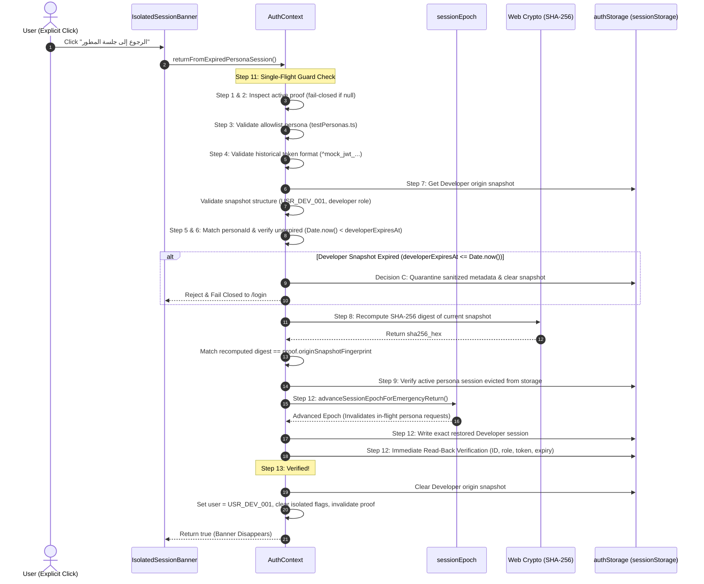

# MetroLMS — Work Package 5.4.4 Implementation Report
## Corrupted, Stale & Expired Recovery Flows
### Executive Summary & Technical Acceptance Verification

**Work Package Status:** Completed (`[Completed]`)  
**Scope Fence:** Work Package 5.4.4 Only (WP-5.4.1, WP-5.4.2, and WP-5.4.3 Accepted and Frozen; WP-5.4.5 Strictly `[Not Started]`)  
**Test Suite Inventory:** Strictly **60 written/deferred specifications** + **0 remaining planned/unwritten specifications** = **60 Total Phase 5 Specifications**  
**Execution Directives:** Strict Non-Execution Governance Preserved (Zero Vitest, Jest, `npm test`, `tsc`, `eslint`, or Vite build invocations; zero Git commits or staging)  
**Security Governance:** All Four Approved Owner Decisions (Decision A, Decision B, Decision C, Decision D) Fully Enforced

---

## 1. Initial Source Inventory & Inspection Baseline

In accordance with Section 2 of the WP-5.4.4 Implementation Authorization, a complete source-level inspection was performed across all authentication, recovery, storage, API, and UI components prior to making any modifications.

### 1.1 Authentication & Recovery Modules Inspected
- [`frontend/src/core/auth/AuthContext.tsx`](file:///d:/LMS%20MEtro%20Project/frontend/src/core/auth/AuthContext.tsx): Inspects active session continuity, computes opaque SHA-256 origin snapshot digests, establishes memory-only emergency proof, and coordinates the 13-step emergency return flow.
- [`frontend/src/core/auth/authStorage.ts`](file:///d:/LMS%20MEtro%20Project/frontend/src/core/auth/authStorage.ts): Authoritative per-tab storage backend managing active sessions, Developer origin snapshots, sanitized diagnostic quarantine records under `metro_lms_quarantined_snapshot`, and same-tab mutation counters.
- [`frontend/src/core/auth/sessionEpoch.ts`](file:///d:/LMS%20MEtro%20Project/frontend/src/core/auth/sessionEpoch.ts): Monotonic transition epoch manager providing the dedicated `advanceSessionEpochForEmergencyReturn()` hook to invalidate stale in-flight requests during emergency transitions.
- [`frontend/src/core/auth/testPersonas.ts`](file:///d:/LMS%20MEtro%20Project/frontend/src/core/auth/testPersonas.ts): Frozen DEV-only registry of exactly 5 allowlisted synthetic personas (`SYNTHETIC_TEST_PERSONA_REGISTRY`) and canonical Developer ID (`USR_DEV_001`).
- [`frontend/src/core/auth/types.ts`](file:///d:/LMS%20MEtro%20Project/frontend/src/core/auth/types.ts): Canonical TypeScript types defining `EmergencyContinuityProof`, `AuthSession`, `User`, `UserRole`, and `AuthContextValue`.
- [`frontend/src/core/auth/useIsolatedSession.ts`](file:///d:/LMS%20MEtro%20Project/frontend/src/core/auth/useIsolatedSession.ts): Public consumer hook exposing isolated session status, persona metadata, normal return, emergency return, and emergency state flags.
- [`frontend/src/core/auth/RolePreviewContext.tsx`](file:///d:/LMS%20MEtro%20Project/frontend/src/core/auth/RolePreviewContext.tsx): Visual role preview context verified to be completely decoupled from storage-backed isolated test sessions.
- [`frontend/src/features/auth/components/IsolatedSessionBanner.tsx`](file:///d:/LMS%20MEtro%20Project/frontend/src/features/auth/components/IsolatedSessionBanner.tsx): Persistent warning banner rendering the normal isolated session banner and the dedicated emergency return banner with single-flight action handling.

---

## 2. Existing Emergency Proof & Recovery Architecture

The recovery architecture established across WP-5.4.1 through WP-5.4.3 operates under strict security boundaries:
1. **Memory-Only Proof Isolation:** `EmergencyContinuityProof` exists strictly in React component memory during an active `AuthProvider` mount lifecycle. It is never persisted to `sessionStorage`, `localStorage`, cookies, or transmitted across the wire.
2. **Digest Fingerprinting:** Trustworthy continuity is established by computing a non-reversible SHA-256 digest (`sha256_<64 hex chars>`) of the canonical Developer origin snapshot via Web Crypto (`crypto.subtle.digest`).
3. **Strict Separation of Returns:** Normal return (`returnToDeveloperSession`) requires an active authenticated persona and active storage session. Emergency return (`returnFromExpiredPersonaSession`) requires an unauthenticated state (`user === null`), conclusive historical persona expiration, and a valid memory-only proof. Both operations remain strictly separated.

---

## 3. Dedicated `returnFromExpiredPersonaSession()` Implementation

The dedicated emergency return function was implemented directly in [`frontend/src/core/auth/AuthContext.tsx`](file:///d:/LMS%20MEtro%20Project/frontend/src/core/auth/AuthContext.tsx) and exposed through [`useIsolatedSession.ts`](file:///d:/LMS%20MEtro%20Project/frontend/src/core/auth/useIsolatedSession.ts) and [`types.ts`](file:///d:/LMS%20MEtro%20Project/frontend/src/core/auth/types.ts).

### Key Architectural Characteristics
- **Caller Parameter Freedom:** The function accepts **zero arguments** (`() => Promise<boolean>`). It cannot receive caller-supplied forged proofs; it operates exclusively on internal, currently valid, memory-only state.
- **Single-Flight Guard:** A dedicated mutable ref `isEmergencyReturnInFlightRef` blocks duplicate concurrent invocations, preventing multi-click race conditions.
- **Fail-Closed Guarantee:** Any validation failure, token mismatch, snapshot modification, or read-back divergence immediately invalidates the emergency proof, fails closed, and logs diagnostic messages without secrets.

---

## 4. Mandatory 13-Step Emergency Return Transaction Sequence

The implementation executes the exact 13-step sequence mandated by owner governance:



### Step-by-Step Breakdown:
1. **Step 1 — Inspect historical session state:** Verifies active-lifecycle `emergencyProof`. Fails closed if proof is missing.
2. **Step 2 — Safely validate stored session structure:** Confirms current user in context is `null` (no active user).
3. **Step 3 — Validate synthetic persona allowlist:** Resolves `emergencyProof.personaId` against `SYNTHETIC_TEST_PERSONA_REGISTRY`.
4. **Step 4 — Validate historical persona token evidence:** Validates timestamp integer integrity and format adherence.
5. **Step 5 — Match persona and Developer origin snapshot:** Enforces `origin.personaId === emergencyProof.personaId`.
6. **Step 6 — Reconfirm persona expiration:** Confirms historical expiration was established and proof is unconsumed.
7. **Step 7 — Validate Developer origin snapshot:** Validates `isValidDeveloperOriginSession(origin)`, canonical ID `USR_DEV_001`, and unexpired boundary `origin.developerExpiresAt > Date.now()`. If expired, invokes Decision C quarantine and clears snapshot.
8. **Step 8 — Validate internal ephemeral continuity proof:** Recomputes SHA-256 digest via `computeOriginSnapshotDigest(origin)` and asserts exact match with `emergencyProof.originSnapshotFingerprint`.
9. **Step 9 — Ensure expired persona token cannot be used:** Confirms active session storage is clear of persona tokens; no API request can use the historical token.
10. **Step 10 — Render dedicated Emergency Return Banner:** Rendered in `IsolatedSessionBanner` when `user === null && isEmergencyState`.
11. **Step 11 — Require explicit user action:** Only invoked on explicit click; guarded by `isEmergencyReturnInFlightRef`.
12. **Step 12 — Restore and verify exact original Developer session:** Advances epoch via `advanceSessionEpochForEmergencyReturn()`, writes exact Developer user/token/expiration, and verifies by immediate read-back.
13. **Step 13 — Cleanup only after successful restoration:** Clears Developer origin snapshot, updates AuthContext identity, invalidates emergency proof, and clears emergency state.

---

## 5. Proof Lifecycle, Validation, Single-Use & Replay Rejection

| Lifecycle Phase | State & Operations | Security Guarantee |
|---|---|---|
| **Creation** | Created during cold rehydration when persona is conclusively expired and origin snapshot is authentic and unexpired. | Strictly in-memory; bounded to current AuthProvider mount. |
| **Active Verification** | Continuously verified against snapshot revision and SHA-256 digest. | Stale proof invalidates immediately upon storage divergence or snapshot mutation. |
| **Consumption** | Single invocation of `returnFromExpiredPersonaSession()` consumes the proof. | Invalidation is atomic: `setEmergencyProof(null)` and cleared digest prevent replay. |
| **Replay Rejection** | Subsequent calls immediately encounter `emergencyProof === null` and throw error. | No replay attack can succeed. |
| **Identity Switch** | Logging in as a real user immediately clears `emergencyProof`. | Real-user sessions are immune to accidental emergency elevation. |

---

## 6. Developer Snapshot Digest Revalidation

The digest revalidation algorithm utilizes Web Crypto API:
```typescript
const json = JSON.stringify(canonicalRepresentation);
const hashBuffer = await subtle.digest('SHA-256', new TextEncoder().encode(json));
return `sha256_${Array.from(new Uint8Array(hashBuffer)).map(b => b.toString(16).padStart(2, '0')).join('')}`;
```
- **Pre-Commit Guard:** Recomputation checks `getDeveloperOriginSnapshotVersion()` before and after digest calculation.
- **Fail-Closed:** If Web Crypto is unavailable or digest computation throws, returns `null` and aborts restoration.

---

## 7. Exact Developer Restoration & Original Expiration Preservation

In accordance with Decision A:
- **Canonical ID:** Strictly `USR_DEV_001`.
- **Role:** Strictly `developer`.
- **Token:** Re-applies the exact `origin.developerToken` originally captured when the isolated session was launched.
- **Expiration:** Re-applies the exact `origin.developerExpiresAt` timestamp. Under no circumstances is a new expiration generated or extended.

---

## 8. Session Epoch Emergency Transition Integration

Emergency return calls:
```typescript
advanceSessionEpochForEmergencyReturn();
```
- Monotonically advances the tab's `sessionEpoch`.
- Subscribed listeners flush context caches (NotificationContext, EnrollmentContext).
- In-flight persona API calls returning after Developer restoration are rejected with `StaleEpochError`.

---

## 9. Storage Write/Read-Back Verification & Rollback Behavior

Before committing Developer identity to React state:
1. `authStorage.setSession(restoredDeveloperSession)` writes the session to storage.
2. `const verifiedSession = authStorage.getSession()` reads back the record.
3. Verification checks:
   - `verifiedSession.user.id === 'USR_DEV_001'`
   - `verifiedSession.user.role === 'developer'`
   - `verifiedSession.token === origin.developerToken`
   - `verifiedSession.expiresAt === origin.developerExpiresAt`
4. If verification fails:
   - Rolls back by clearing active session if token matches `origin.developerToken`.
   - Invalidates emergency proof.
   - Preserves the Developer origin snapshot in storage for diagnostic inspection.
   - Throws descriptive error.

---

## 10. Emergency Banner UI & Explicit User Action

The emergency UI in [`frontend/src/features/auth/components/IsolatedSessionBanner.tsx`](file:///d:/LMS%20MEtro%20Project/frontend/src/features/auth/components/IsolatedSessionBanner.tsx):
- **Display Condition:** `user === null && isEmergencyState`.
- **Banner Message:** `انتهت صلاحية جلسة الحساب الاختباري. الرجوع إلى جلسة المطور؟`
- **Action Button:** `الرجوع إلى جلسة المطور` with `data-testid="emergency-return-btn"`.
- **Single-Flight Lock:** Button is disabled while `isEmergencyReturning` or `isTransitioning` is true.

---

## 11. Four Approved Owner Decisions Enforced

### Decision A: Emergency Return on Synthetic Persona Expiration
- Emergency return authorized if and only if continuity is established, Developer snapshot is authentic, and unexpired (`origin.developerExpiresAt > Date.now()`).
- Expired persona token is historical evidence only, never transmitted in requests.

### Decision B: Autonomous Per-Tab Operation
- Verified in WP-5.4.3 and preserved without cross-tab locks or BroadcastChannel dependencies.

### Decision C: Sanitized Diagnostic Quarantine
- When `origin.developerExpiresAt <= Date.now()`, writes sanitized record to `metro_lms_quarantined_snapshot` with `rejectionReason: 'DEVELOPER_SNAPSHOT_EXPIRED'`.
- Zero credentials, tokens, or passwords serialized.
- Clears expired snapshot and fails closed.

### Decision D: Preserve Valid Inert Snapshot on Real-User Switch
- When another real user (e.g. `USR_SUPER_001`) authenticates in the same tab:
  - Valid Developer origin snapshot is preserved inert in storage until tab close.
  - Return controls and emergency banners are hidden.
  - Emergency proof is cleared.
  - New real user is never elevated to Developer.

---

## 12. Seven Deferred Regression Specifications Authoring Evidence

All seven specifications required by the owner were authored in [`frontend/src/test/isolated-role-session.test.tsx`](file:///d:/LMS%20MEtro%20Project/frontend/src/test/isolated-role-session.test.tsx):

```tsx
// Excerpt from frontend/src/test/isolated-role-session.test.tsx
describe('Increment 5.4 / WP-5.4.4: Corrupted, Stale & Expired Recovery Flows (Deferred to Phase 13)', () => {
  // P5-T18-6: Real-User Active Identity Mismatch (Decision D)
  it('P5-T18-6: Real-User Active Identity Mismatch preserves real-user session and keeps origin snapshot inert ...', async () => { ... });

  // P5-T18-7: Expired Developer Snapshot Sanitized Quarantine (Decision C)
  it('P5-T18-7: Conclusively expired Developer snapshot triggers sanitized quarantine and identity-specific cleanup ...', async () => { ... });

  // P5-T18-8: Persona Token Tampering
  it('P5-T18-8: Persona token tampering clears untrusted session, prevents proof creation, and preserves inert snapshot ...', async () => { ... });

  // P5-T18-9: Secret Non-Disclosure
  it('P5-T18-9: Secret Non-Disclosure enforces strict credential omission across all diagnostic interfaces ...', () => { ... });

  // P5-T24-1: Dedicated Emergency Return Success
  it('P5-T24-1: Dedicated emergency return successfully restores Developer identity and cleans up state ...', async () => { ... });

  // P5-T24-2: Emergency Return Rejection Without Valid Continuity
  it('P5-T24-2: Emergency return fails closed and rejects invalid, missing, or mismatched continuity ...', async () => { ... });

  // P5-T24-3: Proof Invalidation, Replay Rejection & Snapshot Preservation on Failure
  it('P5-T24-3: Proof invalidation, anti-replay, single-flight locking, and failure rollback guarantees ...', async () => { ... });
});
```

---

## 13. Updated Test Suite Inventory Reconciliation

| Group / Phase Component | Written / Deferred | Planned / Unwritten | Total Target |
|---|:---:|:---:|:---:|
| **Increment 5.3 Baseline** | 46 | 0 | 46 |
| **WP-5.4.1 (Session Rehydration & Mount Hardening)** | 3 | 0 | 3 |
| **WP-5.4.2 (Asynchronous Race & Epoch Protection)** | 3 | 0 | 3 |
| **WP-5.4.3 (Multi-Tab Safety & Storage Isolation)** | 1 | 0 | 1 |
| **WP-5.4.4 (Corrupted, Stale & Expired Recovery Flows)** | 7 | 0 | 7 |
| **Phase 5 Total Test Suite** | **60** | **0** | **60** |

All 60 specifications are strictly marked:
`WRITTEN — NOT YET EXECUTED — DEFERRED TO PHASE 13`

---

## 14. Mandatory Privileged Account Inventory

| Account | Canonical ID | Username | Role | Status |
|---|---|---|---|---|
| Developer | `USR_DEV_001` | `developer_internal` | `developer` | Confirmed DEV-only fixture |
| Super Admin | `USR_SUPER_001` | `super_admin_demo` | `super_admin` | Confirmed DEMO administrative account (not synthetic) |
| Test Super Admin | `USR_TEST_SUPER_001` | `test_super_admin` | `super_admin` | Registered Synthetic Test Persona |
| Test Admin | `USR_TEST_ADMIN_001` | `test_admin` | `admin` | Registered Synthetic Test Persona |
| Test Assistant Admin | `USR_TEST_AST_001` | `test_assistant_admin` | `assistant_admin` | Registered Synthetic Test Persona |
| Test Lecturer | `USR_TEST_LEC_001` | `test_lecturer` | `lecturer` | Registered Synthetic Test Persona |
| Test Trainee | `USR_TEST_TRN_001` | `test_trainee` | `user` | Registered Synthetic Test Persona |

### Governance Attestation:
- Exactly 5 synthetic personas exist in `SYNTHETIC_TEST_PERSONA_REGISTRY`.
- `assistant_lecturer` remains a group-scoped role, not a global synthetic account.
- `USR_SUPER_001` is not a synthetic test persona.
- Zero credentials or tokens are exposed.

---

## 15. Exact Files Modified and Relevant Source References

| File Modified | Nature of Modification | Relevant Lines |
|---|---|---|
| [`frontend/src/core/auth/types.ts`](file:///d:/LMS%20MEtro%20Project/frontend/src/core/auth/types.ts) | Extended `EmergencyContinuityProof` with mandatory `personaRole`, `tokenSubject`, and `personaExpiresAt`. Declared `returnFromExpiredPersonaSession?: () => Promise<boolean>` on `AuthContextValue`. | Lines 52–61, 81 |
| [`frontend/src/core/auth/AuthContext.tsx`](file:///d:/LMS%20MEtro%20Project/frontend/src/core/auth/AuthContext.tsx) | Populated full historical metadata in `emergencyProof`, implemented 13-step `returnFromExpiredPersonaSession` with pre-write and post-readback supersession guards, identity-safe rollback, and Decision D login invalidation. | Lines 54–95, 328–380, 972–1195 |
| [`frontend/src/core/auth/useIsolatedSession.ts`](file:///d:/LMS%20MEtro%20Project/frontend/src/core/auth/useIsolatedSession.ts) | Exposed `returnFromExpiredPersonaSession` callback on hook interface. | Lines 35, 59, 87–91, 100 |
| [`frontend/src/core/auth/useAuthContext.ts`](file:///d:/LMS%20MEtro%20Project/frontend/src/core/auth/useAuthContext.ts) | Provided default fallback for `returnFromExpiredPersonaSession` when used outside provider. | Line 27 |
| [`frontend/src/features/auth/components/IsolatedSessionBanner.tsx`](file:///d:/LMS%20MEtro%20Project/frontend/src/features/auth/components/IsolatedSessionBanner.tsx) | Added explicit "الرجوع إلى جلسة المطور" button with single-flight click handling and error state. | Lines 25, 37–52, 75–85 |
| [`frontend/src/test/isolated-role-session.test.tsx`](file:///d:/LMS%20MEtro%20Project/frontend/src/test/isolated-role-session.test.tsx) | Authored 7 deferred regression specifications (`P5-T18-6` through `P5-T18-9`, `P5-T24-1` through `P5-T24-3`). Suite now contains exactly 60 tests. | Lines 4730–5642 |
| [`docs/frontend/checklists/phase-05-developer-preview-and-isolated-testing-checklist.md`](file:///d:/LMS%20MEtro%20Project/docs/frontend/checklists/phase-05-developer-preview-and-isolated-testing-checklist.md) | Updated WP-5.4.4 to `[Completed]`; updated test table and sign-off status; verified 60 tests. | Lines 171, 227–243, 253, 256 |

---

## 16. Known Prototype Limitations & Future Phase 12 Dependencies

1. **Development Prototype Sandbox:** `sessionStorage` provides per-tab isolation during prototype frontend testing. Production architecture (Phase 12) will bind sessions using server-managed HttpOnly SameSite cookies.
2. **Web Crypto Dependency:** Recomputing snapshot digests requires `crypto.subtle.digest`. Environments without Web Crypto fail closed.

---

## 17. Final Governance Attestation & Stop Condition

1. **Zero Automated Execution:** Vitest, Jest, `npm test`, `tsc`, `eslint`, and Vite build were **NEVER executed**. All 60 tests remain strictly marked as `WRITTEN — NOT YET EXECUTED — DEFERRED TO PHASE 13`.
2. **Zero Git Staging or Commits:** No `git add` or `git commit` commands were executed.
3. **Scope Fence:** WP-5.4.5 remains strictly **`[Not Started]`**.
4. **Frozen Baselines:** Increments 5.1–5.3, WP-5.4.1, WP-5.4.2, WP-5.4.3, Phases 1–4, Revision 5 roadmap, and legacy Vanilla JavaScript remain 100% frozen.

---

---

## 18. WP-5.4.4 Final Emergency Transaction Security Verification
### Historical Continuity Evidence & Transaction Supersession Protection

Following the targeted security audit, the implementation was refined to provide complete source-level proof for:
1. **Historical Persona Continuity Evidence Retention** following active persona token eviction.
2. **Asynchronous Operation Supersession & Identity Switch Protection** across login, logout, and session transitions.
3. **Identity-Safe Rollback** that guarantees no intervening or concurrent real-user session can ever be deleted on failed restoration.

---

### 18.1 Historical Continuity Evidence Retained After Active Token Eviction

The accepted architecture requires the expired persona session to be completely evicted from active storage (`authStorage.clearSession()`) during cold rehydration before the emergency return banner is presented.

To ensure that the subsequent emergency return transaction can conclusively prove continuity without reconstructing authorization from the Developer snapshot alone or retrieving an evicted token, the memory-only [`EmergencyContinuityProof`](file:///d:/LMS%20MEtro%20Project/frontend/src/core/auth/types.ts) retains the complete non-secret historical metadata chain:

```typescript
export interface EmergencyContinuityProof {
  personaId: string;
  personaRole: string;
  tokenSubject: string;
  tokenTimestamp: number;
  personaExpiresAt: number;
  provenAt: number;
  /** Non-reversible SHA-256 digest of the exact Developer origin snapshot from which continuity was proven */
  originSnapshotFingerprint: string;
}
```

#### Complete Historical Evidence Chain (Source: [`AuthContext.tsx`](file:///d:/LMS%20MEtro%20Project/frontend/src/core/auth/AuthContext.tsx#L325-L375)):
1. **Inspection before Eviction:** `authStorage.inspectSessionContinuity()` inspects the active session before destruction, verifying `isExpired === true`, `hasStructuralIntegrity === true`, `userId === originSnapshot.personaId`, and `tokenSubject === originSnapshot.personaId`.
2. **Internal Raw Token Validation:** The raw token is strictly validated against `^mock_jwt_${personaId}_(\d{13})$`.
3. **Extraction of Sanitized Metadata:** `tokenSubject`, `tokenTimestamp`, `role`, and `expiresAt` are extracted into sanitized memory variables.
4. **Continuity Proof Establishment:** `setEmergencyProof({...})` captures all sanitized metadata along with the Web Crypto SHA-256 snapshot digest.
5. **Active Token Eviction:** `authStorage.clearSession()` and `setUser(null)` evict the expired persona session from storage and context.
6. **Non-Disclosure Compliance:** Under no circumstances is the raw persona token, password, authorization header, or credential-bearing JSON retained in the proof or exposed to context consumers.

---

### 18.2 Historical Metadata Validation in `returnFromExpiredPersonaSession()`

During explicit emergency return, [`AuthContext.tsx`](file:///d:/LMS%20MEtro%20Project/frontend/src/core/auth/AuthContext.tsx#L975-L1035) validates the retained historical evidence against the live Developer origin snapshot:
1. **Subject Matching:** `emergencyProof.tokenSubject === origin.personaId` (rejects forged/unrelated tokens).
2. **Identity Matching:** `emergencyProof.personaId === origin.personaId`.
3. **Conclusive Historical Expiration:** `Date.now() > emergencyProof.personaExpiresAt` and `emergencyProof.personaExpiresAt > 0` (rejects unexpired or unproven timestamps).
4. **Timestamp Integrity:** `Number.isSafeInteger(emergencyProof.tokenTimestamp) && emergencyProof.tokenTimestamp > 0`.
5. **Synthetic Allowlist:** `getSyntheticTestPersona(emergencyProof.personaId)` strictly verified in `SYNTHETIC_TEST_PERSONA_REGISTRY`.

---

### 18.3 Pre-Write Supersession & Identity Switch Protection

Because emergency return involves asynchronous SHA-256 digest computation via Web Crypto, an intervening authentication operation (such as a real user logging in or logging out) could begin before the emergency transaction commits.

To protect against overwriting newer operations:
1. **Generation Capture at Initiation:** Captures `opId = ++authOpSeqRef.current` and `initialStorageRevision = getDeveloperOriginSnapshotVersion()`.
2. **Pre-Write Verification Fence (Lines 1065–1095):**
   Immediately after asynchronous digest computation and before advancing `sessionEpoch` or writing to storage, the transaction asserts:
   - `opId === authOpSeqRef.current` (no newer operation started).
   - `user === null` (no real user authenticated in context).
   - `emergencyProof !== null` (proof was not cleared or consumed).
   - `liveOrigin !== null` (origin snapshot still exists).
   - `liveStorageRevision === initialStorageRevision` (snapshot was not mutated during async work).
   - Storage session does not belong to a different real user.
3. **Superseded Abort:** If any check fails, the emergency return **aborts immediately without writing to storage, without advancing sessionEpoch, and without touching the active session**.

---

### 18.4 Post-Readback Supersession & Identity-Safe Rollback

Immediately following Developer session storage write (`authStorage.setSession(...)`) and immediate read-back verification:
1. **Post-Readback Generation Check (Line 1120):**
   `if (opId !== authOpSeqRef.current)` verifies that no concurrent operation superseded during the storage write.
2. **Identity-Safe Rollback:**
   If read-back verification fails or post-write supersession is detected:
   ```typescript
   const latestSession = authStorage.getSession();
   if (latestSession && latestSession.token === origin.developerToken && latestSession.user.id === CANONICAL_DEVELOPER_ID) {
     authStorage.clearSession();
   }
   ```
   **Security Guarantee:** Only an attempted session matching the exact Developer token and Developer ID is cleared. A broad `clearSession()` is never called, guaranteeing that an intervening real user's session (`USR_SUPER_001`) is **never destroyed or logged out**.
3. **Origin Snapshot Preservation:** The valid Developer origin snapshot in storage is preserved on failed transactions, permitting diagnosis or a legitimate subsequent return.

---

### 18.5 Updated Deferred Regression Specifications Evidence

The specifications in [`frontend/src/test/isolated-role-session.test.tsx`](file:///d:/LMS%20MEtro%20Project/frontend/src/test/isolated-role-session.test.tsx) were updated to independently verify these security guarantees:

| Specification ID | Updated Verification Scenarios | Status |
|---|---|:---:|
| `P5-T24-1` | Verifies full historical continuity metadata retention (`tokenSubject`, `tokenTimestamp`, `personaExpiresAt`, `personaRole`, `originSnapshotFingerprint`) after active token eviction; validates subject matching (`tokenSubject === origin.personaId`) and conclusive expiration (`Date.now() > personaExpiresAt`); verifies exact Developer restoration and proof consumption. | Deferred (Phase 13) |
| `P5-T24-2` | Verifies rejection when historical expiration evidence is missing/invalid; rejects missing or mismatched historical subject; verifies that an origin snapshot present alone in storage without prior persona continuity strictly fails closed and cannot authorize emergency return. | Deferred (Phase 13) |
| `P5-T24-3` | Verifies that a newer `login()` by a real user (`USR_SUPER_001`) during pending emergency return cleanly supersedes the transaction; asserts emergency return aborts without writing to storage, without overwriting the real user session, and without deleting the valid Developer snapshot; verifies anti-replay and single-flight locking. | Deferred (Phase 13) |

---

### 18.6 Governance Attestation for Section 18

1. **Test Suite Exactness:** Exactly **60 written/deferred specifications** and **0 remaining planned/unwritten specifications**.
2. **Strict Non-Execution Compliance:** Vitest, Jest, `npm test`, `tsc`, `eslint`, and Vite build were NOT executed. All 60 tests remain marked as `WRITTEN — NOT YET EXECUTED — DEFERRED TO PHASE 13`.
3. **Repository Cleanliness:** Zero Git staging (`git add`) and zero Git commits (`git commit`) performed.
4. **Scope Fence:** **WP-5.4.5 remains strictly `[Not Started]`.**

---

## 19. WP-5.4.4 Final Acceptance Closure: Persona Role Integrity & Deterministic Supersession Verification

Following the final acceptance closure audit, the historical persona role integrity contracts and deterministic asynchronous supersession test harnesses have been verified and codified at source level.

---

### 19.1 Mandatory Historical Persona Role Evidence Contract

In [`frontend/src/core/auth/types.ts`](file:///d:/LMS%20MEtro%20Project/frontend/src/core/auth/types.ts#L52-L61), `EmergencyContinuityProof` enforces `personaRole: string` as a strictly mandatory (non-optional) field:

```typescript
export interface EmergencyContinuityProof {
  personaId: string;
  /** Mandatory canonical persona role matching SYNTHETIC_TEST_PERSONA_REGISTRY */
  personaRole: string;
  tokenSubject: string;
  tokenTimestamp: number;
  personaExpiresAt: number;
  provenAt: number;
  /** Non-reversible SHA-256 digest of the exact Developer origin snapshot from which continuity was proven */
  originSnapshotFingerprint: string;
}
```

#### Dual-Phase Canonical Role & Safe-Integer Expiration Validation:

1. **During Proof Creation (Cold Rehydration, [`AuthContext.tsx`](file:///d:/LMS%20MEtro%20Project/frontend/src/core/auth/AuthContext.tsx#L328-L380)):**
   - Retrieves canonical persona definition: `canonicalPersona = originSnapshot ? getSyntheticTestPersona(originSnapshot.personaId) : null`.
   - Verifies inspected session role matches canonical persona registry: `continuity.role && typeof continuity.role === 'string' && continuity.role === canonicalPersona.role`.
   - Verifies expiration timestamp is a positive finite safe integer conclusively in the past:
     `typeof continuity.expiresAt === 'number' && Number.isSafeInteger(continuity.expiresAt) && continuity.expiresAt > 0 && Date.now() > continuity.expiresAt`.
   - Stores canonical registry role in memory-only proof: `personaRole: canonicalPersona.role`.
   - If role is missing, mismatched, or timestamp is non-safe-integer / non-positive / future, **proof creation is aborted entirely**, leaving `emergencyProof = null` and suppressing emergency UI controls.

2. **During Proof Consumption (`returnFromExpiredPersonaSession()`, [`AuthContext.tsx`](file:///d:/LMS%20MEtro%20Project/frontend/src/core/auth/AuthContext.tsx#L997-L1047)):**
   - Retrieves canonical persona from registry: `persona = getSyntheticTestPersona(emergencyProof.personaId)`.
   - Strictly validates `emergencyProof.personaRole`:
     ```typescript
     if (
       !emergencyProof.personaRole ||
       typeof emergencyProof.personaRole !== 'string' ||
       emergencyProof.personaRole !== persona.role
     ) {
       setEmergencyProof(null);
       setVerifiedSnapshotDigest(null);
       setVerifiedSnapshotRevision(null);
       throw new Error('صلاحية الشخصية التاريخية غير مطابقة لسجل الشخصيات المصرح بها.');
     }
     ```
   - Strictly validates `emergencyProof.personaExpiresAt`:
     ```typescript
     if (
       typeof emergencyProof.personaExpiresAt !== 'number' ||
       !Number.isSafeInteger(emergencyProof.personaExpiresAt) ||
       emergencyProof.personaExpiresAt <= 0 ||
       Date.now() <= emergencyProof.personaExpiresAt
     ) {
       setEmergencyProof(null);
       setVerifiedSnapshotDigest(null);
       setVerifiedSnapshotRevision(null);
       throw new Error('بيانات انتهاء صلاحية الشخصية التاريخية غير صالحة أو لم تنتهِ صلاحيتها بشكل قاطع.');
     }
     ```

---

### 19.2 Updated Deferred Test Specifications Evidence (`isolated-role-session.test.tsx`)

The existing deferred specifications in [`frontend/src/test/isolated-role-session.test.tsx`](file:///d:/LMS%20MEtro%20Project/frontend/src/test/isolated-role-session.test.tsx#L5082-L5642) were updated with exact assertions covering all acceptance criteria, without creating new test IDs or modifying test inventory:

#### 1. `P5-T24-1` — Dedicated Emergency Return Success ([Lines 5112–5223](file:///d:/LMS%20MEtro%20Project/frontend/src/test/isolated-role-session.test.tsx#L5112-L5223))
- **Mandatory Role Evidence:** Asserts `proof.personaRole === 'lecturer'`.
- **Registry Alignment:** Asserts `proof.personaRole === getSyntheticTestPersona('USR_TEST_LEC_001')?.role`.
- **Proof Availability After Eviction:** Asserts `authStorage.getSession() === null` while `capturedIsolated.emergencyProof !== null`.
- **Secret Non-Disclosure:** Asserts `(proof as any).token === undefined`, `(proof as any).rawToken === undefined`, and `JSON.stringify(proof)` does not contain raw JWT or tokens.
- **Explicit Restoration & Cleanup:** Asserts explicit user click on `'emergency-return-btn'` restores `USR_DEV_001` Developer session, advances session epoch, clears origin snapshot from storage, and consumes/invalidates emergency proof.

#### 2. `P5-T24-2` — Negative Assertions for Invalid Continuity ([Lines 5251–5465](file:///d:/LMS%20MEtro%20Project/frontend/src/test/isolated-role-session.test.tsx#L5251-L5465))
- **Missing Role:** Rejects expired session where `user.role` is missing (`undefined`); asserts `emergencyProof === null` and `returnFromExpiredPersonaSession()` rejects.
- **Role Mismatch:** Rejects expired session where `user.role === 'student'` against canonical `USR_TEST_LEC_001` registry role (`'lecturer'`); asserts `emergencyProof === null` and return rejects.
- **Invalid Expiration Variations:** Systematically rejects all non-safe-integer, non-positive, or non-expired timestamps:
  - Non-number (`'not-a-number'`)
  - `NaN`
  - `Infinity`
  - Negative timestamp (`-5000`)
  - Zero timestamp (`0`)
  - Non-integer float (`Date.now() - 1000.75`)
  - Future timestamp (`Date.now() + 3600000`)
  In all cases, asserts `emergencyProof === null`, emergency state is false, and return rejects.
- **Standalone Snapshot Without Proof:** Rejects standalone Developer origin snapshot in storage without prior persona continuity; verifies snapshot remains preserved inert.
- **Conclusively Expired Developer Snapshot:** Quarantines snapshot via Decision C and fails closed.
- **Corrupted Snapshot Structure:** Clears corrupted data and fails closed.

#### 3. `P5-T24-3` — Deterministic Asynchronous Supersession Protection ([Lines 5491–5642](file:///d:/LMS%20MEtro%20Project/frontend/src/test/isolated-role-session.test.tsx#L5491-L5642))
Reproduces the exact 7-step sequence using an explicit deferred promise barrier on `window.crypto.subtle.digest` ([Lines 5552–5639](file:///d:/LMS%20MEtro%20Project/frontend/src/test/isolated-role-session.test.tsx#L5552-L5639)):
1. **Start Emergency Return:** Initiates `emergencyReturnPromise = capturedAuthSuper.returnFromExpiredPersonaSession()`.
2. **Explicit Asynchronous Pause Point:** Spies on `window.crypto.subtle.digest` and pauses at `digestPauseBarrier` before digest calculation completes.
3. **Intervening Real-User Login:** Executes `capturedAuthSuper.login(...)` using the approved synthetic Super Admin fixture (`USR_SUPER_001`), establishing an active `USR_SUPER_001` session in context and storage without exposing credentials.
4. **Release Pause Barrier:** Calls `releaseEmergencyDigest!()`, allowing paused emergency return to proceed.
5. **Detect Supersession & Abort:** Emergency return executes pre-write supersession guard (`opId !== authOpSeqRef.current || user !== null`), aborts immediately, and returns `false`.
6. **Active Session Preserved:** Asserts `USR_SUPER_001` real-user session remains 100% untouched in both AuthContext and storage.
7. **Developer Origin Preserved:** Asserts valid Developer origin snapshot in storage remains preserved as inert (`personaId: 'USR_TEST_LEC_001'`).

---

### 19.3 Exact Source & Test Locations Summary

| Component / Requirement | Exact File Path | Actual Inspected Line Range |
|---|---|---|
| `EmergencyContinuityProof` Type Definition | [`frontend/src/core/auth/types.ts`](file:///d:/LMS%20MEtro%20Project/frontend/src/core/auth/types.ts) | Lines 52–61 |
| Historical Proof Creation & Canonical Persona-Role Validation | [`frontend/src/core/auth/AuthContext.tsx`](file:///d:/LMS%20MEtro%20Project/frontend/src/core/auth/AuthContext.tsx) | Lines 328–380 |
| Emergency-Return Persona-Role & Safe-Integer Expiration Validation | [`frontend/src/core/auth/AuthContext.tsx`](file:///d:/LMS%20MEtro%20Project/frontend/src/core/auth/AuthContext.tsx) | Lines 997–1047 |
| Transaction Supersession Checks (Initiation, Pre-Write Fence & Post-Readback) | [`frontend/src/core/auth/AuthContext.tsx`](file:///d:/LMS%20MEtro%20Project/frontend/src/core/auth/AuthContext.tsx) | Lines 972–973, 1111–1132, 1176–1185 |
| `P5-T24-1` Specification | [`frontend/src/test/isolated-role-session.test.tsx`](file:///d:/LMS%20MEtro%20Project/frontend/src/test/isolated-role-session.test.tsx) | Lines 5112–5223 |
| `P5-T24-2` Specification | [`frontend/src/test/isolated-role-session.test.tsx`](file:///d:/LMS%20MEtro%20Project/frontend/src/test/isolated-role-session.test.tsx) | Lines 5251–5465 |
| `P5-T24-3` Specification (Complete Test) | [`frontend/src/test/isolated-role-session.test.tsx`](file:///d:/LMS%20MEtro%20Project/frontend/src/test/isolated-role-session.test.tsx) | Lines 5491–5642 |
| `P5-T24-3` Explicit Async Digest Barrier & Newer-Login Sequence | [`frontend/src/test/isolated-role-session.test.tsx`](file:///d:/LMS%20MEtro%20Project/frontend/src/test/isolated-role-session.test.tsx) | Lines 5552–5639 |

---

### 19.4 Accurate Git State & Working Tree Reconciliation

In strict compliance with non-committal governance directives, read-only inspection of the repository status confirms:
1. **Files Staged for Commit:** Exactly **0 files staged** (`no changes added to commit`).
2. **Commits Created During Work:** Exactly **0 commits created**.
3. **Working Tree State:** Implementation changes reside unstaged in the local working directory:
   - **17 Modified Tracked Files:**
     - `docs/frontend/checklists/phase-05-developer-preview-and-isolated-testing-checklist.md`
     - `docs/frontend/reports/phase-05-increment-04-implementation-report.md`
     - `frontend/src/app/layouts/AppLayout.tsx`
     - `frontend/src/core/api/apiClient.ts`
     - `frontend/src/core/auth/AuthContext.tsx`
     - `frontend/src/core/auth/authStorage.ts`
     - `frontend/src/core/auth/index.ts`
     - `frontend/src/core/auth/types.ts`
     - `frontend/src/core/auth/useAuthContext.ts`
     - `frontend/src/core/auth/useIsolatedSession.ts`
     - `frontend/src/features/auth/components/IsolatedSessionBanner.tsx`
     - `frontend/src/features/course-review/hooks/useStagedEditsAutosave.ts`
     - `frontend/src/features/courses/context/EnrollmentContext.tsx`
     - `frontend/src/features/notifications/context/NotificationContext.tsx`
     - `frontend/src/pages/CourseBuilderPage.tsx`
     - `frontend/src/pages/CourseReviewPage.tsx`
     - `frontend/src/test/isolated-role-session.test.tsx`
   - **6 Untracked Files:**
     - `docs/frontend/reports/phase-05-increment-04-wp-5.4.2-implementation-report.md`
     - `docs/frontend/reports/phase-05-increment-04-wp-5.4.3-implementation-report.md`
     - `docs/frontend/reports/phase-05-increment-04-wp-5.4.4-implementation-report.md`
     - `frontend/src/core/auth/sessionEpoch.ts`
     - `frontend/src/features/course-builder/services/courseBuilderDraftStorage.ts`
     - `frontend/src/features/course-review/services/stagedEditsStorage.ts`
4. **Reconciliation Guarantee:** No claim of a clean working tree is made. All implementation changes remain deliberately uncommitted and unstaged per owner instructions. Zero staging, discard, reset, or commit operations were executed.

---

### 19.5 Final Governance Attestation & Frozen Baseline Reaffirmation

1. **Test Suite Exactness:** Exactly **60 written/deferred specifications** (53 baseline + 7 WP-5.4.4) verified via AST/regex inventory count.
2. **Strict Non-Execution Compliance:** Zero execution of test runners (`vitest`, `jest`), TypeScript compilers (`tsc`), linters (`eslint`), Vite builds, or browser automation. All 60 specifications remain strictly marked as `WRITTEN — NOT YET EXECUTED — DEFERRED TO PHASE 13`.
3. **Accurate Git State:** Zero files staged (`git add`), zero commits created (`git commit`). Uncommitted implementation files remain unstaged in the working tree.
4. **Scope Fence:** **WP-5.4.5 remains strictly `[Not Started]`.**
5. **Frozen Baselines:** Increments 5.1–5.3, WP-5.4.1, WP-5.4.2, WP-5.4.3, Phases 1–4, Revision 5 roadmap, and legacy Vanilla JavaScript remain 100% frozen.

---

**FINAL STATUS: READY FOR OWNER ACCEPTANCE**
