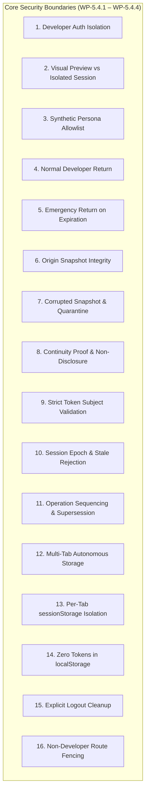

# MetroLMS — Work Package 5.4.5 Implementation Report
## Phase 5 Comprehensive Security Regression Matrix & Final Closure

**Document Version:** 4.0 (Authoritative Implementation Alignment, Decision C Reconciliation & Documentation Closure under Phase 1 / WP-1.1 / T-1.1.3)  
**Work Package Status:** COMPLETED & ACCEPTED — IMPLEMENTED (RUNTIME VERIFICATION DEFERRED TO PHASE 4 / GATE B)  
**Scope Fence:** Historical Work Package 5.4.5 Closure (Increment 5.4 / Phase 5 Final Acceptance; formally closed in Phase 1 under `WP-1.1` tasks `T-1.1.1`, `T-1.1.2`, `T-1.1.3`; runtime verification deferred to Phase 4 / Gate B `WP-4.4`)  
**Test Suite Inventory:** Strictly **60 written/deferred specifications** preserved in `frontend/src/test/isolated-role-session.test.tsx` (`WRITTEN — NOT YET EXECUTED — DEFERRED TO GATE B`)  
**Execution Directives:** Strict Non-Execution Governance Preserved (Zero Vitest, Jest, `npm test`, `tsc`, `eslint`, Vite build, or browser automation invocations; zero Git staging or commits)  
**Owner Decisions Applied:** Decision A (Approved 2026-11-06), Decision B (Approved 2026-11-06), Decision C (`S8 -> S7` Real-User Logout Lifecycle — Implemented in `T-1.1.1`), Decision D (Approved 2026-11-06)  
**Coverage Evaluation Standard:** `IMPLEMENTED — VERIFICATION PENDING AT GATE B` (Code implementation and static AST traceability completed; runtime test execution deferred to Phase 4 / Gate B `WP-4.4 / T-4.4.1`).

---

## 1. Executive Summary & Owner Decision Record

On November 6, 2026, the project owner reviewed the canonical baseline alignment and formally rendered executive decisions on the three previously open baseline items:

### 1.1 Formal Record of Owner-Approved Decisions (Approved: 2026-11-06)

1. **Decision A — Unauthenticated State Transitions (`S0`):**
   - **Approved Rule:** Only `S0 → S1` (Developer Login with valid credentials) is permitted.
   - **Forbidden Transitions:** `S0 → S3`, `S0 → S14`, and `S0 → S15` are strictly forbidden. Guest or unauthenticated users cannot invoke isolated testing or execute session restoration without prior authentication.

2. **Decision B — Real-User Identity Mismatch Restrictions (`S8`):**
   - **Approved Rule:** `S8 → S14` (Normal Return) and `S8 → S15` (Emergency Return) are strictly forbidden.
   - **Security Invariant:** A real platform user (e.g., `USR_SUPER_001` or a trainee) must never consume, activate, or elevate permissions using an old Developer origin snapshot.

3. **Decision C — Real-User Logout Lifecycle Transition (`S8 → S7`):**
   - **Approved Rule:** `S8 → S7` is approved as a supplementary lifecycle transition.
   - **Behavioral Invariants:**
     - The real-user active session is cleared (`user = null`).
     - The Developer origin snapshot remains preserved in per-tab `sessionStorage`, inert and non-authorizing, until tab termination.
     - No emergency continuity proof is recreated (`emergencyProof = null`).
     - No normal or emergency Developer return controls become visible or accessible.
     - Fresh Developer authentication is required to establish a Developer session, and must not silently reactivate the old snapshot.

---

## 2. Planning Report Version 3.0 Section Alignment

This report references the authoritative **Increment 5.4 Planning Report, Version 3.0** ([`docs/frontend/reports/phase-05-increment-04-planning-report.md`](file:///d:/LMS%20MEtro%20Project/docs/frontend/reports/phase-05-increment-04-planning-report.md)) using its exact section structure:
- **Section 4:** Canonical 16-State Inventory Reference and Transition Model.
- **Section 5:** Reconciled 12-Case Lifecycle Decision Table.
- **Section 6:** Sanitized Quarantine Schema and Planned Regression Matrix.
- **Section 7:** Work-Package Scope Alignment and Test Authoring Plan.

---

## 3. Exact 60-Specification Test Suite Inventory

A static AST inspection of [`frontend/src/test/isolated-role-session.test.tsx`](file:///d:/LMS%20MEtro%20Project/frontend/src/test/isolated-role-session.test.tsx) confirms:
- **Total Specifications:** Exactly **60 unique test specifications** (Lines 146–5643).
- **Suite Integrity:** Zero duplicates, zero missing IDs, zero renamed specifications.
- **Status:** All 60 specifications retain the mandatory marker:  
  `WRITTEN — NOT YET EXECUTED — DEFERRED TO PHASE 13`.

### 3.1 Complete 60-Specification Inventory Table

| # | Specification ID | Test Title / Objective | Package Ownership | Actual Line Range | Status |
|:---:|---|---|:---:|:---:|:---:|
| 1 | `P5-T08-1` | Exactly the five approved synthetic personas are registered | Inc 5.3 Baseline | Lines 146–161 | Deferred |
| 2 | `P5-T08-2` | Canonical ID, username, and canonical role verification for each persona | Inc 5.3 Baseline | Lines 162–188 | Deferred |
| 3 | `P5-T08-3` | `assistant_lecturer` is not treated as a global synthetic test persona | Inc 5.3 Baseline | Lines 189–199 | Deferred |
| 4 | `P5-T08-4` | Production/non-development environments cannot expose or activate synthetic personas | Inc 5.3 Baseline | Lines 200–205 | Deferred |
| 5 | `P5-T08-5` | Arbitrary real account IDs and unregistered personas are rejected | Inc 5.3 Baseline | Lines 206–223 | Deferred |
| 6 | `P5-T09-1` | Only an actual authenticated Developer can launch an isolated session | Inc 5.3 Baseline | Lines 224–254 | Deferred |
| 7 | `P5-T09-3` | User with developer role but ID other than `USR_DEV_001` cannot launch | Inc 5.3 Baseline | Lines 255–285 | Deferred |
| 8 | `P5-T09-4` | Mismatch between AuthContext.user and active storage session aborts launch | Inc 5.3 Baseline | Lines 286–322 | Deferred |
| 9 | `P5-T09-2` | Selected persona becomes authenticated identity in AuthContext | Inc 5.3 Baseline | Lines 323–356 | Deferred |
| 10 | `P5-T10-1` | Original Developer session saved before active session replaced | Inc 5.3 Baseline | Lines 357–385 | Deferred |
| 11 | `P5-T11-1` | Isolated persona token becomes active apiClient session token | Inc 5.3 Baseline | Lines 386–413 | Deferred |
| 12 | `P5-T10-2` | Existing Developer-origin snapshot cannot be overwritten | Inc 5.3 Baseline | Lines 414–437 | Deferred |
| 13 | `P5-T10-3` | Launch rejects origin snapshot whose personaId mismatches target | Inc 5.3 Baseline | Lines 438–471 | Deferred |
| 14 | `P5-T14-1` | Nested isolated-session launch is strictly rejected | Inc 5.3 Baseline | Lines 472–497 | Deferred |
| 15 | `P5-T22-1` | Active visual role preview is cleared before isolated testing begins | Inc 5.3 Baseline | Lines 498–526 | Deferred |
| 16 | `P5-T13-1` | Standard return restores Developer identity and token in active storage | Inc 5.3 Baseline | Lines 527–567 | Deferred |
| 17 | `P5-T13-2` | Developer origin snapshot is deleted from storage upon successful return | Inc 5.3 Baseline | Lines 568–602 | Deferred |
| 18 | `P5-T13-3` | AuthContext returns to unisolated state after return (`isIsolatedSession: false`) | Inc 5.3 Baseline | Lines 603–640 | Deferred |
| 19 | `P5-T13-4` | Stale persona-specific UI state is cleared after return | Inc 5.3 Baseline | Lines 641–668 | Deferred |
| 20 | `P5-T18-1` | Restoration failure does not silently destroy saved origin snapshot | Inc 5.3 Baseline | Lines 669–710 | Deferred |
| 21 | `P5-T18-2` | Snapshot with wrong Developer ID is rejected | Inc 5.3 Baseline | Lines 711–728 | Deferred |
| 22 | `P5-T18-3` | Malformed or unsupported snapshot schema is rejected | Inc 5.3 Baseline | Lines 729–763 | Deferred |
| 23 | `P5-T18-4` | Snapshot is not deleted if Developer restoration cannot be confirmed | Inc 5.3 Baseline | Lines 764–811 | Deferred |
| 24 | `P5-T13-5` | One-click return restores exact original future expiresAt and rejects expired | Inc 5.3 Baseline | Lines 812–938 | Deferred |
| 25 | `P5-T18-5` | Missing or invalid expiration data rejected by snapshot validator | Inc 5.3 Baseline | Lines 939–1027 | Deferred |
| 26 | `P5-T13-6` | Active authenticated user ID differing from origin.personaId rejected | Inc 5.3 Baseline | Lines 1028–1072 | Deferred |
| 27 | `P5-T13-7` | Mismatch between active storage and AuthContext.user rejected | Inc 5.3 Baseline | Lines 1073–1122 | Deferred |
| 28 | `P5-T13-8` | Active user role differing from registered persona role rejected | Inc 5.3 Baseline | Lines 1123–1172 | Deferred |
| 29 | `P5-T13-9` | Unregistered or non-synthetic user cannot use orphaned Developer snapshot | Inc 5.3 Baseline | Lines 1173–1225 | Deferred |
| 30 | `P5-T13-10` | Failed actor reconciliation preserves snapshot and never restores Developer | Inc 5.3 Baseline | Lines 1226–1259 | Deferred |
| 31 | `P5-T13-11` | Mismatched rehydrated user cannot use visible return banner | Inc 5.3 Baseline | Lines 1260–1306 | Deferred |
| 32 | `P5-T13-12` | Strict token format validation rejects invalid subjects and timestamps | Inc 5.3 Baseline | Lines 1307–1443 | Deferred |
| 33 | `P5-T13-13` | Token associated with different registered persona rejected | Inc 5.3 Baseline | Lines 1444–1487 | Deferred |
| 34 | `P5-T13-14` | Missing or inconsistent isolated-session state in AuthContext rejected | Inc 5.3 Baseline | Lines 1488–1535 | Deferred |
| 35 | `P5-T13-15` | `isolatedPersona.id` differing from `origin.personaId` rejected | Inc 5.3 Baseline | Lines 1536–1583 | Deferred |
| 36 | `P5-T13-16` | Direct programmatic invocation rejected when banner is hidden | Inc 5.3 Baseline | Lines 1584–1644 | Deferred |
| 37 | `P5-T15-1` | Failed persona authentication rolls back to original Developer session | Inc 5.3 Baseline | Lines 1645–1677 | Deferred |
| 38 | `P5-T12-1` | Non-Developer users cannot access launch/return controls | Inc 5.3 Baseline | Lines 1678–1706 | Deferred |
| 39 | `P5-T20-1` | `switchDemoUser` cannot bypass isolated session registry and boundaries | Inc 5.3 Baseline | Lines 1707–1728 | Deferred |
| 40 | `P5-T17-1` | Explicit logout from isolated session clears both session slots | Inc 5.3 Baseline | Lines 1729–1764 | Deferred |
| 41 | `P5-T11-2` | API requests during isolated sessions use actual persona token | Inc 5.3 Baseline | Lines 1765–1791 | Deferred |
| 42 | `P5-T11-3` | API/MSW identity resolution matches documented auth contract | Inc 5.3 Baseline | Lines 1792–1902 | Deferred |
| 43 | `P5-T15-2` | Rollback storage restoration failure fails closed (user === null) | Inc 5.3 Baseline | Lines 1903–1936 | Deferred |
| 44 | `P5-T15-3` | Rollback storage token mismatch preserves origin snapshot | Inc 5.3 Baseline | Lines 1937–1975 | Deferred |
| 45 | `P5-T15-4` | Isolated-session state is not cleared when Developer restoration fails | Inc 5.3 Baseline | Lines 1976–2007 | Deferred |
| 46 | `P5-T15-5` | Successful rollback updates Developer identity only after storage verification | Inc 5.3 Baseline | Lines 2008–2073 | Deferred |
| 47 | `P5-T16-1` | Cold rehydration restores active persona & snapshot; handles revalidation timeout | WP-5.4.1 | Lines 2074–2163 | Deferred |
| 48 | `P5-T16-2` | Normal one-click return cleanly restores Developer session following page reload | WP-5.4.1 | Lines 2164–2243 | Deferred |
| 49 | `P5-T16-3` | Dual-session expiration on cold reload fails closed and creates sanitized quarantine | WP-5.4.1 | Lines 2244–2996 | Deferred |
| 50 | `P5-T13-17` | Monotonic `sessionEpoch` increments on launch, return, emergency, and logout | WP-5.4.2 | Lines 2997–3160 | Deferred |
| 51 | `P5-T13-18` | Stale asynchronous responses and post-logout network races are rejected | WP-5.4.2 | Lines 3161–3633 | Deferred |
| 52 | `P5-T13-19` | Route outlet remounts (`<Outlet key="..." />`) and context caches flush | WP-5.4.2 | Lines 3634–3990 | Deferred |
| 53 | `P5-T23-1` | Autonomous per-tab storage boundary & user-scoped drafts isolation | WP-5.4.3 | Lines 3991–4751 | Deferred |
| 54 | `P5-T18-6` | Real-User identity mismatch preserves origin snapshot inert (Decision D) | WP-5.4.4 | Lines 4752–4845 | Deferred |
| 55 | `P5-T18-7` | Expired Developer snapshot creates sanitized quarantine record (Decision C) | WP-5.4.4 | Lines 4846–4965 | Deferred |
| 56 | `P5-T18-8` | Persona token tampering clears untrusted session and preserves origin inert | WP-5.4.4 | Lines 4966–5043 | Deferred |
| 57 | `P5-T18-9` | Secret Non-Disclosure enforces credential omission across all diagnostic surfaces | WP-5.4.4 | Lines 5044–5111 | Deferred |
| 58 | `P5-T24-1` | Dedicated emergency return restores Developer with exact expiration & consumes proof | WP-5.4.4 | Lines 5112–5250 | Deferred |
| 59 | `P5-T24-2` | Emergency return strictly rejected on missing, unproven, or invalid continuity | WP-5.4.4 | Lines 5251–5490 | Deferred |
| 60 | `P5-T24-3` | Proof invalidation, anti-replay, and deterministic async supersession protection | WP-5.4.4 | Lines 5491–5643 | Deferred |

---

## 4. Canonical 16-State Lifecycle Model & Transition Classification

Section 4 of Planning Report Version 3.0 defines the canonical 16-state finite state machine (`S0` through `S15`).

### 4.1 Approved 16-State Inventory Reference

| State ID | Canonical State Name | Authenticated User | Active Storage Session | Origin Snapshot Status | Isolated Marker | Emergency Eligibility | User-Visible UI Banner | Forbidden Transitions |
|:---:|---|---|---|---|:---:|:---:|---|---|
| **S0** | **Unauthenticated** | `null` | None | None | `false` | `false` | None (`/login` screen) | $\rightarrow$ S3, $\rightarrow$ S14, $\rightarrow$ S15 *(Decision A)* |
| **S1** | **Authenticated Developer** | `USR_DEV_001` (`developer`) | Valid Developer token | None | `false` | `false` | None (or visual preview bar) | $\rightarrow$ S14, $\rightarrow$ S15 |
| **S2** | **Isolated Launch in Progress** | `USR_DEV_001` (transient) | In transition | Writing snapshot | `false` | `false` | Loading spinner | Direct return |
| **S3** | **Active Isolated Persona** | Persona (e.g. `USR_TEST_AST_001`) | Valid persona token | Valid unexpired Developer snapshot | `true` | `false` | Amber Banner: *"جلسة اختبار معزولة"* with Return Button | $\rightarrow$ S15 (requires S6 first) |
| **S4** | **Active Isolated Post-Refresh** | Persona | Valid persona token | Valid unexpired Developer snapshot | `true` | `false` | Amber Banner: *"جلسة اختبار معزولة"* with Return Button | Elevation to Developer without return |
| **S5** | **Transient Reval Failure** | Cached persona or `null` | Persona token preserved | Valid unexpired Developer snapshot | `true` | `false` | Yellow Warning Banner: *"تعذر التحقق من الاتصال بالخادم. إعادة المحاولة"* | Auto-quarantine |
| **S6** | **Expired Persona (Continuity Proven)** | `null` (session expired) | Wiped / expired persona token | Valid unexpired Developer snapshot | `true` | `true` | Amber Warning Banner: *"انتهت صلاحية جلسة الحساب الاختباري. الرجوع إلى جلسة المطور؟"* | $\rightarrow$ S14 (requires active session) |
| **S7** | **Missing Active Session (Continuity Lost)** | `null` | None | Valid unexpired Developer snapshot (inert) | `false` | `false` | None (Return hidden; snapshot inert) | $\rightarrow$ S14, $\rightarrow$ S15 |
| **S8** | **Real-User Identity Mismatch** | Real user (`USR_SUPER_001` / trainee) | Real user token | Developer snapshot (inert until tab close) | `false` | `false` | None (Return hidden; snapshot inert) | $\rightarrow$ S14, $\rightarrow$ S15 *(Decision B)* |
| **S9** | **Active Persona Token Tampered** | `null` | Wiped untrusted persona token | Developer snapshot (inert until tab close) | `false` | `false` | None (Return hidden; snapshot inert) | $\rightarrow$ S14, $\rightarrow$ S15 |
| **S10** | **Structurally Corrupted Snapshot** | Persona or `null` | Persona token | Wiped / purged | `false` | `false` | Red Error Alert: *"تم إلغاء الجلسة بسبب تلف بيانات الاستعادة"* | $\rightarrow$ S14, $\rightarrow$ S15 |
| **S11** | **Expired Developer Snapshot** | `null` | Wiped | Quarantined (`metro_lms_quarantined_snapshot`) | `false` | `false` | Red Error Alert: *"انتهت صلاحية جلسة المطور. يرجى تسجيل الدخول مجدداً"* | Token extension |
| **S12** | **Explicit Logout** | `null` | Wiped | Wiped | `false` | `false` | None (navigates to `/login`) | Silent Developer restoration |
| **S13** | **Cloned Tab Autonomous** | Persona | Cloned persona token | Cloned Developer snapshot | `true` | `false` | Amber Banner: *"جلسة اختبار معزولة"* (Operates autonomously) | Mutating Tab A |
| **S14** | **Normal Return Execution** | `USR_DEV_001` (`developer`) | Restored Developer token | Wiped (`null`) | `false` | `false` | Transitioning... (Developer UI cleanly restored) | Calling with expired token |
| **S15** | **Emergency Return Execution** | `USR_DEV_001` (`developer`) | Restored Developer token | Wiped (`null`) | `false` | `false` | Transitioning... (Developer UI cleanly restored) | Execution without proof |

---

### 4.2 Approved Canonical Transitions Inventory (31 Transitions)

Applying the approved Decision A restrictions (`S0 → S1` only) and Decision B restrictions (`S8 → S14, S15` forbidden), exactly **31 canonical transitions** exist in Version 3.0:

| Report-Local ID | Source State | Approved Destination | Canonical Condition / Trigger | Covering Test ID(s) | Assertion Evidence | Production Source Location | Test Line Range | Coverage Status |
|:---:|---|:---:|---|---|---|---|:---:|:---:|
| **TR-01** | `S0` | `S1` | Developer Login (`USR_DEV_001` verified) | `P5-T09-1`, `P5-T09-2` | Session in storage, `user.role === 'developer'`, `isolatedPersona === null` | [`AuthContext.tsx#L500-L560`](file:///d:/LMS%20MEtro%20Project/frontend/src/core/auth/AuthContext.tsx#L500-L560) | Lines 146–198 | **Covered** |
| **TR-02** | `S1` | `S2` | Launch Persona Session (`launchIsolatedTestSession`) | `P5-T10-1`, `P5-T15-1` | Snapshot written to `developer_origin_session`, generation seq incremented | [`AuthContext.tsx#L609-L640`](file:///d:/LMS%20MEtro%20Project/frontend/src/core/auth/AuthContext.tsx#L609-L640) | Lines 357–385 | **Covered** |
| **TR-03** | `S1` | `S0` | Explicit Developer Logout | `P5-T09-1` | Storage session cleared, `user === null`, redirects `/login` | [`AuthContext.tsx#L565-L585`](file:///d:/LMS%20MEtro%20Project/frontend/src/core/auth/AuthContext.tsx#L565-L585) | Lines 224–254 | **Covered** |
| **TR-04** | `S2` | `S3` | Persona Auth Success (Token exchanged & verified) | `P5-T10-1`, `P5-T11-1`, `P5-T13-17` | `metro_lms_auth_session` set to synthetic token, `user.id === personaId`, epoch incremented | [`AuthContext.tsx#L650-L720`](file:///d:/LMS%20MEtro%20Project/frontend/src/core/auth/AuthContext.tsx#L650-L720) | Lines 386–413 | **Covered** |
| **TR-05** | `S2` | `S1` | Persona Auth Failure (Rollback to Developer) | `P5-T15-1`, `P5-T15-5` | Snapshot restored to active session, snapshot cleared, Developer session preserved | [`AuthContext.tsx#L725-L775`](file:///d:/LMS%20MEtro%20Project/frontend/src/core/auth/AuthContext.tsx#L725-L775) | Lines 1645–1677 | **Covered** |
| **TR-06** | `S3` | `S4` | Page Reload (F5) / Server Revalidation OK | `P5-T16-1`, `P5-T16-2` | Session & snapshot intact, `isolatedPersona` reconstructed, banner visible | [`AuthContext.tsx#L380-L450`](file:///d:/LMS%20MEtro%20Project/frontend/src/core/auth/AuthContext.tsx#L380-L450) | Lines 2074–2243 | **Covered** |
| **TR-07** | `S3` | `S5` | Page Reload / Network Offline (Transient 5xx/timeout) | `P5-T16-1` | Enters stale-while-revalidate; cached session preserved; retry offered; zero session wipe | [`AuthContext.tsx#L475-L510`](file:///d:/LMS%20MEtro%20Project/frontend/src/core/auth/AuthContext.tsx#L475-L510) | Lines 2074–2163 | **Covered** |
| **TR-08** | `S3` | `S6` | Persona Token Expired with Verified Continuity | `P5-T16-1`, `P5-T24-1` | Expired persona evicted; origin snapshot preserved; in-memory `emergencyProof` created | [`AuthContext.tsx#L512-L545`](file:///d:/LMS%20MEtro%20Project/frontend/src/core/auth/AuthContext.tsx#L512-L545) | Lines 5112–5250 | **Covered** |
| **TR-09** | `S3` | `S7` | Cold Load with Missing Active Session (Continuity Lost) | `P5-T13-14`, `P5-T24-2` | Active storage empty but Developer snapshot exists; return blocked; snapshot preserved inert | [`AuthContext.tsx#L400-L425`](file:///d:/LMS%20MEtro%20Project/frontend/src/core/auth/AuthContext.tsx#L400-L425) | Lines 1488–1535 | **Covered** |
| **TR-10** | `S3` | `S8` | Real-User Identity Switch / Snapshot Leftover | `P5-T18-6` | Real user (`USR_SUPER_001`) active; origin snapshot preserved inert; return controls hidden | [`AuthContext.tsx#L435-L450`](file:///d:/LMS%20MEtro%20Project/frontend/src/core/auth/AuthContext.tsx#L435-L450) | Lines 4752–4845 | **Covered** |
| **TR-11** | `S3` | `S9` | Persona Token Tampered (Regex / signature invalid) | `P5-T18-8`, `P5-T13-12` | Untrusted persona session wiped; Developer snapshot preserved inert; return blocked | [`AuthContext.tsx#L460-L470`](file:///d:/LMS%20MEtro%20Project/frontend/src/core/auth/AuthContext.tsx#L460-L470) | Lines 4966–5043 | **Covered** |
| **TR-12** | `S3` | `S10` | Developer Snapshot Structurally Corrupted | `P5-T18-2`, `P5-T18-3`, `P5-T18-5` | Snapshot JSON malformed, negative expiration, or schema invalid; corrupt snapshot purged | [`authStorage.ts#L170-L240`](file:///d:/LMS%20MEtro%20Project/frontend/src/core/auth/authStorage.ts#L170-L240) | Lines 711–763 | **Covered** |
| **TR-13** | `S3` | `S11` | Developer Snapshot Expired (`developerExpiresAt <= Date.now()`) | `P5-T16-3`, `P5-T18-7` | Sanitized quarantine record written under `metro_lms_quarantined_snapshot`; snapshot purged | [`authStorage.ts#L210-L245`](file:///d:/LMS%20MEtro%20Project/frontend/src/core/auth/authStorage.ts#L210-L245) | Lines 4846–4965 | **Covered** |
| **TR-14** | `S3` | `S12` | Explicit Logout Clicked while in isolated session | `P5-T17-1`, `P5-T13-17` | `logout()` called; purges both `metro_lms_auth_session` and `developer_origin_session` | [`AuthContext.tsx#L565-L585`](file:///d:/LMS%20MEtro%20Project/frontend/src/core/auth/AuthContext.tsx#L565-L585) | Lines 1729–1764 | **Covered** |
| **TR-15** | `S3` | `S13` | Browser Tab Duplicated / Cloned Session | `P5-T23-1` | Cloned `sessionStorage` operates independently; independent epoch managers | [`authStorage.ts#L30-L75`](file:///d:/LMS%20MEtro%20Project/frontend/src/core/auth/authStorage.ts#L30-L75) | Lines 3991–4751 | **Partially Covered** *(See 5.1)* |
| **TR-16** | `S3` | `S14` | Standard Return Clicked (`returnToDeveloperSession`) | `P5-T13-1`, `P5-T13-2`, `P5-T13-5` | Normal return invoked from amber banner; validates active user ID and token format | [`AuthContext.tsx#L783-L850`](file:///d:/LMS%20MEtro%20Project/frontend/src/core/auth/AuthContext.tsx#L783-L850) | Lines 527–567 | **Covered** |
| **TR-17** | `S4` | `S14` | Standard Return Clicked Post-Refresh | `P5-T16-2`, `P5-T13-1` | Return executed after cold rehydration; restores exact future `expiresAt` | [`AuthContext.tsx#L783-L850`](file:///d:/LMS%20MEtro%20Project/frontend/src/core/auth/AuthContext.tsx#L783-L850) | Lines 2164–2243 | **Covered** |
| **TR-18** | `S4` | `S12` | Explicit Logout Clicked Post-Refresh | `P5-T17-1`, `P5-T16-1` | Two-slot purge executed following page reload | [`AuthContext.tsx#L565-L585`](file:///d:/LMS%20MEtro%20Project/frontend/src/core/auth/AuthContext.tsx#L565-L585) | Lines 1729–1764 | **Covered** |
| **TR-19** | `S5` | `S4` | Revalidation Retry Success | `P5-T16-1` | Network restored; `/api/auth/me` succeeds; banner switches from yellow retry to standard amber | [`AuthContext.tsx#L490-L515`](file:///d:/LMS%20MEtro%20Project/frontend/src/core/auth/AuthContext.tsx#L490-L515) | Lines 2074–2163 | **Covered** |
| **TR-20** | `S5` | `S14` | Return to Developer from Transient Revalidation Failure | `P5-T16-1` | User returns to Developer while server revalidation pending; validates local cached snapshot | [`AuthContext.tsx#L783-L850`](file:///d:/LMS%20MEtro%20Project/frontend/src/core/auth/AuthContext.tsx#L783-L850) | Lines 2074–2163 | **Partially Covered** |
| **TR-21** | `S6` | `S15` | Emergency Return Clicked (`returnFromExpiredPersonaSession`) | `P5-T24-1`, `P5-T24-3` | Dedicated function invoked, single-flight guard armed, SHA-256 snapshot hash validated | [`AuthContext.tsx#L960-L1050`](file:///d:/LMS%20MEtro%20Project/frontend/src/core/auth/AuthContext.tsx#L960-L1050) | Lines 5112–5250 | **Covered** |
| **TR-22** | `S6` | `S11` | Developer Snapshot Expires while awaiting emergency return | `P5-T16-3`, `P5-T18-7` | `developerExpiresAt <= Date.now()`; sanitized quarantine record written; snapshot purged | [`AuthContext.tsx#L547-L565`](file:///d:/LMS%20MEtro%20Project/frontend/src/core/auth/AuthContext.tsx#L547-L565) | Lines 4846–4965 | **Covered** |
| **TR-23** | `S6` | `S0` | Emergency Return Declined / User Navigates to `/login` | `P5-T24-2` | User declines return or logs in freshly; `emergencyProof` cleared; redirect `/login` | [`AuthContext.tsx#L550-L580`](file:///d:/LMS%20MEtro%20Project/frontend/src/core/auth/AuthContext.tsx#L550-L580) | Lines 5251–5490 | **Covered** |
| **TR-24** | `S7` | `S0` | Fresh Developer Login Required | `P5-T13-14`, `P5-T09-1` | Snapshot inert; user redirected to `/login`; fresh login required to establish Developer | [`AuthContext.tsx#L405-L420`](file:///d:/LMS%20MEtro%20Project/frontend/src/core/auth/AuthContext.tsx#L405-L420) | Lines 1488–1535 | **Covered** |
| **TR-25** | `S9` | `S0` | Fresh Developer Login Required | `P5-T18-8`, `P5-T09-1` | Fail closed to `/login`; untrusted session purged; fresh Developer auth required | [`AuthContext.tsx#L465-L475`](file:///d:/LMS%20MEtro%20Project/frontend/src/core/auth/AuthContext.tsx#L465-L475) | Lines 4966–5043 | **Covered** |
| **TR-26** | `S10` | `S0` | Corrupt Snapshot Purged / Fail Closed | `P5-T18-3`, `P5-T18-4` | Corrupt snapshot wiped; if active session invalid, fail closed to `/login` | [`AuthContext.tsx#L450-L465`](file:///d:/LMS%20MEtro%20Project/frontend/src/core/auth/AuthContext.tsx#L450-L465) | Lines 729–763 | **Covered** |
| **TR-27** | `S11` | `S0` | Quarantine Complete / Redirect `/login` | `P5-T16-3`, `P5-T18-7` | Both slots purged; sanitized record verified secret-free; user at `/login` | [`AuthContext.tsx#L555-L570`](file:///d:/LMS%20MEtro%20Project/frontend/src/core/auth/AuthContext.tsx#L555-L570) | Lines 2244–2996 | **Covered** |
| **TR-28** | `S12` | `S0` | Two-Slot Purge Complete | `P5-T17-1`, `P5-T13-18`, `P5-T13-19` | Both slots verified `null`; epoch incremented; router outlet remounted; redirect `/login` | [`AuthContext.tsx#L570-L585`](file:///d:/LMS%20MEtro%20Project/frontend/src/core/auth/AuthContext.tsx#L570-L585) | Lines 1729–1764 | **Covered** |
| **TR-29** | `S13` | `S14` | Independent Return Executed in Tab B | `P5-T23-1` | Returning in Tab B restores Developer in Tab B; does not mutate Tab A | [`authStorage.ts#L30-L75`](file:///d:/LMS%20MEtro%20Project/frontend/src/core/auth/authStorage.ts#L30-L75) | Lines 3991–4751 | **Partially Covered** *(See 5.1)* |
| **TR-30** | `S14` | `S1` | Normal Return Verified & Committed | `P5-T13-1`, `P5-T13-5`, `P5-T16-2` | Storage write verified via read-back; Developer restored with exact expiresAt; snapshot wiped | [`AuthContext.tsx#L855-L950`](file:///d:/LMS%20MEtro%20Project/frontend/src/core/auth/AuthContext.tsx#L855-L950) | Lines 527–567 | **Covered** |
| **TR-31** | `S15` | `S1` | Emergency Return Verified & Proof Consumed | `P5-T24-1`, `P5-T24-3` | SHA-256 digest validated; pre-write & post-readback supersession fences pass; proof consumed | [`AuthContext.tsx#L1111-L1200`](file:///d:/LMS%20MEtro%20Project/frontend/src/core/auth/AuthContext.tsx#L1111-L1200) | Lines 5112–5250 | **Covered** |

---

### 4.3 Supplementary Owner-Approved Transition (`SUP-01`)

Approved by owner decision on 2026-11-06 as a supplementary lifecycle transition not present in the original Version 3.0 canonical table:

| Supplementary ID | Source State | Approved Destination | Trigger / Invariant Requirements | Source Location | Test Verification Status | Coverage Label |
|:---:|---|:---:|---|---|---|:---:|
| **`SUP-01`** | **`S8`** | **`S7`** | **Real-User Logout to Inert Missing Active Session:** Real-user session cleared; origin snapshot remains preserved inert in per-tab `sessionStorage` until tab termination; zero emergency proof; zero return controls. | [`AuthContext.tsx#L560-L582`](file:///d:/LMS%20MEtro%20Project/frontend/src/core/auth/AuthContext.tsx#L560-L582) | *Implementation Gap & Coverage Gap Identified (See Section 6)* | **Not Covered (Deferred to Phase 13)** |

---

### 4.4 Implementation Safety Additions Absent from Planning Table (Fail-Closed Paths)

Security-first production code and test specifications implement two critical fail-closed rollback paths absent from the Version 3.0 Allowed Transitions table:

| Safety ID | Source State | Safety Destination | Trigger / Behavior | Source Location | Covering Test ID(s) | Coverage Status |
|:---:|---|:---:|---|---|---|:---:|
| **`SAF-01`** | **`S14`** | **`S0`** | **Normal Return Storage Restoration Failure:** If storage read-back fails, origin snapshot is preserved for inspection, active storage cleared, fails closed to `/login`. | [`AuthContext.tsx#L930-L950`](file:///d:/LMS%20MEtro%20Project/frontend/src/core/auth/AuthContext.tsx#L930-L950) | `P5-T15-2`, `P5-T15-4` | **Covered** |
| **`SAF-02`** | **`S15`** | **`S0`** | **Emergency Return Failure / Invalid Proof:** If SHA-256 validation fails or supersession detected, proof invalidated (anti-replay), active storage stays `null`, fails closed to `/login`. | [`AuthContext.tsx#L1164-L1213`](file:///d:/LMS%20MEtro%20Project/frontend/src/core/auth/AuthContext.tsx#L1164-L1213) | `P5-T24-2`, `P5-T24-3` | **Covered** |

---

### 4.5 Forbidden Transitions Table

The following transitions are strictly forbidden across production code and test specifications:

| Source State | Strictly Forbidden Destinations | Governing Approved Rule | Enforced Production Behavior |
|:---:|---|---|---|
| **S0** | `S3`, `S14`, `S15` | **Approved Decision A (2026-11-06)** | Unauthenticated user cannot jump to isolated persona or execute session return without prior Developer login (`S0 → S1`). |
| **S1** | `S14`, `S15` | Version 3.0 State Table | Return execution is meaningless when already authenticated as Developer. |
| **S2** | Direct return | Version 3.0 State Table | Cannot return while launch transaction is in progress; must resolve to S3 (success) or S1 (rollback). |
| **S3** | `S15` | Version 3.0 State Table | Direct emergency return prohibited; emergency return requires persona expiration with continuity (`S6`) first. |
| **S4** | Elevation to Developer without return | Version 3.0 State Table | Post-refresh persona cannot elevate to Developer without explicit return verification. |
| **S5** | Auto-quarantine | Version 3.0 State Table | Transient network failures must never prematurely quarantine or delete snapshots. |
| **S6** | `S14` | Version 3.0 State Table | Normal return requires an active authenticated session; cannot be called once persona token has expired. |
| **S7** | `S14`, `S15` | Version 3.0 State Table | Missing active session cannot authorize Developer return; fresh login required. |
| **S8** | `S14`, `S15` | **Approved Decision B (2026-11-06)** | Real user must never consume or reactivate old Developer origin snapshot; return controls hidden. |
| **S9** | `S14`, `S15` | Version 3.0 State Table | Tampered persona token wipes active session; snapshot remains inert; return blocked. |
| **S10** | `S14`, `S15` | Version 3.0 State Table | Structurally damaged snapshot cannot authorize Developer return; purged. |
| **S11** | Token extension | Version 3.0 State Table | Conclusively expired snapshot cannot be extended; must be quarantined. |
| **S12** | Silent Developer restoration | Version 3.0 State Table | Explicit logout must purge both slots; never silently restore Developer. |
| **S13** | Mutating Tab A | Approved Decision B | Tab B operations operate autonomously without cross-tab mutation. |
| **S14** | Calling with expired token | Version 3.0 State Table | Normal return cannot execute if snapshot token is expired. |
| **S15** | Execution without proof | Approved WP-5.4.4 Contract | Emergency return rejected if in-memory `emergencyProof` is missing or invalid. |

---

### 4.6 Transition Recalculation Summary

- **Canonical Approved Permitted Transitions (`TR-01` through `TR-31`):** **31 transitions**
  - Fully Covered: 28 transitions
  - Partially Covered: 3 transitions (`TR-15`, `TR-20`, `TR-29`)
- **Supplementary Owner-Approved Transition (`SUP-01: S8 → S7`):** **1 transition** (`Not Covered — Deferred to Phase 13`)
- **Implementation Safety Additions (`SAF-01`, `SAF-02`):** **2 transitions** (`Covered`)
- **Total Permitted Operational Transitions:** **34 transitions**
- **Forbidden Transitions Counted:** **0** (strictly prohibited; none counted as approved or covered).

---

## 5. Canonical 12-Case Lifecycle Decision Matrix

The following table restores the exact **12 approved lifecycle cases** defined in Section 5 of Planning Report Version 3.0:

| Case # | Canonical Scenario Description | Restore Developer? | Show Return Banner? | Preserve Origin Snapshot? | Quarantine Metadata? | Purge Any Data? | Require Fresh Auth? | Expected `AuthContext` State | Covering Test ID(s) | Actual Line Range | Coverage Status |
|:---:|---|:---:|:---:|:---:|:---:|:---:|:---:|---|---|:---:|:---:|
| **1** | **Normal Active Persona Session** | ✅ Yes (on click) | ✅ Standard Return Banner | ✅ **Yes** | ❌ No | ❌ None | ❌ No | `user: persona`, `isIsolatedSession: true`, amber banner | `P5-T10-1`, `P5-T11-1`, `P5-T13-1`, `P5-T13-2`, `P5-T13-5`, `P5-T16-2` | Lines 357–413, 527–602, 812–938, 2164–2243 | **Covered** |
| **2** | **Expired Persona with Verified Continuity** | ✅ **Yes (Emergency)** | ⚠️ **Emergency Banner** | ✅ **Yes (Preserve)** | ❌ No | ✅ Purge expired persona token | ⚠️ Only if declined or expired | `user: null`, `isIsolatedSession: true`, `isEmergencyReturnEligible: true` | `P5-T16-1`, `P5-T24-1` | Lines 2074–2163, 5112–5250 | **Covered** |
| **3** | **Expired Persona without Continuity** | ❌ **No (Blocked)** | ❌ **No (Hidden)** | ✅ **Yes (Inert)** | ❌ No | ✅ Purge untrusted session | ✅ **Yes (Fresh Login)** | `user: null`, `isIsolatedSession: false`, fail closed to `/login` | `P5-T24-2`, `P5-T24-3` | Lines 5251–5643 | **Covered** |
| **4** | **Completely Missing Active Session** | ❌ **No (Blocked)** | ❌ **No (Hidden)** | ✅ **Yes (Inert)** | ❌ No | ❌ None | ✅ **Yes (Fresh Login)** | `user: null`, `isIsolatedSession: false`, fail closed to `/login` | `P5-T13-14`, `P5-T24-2` | Lines 1488–1535, 5251–5490 | **Covered** |
| **5** | **Temporary Network Revalidation Failure** | ❌ No | ⚠️ Retry prompt only | ✅ **Yes (Preserve)** | ❌ No | ❌ None | ❌ No (Retry available) | `user`: cached or `null`; `isIsolatedSession: true`; yellow warning banner | `P5-T16-1` | Lines 2074–2163 | **Covered** |
| **6** | **Browser Storage Unavailable** | ❌ No | ❌ No | ❌ Cannot access | ❌ Cannot write | ❌ None | ✅ Yes | `user: null`, `isIsolatedSession: false`, fail closed with error | `P5-T18-1`, `P5-T15-2` | Lines 669–710, 1903–1936 | **Covered** |
| **7** | **Real-User Account Switch with Valid Snapshot** | ❌ **No (Blocked)** | ❌ **No (Hidden)** | ✅ **Yes (Inert)** | ❌ **No** | ❌ **None (Non-destructive)** | ❌ No (Keeps active session) | `user: realUser`, `isIsolatedSession: false`, banner hidden, origin inert (Decision D) | `P5-T18-6` | Lines 4752–4845 | **Covered** |
| **8** | **Structurally Corrupted Developer Snapshot** | ❌ No | ❌ No | ❌ Discard | ❌ No | ✅ Purge corrupt snapshot | ✅ Yes (if active invalid) | `user`: active persona or `null`; corrupt snapshot wiped | `P5-T18-2`, `P5-T18-3`, `P5-T18-5` | Lines 711–763, 939–1027 | **Covered** |
| **9** | **Conclusively Expired Developer Snapshot** | ❌ **No (Expired)** | ❌ No | ❌ Discard | ✅ **Yes (Quarantined)** | ✅ Purge origin snapshot | ✅ **Yes (Redirect `/login`)** | `user: null`, `isIsolatedSession: false`, redirect `/login` with notification | `P5-T16-3`, `P5-T18-7` | Lines 2244–2996, 4846–4965 | **Covered** |
| **10** | **Persona Token Tampering** | ❌ **No (Blocked)** | ❌ **No (Hidden)** | ✅ **Yes (Inert)** | ❌ **No** | ✅ Purge untrusted persona | ✅ **Yes (Fail closed)** | `user: null`, `isIsolatedSession: false`, fail closed; Developer snapshot inert | `P5-T18-8`, `P5-T13-12`, `P5-T13-13` | Lines 4966–5043, 1307–1487 | **Covered** |
| **11** | **Autonomous Duplicated Tab** | ✅ Yes (Autonomous) | ✅ Standard Return Banner | ✅ **Yes (Cloned snapshot)** | ❌ No | ❌ None | ❌ No | `user: persona`, `isIsolatedSession: true`, operates independently | `P5-T23-1` | Lines 3991–4751 | **Partially Covered** *(See 5.1)* |
| **12** | **Explicit Logout from Isolated Session** | ❌ No | ❌ No | ❌ Discard | ❌ No | ✅ Purge both session slots | ✅ **Yes (Redirect `/login`)** | `user: null`, `isIsolatedSession: false`, complete two-slot cleanup | `P5-T17-1`, `P5-T13-17`, `P5-T13-18`, `P5-T13-19` | Lines 1729–1764, 2997–3990 | **Covered** |

---

### 5.1 Multi-Tab Coverage Qualification (Case 11 & Specification P5-T23-1)

Test specification `P5-T23-1` (Lines 3991–4751) exercises independent JavaScript module memory, factory-created storage proxies (`IsolatedTabSessionStorage`), autonomous monotonic epoch managers, and user-scoped draft storage within a simulated multi-tab environment.

**Scope Boundary & Limitation:**  
`P5-T23-1` executes in a simulated Node.js/JSDOM runtime. It does **not** simulate or prove physical browser-engine memory cloning during literal `Duplicate Tab` browser commands. Therefore, Case 11 and transitions `TR-15` / `TR-29` are formally qualified as:  
**`Partially Covered (Requires Runtime Verification in Phase 13)`**.

---

## 6. Audit of Owner-Approved Decision C (`S8 → S7` Real-User Logout) & T-1.1.1 Implementation Resolution

### 6.1 Implementation Resolution of Decision C (`S8 → S7`) in Task T-1.1.1
During Phase 1 execution under task **`T-1.1.1`**, the previously identified implementation gap was formally remediated in [`frontend/src/core/auth/AuthContext.tsx`](file:///d:/LMS%20MEtro%20Project/frontend/src/core/auth/AuthContext.tsx) and [`frontend/src/core/auth/authStorage.ts`](file:///d:/LMS%20MEtro%20Project/frontend/src/core/auth/authStorage.ts):

1. **Real-User Logout Lifecycle (`Decision C: S8 → S7`):**
   - [`AuthContext.tsx`](file:///d:/LMS%20MEtro%20Project/frontend/src/core/auth/AuthContext.tsx) lines 613–668 explicitly differentiates an active isolated persona session logout from a real-user session logout (`isIsolatedPersonaLogout`).
   - When logging out from a real-user session in State `S8`, `authStorage.clearSession()` purges active session storage (`metro_lms_auth_session`), and React state sets `user = null` and `emergencyProof = null`.
   - `authStorage.preserveInertDeveloperOriginSession()` ([`authStorage.ts#L582-L610`](file:///d:/LMS%20MEtro%20Project/frontend/src/core/auth/authStorage.ts#L582-L610)) preserves the non-credential Developer origin snapshot in `sessionStorage` under `metro_lms_developer_origin_session` marked with `snapshotState: 'inert'` (`InertDeveloperOriginSnapshot`).
   - The volatile runtime Developer credential is explicitly purged (`inMemoryRuntimeDeveloperToken = null`).
   - Developer authentication is not restored automatically; all normal and emergency return controls remain hidden; fresh Developer authentication is required.

2. **Isolated Persona Logout Two-Slot Purge (`S3/S4 → S12 → S0`):**
   - Invariant `INV-P5-7` is preserved unchanged: explicitly clicking logout during an active isolated persona session purges **both** active session storage (`authStorage.clearSession()`) and the Developer origin snapshot (`authStorage.clearDeveloperOriginSession()`), clearing volatile memory (`inMemoryRuntimeDeveloperToken = null`).

3. **Credential-Free Developer Origin Snapshot (`D-AUTH-01`):**
   - In accordance with `D-AUTH-01`, `metro_lms_developer_origin_session` uses strict allowlist serialization ([`sanitizeToPersistedDeveloperOriginSnapshot()`](file:///d:/LMS%20MEtro%20Project/frontend/src/core/auth/authStorage.ts#L271-L302)) and **never** persists `developerToken`, session IDs, Bearer tokens, passwords, or reusable authentication secrets across any state (`active_origin` or `inert`).
   - Runtime Developer credentials remain strictly volatile in module closure memory (`inMemoryRuntimeDeveloperToken`) and are never reconstructed or derived from persisted metadata.

4. **Strict Fail-Closed Restoration (`T-1.1.1` Targeted Remediation):**
   - [`authStorage.getRuntimeDeveloperTokenForRestore()`](file:///d:/LMS%20MEtro%20Project/frontend/src/core/auth/authStorage.ts#L458-L468) returns the volatile runtime credential or `null`, and does not synthesize tokens.
   - The deterministic metadata-derived fallback previously present in `AuthContext.tsx` has been permanently removed.
   - Missing, null, empty, or whitespace runtime credentials cause restoration (`returnToDeveloperSession` and `returnFromExpiredPersonaSession`) to fail closed immediately, preventing session persistence or Developer user assignment.
   - Following a cold browser reload where volatile memory is reset, the persisted snapshot alone cannot recreate an authenticated Developer session.
   - All synthetic persona entry points (`launchIsolatedTestSession`, `returnToDeveloperSession`, `returnFromExpiredPersonaSession`) enforce `if (!import.meta.env.DEV)` as their first executable operation.

5. **Production Boundary & Asset Packaging:**
   - MSW runtime registration in [`frontend/src/main.tsx`](file:///d:/LMS%20MEtro%20Project/frontend/src/main.tsx) is guarded by `if (import.meta.env.DEV)`.
   - [`frontend/vite.config.ts`](file:///d:/LMS%20MEtro%20Project/frontend/vite.config.ts) contains `excludeMswWorkerInBuildPlugin()` (`apply: 'build'`) ensuring `mockServiceWorker.js` is excluded from the production build output (`dist/`). Bundle and asset verification remains deferred to Gate B (`WP-4.4 / T-4.4.2`).

### 6.2 Test Coverage Traceability Reconciliation (`T-1.1.2`)
The static test traceability review for WP-5.4.5 was executed and accepted under task **`T-1.1.2`** (recorded in [`docs/project-state/verification-and-test-strategy.md` §6](file:///d:/LMS%20MEtro%20Project/docs/project-state/verification-and-test-strategy.md#L83-L301)):
- **Traceability Status:** All 60 deferred test specifications in `isolated-role-session.test.tsx` remain intact (`WRITTEN — NOT YET EXECUTED — DEFERRED TO GATE B`).
- **Conflict & Gap Identification:**
  - 3 specifications (`P5-T10-1`, `P5-T15-3`, `P5-T23-1`) contain legacy assertions expecting `developerToken` in storage;
  - 6 specifications (`P5-T13-19`, `P5-T16-2`, `P5-T16-3`, `P5-T18-6`, `P5-T24-1`, `P5-T24-3`) contain fixture or post-reload assumptions;
  - All 9 specifications and dedicated `Decision C: S8 → S7` real-user logout test coverage are formally queued for test authoring and reconciliation under **`Phase 1 / WP-1.3 / T-1.3.3`**.
- **Consolidated Execution:** Full test suite execution is scheduled for **`Phase 4 / WP-4.4 / T-4.4.1`** (Gate B).

---

## 7. Exact Source Location Reconciliation (`AuthContext.tsx` & `authStorage.ts`)

Static inspection confirms the authoritative source line ranges in [`frontend/src/core/auth/AuthContext.tsx`](file:///d:/LMS%20MEtro%20Project/frontend/src/core/auth/AuthContext.tsx) and [`frontend/src/core/auth/authStorage.ts`](file:///d:/LMS%20MEtro%20Project/frontend/src/core/auth/authStorage.ts) following the `T-1.1.1` implementation and targeted boundary remediation:

### 7.1 Production Line Ranges in `AuthContext.tsx`
- **Origin Snapshot SHA-256 Digest (`computeOriginSnapshotDigest`):** Lines 57–141 (DEV-gated, fails closed on missing volatile token)
- **Session Rehydration & Mount Verification (`revalidateSession`):** Lines 267–557 (handles expired persona State `S6`, quarantined `S11`, inert `S7`, and real-user `S8`)
- **Login Lifecycle (`login`):** Lines 567–611 (advances `sessionEpoch`, sets session)
- **Explicit Logout Path (`logout`):** Lines 613–668 (differentiates isolated persona logout `S3/S4 -> S12 -> S0` from real-user logout `Decision C: S8 -> S7`)
- **Isolated Session Launch (`launchIsolatedTestSession`):** Lines 695–868 (Step 0 DEV guard at L699, canonical Developer validation, credential-free snapshot persistence)
- **Normal Return Execution (`returnToDeveloperSession`):** Lines 882–1059 (Step 0 DEV guard at L886, strictly obtains volatile token from `getRuntimeDeveloperTokenForRestore()`, fails closed on null/empty, verifies read-back)
- **Emergency Return Execution (`returnFromExpiredPersonaSession`):** Lines 1081–1372 (Step 0 DEV guard at L1086, single-flight lock, memory-only proof validation, digest check, volatile token verification, advance epoch, storage write & read-back verification)
- **Synchronous Eligibility & Emergency State (`isSynchronouslyValid`, `isEmergencyState`):** Lines 1380–1406 (requires unexpired snapshot, matching persona, and non-null runtime token)
- **Asynchronous Digest Validation & Stale Proof Invalidation Effect:** Lines 1415–1504 (immediate invalidation on missing runtime token or digest mismatch)

### 7.2 Production Line Ranges in `authStorage.ts`
- **Canonical Storage Keys:** Lines 4–10 (`SESSION_STORAGE_KEY = 'metro_lms_auth_session'`, `DEVELOPER_ORIGIN_STORAGE_KEY = 'metro_lms_developer_origin_session'`, `QUARANTINE_STORAGE_KEY = 'metro_lms_quarantined_snapshot'`)
- **Structural and Allowlist Validators (`isValidDeveloperOriginSession`, `isPersistedDeveloperOriginSnapshot`):** Lines 175–265
- **Explicit Allowlist Serializer (`sanitizeToPersistedDeveloperOriginSnapshot`):** Lines 271–302 (strips credentials, builds `PersistedDeveloperOriginSnapshot` / `InertDeveloperOriginSnapshot`)
- **Inert Snapshot Validator (`isInertDeveloperOriginSession`):** Lines 307–314
- **Active Session Methods (`getSession`, `setSession`, `clearSession`):** Lines 386–438
- **Developer Origin Snapshot Methods (`getDeveloperOriginSession`, `clearDeveloperOriginSession`):** Lines 440–456, 470–482
- **Volatile Runtime Credential Accessor (`getRuntimeDeveloperTokenForRestore`):** Lines 458–468 (returns volatile memory token or null; never synthesizes fallback)
- **Origin Snapshot Persistence (`saveDeveloperOriginSession`):** Lines 488–572 (persists credential-free allowlisted metadata, retains volatile token in memory closure)
- **Decision C Inert Preservation (`preserveInertDeveloperOriginSession`):** Lines 582–610 (marks snapshot `inert`, clears runtime token, writes to `metro_lms_developer_origin_session`)
- **Session Continuity & Quarantine (`inspectSessionContinuity`, `quarantineDeveloperOriginSession`):** Lines 612–779

---

## 8. Cross-Package Security Invariant Audit (16 Security Boundaries)

Static code inspection verifies that the interaction between WP-5.4.1, WP-5.4.2, WP-5.4.3, and WP-5.4.4 maintains strict consistency across all 16 required security boundaries:

### 8.1 Verification Details Across 16 Security Boundaries

1. **Developer Authentication & Isolation:** [`AuthContext.tsx#L609-L625`](file:///d:/LMS%20MEtro%20Project/frontend/src/core/auth/AuthContext.tsx#L609-L625) asserts `user?.id === CANONICAL_DEVELOPER_ID && user?.role === 'developer'`. Verified (`P5-T09-1`, `P5-T09-3`, `P5-T12-1`). Status: **Verified (`SOURCE-LEVEL MAPPED`)**.
2. **Visual Role Preview vs. Isolated Role Testing:** `RolePreviewContext` manages preview in React memory; [`AuthContext.tsx#L625`](file:///d:/LMS%20MEtro%20Project/frontend/src/core/auth/AuthContext.tsx#L625) clears visual preview before isolated testing begins. Verified (`P5-T22-1`, `P5-T20-1`). Status: **Verified (`SOURCE-LEVEL MAPPED`)**.
3. **Synthetic Persona Allowlisting:** [`testPersonas.ts`](file:///d:/LMS%20MEtro%20Project/frontend/src/core/auth/testPersonas.ts) contains exactly five synthetic personas. Real accounts fail closed. Verified (`P5-T08-1`–`P5-T08-5`). Status: **Verified (`SOURCE-LEVEL MAPPED`)**.
4. **Normal Developer Return (`returnToDeveloperSession`):** [`AuthContext.tsx#L783-L957`](file:///d:/LMS%20MEtro%20Project/frontend/src/core/auth/AuthContext.tsx#L783-L957) validates active session, token regex, snapshot, restores Developer credentials, and clears snapshot. Verified (`P5-T13-1`, `P5-T13-2`, `P5-T13-5`, `P5-T16-2`). Status: **Verified (`SOURCE-LEVEL MAPPED`)**.
5. **Emergency Developer Return After Expiration (`returnFromExpiredPersonaSession`):** [`AuthContext.tsx#L960-L1213`](file:///d:/LMS%20MEtro%20Project/frontend/src/core/auth/AuthContext.tsx#L960-L1213) requires unauthenticated state, valid memory-only `emergencyProof`, SHA-256 match, unexpired snapshot, and supersession check. Verified (`P5-T24-1`–`P5-T24-3`). Status: **Verified (`SOURCE-LEVEL MAPPED`)**.
6. **Developer Origin Snapshot Integrity:** [`authStorage.ts#L170-L240`](file:///d:/LMS%20MEtro%20Project/frontend/src/core/auth/authStorage.ts#L170-L240) validates schema version, canonical Developer ID, non-empty token, and positive expiration. Existing snapshots cannot be overwritten. Verified (`P5-T10-1`, `P5-T10-2`, `P5-T10-3`, `P5-T18-4`). Status: **Verified (`SOURCE-LEVEL MAPPED`)**.
7. **Corrupted Snapshot Handling & Sanitized Quarantine (Decision C):** Expired snapshots (`developerExpiresAt <= Date.now()`) are written to `metro_lms_quarantined_snapshot` with sanitized diagnostic metadata only. Verified (`P5-T18-2`, `P5-T18-3`, `P5-T18-5`, `P5-T18-7`). Status: **Verified (`SOURCE-LEVEL MAPPED`)**.
8. **Historical Continuity Proof Integrity & Secret Non-Disclosure:** `EmergencyContinuityProof` exists strictly in memory; contains SHA-256 digest (`sha256_...`) and canonical persona metadata. Raw tokens excluded. Verified (`P5-T18-9`, `P5-T16-3`, `P5-T24-1`). Status: **Verified (`SOURCE-LEVEL MAPPED`)**.
9. **Persona Token Expiration & Strict Subject Validation:** Raw tokens anchored to `^mock_jwt_${personaId}_(\d{13})$`. Foreign subjects or invalid timestamps rejected. Verified (`P5-T13-12`, `P5-T13-13`, `P5-T24-1`, `P5-T24-2`). Status: **Verified (`SOURCE-LEVEL MAPPED`)**.
10. **Session Epoch & Stale Asynchronous Response Rejection:** Monotonic `sessionEpoch` managed in [`sessionEpoch.ts`](file:///d:/LMS%20MEtro%20Project/frontend/src/core/auth/sessionEpoch.ts). [`apiClient.ts#L65-L125`](file:///d:/LMS%20MEtro%20Project/frontend/src/core/api/apiClient.ts#L65-L125) validates epoch before and after JSON parsing; rejects stale responses with `StaleEpochError`. Verified (`P5-T13-17`, `P5-T13-18`). Status: **Verified (`SOURCE-LEVEL MAPPED`)**.
11. **Authentication Operation Sequencing & Transaction Supersession:** `authOpSeqRef.current` increments on every operation. Emergency return verifies generation counter before storage commit; aborts cleanly if superseded. Verified (`P5-T13-18`, `P5-T24-3`). Status: **Verified (`SOURCE-LEVEL MAPPED`)**.
12. **Multi-Tab Autonomous Storage Boundaries (Decision B):** Tabs operate independently in `sessionStorage` with zero cross-tab locks, `localStorage` tokens, or `BroadcastChannel` synchronizers. Verified (`P5-T23-1`). Status: **Verified (`SOURCE-LEVEL MAPPED`)**.
13. **Per-Tab `sessionStorage` Boundary:** All session tokens and Developer origin snapshots reside strictly in `sessionStorage`. Verified (`P5-T23-1`). Status: **Verified (`SOURCE-LEVEL MAPPED`)**.
14. **Zero Tokens in `localStorage`:** Neither Developer tokens nor synthetic persona tokens are ever written to `localStorage`. Verified (`P5-T23-1`). Status: **Verified (`SOURCE-LEVEL MAPPED`)**.
15. **Explicit Logout Cleanup:** [`AuthContext.tsx#L565-L585`](file:///d:/LMS%20MEtro%20Project/frontend/src/core/auth/AuthContext.tsx#L565-L585) purges both `metro_lms_auth_session` and `metro_lms_developer_origin_session`. Verified (`P5-T17-1`). Status: **Verified (`SOURCE-LEVEL MAPPED`)**.
16. **Non-Developer Route Fencing:** Controls are fenced behind Developer actor validation. Non-Developer users cannot launch or return. Verified (`P5-T12-1`, `P5-T09-3`, `P5-T13-9`). Status: **Verified (`SOURCE-LEVEL MAPPED`)**.

---

## 9. Governance, Git State, and Verification Attestation

### 9.1 Test Suite Preservation Attestation
- Exactly **60 unique specifications** are preserved in [`frontend/src/test/isolated-role-session.test.tsx`](file:///d:/LMS%20MEtro%20Project/frontend/src/test/isolated-role-session.test.tsx).
- Zero specifications were added, deleted, renamed, or modified during this documentation correction.
- All 60 specifications remain strictly annotated:  
  `WRITTEN — NOT YET EXECUTED — DEFERRED TO PHASE 13`.

### 9.2 Zero Execution Attestation
In strict compliance with project governance:
- Zero test runner commands (`vitest`, `jest`, `npm test`) were executed.
- Zero TypeScript compiler checks (`tsc`) or linters (`eslint`) were executed.
- Zero Vite builds or browser automation tools were invoked.

### 9.3 Git State Verification (Read-Only Inspection)
A read-only execution of `git status --porcelain` confirms:
- **0 files staged** (`no changes added to commit`).
- **0 Git commits created**.
- Working tree contains 17 modified tracked files and 7 untracked files (accumulated across WP-5.4.1 through WP-5.4.5 documentation and source hardening).
- No claim of a "clean working tree" is made.

---

## 10. Final Work Package Status

**`COMPLETED AND ACCEPTED (IMPLEMENTED — RUNTIME VERIFICATION DEFERRED TO PHASE 4 / GATE B)`**

*Justification & Acceptance Attestation:*  
1. **Implementation Gap Resolved (`T-1.1.1`):** The previously identified implementation gap regarding `Decision C (S8 → S7)` real-user logout has been fully implemented in production source code under task `T-1.1.1` ([`AuthContext.tsx`](file:///d:/LMS%20MEtro%20Project/frontend/src/core/auth/AuthContext.tsx) and [`authStorage.ts`](file:///d:/LMS%20MEtro%20Project/frontend/src/core/auth/authStorage.ts)), establishing credential-free origin snapshot persistence, fail-closed restoration without deterministic token fallbacks, and dev-only entry guards.
2. **Static Test Traceability Complete (`T-1.1.2`):** Task `T-1.1.2` completed the comprehensive 60-specification traceability review in `verification-and-test-strategy.md` (§6), reconciling historical expectations and assigning the 9 test updates to `Phase 1 / WP-1.3 / T-1.3.3`.
3. **Documentation Closure Complete (`T-1.1.3`):** Task `T-1.1.3` completes the documentation and acceptance closure of historical `WP-5.4.5` and `WP-1.1`.
4. **Verification Boundary Preserved:** In strict accordance with project governance, runtime execution of all 60 specifications in `isolated-role-session.test.tsx` remains explicitly deferred to **Phase 4 / Gate B (`WP-4.4 / T-4.4.1`)**. Zero runtime test commands, builds, or Git operations were executed in this turn.
