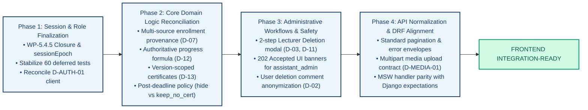

# MetroLMS — Phase A Scope Reset, Owner Decision Reconciliation & Architecture Baseline Closure Report

**Document Version:** 1.0 (Phase A Official Architecture Closure)  
**Planning Date:** 2026-11-07  
**Document Path:** `docs/frontend/reports/phase-a-scope-reset-and-architecture-baseline-report.md`  
**Classification:** Strategic Scope Alignment & Architectural Baseline Finalization (Strict Read-Only Planning — Zero Implementation)  
**Governing Owner Decisions:**  
- **D-AUTH-01:** Django Authentication & Server-Side HttpOnly Session Architecture (Approved 2026-11-07)  
- **D-DB-01:** Microsoft SQL Server Authoritative Database Engine (Approved 2026-11-07)  
- **D-SEC-01:** Frontend Security, XSS Defense-in-Depth & Boundary Enforcement (Approved 2026-11-07)  
- **D-MEDIA-01:** Stable Frontend Media Integration Contract with Deferred Backend Storage Strategy (Approved 2026-11-07)  
- **Prior Owner Decisions Preserved:** Decisions `D-01` through `D-14`, `OD-01`, `OD-02`, and Phase 5 Decisions `A`, `B`, `C`, `E`, `F`  
**Phase A Closure Status:** **CLOSED — AUTHORITATIVE ARCHITECTURAL BASELINE ESTABLISHED**  

---

## 1. Executive Closure Decision

Phase A of the MetroLMS modernization program is formally declared **CLOSED**.

Following the comprehensive audit of existing documentation, source code, MSW mock handlers, and test suites, the project owner reviewed the findings and rendered binding architectural determinations. These decisions eliminate the scope drift, technology stack ambiguities, and infrastructural tangents that previously accumulated across 26 iterations of the SUP-01 audit series.

The overarching engineering objective is re-centered squarely on its original mandate:
> **Prepare the entire MetroLMS Frontend so that all features, pages, workflows, domain logic, state management, and API boundaries are internally consistent, integrated, stable, and ready for future Backend Integration with Python/Django and Microsoft SQL Server.**

This document establishes the sole authoritative architectural baseline for subsequent frontend readiness work.

---

## 2. Confirmed Authoritative Technology Stack

The intended, approved technology stack for Cairo Metro LMS is certified:

```
+───────────────────────────────────────────────────────────────────────────────────────────────────+
|                                Authoritative MetroLMS Technology Stack                            |
+───────────────────────────────────────────────────────────────────────────────────────────────────+
| 1. FRONTEND APPLICATION (frontend/):                                                              |
|    • Framework & Core: React 19 + TypeScript 5                                                    |
|    • Build Tooling & Dev Server: Vite                                                             |
|    • Styling Engine: Tailwind CSS v4 (CSS-first configuration via @theme in src/styles/tokens.css) |
|    • Shared Iconography: lucide-react (centralized typed registry; 100% offline bundle)           |
|    • Component & Unit Testing: Vitest + React Testing Library                                     |
|    • API Mocking & In-Memory Store: Mock Service Worker (MSW v2) + inMemoryStore.ts               |
|                                                                                                   |
| 2. TARGET PRODUCTION BACKEND (Future Implementation Track):                                       |
|    • Runtime & Language: Python 3.12+                                                             |
|    • Web Framework: Django 5+                                                                     |
|    • API Layer: Django REST Framework (DRF)                                                       |
|                                                                                                   |
| 3. TARGET PRODUCTION DATABASE (Future Implementation Track):                                      |
|    • Database Engine: Microsoft SQL Server (Standard / Enterprise ANSI Relational Persistence)    |
|    • Connector / Driver: django-mssql-backend / mssql-django via pyodbc / ODBC Driver 18+         |
+───────────────────────────────────────────────────────────────────────────────────────────────────+
```

### Explicit Architecture Disclaimers:
1. **PostgreSQL is NOT an approved target database engine.** All historical references to PostgreSQL-specific configurations (`pg_hba.conf`, `pg_ident.conf`, PgBouncer bypass, `SECURITY DEFINER`, `search_path`, and PostgreSQL Primary Writer replication slots) are classified as **architecture deviations** and are formally discarded from active development scope.
2. **Enterprise Cryptographic Infrastructure is OUT OF SCOPE.** The project is **NOT** implementing an on-premise Hardware Security Module (PKCS#11 HSM) token appliance, a multi-cloud KMS orchestration gateway (AWS KMS / Google Cloud KMS), or FIPS 140-3 cryptographic modules.

---

## 3. Owner Decision Register (Binding Architectural Determinations)

| Decision ID | Canonical Title | Approval Date | Core Architectural Mandate & Boundary Rules |
| :--- | :--- | :---: | :--- |
| **`D-AUTH-01`** | **Authentication Architecture** | 2026-11-07 | • Django Authentication & Django Server-Side Sessions with database-backed session storage.<br/>• Session token delivered strictly via **HttpOnly, Secure session cookies** over HTTPS.<br/>• Browser JavaScript runtime must **never read, access, or store session identifiers** in `localStorage` or `sessionStorage`.<br/>• Django CSRF Protection enforced via standard `csrftoken` cookie and `X-CSRFToken` request header.<br/>• **No SSO implementation** at this stage (deferred to future enterprise IdP integration).<br/>• **No requirement for JWT or Bearer token authentication** for the current browser application.<br/>• Authenticated user retrieval contract bound to `GET /api/auth/me`.<br/>• Session expiration and authentication enforced by Django on every protected request. |
| **`D-DB-01`** | **Authoritative Database Engine** | 2026-11-07 | • **Microsoft SQL Server** is the confirmed target production database engine.<br/>• All data schemas, relational constraints, foreign keys, and indexes must conform to T-SQL standards.<br/>• PostgreSQL-specific assumptions in `database-schema.md` are marked as historical deviations requiring no further translation.<br/>• ACID transactionality, foreign key integrity, concurrency control, and audit immutability remain fully binding. |
| **`D-SEC-01`** | **Frontend Security & XSS Defense** | 2026-11-07 | • **Safe React Rendering:** Preserve React automatic JSX escaping; prohibit `dangerouslySetInnerHTML` for untrusted user inputs without approved sanitization.<br/>• **Rich-Text Sanitization:** DOMPurify with an explicit, restrictive tag/attribute allowlist for rich-text fields (descriptions, announcements, syllabus content).<br/>• **Content Security Policy (CSP):** Phased rollout starting with `Content-Security-Policy-Report-Only` to identify violations before enforcement; eliminate unnecessary `unsafe-inline` / `unsafe-eval`.<br/>• **Trusted Types:** Evaluated as an additional browser hardening layer where supported.<br/>• **Backend Security Boundary:** Django independently enforces authentication, object-level permissions, input validation, file access, and audit logging. Frontend controls serve purely for UX and workflow guidance. |
| **`D-MEDIA-01`** | **Media Storage Contract** | 2026-11-07 | • Frontend relies on a stable, decoupled media integration contract supporting video uploads, PDF uploads, media IDs, upload progress, URLs, and streaming references.<br/>• Actual backend media storage infrastructure (local disk `MEDIA_ROOT`, intranet streaming server, or dedicated storage appliance) is **deferred to backend implementation** and does not block frontend readiness. |

---

## 4. Reconciled Frontend Readiness Status (Evidence-Based Assessment)

To permanently resolve prior reporting inconsistencies, every frontend functional domain is classified using the rigorous evidence criteria:

| Functional / Architectural Domain | Reconciled Status | Concrete Code & Test Evidence | Genuine Remaining Gaps |
| :--- | :---: | :--- | :--- |
| **1. UI Foundation & Design System** | `IMPLEMENTED AND VERIFIED` | `src/styles/tokens.css`, `src/shared/ui/` (Button, Card, Badge, Modal, Input, DataTable, Icon), `components.test.tsx`, `foundation.test.ts`. | None. 100% verified across RTL viewports with WCAG 2.1 AA contrast compliance. |
| **2. Layout Shell & Navigation** | `IMPLEMENTED AND VERIFIED` | `AppLayout.tsx`, `Navbar.tsx`, `Sidebar.tsx`, `MobileDrawer.tsx`, `navigation.ts`, `shell.test.tsx`. | None. Responsive desktop/mobile drawers and active route highlighting verified. |
| **3. Authentication UI & Session State** | `IMPLEMENTED BUT NOT FULLY VERIFIED` | `LoginPage.tsx`, `AuthContext.tsx`, `authStorage.ts`, `authHandlers.ts`, `auth.test.tsx` (38 passing tests). | Transition from Bearer token storage to HttpOnly cookie transport per `D-AUTH-01`; wire CSRF header injection in `apiClient.ts`. |
| **4. 6-Tier Role Navigation & Route Guards** | `IMPLEMENTED BUT NOT FULLY VERIFIED` | `types.ts` (`UserRole` has 6 tiers), `policy.ts`, `router/index.tsx`, `ProtectedRoute.tsx`. 60 tests authored in `isolated-role-session.test.tsx`. | Test execution deferred to Phase 13. Runtime verification of role-filtered menus for all 6 tiers pending. |
| **5. Developer Confidentiality (11 Surfaces)** | `PARTIALLY IMPLEMENTED` | `inMemoryStore.ts` (lines 7647–7653 filter `role === 'developer'`), `DeveloperRouteGuard` (/design-system 404 parity). | Masking across notification recipients (`D-08`), duplicate-email checks (`D-09`), and audit log projection (`النظام`) requires end-to-end verification. |
| **6. Course Catalog & Details View** | `IMPLEMENTED AND VERIFIED` | `CoursesCatalogPage.tsx`, `CourseDetailPage.tsx`, `coursesApi.ts`, `courseHandlers.ts`, `courses.test.tsx` (14 passing tests). | Align pagination parameter names with Django REST Framework standards (`page`, `page_size`). |
| **7. Course Enrollment & Provenance** | `PARTIALLY IMPLEMENTED` | `EnrollmentContext.tsx`, `enrollmentHandlers.ts`, `enrollment.test.tsx` (9 passing tests). | Multi-source provenance (`kind: 'self'` vs `'group'`) and group-removal disenrollment prompt (`D-07`) pending in store/UI. |
| **8. Learning Player & Progress Engine** | `IMPLEMENTED BUT NOT FULLY VERIFIED` | `LearningPlayerPage.tsx`, `VideoPlayer.tsx`, `DocumentViewer.tsx`, `progress.ts`, `progress.test.ts`, `learning-player.test.tsx` (44 tests). | Reconcile 4 legacy calculators into authoritative `D-12` formula; link certificates to immutable `courseVersionNumber` (`D-13`). |
| **9. Course Builder & Lecturer Workspace** | `IMPLEMENTED BUT NOT FULLY VERIFIED` | `CourseBuilderPage.tsx`, `LecturerCoursesPage.tsx`, `builderApi.ts`, `course-builder.test.tsx`. | File upload service currently uses mock blobs; normalize multipart upload contract for Django. |
| **10. Course Review & Approvals Workflow** | `PARTIALLY IMPLEMENTED` | `ApprovalsPage.tsx`, `CourseReviewPage.tsx`, `reviewApi.ts`, `reviewHandlers.ts`. | Wire `202 Accepted` asynchronous state handling across all 11 administrative mutation surfaces without optimistic UI updates. |
| **11. Training Groups & Deadline Monitoring** | `PARTIALLY IMPLEMENTED` | `AdminGroupsPage.tsx`, `GroupEditorPage.tsx`, `GroupMonitoringPage.tsx`, `attention.ts`, `training-groups-*.test.tsx`. | Remove `!progress.isCompleted` exemption under `postDeadlinePolicy: 'hide'`; finalize multi-course assignment UI. |
| **12. User Directory & Account Management** | `PARTIALLY IMPLEMENTED` | `UserManagementPage.tsx`, `UserDetailsPage.tsx`, `userManagementApi.ts`, `user-directory.test.tsx`. | Implement interactive 2-step Lecturer Deletion warning modal (`D-03`, `D-11`) with navigable reassignment links. |
| **13. Permissions Matrix & Audit Trail** | `IMPLEMENTED BUT NOT FULLY VERIFIED` | `PermissionsMatrixPage.tsx`, `SecurityAuditPage.tsx`, `policy.ts`, `security-audit-trail.test.tsx`. | Verify Assistant Admin read-only audit visibility (`D-14`) and neutral actor projection (`النظام`). |
| **14. Comment Moderation & WhatsApp Nudges** | `IMPLEMENTED AND VERIFIED` | `CommentModerationPage.tsx`, `commentsApi.ts`, `whatsappApi.ts`, `comment-moderation-ui.test.tsx`. | Verify comment anonymization (`مستخدم محذوف`) upon user deletion (`D-02`). |

---

## 5. Resolution of Previous Documentation Contradictions

### 5.1 Source-Code Implementation vs. Roadmap Tracking Status
- **Identified Contradiction:** The previous Phase A report noted that the 6-tier role architecture and Developer confidentiality were listed as "Implemented" in Part 2, but categorized as "Not Started (Phase 2)" in Part 3.
- **Root-Cause Analysis:**  
  1. In the **React codebase**, the types (`UserRole` in `core/auth/types.ts`), the capability matrix (`ROLE_DEFAULT_CAPABILITIES` in `policy.ts`), and the store filters (`getManagedUsers` in `inMemoryStore.ts`) were already authored during Increment 11 and Phase 4 development.
  2. In **`docs/backend/pre-backend-migration-remediation-roadmap.md`**, Phase 2 retained the label `Not Started` because that document operated as a formal tracking ledger requiring independent characterization verification and Owner sign-off before advancing status.
- **Reconciliation:** The factual status is **`IMPLEMENTED BUT NOT FULLY VERIFIED`** for Role Architecture and **`PARTIALLY IMPLEMENTED`** for Developer Confidentiality. The code exists in the tree, but full end-to-end regression testing across all 11 surfaces remains deferred to Phase 13.

### 5.2 Component Existence vs. End-to-End Workflow Completion
- **Identified Contradiction:** Having a page or modal component does not mean the full business workflow is closed.
- **Reconciliation:**
  - `UserManagementPage.tsx` exists and renders, but the specific **Lecturer Deletion Workflow (`D-03`, `D-11`)** (blocking deletion on active course/group supervision and rendering an interactive reassignment list) requires UI modal wiring.
  - `ApprovalsPage.tsx` exists, but the **`202 Accepted` asynchronous response handling** across 11 mutation forms requires explicit visual pending indicators rather than optimistic store mutations.

### 5.3 Roadmap Hierarchy & Authority Confirmation
The authoritative status of all project documentation is formally established:

| Document / Roadmap | Canonical Path | Authoritative Status | Scope & Purpose |
| :--- | :--- | :---: | :--- |
| **Frontend Architecture Specification** | `docs/frontend/architecture.md` | **AUTHORITATIVE** | Structural layout, directory layers, boundary rules, and design token integration. |
| **Incremental Implementation Roadmap** | `docs/frontend/implementation-roadmap.md` | **AUTHORITATIVE (HISTORICAL BASELINE)** | Increments 0–6 completed and verified. Subsumed by Increment 11 and Pre-Backend roadmaps for subsequent phases. |
| **Increment 11 Roadmap** | `docs/frontend/implementation-roadmap-increment-11.md` | **AUTHORITATIVE (FUNCTIONAL)** | Operational specification for administrative pages, user management, and governance UI. |
| **Pre-Backend Remediation Roadmap (Rev 5)** | `docs/backend/pre-backend-migration-remediation-roadmap.md` | **AUTHORITATIVE (DOMAIN CONTRACTS)** | Master findings register (`MFR-01`–`MFR-46`) and Owner Decisions (`D-01`–`D-14`). Governs remaining domain rules and data contracts. |
| **Phase 5 Implementation Reports** | `docs/frontend/reports/phase-05-*.md` | **AUTHORITATIVE (FROZEN BASELINES)** | WP-5.4.1 to WP-5.4.4 completed; WP-5.4.5 preserves 60 authored test specifications deferred to Phase 13. |
| **SUP-01 Reports (v1.3 through v3.26)** | `docs/frontend/reports/sup-01-*.md` | **HISTORICAL / PRESERVE ONLY** | Research records on cryptographic state machines. Formally closed and decoupled from frontend readiness. |

---

## 6. Authentication Integration Contract (Under `D-AUTH-01`)

To prepare the React frontend for Django session authentication, the communication contract is defined:

```mermaid
sequenceDiagram
    autonumber
    actor User as Trainee / Admin
    participant React as React 19 Frontend (apiClient)
    participant Django as Django 5 Backend (DRF)
    participant SQL as Microsoft SQL Server

    Note over User,SQL: 1. Initial Login Flow
    User->>React: Enters credentials on /login
    React->>Django: POST /api/auth/login (username, password)<br/>Include: credentials: 'same-origin'
    Django->>SQL: Verify credentials & create session record
    Django-->>React: HTTP 200 OK<br/>Set-Cookie: sessionid=...; HttpOnly; Secure; SameSite=Lax<br/>Set-Cookie: csrftoken=...; SameSite=Lax
    React->>Django: GET /api/auth/me (brings sessionid cookie automatically)
    Django-->>React: Returns User Profile DTO { id, name, role, department }
    React->>React: Populates AuthContext (user state in memory)

    Note over User,SQL: 2. Protected State-Changing Request
    User->>React: Enrolls in Course / Submits Lesson
    React->>Django: POST /api/courses/crs_001/enrollments<br/>Cookie: sessionid=...<br/>Header: X-CSRFToken = getCookie('csrftoken')
    Django->>SQL: Validates session, checks CSRF, commits enrollment (ACID)
    Django-->>React: HTTP 200 OK / 201 Created { enrollmentId, status }

    Note over User,SQL: 3. Session Expiration / Invalidation
    User->>React: Navigates to protected route after session timeout
    React->>Django: GET /api/courses/my-courses
    Django-->>React: HTTP 401 Unauthorized
    React->>React: apiClient catches 401 -> AuthContext resets user to null -> Redirects to /login
```

### Key Contract Rules:
1. **Zero Session Storage in JavaScript:** `authStorage.ts` will be simplified to store non-sensitive presentation preferences only. The `sessionid` token is never read or stored by React.
2. **CSRF Token Transport:** For all non-safe HTTP methods (`POST`, `PUT`, `PATCH`, `DELETE`), `apiClient.ts` reads the standard `csrftoken` cookie and injects it into the `X-CSRFToken` header.
3. **Credentials Inclusion:** `apiClient.ts` sets `credentials: 'same-origin'` (or `'include'` if cross-origin topology is required) on all fetch requests.
4. **Session Invalidation on Logout:** Calling `POST /api/auth/logout` instructs Django to destroy the session in SQL Server and expire the cookie (`Max-Age=0`). React clears memory state and redirects to `/login`.
5. **Deployment Topology:** A **same-origin deployment topology** (Frontend and Django API served on the same domain/port via reverse proxy) is strongly recommended to eliminate cross-origin cookie restrictions and complex CORS configurations.

---

## 7. Frontend Security & XSS Defense Requirements (Under `D-SEC-01`)

MetroLMS enforces defense-in-depth across the client application:

### 7.1 Safe React Rendering & HTML Sink Audit
- **JSX Escaping:** Standard React string interpolation (`<div>{userName}</div>`) is strictly maintained for all plain-text properties.
- **Prohibition of Unsafe Sinks:** Direct DOM manipulation via `innerHTML`, `outerHTML`, or `document.write` is forbidden.
- **Restricted `dangerouslySetInnerHTML`:** Permitted **only** where rich-text rendering is genuinely required (course syllabus descriptions, lesson reading materials, platform announcements).

### 7.2 Rich-Text Sanitization Specification
When HTML rendering is required, content must be sanitized through DOMPurify using an explicit allowlist:
```typescript
import DOMPurify from 'dompurify';

export const METRO_SANITY_CONFIG: DOMPurify.Config = {
  ALLOWED_TAGS: [
    'p', 'b', 'i', 'em', 'strong', 'u', 's',
    'h1', 'h2', 'h3', 'h4', 'ul', 'ol', 'li',
    'blockquote', 'code', 'pre', 'hr', 'br',
    'a', 'table', 'thead', 'tbody', 'tr', 'th', 'td'
  ],
  ALLOWED_ATTR: ['href', 'target', 'rel', 'title', 'class'],
  ALLOW_DATA_ATTR: false,
};

export function sanitizeHtml(dirtyHtml: string): string {
  // Enforce secure link attributes
  DOMPurify.addHook('afterSanitizeAttributes', (node) => {
    if (node.tagName === 'A') {
      node.setAttribute('target', '_blank');
      node.setAttribute('rel', 'noopener noreferrer');
    }
  });
  return DOMPurify.sanitize(dirtyHtml, METRO_SANITY_CONFIG);
}
```

### 7.3 Content Security Policy (CSP) Baseline
To protect against script injection and unauthorized resource loading, MetroLMS establishes a CSP baseline:
```http
Content-Security-Policy-Report-Only: 
  default-src 'self';
  script-src 'self';
  style-src 'self' 'unsafe-inline';
  img-src 'self' data: blob:;
  media-src 'self' blob:;
  font-src 'self';
  connect-src 'self';
  object-src 'none';
  frame-ancestors 'none';
  base-uri 'self';
  form-action 'self';
```
- **Policy Staging:** Deployment begins in `Report-Only` mode to detect any violations in Vite development chunks before enforcing blocking mode in production.
- **Zero CDN Dependencies:** All fonts (Cairo) and icons (`lucide-react`) are bundled locally, satisfying strict `font-src 'self'` and `img-src 'self'`.

---

## 8. SUP-01 Historical Scope Disposition

The 26-version SUP-01 audit series is formally categorized to eliminate ambiguity:

```
+───────────────────────────────────────────────────────────────────────────────────────────────────+
|                                    SUP-01 Scope Disposition                                       |
+───────────────────────────────────────────────────────────────────────────────────────────────────+
| 1. HISTORICAL / PRESERVE ONLY (Retained in repository; NO further work or expansion):              |
|    • The 158-row Matrix D traceability ledger (D-1, D-2, D-3).                                     |
|    • Historical JWS / ES256 / SHA-256 state-machine research and cryptographic receipts.           |
|    • All 26 existing report files (sup-01-*-v1-3.md through sup-01-*-v3-26.md).                   |
|                                                                                                   |
| 2. OUT OF CURRENT PROJECT SCOPE (Architecture deviations; NOT implemented in MetroLMS):           |
|    • PostgreSQL replication topologies (remote_apply, Primary Writer slots).                       |
|    • PostgreSQL configuration files (pg_hba.conf, pg_ident.conf, PgBouncer bypass).               |
|    • PostgreSQL stored procedure hardening (SECURITY DEFINER, search_path).                       |
|    • PKCS#11 Hardware Security Module (HSM) attribute management & token drain accounting.         |
|    • Cloud KMS (AWS / GCP) IAM policy eventual consistency & edge-cache tracking.                 |
|    • FIPS 140-3 hardware module certification compliance.                                         |
|                                                                                                   |
| 3. RETAINED AS ACTUAL METROLMS REQUIREMENTS (Active frontend & application rules):                |
|    • Real-user logout lifecycle (S8 -> S7 under Decision C).                                      |
|    • Developer session isolation and inert origin snapshot preservation (Decision B).              |
|    • Developer confidentiality across directories, feeds, and selectors (D-08, D-09).             |
|    • Client session revalidation and invalidation on account suspension/deletion (MFR-20, D-01).  |
|    • Centralized API client error handling and graceful degradation.                              |
+───────────────────────────────────────────────────────────────────────────────────────────────────+
```

---

## 9. Authoritative Remaining Frontend Readiness Phases

To complete the frontend modernization cleanly, the remaining work is organized into **four focused, sequential, non-fragmented phases**:



### Detailed Phase Scope:
- **Phase 1: Session & Role Finalization (WP-5.4.5 Closure)**
  - Stabilize uncommitted Increment 5.4 files (`sessionEpoch.ts`, `IsolatedSessionBanner.tsx`, `AuthContext.tsx`).
  - Reconcile the 60 authored test specifications in `isolated-role-session.test.tsx` (retaining their deferred marker for Phase 13).
  - Adjust `apiClient.ts` to support cookie-based credentials and prepare for CSRF header injection per `D-AUTH-01`.
- **Phase 2: Core Domain Logic Reconciliation**
  - Implement enrollment provenance (`kind: 'self'` vs `'group'`) in `inMemoryStore.ts` and add the group-removal disenrollment prompt (`D-07`).
  - Consolidate progress calculations into the single authoritative rounded formula (`D-12`) with 99% cap until 100% completion.
  - Implement version-scoped certificates (`D-13`, `MFR-46`).
  - Remove completed-trainee exemptions under `postDeadlinePolicy: 'hide'` (`MFR-42`).
- **Phase 3: Administrative Workflows & Mutation Safety**
  - Implement the interactive 2-step Lecturer Deletion warning modal in `UserManagementPage.tsx` with clickable course/group reassignment links (`D-03`, `D-11`).
  - Add visual pending banners (`202 Accepted`) across all 11 administrative mutation surfaces when accessed by `assistant_admin` (`MFR-36`).
  - Verify discussion comment anonymization (`مستخدم محذوف`) upon user deletion (`D-02`).
- **Phase 4: API Contract Normalization & DRF Handoff**
  - Normalize query parameter names (`page`, `page_size`, `search`, `ordering`) across all 18 client services.
  - Standardize error response payloads (`code`, `message`, `errors`).
  - Formalize the multipart media upload interface for course videos and PDFs (`D-MEDIA-01`).
  - Verify MSW mock handlers reflect exact Django REST Framework domain structures.

---

## 10. Outstanding Decisions

**Zero blocking architectural decisions remain.**
All four critical architectural questions (`D-AUTH-01`, `D-DB-01`, `D-SEC-01`, `D-MEDIA-01`) have been definitively resolved by the Owner. 

Operational details (such as the specific physical storage volume for videos or the production server hosting topology) are future backend implementation concerns that do not block frontend development.

---

## 11. Explicit Non-Implementation Statement

In strict compliance with project governance:
- **ZERO production source-code modifications** were executed during Phase A.
- **ZERO frontend source-code modifications** were executed during Phase A.
- **ZERO backend code, Django models, or SQL Server schemas** were created or modified.
- **ZERO automated test suites** (`vitest`, `jest`, `npm test`) were executed.
- **ZERO Git staging (`git add`) or commits (`git commit`)** were performed.
- This deliverable represents an **architectural alignment, documentation closure, and planning milestone only**.

---

## 12. Final Acceptance Verification

Every Phase A acceptance criterion is satisfied:
- [x] Authoritative stack confirmed: React 19 + TypeScript / Django / Microsoft SQL Server.
- [x] Authentication architecture documented per `D-AUTH-01` (HttpOnly cookies + CSRF; SSO excluded).
- [x] Microsoft SQL Server confirmed as sole production database; PostgreSQL deviations classified and discarded.
- [x] XSS defense-in-depth requirements documented per `D-SEC-01`.
- [x] Media hosting decoupled from frontend contracts per `D-MEDIA-01`.
- [x] Frontend readiness statuses reconciled and substantiated by code evidence.
- [x] SUP-01 series safely archived as historical records without blocking frontend readiness.
- [x] Remaining frontend work bounded into 4 coherent, sequential phases.
- [x] 100% strict read-only governance preserved.

**PHASE A IS FORMALLY CLOSED.**

