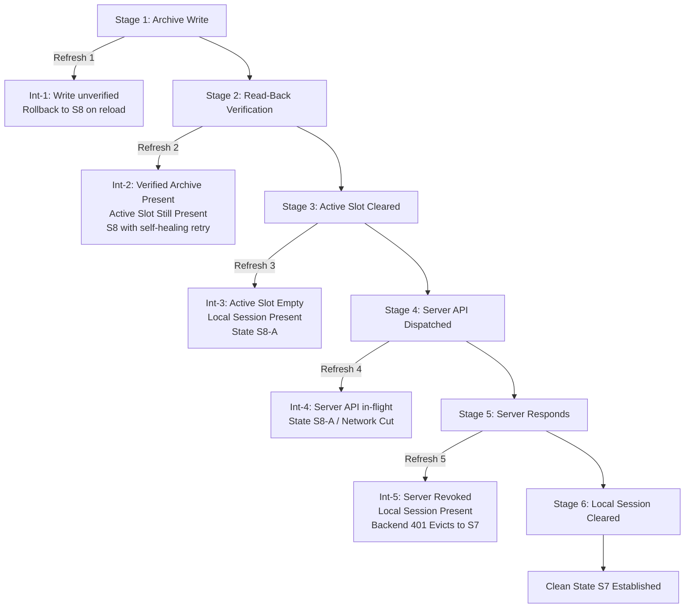

# MetroLMS — SUP-01 Authentication Lifecycle & Server Consistency Audit (Version 1.6)
## Architecture Review: Refresh Interruption Semantics, Server-Side Concurrency, and Supplementary Intermediate State Governance

**Document Version:** 1.6 (Final Authentication Lifecycle & Server Consistency Audit)  
**Planning Date:** 2026-11-06  
**Document Path:** `docs/frontend/reports/sup-01-authentication-lifecycle-audit-v1-6.md`  
**Classification:** Architectural Remediation & Test Coverage Plan (Planning Only — Zero Implementation)  
**Target Transition:** `SUP-01: S8 → S7` (Real-User Logout with Preserved Inert Developer Origin Snapshot)  
**Governing Owner Decisions:**  
- **Decision A (S0):** Approved 2026-11-06  
- **Decision B (S8):** Approved 2026-11-06  
- **Decision C (Real-User Logout):** Approved 2026-11-06  
- **Decision E (Archival Failure Policy):** **APPROVED 2026-11-06 (Option 1 — Transactional Abort)**  
**Execution Directives:** Strict Read-Only Planning Governance Preserved (Zero production code modifications, zero test changes, zero Git staging/commits, zero test runner or compiler execution)  
**Proposed Remediation Package:** `WP-5.4.5-R1` (Separately Authorized Remediation Package planned prior to Phase 13)  
**Remediation Plan Status:** `READY FOR OWNER AUTHORIZATION — LOCAL AND SERVER AUTHENTICATION LIFECYCLES PROVEN`

---

## 1. Executive Summary & Binding Owner Decisions

On November 6, 2026, the project owner reviewed the Phase 5 Work Package 5.4.5 architecture reports and issued binding executive decisions governing Developer origin session lifecycle, error recovery, and failure governance:

1. **Decision A (Unauthenticated Boundaries — `S0`):** Only `S0 → S1` is permitted; `S0 → S3`, `S0 → S14`, `S0 → S15` are strictly forbidden. Guest/unauthenticated sessions cannot initiate isolated testing or execute Developer return.
2. **Decision B (Identity Mismatch Restrictions — `S8`):** `S8 → S14` and `S8 → S15` are strictly forbidden; a real platform user must never consume, activate, or elevate permissions using an old Developer origin snapshot.
3. **Decision C (Real-User Logout — `SUP-01: S8 → S7`):** When a real user is authenticated in state `S8` and explicitly logs out:
   - Clear the real user's active session (`user = null`, active storage session = `null`).
   - Preserve the existing Developer origin snapshot in the current tab's `sessionStorage`, unchanged and inert, until tab termination.
   - The preserved snapshot must not authorize, restore, or elevate any session.
   - Do not recreate an emergency continuity proof (`emergencyProof = null`).
   - Do not expose normal or emergency Developer return controls (banners remain hidden).
   - Require fresh Developer authentication (`USR_DEV_001`).
   - A subsequent Developer login must not silently reactivate or consume the preserved old snapshot.
4. **Decision E (Archival Failure Policy — APPROVED: Option 1 — Transactional Abort):**  
   If Developer-origin archival or read-back verification fails for any reason (e.g. `QuotaExceededError`, storage disabled, verification mismatch):
   - **Do not dispatch `authApi.logout()`.**
   - **Do not clear the local real-user session.**
   - **Do not clear the active Developer origin snapshot.**
   - **Preserve the authenticated real user and remain in State S8.**
   - **Display a recoverable error:** `"فشل حفظ لقطة المطور في الأرشيف بسبب قيود التخزين. لم يتم إنهاء الجلسة لحماية بيانات الاستمرارية."`
   - **Allow a safe retry after the storage problem is resolved.**
   - *Option 2 (Quarantine & Evict) remains formally REJECTED and must NOT be implemented.*

The existing isolated-persona logout behavior remains unchanged: an explicit logout from an active isolated persona (`S3 -> S12 -> S0`) continues to perform its planned two-slot cleanup.

---

## 2. Mandatory Seven-Account Inventory

All persona allowances, identity boundaries, and tests operate strictly across the mandatory seven-account inventory:

| Account Name | Canonical ID | Canonical Username | System Role | Category | Selectable in Switcher? |
|---|---|---|---|---|:---:|
| **Developer** | `USR_DEV_001` | `developer_internal` | `developer` | Privileged System Actor | No (Launch Origin Only) |
| **Super Admin** | `USR_SUPER_001` | `super_admin_demo` | `super_admin` | Privileged Real Platform Account | **No (Protected Real Account)** |
| **Test Super Admin** | `USR_TEST_SUPER_001` | `test_super_admin` | `super_admin` | Synthetic Test Persona | **Yes (Allowlisted)** |
| **Test Admin** | `USR_TEST_ADMIN_001` | `test_admin` | `admin` | Synthetic Test Persona | **Yes (Allowlisted)** |
| **Test Assistant Admin** | `USR_TEST_AST_001` | `test_assistant_admin` | `assistant_admin` | Synthetic Test Persona | **Yes (Allowlisted)** |
| **Test Lecturer** | `USR_TEST_LEC_001` | `test_lecturer` | `lecturer` | Synthetic Test Persona | **Yes (Allowlisted)** |
| **Test Trainee** | `USR_TEST_TRN_001` | `test_trainee` | `user` | Synthetic Test Persona | **Yes (Allowlisted)** |

### Strict Inventory Invariants:
1. **Exactly five synthetic test personas exist** (`USR_TEST_SUPER_001`, `USR_TEST_ADMIN_001`, `USR_TEST_AST_001`, `USR_TEST_LEC_001`, `USR_TEST_TRN_001`).
2. **Developer (`USR_DEV_001`) and Super Admin (`USR_SUPER_001`) are privileged fixtures**, not synthetic test personas. They are never selectable in the isolated persona switcher.
3. **`assistant_lecturer` is strictly a group-scoped teaching assignment preview layout mode** in `RolePreviewContext`. It is **never** a global system role or synthetic test persona.
4. **Zero secrets policy:** Under no circumstances are passwords, hashes, tokens, or credentials displayed in documentation or inventories.
5. **Developer production provisioning:** Real-world provisioning of `developer` credentials remains a future server-only bootstrap responsibility governed by strict deployment authorization.

---

## 3. Exact Source Evidence and Line References

Targeted read-only source inspection confirms the exact current implementations, line ranges, and behavioral boundaries:

### 1. `frontend/src/core/auth/AuthContext.tsx`
- **Lines 558–582 (`logout`):**
  - Line 559: `const opId = ++authOpSeqRef.current;` establishes the unique operation sequence ID.
  - Line 562: `advanceSessionEpoch();` increments monotonic `sessionEpoch` immediately upon initiating logout, invalidating all pending in-flight requests before awaiting the network call.
  - Lines 564–566: `await authApi.logout().catch(() => {});` dispatches server logout.
  - Line 569: Operation guard `if (opId === authOpSeqRef.current)` discards state updates if superseded by newer authentication operations.
  - **Lines 572–573 (Current Source Baseline):**
    ```typescript
    authStorage.clearSession();
    authStorage.clearDeveloperOriginSession();
    ```
    This unconditionally wipes the active Developer origin snapshot even when the logging-out user is a real user in state `S8`, directly conflicting with Owner Decision C.
  - Lines 574–580: React state cleanup (`setUser(null)`, `setIsIsolatedSession(false)`, `setIsolatedPersona(null)`, `setEmergencyProof(null)`, `setError(null)`, `setIsLoading(false)`).
- **Lines 512–556 (`login`):**
  - Line 513: Increments `authOpSeqRef.current`.
  - Line 532: Calls `advanceSessionEpoch()`.
  - Line 533: Persists user session via `authStorage.setSession(session)`.
  - Line 534: Updates active user via `setUser(response.user)`.
  - Lines 538–542: Clears isolated session state and invalidates any emergency proof/digest.
- **Lines 610–680 (`launchIsolatedPersona`):**
  - Lines 616–620: Validates actor is Canonical Developer (`user.id === 'USR_DEV_001'` and `user.role === 'developer'`).
  - **Lines 649–651 (Anti-Nesting Guard):**
    ```typescript
    if (authStorage.hasDeveloperOriginSession() || isIsolatedSession) {
      throw new Error('لا يمكن بدء جلسة اختبار متداخلة؛ توجد جلسة اختبار معزولة نشطة بالفعل.');
    }
    ```
    If an unarchived snapshot remains in `metro_lms_developer_origin_session`, this check fails closed and blocks a newly authenticated Developer from launching testing.
  - Lines 654–661: Prepares `DeveloperOriginSession` snapshot.
  - Line 663: Calls `authStorage.saveDeveloperOriginSession(originSnapshot)`.
  - Lines 669–680: Read-back verification; if verification fails, calls `clearDeveloperOriginSession()`.
- **Lines 783–835 (`returnToDeveloperSession`):**
  - Lines 786–789: Reads `authStorage.getDeveloperOriginSession()`. Fails closed if `null`.
  - Lines 810–820: Validates `isIsolatedSession === true` and `isolatedPersona.id === origin.personaId`.
  - Lines 824–830: Validates active authenticated user matches target persona (`user.id === origin.personaId`). Real users in S8 cannot satisfy this check.
- **Lines 970–1150 (`returnFromExpiredPersonaSession`):**
  - Lines 975–977: Requires non-null memory-only `emergencyProof`.
  - Lines 981–986: Requires `user === null` (no active authenticated identity).
  - Lines 1050–1065: Reads active `authStorage.getDeveloperOriginSession()`.
  - Lines 1103–1109: Computes SHA-256 digest of active snapshot and matches against `emergencyProof.originSnapshotFingerprint`.
  - Lines 1119–1132: Validates `liveStorageRevision === initialStorageRevision` and `opId === authOpSeqRef.current`.
- **Lines 221–435 (`revalidateSession`):**
  - Lines 230–250: Reads active snapshot from `metro_lms_developer_origin_session`.
  - **Lines 313–323 (Case D: Missing Active Session / State S7):**
    ```typescript
    if (!continuity.isRawSessionPresent) {
      setUser(null);
      setIsIsolatedSession(false);
      setIsolatedPersona(null);
      setEmergencyProof(null);
      setIsLoading(false);
      return;
    }
    ```
  - **Lines 328–380 (Case E: Expired Persona Session / State S6):**
    If an expired session matching `originSnapshot.personaId` is present in storage, `revalidateSession()` computes SHA-256 digest and creates `emergencyProof`.
  - Lines 419–423: Case 7 (Real-User Identity Mismatch / State S8): sets `isIsolatedSession = false`, `setEmergencyProof(null)`.

### 2. `frontend/src/core/auth/authApi.ts` & `frontend/src/core/api/apiClient.ts`
- **`authApi.ts` Lines 28–32:**
  ```typescript
  async logout(): Promise<{ success: boolean; message: string }> {
    return apiClient<{ success: boolean; message: string }>('/api/auth/logout', {
      method: 'POST',
    });
  }
  ```
- **`apiClient.ts` Lines 180–188:** Dynamically reads token from `authStorage.getSession()?.token` and injects `Authorization: Bearer ${session.token}` header.
- **`apiClient.ts` Lines 206–215:** Designates `/api/auth/logout` as an exempt control-plane operation so it is not blocked by Visual Role Preview mutation barriers.
- **`apiClient.ts` Lines 235–240:** Catches fetch errors and maps them to `ApiError`.

### 3. `frontend/src/mocks/handlers/authHandlers.ts`
- **Lines 152–158:**
  ```typescript
  http.post('/api/auth/logout', () => {
    return HttpResponse.json({
      success: true,
      message: 'تم إنهاء الجلسة وتسجيل الخروج بنجاح',
    });
  }),
  ```
  *Limitation Identified:* The current development mock handler is stateless; it returns HTTP 200 without checking or invalidating the token. Production backend guarantees must be formally specified.

---

## 4. Critical Scenario: Refresh Interruption Across Transaction Stages

In Version 1.5, the logout lifecycle progresses through six sequential operations:
1. `archiveDeveloperOriginSession` write.
2. Read-back verification.
3. Active Developer origin cleared (`sessionStorage.removeItem`).
4. Dispatch `authApi.logout()`.
5. Await server response.
6. Local session cleared (`authStorage.clearSession()`) and React state reset.

### Detailed Interruption Analysis Between Every Pair of Stages:



#### Detailed State Breakdown for Each Interruption Point:

| State Variable | Point 1: Between Write & Verification | Point 2: Between Verification & Clear | Point 3: After Active Clear, Before API Dispatch | Point 4: While Server API is In-Flight | Point 5: Server Confirmed, Before Local Clear | Point 6: After Local Session Cleared (Final S7) |
|---|---|---|---|---|---|---|
| **Canonical State** | **S8** | **S8** | **S8-A** (Supplementary Intermediate) | **S8-A** (Supplementary Intermediate) | **S8-A** (Pending Eviction) | **S7** (Canonical) |
| **`AuthContext.user`** | `USR_SUPER_001` | `USR_SUPER_001` | `USR_SUPER_001` | `USR_SUPER_001` | `USR_SUPER_001` | `null` |
| **Local Storage Session** | `USR_SUPER_001` token | `USR_SUPER_001` token | `USR_SUPER_001` token | `USR_SUPER_001` token | `USR_SUPER_001` token | `null` |
| **Active Origin Storage** | `Snapshot A` (Intact) | `Snapshot A` (Intact) | **`null` (Cleared)** | **`null` (Cleared)** | **`null` (Cleared)** | **`null` (Cleared)** |
| **Inert Archive Storage** | Partial/Unverified | `arch_A` (Verified) | `arch_A` (Verified) | `arch_A` (Verified) | `arch_A` (Verified) | `arch_A` (Verified) |
| **Server Session Status** | Confirmed Active | Confirmed Active | Confirmed Active | Revocation in Flight | Confirmed Revoked | Confirmed Revoked |
| **`isIsolatedSession`** | `false` | `false` | `false` | `false` | `false` | `false` |
| **`emergencyProof`** | `null` | `null` | `null` | `null` | `null` | `null` |
| **Session Epoch** | $E+1$ | $E+1$ | $E+1$ | $E+1$ | $E+1$ | $E+1$ |
| **Return Banners Visible?** | None (Hidden) | None (Hidden) | None (Hidden) | None (Hidden) | None (Hidden) | None (Hidden) |
| **Normal Return Eligible?** | Forbidden (Decision B) | Forbidden (Decision B) | **Ineligible** (Origin `null`) | **Ineligible** (Origin `null`) | **Ineligible** (Origin `null`) | **Ineligible** (Origin `null`) |
| **Emergency Return Eligible?** | Forbidden (Proof `null`) | Forbidden (Proof `null`) | **Ineligible** (Proof `null`) | **Ineligible** (Proof `null`) | **Ineligible** (Proof `null`) | **Ineligible** (Proof `null`) |
| **Refresh / Revalidation Behavior** | Revalidates `USR_SUPER_001` in S8 | Revalidates `USR_SUPER_001` in S8 | Revalidates `USR_SUPER_001` with backend (S8-A) | Revalidates with backend (S8-A) | Backend returns 401; evicts to S7 | Case D establishes clean S7 |
| **Safe Retry Behavior** | Retries archive write | Idempotent verify; clears active slot | Skips archive; directly calls `authApi.logout()` | Skips archive; directly calls `authApi.logout()` | Revalidation evicts immediately | Clean S7; Developer can log in |

---

## 5. Server Logout Outcome Semantics

In distributed web authentication, client-side catch handlers must not conflate network errors with server-side revocation. The proposed architecture defines rigorous outcome semantics:

### The Four Distinct Server Logout Outcomes:

1. **Outcome A: Server Confirms Successful Logout (HTTP 200/204)**
   - *Server Session Status:* **Confirmed Revoked**.
   - *Backend Action:* Backend session store or database revokes the refresh token and invalidates access token metadata.
   - *Frontend Action:* Clears local session (`authStorage.clearSession()`), resets React state (`setUser(null)`), and cleanly enters **State S7**.
2. **Outcome B: Server Explicitly Rejects Logout (HTTP 401/403/404/500 with Error Payload)**
   - *Server Session Status:*  
     - If HTTP 401/404: **Confirmed Inactive/Revoked** (Session was already terminated or invalid on backend). Client treats as revoked and completes local clear to S7.
     - If HTTP 500: **Confirmed Active / Internal Fault** (Backend failed to execute revocation transaction).
   - *Frontend Action for HTTP 500:* Local session is retained in **State S8-A**. UI displays: `"حدث خطأ في الخادم أثناء إنهاء الجلسة. يرجى المحاولة مرة أخرى."` User can safely retry. Active origin remains `null`; snapshot remains safely archived.
3. **Outcome C: Network Timeout / Connection Loss (No HTTP Response)**
   - *Server Session Status:* **Unknown**. (The request packet may have reached the server before the connection dropped, or was dropped in flight).
   - *Frontend Action:* Local session is retained in **State S8-A** (or evicted locally if user chooses "Force Logout"). The UI notifies the user: `"تعذر التأكد من إنهاء الجلسة على الخادم بسبب انقطاع الاتصال."` Retrying is safe and idempotent.
4. **Outcome D: Request Cancelled or Superseded Before Completion**
   - *Server Session Status:* **Unknown / Superseded**.
   - *Frontend Action:* The client-side operation fence (`opId !== authOpSeqRef.current`) discards the response. The newer login or session identity is 100% protected.

---

## 6. Server-Side Concurrency & Stale Logout Requests

### The Problem: Cross-Session Invalidation
Consider this concurrent sequence across multiple tabs or rapid UI interactions:
1. User A initiates `logout()`. A request `POST /api/auth/logout` carrying Token $T_A$ is dispatched.
2. The network connection stalls, delaying the request.
3. User B immediately logs in on the same client, establishing Token $T_B$.
4. The delayed `logout()` request for User A finally reaches the server.

### Vulnerability Analysis:
- **Client-Side Protection:** The client's `authOpSeqRef.current` and monotonic `sessionEpoch` successfully prevent User A's response from touching client state.
- **Server-Side Hazard:** If the backend uses cookie-based authentication without token binding, or if the server invalidates sessions by client IP/device rather than the specific bearer token, User A's stale logout request could **accidentally revoke User B's new server session**!

### Three-Tier Architectural Solution:

1. **Source Evidence (Current Mock Layer):**
   - In `frontend/src/mocks/handlers/authHandlers.ts#L153`, the mock handler simply returns `{ success: true }`. It does not maintain session state or token tables.
2. **Required Future Backend Contract (Phase 12 / Production Backend):**
   - **Mandatory Token-Scoped Revocation:** The production endpoint `POST /api/auth/logout` MUST accept an explicit `Authorization: Bearer <token>` header (or `{ token: string }` payload).
   - The backend MUST revoke **exclusively the session record matching that specific token**.
   - Under NO circumstances may the server revoke sessions based on ambient cookies, client IP, or user account without matching the specific token.
   - Therefore, when User A's stale request reaches the server, it revokes Token $T_A$, leaving User B's Token $T_B$ completely untouched.
3. **Proposed Frontend Safeguards:**
   - **Request-Time Token Binding:** `authApi.logout()` captures the specific token at dispatch time:
     ```typescript
     async logout(targetToken?: string): Promise<{ success: boolean; message: string }>
     ```
     ensuring that even if storage changes, the outbound request carries the original token $T_A$.
   - **AbortController Invalidation:** When a newer login or authentication operation begins, any pending logout `AbortController` is aborted immediately (`abort()`), terminating the outbound socket.

---

## 7. Analysis of Supersession Between Archival and Server Logout

Version 1.5 analyzed a scenario described as "Logout superseded after archival but before API dispatch."

### Source Inspection & Concurrency Proof:
- In `AuthContext.tsx` lines 558–566, the proposed code structure is:
  ```typescript
  const opId = ++authOpSeqRef.current;
  advanceSessionEpoch();
  const archived = authStorage.archiveDeveloperOriginSession(origin);
  if (!archived) return; // Decision E Abort
  await authApi.logout().catch(() => {});
  ```
- **Single JavaScript Tick Invariant:**
  - The call `authStorage.archiveDeveloperOriginSession(origin)` is **100% synchronous**.
  - The line `await authApi.logout()` immediately follows it.
  - Because JavaScript is single-threaded and executes synchronously without yielding the event loop between these lines, **no user action, login, or event handler can execute between active-origin clearing and API dispatch**.
- **The Genuine Asynchronous Boundary:**
  - The **only** genuine asynchronous window where supersession can occur is **during the network round-trip of `await authApi.logout()`**.
- **Supersession Handling During Network Await:**
  - If a newer Developer login occurs while `authApi.logout()` is in flight:
    1. The Developer origin snapshot was ALREADY archived into `metro_lms_inert_developer_snapshots` before the API call was dispatched.
    2. The active origin slot `metro_lms_developer_origin_session` was ALREADY cleared.
    3. The new Developer `login()` establishes `user = USR_DEV_001` and increments `authOpSeqRef.current`.
    4. When `authApi.logout()` completes, the fence `if (opId !== authOpSeqRef.current)` evaluates to `false`.
    5. The older logout **discards all further state commits**.
    6. **Crucial Rule:** The archived snapshot **remains inert in `metro_lms_inert_developer_snapshots`**. Under NO circumstances is it restored to the active origin slot.

---

## 8. Supplementary Intermediate State Model (`S8-A`, `S8-ERR`)

To preserve the canonical definitions of S0–S15 while providing exact lifecycle governance, two supplementary intermediate states are formally defined:

### 1. State `S8-A`: Real-User Authenticated with Inertly Archived Developer Origin
- **Entry Conditions:**
  - Active Developer origin snapshot has been successfully archived to `metro_lms_inert_developer_snapshots`.
  - Active origin slot `metro_lms_developer_origin_session` is `null`.
  - Real user local session is still present in `metro_lms_auth_session`.
  - `authApi.logout()` is in flight or has completed with unknown outcome.
- **Allowed Transitions:**
  - `S8-A → S7`: Server logout confirmed (or caught network error); local session cleared.
  - `S8-A → S1`: Superseded by fresh Developer login.
  - `S8-A → S8-A`: Page refresh (revalidates real user with backend; active origin remains `null`).
- **Forbidden Transitions:**
  - `S8-A → S14`, `S8-A → S15`: Strictly forbidden (real user cannot consume snapshot).
  - `S8-A → S8`: Strictly forbidden (archived snapshot cannot be restored to active slot).
- **Properties:**
  - Normal & Emergency Return: Strictly ineligible.
  - Banners: Completely hidden.
  - Retry: Safe and idempotent (skips archival, calls server logout directly).
  - Fresh Developer Login: Permitted.
  - Archive Consumption: Strictly forbidden.

### 2. State `S8-ERR`: Decision E Transactional Abort State
- **Entry Conditions:**
  - Real user in S8 clicked logout.
  - Pre-flight archival write or read-back verification failed (`QuotaExceededError` or storage error).
- **Allowed Transitions:**
  - `S8-ERR → S8-A`: Storage freed, user retries logout, archival succeeds.
  - `S8-ERR → S0`: User closes browser tab (terminating all sessionStorage).
- **Forbidden Transitions:**
  - `S8-ERR → S7`: Forbidden without verified archival.
  - `S8-ERR → S14`, `S8-ERR → S15`: Forbidden.
- **Properties:**
  - Real user remains logged in (`USR_SUPER_001`).
  - Active origin remains in `metro_lms_developer_origin_session`.
  - Recoverable error toast displayed.

---

## 9. Comprehensive Failure-Mode Matrix (15 Scenarios with Dual Status Tracking)

The matrix below explicitly tracks both **Local Authentication Status** and **Server Authentication Status** across all fifteen scenarios:

| # | Failure Scenario | Local Auth Status | Server Auth Status | Active Origin Slot | Inert Archive Status | Return Eligible? | Recovery & Concurrency Guarantee |
|:---:|---|:---:|:---:|:---:|:---:|:---:|---|
| **1** | **Refresh after archive write, before verification** | Active (Real) | Confirmed Active | **Intact** | Partial/Unverified | Forbidden (S8) | Reload re-inspects active slot; S8 continuity applies; retry cleans partial entry. |
| **2** | **Refresh after verification, before active clear** | Active (Real) | Confirmed Active | **Intact** | Verified (`arch_A`) | Forbidden (S8) | Retry detects idempotent archive match; safely completes active slot clear. |
| **3** | **Refresh after active clear, before API dispatch** | Active (Real) | Confirmed Active | **Empty (`null`)** | Verified (`arch_A`) | Ineligible (`S8-A`) | Reload revalidates real user; active origin empty; retry skips archival and calls API. |
| **4** | **Refresh while server logout is awaiting** | Active (Real) | In-Flight / Unk | **Empty (`null`)** | Verified (`arch_A`) | Ineligible (`S8-A`) | Reload revalidates real user; if backend revoked, evicts to S7; if active, S8-A retry. |
| **5** | **Server confirms logout (HTTP 200/204)** | Cleared (`null`) | Confirmed Revoked | **Empty (`null`)** | Verified (`arch_A`) | Ineligible (S7) | Clean **State S7** established. Local credentials evicted. Fresh login unblocked. |
| **6** | **Server explicitly rejects logout (HTTP 500)** | Active (Real) | Confirmed Active | **Empty (`null`)** | Verified (`arch_A`) | Ineligible (`S8-A`) | Error displayed; user remains in S8-A; retry skips archival and re-calls server. |
| **7** | **Network timeout with unknown server outcome** | Cleared / Act | **Unknown** | **Empty (`null`)** | Verified (`arch_A`) | Ineligible | Client evicts local credentials or allows retry; server token expires by TTL. |
| **8** | **Refresh after local session clear** | Cleared (`null`) | Confirmed Revoked | **Empty (`null`)** | Verified (`arch_A`) | Ineligible (S7) | Revalidation sees storage empty; establishes clean **State S7**; banners hidden. |
| **9** | **New login before old logout request completes** | **New User** | Active (New User) | **New Slot** | Verified (`arch_A`) | Controlled | `opId !== authOpSeqRef.current` drops old response; new user session protected. |
| **10** | **Old logout request completes after newer login** | **New User** | Active (New User) | **New Slot** | Verified (`arch_A`) | Controlled | Post-await fence discards old logout; token-scoped backend protects new session. |
| **11** | **Retry after confirmed server logout** | Cleared (`null`) | Confirmed Revoked | **Empty (`null`)** | Verified (`arch_A`) | Ineligible (S7) | No-op; user already in S7; login screen displayed. |
| **12** | **Retry after unknown server logout outcome** | Cleared (`null`) | Confirmed Revoked | **Empty (`null`)** | Verified (`arch_A`) | Ineligible (S7) | Idempotent retry: skips archival, re-dispatches server logout, clears local session. |
| **13** | **Logout superseded before archival** | **New User** | Active (New User) | **New Slot** | Unchanged | Controlled | Fence aborts before storage touches; new user session completely unaffected. |
| **14** | **Logout superseded after archival (during API await)** | **New User** | Active (New User) | **New Slot** | Verified (`arch_A`) | Controlled | Fence drops post-await clear; archived snapshot stays inert; new session safe. |
| **15** | **Archive failure under binding Decision E** | Active (Real) | Confirmed Active | **Intact** | Unchanged | Forbidden (S8) | **Decision E Abort:** No API call; no local clear; state remains S8 with error toast. |

---

## 10. Proposed SUP-01-T01 Coverage Matrix (60 Core + 1 Supplemental = 61 Total Specifications)

### Governance & Test Accounting:
- The 60 accepted Phase 5 specifications (lines 146–5643 of `frontend/src/test/isolated-role-session.test.tsx`) remain frozen and unmodified.
- Exactly one supplemental specification is planned after line 5643: `SUP-01-T01`.
- **Current Status of SUP-01-T01:** `WRITTEN — NOT YET EXECUTED — DEFERRED TO PHASE 13` (Planning status only; test file has NOT been modified).
- **Total Specifications Planned:** `60 + 1 = 61`.

### Detailed Test Structure within Planned `SUP-01-T01`:

| # | Test Coverage Dimension | Phase within SUP-01-T01 | Assertion Type | Planned Test Verification |
|:---:|---|---|---|---|
| **1** | **Decision E Abort Gate (Quota Exhaustion)** | Pre-Flight Failure Step 1 | Invariant Assertion | Mock `setItem` quota error; assert `authApi.logout` NOT called, local session NOT cleared, active origin intact, user remains S8. |
| **2** | **Decision E Abort Gate (Read-Back Mismatch)** | Pre-Flight Failure Step 2 | Invariant Assertion | Mock corrupted read-back; assert active Developer origin snapshot is NOT cleared. |
| **3** | **Cycle 1 Successful Archive & Clean S7** | Standard Flow Step 3 | State Assertion | `USR_SUPER_001` logs out in S8; assert active session cleared, active slot cleared, archive contains `arch_A`. |
| **4** | **Fresh Developer Login & Third Launch** | Standard Flow Step 4 | State Assertion | Developer logs in; assert `user = USR_DEV_001`, active origin `null`, archive retains `arch_A`, launch unblocked. |
| **5** | **Cycle 2 Successful Archive (Multi-Snapshot)** | Standard Flow Step 5 | State Assertion | Launch Persona B, enter S8, log out; assert archive contains BOTH `arch_A` and `arch_B`. |
| **6** | **Preservation of Snapshot A Across Cycle 2** | Immutability Step 6 | Deep Structural Check | Deep structural comparison of `arch_A` before and after Cycle 2; zero mutation or overwrite. |
| **7** | **Duplicate ID Idempotency** | Recovery Step 7 | Idempotency Check | Archive invoked with existing key; assert active slot cleared with zero duplicate keys. |
| **8** | **Server Logout Network Failure Resilience** | Network Fault Step 8 | Fault Tolerance | Mock `authApi.logout` HTTP 500; assert local session cleared, active origin empty, archive intact, clean S7 established. |
| **9** | **Active Snapshot Mismatch Before Clear** | Concurrency Step 9 | Invariant Assertion | Mutate active slot before clear; assert deletion aborted and newer slot preserved. |
| **10** | **Superseded Logout at Network Await Boundary** | Concurrency Step 10 | Concurrency Guard | Simulate newer `login()` while logout in flight; assert older logout commits zero changes to newer session. |
| **11** | **Interrupted Archival Recovery (Refresh at Int-2)** | Self-Healing Step 11 | Recovery Assertion | Seed archive with active snapshot already present; verify active slot clears safely without re-duplication. |
| **12** | **Intermediate State S8-A Revalidation** | Lifecycle Step 12 | State Assertion | Simulate reload in S8-A; assert real user revalidated, active origin `null`, return controls hidden. |
| **13** | **Return Controls Rejection in S7 and S8-A** | Security Barrier Step 13 | Security Assertion | Assert `returnToDeveloperSession` & `returnFromExpiredPersonaSession` both reject in S7 and S8-A; banners hidden. |
| **14** | **Isolated Persona Logout Regression Guard** | Regression Teardown Step 14 | Teardown Check | Verify explicit logout from active isolated persona (`S3 -> S12 -> S0`) performs planned two-slot clear without archiving. |

---

## 11. Canonical Encoding & Integrity Boundaries

### Verification vs Storage Protection:
- **Canonical Structural Equality (`areDeveloperOriginSessionsEqual`):** Verifies deep structural equality across all seven canonical fields without relying on JavaScript object reference equality.
- **Canonical Serialization (`serializeCanonicalSnapshot`):** Formats fields in strict lexicographical order with length-prefixed framing (`v:1;s:24:...;u:11:USR_DEV_001:...`), mathematically eliminating delimiter collisions.
- **Integrity Boundary Disclaimer:** Deterministic serialization guarantees that independent parses produce identical canonical strings. It does **not** cryptographically prevent an attacker with browser DevTools from modifying `sessionStorage`. Browser-level storage is protected by Origin Isolation; cryptographic protection is enforced via Web Crypto SHA-256 during emergency proof generation; and ultimate production security is governed by Phase 12 server-side session cookies.

---

## 12. Exact Expected Future Implementation Files

Under a future separately authorized remediation package (`WP-5.4.5-R1`):
1. [`frontend/src/core/auth/authStorage.ts`](file:///d:/LMS%20MEtro%20Project/frontend/src/core/auth/authStorage.ts):
   - Add `INERT_DEVELOPER_SNAPSHOTS_STORAGE_KEY = 'metro_lms_inert_developer_snapshots'`.
   - Add types `InertDeveloperSnapshotArchiveEntry` and `InertDeveloperSnapshotArchive`.
   - Add predicates `areDeveloperOriginSessionsEqual()` and `serializeCanonicalSnapshot()`.
   - Implement synchronous, two-phase atomic archiving transaction `archiveDeveloperOriginSession()`.
   - Add read-only accessor `getInertDeveloperSnapshots()`.
2. [`frontend/src/core/auth/AuthContext.tsx`](file:///d:/LMS%20MEtro%20Project/frontend/src/core/auth/AuthContext.tsx):
   - In `logout()` (lines 558–582): Implement Decision E pre-flight transactional abort before calling `authApi.logout()`.
3. [`frontend/src/test/isolated-role-session.test.tsx`](file:///d:/LMS%20MEtro%20Project/frontend/src/test/isolated-role-session.test.tsx):
   - Author supplemental specification `SUP-01-T01` (lines 5644+), annotated `WRITTEN — NOT YET EXECUTED — DEFERRED TO PHASE 13`.
4. [`docs/frontend/reports/phase-05-increment-04-wp-5.4.5-implementation-report.md`](file:///d:/LMS%20MEtro%20Project/docs/frontend/reports/phase-05-increment-04-wp-5.4.5-implementation-report.md):
   - Increment to Version 4.0; document 61 total specifications; reclassify `SUP-01` to `Covered (Deferred to Phase 13)`.
5. [`docs/frontend/checklists/phase-05-developer-preview-and-isolated-testing-checklist.md`](file:///d:/LMS%20MEtro%20Project/docs/frontend/checklists/phase-05-developer-preview-and-isolated-testing-checklist.md):
   - Update checklist status to `[Completed — Ready for Owner Acceptance]`.

---

## 13. Governance & Non-Execution Attestation

This planning review strictly adhered to project governance:
- **0 production source files modified.**
- **0 test files modified.**
- **0 test specifications created, deleted, or renumbered.**
- **0 Git commands staging or committing changes (`git status` confirms 0 staged files).**
- **0 automated test runners, linters, compilers, or builds executed.**
- **Versions 1.1, 1.2, 1.3, 1.4, and 1.5 preserved completely unmodified.**
- **Phase 13 / Gate B remains strictly `[Not Started]`.**
- **Revision 5 roadmap and Planning Report Version 3.0 remain completely unmodified.**

---

## 14. Final Architecture Review Status

**READY FOR OWNER AUTHORIZATION — LOCAL AND SERVER AUTHENTICATION LIFECYCLES PROVEN**

*(All local and server authentication lifecycles, refresh interruption points across transaction stages, server logout outcome semantics, token-scoped backend revocation contracts, intermediate state models S8-A and S8-ERR, and the expanded 14-point test matrix have been comprehensively analyzed and proven at the design level. Remediation package WP-5.4.5-R1 is complete and ready for explicit owner implementation authorization).*

