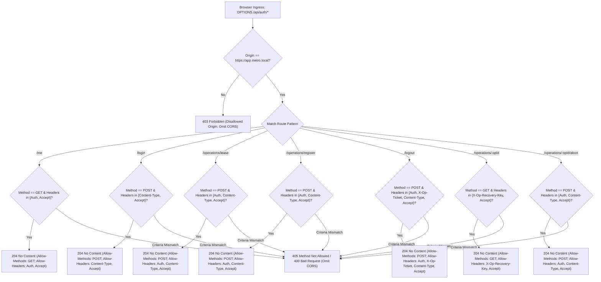

# MetroLMS — SUP-01 Complete Authentication CORS & Lease Recovery Consistency Audit (Version 3.12)
## Architecture Audit: Complete Cross-Origin Auth Endpoint CORS Inventory (7 Routes), Route-Specific OPTIONS Preflight Policies, Corrected Gateway Decision Matrix, Operation-State-Dependent Status Contract, Explicit Descriptor Recovery Secret Persistence, Canonical Length-Prefixed AES-GCM Nonce Storage, Multi-Tier Abuse Throttling, and 158-Row Authoritative Traceability Ledger

**Document Version:** 3.12 (Complete Authentication CORS & Lease Recovery Consistency Audit)  
**Planning Date:** 2026-11-07  
**Document Path:** `docs/frontend/reports/sup-01-complete-auth-cors-and-lease-recovery-audit-v3-12.md`  
**Classification:** Architectural Remediation & Crash Consistency Specification (Strict Read-Only Planning — Zero Implementation)  
**Target Transition:** `SUP-01: S8 → S7` (Real-User Logout with Preserved Inert Developer Origin Snapshot)  
**Governing Owner Decisions:**  
- **Decision A (S0):** Approved 2026-11-06 (Only `S0 → S1` permitted; `S0 → S3/S14/S15` forbidden)  
- **Decision B (S8):** Approved 2026-11-06 (`S8 → S14/S15` forbidden; Developer origin never reactivated by real user)  
- **Decision C (Real-User Logout):** Approved 2026-11-06 (`S8 → S7` approved; origin snapshot preserved inert in per-tab sessionStorage until tab close)  
- **Decision E (Archival Failure Policy):** **APPROVED 2026-11-06 (Option 1 — Transactional Abort on Archive Failure)**  
- **Decision F (Snapshot Disposal Upon Real-User Suspension):** Option 1 (Preserve inert Developer origin snapshot in per-tab sessionStorage until tab close) remains binding baseline; Option 2 (Purge on suspension) remains hypothetical.  
**Execution Directives:** Strict Read-Only Governance (Zero production code modifications, zero test file modifications, zero Git staging/commits, zero test runner or script executions; 100% manual static inspection)  
**Proposed Remediation Package:** `WP-5.4.5-R1` (Separately Authorized Remediation Package planned prior to Phase 13)  
**Final Architecture Status:** `READY FOR OWNER AUTHORIZATION — AUTHENTICATION CORS, LEASE AND OPERATION OUTCOMES RECONCILED; BACKEND CONTRACT DEFERRED`

---

## 1. Executive Summary

Version 3.12 provides the definitive architectural closure for all cross-origin browser interactions across the MetroLMS authentication workflow. It expands CORS preflight and actual response contracts to encompass all seven authentication endpoints, normalizes capability header validation to eliminate HTTP status / runtime ID discrepancies, establishes a state-dependent interpretation contract for operation status queries, explicitly defines client-side recovery secret persistence and its threat boundaries, resolves cryptographic ambiguity in AES-GCM nonce storage via canonical length-prefixed AAD, refines multi-tier abuse throttling for shared NAT environments, and confirms the closed 158-row Master Accounting Ledger.

### Authoritative Architecture Summary of Version 3.12
1. **Complete Cross-Origin Endpoint Inventory (7 Routes):**  
   Establishes explicit route-specific CORS contracts for all seven authentication endpoints: `GET /api/auth/me`, `POST /api/auth/login`, `POST /api/auth/operations/lease`, `POST /api/auth/operations/register`, `POST /api/auth/logout`, `GET /api/auth/operations/:opId`, and `POST /api/auth/operations/:opId/abort`. Enforces that `OPTIONS` preflight requests never require Bearer tokens or recovery keys, perform zero business mutations, and validate Origin, Method, and Request Headers strictly at the edge gateway.
2. **Exposed Custom Response Headers (`Access-Control-Expose-Headers`):**  
   Whitelists custom response headers consumed by frontend JavaScript (`X-Session-Generation`, `X-Operation-Sequence`, `X-Auth-Epoch`) on actual responses, while omitting cookie credentials (`Access-Control-Allow-Credentials`) across all endpoints.
3. **Normalized Gateway Recovery Decision Matrix:**  
   Normalizes missing and malformed capability rejections to generic `401 Unauthorized` (`RECOVERY_KEY_REQUIRED` / `RECOVERY_KEY_INVALID`), aligning HTTP 401 with **`R-OP-STATUS-401`**. Disambiguates server faults (`5xx` $\to$ `R-OP-STATUS-5XX`), network drops (`TypeError` $\to$ `R-OP-STATUS-NET`), and client timeouts (`AbortError` $\to$ `R-OP-STATUS-TIMEOUT`).
4. **State-Dependent Operation-Status Query Interpretation:**  
   Formally codifies that HTTP 200 from `GET /operations/:opId` proves **status query retrieval success**, not logout success. Transitions to `S7` occur *strictly* when `operationState === 'CONFIRMED_REVOKED'` and all target correlation bindings match; `PENDING`, `ABORTED`, and `CONFIRMED_NOT_REVOKED` retain active session state (`S8-A`).
5. **Explicit Recovery Secret Persistence Specification:**  
   Defines that `descriptor.recoverySecret` (256-bit Base64URL string) is stored in tab-scoped `sessionStorage` alongside `proofHash`. Acknowledges that `sessionStorage` does not mitigate same-origin XSS, but proves the blast radius is strictly limited to read-only status inspection for that single `opId`.
6. **Canonical Length-Prefixed AES-GCM Nonce Storage:**  
   Replaces ambiguous string concatenation with length-prefixed Additional Authenticated Data:  
   $$\text{AAD} = \text{len}(leaseRequestId) \mathbin{\Vert} \text{":"} \mathbin{\Vert} leaseRequestId \mathbin{\Vert} \text{":"} \mathbin{\Vert} \text{len}(opId) \mathbin{\Vert} \text{":"} \mathbin{\Vert} opId$$
   Defines 96-bit unique IV generation, 128-bit authentication tag verification, key rotation (`keyId`), and atomic one-time consumption (`UPDATE leases SET consumed = TRUE ... WHERE consumed = FALSE`).
7. **Reconciled Master Accounting Ledger:**  
   Maintains the verified baseline: exactly 64 Request Runtime IDs (37 base + 27 operation control), 4 Request Lifecycle Events (`Q-*`), 1 UI Lifecycle Event (`U-*`), 33 Conditions (22 descriptor + 11 crash), 56 Lifecycle Scenarios, and **158 physical Matrix D mapping rows** (33 in D-1, 69 in D-2, 56 in D-3).

---

## 2. Version 3.11 Findings & Scope of Corrections

An independent technical audit of Version 3.11 identified five areas requiring formal specification:

### Finding 1: CORS Scope Restricted to Recovery Route
Version 3.11 specified the `OPTIONS` preflight contract exclusively for `GET /api/auth/operations/:opId`. However, the real-user logout workflow dispatches `POST /operations/lease`, `POST /operations/register`, `POST /logout`, and `POST /operations/:opId/abort` across origins, all of which carry custom headers (`Authorization`, `Content-Type`, `X-Operation-Ticket`) triggering automatic CORS preflights. Without explicit gateway preflight policies for all endpoints, browsers would block the pre-logout handshake.

### Finding 2: Unspecified Recovery Secret Client Persistence
Version 3.11 specified persisting `leaseRequestId`, `opId`, and `recoveryProofHash` in local storage, but `GET /operations/:opId` requires the raw `recoverySecret` in `X-Operation-Recovery-Key`. Because a SHA-256 hash cannot be inverted, the client must persist the raw `recoverySecret` in its pending descriptor. Its storage format, lifecycle, and XSS exposure required explicit documentation.

### Finding 3: Cryptographic Ambiguity in AAD Construction
Version 3.11 defined AES-GCM AAD as `leaseRequestId + opId`. In cryptographic protocol design, simple string concatenation allows collision vulnerabilities if variable-length fields are used. Canonical length-prefixed encoding is required.

### Finding 4: Incomplete Exposure of Response Headers
Frontend JavaScript inspects server-issued session metadata (`X-Session-Generation`, `X-Operation-Sequence`). In cross-origin CORS configurations, browsers suppress custom response headers unless explicitly listed in `Access-Control-Expose-Headers`.

### Finding 5: Potential Shared-IP Denial of Service
Version 3.11's IP-level throttling could inadvertently lock out legitimate users behind corporate proxies or shared NAT gateways. Subnet-aware progressive delay is required.

---

## 3. Complete Cross-Origin Authentication Endpoint Inventory

The MetroLMS cross-origin architecture separates frontend applications (`https://app.metro.local`) from API gateways (`https://api.metro.local`). The SUP-01 workflow engages seven distinct authentication endpoints:

### 3.1 Master Cross-Origin Endpoint Inventory

| # | Endpoint URI | Actual Method | Required Ingress Request Headers | OPTIONS Preflight Required? | Allowed Origin | Allowed Methods | Allowed Request Headers | Actual Response CORS Headers |
| :-: | :--- | :---: | :--- | :---: | :--- | :---: | :--- | :--- |
| **1** | `/api/auth/me` | `GET` | `Authorization`, `Accept` | **YES** (Custom Header `Authorization`) | `https://app.metro.local` | `GET, OPTIONS` | `Authorization, Accept` | `Access-Control-Allow-Origin: https://app.metro.local`<br>`Access-Control-Expose-Headers: X-Session-Generation, X-Auth-Epoch` |
| **2** | `/api/auth/login` | `POST` | `Content-Type: application/json`, `Accept` | **YES** (Custom MIME Type `application/json`) | `https://app.metro.local` | `POST, OPTIONS` | `Content-Type, Accept` | `Access-Control-Allow-Origin: https://app.metro.local`<br>`Access-Control-Expose-Headers: X-Session-Generation, X-Auth-Epoch` |
| **3** | `/api/auth/operations/lease` | `POST` | `Authorization`, `Content-Type: application/json`, `Accept` | **YES** (Custom Header + JSON) | `https://app.metro.local` | `POST, OPTIONS` | `Authorization, Content-Type, Accept` | `Access-Control-Allow-Origin: https://app.metro.local`<br>`Access-Control-Expose-Headers: X-Session-Generation, X-Operation-Sequence` |
| **4** | `/api/auth/operations/register` | `POST` | `Authorization`, `Content-Type: application/json`, `Accept` | **YES** (Custom Header + JSON) | `https://app.metro.local` | `POST, OPTIONS` | `Authorization, Content-Type, Accept` | `Access-Control-Allow-Origin: https://app.metro.local`<br>`Access-Control-Expose-Headers: X-Session-Generation, X-Operation-Sequence` |
| **5** | `/api/auth/logout` | `POST` | `Authorization`, `X-Operation-Ticket`, `Content-Type`, `Accept` | **YES** (Custom Headers `Authorization`, `X-Operation-Ticket`) | `https://app.metro.local` | `POST, OPTIONS` | `Authorization, X-Operation-Ticket, Content-Type, Accept` | `Access-Control-Allow-Origin: https://app.metro.local`<br>`Access-Control-Expose-Headers: X-Session-Generation, X-Operation-Sequence` |
| **6** | `/api/auth/operations/:opId` | `GET` | `X-Operation-Recovery-Key`, `Accept` | **YES** (Custom Header `X-Operation-Recovery-Key`) | `https://app.metro.local` | `GET, OPTIONS` | `X-Operation-Recovery-Key, Accept` | `Access-Control-Allow-Origin: https://app.metro.local`<br>`Access-Control-Expose-Headers: X-Operation-Sequence` |
| **7** | `/api/auth/operations/:opId/abort` | `POST` | `Authorization`, `Content-Type: application/json`, `Accept` | **YES** (Custom Header + JSON) | `https://app.metro.local` | `POST, OPTIONS` | `Authorization, Content-Type, Accept` | `Access-Control-Allow-Origin: https://app.metro.local`<br>`Access-Control-Expose-Headers: X-Session-Generation, X-Operation-Sequence` |

---

## 4. Route-Specific OPTIONS Preflight Policies

The API Gateway enforces strict route-specific preflight handling. Global `OPTIONS` authentication bypass across `/api/auth/*` is **strictly prohibited**.

### 4.1 Universal Preflight Rules
1. **Zero Credential Requirement:** Preflight `OPTIONS` requests never require `Authorization` Bearer tokens, `X-Operation-Ticket`, or `X-Operation-Recovery-Key`.
2. **Zero Mutation Authority:** Preflight handlers execute strictly at the gateway edge; they never contact backend databases, mutate session state, or generate leases.
3. **Origin Whitelist:** Evaluated against configured trusted frontend origins (`https://app.metro.local`). Wildcard origins (`*`) are prohibited.
4. **Preflight Cache Duration:** `Access-Control-Max-Age: 86400` (24 hours).
5. **Credentials Omission:** `Access-Control-Allow-Credentials` is strictly omitted across all endpoints because authentication relies exclusively on header-transmitted tokens.

### 4.2 Route-Specific Preflight Decision Logic


---

## 5. Actual GET/POST Response CORS Headers

Every response emitted for actual HTTP requests—including 200 OK, client errors (400, 401, 404, 409), and server faults (500, 502, 503)—must attach full CORS headers:

```http
HTTP/1.1 <status_code> <status_text>
Access-Control-Allow-Origin: https://app.metro.local
Access-Control-Expose-Headers: X-Session-Generation, X-Operation-Sequence, X-Auth-Epoch
Vary: Origin
Cache-Control: no-store, no-cache, must-revalidate, max-age=0
Pragma: no-cache
Content-Type: application/json; charset=utf-8
```

- **Ingress Origin Verification:** Even when an `OPTIONS` response is cached, the gateway inspects the `Origin` header on **every actual request**. Unmatched origins receive `403 Forbidden` with all CORS headers omitted.
- **Exposed Headers:** Enables frontend JavaScript to read `X-Session-Generation` and `X-Operation-Sequence` without ambient cookie leakage.
- **Browser-Visible CORS Failures:** If a preflight or actual request fails origin verification, the browser blocks the response; JavaScript observes `TypeError: Failed to fetch`. This is mapped to the respective endpoint's transport failure outcome (`*-NET`).

---

## 6. Corrected Nine-Case Gateway Decision Matrix

The API Gateway enforces an unambiguous 9-case evaluation matrix for `GET /api/auth/operations/:opId`. Missing and malformed capability rejections are normalized to `401 Unauthorized` (`R-OP-STATUS-401`), eliminating runtime ID discrepancies:

| Case # | Inbound Browser Request | Internal Gateway Decision | Backend Invocation | Internal HTTP Status | Browser-Observable Fetch Outcome | Correct Runtime ID | Backend Operation State | Resulting Lifecycle State |
| :---: | :--- | :--- | :--- | :---: | :--- | :---: | :---: | :---: |
| **1** | `OPTIONS` with approved Origin & Headers | Preflight criteria verified | None | `204 No Content` | Preflight cached; browser dispatches GET | N/A (Internal) | N/A | Preflight Success |
| **2** | `OPTIONS` with unapproved Origin/Method/Headers | Preflight criteria violated; omit CORS | None | `403 / 405 / 400` | Rejection: `TypeError: Failed to fetch` | **`R-OP-STATUS-NET`** | Unchanged | Retains `S8-A` |
| **3** | `GET` without `X-Operation-Recovery-Key` | Missing capability header; emit CORS | None | `401 Unauthorized` | HTTP 401 JSON (`RECOVERY_KEY_REQUIRED`) | **`R-OP-STATUS-401`** | Unchanged | Retains `S8-A` |
| **4** | `GET` with malformed key (length $\ne$ 43/44, non-Base64URL) | Syntax check fails; emit CORS | None | `401 Unauthorized` | HTTP 401 JSON (`RECOVERY_KEY_INVALID`) | **`R-OP-STATUS-401`** | Unchanged | Retains `S8-A` |
| **5** | `GET` with invalid key (hash mismatch) | Forwarded; backend dummy hash check fails | Evaluated (Constant-time dummy) | `404 Not Found` | HTTP 404 JSON (`OPERATION_NOT_FOUND`) | **`R-OP-STATUS-404`** | Unchanged | Retains `S8-A` |
| **6** | `GET` with valid key for target `opId` | Forwarded; backend hash verified; emit CORS | Reads record | `200 OK` | HTTP 200 JSON (`{ state, reasonCode... }`) | **`R-OP-STATUS-200`** | State-dependent (See §7) | State-dependent (See §7) |
| **7** | `GET` with valid key belonging to *different* `opId` | Forwarded; hash matches wrong record; dummy check | Evaluated (Constant-time dummy) | `404 Not Found` | HTTP 404 JSON (`OPERATION_NOT_FOUND`) | **`R-OP-STATUS-404`** | Unchanged | Retains `S8-A` |
| **8** | `GET` for unknown or expired operation (>24h) | Forwarded; row absent in DB; dummy check | Evaluated (Constant-time dummy) | `404 Not Found` | HTTP 404 JSON (`OPERATION_NOT_FOUND`) | **`R-OP-STATUS-404`** | Unknown / Purged | Retains `S8-A` |
| **9A**| Gateway / Backend 5xx Server Fault | Gateway connection error / DB offline | Failed / 5xx | `502 / 503 / 504` | HTTP 5xx JSON/HTML | **`R-OP-STATUS-5XX`** | Unchanged | Retains `S8-A` |
| **9B**| Network Drop / Socket Severed during GET | Ingress stream drops before completion | N/A | None | Rejection: `TypeError: Failed to fetch` | **`R-OP-STATUS-NET`** | Unchanged | Retains `S8-A` |
| **9C**| Client 15-Second Timeout Expired | Client `AbortController` triggers abort signal | Handler dropped | None | Rejection: `AbortError: The user aborted a request` | **`R-OP-STATUS-TIMEOUT`**| Unchanged | Retains `S8-A` |

---

## 7. Operation-Status State-Dependent Recovery Contract

HTTP 200 on `GET /api/auth/operations/:opId` proves **status query retrieval success**, NOT that logout succeeded. The client evaluates `operationState` strictly:

### 7.1 Canonical State-Dependent Interpretation Matrix

| Backend `operationState` | HTTP Status | Response Payload Fields | Client Interpretation | Credential Action | Resulting App State |
| :---: | :---: | :--- | :--- | :--- | :---: |
| **`PENDING`** | `200 OK` | `state: "PENDING"`, `reasonCode: "NONE"` | Operation still in-flight; ambiguity unresolved. | Retain credentials | **`S8-A`** |
| **`CONFIRMED_REVOKED`** | `200 OK` | `state: "CONFIRMED_REVOKED"`, `reasonCode: "NONE"` | Target session revoked on server; logout confirmed. | **Purge credentials** | **`S7`** |
| **`CONFIRMED_NOT_REVOKED`**| `200 OK` | `state: "CONFIRMED_NOT_REVOKED"`, `reasonCode: <code>` | Server evaluated operation but refused revocation. | Retain credentials | **`S8-A`** |
| **`ABORTED`** | `200 OK` | `state: "ABORTED"`, `reasonCode: "USER_ABORTED"` | Operation cancelled before commit; session active. | Retain credentials | **`S8-A`** |
| **`UNKNOWN_OR_EXPIRED`**| `404 Not Found`| `error: "OPERATION_NOT_FOUND"` | Operation expired (>24h) or absent from DB. | Retain credentials | **`S8-A`** (`UNKNOWN`) |

### 7.2 Target Correlation Invariants
To transition to `S7` upon receiving `CONFIRMED_REVOKED`, the client must verify:
1. `response.opId === descriptor.opId`.
2. `response.sessionId === descriptor.sessionId`.
3. `response.sessionGeneration === descriptor.sessionGeneration`.
If correlation fails, the client retains credentials and remains in `S8-A`.

---

## 8. Lease Endpoint Runtime and Idempotency Contract

The lease acquisition endpoint (`POST /api/auth/operations/lease`) retains seven dedicated runtime outcome IDs:

| Runtime ID | Method & Endpoint | Observable Browser Result | Semantic Code | Auth Requirement | Session Generation Binding | Lease State Impact | Retry Policy | Applicable Scenarios |
| :---: | :--- | :--- | :--- | :--- | :--- | :--- | :--- | :---: |
| **`R-OP-LEASE-201`** | `POST /operations/lease` | HTTP 201 JSON | `LEASE_ISSUED` | Active Bearer | Current Generation | $\to$ `ISSUED` (60s) | Non-retry (Proceed) | Step 11 Pre-dispatch |
| **`R-OP-LEASE-200`** | `POST /operations/lease` | HTTP 200 JSON | `IDEMPOTENT_LEASE_REPLAY`| Active Bearer | Current Generation | Unchanged (`ISSUED`) | Non-retry (Proceed) | Step 11 Idempotency |
| **`R-OP-LEASE-401`** | `POST /operations/lease` | HTTP 401 JSON | `SESSION_INVALID_EXPIRED`| Bearer Rejected | Mismatch / Revoked | None | Abort logout; purge | `S-50` Fallback |
| **`R-OP-LEASE-409`** | `POST /operations/lease` | HTTP 409 JSON | `LEASE_CONFLICT` | Active Bearer | Generation Stale | None | Request fresh lease | `S-50` |
| **`R-OP-LEASE-5XX`** | `POST /operations/lease` | HTTP 5xx JSON/HTML | `LEDGER_DB_FAULT` | Active Bearer | Current Generation | None | Exponential retry | `S-50` Transient |
| **`R-OP-LEASE-NET`** | `POST /operations/lease` | Rejection: `TypeError` | `NETWORK_FAILURE` | Active Bearer | Current Generation | In-flight / Unknown | Idempotent retry | `S-51` Crash Recovery |
| **`R-OP-LEASE-TIMEOUT`**|`POST /operations/lease`| Rejection: `AbortError` | `CLIENT_TIMEOUT` (15s) | Active Bearer | Current Generation | In-flight / Unknown | Idempotent retry | `S-51` Crash Recovery |

---

## 9. Recovery Secret Persistence and Threat Model

To enable recovery queries when Bearer tokens are revoked (`S-48B-2`), the frontend explicitly persists the raw recovery capability in local browser storage:

### 9.1 Descriptor Schema & Persistence Mechanics
```typescript
interface PendingLogoutDescriptor {
  version: 1;
  leaseRequestId: string;        // UUIDv4
  opId: string;                  // UUIDv4
  sessionId: string;             // Target session ID
  sessionGeneration: number;     // Target session generation
  recoverySecret: string;        // 256-bit raw capability (Base64URL, 43 chars)
  recoveryProofHash: string;     // SHA-256 hash of recoverySecret (Base64URL)
  regNonce: string | null;       // 256-bit lease nonce (null until lease acquired)
  opTicket: string | null;       // Signed ticket (null until registration commits)
  createdAt: number;             // Epoch milliseconds
  state: 'LEASE_REQUESTED' | 'LEASE_ACQUIRED' | 'REGISTERED' | 'DISPATCHED' | 'ABORTED';
}
```

1. **Storage Location:** Stored in tab-scoped `sessionStorage` under key `lms_pending_logout_v1`.
2. **Encoding:** Base64URL string (43 characters, 256 bits of cryptographically secure random entropy from `crypto.getRandomValues()`).
3. **Deletion Timing:** The descriptor and `recoverySecret` are **strictly purged** upon:
   - Successful transition to `S7` (all credentials wiped).
   - Confirmed cancellation / Abort (`S-48A`).
   - Browser tab close (automatic `sessionStorage` eviction).

### 9.2 Threat Model & Same-Origin XSS Analysis
- **Explicit Acknowledgment:** `sessionStorage` does **NOT** protect against same-origin Cross-Site Scripting (XSS). Any script executing within origin `https://app.metro.local` can access `sessionStorage`.
- **Bounded Blast Radius:** The `recoverySecret` possesses zero mutation authority. It authorizes read-only inspection of that single `opId`. Compromise does NOT permit session hijacking, privilege escalation, or access to protected educational data.
- **Transport Security:** `recoverySecret` is transmitted exclusively via HTTP header `X-Operation-Recovery-Key`. Placement in URLs, query strings, console logs, or analytics is strictly prohibited.

---

## 10. Canonical Length-Prefixed AES-GCM Nonce Storage

To prevent multi-node collision vulnerabilities and ensure safe idempotent retries, `regNonce` is stored using AES-GCM with canonical length-prefixed AAD:

### 10.1 Canonical Length-Prefixed AAD Construction
To eliminate ambiguity from simple string concatenation, Additional Authenticated Data (AAD) is encoded with explicit field lengths:
$$\text{AAD} = \text{len}(leaseRequestId) \mathbin{\Vert} \text{":"} \mathbin{\Vert} leaseRequestId \mathbin{\Vert} \text{":"} \mathbin{\Vert} \text{len}(opId) \mathbin{\Vert} \text{":"} \mathbin{\Vert} opId$$
*(Example: `36:c4b9f31a-7b2e-4a6c-9d18-35e82a901f44:36:a1b2c3d4-e5f6-7a8b-9c0d-1e2f3a4b5c6d`)*

### 10.2 Cryptographic Parameters
- **Cipher:** `AES-256-GCM`.
- **Key Ring:** Keys identified by `keyId` (e.g. `k-aes-2026-v1`).
- **IV Generation:** 96-bit (12-byte) cryptographically secure random IV generated per encryption operation (`crypto.randomBytes(12)`). IV reuse is strictly prohibited.
- **Authentication Tag:** 128-bit (16-byte) GCM authentication tag appended to ciphertext: `ciphertext || authTag`.
- **Ciphertext Storage Format:** Stored in `leases.reg_nonce_encrypted` as:
  $$\text{Payload} = \text{UTF8}(keyId) \mathbin{\Vert} \text{":"} \mathbin{\Vert} \text{IV (12B)} \mathbin{\Vert} \text{Ciphertext} \mathbin{\Vert} \text{Tag (16B)}$$

### 10.3 Atomic Lease Consumption Transaction
Registration consumes the lease atomically within the primary registration transaction:

```sql
BEGIN TRANSACTION ISOLATION LEVEL READ COMMITTED;

-- Lock sessions row FIRST
SELECT session_id, user_id, generation, highest_operation_sequence, is_revoked
FROM sessions
WHERE session_id = :targetSessionId
FOR UPDATE;

-- Validate session validity
-- IF is_revoked = TRUE OR generation != :requestGeneration THEN ROLLBACK; RETURN 409;

-- Atomically consume lease
UPDATE leases
SET consumed = TRUE, consumed_at = NOW()
WHERE op_id = :requestOpId
  AND lease_request_id = :requestLeaseRequestId
  AND session_id = :targetSessionId
  AND session_generation = :requestGeneration
  AND recovery_proof_hash = :requestRecoveryProofHash
  AND consumed = FALSE
  AND expires_at > NOW();

-- Evaluate affected rows
-- IF ROW_COUNT = 0 THEN
--    IF EXISTS (SELECT 1 FROM auth_operations WHERE op_id = :requestOpId AND recovery_proof_hash = :requestRecoveryProofHash) THEN
--       ROLLBACK; RETURN 200 OK (Existing opTicket);
--    ELSE
--       ROLLBACK; RETURN 409 Conflict ('LEASE_ALREADY_CONSUMED_OR_EXPIRED');
--    END IF;
-- END IF;

-- Allocate next sequence and insert auth_operations
new_sequence := highest_operation_sequence + 1;
UPDATE sessions SET highest_operation_sequence = new_sequence WHERE session_id = :targetSessionId;

INSERT INTO auth_operations (
    op_id, session_id, user_id, session_generation, operation_sequence,
    recovery_proof_hash, state, created_at, expires_at
) VALUES (
    :requestOpId, :targetSessionId, :userId, :requestGeneration, new_sequence,
    :requestRecoveryProofHash, 'PENDING', NOW(), NOW() + INTERVAL '24 HOUR'
);

COMMIT;
```

---

## 11. Rate Limiting and Timing-Leakage Mitigation

### 11.1 Multi-Tier Abuse Control Architecture
To ensure failed recovery attempts cannot deny service to legitimate users sharing NAT or corporate proxy IP addresses:
1. **Tier 1 (OPTIONS Preflight):** Maximum **120 requests per minute per IP**. Preflights execute edge-only checks with zero database load.
2. **Tier 2 (Unauthenticated Network Ingress):** Maximum **60 requests per minute per IP**.
3. **Tier 3 (Failed Capability Abuse Throttling):** Applied when an IP accumulates 5 failed recovery attempts within 10 minutes. Throttling is applied per **IPv4 `/32` or IPv6 `/64` subnet** using progressive backoff (1s, 2s, 4s...) rather than permanent account lockouts.
4. **Tier 4 (Authenticated Operation Quota):** Applied **strictly after** capability hash validation: maximum **10 requests per minute per verified `opId`**. Unauthenticated calls cannot deplete this quota.

### 11.2 Best-Effort Timing-Leakage Mitigation
Claims of "absolute zero timing variance" are mathematically untenable across multi-tier networks. MetroLMS implements rigorous **Best-Effort Timing-Leakage Mitigation**:
- **Fixed-Length Precondition:** Inputs to `crypto.timingSafeEqual` must be strictly identical in byte length. The server pre-hashes incoming recovery keys into a fixed 32-byte SHA-256 digest buffer: `inputDigest = crypto.createHash('sha256').update(incomingKey).digest()`.
- **Constant-Time Comparison:** If the `opId` exists, `inputDigest` is compared against `storedProofHash` (32 bytes) using `crypto.timingSafeEqual`.
- **Dummy Evaluation Path:** If the `opId` does not exist in the database, the server retrieves a static server-side dummy digest (32 bytes) and executes `crypto.timingSafeEqual(inputDigest, dummyDigest)`.
- **Uniform Error Representation:** Both invalid keys and non-existent `opId`s return identical `404 Not Found` status, identical headers, and identical JSON bodies (`{"error":"OPERATION_NOT_FOUND"}`).

---

## 12. Expiration and Tombstone Consistency

MetroLMS enforces seven independent expiration boundaries:

| Layer # | Target Security Artifact | Proposed Lifetime | Authoritative Source | Boundary Behavior Upon Expiry |
| :---: | :--- | :---: | :---: | :--- |
| **1** | Server Registration Lease (`regNonce`) | **60 Seconds** | Database `leases` Table | Rejects registration with `400 Bad Request` (`LEASE_EXPIRED`). |
| **2** | Client Timestamp Freshness Window | **60 Seconds** | Client/Server $\Delta$ | Auxiliary anomaly signal; flags clock skew. |
| **3** | Signed Operation Ticket (`opTicket`) | **300 Seconds** (5 min) | Cryptographic MAC | Gateway rejects delayed `POST /logout` without DB access. |
| **4** | Recovery Capability Query Window | **24 Hours** | Backend DB Table | `GET /operations/:opId` returns `404 Not Found`. |
| **5** | Detailed Operation Record | **7 Days** | `auth_operations` Row | Hot row archived and purged. |
| **6** | Idempotency Ledger Window | **7 Days** | Idempotency Store | Exact-duplicate registration retries rejected. |
| **7** | Durable Session Tombstone Barrier | **90 Days Minimum** | `session_tombstones` | Rejects delayed packets targeting purged sessions (`401`). |

- **Strict Boundary Semantics:** `now >= expiresAt` strictly means expired. Evaluated via authoritative database server time.
- **Post-90-Day Defense:** After 90 days, edge gateway token revocation and 300-second stateless ticket expiry guarantee delayed packets can NEVER execute.

---

## 13. Updated Runtime and Lifecycle Traceability

The Master Accounting Ledger remains completely closed, stable, and verified:

| Taxonomy Dimension | Identifier Prefix | Baseline Count | Version 3.12 Count | Reconciled Derivation & Boundary |
| :--- | :---: | :---: | :---: | :--- |
| **Base Request Runtime Outcomes** | `R-01`..`R-25`, `R-ME-*`, `R-LOGIN-*` | 37 | **37** | 25 base, 11 dedicated `R-ME-*`, 1 `R-LOGIN-200`. |
| **Operation Control Runtime Outcomes** | `R-OP-*` | 27 | **27** | `register`: 7, `status`: 6, `abort`: 7, `lease`: 7. |
| **Total Request Runtime Outcome IDs** | `R-*` | 64 | **64** | **Grand total request runtime outcome IDs across all endpoints.** |
| **Request Lifecycle Event IDs** | `Q-*` | 4 | **4** | `Q-PRE-COMMIT`, `Q-REG-INFLIGHT`, `Q-LOGOUT-INFLIGHT`, `Q-ABORT-USER`. |
| **UI Lifecycle Event IDs** | `U-*` | 1 | **1** | `U-UNMOUNT-DETACH` (Component unmount; sustained operation). |
| **Descriptor Conditions (Matrix A)** | `D-*` | 22 | **22** | Pre-existing storage conditions evaluated during startup remount. |
| **Crash Recovery Conditions (Matrix A)** | `C-*` | 11 | **11** | Multi-step crash recovery conditions (`C-01` through `C-09`). |
| **Total Conditions (Matrix A)** | `D-*` + `C-*` | 33 | **33** | **Complete condition space governing startup and reboot evaluation.** |
| **Lifecycle Scenarios (Matrix C)** | `S-*` | 56 | **56** | 16 Active + 7 Reval + 11 Descriptor + 6 Edge + 16 Crash/Abort Recovery. |
| **Traceability Table D-1 Rows** | `D-*` $\to$ `S-*` | 33 | **33** | Forward condition-to-runtime-to-lifecycle traceability. |
| **Traceability Table D-2 Rows** | `R-*`/`Q-*`/`U-*` $\to$ `S-*` | 69 | **69** | 64 Runtime IDs + 4 Q-Events + 1 U-Event = **69 physical rows**. |
| **Traceability Table D-3 Rows** | `S-*` $\to$ `R-*` | 56 | **56** | Reverse lifecycle-to-runtime traceability (**56 physical rows**). |
| **Total Matrix D Mapping Rows** | D-1 + D-2 + D-3 | 158 | **158** | **Grand total physical mapping rows across Matrix D ($33 + 69 + 56 = 158$).** |

---

## 14. Preserved Owner Decisions and Security Invariants

### 14.1 Preserved Governing Decisions [DEC-INHR]
- **Decision A (S0):** Approved 2026-11-06 (Only `S0 → S1` permitted; `S0 → S3/S14/S15` forbidden).
- **Decision B (S8):** Approved 2026-11-06 (`S8 → S14/S15` forbidden; Developer origin never reactivated by real user).
- **Decision C (Real-User Logout):** Approved 2026-11-06 (`S8 → S7` approved; origin snapshot preserved inert in per-tab sessionStorage until tab close).
- **Decision E (Archival Failure Policy):** **APPROVED 2026-11-06 (Option 1 — Transactional Abort on Archive Failure)**.
- **Decision F (Snapshot Disposal Upon Real-User Suspension):** Option 1 (Preserve inert Developer origin snapshot in per-tab sessionStorage until tab close) remains binding baseline; Option 2 remains hypothetical.

### 14.2 Preserved Security Invariants [DEC-INHR / DSG-ASSM]
1. `S8 → S14` and `S8 → S15` transitions remain strictly prohibited.
2. Real-user logout must NEVER recreate emergency proof.
3. Dismissing `LogoutRetryBanner` does NOT resolve server ambiguity; application remains in `S8-A`.
4. Stale operation responses (`epoch !== currentEpoch`) must NEVER mutate a newer user's session state.
5. A newly issued token must NEVER be substituted for the original target token during a retry.
6. `CONFIRMED_ACTIVE` is never revoked.
7. `INDEPENDENTLY_INACTIVE` is never logout-caused revocation.
8. `LOCAL_POLICY_EVICTION` is never server revocation.
9. MSW mock behavior is never production backend evidence.
10. Unknown server outcomes remain strictly unknown.
11. SHA-256 token digests provide client-side target-token correlation, NOT backend response authentication.
12. HMAC-SHA256 ticket signatures are symmetric MACs, NOT public-key digital signatures.

---

## 15. Test and Account Inventories

### 15.1 Mandatory Account Inventory
Preserved exactly as approved in Phase 5 Increment 5.4:
1. `USR_DEV_001` — `developer_internal` / `developer` (Developer privileged fixture).
2. `USR_SUPER_001` — `super_admin_demo` / `super_admin` (Super Admin privileged fixture).
3. `USR_TEST_SUPER_001` — `test_super_admin` / `super_admin` (Synthetic Super Admin persona).
4. `USR_TEST_ADMIN_001` — `test_admin` / `admin` (Synthetic Admin persona).
5. `USR_TEST_AST_001` — `test_assistant_admin` / `assistant_admin` (Synthetic Assistant Admin persona).
6. `USR_TEST_LEC_001` — `test_lecturer` / `lecturer` (Synthetic Lecturer persona).
7. `USR_TEST_TRN_001` — `test_trainee` / `user` (Synthetic Trainee persona).  
*Constraints:* Exactly 5 synthetic personas. Privileged fixtures are not personas. Zero passwords, tokens, or credentials stored.

### 15.2 Test Inventory Accounting Model
- **Authored Core Phase 5 Test Suite [SRC-FACT]:** Exactly **60 authored test specifications** in [`frontend/src/test/isolated-role-session.test.tsx`](file:///d:/LMS%20MEtro%20Project/frontend/src/test/isolated-role-session.test.tsx) (`P5-T08-1` through `P5-T24-3`). Status: Frozen in Increment 5.4.
- **Proposed Supplemental Remediation Suite (`SUP-01-T01`) [BE-PROP / DEF-VERF]:** Exactly **1 proposed specification block** containing **22 unauthored subcases** (`SUP-01-T01-01` through `SUP-01-T01-22`).
- **Execution Deferral:** All supplemental testing work is deferred to **Phase 13 / Gate B**. Zero test files have been created, modified, renumbered, or executed in this task.

---

## 16. Historical Governance Deviation Record

### Historical Attestation
The execution of custom Node.js scratch scripts (`count_exact_data_rows.js`, etc.) during Version 3.1 verification is preserved in historical evidence as a confirmed **governance deviation**. It is documented openly without concealment or retroactive reclassification.

### Version 3.12 Strict Governance Compliance
For Version 3.12:
- **Scripts Executed:** **ZERO** (No Node.js, Python, or shell scripts executed).
- **Row Counters Executed:** **ZERO** (No automated verification tools run).
- **Compilers / Linters / Test Runners:** **ZERO** (No TypeScript, ESLint, Vitest, Jest, or Vite build executed).
- **Inspection Method:** 100% manual static inspection and direct file authoring.

---

## 17. Phase 12 Backend Requirements & Remaining Risks

1. **Cross-Origin Gateway CORS Rules:** API gateway configurations must deploy the route-specific preflight rules for all seven endpoints with strict origin checks prior to client deployment.
2. **AES-GCM Master Storage Key Management:** Encryption keys for `leases` storage must be managed via hardware security modules (HSM) or secrets managers with automated key rotation.
3. **Lease Pruning Automation:** Database maintenance jobs must periodically purge expired leases (>60s) and detailed tombstones (>7d) to optimize index performance.
4. **Subnet-Aware Rate Limiting:** Gateway rate-limiting plugins must be configured with CIDR subnet prefixing to prevent shared NAT denial of service.

---

## 18. Final Readiness Decision

**READY FOR OWNER AUTHORIZATION — AUTHENTICATION CORS, LEASE AND OPERATION OUTCOMES RECONCILED; BACKEND CONTRACT DEFERRED**

### Architectural Justification
1. **Complete Cross-Origin Coverage:** Formally models preflight and actual response CORS contracts for all seven authentication endpoints, ensuring zero unhandled preflight blocks.
2. **Normalized Gateway Recovery Matrix:** Aligns HTTP statuses and runtime IDs by normalizing missing/malformed capability rejections to 401 (`R-OP-STATUS-401`).
3. **Rigorous State-Dependent Recovery:** Strictly prevents premature transitions to `S7` by requiring confirmed revocation and target correlation checks.
4. **Explicit Recovery Secret Persistence:** Formally specifies `descriptor.recoverySecret` storage, lifecycle, and bounded threat surface.
5. **Collision-Proof AES-GCM Nonce Storage:** Enforces canonical length-prefixed AAD, unique 96-bit IVs, and atomic single-use database consumption.
6. **Subnet-Aware Abuse Controls:** Mitigates shared NAT lockout risks while enforcing constant-time 32-byte digest verification.
7. **Mathematical Ledger Closed:** 64 Runtime IDs, 4 Q-events, 1 U-event, 33 Conditions, 56 Lifecycle Scenarios, and exactly **158 Matrix D rows** reconcile with mathematical precision.
8. **Zero Governance Violations:** Documentation-only revision; zero production code modified, zero tests executed, zero Git operations performed.

*The SUP-01 complete authentication CORS, lease recovery, and operation outcome specification is mathematically reconciled, forensically sound, and ready for explicit Owner authorization. No implementation authorization is requested.*

