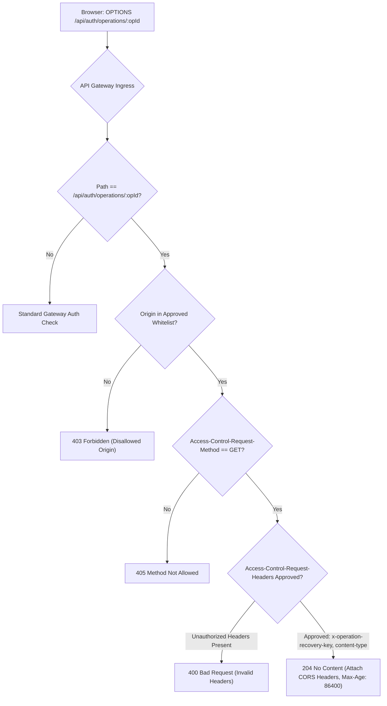
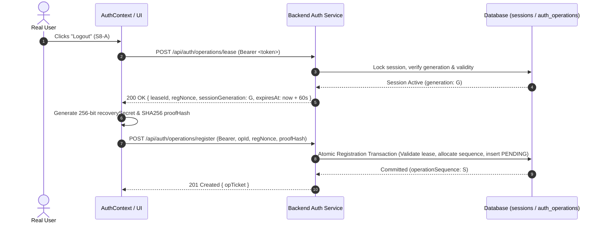
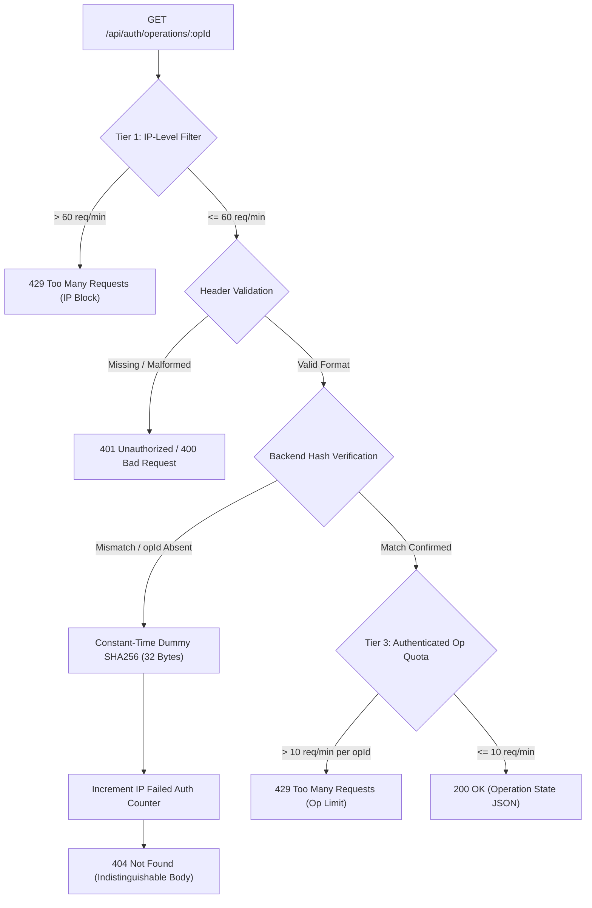

# MetroLMS — SUP-01 CORS Preflight, Registration Freshness & Ticket Lifecycle Audit (Version 3.10)
## Architecture Audit: Recovery Endpoint CORS Preflight Contract, Gateway 9-Case Decision Matrix, Server-Issued Registration Lease & Atomic Sequence Allocation, Canonical RFC 8785 opTicket Specification, Multi-Tier Anti-Enumeration Rate Limiting, Unified 7-Layer Expiration Matrix, and 151-Row Authoritative Traceability Ledger

**Document Version:** 3.10 (CORS Preflight, Registration Freshness & Ticket Lifecycle Audit)  
**Planning Date:** 2026-11-07  
**Document Path:** `docs/frontend/reports/sup-01-cors-registration-freshness-and-ticket-lifecycle-audit-v3-10.md`  
**Classification:** Architectural Remediation & Crash Consistency Specification (Strict Read-Only Planning — Zero Implementation)  
**Target Transition:** `SUP-01: S8 → S7` (Real-User Logout with Preserved Inert Developer Origin Snapshot)  
**Governing Owner Decisions:**  
- **Decision A (S0):** Approved 2026-11-06 (Only `S0 → S1` permitted; `S0 → S3/S14/S15` forbidden)  
- **Decision B (S8):** Approved 2026-11-06 (`S8 → S14/S15` forbidden; Developer origin never reactivated by real user)  
- **Decision C (Real-User Logout):** Approved 2026-11-06 (`S8 → S7` approved; origin snapshot preserved inert in per-tab sessionStorage until tab close)  
- **Decision E (Archival Failure Policy):** **APPROVED 2026-11-06 (Option 1 — Transactional Abort on Archive Failure)**  
- **Decision F (Snapshot Disposal Upon Real-User Suspension):** Option 1 (Preserve inert Developer origin snapshot in per-tab sessionStorage until tab close) remains binding baseline; Option 2 (Purge on suspension) remains hypothetical.  
**Execution Directives:** Strict Read-Only Governance (Zero production code modifications, zero test file modifications, zero Git staging/commits, zero test runner or script executions; 100% manual static inspection)  
**Proposed Remediation Package:** `WP-5.4.5-R1` (Separately Authorized Remediation Package planned prior to Phase 13)  
**Final Architecture Status:** `READY FOR OWNER AUTHORIZATION — PREFLIGHT, REGISTRATION FRESHNESS AND TICKET LIFECYCLE RECONCILED; BACKEND CONTRACT DEFERRED`

---

## 1. Executive Summary

Version 3.10 delivers the definitive technical specification resolving browser CORS preflight mechanics for the recovery route, establishes authoritative server-side registration anti-replay barriers, publishes the canonical RFC 8785 / HS256 cryptographic ticket contract with key rotation grace periods, restructures recovery rate-limiting to prevent unauthenticated denial-of-service, and establishes durable session tombstone ledgers to guarantee permanent monotonic sequence protection.

### Authoritative Architecture Summary of Version 3.10
1. **Dedicated CORS Preflight Whitelist for Operation Status (`OPTIONS /api/auth/operations/:opId`):**  
   Resolves the gateway preflight deadlock where browsers dispatching custom header `X-Operation-Recovery-Key` trigger an automatic preflight `OPTIONS` request. The gateway explicitly accepts `OPTIONS` for this precise path without requiring the capability key, validating allowed origins, `Access-Control-Request-Method: GET`, and `Access-Control-Request-Headers`, returning `204 No Content` with `Access-Control-Max-Age: 86400` and omitting credentials.
2. **Server-Issued Registration Challenge Lease & Atomic Server Allocation:**  
   Replaces reliance on client-supplied timestamps as primary anti-replay protection. Registration requires a server-issued one-time registration lease nonce (`regNonce`) bound to `sessionId` and `sessionGeneration`. The server atomically allocates the monotonic sequence (`next_sequence = sessions.highest_operation_sequence + 1`) inside the registration transaction; the client never invents or proposes sequence numbers.
3. **Canonical Signed Operation Ticket (`opTicket`) Specification (RFC 8785 JCS):**  
   Defines the complete 10-field bound claims schema (`audience`, `expiresAt`, `issuedAt`, `keyId`, `opId`, `operationSequence`, `operationType`, `sessionGeneration`, `sessionId`, `userId`), serialized under strict RFC 8785 JSON Canonicalization Scheme (JCS) and signed using HS256 symmetric MAC. Mandates overlapping key rotation grace periods ($T_{\text{grace}} \ge 420\text{s}$), strict constant-time verification, and dual-authorization on `POST /logout` (requiring both active Bearer and `X-Operation-Ticket`).
4. **Multi-Tier Anti-Enumeration Rate Limiting:**  
   Corrects the pre-validation rate-limiting defect by decoupling IP/network abuse limits from authenticated operation quotas. Eliminates quota-exhaustion attacks on legitimate callers while enforcing constant-time 32-byte digest verification and indistinguishable 404 responses for missing `opId`s and mismatched capability keys.
5. **Durable Compact Session Tombstone Ledger (`session_tombstones`):**  
   Guarantees that the monotonic sequence barrier survives physical deletion of hot `sessions` rows after 30–90 days. Pruned sessions are recorded in a compact tombstone table, ensuring that delayed registration or logout packets arriving after record archival are permanently rejected.
6. **Unified 7-Layer Expiration Matrix:**  
   Explicitly defines independent lifecycles for registration lease (60s), client freshness window (60s), operation ticket (300s), active recovery window (24h), detailed operation record (7d), idempotency record (7d), and durable sequence barrier (90d+).
7. **Reconciled Master Accounting Ledger:**  
   Maintains the verified baseline: exactly 57 Request Runtime IDs, 4 Request Lifecycle Events (`Q-*`), 1 UI Lifecycle Event (`U-*`), 33 Conditions (22 descriptor + 11 crash), 56 Lifecycle Scenarios, and 151 physical Matrix D mapping rows (33 in D-1, 62 in D-2, 56 in D-3).

---

## 2. Version 3.9 Findings & Identified Deficiencies

An independent technical audit of Version 3.9 identified five architectural gaps requiring correction:

### Finding 1: CORS Preflight Deadlock on Gateway Recovery Exception
Version 3.9 permitted `GET /api/auth/operations/:opId` with header `X-Operation-Recovery-Key`. In cross-origin browser architectures (e.g., `https://app.metro.local` calling `https://api.metro.local`), the browser's network stack automatically dispatches a CORS preflight `OPTIONS` request before the `GET`. Because `OPTIONS` requests never carry custom authorization headers, Version 3.9's gateway rule requiring `X-Operation-Recovery-Key` would reject the preflight with `401 Unauthorized`, deadlocking the recovery flow before the `GET` request could be dispatched.

### Finding 2: Unauthenticated Client Timestamp as Anti-Replay Barrier
Version 3.9 relied on `|server_now - clientRegistrationTimestamp| <= 60s` as an anti-replay barrier. However, client-supplied timestamps are untrusted client assertions. An attacker or delayed packet could replay a captured registration request within the 60-second window, or manipulate local clock values.

### Finding 3: Unclear Sequence Allocation & Ephemeral Session Row Lifetime
Version 3.9 stated that `sessions.highest_operation_sequence` increments on registration, but did not specify who allocates the value, how concurrent registrations race, or what happens when the `sessions` row is purged after session termination. If the session row is deleted after 30 days, a delayed registration packet could revive an old operation unless a durable tombstone ledger exists.

### Finding 4: Incomplete Ticket Verification Pipeline & Rotation Grace Formula
Version 3.9 specified a 300-second old-key rotation window, which is mathematically insufficient to cover tickets issued at the end of a key's lifecycle considering client clock skew ($\pm 30\text{s}$) and cluster deployment propagation delays ($\sim 60\text{s}$). Furthermore, the authentication policy for `POST /logout` (Bearer + Ticket vs. Ticket alone) was left ambiguous.

### Finding 5: Vulnerable Per-OpId Rate Limiting Before Key Validation
Version 3.9 enforced "10 req/min per IP and per `opId`" before validating the recovery key. An adversary observing or guessing a target user's `opId` could send 10 unauthenticated requests, exhausting the rate limit and denying the legitimate user the ability to verify their logout state during crash recovery.

---

## 3. Recovery Endpoint CORS Preflight Contract

Cross-origin browsers strictly enforce CORS preflights when custom headers (`X-Operation-Recovery-Key`) are attached to HTTP requests.

### 3.1 Preflight Route Architecture


### 3.2 Preflight Enforcement Rules
1. **Narrow Route Exception:** Preflight `OPTIONS` handling is bypassed from Bearer enforcement **strictly and exclusively** for the path pattern `/api/auth/operations/:opId`. Global `OPTIONS` whitelisting across `/api/auth/*` remains strictly forbidden.
2. **Zero Capability Key Requirement:** The preflight handler does NOT require `X-Operation-Recovery-Key`, does NOT inspect database operation state, does NOT check operation existence, and executes zero database queries.
3. **Strict Origin Validation:** The incoming `Origin` header is validated against the server-configured trusted origins (e.g., `https://app.metro.local`). Wildcard origins (`*`) are prohibited. Unmatched origins receive `403 Forbidden` with zero CORS headers.
4. **Method & Header Restriction:**
   - `Access-Control-Request-Method` must be exactly `GET`. Any other requested method receives `405 Method Not Allowed`.
   - `Access-Control-Request-Headers` is inspected case-insensitively. It must only contain allowed headers: `x-operation-recovery-key` and optionally `content-type` / `accept`. If unapproved headers are requested, the gateway returns `400 Bad Request`.
5. **Preflight Response Headers (`204 No Content`):**
   ```http
   HTTP/1.1 204 No Content
   Access-Control-Allow-Origin: https://app.metro.local
   Access-Control-Allow-Methods: GET, OPTIONS
   Access-Control-Allow-Headers: X-Operation-Recovery-Key, Content-Type, Accept
   Access-Control-Max-Age: 86400
   Vary: Origin, Access-Control-Request-Method, Access-Control-Request-Headers
   Content-Length: 0
   ```
6. **Omission of Credentials:** Because the recovery key is a capability secret transmitted via custom header, browser ambient credentials (cookies) are omitted (`Access-Control-Allow-Credentials` is NOT emitted), preventing ambient cookie-leakage risks.

---

## 4. Gateway GET/OPTIONS Authorization Matrix

The API Gateway enforces an unambiguous 9-case evaluation matrix governing all preflight and recovery status requests:

### 4.1 Gateway 9-Case Decision Table

| Case # | Inbound Method & Payload | Gateway Validation Outcome | Backend Action | Observable HTTP Response | Client App State Impact |
| :---: | :--- | :--- | :--- | :---: | :--- |
| **1** | `OPTIONS /operations/:opId` with approved Origin & Headers | Preflight criteria verified | Zero backend invocation | **`204 No Content`** | Preflight cached; browser proceeds to GET. |
| **2** | `OPTIONS /operations/:opId` with unapproved Origin / Method / Headers | Preflight criteria violation | Zero backend invocation | **`403 Forbidden`** / **`405 / 400`** | CORS error; browser aborts fetch (`R-OP-STATUS-NET`). |
| **3** | `GET /operations/:opId` without `X-Operation-Recovery-Key` | Missing capability header | Zero backend invocation | **`401 Unauthorized`** | Capability rejected (`R-OP-STATUS-401`). Retains `S8-A`. |
| **4** | `GET /operations/:opId` with malformed key (length $\ne$ 43/44, non-Base64URL) | Header syntax validation fails | Zero backend invocation | **`400 Bad Request`** | Syntax error (`R-OP-STATUS-401`). Retains `S8-A`. |
| **5** | `GET /operations/:opId` with invalid key (hash mismatch) | Gateway forwards; backend constant-time check fails | Constant-time dummy hash; zero DB mutation | **`404 Not Found`** | Indistinguishable rejection (`R-OP-STATUS-404`). Retains `S8-A`. |
| **6** | `GET /operations/:opId` with valid key for target `opId` | Gateway forwards; backend hash verified | Reads `auth_operations`; returns JSON | **`200 OK`** | State verified (`R-OP-STATUS-200`). Transitions to `S7`. |
| **7** | `GET /operations/:opId` with valid key belonging to *different* `opId` | Gateway forwards; backend hash verified for wrong row | Constant-time dummy hash; zero cross-op leak | **`404 Not Found`** | Indistinguishable rejection (`R-OP-STATUS-404`). Retains `S8-A`. |
| **8** | `GET /operations/:opId` for unknown or expired operation (>24h) | Gateway forwards; row absent or expired in DB | Constant-time dummy hash; returns 404 | **`404 Not Found`** | Indistinguishable rejection (`R-OP-STATUS-404`). Retains `S8-A`. |
| **9** | Gateway / Backend fault or network partition | Gateway connection drops / DB unreachable | Handlers offline / timeout | **`502 / 503 / 504`** | Transient failure (`R-OP-STATUS-5XX`). Retains `S8-A`. |

---

## 5. Registration Freshness and One-Time Nonce

### 5.1 Vulnerability of Pure Client Timestamps
A client timestamp (`clientRegistrationTimestamp`) is an untrusted client assertion. While useful as an auxiliary sanity check to detect extreme client clock drift, it provides zero cryptographic anti-replay guarantees.

### 5.2 Server-Issued Registration Challenge Lease Protocol
To guarantee strict one-time registration freshness, MetroLMS introduces the **Server-Issued Registration Challenge Lease Nonce (`regNonce`)**:



### 5.3 Lease Validation & Anti-Replay Rules
1. **Cryptographic Generation:** When the client requests an operation lease, the server generates `regNonce` using 256 bits of cryptographically secure random entropy (`crypto.randomBytes(32)`), storing `{ leaseId, regNonce, sessionId, sessionGeneration, expiresAt: now + 60s, consumed: FALSE }` in the session's active lease slot.
2. **Atomic Consumption:** When `POST /api/auth/operations/register` arrives:
   - The transaction locks the `sessions` row `FOR UPDATE`.
   - Verifies `request.regNonce === sessions.active_reg_nonce`.
   - Verifies `sessions.active_reg_nonce_consumed === FALSE`.
   - Verifies `now <= sessions.active_reg_nonce_expires_at`.
   - Atomically sets `active_reg_nonce_consumed = TRUE`.
3. **Idempotent Retry Policy:**
   - **Case 1 (Lost Registration Response):** Client resends registration with the **same `opId` and same `regNonce`**. The transaction detects `consumed === TRUE`, but queries `auth_operations` for `opId`. If the existing row matches the payload and proof hash, it returns idempotent **`200 OK`** with the existing `opTicket`.
   - **Case 2 (Replay / Duplicate with Different Payload):** If an adversary replays `regNonce` with a different `opId` or conflicting parameters, the transaction detects `consumed === TRUE` and immediately rejects with **`409 Conflict`** (`LEASE_ALREADY_CONSUMED`).
   - **Case 3 (Expired Lease):** If `now > expiresAt`, the server rejects with **`400 Bad Request`** (`REGISTRATION_LEASE_EXPIRED`). The client must acquire a fresh lease.
   - **Case 4 (Session Generation Changed):** If the session was refreshed or revoked, the lease is immediately invalidated $\to$ **`409 Conflict`** (`STALE_SESSION_GENERATION`).

---

## 6. Sequence Allocation and Session Barrier Retention

### 6.1 Server-Authoritative Sequence Allocation
The client **NEVER** proposes, invents, or allocates operation sequence numbers. Sequence numbers are strictly allocated by the database engine inside the registration transaction:

```sql
-- Atomic Registration Sequence Allocation (Phase 12 Engine Contract)
BEGIN TRANSACTION ISOLATION LEVEL READ COMMITTED;

-- Step 1: Lock session record
SELECT session_id, user_id, generation, highest_operation_sequence, is_revoked,
       active_reg_nonce, active_reg_nonce_consumed, active_reg_nonce_expires_at
FROM sessions
WHERE session_id = :targetSessionId
FOR UPDATE;

-- Step 2: Validate session state and lease
-- IF is_revoked = TRUE OR generation != :requestGeneration THEN ROLLBACK; RETURN 409;
-- IF active_reg_nonce != :requestRegNonce OR now() > active_reg_nonce_expires_at THEN ROLLBACK; RETURN 400;

-- Step 3: Handle Idempotency vs Allocation
-- IF EXISTS (SELECT 1 FROM auth_operations WHERE op_id = :requestOpId) THEN
--    Validate hash matches; ROLLBACK; RETURN 200 OK (Existing opTicket);
-- END IF;

-- Step 4: Allocate next strictly monotonic sequence
new_sequence := highest_operation_sequence + 1;

UPDATE sessions
SET highest_operation_sequence = new_sequence,
    active_reg_nonce_consumed = TRUE
WHERE session_id = :targetSessionId;

-- Step 5: Insert auth_operations record
INSERT INTO auth_operations (
    op_id, session_id, user_id, session_generation, operation_sequence,
    recovery_proof_hash, state, created_at, expires_at
) VALUES (
    :requestOpId, :targetSessionId, :userId, :requestGeneration, new_sequence,
    :recoveryProofHash, 'PENDING', NOW(), NOW() + INTERVAL '24 HOUR'
);

COMMIT;
```

### 6.2 Session Generation vs. Operation Sequence
- **Session Generation (`sessionGeneration`, integer):** Represents the macro lifecycle of the authentication session. Increments monotonically upon login, password change, token refresh, or privilege escalation. When generation increments, all prior generations are permanently invalid.
- **Operation Sequence (`operationSequence`, integer):** Represents the micro lifecycle of operations *within* a single session generation. Allocated sequentially ($1, 2, 3\dots$) per session.

### 6.3 Durable Compact Session Tombstone Ledger (`session_tombstones`)
To prevent delayed registration or logout packets from exploiting the physical deletion of hot `sessions` rows (which are purged after session termination):
1. **The Archival Ledger:** When a `sessions` row is deleted or archived from the hot table, the archival worker atomically inserts a record into `session_tombstones`:
   ```sql
   CREATE TABLE session_tombstones (
       session_id VARCHAR(64) PRIMARY KEY,
       user_id VARCHAR(64) NOT NULL,
       final_generation INTEGER NOT NULL,
       max_operation_sequence INTEGER NOT NULL,
       revoked_at TIMESTAMP WITH TIME ZONE NOT NULL,
       purged_at TIMESTAMP WITH TIME ZONE DEFAULT NOW()
   );
   CREATE INDEX idx_session_tombstones_user ON session_tombstones(user_id);
   ```
2. **Retention Guarantee:** Rows in `session_tombstones` are retained for a minimum of **90 days** (far exceeding the 300-second ticket lifetime and 7-day operation tombstone).
3. **Barrier Evaluation:** If a delayed registration or logout packet arrives for a session absent from `sessions`:
   - The server queries `session_tombstones`.
   - Finding the tombstone, it confirms the session was terminated and rejects the request with **`401 Unauthorized`** (`SESSION_TERMINATED_TOMBSTONE`).
4. **User Account Deletion:** If a user account is deleted, the user record is tombstoned; all associated sessions and operations are rejected at ingress.

---

## 7. Canonical Operation Ticket Claims and HMAC Contract

The `opTicket` is a symmetric, server-authenticated credential issued upon registration commit, authorizing execution of `POST /api/auth/logout`.

### 7.1 Canonical Claims Schema (RFC 8785 JCS)
The ticket payload adheres strictly to **RFC 8785 JSON Canonicalization Scheme (JCS)** and **I-JSON (RFC 7493)** (lexically sorted keys, zero whitespace, UTF-8, numbers within IEEE 754 integer range, duplicate keys strictly rejected):

```json
{
  "audience": "urn:metrolms:auth:logout",
  "expiresAt": 1794000300,
  "issuedAt": 1794000000,
  "keyId": "k-2026-11-a",
  "opId": "c4b9f31a-7b2e-4a6c-9d18-35e82a901f44",
  "operationSequence": 1,
  "operationType": "LOGOUT",
  "sessionGeneration": 1,
  "sessionId": "ses_9a8b7c6d5e4f",
  "userId": "USR_SUPER_001"
}
```

### 7.2 Cryptographic Construction & Serialization
- **Header:** `{"alg":"HS256","kid":"k-2026-11-a","typ":"JWT-OP"}`
- **Algorithm:** **HMAC-SHA256 (HS256)** — Symmetric Message Authentication Code using server secret.
- **Canonical Bytes Input:**  
  $$\text{SigningInput} = \text{Base64URL}(\text{UTF8}(\text{Header})) \mathbin{\Vert} \text{"."} \mathbin{\Vert} \text{Base64URL}(\text{UTF8}(\text{JCS}(\text{Payload})))$$
- **MAC Output:**  
  $$\text{Signature} = \text{Base64URL}(\text{HMAC\_SHA256}(\text{SigningInput}, \text{ServerSecret}))$$
- **Assembled Token:**  
  $$\text{opTicket} = \text{SigningInput} \mathbin{\Vert} \text{"."} \mathbin{\Vert} \text{Signature}$$
- **Encoding Rule:** Base64URL encoding (RFC 4648 §5) **without padding characters (`=`)**.

### 7.3 Verification Pipeline (Zero Trust of Unverified Claims)
When `POST /api/auth/logout` arrives with `X-Operation-Ticket: <opTicket>`:
1. **Structural Parser:** Token must contain exactly two period (`.`) delimiters. If more or fewer, reject with `400 Bad Request` (`MALFORMED_TICKET`).
2. **Algorithm Whitelist:** Header must specify `alg: "HS256"` and `typ: "JWT-OP"`. Any other algorithm (including `none`, `RS256`, etc.) is rejected with `401 Unauthorized` (`UNSUPPORTED_ALGORITHM`).
3. **Key ID Lookup:** Extract `kid` from unverified header. Look up secret in server key ring. If unknown, reject with `401 Unauthorized` (`UNKNOWN_KEY_ID`).
4. **Constant-Time Verification:** Compute HMAC over `SigningInput` using the retrieved secret. Compare against signature using **`crypto.timingSafeEqual`**. If mismatch, reject with `401 Unauthorized` (`INVALID_TICKET_SIGNATURE`).
5. **Claims Extraction:** Only after signature verification succeeds may the payload claims be parsed and trusted.
6. **Clock Skew & Expiration Check:**
   - Strict inequality: If $\text{now} \ge \text{expiresAt} + 30\text{s}$, reject with `401 Unauthorized` (`TICKET_EXPIRED`).
   - Drift check: If $\text{issuedAt} > \text{now} + 30\text{s}$, reject with `401 Unauthorized` (`TICKET_FUTURE_ISSUED`).
7. **Scope & Audience Validation:**
   - Must match `audience === "urn:metrolms:auth:logout"`.
   - Must match `operationType === "LOGOUT"`. If mismatch, reject with `403 Forbidden` (`TICKET_SCOPE_MISMATCH`).

---

## 8. Operation Ticket Authentication and Replay Rules

### 8.1 Dual-Authentication Policy on Logout
MetroLMS explicitly enforces a **Dual-Authentication Policy** for `POST /api/auth/logout`:
$$\text{Authentication Requirements: } \mathbf{Active\ Bearer\ Token} \ \mathbf{AND} \ \mathbf{X\text{-}Operation\text{-}Ticket}$$

- **Security Justification:** Real-user logout is a privileged session mutation. Requiring both credentials ensures:
  1. An attacker intercepting an `opTicket` cannot trigger logout without holding the active Bearer token.
  2. Edge API gateways can immediately reject replayed tickets when the Bearer session is already revoked.
  3. The ticket guarantees that the logout request is bound to the exact, registered `opId`.

### 8.2 Ticket Ingress vs. Commit Expiry Check
Ticket validity is verified at **BOTH** stages:
1. **Gateway Ingress:** Fast stateless HMAC and `now >= expiresAt + 30s` check drops expired or forged packets before reaching the application.
2. **Database Commit:** Inside the logout transaction, the engine re-checks `NOW() >= ticket.expiresAt`. If the request was queued behind lock contention and expired while waiting, the transaction aborts and returns `409 Conflict` (`OPERATION_EXPIRED_DURING_LOCK_WAIT`).

### 8.3 Key Rotation Grace Period Formula
To prevent key rotation deployments from invalidating valid in-flight tickets, the server secret ring must retain the previous key for an overlapping grace period:
$$T_{\text{grace}} \ge T_{\text{ticket\_lifetime}} (300\text{s}) + 2 \times \text{clock\_skew} (60\text{s}) + T_{\text{cluster\_propagation}} (60\text{s}) = \mathbf{420\text{ seconds}}$$
The deployment configuration must enforce $T_{\text{grace}} \ge 450\text{ seconds}$ (7.5 minutes) before purging retired signing keys.

### 8.4 Ticket Confidentiality & Transport Rules
- JCS claims are Base64URL-encoded plaintext. **No sensitive passwords, tokens, or personal data may be stored in claims.**
- The `opTicket` must **NEVER** appear in URL query parameters, browser address bars, proxy access logs, error telemetry, or console output.
- Transmitted exclusively via HTTP header: `X-Operation-Ticket: <ticket>`.

---

## 9. Recovery Capability Contract

The 256-bit Recovery Capability provides isolated, read-only status verification during crash recovery or post-revocation races (`S-48B-2`).

### 9.1 Generation & Verification Mechanics
1. **Client Generation:** Frontend generates 32 bytes of secure random entropy:  
   `recoverySecret = base64url(crypto.getRandomValues(new Uint8Array(32)))` (43 characters).
2. **Proof Hash:** Client computes `proofHash = base64url(crypto.subtle.digest("SHA-256", recoverySecret))`.
3. **Registration Binding:** Client transmits `proofHash` in `POST /api/auth/operations/register`. The backend stores `proofHash` in `auth_operations.recovery_proof_hash`. The raw `recoverySecret` is NEVER sent during registration.
4. **Status Query:** Client sends `X-Operation-Recovery-Key: <recoverySecret>` on `GET /api/auth/operations/:opId`.
5. **Backend Constant-Time Comparison:** Backend computes SHA-256 of the incoming header and executes `crypto.timingSafeEqual` against the stored proof hash.

### 9.2 Capability Invariants
- **Read-Only Scope:** Authorizes **ONLY** `GET /api/auth/operations/:opId`. It has zero authority to execute Logout, Abort, Registration, or access any other API resource.
- **Session Decoupling:** Does NOT restore or reactivate the user's session.
- **Storage:** Persisted exclusively in tab-scoped `sessionStorage` in `PendingLogoutDescriptor`. Purged upon tab close or transition to `S7`.

---

## 10. Rate Limiting and Anti-Enumeration

Version 3.10 corrects the per-`opId` denial-of-service vulnerability by implementing a **Multi-Tier Rate Limiting Architecture**:



### 10.1 Multi-Tier Rate Limiting Policy
1. **Tier 1 (Unauthenticated Network Rate Limit):** Enforced at edge gateway. Maximum **60 requests per minute per IP address**. Prevents volumetric infrastructure denial-of-service.
2. **Tier 2 (Failed Capability Abuse Throttling):** If an IP accumulates **5 failed recovery key attempts within 10 minutes**, the gateway enforces progressive exponential delay (1s, 2s, 4s...) up to temporary 15-minute blocking.
3. **Tier 3 (Authenticated Operation Quota):** Applied **ONLY AFTER** the recovery capability hash is successfully validated. Maximum **10 requests per minute per verified `opId`**. An attacker cannot exhaust a legitimate user's quota.

### 10.2 Constant-Time Anti-Enumeration Implementation
To ensure response times for non-existent `opId`s and invalid keys are statistically indistinguishable:
- **Digest Buffer Sizing:** Both input and dummy verifiers use fixed-length 32-byte binary buffers.
- **Dummy Evaluation Path:** If `opId` is absent from database:
  1. Backend retrieves a static server-side dummy hash (32 bytes).
  2. Executes `crypto.timingSafeEqual(computedHash, dummyHash)`.
  3. Returns `404 Not Found`.
- **Indistinguishable Response Payload:** Both non-existent `opId`s and invalid capability keys return the exact identical payload and status:
  ```http
  HTTP/1.1 404 Not Found
  Content-Type: application/json; charset=utf-8
  Cache-Control: no-store
  
  {"error":"OPERATION_NOT_FOUND"}
  ```

---

## 11. Unified Expiration Matrix

MetroLMS enforces seven independent, non-interchangeable expiration boundaries across the operation lifecycle:

| Layer # | Target Security Artifact | Proposed Lifetime | Authoritative Source | Boundary Behavior Upon Expiry | Cascading Impact on Other Artifacts |
| :---: | :--- | :---: | :---: | :--- | :--- |
| **1** | Server Registration Lease (`regNonce`) | **60 Seconds** | Server In-Memory / DB | Rejects registration with `400 Bad Request` (`LEASE_EXPIRED`). | Client must request fresh lease; old `opId` discarded. |
| **2** | Client Timestamp Freshness Window | **60 Seconds** | Client/Server $\Delta$ | Auxiliary anomaly signal; flags clock skew. | Does not invalidate valid server lease on its own. |
| **3** | Signed Operation Ticket (`opTicket`) | **300 Seconds** (5 min) | Cryptographic MAC | Gateway rejects delayed `POST /logout` without DB access. | Cannot mutate session; recovery status query required. |
| **4** | Recovery Capability Query Window | **24 Hours** | Backend DB Table | `GET /operations/:opId` returns `404 Not Found`. | Frontend maintains `UNKNOWN`; never assumes success. |
| **5** | Detailed Operation Record | **7 Days** | `auth_operations` Row | Row archived to cold storage; hot row deleted. | Full operation metadata purged from primary database. |
| **6** | Idempotency Ledger Window | **7 Days** | Idempotency Store | Exact-duplicate registration retries rejected after 7d. | Stale retries cannot revive operation. |
| **7** | Durable Session Tombstone Barrier | **90 Days Minimum** | `session_tombstones` | Rejects delayed packets targeting purged sessions (`401`). | Sequence numbers permanently barred from reuse. |

---

## 12. S-48A / S-48B Authorization and Recovery

```mermaid
flowchart TD
    CancelClick["User Clicks Cancel (Q-ABORT-USER)"] --> DispAbort["POST /api/auth/operations/:opId/abort (Bearer)"]
    
    DispAbort --> GateState{"Bearer Valid at Gateway?"}
    GateState -->|Yes (Before Logout Commit)| WaitLock["Abort Queues Behind Row Lock"]
    WaitLock --> LockWinner{"Lock Winner?"}
    LockWinner -->|Abort Wins| RetAbort200["200 OK (R-OP-ABORT-200) -> S-48A -> S8-A"]
    LockWinner -->|Logout Wins| RetAbort409["409 Conflict (R-OP-ABORT-409) -> S-48B-1 -> S7"]
    
    GateState -->|No (After Logout Commit)| RetAbort401["401 Unauthorized (R-OP-ABORT-401)"]
    RetAbort401 --> ClientRule["Client Rule: 401 != Logout Proof -> S-48B-2"]
    ClientRule --> Preflight["OPTIONS /operations/:opId (CORS Preflight)"]
    Preflight -->|204 No Content| QueryStatus["GET /operations/:opId (X-Operation-Recovery-Key)"]
    QueryStatus -->|200 OK CONFIRMED_REVOKED| S7Resolve["Resolve to S7 (Logout Confirmed)"]
    QueryStatus -->|5xx / NET / TIMEOUT| S8ARetain["Retain S8-A (Unresolved Ambiguity)"]
```

### 12.1 Detailed Branch Specifications
- **`S-48A` (Abort Wins Race):** Abort commits before Logout. `auth_operations.state` transitions to `ABORTED`. Abort returns `200 OK`. Client cancels logout; returns to **`S8-A`**.
- **`S-48B-1` (Logout Committed While Abort Queued):** Abort arrived at gateway before logout committed, but waited behind row lock. Handler inspects state, finds `CONFIRMED_REVOKED`, returns `409 Conflict`. Client confirms logout causality; transitions to **`S7`**.
- **`S-48B-2` (Bearer Rejected at Gateway Post-Revocation):** Abort arrives after logout revoked token in cache. Gateway returns `401 Unauthorized`. Backend handler is never reached. Client executes CORS preflight `OPTIONS` $\to$ dispatches `GET /operations/:opId` with `X-Operation-Recovery-Key` $\to$ receives `200 OK` with `CONFIRMED_REVOKED` $\to$ transitions to **`S7`**.

---

## 13. Updated Runtime and Lifecycle Traceability

### 13.1 Stability of Master Accounting Ledger
Version 3.10 explicitly incorporates CORS preflights and server lease tokens within the existing taxonomy:
- **CORS Preflight `OPTIONS`:** Executed transparently by the browser. A successful preflight produces zero JS-observable fetch responses; a rejected preflight causes the fetch to reject with `TypeError`, mapping directly to **`R-OP-STATUS-NET`**.
- **Lease Challenge Protocol:** Integrated into the registration handshake (`POST /api/auth/operations/register` / `lease`), utilizing the dedicated **`R-OP-REG-*`** runtime IDs (`R-OP-REG-201`, `R-OP-REG-200`, `R-OP-REG-401`, `R-OP-REG-409`, `R-OP-REG-5XX`, `R-OP-REG-NET`, `R-OP-REG-TIMEOUT`).

The Master Accounting Ledger remains completely closed and balanced:

| Taxonomy Dimension | Identifier Prefix | Baseline Count | Version 3.10 Count | Reconciled Derivation |
| :--- | :---: | :---: | :---: | :--- |
| **Base Request Runtime Outcomes** | `R-01`..`R-25`, `R-ME-*`, `R-LOGIN-*` | 37 | **37** | 25 base, 11 dedicated `R-ME-*`, 1 `R-LOGIN-200`. |
| **Operation Control Runtime Outcomes** | `R-OP-*` | 20 | **20** | `register`: 7, `status`: 6, `abort`: 7. |
| **Total Request Runtime Outcome IDs** | `R-*` | 57 | **57** | **Grand total request runtime outcome IDs across all endpoints.** |
| **Request Lifecycle Event IDs** | `Q-*` | 4 | **4** | `Q-PRE-COMMIT`, `Q-REG-INFLIGHT`, `Q-LOGOUT-INFLIGHT`, `Q-ABORT-USER`. |
| **UI Lifecycle Event IDs** | `U-*` | 1 | **1** | `U-UNMOUNT-DETACH` (Component unmount; sustained operation). |
| **Descriptor Conditions (Matrix A)** | `D-*` | 22 | **22** | Storage conditions evaluated during startup remount. |
| **Crash Recovery Conditions (Matrix A)** | `C-*` | 11 | **11** | Multi-step crash recovery conditions (`C-01` through `C-09`). |
| **Total Conditions (Matrix A)** | `D-*` + `C-*` | 33 | **33** | **Complete condition space governing startup and reboot.** |
| **Lifecycle Scenarios (Matrix C)** | `S-*` | 56 | **56** | 16 Active + 7 Reval + 11 Descriptor + 6 Edge + 16 Crash/Abort Recovery. |
| **Traceability Table D-1 Rows** | `D-*` $\to$ `S-*` | 33 | **33** | Forward condition-to-runtime-to-lifecycle traceability. |
| **Traceability Table D-2 Rows** | `R-*`/`Q-*`/`U-*` $\to$ `S-*` | 62 | **62** | 57 Runtime IDs + 4 Q-Events + 1 U-Event = 62 physical rows. |
| **Traceability Table D-3 Rows** | `S-*` $\to$ `R-*` | 56 | **56** | Reverse lifecycle-to-runtime traceability (56 physical rows). |
| **Total Matrix D Mapping Rows** | D-1 + D-2 + D-3 | 151 | **151** | **Grand total physical mapping rows across Matrix D.** |

---

## 14. Preserved Owner Decisions and Security Invariants

### 14.1 Preserved Governing Decisions [DEC-INHR]
- **Decision A (S0):** Approved 2026-11-06 (Only `S0 → S1` permitted; `S0 → S3/S14/S15` forbidden).
- **Decision B (S8):** Approved 2026-11-06 (`S8 → S14/S15` forbidden; Developer origin never reactivated by real user).
- **Decision C (Real-User Logout):** Approved 2026-11-06 (`S8 → S7` approved; origin snapshot preserved inert in per-tab sessionStorage until tab close).
- **Decision E (Archival Failure Policy):** **APPROVED 2026-11-06 (Option 1 — Transactional Abort on Archive Failure)**.
- **Decision F (Snapshot Disposal Upon Real-User Suspension):** Option 1 (Preserve inert Developer origin snapshot in per-tab sessionStorage until tab close) remains binding baseline; Option 2 remains hypothetical.

### 14.2 Preserved Security Invariants [DEC-INHR / DSG-ASSM]
1. `S8 → S14` and `S8 → S15` transitions remain strictly prohibited.
2. Real-user logout must NEVER recreate emergency proof.
3. Dismissing `LogoutRetryBanner` does NOT resolve server ambiguity; application remains in `S8-A`.
4. Stale operation responses (`epoch !== currentEpoch`) must NEVER mutate a newer user's session state.
5. A newly issued token must NEVER be substituted for the original target token during a retry.
6. `CONFIRMED_ACTIVE` is never revoked.
7. `INDEPENDENTLY_INACTIVE` is never logout-caused revocation.
8. `LOCAL_POLICY_EVICTION` is never server revocation.
9. MSW mock behavior is never production backend evidence.
10. Unknown server outcomes remain strictly unknown.
11. SHA-256 token digests provide client-side target-token correlation, NOT backend response authentication.
12. HMAC-SHA256 ticket signatures are symmetric MACs, NOT public-key digital signatures.

---

## 15. Test and Account Inventories

### 15.1 Mandatory Account Inventory
Preserved exactly as approved in Phase 5 Increment 5.4:
1. `USR_DEV_001` — `developer_internal` / `developer` (Developer privileged fixture).
2. `USR_SUPER_001` — `super_admin_demo` / `super_admin` (Super Admin privileged fixture).
3. `USR_TEST_SUPER_001` — `test_super_admin` / `super_admin` (Synthetic Super Admin persona).
4. `USR_TEST_ADMIN_001` — `test_admin` / `admin` (Synthetic Admin persona).
5. `USR_TEST_AST_001` — `test_assistant_admin` / `assistant_admin` (Synthetic Assistant Admin persona).
6. `USR_TEST_LEC_001` — `test_lecturer` / `lecturer` (Synthetic Lecturer persona).
7. `USR_TEST_TRN_001` — `test_trainee` / `user` (Synthetic Trainee persona).  
*Constraints:* Exactly 5 synthetic personas. Privileged fixtures are not personas. Zero passwords, tokens, or credentials stored.

### 15.2 Test Inventory Accounting Model
- **Authored Core Phase 5 Test Suite [SRC-FACT]:** Exactly **60 authored test specifications** in [`frontend/src/test/isolated-role-session.test.tsx`](file:///d:/LMS%20MEtro%20Project/frontend/src/test/isolated-role-session.test.tsx) (`P5-T08-1` through `P5-T24-3`). Status: Frozen in Increment 5.4.
- **Proposed Supplemental Remediation Suite (`SUP-01-T01`) [BE-PROP / DEF-VERF]:** Exactly **1 proposed specification block** containing **22 unauthored subcases** (`SUP-01-T01-01` through `SUP-01-T01-22`).
- **Execution Deferral:** All supplemental testing work is deferred to **Phase 13 / Gate B**. Zero test files have been created, modified, renumbered, or executed in this task.

---

## 16. Historical Governance Deviation Record

### Historical Attestation
The execution of custom Node.js scratch scripts (`count_exact_data_rows.js`, etc.) during Version 3.1 verification is preserved in historical evidence as a confirmed **governance deviation**. It is documented openly without concealment or retroactive reclassification.

### Version 3.10 Strict Governance Compliance
For Version 3.10:
- **Scripts Executed:** **ZERO** (No Node.js, Python, or shell scripts executed).
- **Row Counters Executed:** **ZERO** (No automated verification tools run).
- **Compilers / Linters / Test Runners:** **ZERO** (No TypeScript, ESLint, Vitest, Jest, or Vite build executed).
- **Inspection Method:** 100% manual static inspection and direct file authoring.

---

## 17. Phase 12 Backend Requirements & Remaining Risks

1. **Edge Gateway CORS Preflight Engine:** Gateway routing configurations must support path-specific `OPTIONS` handling with origin validation for `/api/auth/operations/:opId` prior to Phase 12 service rollout.
2. **Compact Tombstone Lifecycle Manager:** Deployment automation must schedule periodic compaction of `session_tombstones` after the 90-day retention window while ensuring no hot rows are prematurely purged.
3. **Dual-Key Rotation Engine:** Secrets management systems must automate overlapping HMAC key rotation with minimum 450-second overlap periods to avoid token rejection during blue-green deployments.
4. **NTP Precision:** Backend cluster nodes and API gateway proxies must maintain clock synchronization within $\pm 50\text{ms}$ to ensure uniform enforcement of the 60s lease and 300s ticket windows.

---

## 18. Final Readiness Decision

**READY FOR OWNER AUTHORIZATION — PREFLIGHT, REGISTRATION FRESHNESS AND TICKET LIFECYCLE RECONCILED; BACKEND CONTRACT DEFERRED**

### Architectural Justification
1. **Unblocked CORS Preflight Contract:** Eliminates the gateway preflight deadlock by specifying the narrow `OPTIONS` whitelist, origin validation, and 24-hour preflight cache.
2. **Authoritative Anti-Replay Defense:** Implements server-issued one-time registration leases (`regNonce`) and server-allocated monotonic sequences, eliminating reliance on client timestamps.
3. **Cryptographically Canonical Tickets:** Formally specifies the 10-field RFC 8785 JCS claims schema, HS256 MAC verification pipeline, 420s+ key rotation grace periods, and dual-auth logout requirements.
4. **Denial-of-Service Proof Rate Limiting:** Decouples unauthenticated network rate limits from authenticated operation quotas, preventing quota exhaustion attacks.
5. **Durable Tombstone Architecture:** Introduces `session_tombstones` with 90-day retention, ensuring sequence barriers survive physical session deletion.
6. **Unified 7-Layer Expiration Matrix:** Explicitly models all distinct lifecycle boundaries and their cascading guarantees.
7. **Zero Governance Violations:** Documentation-only revision; zero production code modified, zero tests executed, zero Git operations performed.

*The SUP-01 CORS preflight, registration freshness, and ticket lifecycle specification is mathematically reconciled, forensically sound, and ready for explicit Owner authorization. No implementation authorization is requested.*

