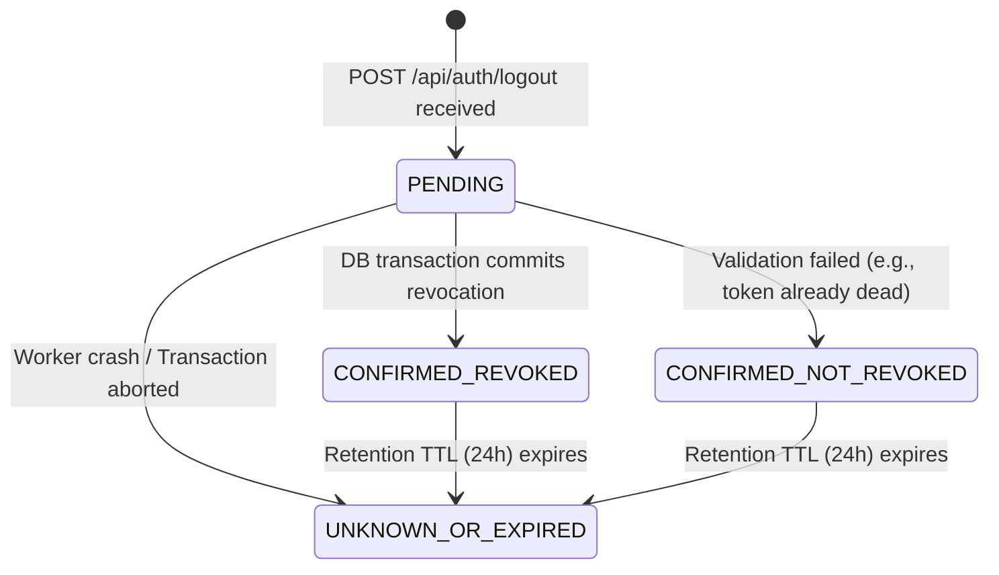

# MetroLMS — SUP-01 Durable Acknowledgement & Runtime Semantics Audit (Version 3.4)
## Architecture Audit: Client-Side Acknowledgement Record Limitations, Authoritative Backend Operation-Status Recovery Contract, Decoupled Session Validity and Causal Attribution, S-41 In-Flight Race Serialization, R-11/R-ME-REDIRECT Reconciliation, and Reconciled Multi-Step Crash Consistency

**Document Version:** 3.4 (Durable Acknowledgement & Runtime Semantics Reconciliation)  
**Planning Date:** 2026-11-06  
**Document Path:** `docs/frontend/reports/sup-01-durable-acknowledgement-and-runtime-semantics-audit-v3-4.md`  
**Classification:** Architectural Remediation & Crash Consistency Specification (Strict Read-Only Planning — Zero Implementation)  
**Target Transition:** `SUP-01: S8 → S7` (Real-User Logout with Preserved Inert Developer Origin Snapshot)  
**Governing Owner Decisions:**  
- **Decision A (S0):** Approved 2026-11-06 (Only `S0 → S1` permitted; `S0 → S3/S14/S15` forbidden)  
- **Decision B (S8):** Approved 2026-11-06 (`S8 → S14/S15` forbidden; Developer origin never reactivated by real user)  
- **Decision C (Real-User Logout):** Approved 2026-11-06 (`S8 → S7` approved; origin snapshot preserved inert in per-tab sessionStorage until tab close)  
- **Decision E (Archival Failure Policy):** **APPROVED 2026-11-06 (Option 1 — Transactional Abort on Archive Failure)**  
- **Decision F (Snapshot Disposal Upon Real-User Suspension):** Option 1 (Preserve inert Developer origin snapshot in per-tab sessionStorage until tab close) remains binding baseline; Option 2 (Purge on suspension) remains hypothetical.  
**Execution Directives:** Strict Read-Only Governance (Zero production code modifications, zero test file modifications, zero Git staging/commits, zero test runner or script executions; 100% manual static inspection)  
**Proposed Remediation Package:** `WP-5.4.5-R1` (Separately Authorized Remediation Package planned prior to Phase 13)  
**Final Architecture Status:** `READY FOR OWNER AUTHORIZATION — ACKNOWLEDGEMENT AND RUNTIME SEMANTICS RECONCILED; BACKEND CONTRACT DEFERRED`

---

## 1. Executive Summary

Version 3.4 delivers the final architectural correction of the SUP-01 frontend security architecture, resolving the storage durability, backend recovery authority, in-flight race serialization, and runtime taxonomy gaps identified in Version 3.3.

Version 3.3 introduced two vital concepts:
1. Formally separating completed request outcomes from interrupted request events.
2. Decoupling current server session validity from logout-causal attribution.

Version 3.4 preserves both foundations while correcting a fundamental storage assumption: **a synchronous `sessionStorage.setItem()` write is not a durable, crash-proof, or tamper-proof acknowledgement**. Web Storage operates within browser-process memory buffers that can be lost on OS crashes, destroyed upon tab closure, or mutated by same-origin scripts. Consequently, a client-side marker cannot independently authenticate a backend outcome or prove logout causality across a reboot.

### Authoritative Architecture Summary of Version 3.4
1. **Reclassification of `metro_lms_logout_ack`:**  
   Renamed to **`Client-Side Logout Acknowledgement Record`**. It serves strictly as a *local recovery hint* recording what the client previously observed. It is neither durable nor tamper-proof and **cannot independently establish `LOGOUT_CAUSED_REVOCATION_CONFIRMED`**.
2. **Backend Operation Status as Sole Authoritative Recovery (`GET /api/auth/operations/:opId`):**  
   Promotes the proposed Phase 12 endpoint to the primary authoritative recovery mechanism. Defines the operation record schema, 4-state lifecycle machine (`PENDING`, `CONFIRMED_REVOKED`, `CONFIRMED_NOT_REVOKED`, `UNKNOWN_OR_EXPIRED`), idempotency rules, and 24-hour retention policy. When this endpoint is unavailable or expired, causality strictly remains **`REVOCATION_CAUSE_UNKNOWN`**.
3. **Corrected Crash Windows (`S-42A`, `S-42B`, `S-43A`, `S-43B`):**  
   In all four crash scenarios, reboot revalidation returning 401 proves only `SESSION_CURRENTLY_INVALID`. In `S-42B` and `S-43B`, the local record prompts a query to `GET /api/auth/operations/:opId`. If confirmed by the backend, causality becomes `LOGOUT_CAUSED_REVOCATION_CONFIRMED`; if unavailable, it remains `REVOCATION_CAUSE_UNKNOWN`.
4. **S-41 In-Flight Race Protocol:**  
   Defines an explicit 10-point Phase 12 backend consistency protocol (client-generated UUID `opId`, server-issued monotonic sequence ordering, database row locks, stale operation dropping, and tombstoning). On reboot, if revalidation returns 200 OK while the previous logout is unresolved, the session is `SESSION_CONFIRMED_ACTIVE` but the operation remains `OPERATION_OUTCOME_UNRESOLVED`. The client **must retain state `S8-A`** with `LogoutRetryBanner`.
5. **Reconciliation of Duplicate `R-11` and `R-ME-REDIRECT`:**  
   Confirms both represent the identical endpoint (`GET /api/auth/me`) and observable outcome (3xx captive portal opaque redirect converging into `D-01B-2` / `S-25B`). Preserves `R-11` as canonical and **eliminates `R-ME-REDIRECT`**, removing runtime double-counting.
6. **Broadened Request Runtime Outcome Taxonomy (`R-*`):**  
   Adopts Option A, formally defining `R-*` as **Request Runtime Outcomes** spanning six explicit evidence categories (HTTP Responses, Opaque Redirects, Fetch Rejections, Client Timeouts, Client User Aborts, and Stale Epoch Discards).
7. **Authoritative Master Accounting Ledger:**  
   Reconciles all counts: 37 Request Runtime IDs, 3 Request Lifecycle Event IDs (`Q-*`), 32 Condition IDs (22 Descriptor + 10 Crash), 50 Lifecycle Scenarios, and exactly 122 physical Matrix D mapping rows (32 in D-1, 40 in D-2, 50 in D-3).

---

## 2. Version 3.3 Audit Findings & Identified Defects

An independent audit of Version 3.3 revealed six technical and governance issues requiring remediation:

### Finding 1: Flawed Durability Assumption for Web Storage
Version 3.3 classified `metro_lms_logout_ack` in `sessionStorage` as a "durable marker" and concluded that discovering it on reboot established `LOGOUT_CAUSED_REVOCATION_CONFIRMED`. However:
- `sessionStorage` is held in volatile renderer memory buffers; during hard process or OS crashes, write buffers may never reach persistent disk.
- `sessionStorage` is automatically wiped upon tab closure.
- `sessionStorage` possesses zero cryptographic integrity and can be manipulated by any script in the origin or via Developer Tools.
Treating this marker as authoritative evidence violated browser platform security fundamentals.

### Finding 2: Unresolved Backend Authority for Crash Attribution
Version 3.3 suggested `GET /api/auth/operations/:opId` as an optional idea, but relied on the local client marker to declare causality. Authoritative recovery requires that the server—the sole source of truth for session destruction—validate whether an operation succeeded.

### Finding 3: Incomplete Consistency Protocol for In-Flight Logout Race (S-41)
Version 3.3 identified the race where a delayed `POST /api/auth/logout` reaches the server after reboot revalidation completes, but proposed partial HTTP headers without specifying sequence generation, database concurrency serialization, stale operation dropping, or cancellation semantics. Furthermore, it classified the pending state as `NOT_APPLICABLE` rather than tracking it as an unresolved operation.

### Finding 4: Duplicate Runtime Scenario (R-11 vs. R-ME-REDIRECT)
Version 3.3 preserved `R-11` (captive portal on `GET /api/auth/me`) while introducing `R-ME-REDIRECT` for the exact same event. This double-counted a single runtime outcome and inflated the response inventory from 37 to 38.

### Finding 5: Inaccurate Category Scope for the `R-*` Namespace
Version 3.3 described all `R-*` identifiers as "completed HTTP response scenarios," yet included `R-ME-NETWORK` (JavaScript `TypeError`) and `R-ME-TIMEOUT` (client `AbortError`), which never produce HTTP response objects.

### Finding 6: S-42B and S-43B Causal Attribution Overclaim
Version 3.3 marked `S-42B` and `S-43B` with Logout Revocation = **YES** based solely on finding the local marker in `sessionStorage` after reboot. This assumed the marker was authoritative proof of backend state.

---

## 3. Browser Storage Guarantees and Limitations

To prevent future architectural errors, MetroLMS establishes an explicit browser platform storage matrix:

| Storage Dimension | `sessionStorage` Contract [SRC-FACT / BROWSER] | Impact on Authentication & Crash Recovery |
| :--- | :--- | :--- |
| **Call Synchronicity** | `sessionStorage.setItem()` is synchronous on the JS event loop. In-memory storage cache updates immediately. | Allows immediate in-tab reads, but does NOT guarantee persistent disk commit. |
| **Page Reloads** | Retained across soft reloads (`location.reload()`) within the same browsing context. | Reliable for user-initiated reloads within an active, running browser process. |
| **Session Restoration** | Browser heuristics may restore `sessionStorage` when reopening a crashed tab, but behavior is browser-dependent and not guaranteed by web standards. | Cannot be relied upon as an architectural guarantee across process boundaries. |
| **Process / OS Crash** | Abrupt OS termination (`SIGKILL`, power failure, hardware crash) can kill the browser process before memory pages flush to disk (`fsync`). | **High risk of total marker loss during hard crashes.** |
| **Tab Closure** | WHATWG HTML specification §11.2 mandates that closing the top-level browsing context (tab) permanently destroys the `sessionStorage` area. | If user closes the tab after logout, the marker is wiped instantly. |
| **Tamper Resistance** | Web Storage has **zero cryptographic protection**. Any script running in the origin, browser extensions, or Developer Tools can read, modify, or delete entries. | **A local record cannot provide non-repudiation or server outcome authentication.** |

### Architectural Conclusion
A local record in `sessionStorage` can only answer: *"Did this browser tab believe it received an authoritative logout response before it was closed or restarted?"*  
It **cannot** answer: *"Did the server commit session revocation in its database, and is the token dead because of this specific request?"*

---

## 4. Client-Side Acknowledgement Record Contract

### 4.1 Renaming and Reclassification
The entity formerly termed `metro_lms_logout_ack` is formally reclassified as:
**`Client-Side Logout Acknowledgement Record`** (`metro_lms_logout_client_record`).

### 4.2 Data Schema
Written to `sessionStorage` immediately after validating an authoritative logout response (`R-01` or `R-06`), prior to credential removal:
```typescript
interface ClientLogoutRecord {
  recordType: 'CLIENT_LOGOUT_RECORD_V1';
  opId: string;              // Client-generated UUIDv4
  userId: string;            // Bound user identifier
  tokenFingerprint: string;  // SHA-256 hex digest of the bearer token
  observedResponse: {
    status: 200 | 204;
    outcomeType: 'AUTHORITATIVE_200_JSON' | 'AUTHORITATIVE_204_HEADER';
    observedAt: string;      // ISO 8601 client timestamp
  };
}
```

### 4.3 Safe, Limited Role
1. **Local Recovery Hint:** Acts strictly as a client-side advisory hint indicating that the previous session execution received an authoritative response.
2. **Query Key for Phase 12 Recovery:** Provides the `opId` used by the reboot recovery flow to query the authoritative backend status via `GET /api/auth/operations/:opId`.
3. **No Standalone Authority:** **A Client-Side Logout Record alone NEVER establishes `LOGOUT_CAUSED_REVOCATION_CONFIRMED`.** If no backend confirmation is obtained, the reboot causal attribution remains strictly **`REVOCATION_CAUSE_UNKNOWN`**.

---

## 5. Backend Operation-Status Recovery Contract (Phase 12 Proposal)

The authoritative mechanism for resolving interrupted operations is promoted to the **Phase 12 Backend Operation-Status Contract**.

### 5.1 Endpoint Specification
`GET /api/auth/operations/:opId`

- **HTTP Method:** `GET`
- **Request Headers:**
  - `Authorization: Bearer <active_or_recovery_token>` OR `X-Recovery-Token-Fingerprint: <sha256_hex>`
  - `X-Operation-ID: <opId>`
- **Response Status:**
  - `200 OK`: Operation record found and authenticated.
  - `404 Not Found`: Operation unknown or expired from retention ledger.

### 5.2 Server Operation Record Schema
```typescript
interface ServerOperationRecord {
  opId: string;                     // Matches X-Operation-ID
  userId: string;                   // Bound user ID
  sessionId: string;                // Bound server session ID
  tokenFingerprint: string;         // SHA-256 hex digest of target token
  operationType: 'LOGOUT';
  createdAt: string;                // ISO 8601 timestamp
  completedAt: string | null;       // ISO 8601 timestamp or null if in-flight
  state: 'PENDING' | 'CONFIRMED_REVOKED' | 'CONFIRMED_NOT_REVOKED' | 'UNKNOWN_OR_EXPIRED';
  sequenceNumber: number;           // Monotonic sequence assigned by server
  serverSignature: string;          // HMAC-SHA256 over record fields
}
```

### 5.3 Backend Outcome State Machine



| State | Server Meaning | Client Recovery Interpretation | Resulting Causality Attribution |
| :--- | :--- | :--- | :--- |
| **`PENDING`** | Operation received and queued/executing; not yet committed. | Operation still in-flight on backend. Client must wait or retry. | `REVOCATION_CAUSE_UNKNOWN` (Pending) |
| **`CONFIRMED_REVOKED`** | Transaction committed atomically; session record invalidated in DB. | Server definitively acknowledges user logout caused revocation. | **`LOGOUT_CAUSED_REVOCATION_CONFIRMED`** |
| **`CONFIRMED_NOT_REVOKED`**| Operation processed, but session was not revoked (e.g. token expired earlier). | Session is dead, but logout did NOT cause it. | `INDEPENDENTLY_INACTIVE` |
| **`UNKNOWN_OR_EXPIRED`** | Operation ID not found in ledger, aborted by crash, or purged after 24h. | Server cannot confirm outcome. Fallback closed. | **`REVOCATION_CAUSE_UNKNOWN`** |

### 5.4 Anti-Substitution and Correlation Rules
To prevent result substitution across users or sessions:
1. The backend verifies that `opId` in the database matches both `userId` and `tokenFingerprint`.
2. A status record for User A cannot be returned or applied to User B.
3. If `tokenFingerprint` in the operation record does not match the client's target token, the client rejects the status response and marks causality as `REVOCATION_CAUSE_UNKNOWN`.

---

## 6. Current Session Validity vs. Logout-Causal Attribution Model

Version 3.4 maintains the strict decoupling between what the server observes *now* and why the session reached that state:

```mermaid
flowchart TD
    subgraph Dimension 1: Server Session Validity (Observed State Now)
        V1["SESSION_CONFIRMED_ACTIVE<br/>(GET /me returns 200 with User)"]
        V2["SESSION_CURRENTLY_INVALID<br/>(GET /me returns 401 TOKEN_INVALID / 404)"]
        V3["SESSION_STATUS_UNKNOWN<br/>(GET /me returns 5xx / Network Error / Timeout)"]
    end

    subgraph Dimension 2: Operation Execution Status
        O1["OPERATION_COMPLETED_SUCCESS<br/>(Authoritative 200/204 Observed in Tab)"]
        O2["OPERATION_OUTCOME_UNRESOLVED<br/>(In-Flight, Disrupted by Crash, or Fault)"]
        O3["OPERATION_NOT_DISPATCHED<br/>(Crash Pre-Commit or Not Started)"]
    end

    subgraph Dimension 3: Logout-Causal Attribution
        C1["LOGOUT_CAUSED_REVOCATION_CONFIRMED<br/>(Phase 12 Backend Operation Confirms Revocation)"]
        C2["INDEPENDENTLY_INACTIVE<br/>(Token Was Already Invalid Before Logout)"]
        C3["REVOCATION_CAUSE_UNKNOWN<br/>(Session Dead, but Unproven if Logout Caused It)"]
        C4["NOT_APPLICABLE<br/>(Session Still Active or Policy Eviction)"]
    end

    V2 --> C1
    V2 --> C2
    V2 --> C3
    V1 --> C4
    V3 --> C4
```

### Decoupled Definitions

| Dimension | Permitted Values | Technical Meaning | Authoritative Evidence Source |
| :--- | :--- | :--- | :--- |
| **Server Session Validity** | `SESSION_CONFIRMED_ACTIVE` | Bearer token is currently valid and active in database. | `GET /api/auth/me` returns HTTP 200 with matching identity. |
| | `SESSION_CURRENTLY_INVALID` | Bearer token is not an active session in database. | `GET /api/auth/me` returns HTTP 401 `TOKEN_INVALID` or 404 `SESSION_NOT_FOUND`. |
| | `SESSION_STATUS_UNKNOWN` | Validity cannot be evaluated due to transport or server fault. | `GET /api/auth/me` returns 5xx, network error, timeout, or captive portal. |
| **Operation Status** | `OPERATION_COMPLETED_SUCCESS`| Client observed authoritative response in active tab. | Authoritative HTTP 200 JSON or 204 headers received in tab memory. |
| | `OPERATION_OUTCOME_UNRESOLVED`| Dispatched but interrupted by crash, network drop, or server fault. | In-flight request or pre-cleanup crash without local/backend confirmation. |
| | `OPERATION_NOT_DISPATCHED` | Operation was never transmitted across network. | Pre-commit crash (`Q-PRE-COMMIT`). |
| **Logout Causality** | `LOGOUT_CAUSED_REVOCATION_CONFIRMED` | Invalidation is provably the causal result of user logout. | Authoritative Phase 12 backend operation status confirmed. |
| | `INDEPENDENTLY_INACTIVE` | Token was already invalid prior to logout dispatch. | Original logout response returned bound 401/404. |
| | `REVOCATION_CAUSE_UNKNOWN` | Session is dead, but causality across crash is unproven. | Reboot 401 without backend operation status confirmation. |
| | `NOT_APPLICABLE` | Session active, or local policy suspension without server revocation. | Active session (`S-17`, `S-41`) or local eviction (`S-10`, `S-23`). |

---

## 7. Resolution of the S-41 In-Flight Race

In scenario `S-41`, `POST /api/auth/logout` is transmitted, but the browser terminates while the request is in-flight. On reboot, remount executes `GET /api/auth/me` and receives 200 OK because the delayed logout request has not yet reached or completed on the server.

### 7.1 Required S-41 State Model
When `AuthContext` remounts and detects an unresolved in-flight operation:
1. **Server Session Validity:** `SESSION_CONFIRMED_ACTIVE` (at observation time).
2. **Operation Status:** **`OPERATION_OUTCOME_UNRESOLVED`** (Pending on network). **MUST NOT be classified as `NOT_APPLICABLE`.**
3. **Frontend Application State:** **MUST RETAIN STATE `S8-A`**.
4. **UI Presentation:** Displays persistent `LogoutRetryBanner` warning the user that a previous logout operation remains unresolved and the session may terminate asynchronously.
5. **Session Safety:** The user cannot proceed into normal authenticated operations until the ambiguity is resolved.

### 7.2 Phase 12 Backend Consistency Protocol (10 Explicit Answers)

To ensure that distributed network packet races converge safely on the backend, Phase 12 must satisfy this 10-point contract:

1. **Operation ID Generation:**  
   The client generates a globally unique UUIDv4 (`opId`) prior to dispatch and transmits it via `X-Operation-ID: <uuid>`.
2. **Monotonic Per-Session Sequence Generation:**  
   The **server** generates and maintains the monotonic sequence counter for each session.
3. **Sequence Issuance & Supply:**  
   The server issues the current sequence number in the login response and updates it on each mutation. The client includes the latest known sequence in `X-Auth-Sequence-Ref: <number>`.
4. **Atomic Concurrency Serialization:**  
   The backend serializes operations per session using an atomic database row lock:
   `SELECT * FROM sessions WHERE session_id = :id FOR UPDATE;`
5. **Prevention of Stale Invalidation Against Newer Sessions:**  
   When processing `POST /api/auth/logout`, the server compares the request's `sessionId` and `tokenFingerprint` against the database record. If the user has logged in again and holds a newer session ID, the delayed logout packet targeting the older session **cannot invalidate the newer session**.
6. **Duplicate Request Idempotency:**  
   The backend maintains a unique constraint on `auth_operations(op_id)`. If a duplicate request arrives, the server returns the cached response without re-executing revocation logic.
7. **Post-Recovery Status Querying:**  
   The client queries `GET /api/auth/operations/:opId`. If the operation is still executing, the server returns `{ state: 'PENDING' }`.
8. **Cancellation & Tombstoning Execution:**  
   If the client issues an explicit cancellation request (`POST /api/auth/operations/:opId/abort` or `X-Abort-Pending-Operation: <opId>`), the backend checks the current state within the row lock:
   - If `state === 'PENDING'`, the server transitions the state to `ABORTED` and drops the logout operation.
9. **Cancellation Arriving Post-Commit:**  
   If the server has already committed the revocation (`state === 'CONFIRMED_REVOKED'`), the abort request is rejected with `409 Conflict` (`ALREADY_COMMITTED`). The revocation stands.
10. **Operation Record Retention & Expiry:**  
    Records in `auth_operations` are retained for **24 hours**. After 24 hours, entries are purged; queries for purged operations return `404 Not Found` (`UNKNOWN_OR_EXPIRED`), prompting the client to fall back to `REVOCATION_CAUSE_UNKNOWN`.

---

## 8. Corrected Crash-Recovery Matrix (S-40 through S-47)

The following matrix corrects the crash-recovery specifications, removing the assumption that local markers provide durable proof of causality:

| Lifecycle ID | Step 1 Operation & ID | Step 1 Outcome | Local Client Record Persisted? | Crash Boundary | Step 2 Remount Request & ID | Server Session Validity | Operation Status | Logout Causality Attribution | Resulting State | Revocation Confirmed? |
| :---: | :--- | :--- | :---: | :--- | :--- | :---: | :---: | :---: | :---: | :---: |
| **`S-40`** | None (`Q-PRE-COMMIT`) | None (Crash pre-dispatch) | **NO** | Crash pre-dispatch; no record | `GET /api/auth/me` (`R-ME-200`) | `SESSION_CONFIRMED_ACTIVE` | `OPERATION_NOT_DISPATCHED` | `NOT_APPLICABLE` | **`Normal Auth`** | **NO** |
| **`S-41`** | `POST /api/auth/logout` (`Q-LOGOUT-INFLIGHT`) | Unobserved (In-flight) | **NO** | Crash in-flight; request pending | `GET /api/auth/me` (`R-ME-200`) | `SESSION_CONFIRMED_ACTIVE` | `OPERATION_OUTCOME_UNRESOLVED`| `NOT_APPLICABLE` | **`S8-A`** | **NO** |
| **`S-42A`**| `POST /api/auth/logout` (`R-01`) | 200 JSON `{ code: 'SESSION_REVOKED' }` | **NO (Pre-Record)** | Crash post-200, pre-record write | `GET /api/auth/me` (`R-ME-401-BOUND`) | `SESSION_CURRENTLY_INVALID` | `OPERATION_OUTCOME_UNRESOLVED`| `REVOCATION_CAUSE_UNKNOWN` | **`S7`** | **NO (Unproven Cause)** |
| **`S-42B`**| `POST /api/auth/logout` (`R-01`) | 200 JSON `{ code: 'SESSION_REVOKED' }` | **YES (Record Saved)**| Crash post-record, pre-credential wipe | Step 2a: `GET /api/auth/me` (`R-ME-401-BOUND`)<br>Step 2b: `GET /api/auth/operations/:opId` | `SESSION_CURRENTLY_INVALID` | Depends on Backend Query:<br>• Confirmed $\to$ `COMPLETED_SUCCESS`<br>• Unavailable $\to$ `UNRESOLVED` | Depends on Backend Query:<br>• Confirmed $\to$ `LOGOUT_CAUSED_REVOCATION_CONFIRMED`<br>• Unavailable $\to$ `REVOCATION_CAUSE_UNKNOWN` | **`S7`** | **Phase 12: YES if confirmed; NO if unavail.** |
| **`S-43A`**| `POST /api/auth/logout` (`R-06`) | 204 Authoritative (8 headers verified) | **NO (Pre-Record)** | Crash post-204, pre-record write | `GET /api/auth/me` (`R-ME-401-BOUND`) | `SESSION_CURRENTLY_INVALID` | `OPERATION_OUTCOME_UNRESOLVED`| `REVOCATION_CAUSE_UNKNOWN` | **`S7`** | **NO (Unproven Cause)** |
| **`S-43B`**| `POST /api/auth/logout` (`R-06`) | 204 Authoritative (8 headers verified) | **YES (Record Saved)**| Crash post-record, pre-credential wipe | Step 2a: `GET /api/auth/me` (`R-ME-401-BOUND`)<br>Step 2b: `GET /api/auth/operations/:opId` | `SESSION_CURRENTLY_INVALID` | Depends on Backend Query:<br>• Confirmed $\to$ `COMPLETED_SUCCESS`<br>• Unavailable $\to$ `UNRESOLVED` | Depends on Backend Query:<br>• Confirmed $\to$ `LOGOUT_CAUSED_REVOCATION_CONFIRMED`<br>• Unavailable $\to$ `REVOCATION_CAUSE_UNKNOWN` | **`S7`** | **Phase 12: YES if confirmed; NO if unavail.** |
| **`S-44`** | `POST /api/auth/logout` (`R-13`) | 401 Bound `TOKEN_INVALID` | **NO** | Crash post-401, pre-cleanup | `GET /api/auth/me` (`R-ME-401-BOUND`) | `SESSION_CURRENTLY_INVALID` | `OPERATION_COMPLETED_SUCCESS` | `INDEPENDENTLY_INACTIVE` | **`S7`** | **NO (Already Dead)** |
| **`S-45`** | `POST /api/auth/logout` (`R-18`) | 404 Bound `SESSION_NOT_FOUND` | **NO** | Crash post-404, pre-cleanup | `GET /api/auth/me` (`R-ME-404-BOUND`) | `SESSION_CURRENTLY_INVALID` | `OPERATION_COMPLETED_SUCCESS` | `INDEPENDENTLY_INACTIVE` | **`S7`** | **NO (Record Missing)** |
| **`S-46`** | `POST /api/auth/logout` (`R-02 / R-07`) | Bare 200/204 (Unconfirmed) | **NO** | Crash post-bare, pre-cleanup | `GET /api/auth/me` (`R-ME-200`) | `SESSION_CONFIRMED_ACTIVE` | `OPERATION_OUTCOME_UNRESOLVED`| `NOT_APPLICABLE` | **`S8-A`** | **NO** |
| **`S-47`** | `POST /api/auth/logout` (`R-20 / R-22 / R-23`) | 500 Fault / Network Error / Timeout | **NO** | Crash post-fault, pre-cleanup | `GET /api/auth/me` (`R-ME-200`) | `SESSION_CONFIRMED_ACTIVE` | `OPERATION_OUTCOME_UNRESOLVED`| `NOT_APPLICABLE` | **`S8-A`** | **NO** |

---

## 9. Reconciliation of R-11 and R-ME-REDIRECT

### 9.1 Forensic Analysis of Duplication
In Version 3.3:
- `R-11` was defined as: Method `GET /api/auth/me`, outcome "3xx Captive Portal (Historical)", mapped to `S-25B`.
- `R-ME-REDIRECT` was defined as: Method `GET /api/auth/me`, outcome "3xx Captive Portal Opaque Redirect", mapped to `S-25B`.

Both identifiers represent:
1. **Target Endpoint:** `GET /api/auth/me`.
2. **Browser Network Observation:** HTTP 301/302/307 redirect intercepted by an external network captive portal.
3. **Fetch API Behavior:** When `redirect: 'manual'` or opaque redirect filtering is triggered, `fetch()` returns a Response with `type === 'opaqueredirect'` and `status === 0`, or throws a network security violation.
4. **Trigger Condition:** `D-01B-2` (Cold reload startup remount captive portal).
5. **Lifecycle Destination:** `S-25B` (Offline / captive portal isolation).

### 9.2 Reconciliation Decision
- **Preserve `R-11` as the Canonical Identifier:** Retains unbroken historical traceability with Version 1.1 through Version 3.1.
- **Eliminate `R-ME-REDIRECT`:** Removed completely from the runtime outcome inventory.
- **Impact on Inventory:** The dedicated `R-ME-*` group is reduced from 12 to **11 identifiers**. Total runtime outcome IDs (`R-*`) is reduced from 38 to **37 identifiers**.

---

## 10. Runtime Outcome Taxonomy (Option A Adoption)

MetroLMS formally adopts **Option A (Broadened Request Runtime Outcome Taxonomy)**.

### 10.1 Justification
1. Preserves the canonical `R-01` through `R-25` identifiers without breaking historical audit trails or test documentation.
2. Accurately reflects browser reality: a network request operation yields an outcome that may be a readable HTTP response, an opaque redirect, a transport rejection, or a timer abort.
3. Every identifier is explicitly classified by its observable evidence type.

### 10.2 Six Explicit Evidence Categories for `R-*` (Total 37 IDs)

| Category | Technical Evidence Type | Observable Characteristics in JavaScript | Associated Runtime IDs | Count |
| :--- | :--- | :--- | :--- | :---: |
| **Category 1: Standard HTTP Responses** | Readable `Response` Object | Promise resolves; `response.status` $\in [200, 599]$; headers and body inspectable. | `R-01`..`R-09`, `R-12`..`R-21`, `R-25`, `R-ME-200`, `R-ME-5XX`, `R-ME-401-BOUND`, `R-ME-401-GATEWAY`, `R-ME-403-ROLE`, `R-ME-403-GENERIC`, `R-ME-403-SUSPENDED`, `R-ME-404-BOUND`, `R-ME-404-GENERIC`, `R-LOGIN-200` | **30** |
| **Category 2: Opaque Redirect Responses** | Filtered `Response` Object | Promise resolves; `response.type === 'opaqueredirect'`, `response.status === 0`; body opaque. | `R-10` (`POST /api/auth/logout`), `R-11` (`GET /api/auth/me`) | **2** |
| **Category 3: Fetch Transport Rejections** | JavaScript `TypeError` | Promise rejects; `error instanceof TypeError`; network dropped, DNS failed, CORS blocked. | `R-22` (`POST /api/auth/logout`), `R-ME-NETWORK` (`GET /api/auth/me`) | **2** |
| **Category 4: Client Timeout Rejections** | `DOMException: AbortError` | Promise rejects; `error.name === 'AbortError'` AND client `timerExpired === true` ($\ge 15,000$ ms). | `R-23` (`POST /api/auth/logout`), `R-ME-TIMEOUT` (`GET /api/auth/me`) | **2** |
| **Category 5: Client User Abort Rejection**| `DOMException: AbortError` | Promise rejects; `error.name === 'AbortError'` AND `timerExpired === false`; unmount/cancel. | `R-24` (`POST /api/auth/logout`) | **1** |
| **Subtotal: Request Runtime Outcome IDs** | | | **All Request Runtime Outcomes across all endpoints** | **37** |

---

## 11. Request Lifecycle Event Taxonomy (Q-*)

Request Lifecycle Events (`Q-*`) represent client operation states where **no response or rejection outcome was observed by the application**:

### 11.1 Master Event Inventory

| Event ID | Event Name | Technical Trigger & State | Observable Evidence | Applicable Lifecycle Mapping |
| :---: | :--- | :--- | :--- | :--- |
| **`Q-PRE-COMMIT`** | Crash Pre-Dispatch | The client application initiated logout intent in memory, but the browser crashed/terminated **before `fetch('/api/auth/logout')` was invoked**. | Zero network packets transmitted; no pending descriptor in storage; clean reboot. | **`S-40 (Step 1)`** |
| **`Q-LOGOUT-INFLIGHT`**| Crash In-Flight | `fetch('/api/auth/logout')` was invoked; socket buffer transmitted, but the browser terminated **before any HTTP response or network error was received**. | Pending descriptor in `sessionStorage`; no response bytes in memory; unobserved server state. | **`S-41 (Step 1)`** |
| **`Q-ABORT-USER`** | User / Component Abort | Explicit user cancellation, route navigation, or component unmount triggered `controller.abort()` **while the request was in-flight**. | `DOMException: AbortError` with `timerExpired === false`. | **`S-13` / Active UI Cancel** |

### 11.2 Safety Invariant on Aborts
A client-side abort (`Q-ABORT-USER` or `R-24`) cancels only local promise resolution. **It does NOT prove that the backend did not receive or process the request.** The backend may still execute the logout if TCP packets were already in transit.

---

## 12. Timeout Contract

### 12.1 Execution Specification
In `frontend/src/core/api/apiClient.ts`:
- **Timer Initialization:** A 15,000 ms timer is created concurrently with `AbortController`.
- **Timer Expiration Flag:** A boolean `timerExpired` is set to `true` strictly inside the `setTimeout` callback immediately before calling `controller.abort(new Error('REQUEST_TIMEOUT'))`.
- **Timer Teardown:** `clearTimeout(timeoutId)` is invoked unconditionally inside both success and error handlers.
- **Rejection Classification:**
  - If `error.name === 'AbortError'` and `timerExpired === true`: Classified as **`R-ME-TIMEOUT`** (or `R-23`).
  - If `error.name === 'AbortError'` and `timerExpired === false`: Classified as **`Q-ABORT-USER`** (or `R-24`).
  - If `error instanceof TypeError`: Classified as **`R-ME-NETWORK`** (or `R-22`).

### 12.2 Lifecycle & Storage Contract
- **Credential Retention:** Active credentials in `authStorage` **must be retained**. A timeout is a transient transport failure; the session may remain completely valid on the server.
- **Recovery State Machine:**
  - When descriptor absent: Evaluated under condition **`D-01B-1`**, converging into lifecycle state **`S-25A`**.
  - When descriptor matching: Evaluated under condition **`D-06B`**, converging into lifecycle state **`S-18`**.
- **UI Presentation:** AuthContext sets user identity to `null` and navigates to `/login`, rendering `SessionRecoveryCard` with warning: *"تعذر الاتصال بالخادم (انتهت مهلة الطلب)"* and an "إعادة المحاولة" (retry revalidation) button.

---

## 13. Updated Scenario and Traceability Ledger

### 13.1 Authoritative Accounting Ledger

| Taxonomy Dimension | Identifier Prefix | Version 3.3 Count | Version 3.4 Adjustment & Derivation | Version 3.4 Count | Scope & Boundary |
| :--- | :---: | :---: | :--- | :---: | :--- |
| **Base Logout & Feature Outcomes** | `R-01`..`R-25` | 25 | Preserved intact (includes `R-10`, `R-11`, `R-22`, `R-23`, `R-24`) | **25** | 22 logout outcomes, 2 feature outcomes, 1 captive portal (`R-11`). |
| **Dedicated `GET /api/auth/me` Outcomes** | `R-ME-*` | 12 | Removed duplicate `R-ME-REDIRECT` (subsumed by canonical `R-11`) | **11** | Dedicated revalidation outcomes (`R-ME-200` through `R-ME-404-GENERIC`). |
| **Dedicated `POST /api/auth/login` Outcomes**| `R-LOGIN-*` | 1 | Preserved intact (`R-LOGIN-200`) | **1** | Fresh user login issuing new bearer credentials. |
| **Total Request Runtime Outcome IDs** | `R-*` | 38 | $25 + 11 + 1 = 37$ (Option A: 30 HTTP, 2 Opaque, 2 Net, 2 Timeout, 1 Abort) | **37** | **Grand total request runtime outcome IDs across all endpoints.** |
| **Request Lifecycle Event IDs** | `Q-*` | 3 | Preserved (`Q-PRE-COMMIT`, `Q-LOGOUT-INFLIGHT`, `Q-ABORT-USER`) | **3** | Client operations interrupted without observable response. |
| **Descriptor Conditions (Matrix A)** | `D-*` | 22 | Preserved (`D-01A` through `D-06I`, `D-07`, `D-08`) | **22** | Pre-existing storage conditions evaluated during startup remount. |
| **Crash Recovery Conditions (Matrix A)** | `C-*` | 10 | Preserved (`C-01` through `C-08`, with `C-03A/B` and `C-04A/B`) | **10** | Multi-step crash recovery conditions. |
| **Total Startup & Crash Conditions** | `D-*` + `C-*` | 32 | $22\text{ (Descriptor)} + 10\text{ (Crash)} = 32$ | **32** | **Complete condition space governing startup and reboot evaluation.** |
| **Lifecycle Scenarios (Matrix C)** | `S-*` | 50 | Preserved (`S-01`..`S-47`, with `S-25A/B`, `S-42A/B`, `S-43A/B`) | **50** | 16 Active + 7 Reval + 11 Descriptor + 6 Edge + 10 Crash Recovery. |
| **Traceability Table D-1 Rows** | `D-*` $\to$ `S-*` | 32 | Updated row `D-01B-2` to reference canonical `R-11` | **32** | Forward condition-to-runtime-to-lifecycle traceability. |
| **Traceability Table D-2 Rows** | `R-*`/`Q-*` $\to$ `S-*` | 41 | 37 Runtime IDs + 3 Event IDs = 40 (removed duplicate `R-ME-REDIRECT`) | **40** | Full runtime/event-to-condition-to-lifecycle traceability. |
| **Traceability Table D-3 Rows** | `S-*` $\to$ `R-*` | 50 | Updated row `S-25B` to reference canonical `R-11` | **50** | Full lifecycle-to-condition-to-runtime reverse traceability. |
| **Total Matrix D Mapping Rows** | D-1 + D-2 + D-3 | 123 | $32 + 40 + 50 = 122$ | **122** | **Grand total physical mapping rows across Matrix D.** |
| **Proposed Backend Operation States** | `OP-*` | 0 | Formalized 4-state Phase 12 machine (`PENDING`, `REVOKED`, etc.) | **4** | Proposed Phase 12 backend operation-status ledger states. |

---

### 13.2 Table D-1: Condition $\rightarrow$ Runtime $\rightarrow$ Lifecycle Mapping (Authoritative 32 Rows)

| Condition ID | Trigger Event | Dispatched HTTP Operation(s) | Corrected Runtime / Event ID(s) | Resulting Lifecycle Scenario | Descriptor Action | Server Validity Status | Operation Status | Logout Causality Attribution | Logout Revocation Confirmed? |
| :---: | :--- | :--- | :---: | :---: | :---: | :---: | :---: | :---: | :---: |
| **`D-01A`** | Cold reload startup; ME 200 | `GET /api/auth/me` | `R-ME-200` | **`S-24`** | None | `SESSION_CONFIRMED_ACTIVE` | `COMPLETED_SUCCESS` | `NOT_APPLICABLE` | **NO** |
| **`D-01B-1`**| Cold reload startup; ME 5xx/Net/Timeout | `GET /api/auth/me` | `R-ME-5XX / R-ME-NETWORK / R-ME-TIMEOUT` | **`S-25A`** | None | `SESSION_STATUS_UNKNOWN` | `OUTCOME_UNRESOLVED` | `NOT_APPLICABLE` | **NO** |
| **`D-01B-2`**| Cold reload startup; Captive portal | `GET /api/auth/me` | `R-11` | **`S-25B`** | None | `SESSION_STATUS_UNKNOWN` | `OUTCOME_UNRESOLVED` | `NOT_APPLICABLE` | **NO** |
| **`D-02A`** | Corrupt descriptor; ME 200 | `GET /api/auth/me` | `R-ME-200` | **`S-26`** | Purged | `SESSION_CONFIRMED_ACTIVE` | `COMPLETED_SUCCESS` | `NOT_APPLICABLE` | **NO** |
| **`D-02B`** | Corrupt descriptor; ME 5xx/Net | `GET /api/auth/me` | `R-ME-5XX / R-ME-NETWORK` | **`S-27`** | Purged | `SESSION_STATUS_UNKNOWN` | `OUTCOME_UNRESOLVED` | `NOT_APPLICABLE` | **NO** |
| **`D-03A`** | `now > expiresAt`; ME 200 | `GET /api/auth/me` | `R-ME-200` | **`S-28`** | Purged | `SESSION_CONFIRMED_ACTIVE` | `COMPLETED_SUCCESS` | `NOT_APPLICABLE` | **NO** |
| **`D-03B`** | `now > expiresAt`; ME 5xx/Net | `GET /api/auth/me` | `R-ME-5XX / R-ME-NETWORK` | **`S-29`** | Purged | `SESSION_STATUS_UNKNOWN` | `OUTCOME_UNRESOLVED` | `NOT_APPLICABLE` | **NO** |
| **`D-04A`** | Token digest mismatch; ME 200 | `GET /api/auth/me` | `R-ME-200` | **`S-30`** | Purged | `SESSION_CONFIRMED_ACTIVE` | `COMPLETED_SUCCESS` | `NOT_APPLICABLE` | **NO** |
| **`D-04B`** | Token digest mismatch; ME 5xx | `GET /api/auth/me` | `R-ME-5XX / R-ME-NETWORK` | **`S-31`** | Purged | `SESSION_STATUS_UNKNOWN` | `OUTCOME_UNRESOLVED` | `NOT_APPLICABLE` | **NO** |
| **`D-05A`** | User ID mismatch; ME 200 | `GET /api/auth/me` | `R-ME-200` | **`S-32`** | Purged | `SESSION_CONFIRMED_ACTIVE` | `COMPLETED_SUCCESS` | `NOT_APPLICABLE` | **NO** |
| **`D-05B`** | User ID mismatch; ME 5xx | `GET /api/auth/me` | `R-ME-5XX / R-ME-NETWORK` | **`S-33`** | Purged | `SESSION_STATUS_UNKNOWN` | `OUTCOME_UNRESOLVED` | `NOT_APPLICABLE` | **NO** |
| **`D-06A`** | Matching descriptor; ME 200 | `GET /api/auth/me` | `R-ME-200` | **`S-17`** | Retained | `SESSION_CONFIRMED_ACTIVE` | `COMPLETED_SUCCESS` | `NOT_APPLICABLE` | **NO** |
| **`D-06B`** | Matching descriptor; ME 5xx/Net | `GET /api/auth/me` | `R-ME-5XX / R-ME-NETWORK / R-ME-TIMEOUT` | **`S-18`** | Retained | `SESSION_STATUS_UNKNOWN` | `OUTCOME_UNRESOLVED` | `NOT_APPLICABLE` | **NO** |
| **`D-06C`** | Matching descriptor; ME 401 bound | `GET /api/auth/me` | `R-ME-401-BOUND` | **`S-19`** | Purged | `SESSION_CURRENTLY_INVALID` | `COMPLETED_SUCCESS` | `INDEPENDENTLY_INACTIVE` | **NO** |
| **`D-06D`** | Matching descriptor; ME 401 gateway| `GET /api/auth/me` | `R-ME-401-GATEWAY` | **`S-20`** | Retained | `SESSION_STATUS_UNKNOWN` | `OUTCOME_UNRESOLVED` | `NOT_APPLICABLE` | **NO** |
| **`D-06E`** | Matching descriptor; ME 403 role | `GET /api/auth/me` | `R-ME-403-ROLE` | **`S-21`** | Retained | `SESSION_CONFIRMED_ACTIVE` | `COMPLETED_SUCCESS` | `NOT_APPLICABLE` | **NO** |
| **`D-06F`** | Matching descriptor; ME 403 generic | `GET /api/auth/me` | `R-ME-403-GENERIC` | **`S-22`** | Retained | `SESSION_STATUS_UNKNOWN` | `OUTCOME_UNRESOLVED` | `NOT_APPLICABLE` | **NO** |
| **`D-06G`** | Matching descriptor; ME 403 suspend| `GET /api/auth/me` | `R-ME-403-SUSPENDED` | **`S-23`** | Evicted | `SESSION_CONFIRMED_ACTIVE` | `COMPLETED_SUCCESS` | `NOT_APPLICABLE` | **NO** |
| **`D-06H`** | Matching descriptor; ME 404 bound | `GET /api/auth/me` | `R-ME-404-BOUND` | **`S-34`** | Purged | `SESSION_CURRENTLY_INVALID` | `COMPLETED_SUCCESS` | `INDEPENDENTLY_INACTIVE` | **NO** |
| **`D-06I`** | Matching descriptor; ME 404 route | `GET /api/auth/me` | `R-ME-404-GENERIC` | **`S-35`** | Retained | `SESSION_STATUS_UNKNOWN` | `OUTCOME_UNRESOLVED` | `NOT_APPLICABLE` | **NO** |
| **`D-07`**  | Fresh login with new token | `POST /api/auth/login` | `R-LOGIN-200` | **`S-36`** | Purged | `SESSION_CONFIRMED_ACTIVE` | `COMPLETED_SUCCESS` | `NOT_APPLICABLE` | **NO** |
| **`D-08`**  | Retry revalidation; ME 200 | `GET /api/auth/me` | `R-ME-200` | **`S-37`** | Retained | `SESSION_CONFIRMED_ACTIVE` | `COMPLETED_SUCCESS` | `NOT_APPLICABLE` | **NO** |
| **`C-01`**  | Crash before Phase 1 commit | Step 1: None<br>Step 2: `GET /api/auth/me` | Step 1: `Q-PRE-COMMIT`<br>Step 2: `R-ME-200` | **`S-40`** | None | `SESSION_CONFIRMED_ACTIVE` | `NOT_DISPATCHED` | `NOT_APPLICABLE` | **NO** |
| **`C-02`**  | Crash after Phase 1 commit | Step 1: `POST /api/auth/logout`<br>Step 2: `GET /api/auth/me` | Step 1: `Q-LOGOUT-INFLIGHT`<br>Step 2: `R-ME-200` | **`S-41`** | Retained | `SESSION_CONFIRMED_ACTIVE` | `OUTCOME_UNRESOLVED` | `NOT_APPLICABLE` | **NO** |
| **`C-03A`** | Post-200 Crash Pre-Record | Step 1: `POST /api/auth/logout`<br>Step 2: `GET /api/auth/me` | Step 1: `R-01`<br>Step 2: `R-ME-401-BOUND` | **`S-42A`** | Purged | `SESSION_CURRENTLY_INVALID` | `OUTCOME_UNRESOLVED` | `REVOCATION_CAUSE_UNKNOWN` | **NO** |
| **`C-03B`** | Post-200 Crash Post-Record | Step 1: `POST /api/auth/logout`<br>Step 2: `GET /api/auth/me` | Step 1: `R-01`<br>Step 2: `R-ME-401-BOUND` | **`S-42B`** | Purged | `SESSION_CURRENTLY_INVALID` | Phase 12 Query | Backend Dependent | **Phase 12: YES if conf.** |
| **`C-04A`** | Post-204 Crash Pre-Record | Step 1: `POST /api/auth/logout`<br>Step 2: `GET /api/auth/me` | Step 1: `R-06`<br>Step 2: `R-ME-401-BOUND` | **`S-43A`** | Purged | `SESSION_CURRENTLY_INVALID` | `OUTCOME_UNRESOLVED` | `REVOCATION_CAUSE_UNKNOWN` | **NO** |
| **`C-04B`** | Post-204 Crash Post-Record | Step 1: `POST /api/auth/logout`<br>Step 2: `GET /api/auth/me` | Step 1: `R-06`<br>Step 2: `R-ME-401-BOUND` | **`S-43B`** | Purged | `SESSION_CURRENTLY_INVALID` | Phase 12 Query | Backend Dependent | **Phase 12: YES if conf.** |
| **`C-05`**  | Crash post-401; reboot ME 401 | Step 1: `POST /api/auth/logout`<br>Step 2: `GET /api/auth/me` | Step 1: `R-13`<br>Step 2: `R-ME-401-BOUND` | **`S-44`** | Purged | `SESSION_CURRENTLY_INVALID` | `COMPLETED_SUCCESS` | `INDEPENDENTLY_INACTIVE` | **NO** |
| **`C-06`**  | Crash post-404; reboot ME 404 | Step 1: `POST /api/auth/logout`<br>Step 2: `GET /api/auth/me` | Step 1: `R-18`<br>Step 2: `R-ME-404-BOUND` | **`S-45`** | Purged | `SESSION_CURRENTLY_INVALID` | `COMPLETED_SUCCESS` | `INDEPENDENTLY_INACTIVE` | **NO** |
| **`C-07`**  | Crash post-bare; reboot ME 200 | Step 1: `POST /api/auth/logout`<br>Step 2: `GET /api/auth/me` | Step 1: `R-02 / R-07`<br>Step 2: `R-ME-200` | **`S-46`** | Retained | `SESSION_CONFIRMED_ACTIVE` | `OUTCOME_UNRESOLVED` | `NOT_APPLICABLE` | **NO** |
| **`C-08`**  | Crash post-5xx; reboot ME 200 | Step 1: `POST /api/auth/logout`<br>Step 2: `GET /api/auth/me` | Step 1: `R-20 / R-22 / R-23`<br>Step 2: `R-ME-200` | **`S-47`** | Retained | `SESSION_CONFIRMED_ACTIVE` | `OUTCOME_UNRESOLVED` | `NOT_APPLICABLE` | **NO** |

---

### 13.3 Table D-2: Runtime & Request-Event $\rightarrow$ Lifecycle Mapping (Authoritative 40 Rows)

| ID | Taxonomy Class | Method & Endpoint | Evidence Type & Status | Applicable Lifecycle Scenarios |
| :---: | :---: | :--- | :--- | :--- |
| **`R-01`** | Runtime Outcome | `POST /api/auth/logout` | HTTP Response: 200 OK Valid JSON `{ code: 'SESSION_REVOKED' }` | `S-01, S-16, S-38, S-42A (Step 1), S-42B (Step 1)` |
| **`R-02`** | Runtime Outcome | `POST /api/auth/logout` | HTTP Response: 200 OK Malformed JSON SyntaxError | `S-02, S-46 (Step 1)` |
| **`R-03`** | Runtime Outcome | `POST /api/auth/logout` | HTTP Response: 200 OK Non-JSON HTML Fallback | `S-02, S-46 (Step 1)` |
| **`R-04`** | Runtime Outcome | `POST /api/courses` | HTTP Response: 201 Created (Feature Endpoint) | Standalone Feature |
| **`R-05`** | Runtime Outcome | `POST /api/jobs/export` | HTTP Response: 202 Accepted (Feature Endpoint) | Standalone Feature |
| **`R-06`** | Runtime Outcome | `POST /api/auth/logout` | HTTP Response: 204 No Content Authoritative Headers Verified | `S-03, S-43A (Step 1), S-43B (Step 1)` |
| **`R-07`** | Runtime Outcome | `POST /api/auth/logout` | HTTP Response: 204 No Content Missing Revocation Headers | `S-04, S-46 (Step 1)` |
| **`R-08`** | Runtime Outcome | `POST /api/auth/logout` | HTTP Response: 204 No Content CORS Filtered Headers | `S-05, S-46 (Step 1)` |
| **`R-09`** | Runtime Outcome | `POST /api/auth/logout` | HTTP Response: 204 No Content Unexpected Body Content | `S-04` |
| **`R-10`** | Runtime Outcome | `POST /api/auth/logout` | Opaque Redirect: 3xx Intercepted / Filtered | `S-13` |
| **`R-11`** | Runtime Outcome | `GET /api/auth/me` | Opaque Redirect: 3xx Captive Portal Intercepted | `S-25B` |
| **`R-12`** | Runtime Outcome | `POST /api/auth/logout` | HTTP Response: 400 Bad Request Client Error | `S-13` |
| **`R-13`** | Runtime Outcome | `POST /api/auth/logout` | HTTP Response: 401 Bound `TOKEN_INVALID` + Digest | `S-06, S-44 (Step 1)` |
| **`R-14`** | Runtime Outcome | `POST /api/auth/logout` | HTTP Response: 401 Ambiguous Gateway / HTML Challenge | `S-07` |
| **`R-15`** | Runtime Outcome | `POST /api/auth/logout` | HTTP Response: 403 `ROLE_FORBIDDEN` + User Identity | `S-08` |
| **`R-16`** | Runtime Outcome | `POST /api/auth/logout` | HTTP Response: 403 Generic WAF / HTML Text | `S-09` |
| **`R-17`** | Runtime Outcome | `POST /api/auth/logout` | HTTP Response: 403 `ACCOUNT_SUSPENDED` | `S-10` |
| **`R-18`** | Runtime Outcome | `POST /api/auth/logout` | HTTP Response: 404 Bound `SESSION_NOT_FOUND` + Digest | `S-11, S-45 (Step 1)` |
| **`R-19`** | Runtime Outcome | `POST /api/auth/logout` | HTTP Response: 404 Route Missing / HTML Fallback | `S-12` |
| **`R-20`** | Runtime Outcome | `POST /api/auth/logout` | HTTP Response: 500 Internal Error JSON | `S-13, S-47 (Step 1)` |
| **`R-21`** | Runtime Outcome | `POST /api/auth/logout` | HTTP Response: 502/504 Bad Gateway HTML Document | `S-13, S-47 (Step 1)` |
| **`R-22`** | Runtime Outcome | `POST /api/auth/logout` | Fetch Rejection: `TypeError: Failed to fetch` | `S-15, S-47 (Step 1)` |
| **`R-23`** | Runtime Outcome | `POST /api/auth/logout` | Client Timeout: `AbortError` (timerExpired === true, 15s) | `S-14, S-47 (Step 1)` |
| **`R-24`** | Runtime Outcome | `POST /api/auth/logout` | Client Abort: `AbortError` (timerExpired === false; user cancel)| `S-13` |
| **`R-25`** | Runtime Outcome | `POST /api/auth/logout` | Stale Epoch Discard: 200 Ignored (`epoch !== current`) | `S-39` |
| **`R-ME-200`** | Runtime Outcome | `GET /api/auth/me` | HTTP Response: 200 OK Valid User Identity JSON | `S-17, S-24, S-26, S-28, S-30, S-32, S-37, S-40 (Step 2), S-41 (Step 2), S-46 (Step 2), S-47 (Step 2)` |
| **`R-ME-5XX`** | Runtime Outcome | `GET /api/auth/me` | HTTP Response: 500/502/503/504 Server Fault JSON/HTML | `S-18, S-25A, S-27, S-29, S-31, S-33` |
| **`R-ME-NETWORK`**| Runtime Outcome| `GET /api/auth/me` | Fetch Rejection: `TypeError: Failed to fetch` | `S-18, S-25A, S-27, S-29, S-31, S-33` |
| **`R-ME-TIMEOUT`**| Runtime Outcome| `GET /api/auth/me` | Client Timeout: `AbortError` (timerExpired === true, 15s) | `S-18, S-25A` |
| **`R-ME-401-BOUND`**|Runtime Outcome| `GET /api/auth/me` | HTTP Response: 401 Bound `TOKEN_INVALID` + Digest | `S-19, S-42A (Step 2), S-42B (Step 2), S-43A (Step 2), S-43B (Step 2), S-44 (Step 2)` |
| **`R-ME-401-GATEWAY`**|Runtime Outcome| `GET /api/auth/me` | HTTP Response: 401 Ambiguous Gateway / HTML Challenge | `S-20` |
| **`R-ME-403-ROLE`**| Runtime Outcome| `GET /api/auth/me` | HTTP Response: 403 `ROLE_FORBIDDEN` + User Identity | `S-21` |
| **`R-ME-403-GENERIC`**|Runtime Outcome| `GET /api/auth/me` | HTTP Response: 403 Generic WAF / HTML Text | `S-22` |
| **`R-ME-403-SUSPENDED`**|Runtime Outcome| `GET /api/auth/me` | HTTP Response: 403 `ACCOUNT_SUSPENDED` | `S-23` |
| **`R-ME-404-BOUND`**|Runtime Outcome| `GET /api/auth/me` | HTTP Response: 404 Bound `SESSION_NOT_FOUND` + Digest | `S-34, S-45 (Step 2)` |
| **`R-ME-404-GENERIC`**|Runtime Outcome| `GET /api/auth/me` | HTTP Response: 404 Route Missing / HTML Document | `S-35` |
| **`R-LOGIN-200`**| Runtime Outcome | `POST /api/auth/login` | HTTP Response: 200 OK Valid New Credentials JSON | `S-36` |
| **`Q-PRE-COMMIT`**| Request Event | Client crash | Operation Event: Browser terminates before `fetch()` initiated | `S-40 (Step 1)` |
| **`Q-LOGOUT-INFLIGHT`**| Request Event | `POST /api/auth/logout` | Operation Event: Request in-flight; response unobserved | `S-41 (Step 1)` |
| **`Q-ABORT-USER`**| Request Event | Client cancel | Operation Event: Request aborted by user action / unmount | Standalone Event / UI cancel |

---

### 13.4 Table D-3: Lifecycle $\rightarrow$ Condition $\rightarrow$ Runtime Reverse Mapping (Authoritative 50 Rows)

| Lifecycle ID | Lifecycle Phase / Group | Originating Condition ID | Request Sequence | Runtime / Event Scenario ID(s) | Resulting State | Logout Revocation Confirmed? |
| :---: | :--- | :---: | :--- | :---: | :---: | :---: |
| **`S-01`** | Active Logout | None | `POST /api/auth/logout` | `R-01` | `S7` | **YES** |
| **`S-02`** | Active Logout | None | `POST /api/auth/logout` | `R-02 / R-03` | `S8-A` | **NO** |
| **`S-03`** | Active Logout | None | `POST /api/auth/logout` | `R-06` | `S7` | **YES** |
| **`S-04`** | Active Logout | None | `POST /api/auth/logout` | `R-07 / R-09` | `S8-A` | **NO** |
| **`S-05`** | Active Logout | None | `POST /api/auth/logout` | `R-08` | `S8-A` | **NO** |
| **`S-06`** | Active Logout | None | `POST /api/auth/logout` | `R-13` | `S7` | **NO (Independently Inactive)** |
| **`S-07`** | Active Logout | None | `POST /api/auth/logout` | `R-14` | `S8-A` | **NO** |
| **`S-08`** | Active Logout | None | `POST /api/auth/logout` | `R-15` | `S8` | **NO** |
| **`S-09`** | Active Logout | None | `POST /api/auth/logout` | `R-16` | `S8-A` | **NO** |
| **`S-10`** | Active Logout | None | `POST /api/auth/logout` | `R-17` | `S-SUSPENDED` | **NO (Local Policy Eviction)** |
| **`S-11`** | Active Logout | None | `POST /api/auth/logout` | `R-18` | `S7` | **NO (Record Not Found)** |
| **`S-12`** | Active Logout | None | `POST /api/auth/logout` | `R-19` | `S8-A` | **NO** |
| **`S-13`** | Active Logout | None | `POST /api/auth/logout` | `R-10 / R-12 / R-20 / R-21 / R-24` | `S8-A` | **NO** |
| **`S-14`** | Active Logout | None | `POST /api/auth/logout` | `R-23` | `S8-A` | **NO** |
| **`S-15`** | Active Logout | None | `POST /api/auth/logout` | `R-22` | `S8-A` | **NO** |
| **`S-16`** | Active Logout | None | `POST /api/auth/logout` | `R-01` | `S8-A` | **NO** |
| **`S-17`** | Cold Reload Revalidation | `D-06A` | `GET /api/auth/me` | `R-ME-200` | `S8-A` | **NO** |
| **`S-18`** | Cold Reload Revalidation | `D-06B` | `GET /api/auth/me` | `R-ME-5XX / R-ME-NETWORK / R-ME-TIMEOUT` | `S5-A` | **NO** |
| **`S-19`** | Cold Reload Revalidation | `D-06C` | `GET /api/auth/me` | `R-ME-401-BOUND` | `S7` | **NO (Independently Inactive)** |
| **`S-20`** | Cold Reload Revalidation | `D-06D` | `GET /api/auth/me` | `R-ME-401-GATEWAY` | `S5-A` | **NO** |
| **`S-21`** | Cold Reload Revalidation | `D-06E` | `GET /api/auth/me` | `R-ME-403-ROLE` | `S8` | **NO** |
| **`S-22`** | Cold Reload Revalidation | `D-06F` | `GET /api/auth/me` | `R-ME-403-GENERIC` | `S5-A` | **NO** |
| **`S-23`** | Cold Reload Revalidation | `D-06G` | `GET /api/auth/me` | `R-ME-403-SUSPENDED` | `S-SUSPENDED` | **NO (Local Policy Eviction)** |
| **`S-24`** | Descriptor Integrity | `D-01A` | `GET /api/auth/me` | `R-ME-200` | Normal Auth | **NO** |
| **`S-25A`**| Descriptor Integrity | `D-01B-1` | `GET /api/auth/me` | `R-ME-5XX / R-ME-NETWORK / R-ME-TIMEOUT` | `S5-A` | **NO** |
| **`S-25B`**| Descriptor Integrity | `D-01B-2` | `GET /api/auth/me` | `R-11` | `S5-A` | **NO** |
| **`S-26`** | Descriptor Integrity | `D-02A` | `GET /api/auth/me` | `R-ME-200` | Normal Auth | **NO** |
| **`S-27`** | Descriptor Integrity | `D-02B` | `GET /api/auth/me` | `R-ME-5XX / R-ME-NETWORK` | `S5-A` | **NO** |
| **`S-28`** | Descriptor Integrity | `D-03A` | `GET /api/auth/me` | `R-ME-200` | Normal Auth | **NO** |
| **`S-29`** | Descriptor Integrity | `D-03B` | `GET /api/auth/me` | `R-ME-5XX / R-ME-NETWORK` | `S5-A` | **NO** |
| **`S-30`** | Descriptor Integrity | `D-04A` | `GET /api/auth/me` | `R-ME-200` | Normal Auth | **NO** |
| **`S-31`** | Descriptor Integrity | `D-04B` | `GET /api/auth/me` | `R-ME-5XX / R-ME-NETWORK` | `S5-A` | **NO** |
| **`S-32`** | Descriptor Integrity | `D-05A` | `GET /api/auth/me` | `R-ME-200` | Normal Auth | **NO** |
| **`S-33`** | Descriptor Integrity | `D-05B` | `GET /api/auth/me` | `R-ME-5XX / R-ME-NETWORK` | `S5-A` | **NO** |
| **`S-34`** | Cold Reload Revalidation | `D-06H` | `GET /api/auth/me` | `R-ME-404-BOUND` | `S7` | **NO (Record Not Found)** |
| **`S-35`** | Cold Reload Revalidation | `D-06I` | `GET /api/auth/me` | `R-ME-404-GENERIC` | `S5-A` | **NO** |
| **`S-36`** | Concurrency / Anti-Sub | `D-07` | `POST /api/auth/login` | `R-LOGIN-200` | Normal Auth | **NO** |
| **`S-37`** | Recovery Retry | `D-08` | `GET /api/auth/me` | `R-ME-200` | Normal Auth | **NO** |
| **`S-38`** | Concurrency / DEV Mock | None | `POST /api/auth/logout` | `R-01` | `S7` | **YES (Mock Only)** |
| **`S-39`** | Stale Epoch Response | None | Stale `POST /api/auth/logout` | `R-25` | `S8` (Unmutated)| **NO** |
| **`S-40`** | Crash Recovery | `C-01` | Step 1: None<br>Step 2: `GET /api/auth/me` | Step 1: `Q-PRE-COMMIT`<br>Step 2: `R-ME-200` | Normal Auth | **NO** |
| **`S-41`** | Crash Recovery | `C-02` | Step 1: `POST /api/auth/logout`<br>Step 2: `GET /api/auth/me` | Step 1: `Q-LOGOUT-INFLIGHT`<br>Step 2: `R-ME-200` | `S8-A` | **NO** |
| **`S-42A`**| Crash Recovery | `C-03A` | Step 1: `POST /api/auth/logout`<br>Step 2: `GET /api/auth/me` | Step 1: `R-01`<br>Step 2: `R-ME-401-BOUND` | `S7` | **NO (Unproven Cause)** |
| **`S-42B`**| Crash Recovery | `C-03B` | Step 1: `POST /api/auth/logout`<br>Step 2: `GET /api/auth/me` | Step 1: `R-01`<br>Step 2: `R-ME-401-BOUND` | `S7` | **Phase 12: YES if conf.** |
| **`S-43A`**| Crash Recovery | `C-04A` | Step 1: `POST /api/auth/logout`<br>Step 2: `GET /api/auth/me` | Step 1: `R-06`<br>Step 2: `R-ME-401-BOUND` | `S7` | **NO (Unproven Cause)** |
| **`S-43B`**| Crash Recovery | `C-04B` | Step 1: `POST /api/auth/logout`<br>Step 2: `GET /api/auth/me` | Step 1: `R-06`<br>Step 2: `R-ME-401-BOUND` | `S7` | **Phase 12: YES if conf.** |
| **`S-44`** | Crash Recovery | `C-05` | Step 1: `POST /api/auth/logout`<br>Step 2: `GET /api/auth/me` | Step 1: `R-13`<br>Step 2: `R-ME-401-BOUND` | `S7` | **NO (Independently Inactive)** |
| **`S-45`** | Crash Recovery | `C-06` | Step 1: `POST /api/auth/logout`<br>Step 2: `GET /api/auth/me` | Step 1: `R-18`<br>Step 2: `R-ME-404-BOUND` | `S7` | **NO (Record Not Found)** |
| **`S-46`** | Crash Recovery | `C-07` | Step 1: `POST /api/auth/logout`<br>Step 2: `GET /api/auth/me` | Step 1: `R-02 / R-07`<br>Step 2: `R-ME-200` | `S8-A` | **NO** |
| **`S-47`** | Crash Recovery | `C-08` | Step 1: `POST /api/auth/logout`<br>Step 2: `GET /api/auth/me` | Step 1: `R-20 / R-22 / R-23`<br>Step 2: `R-ME-200` | `S8-A` | **NO** |

---

## 14. Preserved Owner Decisions and Security Invariants

### 14.1 Preserved Governing Decisions [DEC-INHR]
- **Decision A (S0):** Approved 2026-11-06 (Only `S0 → S1` permitted; `S0 → S3/S14/S15` forbidden).
- **Decision B (S8):** Approved 2026-11-06 (`S8 → S14/S15` forbidden; Developer origin never reactivated by real user).
- **Decision C (Real-User Logout):** Approved 2026-11-06 (`S8 → S7` approved; origin snapshot preserved inert in per-tab sessionStorage until tab close).
- **Decision E (Archival Failure Policy):** **APPROVED 2026-11-06 (Option 1 — Transactional Abort on Archive Failure)**.
- **Decision F (Snapshot Disposal Upon Real-User Suspension):** Option 1 (Preserve inert Developer origin snapshot in per-tab sessionStorage until tab close) remains binding baseline; Option 2 remains hypothetical.

### 14.2 Preserved Security Invariants [DEC-INHR / DSG-ASSM]
1. `S8 → S14` and `S8 → S15` transitions remain strictly prohibited.
2. A real-user logout must NEVER recreate emergency proof.
3. Dismissing `LogoutRetryBanner` does NOT resolve server ambiguity; application remains in `S8-A`.
4. Stale operation responses (`epoch !== currentEpoch`) must NEVER mutate a newer user's session state.
5. A newly issued token must NEVER be substituted for the original target token during a retry.
6. `CONFIRMED_ACTIVE` is never revoked.
7. `INDEPENDENTLY_INACTIVE` is never logout-caused revocation.
8. `LOCAL_POLICY_EVICTION` is never server revocation.
9. MSW mock behavior is never production backend evidence.
10. Unknown server outcomes remain strictly unknown.
11. SHA-256 token digests provide client-side target-token correlation, NOT backend response authentication.

---

## 15. Test and Account Inventories

### 15.1 Mandatory Account Inventory
Preserved exactly as approved in Phase 5 Increment 5.4:
1. `USR_DEV_001` — `developer_internal` / `developer` (Developer privileged fixture).
2. `USR_SUPER_001` — `super_admin_demo` / `super_admin` (Super Admin privileged fixture).
3. `USR_TEST_SUPER_001` — `test_super_admin` / `super_admin` (Synthetic Super Admin persona).
4. `USR_TEST_ADMIN_001` — `test_admin` / `admin` (Synthetic Admin persona).
5. `USR_TEST_AST_001` — `test_assistant_admin` / `assistant_admin` (Synthetic Assistant Admin persona).
6. `USR_TEST_LEC_001` — `test_lecturer` / `lecturer` (Synthetic Lecturer persona).
7. `USR_TEST_TRN_001` — `test_trainee` / `user` (Synthetic Trainee persona).  
*Constraints:* Exactly 5 synthetic personas. Privileged fixtures are not personas. Zero passwords, tokens, or credentials stored.

### 15.2 Test Inventory Accounting Model
- **Authored Core Phase 5 Test Suite [SRC-FACT]:** Exactly **60 authored test specifications** in [`frontend/src/test/isolated-role-session.test.tsx`](file:///d:/LMS%20MEtro%20Project/frontend/src/test/isolated-role-session.test.tsx) (`P5-T08-1` through `P5-T24-3`). Status: Frozen in Increment 5.4.
- **Proposed Supplemental Remediation Suite (`SUP-01-T01`) [BE-PROP / DEF-VERF]:** Exactly **1 proposed specification block** containing **22 unauthored subcases** (`SUP-01-T01-01` through `SUP-01-T01-22`).
- **Execution Deferral:** All supplemental testing work is deferred to **Phase 13 / Gate B**. Zero test files have been created, modified, renumbered, or executed in this task.

---

## 16. Historical Governance Deviation Record

### Historical Attestation
The execution of custom Node.js scratch scripts (`count_exact_data_rows.js`, etc.) during Version 3.1 verification is preserved in historical evidence as a confirmed **governance deviation**. It is documented openly without concealment or retroactive reclassification.

### Version 3.4 Strict Governance Compliance
For Version 3.4:
- **Scripts Executed:** **ZERO** (No Node.js, Python, or shell scripts executed).
- **Row Counters Executed:** **ZERO** (No automated verification tools run).
- **Compilers / Linters / Test Runners:** **ZERO** (No TypeScript, ESLint, Vitest, Jest, or Vite build executed).
- **Inspection Method:** 100% manual static inspection and direct file authoring.

---

## 17. Remaining Risks and Phase 12 Requirements

1. **Pre-Record Crash Causal Attribution:** In `S-42A` and `S-43A`, where the browser crashes before the local record is committed to `sessionStorage`, causal attribution remains `REVOCATION_CAUSE_UNKNOWN` after reboot unless queried via Phase 12 backend operation status.
2. **In-Flight Network Packet Race (`S-41`):** Until Phase 12 implements per-session monotonic sequence checks, a delayed `POST /api/auth/logout` packet arriving after reboot revalidation could theoretically invalidate the session record on a naive backend. The frontend safely stays in `S8-A`, but hard server convergence requires the Phase 12 consistency contract.
3. **Storage Buffer Volatility:** Because `sessionStorage` relies on browser process memory flushing, extreme OS crashes may drop the local record. The architecture handles this safely by falling back to `REVOCATION_CAUSE_UNKNOWN` rather than failing open.

---

## 18. Final Readiness Decision

**READY FOR OWNER AUTHORIZATION — ACKNOWLEDGEMENT AND RUNTIME SEMANTICS RECONCILED; BACKEND CONTRACT DEFERRED**

### Architectural Justification
1. **Storage Durability Realism Restored:** The `sessionStorage` acknowledgement marker is reclassified as a `Client-Side Logout Acknowledgement Record` (local recovery hint). It is no longer treated as durable, tamper-proof, or independently authoritative.
2. **Authoritative Backend Authority Established:** Conclusive resolution of interrupted operations is strictly assigned to the Phase 12 `GET /api/auth/operations/:opId` contract. When unavailable, the system safely falls back to `REVOCATION_CAUSE_UNKNOWN`.
3. **Crash Windows Formally Corrected:** Scenarios `S-42A`, `S-42B`, `S-43A`, and `S-43B` separate server session invalidity from logout causality, requiring authoritative backend confirmation before confirming causality.
4. **S-41 In-Flight Race Sealed:** The frontend retains state `S8-A` and tracks `OPERATION_OUTCOME_UNRESOLVED`, backed by the 10-point Phase 12 backend consistency contract.
5. **Runtime Taxonomy Reconciled:** Canonical `R-11` is preserved; duplicate `R-ME-REDIRECT` is eliminated. The broadened `R-*` taxonomy categorizes all 37 runtime outcomes across 5 explicit evidence types.
6. **Request Events Defined:** `Q-PRE-COMMIT`, `Q-LOGOUT-INFLIGHT`, and `Q-ABORT-USER` are formally defined and mapped.
7. **Timeout Contract Closed:** `R-ME-TIMEOUT` is specified as an `AbortController` timer event and mapped to `D-01B-1` $\to$ `S-25A` and `D-06B` $\to$ `S-18`.
8. **Mathematical Ledger Closed:** All 37 runtime outcome IDs, 3 request event IDs, 32 condition IDs, 50 lifecycle scenarios, and exactly 122 physical Matrix D mapping rows reconcile with complete mathematical consistency.
9. **Zero Governance Violations:** Zero production code modified; zero test files touched or run; zero automated verification scripts executed; zero Git changes staged or committed.

*The SUP-01 durable acknowledgement and runtime semantics specification is complete, mathematically reconciled, and ready for explicit Owner review. No implementation authorization is requested.*

