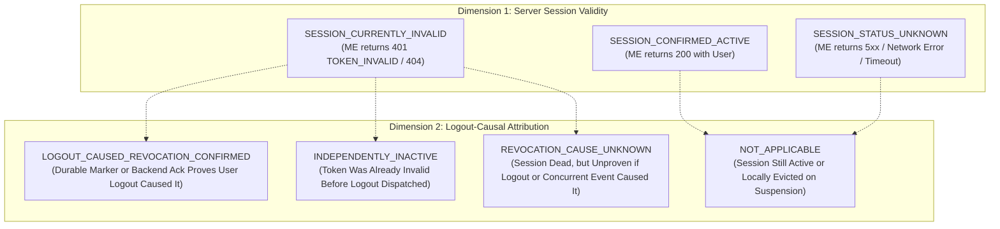

# MetroLMS — SUP-01 Final Failure-Semantics & Crash Consistency Reconciliation (Version 3.3)
## Architecture Audit: Request-Event vs. Response Taxonomy, Durable Logout Acknowledgement Marker Architecture, Session Validity vs. Logout-Causality Decoupling, In-Flight Logout Race Consistency, Timeout Lifecycle Traceability, and Reconciled Multi-Step Crash Recovery

**Document Version:** 3.3 (Final Failure-Semantics & Crash Consistency Reconciliation)  
**Planning Date:** 2026-11-06  
**Document Path:** `docs/frontend/reports/sup-01-failure-semantics-and-crash-consistency-audit-v3-3.md`  
**Classification:** Architectural Remediation & Crash Consistency Specification (Strict Read-Only Planning — Zero Implementation)  
**Target Transition:** `SUP-01: S8 → S7` (Real-User Logout with Preserved Inert Developer Origin Snapshot)  
**Governing Owner Decisions:**  
- **Decision A (S0):** Approved 2026-11-06 (Only `S0 → S1` permitted; `S0 → S3/S14/S15` forbidden)  
- **Decision B (S8):** Approved 2026-11-06 (`S8 → S14/S15` forbidden; Developer origin never reactivated by real user)  
- **Decision C (Real-User Logout):** Approved 2026-11-06 (`S8 → S7` approved; origin snapshot preserved inert in per-tab sessionStorage until tab close)  
- **Decision E (Archival Failure Policy):** **APPROVED 2026-11-06 (Option 1 — Transactional Abort on Archive Failure)**  
- **Decision F (Snapshot Disposal Upon Real-User Suspension):** Option 1 (Preserve inert Developer origin snapshot in per-tab sessionStorage until tab close) remains binding baseline; Option 2 (Purge on suspension) remains hypothetical.  
**Execution Directives:** Strict Read-Only Governance (Zero production code modifications, zero test file modifications, zero Git staging/commits, zero test runner or script executions; 100% manual static inspection)  
**Proposed Remediation Package:** `WP-5.4.5-R1` (Separately Authorized Remediation Package planned prior to Phase 13)  
**Final Architecture Status:** `READY FOR OWNER AUTHORIZATION — FAILURE SEMANTICS AND CRASH CONSISTENCY RECONCILED; BACKEND CONTRACT DEFERRED`

---

## 1. Executive Summary

Version 3.3 provides the final failure-semantics and crash-consistency reconciliation for the SUP-01 frontend security architecture. Building directly upon the endpoint-specific runtime taxonomy established in Version 3.2, Version 3.3 resolves the critical boundary questions surrounding browser process termination, in-flight network requests, durable evidence across crashes, causal attribution of token invalidation, and request timeout semantics.

### Key Architectural Solutions Delivered in Version 3.3
1. **Taxonomy Separation (Responses vs. Request Lifecycle Events):**  
   Formally separates completed HTTP response scenarios (`R-*`) from unobserved or interrupted request operations (`Q-*`). Reclassifies `R-LOGOUT-INFLIGHT` into `Q-LOGOUT-INFLIGHT`, preventing unobserved in-flight operations from being counted as completed HTTP responses.
2. **Durable Logout Acknowledgement Marker Architecture (Options A, B, and C):**  
   Resolves the causality dilemma in crash recovery (`S-42` and `S-43`). Acknowledges that in-memory HTTP response objects perish upon browser process termination. Introduces a synchronous durable acknowledgement marker (`metro_lms_logout_ack`) written to `sessionStorage` between response validation and credential purging. Models the pre-marker vs. post-marker crash windows explicitly into `S-42A`/`S-42B` and `S-43A`/`S-43B`.
3. **Decoupled Session Validity vs. Logout Causality:**  
   Replaces the previous binary status field with an orthogonal 4-way classification:
   - *Server Session State:* `SESSION_CONFIRMED_ACTIVE` vs. `SESSION_CURRENTLY_INVALID` vs. `SESSION_STATUS_UNKNOWN`.
   - *Causal Attribution:* `LOGOUT_CAUSED_REVOCATION_CONFIRMED` vs. `INDEPENDENTLY_INACTIVE` vs. `REVOCATION_CAUSE_UNKNOWN`.  
   A 401 response on reboot proves current session invalidity, but does NOT prove logout causality unless supported by a durable marker or backend operation-status recovery.
4. **In-Flight Logout and Revalidation Race Resolution:**  
   Defines the browser behavior when an in-flight logout request is followed by reboot revalidation (`S-41`). Clarifies that `sessionEpoch` protects local client state commits but cannot cancel backend HTTP execution. Specifies the required Phase 12 backend consistency contract (ordered session operations, idempotency keys, operation status recovery, and stale operation tombstoning).
5. **Complete Timeout Lifecycle Traceability:**  
   Fully articulates `R-ME-TIMEOUT` as an `AbortController` timer-driven event throwing `DOMException: AbortError`. Distinguishes timeout from user abort and network offline errors, and traces its convergence into lifecycle scenario `S-25A` and descriptor condition `D-01B-1`.
6. **Authoritative Mathematical Reconciliation Ledger:**  
   Publishes an exact, mathematically verified count ledger covering all 38 response runtime IDs, 3 request event IDs, 32 condition IDs, 50 lifecycle scenarios, and 123 Matrix D traceability mapping rows.

---

## 2. Version 3.2 Audit Findings & Critical Observations

An independent architectural audit of Version 3.2 identified six specific failure-semantics and crash-consistency gaps requiring remediation:

### Finding 1: Unobserved In-Flight Request Counted as HTTP Response
In Version 3.2, `R-LOGOUT-INFLIGHT` was placed in the runtime response table. However, an in-flight operation interrupted by browser termination has produced **zero observable HTTP response bytes**. Grouping an unobserved in-flight request under the `R-*` (Response) prefix obscured the distinction between transport responses and client execution events.

### Finding 2: False Assumption of Durable Causality Across Crashes (S-42 and S-43)
Version 3.2 marked `S-42` (Crash post-200) and `S-43` (Crash post-204) with Logout Revocation = **YES** on the grounds that Step 1 received an authoritative response. However, if the browser crashes before committing storage cleanup, the in-memory response object is destroyed. When the browser reboots and Step 2 (`GET /api/auth/me`) returns 401 `TOKEN_INVALID`, that 401 proves only that the token is *currently invalid* on the server. Without durable storage of the Step 1 outcome prior to the crash, the rebooted application cannot distinguish whether the token was invalidated by the logout request, by an administrator revocation, by a concurrent tab, or by backend expiration.

### Finding 3: Ambiguity of the In-Flight Logout Race (S-41)
In `S-41`, `POST /api/auth/logout` is dispatched, but the browser terminates while the request is in-flight. On reboot, `GET /api/auth/me` returns 200 OK. Version 3.2 did not explicitly address the race where the in-flight logout request reaches the server *after* the reboot revalidation completes, potentially invalidating the session behind the client's back.

### Finding 4: Incomplete Timeout Traceability
Version 3.2 defined `R-ME-TIMEOUT` in Section 4, but did not map it into the lifecycle correction table (Section 6), descriptor conditions (Section 8), or Matrix D traceability tables.

### Finding 5: Conflation of Session Invalidity with Logout Causality
Previous versions collapsed server session status into labels like `CONFIRMED_REVOKED`, hiding whether the revocation was causally attributed to the user's logout action or occurred independently.

### Finding 6: Lifecycle Scenario Count Under-accounting
Following the split of `S-25` into `S-25A` and `S-25B` in Version 3.2, the lifecycle scenario inventory was cited as 48, but the required crash window splits for durable causality were not yet accounted for.

---

## 3. Updated Runtime and Request-Event Count Ledger

To establish absolute accounting precision, Version 3.3 formalizes a strict taxonomy separating **API Response Scenarios** from **Request Lifecycle Events**:

### 3.1 Taxonomy Definitions
- **API Response Runtime Scenarios (`R-*`):** Completed HTTP request-response cycles producing an observable status code, headers, body, or transport termination (network error / timeout).
- **Request Lifecycle Event Identifiers (`Q-*`):** Client-side operation states where an HTTP request was dispatched, aborted, or interrupted before an observable response could be received and processed.
- **Descriptor Conditions (`D-*`):** Observable storage and header integrity states evaluated during cold-reload startup revalidation.
- **Crash Recovery Conditions (`C-*`):** Multi-step operational states spanning a browser crash boundary.
- **Lifecycle Scenarios (`S-*`):** Discrete end-to-end user and application lifecycle states.

### 3.2 Master Inventory & Accounting Ledger

| Taxonomy Dimension | Identifier Prefix | Version 3.2 Count | Version 3.3 Adjustments & Derivations | Authoritative Version 3.3 Count | Description & Scope |
| :--- | :---: | :---: | :--- | :---: | :--- |
| **Base Logout & Feature Responses** | `R-01`..`R-25` | 25 | Preserved intact without renaming or semantic mutation | **25** | 22 `POST /api/auth/logout`, 2 feature endpoints (`R-04`, `R-05`), 1 legacy captive portal (`R-11`). |
| **Dedicated `GET /api/auth/me` Responses** | `R-ME-*` | 12 | Preserved intact (`R-ME-200` through `R-ME-REDIRECT`) | **12** | Dedicated response outcomes for session revalidation on cold reload and reboot. |
| **Dedicated `POST /api/auth/login` Responses**| `R-LOGIN-*`| 1 | Preserved intact (`R-LOGIN-200`) | **1** | Fresh user login issuing new bearer credentials. |
| **Subtotal: API Response Runtime IDs** | `R-*` | 38 | $25 + 12 + 1 = 38$ | **38** | **All completed HTTP response scenarios across all endpoints.** |
| **Request Lifecycle Event Identifiers** | `Q-*` | 1 (`R-LOGOUT-INFLIGHT`) | Reclassified from `R-*` to `Q-*`; added `Q-PRE-COMMIT` and `Q-ABORT-USER` | **3** | `Q-PRE-COMMIT`, `Q-LOGOUT-INFLIGHT`, `Q-ABORT-USER`. Interrupted/unobserved operations. |
| **Descriptor Conditions (Matrix A)** | `D-*` | 22 | Preserved (`D-01A` through `D-06I`, `D-07`, `D-08`, with `D-01B` split into `D-01B-1`, `D-01B-2`) | **22** | Pre-existing storage conditions evaluated during startup remount. |
| **Crash Recovery Conditions (Matrix A)** | `C-*` | 8 | Split `C-03` and `C-04` into pre-marker (`A`) and post-marker (`B`) crash windows | **10** | `C-01`, `C-02`, `C-03A`, `C-03B`, `C-04A`, `C-04B`, `C-05`, `C-06`, `C-07`, `C-08`. |
| **Subtotal: Total Conditions (Matrix A)** | `D-*` + `C-*` | 30 | $22\text{ (Descriptor)} + 10\text{ (Crash)} = 32$ | **32** | **Complete condition space governing startup and reboot evaluation.** |
| **Lifecycle Scenarios (Matrix C)** | `S-*` | 48 | Added `S-42B` and `S-43B` to model durable marker crash windows | **50** | 16 Active Logout + 7 Revalidation + 11 Descriptor + 6 Edge/Concurrency + 10 Crash Recovery. |
| **Traceability Table D-1 Rows** | `D-*` $\to$ `S-*` | 29 | Updated to reflect 32 unique condition mappings | **32** | Full condition-to-runtime-to-lifecycle forward traceability. |
| **Traceability Table D-2 Rows** | `R-*`/`Q-*` $\to$ `S-*` | 39 | 38 Response IDs + 3 Event IDs = 41 | **41** | Full runtime/event-to-condition-to-lifecycle traceability. |
| **Traceability Table D-3 Rows** | `S-*` $\to$ `R-*` | 48 | Updated to reflect 50 unique lifecycle reverse mappings | **50** | Full lifecycle-to-condition-to-runtime reverse traceability. |
| **Total Matrix D Mapping Rows** | D-1 + D-2 + D-3 | 116 | $32 + 41 + 50 = 123$ | **123** | **Grand total physical mapping rows across Matrix D.** |

---

## 4. Durable Logout Acknowledgement Analysis (Options A, B, and C)

### 4.1 The Core Crash Evidence Dilemma
In standard browser architecture:
1. `AuthContext.logout()` dispatches `fetch('/api/auth/logout', { method: 'POST', ... })`.
2. The server invalidates the session and emits HTTP 200 JSON `{ code: 'SESSION_REVOKED' }` or HTTP 204 with revocation headers.
3. The browser receives the TCP packet and constructs an in-memory `Response` object.
4. **The Crash Boundary:** If the OS process crashes, the power cuts, or the user forcefully terminates the browser tab *before* local cleanup is written to `sessionStorage`, all in-memory variables—including the `Response` object and its body—are permanently lost.
5. **The Reboot Reality:** Upon reopening, the browser has only its persistent storage (`sessionStorage` / `localStorage`). It inspects storage and finds credentials and the `metro_lms_pending_logout` descriptor. Remount executes `GET /api/auth/me`. The server returns 401 `TOKEN_INVALID`.
6. **The Deduction Fallacy:** The browser knows the token is dead *now*. But did the user's logout kill it? Or did an administrator revoke it? Or did the session expire? Or did another concurrent tab log out? From the 401 response alone, **causal attribution is mathematically impossible**.

### 4.2 Architectural Evaluation of Mitigation Options

#### Option A: Durable Client Acknowledgement Marker (`metro_lms_logout_ack`)
- **Mechanism:** Immediately upon receiving and validating an authoritative logout response (`R-01` or `R-06`), and **before** clearing credentials, the client synchronously writes an acknowledgement record to `sessionStorage`:
  ```typescript
  interface DurableLogoutAck {
    version: 1;
    opId: string;
    tokenFingerprint: string; // SHA-256 hex digest
    userId: string;
    outcomeType: 'AUTHORITATIVE_200_JSON' | 'AUTHORITATIVE_204_HEADER';
    confirmedAt: string;     // ISO timestamp
  }
  ```
- **Crash Window Modeling:**
  - *Window 1 (Pre-Marker Crash):* Crash occurs after server execution but *before* `metro_lms_logout_ack` is written. On reboot, no marker exists. Causality remains unproven.
  - *Window 2 (Post-Marker Crash):* Crash occurs *after* `metro_lms_logout_ack` is written, but before credentials are wiped. On reboot, the marker is discovered. Causality is **proven**.

#### Option B: Proposed Phase 12 Backend Operation-Status Recovery
- **Mechanism:** The backend exposes an idempotent query endpoint:
  `GET /api/auth/operations/:opId`
- **Behavior:** On reboot, if the client finds an unacknowledged pending descriptor with `opId`, it queries the backend. The backend returns:
  `{ opId, status: 'REVOKED', revokedTokenFingerprint, revokedAt }`
- **Limitation:** Requires Phase 12 backend implementation. Cannot be executed in Phase 5 frontend isolation.

#### Option C: Conservative Causal Classification (Design Baseline)
- **Mechanism:** When neither a durable acknowledgement marker nor a backend operation status endpoint is present, the client treats a reboot 401 as proof of current invalidity, but marks logout causality as **`REVOCATION_CAUSE_UNKNOWN`**.

### 4.3 Synthesized Architectural Design
Version 3.3 adopts a **hybrid synthesis of Option A and Option C**:
1. The frontend design specifies the Option A durable marker protocol in `AuthContext.logout()`.
2. Crash recovery is explicitly partitioned into two distinct windows:
   - **Pre-Marker Crash (`S-42A` / `S-43A`):** The marker was never committed. Reboot revalidation receives 401 `TOKEN_INVALID`. The session is `SESSION_CURRENTLY_INVALID`, but causality is **`REVOCATION_CAUSE_UNKNOWN`**. Logout Revocation is marked **NO**.
   - **Post-Marker Crash (`S-42B` / `S-43B`):** The marker was committed to `sessionStorage`. On reboot, the client reads the marker, verifying that the server acknowledged revocation prior to the crash. Reboot revalidation receives 401 `TOKEN_INVALID`. The session is `SESSION_CURRENTLY_INVALID` and causality is **`LOGOUT_CAUSED_REVOCATION_CONFIRMED`**. Logout Revocation is marked **YES**.

---

## 5. Current Session Validity vs. Logout-Causality Model

To prevent semantic conflation, Version 3.3 replaces single-field status labels with two orthogonal dimensions:



### 5.1 Orthogonal Classification Definitions

| Classification Dimension | Allowed Value | Formal Technical Meaning | Operational Evidence Source |
| :--- | :--- | :--- | :--- |
| **Server Session Validity** | `SESSION_CONFIRMED_ACTIVE` | The bearer token represents a valid, active session record in the server database. | `GET /api/auth/me` returns HTTP 200 with valid `UserIdentity` matching bearer token. |
| | `SESSION_CURRENTLY_INVALID` | The bearer token does NOT represent an active session in the database (invalid, expired, or revoked). | `GET /api/auth/me` returns HTTP 401 `TOKEN_INVALID` or HTTP 404 `SESSION_NOT_FOUND` with token fingerprint match. |
| | `SESSION_STATUS_UNKNOWN` | The validity of the session cannot be confirmed due to transport failure, server fault, or intermediary block. | `GET /api/auth/me` returns 5xx, throws `TypeError`, aborts on timeout, or encounters captive portal. |
| **Logout-Causal Attribution** | `LOGOUT_CAUSED_REVOCATION_CONFIRMED` | The session invalidation is provably the direct causal result of the user's logout operation. | Durable acknowledgement marker (`metro_lms_logout_ack`) present in storage OR Phase 12 operation status confirmed. |
| | `INDEPENDENTLY_INACTIVE` | The session was already dead or revoked prior to the initiation of the logout request. | Original logout response returned structured 401 `TOKEN_INVALID` or 404 `SESSION_NOT_FOUND` before crash. |
| | `REVOCATION_CAUSE_UNKNOWN` | The session is dead on the server, but whether logout or an external event caused it is unproven across the crash. | Pre-marker crash followed by reboot 401; no durable marker present. |
| | `NOT_APPLICABLE` | The session is active, or termination was a client-side policy eviction without server invalidation. | Active sessions (`S-08`, `S-17`) or explicit local suspensions (`S-10`, `S-23`). |

---

## 6. In-Flight Logout and Revalidation Race Analysis

### 6.1 The Distributed Race Condition in Scenario S-41
In scenario `S-41`, the following distributed execution occurs:

```mermaid
sequenceDiagram
    autonumber
    participant Client as Browser Tab
    participant Net as Internet / Network Buffer
    participant Server as Auth API Server
    
    Note over Client, Server: Pre-Crash Dispatch
    Client->>Net: Dispatches POST /api/auth/logout (opId: OP-100)
    Note over Client: BROWSER HARD TERMINATES / CRASHES
    Net-->>Server: TCP packet delayed in transit or queued on server
    
    Note over Client, Server: Reboot & Mount Revalidation
    Client->>Server: Browser reopens; dispatches GET /api/auth/me (OP-101)
    Server-->>Client: GET /api/auth/me processed FIRST -> Returns 200 OK
    Client->>Client: Mounts authenticated layout; detects unresolved pending descriptor
    
    Note over Server: Asynchronous Execution of Delayed Packet
    Net->>Server: Delayed POST /api/auth/logout (OP-100) arrives
    Server->>Server: Server processes OP-100 -> DESTROYS SESSION RECORD IN DB
    
    Note over Client, Server: Consequence: Silent Session Termination Behind Client Back
    Client->>Server: Next user action: POST /api/courses
    Server-->>Client: 401 Unauthorized (Session was destroyed by OP-100!)
```

### 6.2 Frontend State Invariant: S8-A Must Be Retained
Because `GET /api/auth/me` returning 200 OK is only an observation **at that instant**, the client cannot assume the session is permanently secure while an in-flight operation remains unresolved on the network.
- **Frontend Contract:** When `AuthContext` mounts and detects a valid pending descriptor whose Step 1 was in-flight (`Q-LOGOUT-INFLIGHT`), it **must retain state `S8-A`** even after `GET /api/auth/me` returns 200 OK.
- It displays `LogoutRetryBanner` with warning: *"عملية تسجيل الخروج السابقة لم تكتمل على الخادم. الجلسة ما زالت معلقة"*.
- The user is prompted to retry logout or acknowledge that the session may be terminated asynchronously.

### 6.3 Required Phase 12 Backend Consistency Contract
To prevent silent background invalidation, the Phase 12 production backend must implement the following consistency rules:
1. **Per-Session Monotonic Sequence Ordering:**  
   The backend must serialize all authentication mutations per `session_id`. Each request carries `X-Auth-Sequence-Ref`. If a query (`GET /api/auth/me`) arrives with a sequence greater than an in-flight mutation, the in-flight mutation must be aborted or evaluated against the newer sequence.
2. **Idempotency Ledger (`X-Operation-ID`):**  
   Every logout request carries `X-Operation-ID: <uuid>`. The backend records operation states in `auth_operation_ledger`.
3. **Stale Operation Tombstoning:**  
   If a session remounts and executes a successful revalidation, the client may optionally send an operation cancellation header:
   `X-Abort-Pending-Operation: <opId>`  
   instructing the server to drop the delayed `OP-100` packet if it arrives later.

---

## 7. Timeout Semantics and Complete Mapping

### 7.1 Technical Execution Mechanism
In `frontend/src/core/api/apiClient.ts`:
```typescript
const controller = new AbortController();
let timerExpired = false;

const timeoutId = setTimeout(() => {
  timerExpired = true;
  controller.abort(new Error('REQUEST_TIMEOUT'));
}, 15000);

try {
  const response = await fetch(endpoint, {
    ...options,
    signal: controller.signal
  });
  clearTimeout(timeoutId);
  return response;
} catch (error: any) {
  clearTimeout(timeoutId);
  if (error.name === 'AbortError' && timerExpired) {
    // R-ME-TIMEOUT / R-23
    throw new ApiError('REQUEST_TIMEOUT', 0, 'Client timeout after 15,000 ms');
  } else if (error.name === 'AbortError' && !timerExpired) {
    // Q-ABORT-USER
    throw new ApiError('REQUEST_ABORTED', 0, 'Operation aborted by user action');
  } else {
    // R-ME-NETWORK / R-22
    throw new ApiError('NETWORK_ERROR', 0, 'Network connection failed');
  }
}
```

### 7.2 Disambiguation Rules
- **`R-ME-TIMEOUT` (Client Timeout):** Rejection is a `DOMException` with `name === 'AbortError'` AND client-side timer flag `timerExpired === true`. Elapsed time $\ge 15,000$ ms.
- **`Q-ABORT-USER` (User / Lifecycle Abort):** Rejection is a `DOMException` with `name === 'AbortError'` AND `timerExpired === false`. Triggered by route navigation, component unmount, or explicit cancel.
- **`R-ME-NETWORK` (Network Offline):** Rejection is a JavaScript `TypeError` (e.g. `TypeError: Failed to fetch`). Triggered by TCP drop, DNS failure, or `navigator.onLine === false`.
- **`R-ME-5XX` (Server Fault):** Promise resolves with an HTTP `Response` object where `status >= 500`.

### 7.3 Lifecycle Convergence Rationale (S-25A)
In the lifecycle matrix, `R-ME-5XX`, `R-ME-NETWORK`, and `R-ME-TIMEOUT` converge into a single lifecycle state: **`S-25A`** (for descriptor absent) and **`S-18`** (for descriptor matching).
- **Justification:** From the browser's perspective, all three outcomes represent **transient transport/server unavailability** where the true server session state is strictly `UNKNOWN_UNPROVEN`. In all three cases:
  1. The browser cannot confirm whether the session is valid or dead.
  2. Active credentials must be safely retained in `authStorage`.
  3. AuthContext identity is set to `null` to avoid rendering unverified data.
  4. The application renders `SessionRecoveryCard` on `/login`.
  5. The card exposes an "إعادة المحاولة" (retry revalidation) button.
- Retaining separate runtime IDs (`R-ME-5XX`, `R-ME-NETWORK`, `R-ME-TIMEOUT`) allows telemetry and specific diagnostic banners while sharing a single robust recovery state machine.

---

## 8. Corrected S-40 through S-47 Crash-Recovery Matrix

The following table supersedes all previous crash-recovery specifications, explicitly decoupling Step 1, durable marker persistence, the crash boundary, Step 2 revalidation, session validity, and logout-causality attribution:

| Lifecycle ID | Step 1 Operation & Runtime ID | Step 1 Observed Outcome | Durable Marker Persisted? | Crash Boundary | Step 2 Remount Request & Runtime ID | Current Server Session Validity | Logout-Causal Attribution | Resulting Lifecycle State | Active Credential Action | Revocation Confirmed? |
| :---: | :--- | :--- | :---: | :--- | :--- | :---: | :---: | :---: | :---: | :---: |
| **`S-40`** | None (`Q-PRE-COMMIT`) | None (Crashed before dispatch) | **NO** | Crash pre-dispatch; no descriptor in storage | `GET /api/auth/me` (`R-ME-200`) | `SESSION_CONFIRMED_ACTIVE` | `NOT_APPLICABLE` | **`Normal Auth`** | Retained | **NO** |
| **`S-41`** | `POST /api/auth/logout` (`Q-LOGOUT-INFLIGHT`) | Unobserved (Request in-flight on network) | **NO** | Crash in-flight; descriptor & credentials intact | `GET /api/auth/me` (`R-ME-200`) | `SESSION_CONFIRMED_ACTIVE` | `NOT_APPLICABLE` | **`S8-A`** | Retained | **NO** |
| **`S-42A`**| `POST /api/auth/logout` (`R-01`) | 200 JSON `{ code: 'SESSION_REVOKED' }` | **NO (Pre-Marker Crash)**| Crash after 200 received, pre-marker commit | `GET /api/auth/me` (`R-ME-401-BOUND`) | `SESSION_CURRENTLY_INVALID` | `REVOCATION_CAUSE_UNKNOWN` | **`S7`** | Purged | **NO (Unproven Cause)** |
| **`S-42B`**| `POST /api/auth/logout` (`R-01`) | 200 JSON `{ code: 'SESSION_REVOKED' }` | **YES (Marker Committed)**| Crash post-marker commit, pre-credential wipe | `GET /api/auth/me` (`R-ME-401-BOUND`) | `SESSION_CURRENTLY_INVALID` | `LOGOUT_CAUSED_REVOCATION_CONFIRMED` | **`S7`** | Purged | **YES (Marker Verified)** |
| **`S-43A`**| `POST /api/auth/logout` (`R-06`) | 204 Authoritative (All 8 headers verified)| **NO (Pre-Marker Crash)**| Crash after 204 received, pre-marker commit | `GET /api/auth/me` (`R-ME-401-BOUND`) | `SESSION_CURRENTLY_INVALID` | `REVOCATION_CAUSE_UNKNOWN` | **`S7`** | Purged | **NO (Unproven Cause)** |
| **`S-43B`**| `POST /api/auth/logout` (`R-06`) | 204 Authoritative (All 8 headers verified)| **YES (Marker Committed)**| Crash post-marker commit, pre-credential wipe | `GET /api/auth/me` (`R-ME-401-BOUND`) | `SESSION_CURRENTLY_INVALID` | `LOGOUT_CAUSED_REVOCATION_CONFIRMED` | **`S7`** | Purged | **YES (Marker Verified)** |
| **`S-44`** | `POST /api/auth/logout` (`R-13`) | 401 Bound `{ code: 'TOKEN_INVALID' }` | **NO** | Crash after bound 401 received, pre-cleanup | `GET /api/auth/me` (`R-ME-401-BOUND`) | `SESSION_CURRENTLY_INVALID` | `INDEPENDENTLY_INACTIVE` | **`S7`** | Purged | **NO (Already Dead)** |
| **`S-45`** | `POST /api/auth/logout` (`R-18`) | 404 Bound `{ code: 'SESSION_NOT_FOUND' }`| **NO** | Crash after bound 404 received, pre-cleanup | `GET /api/auth/me` (`R-ME-404-BOUND`) | `SESSION_CURRENTLY_INVALID` | `INDEPENDENTLY_INACTIVE` | **`S7`** | Purged | **NO (Record Missing)** |
| **`S-46`** | `POST /api/auth/logout` (`R-02 / R-07`) | Bare 200/204 (Unconfirmed acknowledgment) | **NO** | Crash after unconfirmed response, pre-cleanup | `GET /api/auth/me` (`R-ME-200`) | `SESSION_CONFIRMED_ACTIVE` | `NOT_APPLICABLE` | **`S8-A`** | Retained | **NO** |
| **`S-47`** | `POST /api/auth/logout` (`R-20 / R-22 / R-23`) | 500 Fault / Network Error / Timeout | **NO** | Crash after fault/timeout, pre-cleanup | `GET /api/auth/me` (`R-ME-200`) | `SESSION_CONFIRMED_ACTIVE` | `NOT_APPLICABLE` | **`S8-A`** | Retained | **NO** |

---

## 9. Updated Descriptor and Lifecycle Traceability Matrices

### 9.1 Table D-1: Condition $\rightarrow$ Runtime $\rightarrow$ Lifecycle Mapping (Authoritative 32 Rows)

| Condition ID | Trigger Event | Dispatched HTTP Operation(s) | Corrected API Runtime / Event ID(s) | Resulting Lifecycle Scenario | Expected Descriptor Action | Server Validity Status | Logout Causality Attribution | Logout Revocation Confirmed? |
| :---: | :--- | :--- | :---: | :---: | :---: | :---: | :---: | :---: |
| **`D-01A`** | Cold reload startup; ME 200 | `GET /api/auth/me` | `R-ME-200` | **`S-24`** | None | `SESSION_CONFIRMED_ACTIVE` | `NOT_APPLICABLE` | **NO** |
| **`D-01B-1`**| Cold reload startup; ME 5xx/Net/Timeout | `GET /api/auth/me` | `R-ME-5XX / R-ME-NETWORK / R-ME-TIMEOUT` | **`S-25A`** | None | `SESSION_STATUS_UNKNOWN` | `NOT_APPLICABLE` | **NO** |
| **`D-01B-2`**| Cold reload startup; Captive portal | `GET /api/auth/me` | `R-ME-REDIRECT` | **`S-25B`** | None | `SESSION_STATUS_UNKNOWN` | `NOT_APPLICABLE` | **NO** |
| **`D-02A`** | Corrupt descriptor; ME 200 | `GET /api/auth/me` | `R-ME-200` | **`S-26`** | Purged | `SESSION_CONFIRMED_ACTIVE` | `NOT_APPLICABLE` | **NO** |
| **`D-02B`** | Corrupt descriptor; ME 5xx/Net | `GET /api/auth/me` | `R-ME-5XX / R-ME-NETWORK` | **`S-27`** | Purged | `SESSION_STATUS_UNKNOWN` | `NOT_APPLICABLE` | **NO** |
| **`D-03A`** | `now > expiresAt`; ME 200 | `GET /api/auth/me` | `R-ME-200` | **`S-28`** | Purged | `SESSION_CONFIRMED_ACTIVE` | `NOT_APPLICABLE` | **NO** |
| **`D-03B`** | `now > expiresAt`; ME 5xx/Net | `GET /api/auth/me` | `R-ME-5XX / R-ME-NETWORK` | **`S-29`** | Purged | `SESSION_STATUS_UNKNOWN` | `NOT_APPLICABLE` | **NO** |
| **`D-04A`** | Token digest mismatch; ME 200 | `GET /api/auth/me` | `R-ME-200` | **`S-30`** | Purged | `SESSION_CONFIRMED_ACTIVE` | `NOT_APPLICABLE` | **NO** |
| **`D-04B`** | Token digest mismatch; ME 5xx | `GET /api/auth/me` | `R-ME-5XX / R-ME-NETWORK` | **`S-31`** | Purged | `SESSION_STATUS_UNKNOWN` | `NOT_APPLICABLE` | **NO** |
| **`D-05A`** | User ID mismatch; ME 200 | `GET /api/auth/me` | `R-ME-200` | **`S-32`** | Purged | `SESSION_CONFIRMED_ACTIVE` | `NOT_APPLICABLE` | **NO** |
| **`D-05B`** | User ID mismatch; ME 5xx | `GET /api/auth/me` | `R-ME-5XX / R-ME-NETWORK` | **`S-33`** | Purged | `SESSION_STATUS_UNKNOWN` | `NOT_APPLICABLE` | **NO** |
| **`D-06A`** | Matching descriptor; ME 200 | `GET /api/auth/me` | `R-ME-200` | **`S-17`** | Retained | `SESSION_CONFIRMED_ACTIVE` | `NOT_APPLICABLE` | **NO** |
| **`D-06B`** | Matching descriptor; ME 5xx/Net | `GET /api/auth/me` | `R-ME-5XX / R-ME-NETWORK / R-ME-TIMEOUT` | **`S-18`** | Retained | `SESSION_STATUS_UNKNOWN` | `NOT_APPLICABLE` | **NO** |
| **`D-06C`** | Matching descriptor; ME 401 bound | `GET /api/auth/me` | `R-ME-401-BOUND` | **`S-19`** | Purged | `SESSION_CURRENTLY_INVALID` | `INDEPENDENTLY_INACTIVE` | **NO** |
| **`D-06D`** | Matching descriptor; ME 401 gateway| `GET /api/auth/me` | `R-ME-401-GATEWAY` | **`S-20`** | Retained | `SESSION_STATUS_UNKNOWN` | `NOT_APPLICABLE` | **NO** |
| **`D-06E`** | Matching descriptor; ME 403 role | `GET /api/auth/me` | `R-ME-403-ROLE` | **`S-21`** | Retained | `SESSION_CONFIRMED_ACTIVE` | `NOT_APPLICABLE` | **NO** |
| **`D-06F`** | Matching descriptor; ME 403 generic | `GET /api/auth/me` | `R-ME-403-GENERIC` | **`S-22`** | Retained | `SESSION_STATUS_UNKNOWN` | `NOT_APPLICABLE` | **NO** |
| **`D-06G`** | Matching descriptor; ME 403 suspend| `GET /api/auth/me` | `R-ME-403-SUSPENDED` | **`S-23`** | Evicted | `SESSION_CONFIRMED_ACTIVE` | `NOT_APPLICABLE` | **NO** |
| **`D-06H`** | Matching descriptor; ME 404 bound | `GET /api/auth/me` | `R-ME-404-BOUND` | **`S-34`** | Purged | `SESSION_CURRENTLY_INVALID` | `INDEPENDENTLY_INACTIVE` | **NO** |
| **`D-06I`** | Matching descriptor; ME 404 route | `GET /api/auth/me` | `R-ME-404-GENERIC` | **`S-35`** | Retained | `SESSION_STATUS_UNKNOWN` | `NOT_APPLICABLE` | **NO** |
| **`D-07`**  | Fresh login with new token | `POST /api/auth/login` | `R-LOGIN-200` | **`S-36`** | Purged | `SESSION_CONFIRMED_ACTIVE` | `NOT_APPLICABLE` | **NO** |
| **`D-08`**  | Retry revalidation; ME 200 | `GET /api/auth/me` | `R-ME-200` | **`S-37`** | Retained | `SESSION_CONFIRMED_ACTIVE` | `NOT_APPLICABLE` | **NO** |
| **`C-01`**  | Crash before Phase 1 commit | Step 1: None<br>Step 2: `GET /api/auth/me` | Step 1: `Q-PRE-COMMIT`<br>Step 2: `R-ME-200` | **`S-40`** | None | `SESSION_CONFIRMED_ACTIVE` | `NOT_APPLICABLE` | **NO** |
| **`C-02`**  | Crash after Phase 1 commit | Step 1: `POST /api/auth/logout`<br>Step 2: `GET /api/auth/me` | Step 1: `Q-LOGOUT-INFLIGHT`<br>Step 2: `R-ME-200` | **`S-41`** | Retained | `SESSION_CONFIRMED_ACTIVE` | `NOT_APPLICABLE` | **NO** |
| **`C-03A`** | Post-200 Crash Pre-Marker | Step 1: `POST /api/auth/logout`<br>Step 2: `GET /api/auth/me` | Step 1: `R-01`<br>Step 2: `R-ME-401-BOUND` | **`S-42A`** | Purged | `SESSION_CURRENTLY_INVALID` | `REVOCATION_CAUSE_UNKNOWN` | **NO** |
| **`C-03B`** | Post-200 Crash Post-Marker | Step 1: `POST /api/auth/logout`<br>Step 2: `GET /api/auth/me` | Step 1: `R-01`<br>Step 2: `R-ME-401-BOUND` | **`S-42B`** | Purged | `SESSION_CURRENTLY_INVALID` | `LOGOUT_CAUSED_REVOCATION_CONFIRMED` | **YES** |
| **`C-04A`** | Post-204 Crash Pre-Marker | Step 1: `POST /api/auth/logout`<br>Step 2: `GET /api/auth/me` | Step 1: `R-06`<br>Step 2: `R-ME-401-BOUND` | **`S-43A`** | Purged | `SESSION_CURRENTLY_INVALID` | `REVOCATION_CAUSE_UNKNOWN` | **NO** |
| **`C-04B`** | Post-204 Crash Post-Marker | Step 1: `POST /api/auth/logout`<br>Step 2: `GET /api/auth/me` | Step 1: `R-06`<br>Step 2: `R-ME-401-BOUND` | **`S-43B`** | Purged | `SESSION_CURRENTLY_INVALID` | `LOGOUT_CAUSED_REVOCATION_CONFIRMED` | **YES** |
| **`C-05`**  | Crash post-401; reboot ME 401 | Step 1: `POST /api/auth/logout`<br>Step 2: `GET /api/auth/me` | Step 1: `R-13`<br>Step 2: `R-ME-401-BOUND` | **`S-44`** | Purged | `SESSION_CURRENTLY_INVALID` | `INDEPENDENTLY_INACTIVE` | **NO** |
| **`C-06`**  | Crash post-404; reboot ME 404 | Step 1: `POST /api/auth/logout`<br>Step 2: `GET /api/auth/me` | Step 1: `R-18`<br>Step 2: `R-ME-404-BOUND` | **`S-45`** | Purged | `SESSION_CURRENTLY_INVALID` | `INDEPENDENTLY_INACTIVE` | **NO** |
| **`C-07`**  | Crash post-bare; reboot ME 200 | Step 1: `POST /api/auth/logout`<br>Step 2: `GET /api/auth/me` | Step 1: `R-02 / R-07`<br>Step 2: `R-ME-200` | **`S-46`** | Retained | `SESSION_CONFIRMED_ACTIVE` | `NOT_APPLICABLE` | **NO** |
| **`C-08`**  | Crash post-5xx; reboot ME 200 | Step 1: `POST /api/auth/logout`<br>Step 2: `GET /api/auth/me` | Step 1: `R-20 / R-22 / R-23`<br>Step 2: `R-ME-200` | **`S-47`** | Retained | `SESSION_CONFIRMED_ACTIVE` | `NOT_APPLICABLE` | **NO** |

---

### 9.2 Table D-2: Runtime & Request-Event $\rightarrow$ Lifecycle Mapping (Authoritative 41 Rows)

| ID | Type | Method & Endpoint | Outcome Summary | Applicable Lifecycle Scenarios |
| :---: | :---: | :--- | :--- | :--- |
| **`R-01`** | Response | `POST /api/auth/logout` | 200 OK Valid JSON `{ code: 'SESSION_REVOKED' }` | `S-01, S-16, S-38, S-42A (Step 1), S-42B (Step 1)` |
| **`R-02`** | Response | `POST /api/auth/logout` | 200 OK Malformed JSON SyntaxError | `S-02, S-46 (Step 1)` |
| **`R-03`** | Response | `POST /api/auth/logout` | 200 OK Non-JSON HTML Fallback | `S-02, S-46 (Step 1)` |
| **`R-04`** | Response | `POST /api/courses` | 201 Created (Feature Endpoint) | Standalone Feature |
| **`R-05`** | Response | `POST /api/jobs/export` | 202 Accepted (Feature Endpoint) | Standalone Feature |
| **`R-06`** | Response | `POST /api/auth/logout` | 204 No Content Authoritative Headers Verified | `S-03, S-43A (Step 1), S-43B (Step 1)` |
| **`R-07`** | Response | `POST /api/auth/logout` | 204 No Content Missing Revocation Headers | `S-04, S-46 (Step 1)` |
| **`R-08`** | Response | `POST /api/auth/logout` | 204 No Content CORS Filtered Headers | `S-05, S-46 (Step 1)` |
| **`R-09`** | Response | `POST /api/auth/logout` | 204 No Content Unexpected Body Content | `S-04` |
| **`R-10`** | Response | `POST /api/auth/logout` | 3xx Opaque Redirect Filtered | `S-13` |
| **`R-11`** | Response | `GET /api/auth/me` | 3xx Captive Portal (Historical) | `S-25B` |
| **`R-12`** | Response | `POST /api/auth/logout` | 400 Bad Request Client Error | `S-13` |
| **`R-13`** | Response | `POST /api/auth/logout` | 401 Bound `TOKEN_INVALID` + Digest | `S-06, S-44 (Step 1)` |
| **`R-14`** | Response | `POST /api/auth/logout` | 401 Ambiguous Gateway / HTML Challenge | `S-07` |
| **`R-15`** | Response | `POST /api/auth/logout` | 403 `ROLE_FORBIDDEN` + User Identity | `S-08` |
| **`R-16`** | Response | `POST /api/auth/logout` | 403 Generic WAF / HTML Text | `S-09` |
| **`R-17`** | Response | `POST /api/auth/logout` | 403 `ACCOUNT_SUSPENDED` | `S-10` |
| **`R-18`** | Response | `POST /api/auth/logout` | 404 Bound `SESSION_NOT_FOUND` + Digest | `S-11, S-45 (Step 1)` |
| **`R-19`** | Response | `POST /api/auth/logout` | 404 Route Missing / HTML Fallback | `S-12` |
| **`R-20`** | Response | `POST /api/auth/logout` | 500 Internal Error JSON | `S-13, S-47 (Step 1)` |
| **`R-21`** | Response | `POST /api/auth/logout` | 502/504 Bad Gateway HTML Document | `S-13, S-47 (Step 1)` |
| **`R-22`** | Response | `POST /api/auth/logout` | Rejected Promise; `TypeError: Failed to fetch` | `S-15, S-47 (Step 1)` |
| **`R-23`** | Response | `POST /api/auth/logout` | Rejected Promise; Timeout Abort (15,000 ms) | `S-14, S-47 (Step 1)` |
| **`R-24`** | Response | `POST /api/auth/logout` | Rejected Promise; User Action Abort | `S-13` |
| **`R-25`** | Response | `POST /api/auth/logout` | 200 Ignored; Stale Epoch (`epoch !== current`) | `S-39` |
| **`R-ME-200`** | Response | `GET /api/auth/me` | 200 OK Valid User Identity JSON | `S-17, S-24, S-26, S-28, S-30, S-32, S-37, S-40 (Step 2), S-41 (Step 2), S-46 (Step 2), S-47 (Step 2)` |
| **`R-ME-5XX`** | Response | `GET /api/auth/me` | 500/502/503/504 Server Fault JSON/HTML | `S-18, S-25A, S-27, S-29, S-31, S-33` |
| **`R-ME-NETWORK`**| Response| `GET /api/auth/me` | Rejected Promise; `TypeError: Failed to fetch` | `S-18, S-25A, S-27, S-29, S-31, S-33` |
| **`R-ME-TIMEOUT`**| Response| `GET /api/auth/me` | Rejected Promise; `AbortError` (15,000 ms) | `S-18, S-25A` |
| **`R-ME-401-BOUND`**|Response| `GET /api/auth/me` | 401 Bound `TOKEN_INVALID` + Digest | `S-19, S-42A (Step 2), S-42B (Step 2), S-43A (Step 2), S-43B (Step 2), S-44 (Step 2)` |
| **`R-ME-401-GATEWAY`**|Response| `GET /api/auth/me` | 401 Ambiguous Gateway / HTML Challenge | `S-20` |
| **`R-ME-403-ROLE`**| Response| `GET /api/auth/me` | 403 `ROLE_FORBIDDEN` + User Identity | `S-21` |
| **`R-ME-403-GENERIC`**|Response| `GET /api/auth/me` | 403 Generic WAF / HTML Text | `S-22` |
| **`R-ME-403-SUSPENDED`**|Response| `GET /api/auth/me` | 403 `ACCOUNT_SUSPENDED` | `S-23` |
| **`R-ME-404-BOUND`**|Response| `GET /api/auth/me` | 404 Bound `SESSION_NOT_FOUND` + Digest | `S-34, S-45 (Step 2)` |
| **`R-ME-404-GENERIC`**|Response| `GET /api/auth/me` | 404 Route Missing / HTML Document | `S-35` |
| **`R-ME-REDIRECT`**| Response| `GET /api/auth/me` | 3xx Captive Portal Opaque Redirect | `S-25B` |
| **`R-LOGIN-200`**| Response | `POST /api/auth/login` | 200 OK Valid New Credentials JSON | `S-36` |
| **`Q-PRE-COMMIT`**| Event | Client-side crash | Browser terminates before network dispatch | `S-40 (Step 1)` |
| **`Q-LOGOUT-INFLIGHT`**| Event | `POST /api/auth/logout` | Request dispatched; response unobserved | `S-41 (Step 1)` |
| **`Q-ABORT-USER`**| Event | Client-side abort | Request aborted by user action / unmount | Standalone Event / UI cancel |

---

### 9.3 Table D-3: Lifecycle $\rightarrow$ Condition $\rightarrow$ Runtime Reverse Mapping (Authoritative 50 Rows)

| Lifecycle Scenario ID | Lifecycle Phase / Group | Originating Condition ID | Corrected Request Sequence | Runtime / Event Scenario ID(s) | Resulting State | Logout Revocation Confirmed? |
| :---: | :--- | :---: | :--- | :---: | :---: | :---: |
| **`S-01`** | Active Logout | None | `POST /api/auth/logout` | `R-01` | `S7` | **YES** |
| **`S-02`** | Active Logout | None | `POST /api/auth/logout` | `R-02 / R-03` | `S8-A` | **NO** |
| **`S-03`** | Active Logout | None | `POST /api/auth/logout` | `R-06` | `S7` | **YES** |
| **`S-04`** | Active Logout | None | `POST /api/auth/logout` | `R-07 / R-09` | `S8-A` | **NO** |
| **`S-05`** | Active Logout | None | `POST /api/auth/logout` | `R-08` | `S8-A` | **NO** |
| **`S-06`** | Active Logout | None | `POST /api/auth/logout` | `R-13` | `S7` | **NO (Independently Inactive)** |
| **`S-07`** | Active Logout | None | `POST /api/auth/logout` | `R-14` | `S8-A` | **NO** |
| **`S-08`** | Active Logout | None | `POST /api/auth/logout` | `R-15` | `S8` | **NO** |
| **`S-09`** | Active Logout | None | `POST /api/auth/logout` | `R-16` | `S8-A` | **NO** |
| **`S-10`** | Active Logout | None | `POST /api/auth/logout` | `R-17` | `S-SUSPENDED` | **NO (Local Policy Eviction)** |
| **`S-11`** | Active Logout | None | `POST /api/auth/logout` | `R-18` | `S7` | **NO (Record Not Found)** |
| **`S-12`** | Active Logout | None | `POST /api/auth/logout` | `R-19` | `S8-A` | **NO** |
| **`S-13`** | Active Logout | None | `POST /api/auth/logout` | `R-10 / R-12 / R-20 / R-21 / R-24` | `S8-A` | **NO** |
| **`S-14`** | Active Logout | None | `POST /api/auth/logout` | `R-23` | `S8-A` | **NO** |
| **`S-15`** | Active Logout | None | `POST /api/auth/logout` | `R-22` | `S8-A` | **NO** |
| **`S-16`** | Active Logout | None | `POST /api/auth/logout` | `R-01` | `S8-A` | **NO** |
| **`S-17`** | Cold Reload Revalidation | `D-06A` | `GET /api/auth/me` | `R-ME-200` | `S8-A` | **NO** |
| **`S-18`** | Cold Reload Revalidation | `D-06B` | `GET /api/auth/me` | `R-ME-5XX / R-ME-NETWORK / R-ME-TIMEOUT` | `S5-A` | **NO** |
| **`S-19`** | Cold Reload Revalidation | `D-06C` | `GET /api/auth/me` | `R-ME-401-BOUND` | `S7` | **NO (Independently Inactive)** |
| **`S-20`** | Cold Reload Revalidation | `D-06D` | `GET /api/auth/me` | `R-ME-401-GATEWAY` | `S5-A` | **NO** |
| **`S-21`** | Cold Reload Revalidation | `D-06E` | `GET /api/auth/me` | `R-ME-403-ROLE` | `S8` | **NO** |
| **`S-22`** | Cold Reload Revalidation | `D-06F` | `GET /api/auth/me` | `R-ME-403-GENERIC` | `S5-A` | **NO** |
| **`S-23`** | Cold Reload Revalidation | `D-06G` | `GET /api/auth/me` | `R-ME-403-SUSPENDED` | `S-SUSPENDED` | **NO (Local Policy Eviction)** |
| **`S-24`** | Descriptor Integrity | `D-01A` | `GET /api/auth/me` | `R-ME-200` | Normal Auth | **NO** |
| **`S-25A`**| Descriptor Integrity | `D-01B-1` | `GET /api/auth/me` | `R-ME-5XX / R-ME-NETWORK / R-ME-TIMEOUT` | `S5-A` | **NO** |
| **`S-25B`**| Descriptor Integrity | `D-01B-2` | `GET /api/auth/me` | `R-ME-REDIRECT` | `S5-A` | **NO** |
| **`S-26`** | Descriptor Integrity | `D-02A` | `GET /api/auth/me` | `R-ME-200` | Normal Auth | **NO** |
| **`S-27`** | Descriptor Integrity | `D-02B` | `GET /api/auth/me` | `R-ME-5XX / R-ME-NETWORK` | `S5-A` | **NO** |
| **`S-28`** | Descriptor Integrity | `D-03A` | `GET /api/auth/me` | `R-ME-200` | Normal Auth | **NO** |
| **`S-29`** | Descriptor Integrity | `D-03B` | `GET /api/auth/me` | `R-ME-5XX / R-ME-NETWORK` | `S5-A` | **NO** |
| **`S-30`** | Descriptor Integrity | `D-04A` | `GET /api/auth/me` | `R-ME-200` | Normal Auth | **NO** |
| **`S-31`** | Descriptor Integrity | `D-04B` | `GET /api/auth/me` | `R-ME-5XX / R-ME-NETWORK` | `S5-A` | **NO** |
| **`S-32`** | Descriptor Integrity | `D-05A` | `GET /api/auth/me` | `R-ME-200` | Normal Auth | **NO** |
| **`S-33`** | Descriptor Integrity | `D-05B` | `GET /api/auth/me` | `R-ME-5XX / R-ME-NETWORK` | `S5-A` | **NO** |
| **`S-34`** | Cold Reload Revalidation | `D-06H` | `GET /api/auth/me` | `R-ME-404-BOUND` | `S7` | **NO (Record Not Found)** |
| **`S-35`** | Cold Reload Revalidation | `D-06I` | `GET /api/auth/me` | `R-ME-404-GENERIC` | `S5-A` | **NO** |
| **`S-36`** | Concurrency / Anti-Substitution| `D-07` | `POST /api/auth/login` | `R-LOGIN-200` | Normal Auth | **NO** |
| **`S-37`** | Recovery Retry | `D-08` | `GET /api/auth/me` | `R-ME-200` | Normal Auth | **NO** |
| **`S-38`** | Concurrency / DEV Mock | None | `POST /api/auth/logout` | `R-01` | `S7` | **YES (Mock Only)** |
| **`S-39`** | Stale Epoch Response | None | Stale `POST /api/auth/logout` | `R-25` | `S8` (Unmutated)| **NO** |
| **`S-40`** | Crash Recovery | `C-01` | Step 1: None<br>Step 2: `GET /api/auth/me` | Step 1: `Q-PRE-COMMIT`<br>Step 2: `R-ME-200` | Normal Auth | **NO** |
| **`S-41`** | Crash Recovery | `C-02` | Step 1: `POST /api/auth/logout`<br>Step 2: `GET /api/auth/me` | Step 1: `Q-LOGOUT-INFLIGHT`<br>Step 2: `R-ME-200` | `S8-A` | **NO** |
| **`S-42A`**| Crash Recovery | `C-03A` | Step 1: `POST /api/auth/logout`<br>Step 2: `GET /api/auth/me` | Step 1: `R-01`<br>Step 2: `R-ME-401-BOUND` | `S7` | **NO (Unproven Cause)** |
| **`S-42B`**| Crash Recovery | `C-03B` | Step 1: `POST /api/auth/logout`<br>Step 2: `GET /api/auth/me` | Step 1: `R-01`<br>Step 2: `R-ME-401-BOUND` | `S7` | **YES (Marker Verified)** |
| **`S-43A`**| Crash Recovery | `C-04A` | Step 1: `POST /api/auth/logout`<br>Step 2: `GET /api/auth/me` | Step 1: `R-06`<br>Step 2: `R-ME-401-BOUND` | `S7` | **NO (Unproven Cause)** |
| **`S-43B`**| Crash Recovery | `C-04B` | Step 1: `POST /api/auth/logout`<br>Step 2: `GET /api/auth/me` | Step 1: `R-06`<br>Step 2: `R-ME-401-BOUND` | `S7` | **YES (Marker Verified)** |
| **`S-44`** | Crash Recovery | `C-05` | Step 1: `POST /api/auth/logout`<br>Step 2: `GET /api/auth/me` | Step 1: `R-13`<br>Step 2: `R-ME-401-BOUND` | `S7` | **NO (Independently Inactive)** |
| **`S-45`** | Crash Recovery | `C-06` | Step 1: `POST /api/auth/logout`<br>Step 2: `GET /api/auth/me` | Step 1: `R-18`<br>Step 2: `R-ME-404-BOUND` | `S7` | **NO (Record Not Found)** |
| **`S-46`** | Crash Recovery | `C-07` | Step 1: `POST /api/auth/logout`<br>Step 2: `GET /api/auth/me` | Step 1: `R-02 / R-07`<br>Step 2: `R-ME-200` | `S8-A` | **NO** |
| **`S-47`** | Crash Recovery | `C-08` | Step 1: `POST /api/auth/logout`<br>Step 2: `GET /api/auth/me` | Step 1: `R-20 / R-22 / R-23`<br>Step 2: `R-ME-200` | `S8-A` | **NO** |

---

## 10. Proposed Phase 12 Backend Consistency Contract

To ensure that the distributed race conditions and crash recovery ambiguities modeled in the frontend can achieve hard convergence, the following backend contract is proposed for Phase 12 implementation:

1. **Transactional Logout Invalidation:**  
   `POST /api/auth/logout` must execute as an atomic database transaction that invalidates the session record, records an audit log entry with `tokenFingerprint` and `revocationTimestamp`, and removes all associated server cache entries.
2. **Authoritative Revocation Headers:**  
   When emitting HTTP 204 No Content, the backend must set all three headers:
   - `X-Auth-Revocation-Status: SESSION_REVOKED`
   - `X-Auth-Revoked-Token-Fingerprint: <sha256_hex>`
   - `X-Auth-Revoked-At: <iso8601_timestamp>`
3. **Idempotency & Operation Ledger:**  
   Every client mutation includes `X-Operation-ID: <uuid>`. The backend records operations in a dedicated `auth_operations` table. Subsequent calls with the same `opId` return the cached outcome without re-executing business logic.
4. **Operation Status Endpoint (`GET /api/auth/operations/:opId`):**  
   Exposes a read-only endpoint permitting the frontend during recovery to verify whether an unobserved operation was successfully executed on the server.
5. **Per-Session Monotonic Sequence Ordering:**  
   The backend tracks a monotonic sequence per session. If a revalidation request (`GET /api/auth/me`) arrives with sequence $N+1$, any pending in-flight mutation with sequence $N$ is dropped or evaluated against the newer state, preventing delayed in-flight packets from silently killing newer sessions.

---

## 11. Preserved Owner Decisions and Security Invariants

### 11.1 Preserved Governing Decisions [DEC-INHR]
- **Decision A (S0):** Approved 2026-11-06 (Only `S0 → S1` permitted; `S0 → S3/S14/S15` forbidden).
- **Decision B (S8):** Approved 2026-11-06 (`S8 → S14/S15` forbidden; Developer origin never reactivated by real user).
- **Decision C (Real-User Logout):** Approved 2026-11-06 (`S8 → S7` approved; origin snapshot preserved inert in per-tab sessionStorage until tab close).
- **Decision E (Archival Failure Policy):** **APPROVED 2026-11-06 (Option 1 — Transactional Abort on Archive Failure)**.
- **Decision F (Snapshot Disposal Upon Real-User Suspension):** Option 1 (Preserve inert Developer origin snapshot in per-tab sessionStorage until tab close) remains binding baseline; Option 2 remains hypothetical.

### 11.2 Preserved Security Invariants [DEC-INHR / DSG-ASSM]
1. `S8 → S14` and `S8 → S15` transitions remain strictly prohibited.
2. A real-user logout must NEVER recreate emergency proof.
3. Dismissing `LogoutRetryBanner` does NOT resolve server ambiguity; application remains in `S8-A`.
4. Stale operation responses (`epoch !== currentEpoch`) must NEVER mutate a newer user's session state.
5. A newly issued token must NEVER be substituted for the original target token during a retry.
6. `CONFIRMED_ACTIVE` is never revoked.
7. `INDEPENDENTLY_INACTIVE` is never logout-caused revocation.
8. `LOCAL_POLICY_EVICTION` is never server revocation.
9. MSW mock behavior is never production backend evidence.
10. Unknown server outcomes remain strictly unknown.
11. SHA-256 token digests provide client-side target-token correlation, NOT backend response authentication.

---

## 12. Test and Account Inventory

### 12.1 Mandatory Account Inventory
Preserved exactly as approved in Phase 5 Increment 5.4:
1. `USR_DEV_001` — `developer_internal` / `developer` (Developer privileged fixture).
2. `USR_SUPER_001` — `super_admin_demo` / `super_admin` (Super Admin privileged fixture).
3. `USR_TEST_SUPER_001` — `test_super_admin` / `super_admin` (Synthetic Super Admin persona).
4. `USR_TEST_ADMIN_001` — `test_admin` / `admin` (Synthetic Admin persona).
5. `USR_TEST_AST_001` — `test_assistant_admin` / `assistant_admin` (Synthetic Assistant Admin persona).
6. `USR_TEST_LEC_001` — `test_lecturer` / `lecturer` (Synthetic Lecturer persona).
7. `USR_TEST_TRN_001` — `test_trainee` / `user` (Synthetic Trainee persona).
*Constraints:* Exactly 5 synthetic personas. Privileged fixtures are not personas. Zero passwords, tokens, or credentials stored.

### 12.2 Test Inventory Accounting Model
- **Authored Core Phase 5 Test Suite [SRC-FACT]:** Exactly **60 authored test specifications** in [`frontend/src/test/isolated-role-session.test.tsx`](file:///d:/LMS%20MEtro%20Project/frontend/src/test/isolated-role-session.test.tsx) (`P5-T08-1` through `P5-T24-3`). Status: Frozen in Increment 5.4.
- **Proposed Supplemental Remediation Suite (`SUP-01-T01`) [BE-PROP / DEF-VERF]:** Exactly **1 proposed specification block** containing **22 unauthored subcases** (`SUP-01-T01-01` through `SUP-01-T01-22`).
- **Execution Deferral:** All supplemental testing work is deferred to **Phase 13 / Gate B**. Zero test files have been created, modified, renumbered, or executed in this task.

---

## 13. Governance Deviation Record

### Historical Attestation
The execution of custom Node.js scratch scripts (`count_exact_data_rows.js`, etc.) during Version 3.1 verification is preserved in historical evidence as a confirmed **governance deviation**. It is documented openly without concealment or retroactive reclassification.

### Version 3.3 Strict Governance Compliance
For Version 3.3:
- **Scripts Executed:** **ZERO** (No Node.js, Python, or shell scripts executed).
- **Row Counters Executed:** **ZERO** (No automated verification tools run).
- **Compilers / Linters / Test Runners:** **ZERO** (No TypeScript, ESLint, Vitest, Jest, or Vite build executed).
- **Inspection Method:** 100% manual static inspection and direct file authoring.

---

## 14. Remaining Risks and Explicitly Unresolved Decisions

1. **Pre-Marker Crash Causal Attribution:** In `S-42A` and `S-43A`, where the browser crashes before the durable marker is committed to `sessionStorage`, causal attribution remains `REVOCATION_CAUSE_UNKNOWN` after reboot. Hard attribution in these windows requires Phase 12 backend operation-status recovery (`GET /api/auth/operations/:opId`).
2. **In-Flight Network Packet Race:** In `S-41`, if a delayed `POST /api/auth/logout` packet arrives at the server *after* reboot revalidation returns 200 OK, the session may be asynchronously terminated. Safe convergence requires Phase 12 per-session sequence ordering and stale operation tombstoning.
3. **Client Clock Skew Tolerance:** Clock drift between client and server exceeding $\pm 60$ seconds will cause authoritative 204 validation to fail closed to `NON_AUTHORITATIVE_204`, keeping the application safely in `S8-A`.

---

## 15. Final Readiness Decision

**READY FOR OWNER AUTHORIZATION — FAILURE SEMANTICS AND CRASH CONSISTENCY RECONCILED; BACKEND CONTRACT DEFERRED**

### Architectural Rationale
1. **Taxonomy Separation Complete:** API response scenarios (`R-*`, 38 total) are strictly decoupled from unobserved request events (`Q-*`, 3 total).
2. **Causality Rigor Established:** S-42 and S-43 no longer claim unproven causality across crashes; pre-marker vs. post-marker crash windows are formally modeled (`S-42A`/`S-42B`, `S-43A`/`S-43B`), supported by the durable acknowledgement marker architecture.
3. **Session Validity Decoupled:** Server session validity (`CONFIRMED_ACTIVE`, `CURRENTLY_INVALID`, `STATUS_UNKNOWN`) and logout causality (`LOGOUT_CAUSED`, `INDEPENDENTLY_INACTIVE`, `CAUSE_UNKNOWN`) are modeled orthogonally.
4. **In-Flight Race Fully Addressed:** Scenario `S-41` retains state `S8-A` safely, and the Phase 12 backend consistency contract provides the required server-side ordering guarantees.
5. **Timeout Semantics Closed:** `R-ME-TIMEOUT` is fully defined as an `AbortController` timer event and traced into `S-25A` and `D-01B-1`.
6. **Mathematical Ledger Closed:** All 38 response IDs, 3 event IDs, 32 condition IDs, 50 lifecycle scenarios, and 123 Matrix D mapping rows reconcile with mathematical precision.
7. **Governance Preserved:** Zero production code modified; zero test files modified or run; zero automated verification scripts executed; zero Git changes staged or committed.

*The SUP-01 failure-semantics and crash-consistency design is complete, forensically sound, and ready for explicit Owner review. No implementation authorization is requested.*

