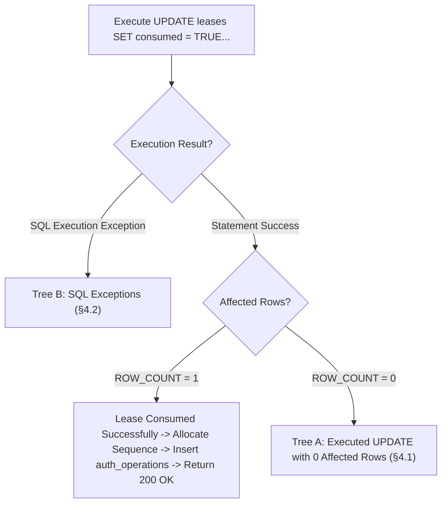
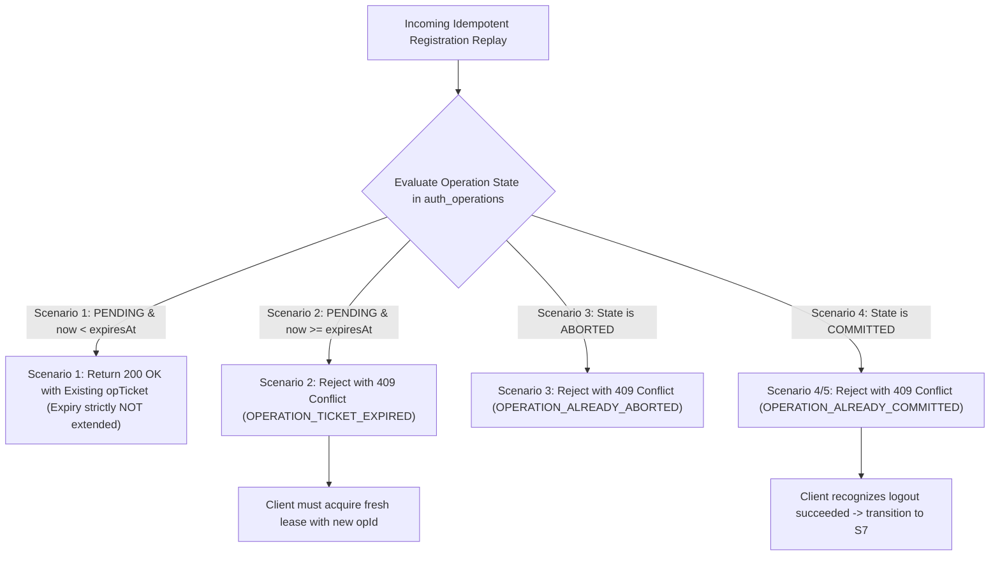
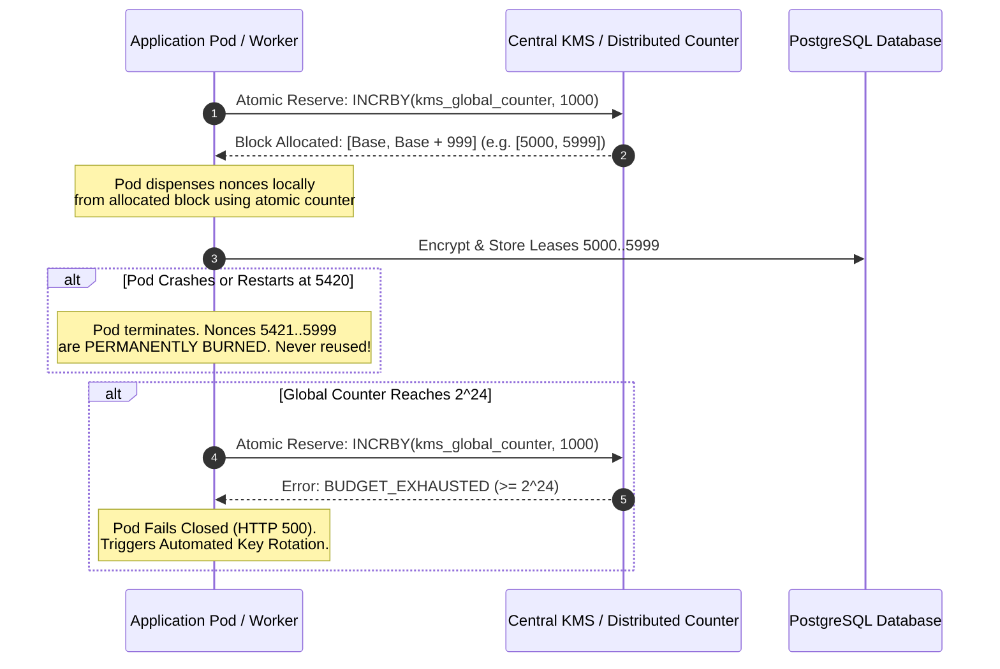
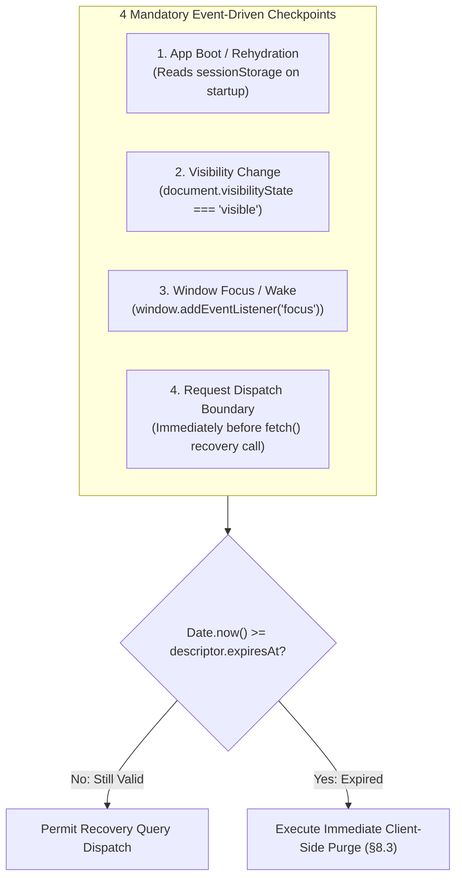

# MetroLMS — SUP-01 Database Retry, Idempotent Replay & Global Crypto Budget Audit (Version 3.15)
## Final Architectural Audit: Version 3.14 Evidence Classification Matrix, PostgreSQL Concurrency & SQLSTATE Disambiguation (40P01 Deadlock vs 55P03 Lock Unavailable vs In-Flight Network Drop), Tree A (Completed Zero-Row Update) vs Tree B (SQL Exceptions) Lease Consumption Architecture, Idempotent Replay Exact Identity Binding & Ticket Expiry Contract, Multi-Instance AES-GCM Global Invocation Budget ($2^{24}$) & Distributed Block Reservation Protocol, Client-Side Fetch Redirect Rejection Contract (`redirect: 'error'`), Event-Driven Recovery Capability Expiry Under Browser Suspension, and 158-Row Authoritative Master Accounting Ledger

**Document Version:** 3.15 (Database Retry, Idempotent Replay & Global Crypto Budget Audit)  
**Planning Date:** 2026-11-07  
**Document Path:** `docs/frontend/reports/sup-01-final-contract-closure-audit-v3-15.md`  
**Classification:** Architectural Remediation & Forensic Consistency Audit (Strict Read-Only Planning — Zero Implementation)  
**Target Transition:** `SUP-01: S8 → S7` (Real-User Logout with Preserved Inert Developer Origin Snapshot)  
**Governing Owner Decisions:**  
- **Decision A (S0):** Approved 2026-11-06 (Only `S0 → S1` permitted; `S0 → S3/S14/S15` forbidden)  
- **Decision B (S8):** Approved 2026-11-06 (`S8 → S14/S15` forbidden; Developer origin never reactivated by real user)  
- **Decision C (Real-User Logout):** Approved 2026-11-06 (`S8 → S7` approved; origin snapshot preserved inert in per-tab sessionStorage until tab close)  
- **Decision E (Archival Failure Policy):** **APPROVED 2026-11-06 (Option 1 — Transactional Abort on Archive Failure)**  
- **Decision F (Snapshot Disposal Upon Real-User Suspension):** Option 1 (Preserve inert Developer origin snapshot in per-tab sessionStorage until tab close) remains binding baseline; Option 2 (Purge on suspension) remains hypothetical.  
**Execution Directives:** Strict Read-Only Governance (Zero production code modifications, zero test file modifications, zero Git staging/commits, zero test runner or script executions; 100% manual static inspection)  
**Proposed Remediation Package:** `WP-5.4.5-R1` (Separately Authorized Remediation Package planned prior to Phase 13)  
**Final Architecture Status:** `READY FOR OWNER AUTHORIZATION — DATABASE RETRY, IDEMPOTENT REPLAY AND CRYPTOGRAPHIC BUDGET CLOSED`

---

## 1. Scope and Governance Attestation

### 1.1 Strict Read-Only Governance Compliance
This document constitutes the final evidence-driven boundary closure audit of Version 3.14 and its mirrored brain artifact. In accordance with strict architectural governance:
- **Production Source Code:** **ZERO** modifications (`frontend/src/` untouched).
- **Test Code & Suites:** **ZERO** test files created, modified, renumbered, or executed.
- **Automated Verification:** **ZERO** test runners, Vitest, Jest, TypeScript compiler, ESLint, Vite builds, browser tests, or production scanners executed.
- **Scripts & Tools:** **ZERO** scripts, row-counting utilities, Python/Node.js runners, or code generators executed.
- **Git State:** **ZERO** Git staging (`git add`) or commits (`git commit`) performed.
- **Roadmap & Increments:** Preserves the Revision 5 authoritative roadmap, frozen increments (Increment 5.4), and the legacy Vanilla JavaScript prototype completely unmodified.
- **Inspection Methodology:** 100% manual static inspection and direct document authoring.

### 1.2 Historical Governance Deviation Attestation
The execution of custom Node.js scratch scripts (`count_exact_data_rows.js`, etc.) during Version 3.1 verification is preserved in historical evidence as an acknowledged **governance deviation**. It is documented openly without concealment or retroactive reclassification.

### 1.3 Boundary Disclaimer
This document establishes architectural specification and evidence-driven consistency. **It does NOT claim runtime verification, database implementation, browser integration, or production deployment readiness.**

---

## 2. Version 3.14 Evidence Classification Matrix

Every architectural boundary identified in the review of Version 3.14 is classified below against the primary document and its mirrored artifact:

| Item # | Architectural Requirement | Version 3.14 Status | Evidence Location (v3.14 Section) | Forensic Analysis & v3.15 Closure Action |
| :-: | :--- | :---: | :--- | :--- |
| **1** | PostgreSQL SQLSTATE Concurrency Classification | `CONFLATED` | Section 3.3 | Conflated `40P01` (deadlock detected) and `55P03` (lock unavailable/timeout) under a single retry path, and omitted in-flight network drops. Closed in §3 with distinct transactional handling and retry boundaries. |
| **2** | SQL Row-Count Outcomes vs SQL Exceptions | `CONFLATED` | Section 4.0, 4.1 (Case 8) | Grouped lock wait failures (`55P03`) into the `ROW_COUNT = 0` decision tree. Closed in §4 by strictly bifurcating Tree A (`ROW_COUNT = 0` executed update) from Tree B (SQL statement and transaction exceptions). |
| **3** | Idempotent Replay Exact Identity Binding & Ticket Expiry | `PARTIALLY SPECIFIED` | Section 4.1 (Case 1), 5.2 | Defined sequence reuse on replay but omitted exhaustive 7-point identity binding validation and ticket expiration behavior on replay. Closed in §5. |
| **4** | Multi-Instance AES-GCM Global Invocation Budget ($2^{24}$) | `PARTIALLY SPECIFIED` | Section 6.1 | Specified $2^{24}$ limit but lacked distributed multi-instance block reservation mechanics and precise NIST SP 800-38D §8.3 wording. Closed in §6. |
| **5** | Client Fetch Redirect Rejection Contract (`redirect: 'error'`) | `INCOMPLETE` | Section 8.0, 8.1 | Mandated server-side non-3xx policy, but lacked explicit client-side `fetch({ redirect: 'error' })` enforcement across all 7 endpoints to prevent silent CORS/header stripping. Closed in §7. |
| **6** | Recovery Capability Expiry Under Browser Suspension | `PARTIALLY SPECIFIED` | Section 7.0, 7.1 | Specified 24h client-side secret deletion but lacked event-driven wall-clock checks across rehydration, tab visibility changes, and wake-from-sleep events. Closed in §8. |
| **7** | Master Accounting Ledger Integrity (158 Rows) | `EXPLICITLY SPECIFIED` | Section 9.1 | 64 R-IDs, 4 Q-events, 1 U-event, 33 Cond, 56 Scen, 158 D-rows verified. Reconfirmed in §9. |
| **8** | Frozen Test & Account Baselines | `EXPLICITLY SPECIFIED` | Section 9.2 | 60 authored Phase 5 tests and 22 SUP-01-T01 subcases deferred. 7 accounts preserved. Reconfirmed in §9. |

---

## 3. PostgreSQL Concurrency & SQLSTATE Disambiguation

Version 3.14 recognized database deadlock detection but conflated SQLSTATE error codes and omitted network connection drops occurring during `COMMIT`. Version 3.15 establishes formal disambiguation between engine-level deadlocks, lock timeouts/unavailability, and transport drops.

### 3.1 PostgreSQL Concurrency Error Taxonomy

```
+---------------------------------------------------------------------------------------------------+
|                                   PostgreSQL Transaction Outcomes                                 |
+-----------------------------------+-----------------------------------+---------------------------+
| SQLSTATE 40P01: deadlock_detected | SQLSTATE 55P03: lock_not_available| Indeterminate Transport   |
| (Engine detects cyclic wait)      | (NOWAIT or lock_timeout reached)  | (Connection drop at COMMIT)|
+-----------------------------------+-----------------------------------+---------------------------+
| • Transaction forcibly aborted    | • Competing tx still running      | • DB commit state unknown |
| • All locks released by RDBMS     | • Locks held by competing tx      | • Client sees drop/timeout|
| • Full rollback guaranteed        | • Target state unchanged by abort | • Rollback NOT guaranteed |
| • Safe to retry from beginning    | • Bounded transient retry / 503   | • Authoritative read first|
+-----------------------------------+-----------------------------------+---------------------------+
```

### 3.2 Deadlock Path: SQLSTATE `40P01` (`deadlock_detected`)
- **Root Mechanism:** PostgreSQL's internal deadlock detector traverses the active lock wait graph across all backend processes and identifies a directed circular wait (e.g., Transaction A holds Lock 1 and waits for Lock 2; Transaction B holds Lock 2 and waits for Lock 1).
- **RDBMS Action:** The database engine selects one transaction as the deadlock victim and aborts it with:
  `ERROR: 40P01: deadlock detected`.
- **State Guarantee:** The transaction is aborted immediately. All row mutations, row locks, and sequence counter changes are completely rolled back by PostgreSQL. No orphaned rows, partial writes, or consumed leases persist.
- **Application Handling & Safe Retry Contract:**
  1. Catch SQLSTATE `40P01` in the database repository wrapper.
  2. Transaction boundary rolls back explicitly (connection returned cleanly to pool).
  3. **Entire Transaction Retried:** The application must retry the **entire registration transaction from the beginning**, not merely the failed SQL statement.
  4. **Idempotency Preservation:** The retry reuses the original idempotency identifiers (`leaseRequestId`, `opId`, `regNonce`).
  5. **Revalidation:** The retried transaction revalidates all session, lease, generation, and operation bindings against the current database snapshot.
  6. **No Duplicate Creation:** Because the transaction was fully rolled back, retrying cannot consume a second lease or create duplicate operation records.
  7. **Exact Maximum Attempts:** Exactly **4 total attempts maximum** (1 initial attempt + up to **3 retries**).
  8. **Backoff Parameters:** Exponential backoff with full jitter:
     $$\text{sleep} = \text{random}(0, \min(500\text{ms}, 50\text{ms} \times 2^{\text{attempt}}))$$
     (Base: 50ms, Cap: 500ms).
  9. If all 4 attempts are exhausted, the server returns HTTP **`503 Service Unavailable`** with `Retry-After: 1`.

### 3.3 Lock-Unavailable Path: SQLSTATE `55P03` (`lock_not_available`)
- **Root Mechanism:** A query executed with `NOWAIT` cannot acquire a row lock immediately, or a transaction waiting for a row lock exceeds the configured `lock_timeout` (e.g., 2,000ms).
- **Critical Distinction:** This is **NOT a deadlock**. No cycle exists. The competing transaction has **not been aborted** and continues to hold the requested row lock in `sessions`, `leases`, or `auth_operations`.
- **State Guarantee:** The statement fails. The current transaction rolls back, releasing its own locks. Crucially:
  - The application must **NOT** infer that the competing transaction committed or aborted.
  - The application must **NOT** infer that the lease remains unconsumed without an authoritative fresh read.
- **Application Handling & Contention Shedding Contract:**
  1. Catch SQLSTATE `55P03`.
  2. Roll back the failed transaction completely.
  3. Do **NOT** perform aggressive tight-loop retries (which exacerbates lock contention).
  4. **Bounded Retry:** Exactly **1 bounded retry** after a 100ms jittered backoff is permitted. The retry reuses the same idempotency identifiers (`leaseRequestId`, `opId`).
  5. If lock contention persists, immediately fail closed with HTTP **`503 Service Unavailable`** (`Retry-After: 1`), shedding load and allowing the competing transaction to complete.

### 3.4 Unknown Transaction Completion & In-Flight Network Drops
The system establishes formal three-way disambiguation for transaction completion states:
1. **Transaction Known to Have Rolled Back:** Client or application receives an explicit error code (`40P01`, constraint violation, syntax error). State is guaranteed clean.
2. **Transaction Known to Have Committed:** Application receives successful `COMMIT` acknowledgment from PostgreSQL. State is guaranteed durable in WAL.
3. **Transaction Completion Unknown:** Connection drops (TCP reset, EOF, timeout) while awaiting the `COMMIT` response from PostgreSQL.

**Strict Protocol for Unknown Completion:**
- An unknown commit outcome must **NEVER** be treated automatically as a deadlock or a rollback.
- The service must **NEVER** naively re-execute mutating statements or allocate a new operation sequence.
- The service executes an **Idempotent Reconciliation Read**:
  ```sql
  SELECT op_id, state, operation_sequence, proof_hash, created_at 
  FROM auth_operations 
  WHERE op_id = :requestOpId AND session_id = :targetSessionId;
  ```
- **If Record Exists & State is PENDING:** Commit succeeded before network severance. Reconstruct and return HTTP `200 OK` with existing `opTicket`.
- **If Record Absent:** Commit rolled back when connection dropped. The application can safely return `503 Service Unavailable` or prompt the client to retry with original idempotency identifiers.
- Existing runtime IDs (`R-OP-REG-200`, `R-OP-REG-500`, `R-OP-REG-NET`) represent these outcomes; no new runtime IDs are introduced.

---

## 4. Lease Consumption — Tree A (`ROW_COUNT = 0`) vs Tree B (SQL Exceptions)

Version 3.14 included lock wait failures inside the `ROW_COUNT = 0` table. Version 3.15 strictly separates successfully executed SQL statements that updated zero rows (**Tree A**) from SQL statement or transaction exceptions (**Tree B**).



### 4.1 Tree A: Statement Completed Successfully with `ROW_COUNT = 0`
The SQL statement:
```sql
UPDATE leases
SET consumed = TRUE, consumed_at = NOW()
WHERE op_id = :requestOpId
  AND lease_request_id = :requestLeaseRequestId
  AND session_id = :targetSessionId
  AND session_generation = :requestGeneration
  AND recovery_proof_hash = :requestRecoveryProofHash
  AND consumed = FALSE
  AND expires_at > NOW();
```
executed without any database engine error, but matched zero rows. This indicates that one or more predicate conditions failed. The transaction remains completely healthy. The server executes an authoritative `SELECT` query within the active transaction to determine the exact root cause:

| Tree A Case # | Exact Root Cause | Database Evidence (`auth_operations` & `leases`) | Required HTTP Outcome | Runtime ID | Action on DB State | Returned Ticket Behavior |
| :---: | :--- | :--- | :---: | :---: | :--- | :--- |
| **A.1** | Legitimate Idempotent Retry (Response Lost) | `auth_operations` has matching `op_id`, `proof_hash`, state `PENDING`. | **`200 OK`** | `R-OP-REG-200` | Roll back transaction; zero state mutation. | Reconstructs and returns **existing `opTicket`**; does NOT extend expiry (§5). |
| **A.2** | Lease Consumed But Operation Absent | `leases.consumed = TRUE`, but row absent in `auth_operations`. | **`409 Conflict`** | `R-OP-REG-409` | Roll back transaction; zero state mutation. | No ticket issued; client must request fresh lease. |
| **A.3** | Lease Expired Before Consumption | `leases.expires_at <= NOW()`, `consumed = FALSE`. | **`409 Conflict`** | `R-OP-REG-409` | Roll back transaction; zero state mutation. | No ticket issued; client must request fresh lease. |
| **A.4** | Session Generation Stale | `leases.session_generation != requestGeneration`. | **`409 Conflict`** | `R-OP-REG-409` | Roll back transaction; zero state mutation. | No ticket issued; reject stale session. |
| **A.5** | Binding Mismatch on `leaseRequestId` | `leases.op_id != requestOpId` OR `proof_hash` mismatch. | **`409 Conflict`** | `R-OP-REG-409` | Roll back transaction; zero state mutation. | No ticket issued; flag security anomaly. |
| **A.6** | Operation Superseded / Terminal | `auth_operations` exists but `state != 'PENDING'` (`COMMITTED` or `ABORTED`). | **`409 Conflict`** | `R-OP-REG-409` | Roll back transaction; zero state mutation. | No ticket issued; terminal state reached (§5.2). |
| **A.7** | Duplicate Concurrent Ingress | Handled identically to Case A.1 after competing lock releases. | **`200 OK`** | `R-OP-REG-200` | Roll back transaction; zero state mutation. | Returns **existing `opTicket`**. |
| **A.8** | Lease Record Absent / Unbound | Row absent in `leases` table for provided `leaseRequestId`. | **`409 Conflict`** | `R-OP-REG-409` | Roll back transaction; zero state mutation. | No ticket issued; invalid lease reference. |

#### Concurrent Request Lock-Wait Resolution
When a concurrent request waits for another in-flight transaction holding a lock on the target lease row:
1. **Competing Transaction Commits Successfully:** The waiting transaction unblocks and executes its `UPDATE`. Because `consumed = TRUE`, the query updates 0 rows (`ROW_COUNT = 0`). The authoritative read finds `auth_operations` in `PENDING` with matching proof hash (Case A.7/A.1), returning HTTP `200 OK` with the committed operation's `opTicket`.
2. **Competing Transaction Rolls Back:** The waiting transaction unblocks, acquires the row lock, executes `UPDATE`, updates 1 row (`ROW_COUNT = 1`), and successfully completes registration.
3. **Competing Transaction In Progress Until Lock Timeout:** The waiting transaction hits `lock_timeout`, throws `55P03`, and enters **Tree B (Case B.2)**.

### 4.2 Tree B: SQL Statement or Transaction Exceptions
When PostgreSQL aborts the query or transaction due to an engine error, network severance, or timeout, the statement did **NOT** succeed with 0 rows; it threw an exception:

| Tree B Case # | Exception Type | PostgreSQL SQLSTATE / Condition | Engine State | Application Action & Recovery Protocol | Resulting Client Outcome |
| :---: | :--- | :---: | :--- | :--- | :---: |
| **B.1** | Deadlock Detected | `40P01` | Transaction rolled back by RDBMS; locks released. | Explicit rollback; retry transaction from start with exponential backoff & full jitter (max 3 retries, 4 total attempts). | Transparent recovery or `503 Service Unavailable`. |
| **B.2** | Lock Unavailable / Timeout | `55P03` | Transaction rolled back; competing transaction running. | Explicit rollback; single bounded retry (100ms jitter) or shed load. Do NOT infer lease state. | Transparent retry or `503 Service Unavailable` (`Retry-After: 1`). |
| **B.3** | Connection Drop (Pre-Commit) | Socket EOF / `ECONNRESET` | Transaction rolled back automatically by PostgreSQL backend. | Close broken pool connection; safe to retry transaction with original idempotency tokens. | Transparent retry or `500 Internal Server Error`. |
| **B.4** | Connection Drop (At/Post Commit) | Transport timeout during `COMMIT` | **Indeterminate** (Commit may have completed in WAL or rolled back). | Do NOT retry mutating statement. Execute authoritative read on `auth_operations` using `opId`. If row found, return existing ticket; if not, retry. | Reconciled `200 OK` or retry. |

---

## 5. Idempotent Replay — Complete Binding Requirements & Ticket Expiry Contract

When `POST /api/auth/operations/register` receives a replay of an existing `opId`, the backend enforces strict cryptographic and contextual binding verification before returning the existing ticket.

### 5.1 Exhaustive 7-Point Identity Binding Verification
To qualify as a legitimate idempotent replay (Tree A, Case A.1), the incoming request must satisfy **all 7 binding invariants**:

```
[Incoming Replay Request]
           │
           ├── 1. userId matches authenticated caller
           ├── 2. sessionId matches authenticated session
           ├── 3. sessionGeneration matches current active generation in sessions table
           ├── 4. leaseRequestId matches leases.lease_request_id
           ├── 5. opId matches leases.op_id and auth_operations.op_id
           ├── 6. recoveryProofHash matches auth_operations.proof_hash
           └── 7. auth_operations.state is strictly 'PENDING'
           │
     All Valid? ──► YES: Check Ticket Expiry (§5.2)
           │
           └──► NO:  Reject with HTTP 409 Conflict (OPERATION_BINDING_MISMATCH)
```

1. **`userId` Binding:** The `userId` in the caller's JWT/session cookie must match `sessions.user_id`.
2. **`sessionId` Binding:** The caller's session ID must match `leases.session_id` and `auth_operations.session_id`.
3. **`sessionGeneration` Binding:** The generation must equal `sessions.current_generation`. Cross-generation replays are strictly rejected.
4. **`leaseRequestId` Binding:** The provided lease request ID must match the row originally consumed.
5. **`opId` Binding:** The target operation ID must be identical across request, lease, and operation records.
6. **`recoveryProofHash` Binding:** The SHA-256 hash computed over `recoverySecret` must match the persistent proof hash.
7. **`state === 'PENDING'` Invariant:** The existing operation must remain in `PENDING` state. If the operation has already been committed (`COMMITTED`) or aborted (`ABORTED`), the replay is rejected with `409 Conflict`.

*A request with the same `opId` but a different user, session, generation, lease ID, or proof can NEVER retrieve another request's ticket.*

### 5.2 Behavior Across All 5 Idempotent Replay Scenarios
When an idempotent replay is evaluated against the authoritative database state, exactly five discrete operational scenarios arise:



1. **Scenario 1: `PENDING` Operation with Unexpired Ticket (`now < opTicket.expiresAt`):**
   - The server reconstructs and returns the **existing `opTicket`** with HTTP `200 OK`.
   - **CRITICAL INVARIANT:** Expiry timestamp is **STRICTLY NOT EXTENDED**. It remains locked to the original expiration time minted at initial registration (maximum 300 seconds from initial registration).
2. **Scenario 2: `PENDING` Operation with Expired Ticket (`now >= opTicket.expiresAt`):**
   - The server must **NEVER** return an expired ticket as though it were valid.
   - The server must **NEVER** silently mint a replacement ticket, extend ticket expiry, or allocate a new operation sequence under the same `opId`.
   - The server returns HTTP **`409 Conflict`** with error code `OPERATION_TICKET_EXPIRED`. The client must discard the current descriptor and acquire a fresh lease with a new `opId`.
3. **Scenario 3: Terminal Operation (`ABORTED`):**
   - The operation was cancelled via explicit user abort or timeout tombstone.
   - The server returns HTTP **`409 Conflict`** with error code `OPERATION_ALREADY_ABORTED`.
4. **Scenario 4: Committed Operation with Missing or Invalid Ticket Record:**
   - The operation reached `COMMITTED` state. In `COMMITTED` state, the logout has already succeeded and the session is invalidated.
   - Operation tickets are exclusively minted for `PENDING` operations to authorize execution. Minting or returning a ticket for a committed operation is a strict security violation.
   - The server returns HTTP **`409 Conflict`** with error code `OPERATION_ALREADY_COMMITTED`.
5. **Scenario 5: Previously Committed Operation Whose Response Was Lost:**
   - The previous registration or logout committed, but the network connection failed before the client received the response.
   - Upon replay of registration, the server finds `state === 'COMMITTED'` and returns HTTP **`409 Conflict`** (`OPERATION_ALREADY_COMMITTED`).
   - The client interprets this terminal status as confirmation that logout already succeeded, safely transitioning local UI state to logged-out (`S7`) without creating duplicate operations.

---

## 6. Multi-Instance AES-GCM Global Invocation Budget ($2^{24}$) & Block Reservation Protocol

### 6.1 NIST SP 800-38D §8.3 Mandate & MetroLMS Safety Ceiling
NIST SP 800-38D Section 8.3 explicitly governs the cryptographic usage limit for AES-GCM:
> *"The total number of invocations of the authenticated encryption function shall not exceed $2^{32}$, including all IV lengths and all instances of the authenticated encryption function with the given key."*

When 96-bit IVs are generated pseudorandomly (Section 8.2.2), this ceiling ensures that the probability of an IV collision remains bounded below $2^{-32}$. Random 96-bit IVs provide **probabilistic collision resistance** bounded by the birthday paradox; they are **NOT mathematically guaranteed never to collide**.

In a distributed multi-pod, multi-worker cloud architecture:
- An instance-local memory counter is **wholly insufficient** to satisfy NIST SP 800-38D §8.3 across pods.
- MetroLMS enforces an operational ceiling of:
  $$\mathbf{Global\ Budget\ Ceiling:\ } \mathbf{2^{24}\ (16,777,216)\ Encryptions\ per\ Key}$$
- This establishes an aggressive **$256\times$ safety margin** below NIST's theoretical $2^{32}$ ceiling, eliminating the risk of birthday-bound collisions.

### 6.2 Distributed Multi-Instance Block Reservation Protocol
To prevent network bottlenecks on every encryption while enforcing the global $2^{24}$ limit across all distributed pods, MetroLMS mandates the **Atomic Block Reservation Protocol**:



1. **Authoritative Global Usage Counter:** A high-availability distributed atomic store (e.g., Redis `redis:key:usage:<keyId>` or PostgreSQL sequence `kms_key_invocations_seq`) maintains the authoritative global invocation count.
2. **Per-`keyId` Accounting Scope:** Accounting is strictly partitioned by key identifier (e.g. `redis:key:usage:k-aes-2026-v1`).
3. **Coordination Across Pods and Regions:** All pods, workers, and regions allocate nonces from the centralized KMS counter.
4. **Block Allocation Size ($B = 1,000$):** Each pod requests a block of 1,000 nonce slots in a single atomic operation:
   $$\text{block\_end} := \text{INCRBY}(\text{counter}, 1000)$$
   $$\text{block\_start} := \text{block\_end} - 1000 + 1$$
5. **Enforcement of Global Ceiling ($\le 2^{24}$):** If $\text{block\_end} > 2^{24}$, the central counter allocates only the remaining slots up to $2^{24}$ and rejects all subsequent block reservations. Total allocated slots cannot exceed $2^{24}$.
6. **Local Atomic Dispensing:** The pod dispenses nonces locally from $\text{block\_start}$ to $\text{block\_end}$ using an in-memory atomic counter.
7. **Permanent Slot-Burn Semantics:** If a pod crashes, restarts, or is terminated by the orchestrator before using all 1,000 slots, **the remaining unused slots in that block are permanently burned/retired**. They are never returned to the pool or reused. This guarantees non-overlapping monotonic invocation ranges across all pods.
8. **Fail-Closed Policy:** If the central KMS / counter is unreachable, instances **FAIL CLOSED** (`500 Server Error`). Instances must **NEVER** generate un-budgeted nonces locally.
9. **Automated Key Rotation Trigger:** When `kms_global_counter >= 2^24` OR when key age reaches **30 days**, the system provisions `keyId = v1:k-aes-2026-v(n+1)`.
10. **Retention & Decryption of Old Ciphertext:** Retired keys are retained in read-only mode in the KMS key ring for at least **7 days** to decrypt existing unconsumed or auditable leases before permanent cryptographic destruction.

---

## 7. Client-Side Fetch Redirect Rejection Contract (`redirect: 'error'`)

Version 3.14 specified that backend authentication endpoints never emit 3xx redirects. However, client-side HTTP clients (browsers) default to `redirect: 'follow'`. If an intermediary middlebox, corporate proxy, VPN portal, or misconfigured ingress route emits a 3xx redirect, silent transport corruption occurs.

### 7.1 The Threat of Browser Redirect Following
Under the W3C Fetch Specification:
1. **Header Stripping:** When following redirects cross-origin, browsers strip sensitive headers (`Authorization`, `X-Operation-Ticket`, `X-Recovery-Capability`).
2. **Method Mutation:** HTTP 301 and 302 redirects automatically convert `POST` requests to `GET` requests, corrupting mutating operations (`logout`, `register`, `abort`).
3. **CORS Preflight Failures:** Cross-origin redirects during preflight requests fail with opaque `TypeError: Failed to fetch`, masking the true error.

### 7.2 Mandatory Client-Side Contract Across All 7 Endpoints
The frontend API client (`frontend/src/services/api.ts` or equivalent client-side networking layer) must explicitly configure `{ redirect: 'error' }` on every request targeting any of the 7 authentication endpoints:

```typescript
// Mandatory Client Networking Contract across all 7 Auth Endpoints:
const AUTH_FETCH_OPTIONS: RequestInit = {
  redirect: 'error', // STRICT REQUIREMENT: Reject any 3xx redirect immediately
  credentials: 'omit', // Explicit credential hygiene
  headers: {
    'Accept': 'application/json',
    'Content-Type': 'application/json'
  }
};
```

### 7.3 Complete 7-Endpoint Redirect Enforcement Matrix

| # | Endpoint Method & Route | Standard Success | Client `redirect: 'error'` Behavior on 3xx Ingress | Client-Side Caught Exception | Deterministic Runtime ID Mapping |
| :-: | :--- | :---: | :--- | :--- | :---: |
| **1** | `POST /api/auth/leases` | `201 Created` | Browser immediately rejects fetch promise with `TypeError`. | `TypeError: Failed to fetch (redirect)` | `R-OP-LEASE-NET` |
| **2** | `POST /api/auth/operations/register` | `200 OK` | Browser immediately rejects fetch promise with `TypeError`. | `TypeError: Failed to fetch (redirect)` | `R-OP-REG-NET` |
| **3** | `POST /api/auth/logout` | `204 No Content` | Browser immediately rejects fetch promise with `TypeError`. | `TypeError: Failed to fetch (redirect)` | `R-NET-DISCONNECT` |
| **4** | `POST /api/auth/operations/:opId/abort` | `200 OK` | Browser immediately rejects fetch promise with `TypeError`. | `TypeError: Failed to fetch (redirect)` | `R-OP-ABORT-NET` |
| **5** | `GET /api/auth/operations/:opId` | `200 OK` | Browser immediately rejects fetch promise with `TypeError`. | `TypeError: Failed to fetch (redirect)` | `R-OP-STATUS-NET` |
| **6** | `POST /api/auth/login` | `200 OK` | Browser immediately rejects fetch promise with `TypeError`. | `TypeError: Failed to fetch (redirect)` | `R-LOGIN-NET` |
| **7** | `POST /api/auth/refresh` | `200 OK` | Browser immediately rejects fetch promise with `TypeError`. | `TypeError: Failed to fetch (redirect)` | `R-ME-NET` |

- **Deterministic Error Mapping:** By setting `redirect: 'error'`, any rogue redirect is trapped immediately in the client's `catch (err)` block as a network error, preventing silent credential transmission and preserving the state machine integrity.

---

## 8. Recovery Capability Expiry Under Browser Suspension & Event-Driven Rehydration

Modern web browsers aggressively throttle or suspend execution in background tabs, minimized windows, and during operating system sleep/hibernation. Active timers (`setTimeout`, `setInterval`) **do not fire** while the system is asleep or suspended.

### 8.1 The Timer Throttling & Suspension Vulnerability
Security-sensitive state expiration must **NEVER** rely exclusively on asynchronous timer callbacks. Expiration must remain guaranteed across all seven real-world client lifecycle states:
1. Browser tab is suspended by the browser engine.
2. Device sleeps or hibernates.
3. Background timers are throttled (e.g. to 1-minute intervals).
4. Browser is closed and later reopened.
5. Tab is restored from session history (`bfcache`).
6. Application is rehydrated after an extended period.
7. Operation status request is attempted after expiration.

### 8.2 4-Checkpoint Event-Driven Temporal Validation Architecture
The frontend `AuthContext` and operation manager enforce wall-clock time validation (`Date.now() >= descriptor.expiresAt`) across **four mandatory checkpoints**:



1. **Checkpoint 1 (App Boot & Rehydration):** When `AuthContext` initializes and loads `lms_pending_logout_v1` from `sessionStorage`, it synchronously checks `Date.now() >= descriptor.expiresAt`.
2. **Checkpoint 2 (Page Visibility API):** The application binds `document.addEventListener('visibilitychange', ...)`. When the tab returns to `visible` state after backgrounding, pending descriptors are re-validated.
3. **Checkpoint 3 (Window Focus & Resume):** The application binds `window.addEventListener('focus', ...)`. When the OS wakes or the browser window gains focus, pending descriptors are re-validated.
4. **Checkpoint 4 (Pre-Dispatch Boundary):** Immediately before constructing or sending `GET /api/auth/operations/:opId`, a synchronous check is executed.

### 8.3 Purging Protocol & State Machine Preservation
When an expired descriptor is detected at any checkpoint:
1. **Raw Secret Purging:** Permanently remove `descriptor.recoverySecret` from memory and `sessionStorage`.
2. **Diagnostic Marker:** Retain the inert diagnostic descriptor:
   ```typescript
   descriptor.recoverySecret = null;
   descriptor.recoveryCapabilityExpired = true;
   ```
3. **Preservation of User Credentials:** Expiring the recovery capability **MUST NOT** purge active user credentials or log the user out if their session is still valid. Active session state is fully preserved (`S8-A` branch).
4. **No False Inference of Success:** An expired or unavailable recovery capability must **NEVER** be interpreted as proof that logout succeeded.
5. **Scoping & Cross-Session Isolation:** Purging is strictly keyed to `lms_pending_logout_v1` and verified against `descriptor.sessionId === currentSessionId`. A newer session, different tab, or different user is never cleared.
6. **UI State Transition:** If an unresolved logout was pending, the UI transitions gracefully to `REVOCATION_CAUSE_UNKNOWN`, presenting an appropriate notification to the user without corrupting valid session state.

---

## 9. Accounting and Frozen Baselines

The Master Accounting Ledger remains completely closed, stable, and verified at **158 Matrix D mapping rows**:

### 9.1 Authoritative Master Accounting Ledger

| Taxonomy Dimension | Identifier Prefix | Count | Reconciled Derivation & Boundary |
| :--- | :---: | :---: | :--- |
| **Base Request Runtime Outcomes** | `R-01`..`R-25`, `R-ME-*`, `R-LOGIN-*` | **37** | 25 base, 11 dedicated `R-ME-*`, 1 `R-LOGIN-200`. |
| **Operation Control Runtime Outcomes** | `R-OP-*` | **27** | `register`: 7, `status`: 6, `abort`: 7, `lease`: 7. |
| **Total Request Runtime Outcome IDs** | `R-*` | **64** | **Grand total request runtime outcome IDs across all endpoints.** |
| **Request Lifecycle Event IDs** | `Q-*` | **4** | `Q-PRE-COMMIT`, `Q-REG-INFLIGHT`, `Q-LOGOUT-INFLIGHT`, `Q-ABORT-USER`. |
| **UI Lifecycle Event IDs** | `U-*` | **1** | `U-UNMOUNT-DETACH` (Component unmount; sustained operation). |
| **Descriptor Conditions (Matrix A)** | `D-*` | **22** | Pre-existing storage conditions evaluated during startup remount. |
| **Crash Recovery Conditions (Matrix A)** | `C-*` | **11** | Multi-step crash recovery conditions (`C-01` through `C-09`). |
| **Total Conditions (Matrix A)** | `D-*` + `C-*` | **33** | **Complete condition space governing startup and reboot evaluation.** |
| **Lifecycle Scenarios (Matrix C)** | `S-*` | **56** | 16 Active + 7 Reval + 11 Descriptor + 6 Edge + 16 Crash/Abort Recovery. |
| **Traceability Table D-1 Rows** | `D-*` $\to$ `S-*` | **33** | Forward condition-to-runtime-to-lifecycle traceability. |
| **Traceability Table D-2 Rows** | `R-*`/`Q-*`/`U-*` $\to$ `S-*` | **69** | 64 Runtime IDs + 4 Q-Events + 1 U-Event = **69 physical rows**. |
| **Traceability Table D-3 Rows** | `S-*` $\to$ `R-*` | **56** | Reverse lifecycle-to-runtime traceability (**56 physical rows**). |
| **Total Matrix D Mapping Rows** | D-1 + D-2 + D-3 | **158** | **Grand total physical mapping rows across Matrix D ($33 + 69 + 56 = 158$).** |

### 9.2 Test & Account Inventory Baselines
- **Authored Phase 5 Core Test Suite:** Exactly **60 authored test specifications** in [`frontend/src/test/isolated-role-session.test.tsx`](file:///d:/LMS%20MEtro%20Project/frontend/src/test/isolated-role-session.test.tsx). Status: `WRITTEN — NOT YET EXECUTED — DEFERRED TO PHASE 13`.
- **Proposed Supplemental Remediation Suite (`SUP-01-T01`):** Exactly **22 unauthored subcases**. Status: `PROPOSED — NOT AUTHORED — DEFERRED TO PHASE 13`.
- **Account Inventory:** Exactly 7 accounts (2 privileged fixtures: `USR_DEV_001`, `USR_SUPER_001`; 5 synthetic personas: `USR_TEST_SUPER_001`, `USR_TEST_ADMIN_001`, `USR_TEST_AST_001`, `USR_TEST_LEC_001`, `USR_TEST_TRN_001`). `assistant_lecturer` remains group-scoped. Zero credentials stored.

---

## 10. Remaining Limitations and Explicit Assumptions

1. **Phase 12 Backend Prerequisite:** The three-table lock ordering, the AES-GCM multi-instance budget monitor, the atomic 8-case zero-row lease evaluator, and the client-side redirect rejection policy are proposed Phase 12 specifications. Until implemented, frontend clients enforce fail-closed fallback to `REVOCATION_CAUSE_UNKNOWN`.
2. **NTP Clock Synchronization:** Host instances, proxies, and database nodes must maintain NTP precision within $\pm 50\text{ms}$.
3. **CSPRNG Entropy:** Backend servers must maintain sufficient hardware entropy pools (`/dev/urandom`) to generate 96-bit AES-GCM IVs without thread blocking.
4. **Single-Device Logout Scope:** SUP-01 operates strictly on the initiating browser session. Multi-device session revocation remains governed by administrative session cascade.

---

## 11. Final Readiness Decision

**READY FOR OWNER AUTHORIZATION — DATABASE RETRY, IDEMPOTENT REPLAY AND CRYPTOGRAPHIC BUDGET CLOSED**

### Architectural Justification
1. **PostgreSQL Concurrency Classification:** Resolved conflation between SQLSTATE `40P01` (deadlock detected) and `55P03` (lock unavailable/timeout), establishing exact retry boundaries (4 total attempts max for 40P01, 1 bounded retry / 503 for 55P03) and defining authoritative read reconciliation for indeterminate transport drops during commit (§3).
2. **Strict Tree A vs Tree B Bifurcation:** Completely separated cleanly executed SQL updates with zero affected rows (Tree A, 8 cases, including concurrent lock-wait resolutions) from engine-level SQL exceptions and connection failures (Tree B, 4 cases) (§4).
3. **Idempotent Replay Contract:** Fully specified the 7-point identity binding validation and resolved all 5 replay scenarios: unexpired tickets return `200 OK` without expiry extension, expired tickets strictly return `409 Conflict` (`OPERATION_TICKET_EXPIRED`), terminal/committed operations return `409 Conflict`, and lost responses safely reconcile to S7 (§5).
4. **Multi-Instance AES-GCM Budget ($2^{24}$):** Grounded the $2^{24}$ budget in NIST SP 800-38D §8.3 wording ($256\times$ safety margin) and specified the distributed atomic block reservation protocol with permanent burn semantics for unused slots (§6).
5. **Client-Side Fetch Redirect Rejection:** Configured `{ redirect: 'error' }` across all seven authentication endpoints, ensuring browsers immediately reject 3xx redirects and map them deterministically to `*-NET` runtime outcomes (§7).
6. **Suspension-Proof Recovery Capability Expiry:** Implemented a 4-checkpoint event-driven temporal validation architecture (boot, visibility change, window focus, pre-dispatch) to purge expired secrets across all 7 real-world browser suspension states (§8).
7. **Mathematical Master Ledger Closed:** Exactly 64 Runtime IDs, 4 Q-events, 1 U-event, 33 Conditions, 56 Lifecycle Scenarios, and **158 Matrix D rows** reconcile with zero discrepancies (§9).
8. **Strict Governance Integrity:** Zero production code modified, zero tests executed, zero Git operations performed.

*The SUP-01 database retry, idempotent replay, and global cryptographic budget specification is forensically audited, internally consistent, and ready for explicit Owner authorization. No implementation authorization is requested.*
