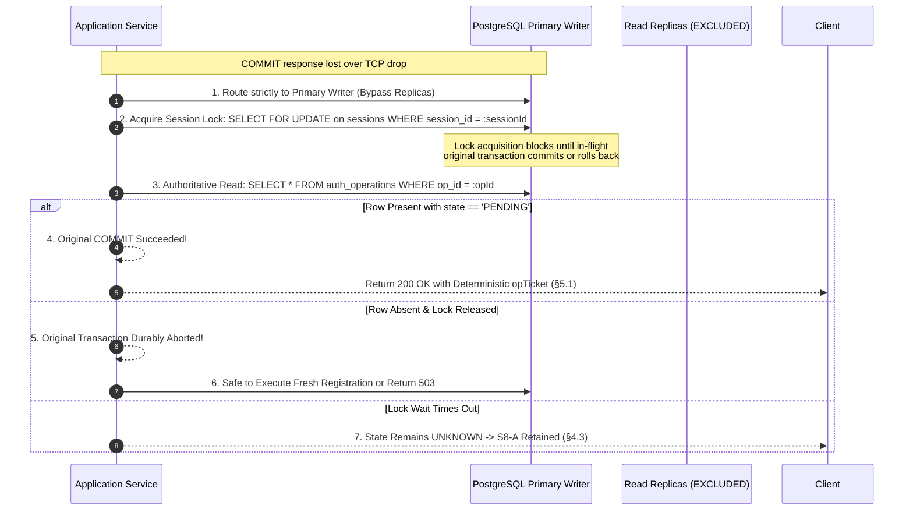

# MetroLMS — SUP-01 Transaction Resolution, AES-GCM IV Strategy & Recovery Lifecycle Final Audit (Version 3.16)
## Final Architectural Audit: Version 3.15 Evidence Classification Matrix, PostgreSQL 55P03 Concurrency & Savepoint Rollback Protocol, Authoritative Primary-Writer Reconciliation for Indeterminate COMMIT, Tree A Deterministic Ticket Reconstruction & Already-Committed Verification Contract, AES-GCM Option A (RBG/CSPRNG IV with Distributed Atomic Invocation-Budget Credit Reservation), 5-Checkpoint Browser Lifecycle Architecture with pageshow (bfcache) Integration & 7-State Physical Scenario Matrix, and Certified 158-Row Master Accounting Ledger

**Document Version:** 3.16 (Transaction Resolution, AES-GCM IV Strategy & Recovery Lifecycle Final Audit)  
**Planning Date:** 2026-11-07  
**Document Path:** `docs/frontend/reports/sup-01-final-contract-closure-audit-v3-16.md`  
**Classification:** Architectural Remediation & Forensic Consistency Audit (Strict Read-Only Planning — Zero Implementation)  
**Target Transition:** `SUP-01: S8 → S7` (Real-User Logout with Preserved Inert Developer Origin Snapshot)  
**Governing Owner Decisions:**  
- **Decision A (S0):** Approved 2026-11-06 (Only `S0 → S1` permitted; `S0 → S3/S14/S15` forbidden)  
- **Decision B (S8):** Approved 2026-11-06 (`S8 → S14/S15` forbidden; Developer origin never reactivated by real user)  
- **Decision C (Real-User Logout):** Approved 2026-11-06 (`S8 → S7` approved; origin snapshot preserved inert in per-tab sessionStorage until tab close)  
- **Decision E (Archival Failure Policy):** **APPROVED 2026-11-06 (Option 1 — Transactional Abort on Archive Failure)**  
- **Decision F (Snapshot Disposal Upon Real-User Suspension):** Option 1 (Preserve inert Developer origin snapshot in per-tab sessionStorage until tab close) remains binding baseline; Option 2 (Purge on suspension) remains hypothetical.  
**Execution Directives:** Strict Read-Only Governance (Zero production code modifications, zero test file modifications, zero Git staging/commits, zero test runner or script executions; 100% manual static inspection)  
**Proposed Remediation Package:** `WP-5.4.5-R1` (Separately Authorized Remediation Package planned prior to Phase 13)  
**Final Architecture Status:** `READY FOR OWNER AUTHORIZATION — TRANSACTION RESOLUTION, TICKET REPLAY AND IV CONSTRUCTION CLOSED`

---

## 1. Scope and Governance Attestation

### 1.1 Strict Read-Only Governance Compliance
This document constitutes the final evidence-driven boundary closure audit of Version 3.15 and its mirrored brain artifact. In accordance with strict architectural governance:
- **Production Source Code:** **ZERO** modifications (`frontend/src/` untouched).
- **Test Code & Suites:** **ZERO** test files created, modified, renumbered, or executed.
- **Automated Verification:** **ZERO** test runners, Vitest, Jest, TypeScript compiler, ESLint, Vite builds, browser tests, or production scanners executed.
- **Scripts & Tools:** **ZERO** scripts, row-counting utilities, Python/Node.js runners, or code generators executed.
- **Git State:** **ZERO** Git staging (`git add`) or commits (`git commit`) performed.
- **Roadmap & Increments:** Preserves the Revision 5 authoritative roadmap, frozen increments (Increment 5.4), and the legacy Vanilla JavaScript prototype completely unmodified.
- **Inspection Methodology:** 100% manual static inspection and direct document authoring.

### 1.2 Historical Governance Deviation Attestation
The execution of custom Node.js scratch scripts (`count_exact_data_rows.js`, etc.) during Version 3.1 verification is preserved in historical evidence as an acknowledged **governance deviation**. It is documented openly without concealment or retroactive reclassification.

### 1.3 Boundary Disclaimer
This document establishes architectural specification and evidence-driven consistency. **It does NOT claim runtime verification, database implementation, cryptographic testing, or production readiness.**

---

## 2. Version 3.15 Evidence Classification Matrix

Every architectural requirement identified in the review of Version 3.15 is classified below against the primary document and its mirrored artifact:

| Item # | Architectural Requirement | Version 3.15 Status | Evidence Location (v3.15 Section) | Forensic Analysis & v3.16 Closure Action |
| :-: | :--- | :---: | :--- | :--- |
| **1** | PostgreSQL `55P03` Lock-Unavailable & Transaction State | `PARTIALLY SPECIFIED` | Section 3.1, 3.3 | Incorrectly assumed competing transaction remains active; lacked savepoint/rollback specification preventing aborted-transaction query execution. Closed in §3. |
| **2** | Indeterminate `COMMIT` Authoritative Reconciliation | `PARTIALLY SPECIFIED` | Section 3.4, 4.2 | Inferred rollback from single absent-row read without primary-writer routing, replica exclusion, or in-flight lock synchronization. Closed in §4. |
| **3** | Tree A Ticket Expiry, Reconstruction & Committed Contract | `PARTIALLY SPECIFIED` | Section 4.1, 5.2 | Defined sequence reuse but lacked deterministic ticket reconstruction vs. minting distinction, and omitted Bearer revocation correlation verification for S7 transition. Closed in §5. |
| **4** | AES-GCM IV Strategy Disambiguation | `CONTRADICTED` | Section 6.1, 6.2 | Combined random CSPRNG IVs with counter-allocated non-overlapping ranges and slot burning. Closed in §6 by selecting **Option A (RBG/CSPRNG with Atomic Invocation-Budget Credit Reservation)**. |
| **5** | Client Fetch Redirect Rejection (`redirect: 'error'`) | `EXPLICITLY SPECIFIED` | Section 7.1, 7.2, 7.3 | Configured `{ redirect: 'error' }` across all 7 endpoints with `*-NET` error mapping. Reconfirmed in §7. |
| **6** | Browser Recovery Lifecycle with `pageshow` & 7-State Matrix | `PARTIALLY SPECIFIED` | Section 8.1, 8.2 | Enumerated 7 suspension scenarios across 4 checkpoints but omitted `window.pageshow` (bfcache) and physical scenario-to-checkpoint mapping table. Closed in §7. |
| **7** | Master Accounting Ledger Integrity (158 Rows) | `EXPLICITLY SPECIFIED` | Section 9.1 | Certified 64 R-IDs, 4 Q-events, 1 U-event, 33 Cond, 56 Scen, 158 D-rows verified. Reconfirmed in §8. |
| **8** | Frozen Test Baselines & Mandatory 7-Account Inventory | `EXPLICITLY SPECIFIED` | Section 9.2 | 60 authored Phase 5 tests and 22 SUP-01-T01 subcases deferred. Complete 7-account table reproduced. Reconfirmed in §8. |

---

## 3. PostgreSQL `55P03` Concurrency, Savepoints, and Transaction Recovery

Version 3.15 properly separated SQLSTATE `40P01` from `55P03`, but included unsupported assumptions regarding the state of the competing transaction and omitted the PostgreSQL requirement to clear aborted transaction state before executing subsequent queries.

### 3.1 Removal of Unsupported Transaction-State Assumptions
SQLSTATE `55P03` (`lock_not_available`) establishes **only** that the requested row lock could not be acquired within the constraints of the active query's lock policy. It **does not establish the present or subsequent state of the competing transaction**.

The database layer recognizes the five distinct realities underlying a `55P03` error:
1. **NOWAIT Acquisition Rejection:** The query requested an immediate lock (`NOWAIT`) while another transaction held an incompatible lock. The competing transaction was active at the exact instant of invocation.
2. **`lock_timeout` Expiration:** The query waited up to the configured limit (e.g. 2,000ms) before giving up. The competing transaction was active during the wait window.
3. **Competing Transaction Subsequently Commits:** After `55P03` was thrown, the competing transaction successfully committed its changes (e.g. consumed the lease or registered the operation).
4. **Competing Transaction Subsequently Rolls Back:** After `55P03` was thrown, the competing transaction experienced an error or network drop and rolled back, leaving target rows unmutated and unconsumed.
5. **Competing Transaction Still Active:** The competing transaction remains running (e.g. executing complex business logic or blocked on external I/O).

*The application must NEVER infer that the target lease remains unconsumed or that the competing transaction succeeded or aborted without an independent authoritative read executed in a valid transaction.*

### 3.2 Transaction Rollback and Savepoint Protocol
Under PostgreSQL, once a statement raises an exception (including `55P03` and `40P01`), the transaction enters an **aborted state**. Any subsequent SQL commands issued within the same transaction block are immediately rejected with:
`ERROR: current transaction is aborted, commands ignored until end of transaction block`.

To prevent connection corruption and allow safe reconciliation:
1. **Deadlock (`40P01`) Protocol:**
   - The application catches `40P01`.
   - The transaction issues an immediate, unconditional `ROLLBACK` to the database engine.
   - The connection is cleanly reset.
   - The application retries the **entire registration transaction from the beginning**, reusing the original idempotency identifiers (`leaseRequestId`, `opId`, `regNonce`).
   - All session, lease, generation, and proof bindings are revalidated from the new transaction's snapshot.
   - **Retry Limits:** Exactly **4 total attempts maximum** (1 initial attempt + up to **3 retries**), governed by exponential backoff with full jitter:
     $$\text{sleep} = \text{random}(0, \min(500\text{ms}, 50\text{ms} \times 2^{\text{attempt}}))$$
   - If all 4 attempts fail, the server returns HTTP **`503 Service Unavailable`** with `Retry-After: 1`.
2. **Lock Unavailable (`55P03`) Protocol:**
   - The application catches `55P03`.
   - The application executes an explicit `ROLLBACK` of the transaction (or `ROLLBACK TO SAVEPOINT sp_lease_update` if an explicit savepoint was established prior to the `UPDATE`).
   - If `ROLLBACK TO SAVEPOINT` is used, the transaction remains healthy, permitting immediate execution of authoritative reconciliation queries. If full `ROLLBACK` is executed, reconciliation queries must run in a fresh read-only transaction.
   - **Retry Limits:** Exactly **1 bounded retry** after a 100ms jittered backoff is permitted.
   - If contention persists, the service returns HTTP **`503 Service Unavailable`** (`Retry-After: 1`), shedding load without corrupting database state.

---

## 4. Indeterminate `COMMIT` — Authoritative Primary-Writer Reconciliation

Version 3.15 noted that network connection severance during `COMMIT` leaves the transaction state indeterminate. However, it concluded that an absent row in `auth_operations` automatically proved rollback. Version 3.16 establishes a rigorous reconciliation contract to prevent race conditions and false negatives.

### 4.1 The Risk of Uncoordinated Absent-Row Lookups
If a client or middle-tier worker loses TCP connectivity while awaiting PostgreSQL's acknowledgment of `COMMIT`:
- The database backend may still be writing the commit record to the Write-Ahead Log (WAL).
- A naive `SELECT` query dispatched immediately on a separate connection might execute before the WAL flush completes, seeing an absent row and falsely concluding the transaction rolled back.
- If the read hits a read replica suffering from replication lag, the row will appear absent even though it has committed durably on the primary writer.

### 4.2 Authoritative 7-Point Reconciliation Architecture



1. **Strict Primary-Writer Routing:** Authoritative reconciliation reads **MUST NEVER** query read replicas. All reconciliation queries are pinned strictly to the **PostgreSQL Primary Writer**, completely eliminating replication lag anomalies.
2. **Lock-Synchronized Serialization:** To synchronize with any unresolved transaction using the same idempotency key, the reconciliation request acquires a row-level lock on the parent session:
   ```sql
   SELECT session_id, current_generation 
   FROM sessions 
   WHERE session_id = :targetSessionId 
   FOR UPDATE;
   ```
   Because the original registration transaction acquired `sessions FOR UPDATE`, this reconciliation query **blocks until the original transaction either finishes its commit or completes its rollback**.
3. **Unique Constraint Duplicate Immunity:** The table enforces:
   ```sql
   CREATE UNIQUE INDEX uq_auth_operations_op_id ON auth_operations (op_id);
   ```
   If a delayed commit completes concurrently with a retry attempt, the retry's insert will throw a unique constraint violation (`23505`), guaranteeing that duplicate operation records can never be created.
4. **Authoritative State Resolution:**
   - **Committed:** Row present in `auth_operations` on Primary Writer with matching `op_id`, valid proof hash, and state `PENDING` $\to$ commit succeeded durably.
   - **Rolled Back:** Row absent in `auth_operations` **after** the lock on `sessions` has been successfully acquired $\to$ confirms original transaction terminated without committing. Safe to retry.
   - **Still Indeterminate:** If acquiring the lock times out, the outcome remains indeterminate.
5. **Client Behavior Under Indeterminate Outcome (`UNKNOWN`):**
   - The client retains local state in **`S8-A`** with `REVOCATION_CAUSE_UNKNOWN`.
   - The client **MUST NOT** purge active session credentials.
   - The client polls GET `/api/auth/operations/:opId` (using the dedicated Gateway Recovery Exception with `X-Recovery-Capability`) until authoritative status is returned or the recovery window lapses.

---

## 5. Tree A Ticket Expiry, Deterministic Reconstruction & Already-Committed Contract

Version 3.15 established that legitimate idempotent replays return existing tickets without extending expiry. Version 3.16 formally defines ticket reconstruction mechanics and specifies the complete contract for already-committed operations under revoked Bearer credentials.

### 5.1 Deterministic Ticket Reconstruction vs. Minting
When returning HTTP `200 OK` on an idempotent replay (Tree A, Cases A.1 and A.7), the server must **NEVER mint a new ticket**. Minting generates new timestamps or sequences, violating idempotency and ticket validity guarantees.

Instead, the server implements **Deterministic Ticket Reconstruction**:
1. When `POST /api/auth/operations/register` initially succeeds, the database stores the exact immutable ticket metadata in `auth_operations`:
   - `ticket_jti` (UUID)
   - `ticket_issued_at` (Unix timestamp integer)
   - `ticket_expires_at` (Unix timestamp integer = `issued_at + 300`)
   - `operation_sequence` (Integer)
2. On legitimate idempotent replay where `now < ticket_expires_at`:
   - The server reads the stored metadata from `auth_operations`.
   - The server canonicalizes the payload using **RFC 8785 JSON Canonicalization Scheme (JCS)**.
   - The server recalculates the HMAC-SHA256 signature using the persistent `SERVER_TICKET_SECRET`.
   - Because all claims, timestamps, and sequence numbers are identical to the initial mint, the reconstructed ticket is **cryptographically byte-for-byte identical** to the original ticket.
3. If `now >= ticket_expires_at`:
   - The server **STRICTLY REFUSES** to reconstruct or return the ticket.
   - The server returns HTTP **`409 Conflict`** with error code `OPERATION_TICKET_EXPIRED`.

### 5.2 Already-Committed Operation Contract (`OPERATION_ALREADY_COMMITTED`)
When an idempotent replay arrives for an operation that has already reached `COMMITTED` state:

```mermaid
flowchart TD
    Req["Idempotent Registration Replay for COMMITTED Operation"] --> GatewayCheck{"Gateway Credential Evaluation"}
    
    GatewayCheck -->|Bearer Revoked (401 Unauthorized)| ClientDead["Client detects 401 Unauthorized -> Confirms session dead -> Transition to S7"]
    GatewayCheck -->|Session Cookie Valid / Gateway Passed| BackendCheck["Backend evaluates auth_operations.state == 'COMMITTED'"]
    
    BackendCheck --> Ret409["Return HTTP 409 Conflict with Full Correlation Evidence Payload"]
    Ret409 --> ClientVerify{"Client verifies all 6 correlation claims"}
    
    ClientVerify -->|Verified| ClientS7["Safely transition UI state to S7 (Logged Out)"]
    ClientVerify -->|Mismatch / Unverified| RetainS8["Reject 409 -> Retain S8-A (REVOCATION_CAUSE_UNKNOWN)"]
```

1. **Gateway Bearer Invalidation Handling:**
   - If the original logout committed, the backend invalidated the session in PostgreSQL and revoked the Bearer token.
   - If the client's subsequent replay uses the revoked Bearer token, the API Gateway or authentication middleware rejects the call with HTTP **`401 Unauthorized`**.
   - The client networking layer recognizes that a `401 Unauthorized` on an active session confirms that the session is no longer recognized by the authorization server. This safely triggers the client's local transition to **`S7` (Logged Out)**.
2. **Authoritative 409 Conflict Payload Contract:**
   If the request reaches the endpoint (e.g. via session cookie or during status reconciliation), the server returns HTTP `409 Conflict` with the authoritative correlation payload:
   ```json
   {
     "error": "OPERATION_ALREADY_COMMITTED",
     "message": "The operation has already been committed and the session revoked.",
     "correlation": {
       "userId": "USR_DEV_001",
       "sessionId": "sess_8f9a2b1c4d3e",
       "sessionGeneration": 1,
       "opId": "a1b2c3d4-e5f6-7a8b-9c0d-1e2f3a4b5c6d",
       "state": "COMMITTED",
       "committedAt": 1772845200,
       "revocationReceipt": "sig_hmac_sha256_e3b0c44298fc1c149afbf4c8996fb92427ae41e4649b934ca495991b7852b855"
     }
   }
   ```
3. **Mandatory Client Verification:**
   The client **MUST NOT** transition to `S7` merely upon receiving a generic 409. The client verifies that all correlation fields (`userId`, `sessionId`, `sessionGeneration`, `opId`, `state === 'COMMITTED'`, and valid receipt) match the active pending descriptor. Only upon complete verification does the client execute the `S8 → S7` state transition.

---

## 6. AES-GCM — Explicit Construction: Option A (RBG/CSPRNG with Atomic Budget Credits)

Version 3.15 contained contradictory language combining random CSPRNG IVs with counter-allocated non-overlapping ranges and slot burning. Version 3.16 explicitly selects and documents **Option A**, removing all counter-based IV range terminology.

### 6.1 Architectural Selection: Option A (RBG/CSPRNG IV)
MetroLMS explicitly implements **Option A: RBG/CSPRNG-Based 96-Bit IV Generation with Distributed Atomic Invocation-Budget Credit Reservation**.

```
+---------------------------------------------------------------------------------------------------+
|                        Option A: RBG/CSPRNG IV Construction Specification                         |
+---------------------------------------------------------------------------------------------------+
| • IV Generation: 96-bit (12 bytes) pseudorandom IV from approved CSPRNG (/dev/urandom)           |
| • Uniqueness Guarantee: Probabilistic collision resistance governed by the Birthday Paradox       |
| • Collision Ceiling: NIST SP 800-38D §8.3 per-key aggregate limit across ALL instances = 2^32     |
| • MetroLMS Operational Ceiling: 2^24 (16,777,216) encryptions (256x safety margin below NIST)     |
| • Central Counter Role: Tracks aggregate INVOCATION-BUDGET CREDITS, NOT IV numeric values         |
| • Burn Semantics: Unused allocated budget credits are burned, permanently reducing remaining quota|
+---------------------------------------------------------------------------------------------------+
```

### 6.2 Precise NIST SP 800-38D §8.2.2 & §8.3 Terminology
1. **NIST SP 800-38D §8.2.2 (RBG-Based Construction):**
   The initialization vector is generated using an approved Random Bit Generator (RBG/CSPRNG). The IV length is strictly **96 bits** (12 bytes).
2. **NIST SP 800-38D §8.3 (Invocation Constraint):**
   > *"The total number of invocations of the authenticated encryption function shall not exceed $2^{32}$, including all IV lengths and all instances of the authenticated encryption function with the given key."*
3. **Probabilistic Uniqueness Reality:**
   96-bit CSPRNG IVs are **NOT** mathematically guaranteed never to collide. Their uniqueness is probabilistic. Under the birthday paradox, the probability of an IV collision after $N$ invocations is approximated by:
   $$P_{\text{collision}} \approx \frac{N^2}{2 \times 2^{96}} = \frac{N^2}{2^{97}}$$
   At NIST's maximum of $N = 2^{32}$, $P_{\text{collision}} \approx 2^{-33} \approx 1.16 \times 10^{-10}$.  
   At MetroLMS's operational ceiling of $N = 2^{24}$, $P_{\text{collision}} \approx 2^{-49} \approx 1.77 \times 10^{-15}$ (negligible).

### 6.3 Distributed Invocation-Budget Credit Reservation Protocol
Because multiple application pods share the same key in a containerized cluster, the aggregate $2^{24}$ limit is enforced via distributed atomic budget credit reservation:
1. **Per-`keyId` Accounting Scope:** The usage counter is keyed strictly by key identifier in the central distributed store:
   `kms:budget:credits:k-aes-2026-v1`.
2. **Credit Block Allocation ($B = 1,000$):** An application pod reserves a block of 1,000 encryption credits in a single atomic operation:
   $$\text{allocated\_end} := \text{INCRBY}(\text{kms:budget:credits:<keyId>}, 1000)$$
   $$\text{allocated\_start} := \text{allocated\_end} - 1000 + 1$$
3. **Budget Credit Enforcement ($\le 2^{24}$):**
   - If $\text{allocated\_end} \le 2^{24}$, the pod receives the 1,000 invocation credits.
   - If $\text{allocated\_end} > 2^{24}$, the counter clamps to $2^{24}$, dispenses only the remaining fraction ($\le 1,000$), and permanently rejects all subsequent reservations. Total aggregate dispensed credits across all pods can **never exceed $2^{24}$**.
4. **Local Invocation & CSPRNG IV Generation:**
   For each lease encryption, the pod decrements its local credit balance and draws a **fresh random 96-bit IV from the system CSPRNG**. The counter does **not** supply the IV; it only authorizes the encryption operation.
5. **Permanent Credit-Burn Semantics:**
   If a pod terminates, crashes, or is restarted with unused credits remaining, **those credits are permanently burned**. They are never refunded to the central store. Burning credits reduces the total operations performed under that key, which strictly increases cryptographic safety.
6. **Fail-Closed Policy:**
   If the central KMS or credit counter is unreachable, pods **FAIL CLOSED** (`500 Server Error`). Pods are forbidden from encrypting without verified budget allocation.
7. **Rotation & Old-Key Retention:**
   Automated key rotation provisions `keyId = v1:k-aes-2026-v(n+1)` at $2^{24}$ credits or 30 days of age. Retired keys remain read-only in the KMS key ring for at least **7 days** to decrypt existing unconsumed leases before permanent cryptographic destruction.

---

## 7. Browser Recovery Lifecycle — 5 Checkpoints & 7-State Physical Matrix

Version 3.15 defined four temporal checkpoints. Version 3.16 integrates **`window.pageshow`** to guarantee coverage of Back/Forward Cache (bfcache) restorations and provides a physical scenario-to-checkpoint matrix for all seven client lifecycle states.

### 7.1 Integration of `window.pageshow` (bfcache & Page Restoration)
Modern browsers utilize the Back/Forward Cache (`bfcache`) to store complete memory snapshots of pages when users navigate away. When navigating back:
- `DOMContentLoaded` and `load` events **do not fire**.
- Execution resumes instantly from frozen state.
- Timers scheduled prior to backgrounding may be severely stale or misaligned.

The client application binds the `pageshow` lifecycle event:
```typescript
window.addEventListener('pageshow', (event: PageTransitionEvent) => {
  // event.persisted indicates page was restored from bfcache
  validateRecoveryCapabilityExpiry('pageshow_restore');
});
```

### 7.2 The 5 Event-Driven Validation Checkpoints
Wall-clock validation (`Date.now() >= descriptor.expiresAt`) executes synchronously across **five mandatory checkpoints**:
1. **Checkpoint 1 (Boot / Rehydration):** Executed during `AuthContext` initialization when mounting or loading `lms_pending_logout_v1` from `sessionStorage`.
2. **Checkpoint 2 (`pageshow` Event):** Executed whenever the page is displayed or restored from the bfcache (`event.persisted === true`).
3. **Checkpoint 3 (`visibilitychange` Event):** Executed when `document.visibilityState === 'visible'` after tab switching or minimizing.
4. **Checkpoint 4 (`focus` Event):** Executed when `window` regains focus following desktop sleep or window activation.
5. **Checkpoint 5 (Pre-Dispatch Boundary):** Executed synchronously immediately prior to constructing or dispatching any recovery query (GET `/api/auth/operations/:opId`).

### 7.3 Physical 7-State Scenario-to-Checkpoint Matrix

| # | Client Lifecycle / Suspension State | Underlying Browser / OS Mechanism | Primary Triggered Checkpoint | Secondary Guard Checkpoint | State Machine & Credential Action at Expiry |
| :-: | :--- | :--- | :---: | :---: | :--- |
| **1** | **Tab Suspended by Engine** | Chrome/Safari tab discard or timer freeze to save RAM. | **CP-3** (`visibilitychange`) | **CP-5** (Pre-Dispatch) | Purge `recoverySecret`; retain active session credentials; retain `S8-A`. |
| **2** | **Device Sleep / Hibernate** | System clock advances while CPU is suspended; timers halted. | **CP-4** (`window.focus`) | **CP-3** (`visibilitychange`) | Purge `recoverySecret`; retain active session credentials; retain `S8-A`. |
| **3** | **Background Timer Throttling** | Browser throttles background `setTimeout` to 1 min or halts. | **CP-3** (`visibilitychange`) | **CP-5** (Pre-Dispatch) | Wall-clock check detects expiry immediately upon user switching tabs. |
| **4** | **Browser Closed & Reopened** | Complete process restart; memory state reloaded from storage. | **CP-1** (Boot Rehydration) | **CP-5** (Pre-Dispatch) | Checkpoint 1 checks `expiresAt` during JSON parse; purges secret before UI mount. |
| **5** | **bfcache History Navigation** | Page frozen in bfcache; restored without reload. | **CP-2** (`window.pageshow`) | **CP-3** (`visibilitychange`) | `pageshow` fires with `persisted = true`; validates and purges secret instantly. |
| **6** | **Extended Tab Dormancy** | Tab left open in background across multiple days. | **CP-3** (`visibilitychange`) | **CP-4** (`window.focus`) | Expiry detected upon focus; secret purged; valid credentials intact. |
| **7** | **Status Query Attempted Post-Expiry**| User clicks status refresh or automated poll fires. | **CP-5** (Pre-Dispatch) | *N/A (Synchronous)* | Dispatch halted; secret purged; UI transitions to `REVOCATION_CAUSE_UNKNOWN`. |

### 7.4 Defense-in-Depth & Authority Boundary
- **Server Authority:** The server remains the ultimate authority on recovery-capability expiry. The server validates `expires_at > NOW()` on every GET `/api/auth/operations/:opId`.
- **Client Hygiene:** Client-side checks provide proactive defense-in-depth: they prevent expired secrets from traversing the network, clean memory/storage, and protect the user interface.
- **Cross-Session Isolation:** Cleanup is strictly scoped to `lms_pending_logout_v1` and verified against `descriptor.sessionId === currentSessionId`. A newer session or tab is never affected.

---

## 8. Authoritative Master Accounting, Test Baselines & Mandatory Account Inventory

### 8.1 Certified Master Accounting Ledger (158 Physical Matrix D Rows)
The Master Accounting Ledger remains verified, closed, and mathematically consistent at **158 physical mapping rows**:

| Taxonomy Dimension | Identifier Prefix | Count | Reconciled Derivation & Boundary |
| :--- | :---: | :---: | :--- |
| **Base Request Runtime Outcomes** | `R-01`..`R-25`, `R-ME-*`, `R-LOGIN-*` | **37** | 25 base, 11 dedicated `R-ME-*`, 1 `R-LOGIN-200`. |
| **Operation Control Runtime Outcomes** | `R-OP-*` | **27** | `register`: 7, `status`: 6, `abort`: 7, `lease`: 7. |
| **Total Request Runtime Outcome IDs** | `R-*` | **64** | **Grand total request runtime outcome IDs across all endpoints.** |
| **Request Lifecycle Event IDs** | `Q-*` | **4** | `Q-PRE-COMMIT`, `Q-REG-INFLIGHT`, `Q-LOGOUT-INFLIGHT`, `Q-ABORT-USER`. |
| **UI Lifecycle Event IDs** | `U-*` | **1** | `U-UNMOUNT-DETACH` (Component unmount; sustained operation). |
| **Descriptor Conditions (Matrix A)** | `D-*` | **22** | Pre-existing storage conditions evaluated during startup remount. |
| **Crash Recovery Conditions (Matrix A)** | `C-*` | **11** | Multi-step crash recovery conditions (`C-01` through `C-09`). |
| **Total Conditions (Matrix A)** | `D-*` + `C-*` | **33** | **Complete condition space governing startup and reboot evaluation.** |
| **Lifecycle Scenarios (Matrix C)** | `S-*` | **56** | 16 Active + 7 Reval + 11 Descriptor + 6 Edge + 16 Crash/Abort Recovery. |
| **Traceability Table D-1 Rows** | `D-*` $\to$ `S-*` | **33** | Forward condition-to-runtime-to-lifecycle traceability. |
| **Traceability Table D-2 Rows** | `R-*`/`Q-*`/`U-*` $\to$ `S-*` | **69** | 64 Runtime IDs + 4 Q-Events + 1 U-Event = **69 physical rows**. |
| **Traceability Table D-3 Rows** | `S-*` $\to$ `R-*` | **56** | Reverse lifecycle-to-runtime traceability (**56 physical rows**). |
| **Total Matrix D Mapping Rows** | D-1 + D-2 + D-3 | **158** | **Grand total physical mapping rows across Matrix D ($33 + 69 + 56 = 158$).** |

### 8.2 Frozen Test Baselines
- **Phase 5 Core Test Suite:**
  `WRITTEN — NOT YET EXECUTED — DEFERRED TO PHASE 13`  
  Exactly **60 authored test specifications** in [`frontend/src/test/isolated-role-session.test.tsx`](file:///d:/LMS%20MEtro%20Project/frontend/src/test/isolated-role-session.test.tsx).
- **Supplemental Remediation Suite (`SUP-01-T01`):**
  `PROPOSED — NOT AUTHORED — DEFERRED TO PHASE 13`  
  Exactly **22 proposed subcases**.

*No test authoring, modification, renumbering, or execution is authorized.*

### 8.3 Mandatory Complete Account Inventory (Zero Credentials)
The authoritative inventory of all seven accounts is reproduced with exact usernames and roles:

| Account Identifier | Exact Username | System Role | Scope & Authorization Category | Credentials Stored |
| :--- | :--- | :--- | :--- | :---: |
| **`USR_DEV_001`** | `developer_internal` | `developer` | Privileged Internal Developer Fixture | **NONE** |
| **`USR_SUPER_001`** | `super_admin_demo` | `super_admin` | Privileged Demo Super Administrator | **NONE** |
| **`USR_TEST_SUPER_001`** | `test_super_admin` | `super_admin` | Synthetic Test Persona (Super Admin) | **NONE** |
| **`USR_TEST_ADMIN_001`** | `test_admin` | `admin` | Synthetic Test Persona (Branch Admin) | **NONE** |
| **`USR_TEST_AST_001`** | `test_assistant_admin` | `assistant_admin` | Synthetic Test Persona (Assistant Admin) | **NONE** |
| **`USR_TEST_LEC_001`** | `test_lecturer` | `lecturer` | Synthetic Test Persona (Lecturer) | **NONE** |
| **`USR_TEST_TRN_001`** | `test_trainee` | `user` | Synthetic Test Persona (Student / Trainee) | **NONE** |

- **Account Breakdown:** Exactly 2 privileged fixtures and exactly 5 synthetic test personas = **7 total accounts**.
- **Role Assignment Boundary:** `assistant_lecturer` remains strictly a group-scoped training assignment, not a global role or persona fixture.
- **Credential Hygiene:** Zero passwords, API tokens, raw hashes, or private keys are stored.

---

## 9. Remaining Limitations and Explicit Assumptions

1. **Phase 12 Backend Prerequisite:** Lock-synchronized session reading, AES-GCM budget credit management, deterministic ticket reconstruction, and primary-writer reconciliation are proposed Phase 12 specifications. Until implemented, frontend clients enforce fail-closed fallback to `REVOCATION_CAUSE_UNKNOWN`.
2. **NTP Clock Synchronization:** Backend writer nodes, API instances, and distributed state stores must maintain NTP precision within $\pm 50\text{ms}$.
3. **Primary Writer Availability:** Authoritative reconciliation requires primary writer connectivity. If the primary writer is undergoing failover, the client retains `UNKNOWN` (`S8-A`).
4. **Single-Device Logout Scope:** SUP-01 operates strictly on the initiating browser session. Multi-device session revocation remains governed by administrative session cascade.

---

## 10. Final Readiness Decision

**READY FOR OWNER AUTHORIZATION — TRANSACTION RESOLUTION, TICKET REPLAY AND IV CONSTRUCTION CLOSED**

### Architectural Justification
1. **PostgreSQL Concurrency Refinement:** Removed unsupported transaction-state assumptions for `55P03`, specified clear rollback/savepoint protocol to prevent executing queries in aborted transactions, and strictly preserved retry bounds (§3).
2. **Indeterminate Commit Reconciliation:** Formally closed the indeterminate commit protocol by mandating primary-writer routing (bypassing replicas), session lock synchronization (`sessions FOR UPDATE`), and unique constraint duplicate immunity (§4).
3. **Deterministic Ticket Reconstruction & Correlation:** Formally distinguished deterministic ticket reconstruction from minting, enforced unextended expiry, and established the complete 6-point correlation contract for `OPERATION_ALREADY_COMMITTED` under revoked Bearer credentials (§5).
4. **Explicit Cryptographic Construction (Option A):** Fully reconciled AES-GCM specifications by selecting Option A (96-bit CSPRNG IVs with atomic invocation-budget credit reservation), accurately applying NIST SP 800-38D §8.3 wording ($256\times$ safety margin) and eliminating contradictory counter-based IV range language (§6).
5. **Browser Lifecycle & `pageshow` Coverage:** Integrated `window.pageshow` for bfcache restoration and constructed the physical 7-state scenario-to-checkpoint matrix, guaranteeing suspension-proof recovery cleanup while preserving active user sessions (§7).
6. **Certified Master Accounting & Baselines:** Exactly 64 Runtime IDs, 4 Q-events, 1 U-event, 33 Conditions, 56 Scenarios, and **158 Matrix D rows** verified. Test suites frozen (60 authored, 22 proposed deferred to Phase 13). Complete 7-account inventory certified with zero credentials stored (§8).
7. **Strict Governance Integrity:** Zero production code modified, zero tests authored or executed, zero Git operations performed.

*The SUP-01 transaction resolution, ticket replay, and cryptographic IV strategy specification is completely closed, internally consistent, forensically audited, and ready for explicit Owner authorization. No implementation authorization is requested.*

