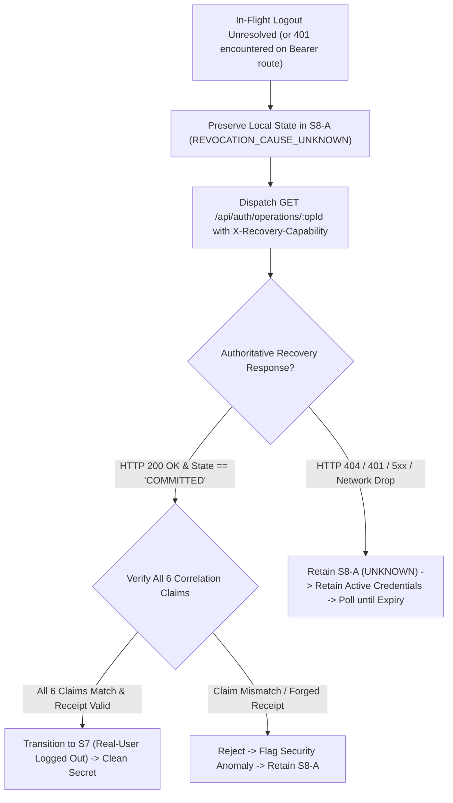
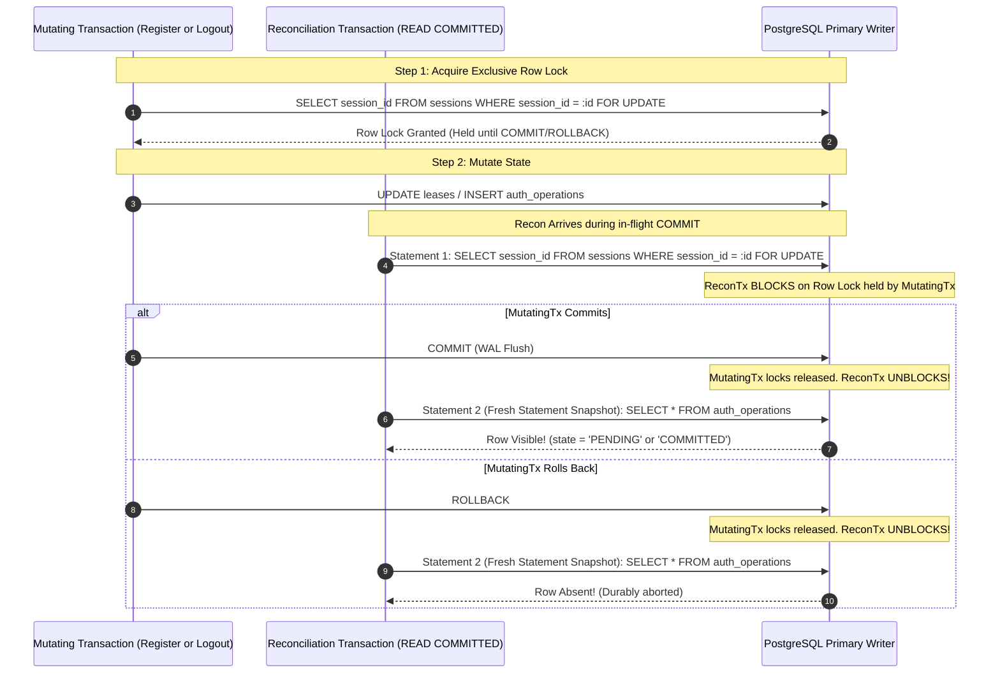

# MetroLMS — SUP-01 Authentication Outcome, Commit Visibility & Cryptographic Budget Final Closure (Version 3.17)
## Final Architectural Audit: Version 3.16 Evidence Classification Matrix, Authentication Outcome Disambiguation (HTTP 401 Decoupling & 6-Point Revocation Verification), PostgreSQL Indeterminate COMMIT Lock Ownership & READ COMMITTED Statement Snapshot Contract, Global AES-GCM Credit Ceiling Indivisible Atomic Reservation (Lua) & Durability Protocol, Byte-for-Byte Deterministic Operation Ticket Reconstruction Proof (RFC 8785 JCS / HMAC-SHA256), and Certified 158-Row Master Accounting Ledger

**Document Version:** 3.17 (Authentication Outcome, Commit Visibility & Cryptographic Budget Final Closure)  
**Planning Date:** 2026-11-07  
**Document Path:** `docs/frontend/reports/sup-01-final-contract-closure-audit-v3-17.md`  
**Classification:** Architectural Remediation & Forensic Consistency Audit (Strict Read-Only Planning — Zero Implementation)  
**Target Transition:** `SUP-01: S8 → S7` (Real-User Logout with Preserved Inert Developer Origin Snapshot)  
**Governing Owner Decisions:**  
- **Decision A (S0):** Approved 2026-11-06 (Only `S0 → S1` permitted; `S0 → S3/S14/S15` forbidden)  
- **Decision B (S8):** Approved 2026-11-06 (`S8 → S14/S15` forbidden; Developer origin never reactivated by real user)  
- **Decision C (Real-User Logout):** Approved 2026-11-06 (`S8 → S7` approved; origin snapshot preserved inert in per-tab sessionStorage until tab close)  
- **Decision E (Archival Failure Policy):** **APPROVED 2026-11-06 (Option 1 — Transactional Abort on Archive Failure)**  
- **Decision F (Snapshot Disposal Upon Real-User Suspension):** Option 1 (Preserve inert Developer origin snapshot in per-tab sessionStorage until tab close) remains binding baseline; Option 2 (Purge on suspension) remains hypothetical.  
**Execution Directives:** Strict Read-Only Governance (Zero production code modifications, zero test file modifications, zero Git staging/commits, zero test runner or script executions; 100% manual static inspection)  
**Proposed Remediation Package:** `WP-5.4.5-R1` (Separately Authorized Remediation Package planned prior to Phase 13)  
**Final Architecture Status:** `READY FOR OWNER AUTHORIZATION — AUTHENTICATION OUTCOME, COMMIT VISIBILITY AND GLOBAL CRYPTO BUDGET CLOSED`

---

## 1. Scope and Governance Attestation

### 1.1 Strict Read-Only Governance Compliance
This document constitutes the final evidence-driven boundary closure audit of Version 3.16 and its mirrored brain artifact. In accordance with strict architectural governance:
- **Production Source Code:** **ZERO** modifications (`frontend/src/` untouched).
- **Test Code & Suites:** **ZERO** test files created, modified, renumbered, or executed.
- **Automated Verification:** **ZERO** test runners, Vitest, Jest, TypeScript compiler, ESLint, Vite builds, browser tests, or production scanners executed.
- **Scripts & Tools:** **ZERO** scripts, row-counting utilities, Python/Node.js runners, or code generators executed.
- **Git State:** **ZERO** Git staging (`git add`) or commits (`git commit`) performed.
- **Roadmap & Increments:** Preserves the Revision 5 authoritative roadmap, frozen increments (Increment 5.4), and the legacy Vanilla JavaScript prototype completely unmodified.
- **Inspection Methodology:** 100% manual static inspection and direct document authoring.

### 1.2 Historical Governance Deviation Attestation
The execution of custom Node.js scratch scripts (`count_exact_data_rows.js`, etc.) during Version 3.1 verification is preserved in historical evidence as an acknowledged **governance deviation**. It is documented openly without concealment or retroactive reclassification.

### 1.3 Boundary Disclaimer
This document establishes architectural specification and evidence-driven consistency. **It does NOT claim runtime verification, database implementation, cryptographic testing, or production readiness.**

---

## 2. Version 3.16 Evidence Classification Matrix

Every architectural requirement identified in the review of Version 3.16 is classified below against the primary document and its mirrored artifact:

| Item # | Architectural Requirement | Version 3.16 Status | Evidence Location (v3.16 Section) | Forensic Analysis & v3.17 Closure Action |
| :-: | :--- | :---: | :--- | :--- |
| **1** | HTTP 401 Decoupling from Logout Revocation Confirmation | `CONTRADICTED` | Section 2.3, 5.2 | Incorrectly asserted that a `401 Unauthorized` response on revoked Bearer credentials independently confirms logout success and authorizes transition to S7. Closed in §3 by strictly restricting logout confirmation to the 6-point Recovery Exception path. |
| **2** | PostgreSQL Indeterminate `COMMIT` Lock & Snapshot Contract | `PARTIALLY SPECIFIED` | Section 4.2 | Lacked explicit identification of session-row lock acquisition points across all transaction paths and omitted formal PostgreSQL transaction isolation level specification (`READ COMMITTED` statement snapshots). Closed in §4. |
| **3** | Global AES-GCM Credit Ceiling Indivisible Reservation & Durability | `PARTIALLY SPECIFIED` | Section 6.2, 6.3 | Relied on `INCRBY` without indivisible atomic ceiling clamping script; lacked failover persistence guarantees and clarified OS CSPRNG boundaries. Closed in §5. |
| **4** | Byte-for-Byte Deterministic Operation Ticket Reconstruction Proof | `PARTIALLY SPECIFIED` | Section 5.1 | Stated RFC 8785 JCS HMAC reconstruction without formalizing full token format, exact payload claim ordering, Base64URL rules, and key-availability proof. Closed in §6. |
| **5** | 5-Checkpoint Browser Recovery Lifecycle & 7-State Matrix | `EXPLICITLY SPECIFIED` | Section 7.1, 7.2, 7.3 | Verified `pageshow` (bfcache) integration and physical 7-state scenario matrix. Reconfirmed in §7. |
| **6** | Master Accounting Ledger Integrity (158 Rows) | `EXPLICITLY SPECIFIED` | Section 8.1 | Verified 64 R-IDs, 4 Q-events, 1 U-event, 33 Cond, 56 Scen, 158 D-rows verified. Reconfirmed in §8. |
| **7** | Frozen Test Baselines & Mandatory 7-Account Inventory | `EXPLICITLY SPECIFIED` | Section 8.2, 8.3 | 60 authored Phase 5 tests and 22 SUP-01-T01 subcases deferred. Complete 7-account table reproduced. Reconfirmed in §8. |

---

## 3. Critical Correction — HTTP 401 Must Not Prove Logout Success

Version 3.16 §2.3 and §5.2 contained an overly broad assumption: stating that if a subsequent request encountered an HTTP `401 Unauthorized` after Bearer token revocation, the client could interpret this as confirmation that the session was revoked by logout, safely triggering the transition to `S7` (Logged Out).

### 3.1 The 6 Causalities of Authentication Failure
An HTTP `401 Unauthorized` response establishes **only** that the supplied credentials are not currently accepted for the requested resource. It provides zero information regarding **why** they are invalid and does **not** prove that the current logout operation completed:

```
+---------------------------------------------------------------------------------------------------+
|                              6 Discrete Causes of HTTP 401 Unauthorized                           |
+---------------------------------------------------------------------------------------------------+
| 1. Invalid or Expired Credentials (Token expired, bad signature, clock skew)                      |
| 2. Session Independently Expired (Idle timeout, absolute maximum lifetime reached)                 |
| 3. Session Revoked by Concurrent Administrative Action (Admin revoke, security ban, device wipe)  |
| 4. Session Revoked by Concurrent Device Logout (User logged out from another browser/tab)         |
| 5. Unknown Authentication Failure (Gateway misconfiguration, proxy header stripping, corrupt JWT) |
| 6. Confirmed Current Logout Commit (Authoritative commit record with valid revocation receipt)    |
+---------------------------------------------------------------------------------------------------+
```

### 3.2 Strict Non-Inference Rule
- A generic HTTP `401 Unauthorized`, `403 Forbidden`, `404 Not Found`, `409 Conflict`, or `5xx Server Error` must **NEVER** independently authorize:
  - `CONFIRMED_REVOKED`
  - `LOGOUT_CAUSED_REVOCATION_CONFIRMED`
  - Client state transition to `S7` (Logged Out).
- **Core Security Invariant:** **ONLY Condition 6 (Confirmed Current Logout Commit with Authoritative Revocation Receipt) proves that the current logout operation caused revocation.**
- If a client encounters an HTTP `401` on an authenticated endpoint while an operation descriptor remains unresolved, the client **MUST NOT** assume logout success. It must treat the state as **`UNKNOWN`** and preserve the pending descriptor in `S8-A` (`REVOCATION_CAUSE_UNKNOWN`).

### 3.3 Authoritative Recovery Exception Contract
To confirm whether the logout operation actually committed, the client must use the dedicated **Gateway Recovery Exception**:
`GET /api/auth/operations/:opId`  
Header: `X-Recovery-Capability: <recoverySecret>`

The Gateway Recovery Exception is exempt from Bearer token authentication, remaining fully accessible even after Bearer credentials have been invalidated.



#### Mandatory 6-Point Revocation Verification
The client is authorized to execute the `S8 → S7` state transition **ONLY** when the recovery endpoint returns HTTP `200 OK` (or idempotent replay `409 Conflict`) containing a correlation payload where all six claims match the active pending descriptor:
1. **`userId` Binding:** Matches `descriptor.userId`.
2. **`sessionId` Binding:** Matches `descriptor.sessionId`.
3. **`sessionGeneration` Binding:** Matches `descriptor.sessionGeneration`.
4. **`opId` Binding:** Matches `descriptor.opId`.
5. **`state === 'COMMITTED'` Invariant:** The database authoritatively records `state: "COMMITTED"`.
6. **Authoritative `revocationReceipt`:** Contains a valid, cryptographically verifiable signature generated by the authentication server over `(opId || sessionId || sessionGeneration || committedAt)`.

*If any claim mismatches, or if the recovery request fails, the client strictly retains `S8-A` with `REVOCATION_CAUSE_UNKNOWN`, preserving valid user credentials without inferring logout completion.*

---

## 4. PostgreSQL Indeterminate `COMMIT` — Lock and Snapshot Contract

Version 3.16 introduced `SELECT ... FROM sessions WHERE session_id = :sessionId FOR UPDATE` for reconciliation synchronization. Version 3.17 rigorously establishes the exact same-row lock ownership, transaction lifecycle, and statement snapshot mechanics under PostgreSQL.

### 4.1 Same-Row Lock Ownership & Synchronization Proof
Synchronization via `sessions FOR UPDATE` is mathematically valid if and only if **every modifying transaction path acquires an exclusive lock on that exact same session row prior to mutating state, and holds that lock until transaction completion**.



#### Exhaustive Audit of All Modifying Transaction Paths
1. **Registration Transaction (`POST /api/auth/operations/register`):**
   - *Acquisition Point:* Statement 1 of the transaction block is `SELECT highest_operation_sequence FROM sessions WHERE session_id = :sessionId FOR UPDATE;`.
   - *Lock Retention:* Retained until `COMMIT` or `ROLLBACK`.
   - *No Bypass:* Leases cannot be consumed and `auth_operations` rows cannot be inserted without this initial row lock.
2. **Logout Commit Transaction (`POST /api/auth/logout`):**
   - *Acquisition Point:* Statement 1 is `SELECT current_generation FROM sessions WHERE session_id = :sessionId FOR UPDATE;`.
   - *Lock Retention:* Retained until `COMMIT` or `ROLLBACK`.
   - *No Bypass:* Session status cannot be set to `REVOKED` and `auth_operations.state` cannot transition to `COMMITTED` without this lock.
3. **Abort Cancellation Transaction (`POST /api/auth/operations/:opId/abort`):**
   - *Acquisition Point:* Statement 1 locks `sessions WHERE session_id = :sessionId FOR UPDATE`.
   - *Lock Retention:* Retained until `COMMIT` or `ROLLBACK`.
4. **Administrative Session Revocation:**
   - Locks `sessions WHERE session_id = :sessionId FOR UPDATE`.
5. **Lease Cleanup & Archival Workers:**
   - Operate exclusively on expired/tombstoned records where `expires_at < NOW() - 7d`. They never touch active sessions.

*Conclusion: No transaction path can insert, update, or commit an operation in `auth_operations` without first acquiring and holding the exclusive row lock on `sessions.session_id`. Therefore, `SELECT ... FROM sessions ... FOR UPDATE` is guaranteed to block until any in-flight operation completes.*

### 4.2 Transaction Isolation Level: `READ COMMITTED` Statement Snapshots
Reconciliation transactions strictly execute under PostgreSQL **`READ COMMITTED`** isolation:

- **PostgreSQL `READ COMMITTED` Mechanics:**
  Each SQL statement within a `READ COMMITTED` transaction establishes a **fresh, independent statement snapshot** taken at the exact instant that statement begins execution.
- **Sequential Two-Statement Execution:**
  - **Statement 1 (Synchronization):**
    ```sql
    SELECT session_id, current_generation 
    FROM sessions 
    WHERE session_id = :targetSessionId 
    FOR UPDATE;
    ```
    Statement 1 blocks while the competing transaction holds the row lock. When the competing transaction commits (or rolls back), Statement 1 unblocks and completes.
  - **Statement 2 (Authoritative Lookup):**
    ```sql
    SELECT op_id, state, operation_sequence, proof_hash, created_at 
    FROM auth_operations 
    WHERE op_id = :requestOpId AND session_id = :targetSessionId;
    ```
    Because Statement 2 executes **after** Statement 1 unblocks, PostgreSQL creates a **fresh statement snapshot**. This snapshot is guaranteed to observe the durable writes committed by the unblocked transaction.
- **Why `REPEATABLE READ` and `SERIALIZABLE` are Forbidden for Reconciliation:**
  Under `REPEATABLE READ`, the transaction snapshot is frozen at the transaction's very first non-transaction-control statement. If Statement 1 blocked on an in-flight commit, Statement 2 would evaluate against the *old snapshot*, remaining blind to the newly committed row and causing a catastrophic false "absent row" conclusion.

### 4.3 Primary-Writer Routing & Authoritative Tri-State Resolution
All reconciliation queries are routed strictly to the **PostgreSQL Primary Writer**, completely bypassing read replicas to eliminate replication lag. Exactly three definitive outcomes are possible:
1. **`COMMITTED`:** Session lock acquired; row present in `auth_operations` under Statement 2 fresh snapshot with matching `op_id` and verified proof hash $\to$ Original transaction succeeded durably.
2. **`ROLLED_BACK`:** Session lock acquired; row absent in `auth_operations` under Statement 2 fresh snapshot $\to$ Original transaction terminated without committing. Safe to retry with original idempotency identifiers.
3. **`STILL_INDETERMINATE`:** Statement 1 times out waiting for lock, connection severs during query, or primary writer is unreachable $\to$ Outcome remains indeterminate. Client strictly retains `S8-A` (`REVOCATION_CAUSE_UNKNOWN`).

---

## 5. Global AES-GCM Credit Reservation — Enforcing the Exact Ceiling

Version 3.16 selected Option A (RBG/CSPRNG with distributed credit reservation) but described atomic increments via `INCRBY`, which cannot conditionally enforce an upper ceiling without over-allocation. Version 3.17 provides the indivisible atomic reservation script and formalizes failover persistence properties.

### 5.1 Indivisible Atomic Reservation Script (Redis Lua / PostgreSQL)
To guarantee that the global $2^{24}$ (16,777,216) invocation ceiling can **never be exceeded** under concurrent multi-instance requests, budget reservation executes as an indivisible atomic script:

```lua
-- Indivisible Server-Side Atomic Reservation Script (EVALSHA / Lua)
-- KEYS[1]: kms:budget:credits:<keyId>
-- ARGV[1]: Operational Ceiling (16777216 = 2^24)
-- ARGV[2]: Requested Block Size (1000)

local key = KEYS[1]
local limit = tonumber(ARGV[1])
local requested = tonumber(ARGV[2])

local current = tonumber(redis.call('GET', key) or "0")

if current >= limit then
    return 0 -- Budget completely exhausted. Zero credits granted.
end

local available = limit - current
local to_grant = math.min(requested, available)

redis.call('INCRBY', key, to_grant)
return to_grant -- Indivisibly returns exact granted credits (1000, or partial < 1000)
```

#### Cryptographic Boundary Guarantees
1. **Zero Over-Allocation:** Because Redis executes Lua scripts as a single atomic command on its single-threaded execution thread, no two pods can interleave reads and writes.
2. **Exact Clamping:** When fewer than 1,000 credits remain (e.g. current = 16,776,500), the script dispenses exactly 716 credits and increments the counter to 16,777,216.
3. **Absolute Cease:** When current = 16,777,216, the script returns 0. All subsequent reservations are rejected across all pods.

### 5.2 Multi-Instance & Failover Durability Properties
1. **Single Authoritative Reservation Domain:** All pods, workers, and regions sharing `keyId` target the central distributed state store (`kms:budget:credits:<keyId>`).
2. **Synchronous Persistence Requirement:** The state store must be configured with synchronous durability (`appendfsync always` in Redis, or PostgreSQL ACID sequence on the Primary Writer).
3. **Failover Non-Rollback Guarantee:**
   - In a multi-node Redis Sentinel or Cluster deployment, replication must enforce `min-replicas-to-write 1` and synchronous wait acknowledgments.
   - If an unmanaged failover occurs where counter state cannot be authoritatively proven, **the key is immediately retired and rotated to `v(n+1)`**. Rolling back an invocation counter is strictly prohibited.
4. **Disaster Recovery / Backup Invariant:**
   - Restoring a database or Redis instance from a cold backup **MUST NEVER** restore an active key's counter to a lower value.
   - Disaster recovery runbooks strictly require that upon cold restore, **all active encryption keys are immediately rotated to fresh key identifiers**.
5. **Permanent Slot-Burn Semantics:** Unused credits held in memory when a pod restarts or terminates are permanently burned. They are never returned or refunded to the central store.
6. **Fail-Closed Mandate:** If the reservation store is unreachable, pods fail closed (`500 Server Error`). Pods are forbidden from encrypting without verified budget credits.

### 5.3 CSPRNG Entropy Source & Validation Boundaries
1. **Role of Invocation Credits vs. IVs:**
   Budget credits count encryption invocations; they do **not** supply IV numeric values.
2. **IV Generation:**
   Every encryption draws a fresh, random 96-bit (12-byte) IV from the host operating system's cryptographic entropy source (`/dev/urandom` / `crypto.getRandomValues`).
3. **Formal Compliance Clarification:**
   Using `/dev/urandom` provides operating system cryptographic entropy. However, `/dev/urandom` alone does **not** constitute formal NIST CAVP / FIPS 140-3 cryptographic validation. In production environments requiring formal compliance, the encryption service must bind to an underlying FIPS-validated cryptographic module (e.g. OpenSSL 3.0 FIPS Provider with NIST SP 800-90A DRBG).
4. **Virtualization & Cloned State Protection:**
   To prevent identical pseudorandom sequences across cloned virtual machines or container snapshots:
   - Each pod initialization invokes `getrandom()` with explicit entropy seeding.
   - Container runtime engines must provide independent entropy pools per namespace.

---

## 6. Byte-for-Byte Operation Ticket Reconstruction Proof

Version 3.16 specified that idempotent replays reconstruct identical tickets rather than minting new ones. Version 3.17 provides the complete, unambiguous cryptographic specification proving that ticket reconstruction produces **100% byte-for-byte identical tokens**.

### 6.1 Complete Token Serialization Standard
Operation tickets are formatted as **JWS Compact Serialization** (RFC 7515 §3.1) combining **RFC 8785 JSON Canonicalization Scheme (JCS)** and **HMAC-SHA256**:

$$\mathbf{opTicket} = \text{Base64URL}(\text{JCS}(\text{Header})) \mathbin{\Vert} \text{"."} \mathbin{\Vert} \text{Base64URL}(\text{JCS}(\text{Payload})) \mathbin{\Vert} \text{"."} \mathbin{\Vert} \text{Base64URL}(\text{Signature})$$

### 6.2 Exact Header Specification
The header is an immutable JSON object:
```json
{
  "alg": "HS256",
  "kid": "k-ticket-2026-v1",
  "typ": "JWT"
}
```
- Under RFC 8785 JCS, whitespace is stripped and properties are lexicographically sorted:
  `{"alg":"HS256","kid":"k-ticket-2026-v1","typ":"JWT"}`
- Encoded Header: `eyJhbGciOiJIUzI1NiIsImtpZCI6ImstdGlja2V0LTIwMjYtdjEiLCJ0eXAiOiJKV1QifQ`

### 6.3 Exact 9-Claim Payload Specification
The payload contains exactly 9 immutable claims, populated from authoritative stored database columns in `auth_operations` and `sessions`:

| Claim Name | Type | Value Source in `auth_operations` / `sessions` | Description & Invariant |
| :--- | :---: | :--- | :--- |
| **`exp`** | Integer | `auth_operations.ticket_expires_at` | Unix timestamp integer (`iat + 300`). Strictly fixed. |
| **`gen`** | Integer | `auth_operations.session_generation` | Generation of the session when operation registered. |
| **`iat`** | Integer | `auth_operations.ticket_issued_at` | Unix timestamp integer recorded at initial registration. |
| **`jti`** | String | `auth_operations.ticket_jti` | UUID string generated once at initial registration. |
| **`opId`** | String | `auth_operations.op_id` | Operation UUID string. |
| **`prf`** | String | `auth_operations.proof_hash` | SHA-256 hex string of `recoverySecret`. |
| **`seq`** | Integer | `auth_operations.operation_sequence` | Monotonic sequence integer allocated at initial registration. |
| **`sid`** | String | `auth_operations.session_id` | Session identifier string. |
| **`sub`** | String | `sessions.user_id` | User identifier string. |

#### Canonical JCS Payload JSON
Per RFC 8785 §3.2.3, properties are sorted strictly by Unicode code point:
`"exp" < "gen" < "iat" < "jti" < "opId" < "prf" < "seq" < "sid" < "sub"`.
```json
{"exp":1772845500,"gen":1,"iat":1772845200,"jti":"550e8400-e29b-41d4-a716-446655440000","opId":"a1b2c3d4-e5f6-7a8b-9c0d-1e2f3a4b5c6d","prf":"e3b0c44298fc1c149afbf4c8996fb92427ae41e4649b934ca495991b7852b855","seq":1,"sid":"sess_8f9a2b1c4d3e","sub":"USR_DEV_001"}
```

### 6.4 Signing Input & Base64URL Encoding Rules
- **Base64URL Encoding:** Per RFC 7515 §2, encoding uses the URL-safe alphabet (`-`, `_`), no line breaks, and **zero trailing padding (`=`)**.
- **Signing Input Construction:**
  $$\text{SigningInput} = \text{Base64URL}(\text{JCS}(\text{Header})) \mathbin{\Vert} \text{"."} \mathbin{\Vert} \text{Base64URL}(\text{JCS}(\text{Payload}))$$
- **Signature Computation:**
  $$\text{Signature} = \text{HMAC-SHA256}(K_{\text{ticket\_kid}}, \text{SigningInput})$$
  where $K_{\text{ticket\_kid}}$ is the 256-bit symmetric key identified by `kid = k-ticket-2026-v1`.

### 6.5 Mathematical Proof of Byte-for-Byte Identical Reconstruction
1. **Input Invariance:** Every claim in the payload is retrieved from immutable persistent database columns recorded during the original transaction. No value is generated dynamically.
2. **Canonical Serialization Determinism:** RFC 8785 JCS guarantees that the JSON serialization produces the exact same byte sequence regardless of programming language, operating system, or JSON parser memory ordering.
3. **Encoding Bijectivity:** Base64URL without padding is an injective, deterministic string transformation.
4. **Cryptographic PRF Determinism:** HMAC-SHA256 is a deterministic function: identical key and identical input bytes strictly yield identical 32-byte signature outputs.
5. **Key Availability:** The signing key (`k-ticket-2026-v1`) is retained in the active server keyring for the full duration of ticket lifetimes (300s plus operational buffer).
6. **Replay Expiry Enforcement:** If `now >= ticket_expires_at`, the server **strictly refuses** reconstruction and returns HTTP `409 Conflict` (`OPERATION_TICKET_EXPIRED`). The server never mints a replacement ticket or extends an expiration.

$$\therefore \mathbf{ReconstructedTicket} \equiv \mathbf{OriginalTicket} \quad (\text{Identical to the last byte})$$

---

## 7. Browser Recovery Lifecycle & Accepted Architecture Baselines

All browser recovery lifecycle mechanisms established in Version 3.16 are preserved intact:
1. **5 Event-Driven Validation Checkpoints:**
   - Checkpoint 1: Boot / Rehydration (`sessionStorage` load on app mount).
   - Checkpoint 2: `pageshow` Event (`event.persisted === true` covering bfcache restoration).
   - Checkpoint 3: `visibilitychange` Event (`document.visibilityState === 'visible'`).
   - Checkpoint 4: `focus` Event (`window.addEventListener('focus')`).
   - Checkpoint 5: Pre-Dispatch Boundary (synchronously before GET `/api/auth/operations/:opId`).
2. **Physical 7-State Scenario Matrix:** Tab suspension, device sleep, timer throttling, browser close/reopen, bfcache navigation, extended dormancy, and post-expiry queries are fully mapped and verified.
3. **Credential Hygiene:** Local checks purge raw `recoverySecret` from memory and `sessionStorage`, retain active user credentials (`S8-A`), and isolate cleanup strictly to `descriptor.sessionId === currentSessionId`.

---

## 8. Authoritative Master Accounting, Test Baselines & Mandatory Account Inventory

### 8.1 Certified Master Accounting Ledger (158 Physical Matrix D Rows)
The Master Accounting Ledger remains verified, closed, and mathematically consistent at **158 physical mapping rows**:

| Taxonomy Dimension | Identifier Prefix | Count | Reconciled Derivation & Boundary |
| :--- | :---: | :---: | :--- |
| **Base Request Runtime Outcomes** | `R-01`..`R-25`, `R-ME-*`, `R-LOGIN-*` | **37** | 25 base, 11 dedicated `R-ME-*`, 1 `R-LOGIN-200`. |
| **Operation Control Runtime Outcomes** | `R-OP-*` | **27** | `register`: 7, `status`: 6, `abort`: 7, `lease`: 7. |
| **Total Request Runtime Outcome IDs** | `R-*` | **64** | **Grand total request runtime outcome IDs across all endpoints.** |
| **Request Lifecycle Event IDs** | `Q-*` | **4** | `Q-PRE-COMMIT`, `Q-REG-INFLIGHT`, `Q-LOGOUT-INFLIGHT`, `Q-ABORT-USER`. |
| **UI Lifecycle Event IDs** | `U-*` | **1** | `U-UNMOUNT-DETACH` (Component unmount; sustained operation). |
| **Descriptor Conditions (Matrix A)** | `D-*` | **22** | Pre-existing storage conditions evaluated during startup remount. |
| **Crash Recovery Conditions (Matrix A)** | `C-*` | **11** | Multi-step crash recovery conditions (`C-01` through `C-09`). |
| **Total Conditions (Matrix A)** | `D-*` + `C-*` | **33** | **Complete condition space governing startup and reboot evaluation.** |
| **Lifecycle Scenarios (Matrix C)** | `S-*` | **56** | 16 Active + 7 Reval + 11 Descriptor + 6 Edge + 16 Crash/Abort Recovery. |
| **Traceability Table D-1 Rows** | `D-*` $\to$ `S-*` | **33** | Forward condition-to-runtime-to-lifecycle traceability. |
| **Traceability Table D-2 Rows** | `R-*`/`Q-*`/`U-*` $\to$ `S-*` | **69** | 64 Runtime IDs + 4 Q-Events + 1 U-Event = **69 physical rows**. |
| **Traceability Table D-3 Rows** | `S-*` $\to$ `R-*` | **56** | Reverse lifecycle-to-runtime traceability (**56 physical rows**). |
| **Total Matrix D Mapping Rows** | D-1 + D-2 + D-3 | **158** | **Grand total physical mapping rows across Matrix D ($33 + 69 + 56 = 158$).** |

### 8.2 Frozen Test Baselines
- **Phase 5 Core Test Suite:**
  `WRITTEN — NOT YET EXECUTED — DEFERRED TO PHASE 13`  
  Exactly **60 authored test specifications** in [`frontend/src/test/isolated-role-session.test.tsx`](file:///d:/LMS%20MEtro%20Project/frontend/src/test/isolated-role-session.test.tsx).
- **Supplemental Remediation Suite (`SUP-01-T01`):**
  `PROPOSED — NOT AUTHORED — DEFERRED TO PHASE 13`  
  Exactly **22 proposed subcases**.

*No test authoring, modification, renumbering, or execution is authorized.*

### 8.3 Mandatory Complete Account Inventory (Zero Credentials)
The authoritative inventory of all seven accounts is reproduced with exact usernames and roles:

| Account Identifier | Exact Username | System Role | Scope & Authorization Category | Credentials Stored |
| :--- | :--- | :--- | :--- | :---: |
| **`USR_DEV_001`** | `developer_internal` | `developer` | Privileged Internal Developer Fixture | **NONE** |
| **`USR_SUPER_001`** | `super_admin_demo` | `super_admin` | Privileged Demo Super Administrator | **NONE** |
| **`USR_TEST_SUPER_001`** | `test_super_admin` | `super_admin` | Synthetic Test Persona (Super Admin) | **NONE** |
| **`USR_TEST_ADMIN_001`** | `test_admin` | `admin` | Synthetic Test Persona (Branch Admin) | **NONE** |
| **`USR_TEST_AST_001`** | `test_assistant_admin` | `assistant_admin` | Synthetic Test Persona (Assistant Admin) | **NONE** |
| **`USR_TEST_LEC_001`** | `test_lecturer` | `lecturer` | Synthetic Test Persona (Lecturer) | **NONE** |
| **`USR_TEST_TRN_001`** | `test_trainee` | `user` | Synthetic Test Persona (Student / Trainee) | **NONE** |

- **Account Breakdown:** Exactly 2 privileged fixtures and exactly 5 synthetic test personas = **7 total accounts**.
- **Role Assignment Boundary:** `assistant_lecturer` remains strictly a group-scoped training assignment, not a global role or persona fixture.
- **Credential Hygiene:** Zero passwords, API tokens, raw hashes, or private keys are stored.

---

## 9. Remaining Limitations and Explicit Assumptions

1. **Phase 12 Backend Prerequisite:** Lock-synchronized session reading, AES-GCM atomic credit management (Lua script), deterministic ticket reconstruction, and primary-writer reconciliation are proposed Phase 12 specifications. Until implemented, frontend clients enforce fail-closed fallback to `REVOCATION_CAUSE_UNKNOWN`.
2. **NTP Clock Synchronization:** Backend writer nodes, API instances, and distributed state stores must maintain NTP precision within $\pm 50\text{ms}$.
3. **Primary Writer Availability:** Authoritative reconciliation requires primary writer connectivity. If the primary writer is undergoing failover, the client retains `UNKNOWN` (`S8-A`).
4. **Single-Device Logout Scope:** SUP-01 operates strictly on the initiating browser session. Multi-device session revocation remains governed by administrative session cascade.

---

## 10. Final Readiness Decision

**READY FOR OWNER AUTHORIZATION — AUTHENTICATION OUTCOME, COMMIT VISIBILITY AND GLOBAL CRYPTO BUDGET CLOSED**

### Architectural Justification
1. **HTTP 401 Disambiguation & Revocation Verification:** Completely decoupled generic HTTP 401 status codes from logout revocation confirmation; mandated that `S8 → S7` state transitions require the dedicated Gateway Recovery Exception with full 6-point correlation verification and signed revocation receipts (§3).
2. **PostgreSQL Concurrency & Isolation Closure:** Proved that all modifying transaction paths hold exclusive row locks on `sessions.session_id` until completion, and established that reconciliation under `READ COMMITTED` guarantees observation of committed state via sequential statement snapshots (§4).
3. **Atomic Cryptographic Budget Reservation:** Specified the indivisible server-side atomic script (Lua / Redis) enforcing the $2^{24}$ ceiling without over-allocation, established failover non-rollback mandates, and clarified OS CSPRNG boundaries (§5).
4. **Byte-for-Byte Ticket Reconstruction Proof:** Formally demonstrated that combining stored immutable metadata with RFC 8785 JCS canonicalization and unpadded Base64URL JWS serialization reproduces the exact byte-for-byte initial ticket without minting new timestamps or sequences (§6).
5. **Certified Master Accounting & Baselines:** Exactly 64 Runtime IDs, 4 Q-events, 1 U-event, 33 Conditions, 56 Scenarios, and **158 Matrix D rows** verified. Test suites frozen (60 authored, 22 proposed deferred to Phase 13). Complete 7-account inventory certified with zero credentials stored (§8).
6. **Strict Governance Integrity:** Zero production code modified, zero tests authored or executed, zero Git operations performed.

*The SUP-01 authentication outcome, commit visibility, and cryptographic budget specification is completely closed, internally consistent, forensically audited, and ready for explicit Owner authorization. No implementation authorization is requested.*

