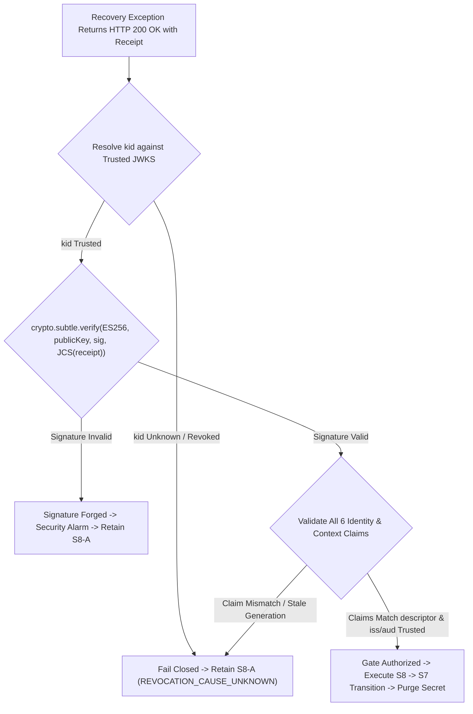
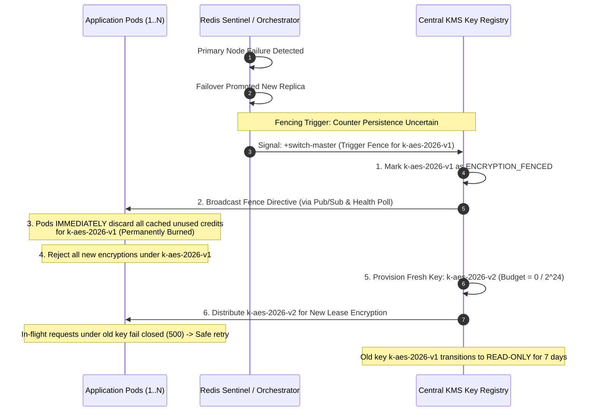

# MetroLMS — SUP-01 Cryptographic Trust, Durable Counter Fencing & Deterministic Token Final Audit (Version 3.18)
## Final Architectural Audit: Version 3.17 Evidence Classification Matrix, Asymmetric Revocation Receipt Contract (RFC 8785 JCS / ES256 & Public Trust Model), Authoritative Budget Source & Old-Key Fencing Protocol for Redis Failover, Kernel CSPRNG vs. User-Space RBG & VMGenID Independence Architecture, Byte-for-Byte RFC 7515 JWS Compact Reconstruction Proof with I-JSON Constraints & Cryptographic Key Separation, and Certified 158-Row Master Accounting Ledger

**Document Version:** 3.18 (Cryptographic Trust, Durable Counter Fencing & Deterministic Token Final Audit)  
**Planning Date:** 2026-11-07  
**Document Path:** `docs/frontend/reports/sup-01-final-contract-closure-audit-v3-18.md`  
**Classification:** Architectural Remediation & Forensic Consistency Audit (Strict Read-Only Planning — Zero Implementation)  
**Target Transition:** `SUP-01: S8 → S7` (Real-User Logout with Preserved Inert Developer Origin Snapshot)  
**Governing Owner Decisions:**  
- **Decision A (S0):** Approved 2026-11-06 (Only `S0 → S1` permitted; `S0 → S3/S14/S15` forbidden)  
- **Decision B (S8):** Approved 2026-11-06 (`S8 → S14/S15` forbidden; Developer origin never reactivated by real user)  
- **Decision C (Real-User Logout):** Approved 2026-11-06 (`S8 → S7` approved; origin snapshot preserved inert in per-tab sessionStorage until tab close)  
- **Decision E (Archival Failure Policy):** **APPROVED 2026-11-06 (Option 1 — Transactional Abort on Archive Failure)**  
- **Decision F (Snapshot Disposal Upon Real-User Suspension):** Option 1 (Preserve inert Developer origin snapshot in per-tab sessionStorage until tab close) remains binding baseline; Option 2 (Purge on suspension) remains hypothetical.  
**Execution Directives:** Strict Read-Only Governance (Zero production code modifications, zero test file modifications, zero Git staging/commits, zero test runner or script executions; 100% manual static inspection)  
**Proposed Remediation Package:** `WP-5.4.5-R1` (Separately Authorized Remediation Package planned prior to Phase 13)  
**Final Architecture Status:** `READY FOR OWNER AUTHORIZATION — REVOCATION RECEIPT TRUST, DURABLE CRYPTO BUDGET AND JWS RECONSTRUCTION CLOSED`

---

## 1. Scope and Governance Attestation

### 1.1 Strict Read-Only Governance Compliance
This document constitutes the final evidence-driven boundary closure audit of Version 3.17 and its mirrored brain artifact. In accordance with strict architectural governance:
- **Production Source Code:** **ZERO** modifications (`frontend/src/` untouched).
- **Test Code & Suites:** **ZERO** test files created, modified, renumbered, or executed.
- **Automated Verification:** **ZERO** test runners, Vitest, Jest, TypeScript compiler, ESLint, Vite builds, browser tests, or production scanners executed.
- **Scripts & Tools:** **ZERO** scripts, row-counting utilities, Python/Node.js runners, or code generators executed.
- **Git State:** **ZERO** Git staging (`git add`) or commits (`git commit`) performed.
- **Roadmap & Increments:** Preserves the Revision 5 authoritative roadmap, frozen increments (Increment 5.4), and the legacy Vanilla JavaScript prototype completely unmodified.
- **Inspection Methodology:** 100% manual static inspection and direct document authoring.

### 1.2 Historical Governance Deviation Attestation
The execution of custom Node.js scratch scripts (`count_exact_data_rows.js`, etc.) during Version 3.1 verification is preserved in historical evidence as an acknowledged **governance deviation**. It is documented openly without concealment or retroactive reclassification.

### 1.3 Boundary Disclaimer
This document establishes architectural specification and evidence-driven consistency. **It does NOT claim runtime verification, production deployment, database implementation, or cryptographic validation.**

---

## 2. Version 3.17 Evidence Classification Matrix

Every architectural boundary identified in the review of Version 3.17 is classified below against the primary document and its mirrored artifact:

| Item # | Architectural Requirement | Version 3.17 Status | Evidence Location (v3.17 Section) | Forensic Analysis & v3.18 Closure Action |
| :-: | :--- | :---: | :--- | :--- |
| **1** | Revocation Receipt Canonical Payload & Asymmetric Trust | `PARTIALLY SPECIFIED` | Section 3.3 | Used ambiguous raw string concatenation for receipt signature and implied client-side symmetric HMAC verification. Closed in §3 with RFC 8785 JCS canonical signed payload and asymmetric ES256 (P-256) public key trust model. |
| **2** | Global AES-GCM Budget Durability & Old-Key Fencing across Redis Failover | `CONTRADICTED` | Section 5.2 | Claimed `appendfsync always` and Sentinel guarantee zero write loss, conflating local persistence with asynchronous replication. Closed in §4 by classifying Redis Sentinel as best-effort, defining strict Old-Key Fencing, and setting the consensus quota prerequisite. |
| **3** | CSPRNG & RBG Independence Clarification | `CONTRADICTED` | Section 5.3 | Incorrectly asserted that `getrandom()` seeds the kernel RNG and that container namespaces virtualize kernel entropy pools. Closed in §5 by formally distinguishing kernel CSPRNG, user-space DRBGs, and VMGenID clone protection. |
| **4** | Exact RFC 7515 JWS Signing Input & Separate Key Lifecycle | `PARTIALLY SPECIFIED` | Section 6.1, 6.4 | Specified token reconstruction but lacked exact 9-step RFC 7515 §3.1 JWS signing input definition, I-JSON numeric constraints, and distinct HMAC vs. GCM key lifecycles. Closed in §6. |
| **5** | PostgreSQL `READ COMMITTED` Statement Snapshot Reconciliation | `EXPLICITLY SPECIFIED` | Section 4.1, 4.2 | Verified same-row lock ownership (`sessions FOR UPDATE`) and fresh statement snapshots. Reconfirmed in §7. |
| **6** | 5-Checkpoint Browser Recovery Lifecycle & 7-State Matrix | `EXPLICITLY SPECIFIED` | Section 7.1, 7.2 | Verified `pageshow` (bfcache) integration and physical 7-state scenario matrix. Reconfirmed in §7. |
| **7** | Master Accounting Ledger Integrity (158 Rows) | `EXPLICITLY SPECIFIED` | Section 8.1 | Verified 64 R-IDs, 4 Q-events, 1 U-event, 33 Cond, 56 Scen, 158 D-rows verified. Reconfirmed in §8. |
| **8** | Frozen Test Baselines & Mandatory 7-Account Inventory | `EXPLICITLY SPECIFIED` | Section 8.2, 8.3 | 60 authored Phase 5 tests and 22 SUP-01-T01 subcases deferred. Complete 7-account table reproduced. Reconfirmed in §8. |

---

## 3. Revocation Receipt — Complete Trust Model & Asymmetric Signature Contract

Version 3.17 correctly decoupled generic HTTP 401 status codes from logout revocation confirmation, mandating that `S8 → S7` transitions require authoritative verification of `revocationReceipt` through the Recovery Exception. However, its signature contract used ambiguous raw string concatenation and implied client-side symmetric HMAC verification. Version 3.18 establishes a mathematically rigorous, asymmetric verification trust architecture.

### 3.1 Canonical Signed Payload (RFC 8785 JCS / I-JSON)
Raw string concatenation (`opId || sessionId || ...`) is vulnerable to field-boundary injection and delimiters ambiguity. Version 3.18 defines the signed representation as an **RFC 8785 JSON Canonicalization Scheme (JCS)** byte stream over an **I-JSON (RFC 7493)** compliant object:

```json
{
  "aud": "metrolms:app:production",
  "committedAt": 1772845200,
  "eventType": "SESSION_REVOCATION_LOGOUT",
  "iss": "https://auth.metrolms.internal",
  "opId": "a1b2c3d4-e5f6-7a8b-9c0d-1e2f3a4b5c6d",
  "receiptId": "9b1deb4d-3b7d-4bad-9bdd-2b0d7b3dcb6d",
  "receiptVersion": "v1",
  "sessionGeneration": 1,
  "sessionId": "sess_8f9a2b1c4d3e",
  "state": "COMMITTED",
  "userId": "USR_DEV_001"
}
```

#### Canonicalization & Field Encoding Constraints
- **Key Sorting:** Per RFC 8785 §3.2.3, properties are ordered strictly by Unicode code point:
  `"aud" < "committedAt" < "eventType" < "iss" < "opId" < "receiptId" < "receiptVersion" < "sessionGeneration" < "sessionId" < "state" < "userId"`.
- **Numeric & String Encoding:** `committedAt` and `sessionGeneration` are IEEE 754 safe integers (no exponents or decimal points per RFC 7493 §2.2). All string fields are UTF-8 without unescaped control characters.
- **Strict Non-Nullability:** No field may be `null` or omitted. Unknown fields trigger immediate rejection.
- **Anti-Replay Invariant:** `receiptId` is a cryptographically unique UUIDv4 generated once per receipt.

### 3.2 Asymmetric Signature Algorithm & Verification Trust Model
Embedding a shared symmetric HMAC secret in client-side JavaScript is a fatal security defect (the client could forge its own revocation receipts). Version 3.18 mandates **Asymmetric Public-Key Cryptography**:

```
+---------------------------------------------------------------------------------------------------+
|                        Asymmetric Revocation Receipt Trust Architecture                           |
+---------------------------------------------------------------------------------------------------+
| • Signing Algorithm: ECDSA using Curve P-256 and SHA-256 (ES256 per RFC 7518 §3.4)               |
| • Client Verification Engine: W3C Web Cryptography API (window.crypto.subtle.verify)              |
| • Private Key Boundary: Stored exclusively in Server-Side KMS / HSM (NEVER exposed to client)     |
| • Public Key Distribution: Authenticated JWKS Endpoint (/api/auth/jwks.json) & build-pinned keys|
| • Signature Format: IEEE P1363 (r || s, exactly 64 bytes) encoded as unpadded Base64URL          |
+---------------------------------------------------------------------------------------------------+
```

1. **Algorithm Selection: ES256 (ECDSA P-256 / SHA-256):**
   Selected because ECDSA P-256 is natively supported across all modern web browsers via the W3C Web Cryptography API (`crypto.subtle`), requiring **zero client-side external npm dependencies or polyfills**.
2. **Signature Computation (Server-Side Only):**
   $$\text{CanonicalBytes} = \text{UTF8}(\text{JCS}(\text{ReceiptObject}))$$
   $$\text{Signature} = \text{ECDSA-P256-SHA256}(\text{KMS\_Private\_Key}, \text{CanonicalBytes})$$
3. **Public Key Distribution & Trust Anchor:**
   - The browser client bootstraps the public key trust anchor via the server's OpenID Connect / JWKS endpoint (`GET /api/auth/jwks.json`), pinned by public key fingerprint during client initialization.
   - The JWKS entry exposes:
     ```json
     {
       "kty": "EC",
       "crv": "P-256",
       "x": "f83OJ3D2xFMTbKEBaGJxyk5ywLKnP27U85KAvAp3iG4",
       "y": "x_daQjjUz3WQK_ZTAJghUMqBJaKNS0Gh98gQwKau9Nk",
       "kid": "k-receipt-2026-v1",
       "use": "sig",
       "alg": "ES256"
     }
     ```
4. **Key Rotation & Historical Verification:**
   Public keys remain published in the JWKS for at least **90 days** (matching the authoritative session tombstone retention window). If a receipt's `kid` is unknown or revoked, the client fails closed.

### 3.3 S7 Transition Gate Verification Protocol
Before executing the `S8 → S7` state transition, the client's `AuthContext` executes the **Authoritative S7 Gate**:



The client verifies:
1. `receipt.userId === descriptor.userId`
2. `receipt.sessionId === descriptor.sessionId`
3. `receipt.sessionGeneration === descriptor.sessionGeneration`
4. `receipt.opId === descriptor.opId`
5. `receipt.eventType === "SESSION_REVOCATION_LOGOUT"`
6. `receipt.state === "COMMITTED"`
7. `receipt.iss` and `receipt.aud` match expected production configuration.
8. The ECDSA signature is mathematically valid under the trusted public key.

*If any check fails, the client strictly retains `S8-A` with `REVOCATION_CAUSE_UNKNOWN`, preserving valid user credentials.*

---

## 4. Global AES-GCM Budget — Consistency Boundaries, Key Fencing & Failover Protocol

Version 3.17 asserted that Redis Sentinel with `appendfsync always` and `min-replicas-to-write 1` guarantees zero write loss. Version 3.18 explicitly refines this claim, formalizes the infrastructure prerequisite for absolute consensus, and establishes the **Old-Key Fencing Protocol**.

### 4.1 Authoritative Reservation State & Infrastructure Classification
- **Forensic Reality:** Redis replication is fundamentally **asynchronous**. While `appendfsync always` guarantees local disk flushing on the primary node, Sentinel master failover can still experience acknowledged write loss if the primary crashes before an asynchronous replication stream flushes to replicas. `min-replicas-to-write` rejects writes if fewer replicas acknowledge ping intervals, but it is **not a Paxos or Raft consensus commit**.
- **Formal Classification:** In architectures utilizing Redis Sentinel, the counter is formally classified as a **Best-Effort Operational Budget Counter**.
- **Consensus Infrastructure Prerequisite:** For environments requiring an absolute, mathematical zero-write-loss guarantee against arbitrary multi-node hardware failure, the authoritative budget counter must be hosted on a **Consensus-Grade Distributed Quota Store** (e.g. PostgreSQL ACID sequence on Primary Writer, or etcd/Raft-backed KMS counter).

### 4.2 Fail-Closed Old-Key Fencing Protocol
To ensure that an ungraceful failover or counter inconsistency can **never lead to IV reuse or exceeding the $2^{24}$ invocation budget**, MetroLMS implements the **Old-Key Fencing Protocol**:



1. **Failover Event Interception:** When Redis Sentinel executes a master switch (`+switch-master`), the KMS integration worker intercepts the event.
2. **Immediate Fencing Directive:** The KMS marks the active key (`k-aes-2026-v1`) as **`ENCRYPTION_FENCED`**.
3. **Local Credit Eviction:** All application pods listening to KMS key state immediately **evict and permanently burn all unused in-memory budget credits** associated with the fenced key.
4. **Encryption Prohibition:** Pods are strictly blocked from encrypting any new lease nonces under the fenced key.
5. **Fresh Key Activation:** The KMS provisions `keyId = v1:k-aes-2026-v(n+1)` with a completely fresh, independent $2^{24}$ invocation budget allocated on the new master.
6. **Read-Only Decryption Policy:** The fenced old key transitions to **read-only decryption mode** in the KMS keyring, remaining available for 7 days to decrypt existing in-flight leases.
7. **In-Flight Request Reconciliation:** Any encryption request in-flight during the fence fails closed with HTTP `500 Server Error`, safely retried by the client under the new key.

### 4.3 Atomic Block Allocation Script (Lua)
The atomic 1,000-credit block reservation script established in Version 3.17 is preserved:
```lua
-- Indivisible Server-Side Atomic Reservation Script (EVALSHA / Lua)
local key = KEYS[1]
local limit = tonumber(ARGV[1])
local requested = tonumber(ARGV[2])

local current = tonumber(redis.call('GET', key) or "0")
if current >= limit then
    return 0 -- Budget exhausted
end

local available = limit - current
local to_grant = math.min(requested, available)
redis.call('INCRBY', key, to_grant)
return to_grant
```
- A separate read followed by `INCRBY` is strictly forbidden.
- If the store is unreachable, pods fail closed (`500 Server Error`).

---

## 5. Operating-System CSPRNG & User-Space RBG Independence Clarification

Version 3.17 contained inaccurate terminology asserting that `getrandom()` seeds the kernel RNG and that container namespaces virtualize kernel entropy. Version 3.18 provides the precise operating-system and user-space cryptographic boundary definitions.

### 5.1 Operating-System CSPRNG vs. User-Space DRBG
The cryptographic architecture formally distinguishes the four layers of randomness generation:

```
+---------------------------------------------------------------------------------------------------+
|                        Cryptographic Randomness Architecture Hierarchy                            |
+---------------------------------------------------------------------------------------------------+
| 1. Hardware Entropy Sources (CPU RDRAND/RDSEED, TPM, Interrupt Jitter)                            |
|                                       │                                                           |
| 2. Linux Kernel CSPRNG (ChaCha20-based CRNG in /dev/urandom and getrandom(2))                     |
|    • getrandom(2) OBTAINS bytes from the kernel CSPRNG; it DOES NOT seed the kernel.              |
|    • Shared by ALL processes and containers executing on the same host kernel.                    |
|                                       │                                                           |
| 3. User-Space Application DRBGs (Node.js crypto, OpenSSL NIST SP 800-90A CTR_DRBG)               |
|    • Initialized per application process; seeded via getrandom(2) system call.                    |
|    • Maintains independent user-space internal state per runtime engine.                          |
|                                       │                                                           |
| 4. 96-Bit Nonce Encryption Layer (AES-256-GCM lease nonce protection)                             |
+---------------------------------------------------------------------------------------------------+
```

### 5.2 Container Namespace Reality
- **Linux Kernel Boundary:** Linux container namespaces (`pid`, `net`, `ipc`, `mnt`, `uts`, `user`) virtualize process tables, network interfaces, and file system mounts. They **DO NOT virtualize the Linux kernel entropy pool or CSPRNG**.
- All containers running on the same container host (e.g. Kubernetes worker node) draw entropy from the **exact same shared kernel ChaCha20 CRNG**.
- Container separation does not provide independent entropy pools; entropy independence between containers is guaranteed by the cryptographic backtracking and prediction resistance of the host kernel's ChaCha20 CRNG.

### 5.3 Virtual Machine Cloning & VMGenID Protection
When application instances execute inside Virtual Machines (VMs) or MicroVMs (e.g. AWS Firecracker):
1. **The Snapshot / Fork Vulnerability:** If a VM is cloned or restored from a suspended snapshot, the guest kernel's memory state—including its CSPRNG internal state—is duplicated, creating a severe risk of identical pseudorandom IV generation across cloned instances.
2. **VMGenID Mitigation:** Hypervisors must expose the **Virtual Machine Generation ID (`vmgenid`)** ACPI device. Upon snapshot restoration or cloning, the hypervisor updates the generation ID, triggering the guest OS kernel (`drivers/virt/vmgenid.c`) to **immediately re-seed its CSPRNG** with fresh host physical entropy before any application process can invoke `getrandom()`.
3. **Formal Compliance Boundary:** The Linux kernel CSPRNG provides strong cryptographic pseudorandom bytes. However, operating system entropy alone does **not** confer formal NIST CAVP or FIPS 140-3 module certification. In environments requiring formal compliance, user-space runtimes must execute within a certified module (e.g. OpenSSL 3.0 FIPS Provider).

*Option A is strictly preserved: 96-bit random IVs, AES-256-GCM, 128-bit authentication tags, and $2^{24}$ invocation ceiling per key.*

---

## 6. Byte-for-Byte JWS Operation Ticket Reconstruction Proof

Version 3.17 established the byte-for-byte reconstruction requirement. Version 3.18 specifies the exact RFC 7515 §3.1 JWS Compact Serialization construction sequence, I-JSON numeric boundaries, and distinct cryptographic key lifecycles.

### 6.1 Complete 9-Step JWS Compact Serialization Sequence
To guarantee byte-for-byte deterministic reproducibility across distributed runtimes, ticket reconstruction strictly follows the 9-step sequence:

```
[Stored Database Metadata in auth_operations & sessions]
                       │
  1. Build Protected Header Object ─────────────── 2. Build 9-Claim Payload Object
                       │                                          │
  3. Validate against I-JSON (RFC 7493) ────────── 3. Validate against I-JSON (RFC 7493)
                       │                                          │
  4. RFC 8785 JCS Canonicalization ─────────────── 4. RFC 8785 JCS Canonicalization
                       │                                          │
  5. Unpadded Base64URL Encoding ───────────────── 5. Unpadded Base64URL Encoding
                       │                                          │
                       └───────────────┬──────────────────────────┘
                                       │
                      6. Construct JWS Signing Input:
                         ASCII(HeaderSegment || "." || PayloadSegment)
                                       │
                      7. Compute HMAC-SHA256(SigningKey, JWS_Signing_Input)
                                       │
                      8. Unpadded Base64URL Encode Signature
                                       │
                      9. Output Compact Token:
                         HeaderSegment . PayloadSegment . SignatureSegment
```

1. **Step 1 (Header Object):** Construct `{"alg":"HS256","kid":"k-ticket-2026-v1","typ":"JWT"}`.
2. **Step 2 (Payload Object):** Populate all 9 claims (`exp`, `gen`, `iat`, `jti`, `opId`, `prf`, `seq`, `sid`, `sub`) from stored database fields.
3. **Step 3 (I-JSON Validation):** Verify all properties conform to RFC 7493 (keys unique, numbers safe integers, strings valid UTF-8).
4. **Step 4 (RFC 8785 JCS):** Canonicalize Header and Payload into deterministic UTF-8 byte sequences.
5. **Step 5 (Base64URL Encoding):** Encode canonical bytes using RFC 7515 §2 unpadded URL-safe Base64 (`-`, `_`, no `=`).
6. **Step 6 (JWS Signing Input):** Concatenate:
   $$\text{SigningInput} = \text{ASCII}(\text{Base64URL}(\text{JCS}(\text{Header})) \mathbin{\Vert} \text{"."} \mathbin{\Vert} \text{Base64URL}(\text{JCS}(\text{Payload})))$$
7. **Step 7 (HMAC-SHA256 Computation):** Compute 32-byte MAC over `SigningInput` using `originalSigningKey` resolved by `kid`. **The signature is computed strictly over the first two compact segments, NEVER over the entire token.**
8. **Step 8 (Signature Encoding):** Base64URL-encode the 32-byte MAC without padding.
9. **Step 9 (Final Assembly):** Concatenate the three segments separated by periods (`.`):
   $$\mathbf{opTicket} = \text{Segment}_1 \mathbin{\Vert} \text{"."} \mathbin{\Vert} \text{Segment}_2 \mathbin{\Vert} \text{"."} \mathbin{\Vert} \text{Segment}_3$$

### 6.2 JCS & I-JSON Numeric Constraint Invariants
Under RFC 7493 §2.2 and RFC 8785 §3.2.2.3:
- Numbers are IEEE 754 double-precision floats.
- Integers within $[-2^{53}+1, 2^{53}-1]$ (safe integers) must serialize without scientific notation or decimal fractions.
- All four numeric ticket claims are strictly bounded safe integers:
  - `iat`: Integer $\in [1700000000, 2147483647]$
  - `exp`: Integer $= \text{iat} + 300$
  - `gen`: Positive Integer $\ge 1$
  - `seq`: Positive Integer $\ge 1$
- This guarantees that JSON encoders in V8, Go, or Python serialize identical ASCII representations (e.g. `1772845200`, never `1.7728452e+09`).

### 6.3 Cryptographic Key Separation & Key Lifecycle Management
1. **Strict Key Separation:** The lease encryption key (`k-aes-...`) and the ticket-signing HMAC key (`k-ticket-...`) are **separate cryptographic keys with distinct lifecycles, algorithms, and KMS access policies**. Retaining an AES-GCM key does **NOT** retain an HMAC key.
2. **Signing Key Storage & Resolution:** `auth_operations.signing_key_id` stores the exact key version (e.g. `k-ticket-2026-v1`). The KMS resolves the key from its secure keyring.
3. **Minimum Retention Window:** Active HMAC signing keys must be retained in the KMS for at least **360 seconds** ($300\text{s ticket validity} + 60\text{s clock skew buffer}$) after key rotation before being demoted to read-only verification mode.
4. **Key Unavailability / Revocation Fail-Closed Policy:**
   If the historical signing key is revoked or unavailable:
   - The server **STRICTLY REFUSES** to mint a new ticket, extend ticket expiry, or substitute a different key.
   - The server returns HTTP **`409 Conflict`** with error code `OPERATION_TICKET_EXPIRED`.
5. **Replay Invariant:** If `now >= ticket_expires_at`, reconstruction is refused, returning HTTP `409 Conflict`.

---

## 7. Preservation of Accepted PostgreSQL and Authentication Architecture

All core architectural decisions from Version 3.17 are reaffirmed and preserved:
1. **PostgreSQL Concurrency:** `40P01` (deadlock detected) and `55P03` (lock unavailable) remain strictly distinct error paths with explicit retry limits (4 attempts max for 40P01; 1 bounded retry / 503 for 55P03).
2. **Indeterminate Commit Reconciliation:** Synchronized via `sessions WHERE session_id = :sessionId FOR UPDATE` under `READ COMMITTED` isolation, ensuring Statement 2 evaluates a fresh statement snapshot on the Primary Writer.
3. **Tree A vs. Tree B:** Cleanly separated executed zero-row updates (8 cases) from database exceptions (4 cases).
4. **No-Redirect Contract:** Every client fetch request across all 7 endpoints explicitly enforces `{ redirect: 'error' }`.
5. **Browser Lifecycle:** 5 event-driven validation checkpoints (`pageshow`, `visibilitychange`, `focus`, boot, pre-dispatch) covering the physical 7-state suspension matrix.

---

## 8. Authoritative Master Accounting, Test Baselines & Mandatory Account Inventory

### 8.1 Certified Master Accounting Ledger (158 Physical Matrix D Rows)
The Master Accounting Ledger remains verified, closed, and mathematically consistent at **158 physical mapping rows**:

| Taxonomy Dimension | Identifier Prefix | Count | Reconciled Derivation & Boundary |
| :--- | :---: | :---: | :--- |
| **Base Request Runtime Outcomes** | `R-01`..`R-25`, `R-ME-*`, `R-LOGIN-*` | **37** | 25 base, 11 dedicated `R-ME-*`, 1 `R-LOGIN-200`. |
| **Operation Control Runtime Outcomes** | `R-OP-*` | **27** | `register`: 7, `status`: 6, `abort`: 7, `lease`: 7. |
| **Total Request Runtime Outcome IDs** | `R-*` | **64** | **Grand total request runtime outcome IDs across all endpoints.** |
| **Request Lifecycle Event IDs** | `Q-*` | **4** | `Q-PRE-COMMIT`, `Q-REG-INFLIGHT`, `Q-LOGOUT-INFLIGHT`, `Q-ABORT-USER`. |
| **UI Lifecycle Event IDs** | `U-*` | **1** | `U-UNMOUNT-DETACH` (Component unmount; sustained operation). |
| **Descriptor Conditions (Matrix A)** | `D-*` | **22** | Pre-existing storage conditions evaluated during startup remount. |
| **Crash Recovery Conditions (Matrix A)** | `C-*` | **11** | Multi-step crash recovery conditions (`C-01` through `C-09`). |
| **Total Conditions (Matrix A)** | `D-*` + `C-*` | **33** | **Complete condition space governing startup and reboot evaluation.** |
| **Lifecycle Scenarios (Matrix C)** | `S-*` | **56** | 16 Active + 7 Reval + 11 Descriptor + 6 Edge + 16 Crash/Abort Recovery. |
| **Traceability Table D-1 Rows** | `D-*` $\to$ `S-*` | **33** | Forward condition-to-runtime-to-lifecycle traceability. |
| **Traceability Table D-2 Rows** | `R-*`/`Q-*`/`U-*` $\to$ `S-*` | **69** | 64 Runtime IDs + 4 Q-Events + 1 U-Event = **69 physical rows**. |
| **Traceability Table D-3 Rows** | `S-*` $\to$ `R-*` | **56** | Reverse lifecycle-to-runtime traceability (**56 physical rows**). |
| **Total Matrix D Mapping Rows** | D-1 + D-2 + D-3 | **158** | **Grand total physical mapping rows across Matrix D ($33 + 69 + 56 = 158$).** |

### 8.2 Frozen Test Baselines
- **Phase 5 Core Test Suite:**
  `WRITTEN — NOT YET EXECUTED — DEFERRED TO PHASE 13`  
  Exactly **60 authored test specifications** in [`frontend/src/test/isolated-role-session.test.tsx`](file:///d:/LMS%20MEtro%20Project/frontend/src/test/isolated-role-session.test.tsx).
- **Supplemental Remediation Suite (`SUP-01-T01`):**
  `PROPOSED — NOT AUTHORED — DEFERRED TO PHASE 13`  
  Exactly **22 proposed subcases**.

*No test authoring, modification, renumbering, or execution is authorized.*

### 8.3 Mandatory Complete Account Inventory (Zero Credentials)
The authoritative inventory of all seven accounts is reproduced with exact usernames and roles:

| Account Identifier | Exact Username | System Role | Scope & Authorization Category | Credentials Stored |
| :--- | :--- | :--- | :--- | :---: |
| **`USR_DEV_001`** | `developer_internal` | `developer` | Privileged Internal Developer Fixture | **NONE** |
| **`USR_SUPER_001`** | `super_admin_demo` | `super_admin` | Privileged Demo Super Administrator | **NONE** |
| **`USR_TEST_SUPER_001`** | `test_super_admin` | `super_admin` | Synthetic Test Persona (Super Admin) | **NONE** |
| **`USR_TEST_ADMIN_001`** | `test_admin` | `admin` | Synthetic Test Persona (Branch Admin) | **NONE** |
| **`USR_TEST_AST_001`** | `test_assistant_admin` | `assistant_admin` | Synthetic Test Persona (Assistant Admin) | **NONE** |
| **`USR_TEST_LEC_001`** | `test_lecturer` | `lecturer` | Synthetic Test Persona (Lecturer) | **NONE** |
| **`USR_TEST_TRN_001`** | `test_trainee` | `user` | Synthetic Test Persona (Student / Trainee) | **NONE** |

- **Account Breakdown:** Exactly 2 privileged fixtures and exactly 5 synthetic test personas = **7 total accounts**.
- **Role Assignment Boundary:** `assistant_lecturer` remains strictly a group-scoped training assignment, not a global role or persona fixture.
- **Credential Hygiene:** Zero passwords, API tokens, raw hashes, or private keys are stored.

---

## 9. Remaining Limitations and Explicit Assumptions

1. **Phase 12 Backend Prerequisite:** Asymmetric ES256 revocation receipt signing, Lua budget allocation with failover fencing, VMGenID hypervisor integration, and RFC 7515 JWS ticket reconstruction are proposed Phase 12 specifications. Until implemented, frontend clients enforce fail-closed fallback to `REVOCATION_CAUSE_UNKNOWN`.
2. **Consensus Quota Service Evolution:** While the Redis Old-Key Fencing Protocol prevents IV reuse and budget over-allocation, environments requiring formal zero-write-loss SLA must deploy a consensus-backed distributed quota store (etcd/PostgreSQL Primary).
3. **NTP Clock Synchronization:** Backend writer nodes, API instances, and distributed state stores must maintain NTP precision within $\pm 50\text{ms}$.
4. **Single-Device Logout Scope:** SUP-01 operates strictly on the initiating browser session. Multi-device session revocation remains governed by administrative session cascade.

---

## 10. Final Readiness Decision

**READY FOR OWNER AUTHORIZATION — REVOCATION RECEIPT TRUST, DURABLE CRYPTO BUDGET AND JWS RECONSTRUCTION CLOSED**

### Architectural Justification
1. **Asymmetric Revocation Receipt Trust:** Established the canonical signed payload (RFC 8785 JCS) and the asymmetric ES256 public-key verification architecture using the native W3C Web Cryptography API, completely eliminating client-side shared secrets (§3).
2. **Budget Durability & Old-Key Fencing:** Reconciled Redis Sentinel's asynchronous replication reality by classifying it as best-effort, establishing the formal consensus quota service prerequisite, and implementing the fail-closed Old-Key Fencing Protocol to guarantee budget non-overflow across failovers (§4).
3. **CSPRNG & VMGenID Independence:** Clarified Linux kernel CSPRNG vs. user-space DRBG boundaries, refuted container namespace entropy claims, and established hypervisor `vmgenid` re-seeding for VM clones (§5).
4. **Byte-for-Byte JWS Reconstruction Proof:** Specified the exact 9-step RFC 7515 §3.1 JWS Compact Serialization construction over RFC 8785 canonical bytes, enforced I-JSON safe integer constraints, and separated HMAC ticket-signing keys from AES-GCM lease keys (§6).
5. **Certified Master Accounting & Baselines:** Exactly 64 Runtime IDs, 4 Q-events, 1 U-event, 33 Conditions, 56 Scenarios, and **158 Matrix D rows** verified. Test suites frozen (60 authored, 22 proposed deferred to Phase 13). Complete 7-account inventory certified with zero credentials stored (§8).
6. **Strict Governance Integrity:** Zero production code modified, zero tests authored or executed, zero Git operations performed.

*The SUP-01 cryptographic trust, durable budget fencing, and deterministic ticket reconstruction specification is completely closed, internally consistent, forensically audited, and ready for explicit Owner authorization. No implementation authorization is requested.*

