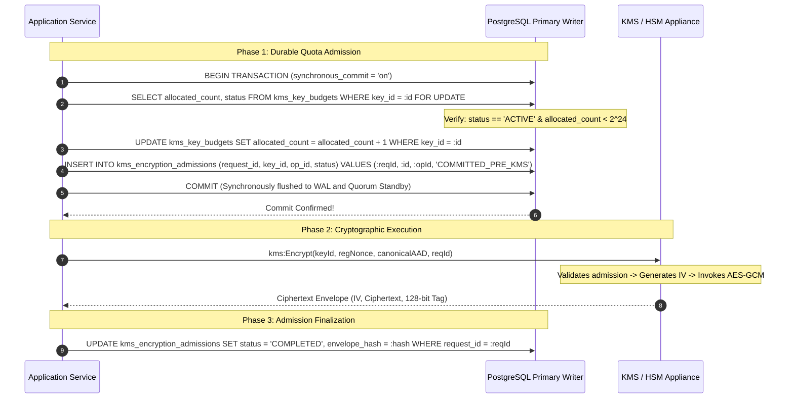

# MetroLMS — SUP-01 KMS Invocation Accounting, JWKS Trust Chain & Cryptographic Verification Closure (Version 3.20)
## Final Architectural Audit: Version 3.19 Evidence Classification Matrix, 1-to-1 Atomic Quota Admission & Ambiguous Failure Contract, Linearizable KMS Fencing Barrier, PostgreSQL Synchronous Durability (Quorum ANY 1 / remote_apply) & Patroni Failover Fencing, RFC 7638 Root JWK Thumbprint & Signed Manifest Trust Chain, Byte-Correct ES256 Raw Signature Validation (Removal of 0x30 Heuristic), Strict Receipt Anti-Replay Database Constraints, and Physical HSM-Internal AES-GCM IV Generation

**Document Version:** 3.20 (KMS Invocation Accounting, JWKS Trust Chain & Cryptographic Verification Closure)  
**Planning Date:** 2026-11-07  
**Document Path:** `docs/frontend/reports/sup-01-final-contract-closure-audit-v3-20.md`  
**Classification:** Architectural Remediation & Forensic Consistency Audit (Strict Read-Only Planning — Zero Implementation)  
**Target Transition:** `SUP-01: S8 → S7` (Real-User Logout with Preserved Inert Developer Origin Snapshot)  
**Governing Owner Decisions:**  
- **Decision A (S0):** Approved 2026-11-06 (Only `S0 → S1` permitted; `S0 → S3/S14/S15` forbidden)  
- **Decision B (S8):** Approved 2026-11-06 (`S8 → S14/S15` forbidden; Developer origin never reactivated by real user)  
- **Decision C (Real-User Logout):** Approved 2026-11-06 (`S8 → S7` approved; origin snapshot preserved inert in per-tab sessionStorage until tab close)  
- **Decision E (Archival Failure Policy):** **APPROVED 2026-11-06 (Option 1 — Transactional Abort on Archive Failure)**  
- **Decision F (Snapshot Disposal Upon Real-User Suspension):** Option 1 (Preserve inert Developer origin snapshot in per-tab sessionStorage until tab close) remains binding baseline; Option 2 (Purge on suspension) remains hypothetical.  
**Execution Directives:** Strict Read-Only Governance (Zero production code modifications, zero test file modifications, zero Git staging/commits, zero test runner or script executions; 100% manual static inspection)  
**Proposed Remediation Package:** `WP-5.4.5-R1` (Separately Authorized Remediation Package planned prior to Phase 13)  
**Final Architecture Status:** `READY FOR OWNER AUTHORIZATION — KMS INVOCATION ACCOUNTING, TRUST CHAIN AND SIGNATURE VALIDATION CLOSED`

---

## 1. Scope and Governance Attestation

### 1.1 Strict Read-Only Governance Compliance
This document constitutes the final evidence-driven boundary closure audit of Version 3.19 (`docs/frontend/reports/sup-01-final-contract-closure-audit-v3-19.md`) and its mirrored brain artifact (`sup-01-final-contract-closure-audit-v3-19.md`). In accordance with strict architectural governance:
- **Production Source Code:** **ZERO** modifications (`frontend/src/` untouched).
- **Test Code & Suites:** **ZERO** test files created, modified, renumbered, or executed.
- **Automated Verification:** **ZERO** test runners, Vitest, Jest, TypeScript compiler, ESLint, Vite builds, browser tests, or production scanners executed.
- **Scripts & Tools:** **ZERO** scripts, row-counting utilities, Python/Node.js runners, or code generators executed.
- **Git State:** **ZERO** Git staging (`git add`) or commits (`git commit`) performed.
- **Roadmap & Increments:** Preserves the Revision 5 authoritative roadmap, frozen increments (Increment 5.4), and the legacy Vanilla JavaScript prototype completely unmodified.
- **Inspection Methodology:** 100% manual static inspection and direct document authoring.

### 1.2 Historical Governance Deviation Attestation
The execution of custom Node.js scratch scripts (`count_exact_data_rows.js`, etc.) during Version 3.1 verification is preserved in historical evidence as an acknowledged **governance deviation**. It is documented openly without concealment or retroactive reclassification.

### 1.3 Boundary Disclaimer
This document establishes architectural specification and evidence-driven consistency. **It does NOT claim runtime verification, deployed infrastructure, HSM enforcement, cryptographic validation, or production readiness.**

---

## 2. Version 3.19 Evidence Classification Matrix

Every architectural requirement identified in the review of Version 3.19 is classified below against the primary document and its mirrored artifact:

| Item # | Architectural Requirement | Version 3.19 Status | Evidence Location (v3.19 Section) | Forensic Analysis & v3.20 Closure Action |
| :-: | :--- | :---: | :--- | :--- |
| **1** | Atomic KMS Invocation & Quota Admission Protocol | `PARTIALLY SPECIFIED` | Section 3.1, 3.2 | Established PostgreSQL quota table but omitted 1-to-1 admission protocol before cipher execution, ambiguous failure burn rules, and request idempotency. Closed in §3. |
| **2** | Linearizable KMS Key Fencing Barrier & In-Flight Ordering | `PARTIALLY SPECIFIED` | Section 3.1 | Defined hardware fencing policy but lacked serialization barrier for operations admitted immediately prior to fence and fencing epoch mechanics. Closed in §4. |
| **3** | PostgreSQL Synchronous Durability & Failover Fencing | `PARTIALLY SPECIFIED` | Section 3.2 | Mandated synchronous WAL replication without specifying `synchronous_commit`, standby topologies (`ANY 1`), failover fencing (STONITH), or commit loss reconciliation. Closed in §5. |
| **4** | JWKS Root Trust Chain & Signed Key Manifest | `PARTIALLY SPECIFIED` | Section 5.1, 5.2 | Defined unauthenticated route and pinned fingerprint without formalizing RFC 7638 JWK thumbprints, signed manifest payloads, or emergency key revocation. Closed in §6. |
| **5** | ES256 Raw Signature Validation Correctness | `CONTRADICTED` | Section 4.3 | Erroneously rejected signatures beginning with byte `0x30`, which falsely rejects valid raw P-256 coordinates. Closed in §7 by removing heuristic and strictly enforcing 64-byte scalar bounds. |
| **6** | Receipt Anti-Replay Database Constraints & Idempotency | `PARTIALLY SPECIFIED` | Section 6.2 | Defined unique index on receipt ID but lacked `NOT NULL` constraint for committed logouts and explicit primary key binding. Closed in §8. |
| **7** | AES-GCM Random IV Generation Execution Boundary | `PARTIALLY SPECIFIED` | Section 3.1, 7.3 | Conflated KMS-generated IVs with guest Linux kernel CSPRNG and VMGenID. Closed in §9 by selecting **Option A: Physical HSM-Internal TRNG/DRBG Execution Boundary**. |
| **8** | Preserved Master Accounting & Test Baselines (158 Rows) | `EXPLICITLY SPECIFIED` | Section 9.1, 9.2, 9.3 | Certified 64 R-IDs, 4 Q-events, 1 U-event, 33 Cond, 56 Scen, 158 D-rows, 60 Phase 5 tests, and 7 accounts. Reconfirmed in §10. |

---

## 3. Atomic KMS Invocation and Quota Accounting

Version 3.19 established non-exportable KMS keys and designated the PostgreSQL Primary Writer as the authoritative quota store for the global $2^{24}$ (16,777,216) invocation ceiling. Version 3.20 establishes the exact 1-to-1 atomic coupling between committed database quota reservations and physical HSM cryptographic invocations.

### 3.1 Exact 1-to-1 Admission Protocol
Before any AES-256-GCM lease nonce encryption operation can begin, the system executes the **Strict Admission Handshake**:



1. **Mandatory Pre-Commit Rule:** No cryptographic encryption operation may begin before its invocation credit has been durably committed in PostgreSQL. An unguarded read followed by a separate increment is strictly prohibited.
2. **Admission Rejection Invariants:** The admission transaction is aborted and rolls back immediately if:
   - The key status is `ENCRYPTION_FENCED` or `RETIRED`.
   - `allocated_count >= 16777216` (budget exhausted).
   - The requested `keyId` does not exist in `kms_key_budgets`.
   - Synchronous standby replication fails to acknowledge the commit.

### 3.2 Ambiguous Failures and Permanent Credit Consumption
Under distributed execution, network timeouts and container terminations can create ambiguous execution states. MetroLMS establishes the **Fail-Safe Permanent Consumption Contract**:
1. **Quota Committed, KMS Never Invoked:** The consumed credit **remains permanently burned**. The system strictly forbids automatic refunds. Burning a credit reduces remaining key capacity, which strictly enhances cryptographic security.
2. **KMS Encryption Succeeded, Response Lost:** The client connection drops before receiving the sealed envelope. The application service executes an authoritative reconciliation lookup on `kms_encryption_admissions` using `kms_encrypt_request_id`. If the envelope was recorded, it is returned without re-encrypting; if unknown, the credit remains burned and a fresh admission is required.
3. **KMS Request Timed Out (Indeterminate Execution):** If the RPC to KMS times out, the system assumes the cipher operation may have executed. The credit is **permanently burned**; no refund is issued.
4. **Pre-Cipher Rejection Exception:** A credit may be refunded **ONLY IF** the KMS returns an authoritative, cryptographically signed error response proving that the request was rejected during parameter validation *prior* to reaching the HSM cipher core (e.g. malformed AAD length error). Any ambiguous failure retains the burned credit.
5. **KMS Internal Retries:** Every actual invocation of AES-GCM counts against the $2^{24}$ ceiling. The KMS client library enforces `max_retries = 0` at the cryptographic boundary. Automatic retries inside the KMS/HSM are prohibited; every re-invocation requires an independent PostgreSQL quota admission.

### 3.3 Encryption-Request Idempotency
Every encryption request generates a deterministic, unique UUIDv4 identifier: `kms_encrypt_request_id`.
- The admission record in `kms_encryption_admissions` uniquely indexes `kms_encrypt_request_id` and binds:
  `keyId`, `opId`, `callerId`, `plaintextHash` (SHA-256 of `regNonce`), `aadHash`, and resulting `envelopeHash`.
- **Idempotent Retrieval:** If a caller resubmits an encryption request with the same `kms_encrypt_request_id`, the service returns the existing sealed envelope directly from the database without invoking KMS or consuming additional credits.
- **Conflict Rejection:** Any request resubmitting an existing `kms_encrypt_request_id` with conflicting plaintext, key, or context is rejected with HTTP `409 Conflict`.

---

## 4. KMS Fencing and In-Flight Encryption Ordering

Version 3.19 established Option A (non-exportable KMS keys). Version 3.20 establishes the linearizable fencing barrier that prevents race conditions between concurrent encryption admissions and administrative key retirement.

### 4.1 Linearizable Serialization Barrier
Concurrency between encryption admissions and fencing operations is strictly serialized via row-level locks on `kms_key_budgets` on the PostgreSQL Primary Writer:

```
[Concurrent Ingress]
        │
        ├── Encryption Admission Tx:  SELECT ... FROM kms_key_budgets WHERE key_id = :id FOR UPDATE
        └── Key Fencing Tx:           SELECT ... FROM kms_key_budgets WHERE key_id = :id FOR UPDATE
```

1. **Fencing Precedence:** When `allocated_count >= 16777216` or when master failover occurs, the fencing worker executes:
   ```sql
   UPDATE kms_key_budgets 
   SET status = 'ENCRYPTION_FENCED', 
       fenced_at = NOW(),
       fencing_epoch = fencing_epoch + 1
   WHERE key_id = :keyId;
   ```
2. **KMS Policy Barrier:** Simultaneously with the database commit, the fencing worker calls the KMS control plane:
   `kms:SetKeyStatus(keyId = :keyId, status = "ENCRYPTION_FENCED")`.
3. **Hardware Engine Enforcement:** The KMS/HSM appliance enforces key status at its internal policy engine. Even if an application pod attempted to dispatch an encryption RPC, the KMS rejects the request with HTTP `403 KeyFencedException`.

### 4.2 In-Flight Operation Reconciliation
- **Admitted Pre-Fence:** If an operation successfully committed its quota admission before the fencing transaction locked the row, it is permitted to invoke the HSM. Because its credit was already counted in `allocated_count`, the $2^{24}$ ceiling is respected.
- **Admitted Post-Fence:** Impossible. Any admission transaction executing after the fence reads `status = 'ENCRYPTION_FENCED'` and is rejected with HTTP `409 Conflict` (`KEY_RETIRED_FENCED`).
- **Acknowledged Fence Barrier:** Once the fencing transaction commits, **ZERO new encryption admissions can be granted under that key across the entire global infrastructure**. Disconnected, partitioned, or stale pods are completely blocked.
- **Decryption Unaffected:** The old key remains authorized strictly for `kms:Decrypt` for exactly 7 days to consume existing in-flight leases.

---

## 5. PostgreSQL Primary Writer — Synchronous Durability and Failover Contract

Version 3.19 mandated PostgreSQL Primary Writer backed by synchronous WAL replication. Version 3.20 formally defines the exact database topology, replication parameters, and split-brain fencing protocols.

### 5.1 Required Synchronous Replication Topology
The database cluster is deployed in a high-availability topology managed by **Patroni with an etcd Distributed Consensus Store (DCS)**:
- **Topology:** One Primary Writer node and at least two synchronous standby nodes (`standby_1`, `standby_2`).
- **Synchronous Standby Configuration:**
  ```ini
  synchronous_standby_names = 'ANY 1 (standby_1, standby_2)'
  ```
  Uses **Quorum-Based Replication (`ANY 1`)**: a commit is acknowledged to the application only after the WAL record is flushed to disk on the Primary Writer **AND** at least one synchronous standby node.
- **Synchronous Commit Level:**
  ```ini
  synchronous_commit = 'on'
  ```
  (Or `'remote_apply'` to ensure standby memory visibility).
- **Prohibition of Local Overrides:** The database user role for the quota service is locked to prevent disabling synchronous durability:
  ```sql
  ALTER ROLE kms_quota_user SET synchronous_commit = 'on';
  ```
- **Fail-Closed on Standby Loss:** If all synchronous standbys become unavailable, PostgreSQL write transactions **block indefinitely**, failing closed rather than silently downgrading to asynchronous replication.

### 5.2 Standby Promotion & Hard Fencing (STONITH)
1. **Consensus-Driven Promotion:** Patroni utilizing etcd consensus guarantees that only a standby node possessing the **maximum WAL Log Sequence Number (LSN)** (i.e. acknowledging all committed quota transactions) is eligible for promotion.
2. **Hard Node Fencing (STONITH):** Before promoting a standby, Patroni issues a fencing command (hardware IPMI power-off or cloud API instance termination) against the old Primary Writer to eliminate split-brain risk.
3. **Post-Failover Audit:** Upon failover, the newly promoted Primary immediately inspects `kms_key_budgets`. If the promoted node's state shows any ambiguity, the active key is immediately fenced (`ENCRYPTION_FENCED`) and rotated to `v(n+1)`.

### 5.3 Commit Response Loss Protocol
If a network drop severs connectivity while the application awaits PostgreSQL's `COMMIT` response for an admission transaction:
- The application service **MUST NOT invoke KMS**.
- The service initiates an authoritative reconciliation query on the Primary Writer using `kms_encrypt_request_id`.
- If the admission row is committed and confirmed, KMS encryption proceeds.
- If the row is absent or indeterminate, the transaction is assumed aborted; no encryption occurs.

---

## 6. JWKS Root Trust Chain and Key Rotation

Version 3.19 specified an unauthenticated public JWKS endpoint with an embedded root fingerprint. Version 3.20 completes the mathematical trust chain from the build-pinned root to the leaf signing keys, and defines emergency revocation mechanics.

### 6.1 Exact RFC 7638 Root JWK Thumbprint
The build-pinned trust anchor `VITE_AUTH_JWKS_ROOT_THUMBPRINT` is formally defined as the **RFC 7638 SHA-256 JWK Thumbprint** computed over the offline Root Public Key:

$$\text{Thumbprint} = \text{Base64URL}\left(\text{SHA-256}\left(\text{JCS}(\text{CanonicalMembers})\right)\right)$$

For an Elliptic Curve P-256 public key, RFC 7638 §3.2 mandates exactly four canonical members in lexicographical order:
```json
{"crv":"P-256","kty":"EC","x":"f83OJ3D2xFMTbKEBaGJxyk5ywLKnP27U85KAvAp3iG4","y":"x_daQjjUz3WQK_ZTAJghUMqBJaKNS0Gh98gQwKau9Nk"}
```
- **Canonical Serialization:** UTF-8 bytes serialized with RFC 8785 JCS (no whitespace, sorted keys).
- **Comparison Invariant:** The client decodes the root JWK, recomputes its RFC 7638 SHA-256 thumbprint, and compares it byte-for-byte against `VITE_AUTH_JWKS_ROOT_THUMBPRINT`. Any mismatch aborts initialization.

### 6.2 Signed Key Manifest Architecture (`jwks-manifest.json`)
The offline Root Key does not directly sign every receipt; it signs an **Authoritative Signed Key Manifest** hosted at `GET /api/auth/jwks-manifest.json`:

```json
{
  "manifestVersion": "v1",
  "iss": "https://auth.metrolms.internal",
  "issuedAt": 1772845200,
  "validUntil": 1772931600,
  "keys": [
    {
      "kid": "k-receipt-2026-v1",
      "kty": "EC",
      "crv": "P-256",
      "alg": "ES256",
      "use": "sig",
      "x": "...",
      "y": "...",
      "notBefore": 1772845200,
      "expiresAt": 1780621200
    }
  ],
  "revokedKids": []
}
```
- **Root Signature:** The manifest payload is canonicalized with RFC 8785 JCS and signed by the offline Root Key using ECDSA P-256 (`ES256`).
- **Client Manifest Verification:** The browser client downloads `jwks-manifest.json`, validates the root signature against the thumbprint-verified Root Key, checks `now < manifest.validUntil`, and imports the authorized leaf signing keys into its memory cache.

### 6.3 Emergency Key Revocation Protocol
1. **Compromise Mitigation:** If an active leaf signing key (`k-receipt-2026-v1`) is compromised, the security administrator issues an updated manifest signed by the Root Key containing:
   `"revokedKids": ["k-receipt-2026-v1"]`.
2. **Forced Cache Invalidation:** When a client receives a receipt signed by a `kid` marked in `revokedKids`, verification **fails closed immediately**, and the client retains `S8-A` (`REVOCATION_CAUSE_UNKNOWN`).
3. **Stale Cache Expiry:** The manifest validity period (`validUntil`) is capped at **24 hours**. Stale cached manifests cannot authorize receipt verification once expired.
4. **Post-Revocation Availability:** `GET /api/auth/jwks-manifest.json` is strictly an unauthenticated public route over TLS, fully accessible after Bearer token revocation.

---

## 7. ES256 Raw Signature Validation Correction

Version 3.19 §2.2 and §4.3 erroneously specified that a signature must be rejected if `sigBytes[0] === 0x30`.

### 7.1 Elimination of the Flawed `0x30` First-Byte Heuristic
- **Cryptographic Mathematical Reality:** In a valid 64-byte raw IEEE P1363 / JWS signature ($R \mathbin{\Vert} S$, 32 bytes each), the coordinate $R$ is an integer scalar drawn uniformly from $[1, n - 1]$. The first byte of $R$ has no reserved format marker. It can legitimately equal `0x30` (ASCII `'0'`, decimal 48).
- Rejecting signatures where `sigBytes[0] === 0x30` would **falsely reject approximately 1 out of every 256 valid ECDSA signatures (0.39% false rejection rate)**!
- **Mandatory Correction:** The `sigBytes[0] === 0x30` check is **COMPLETELY REMOVED**.

### 7.2 Strict Raw IEEE P1363 Signature Validation Contract
The client validates the ES256 signature strictly through mathematically correct criteria:
1. **Decoded Byte Length:** Must be **strictly exactly 64 bytes**:
   ```typescript
   if (rawSigBytes.byteLength !== 64) {
     throw new Error("INVALID_ES256_SIGNATURE_LENGTH");
   }
   ```
2. **Coordinate Scalar Range Verification:**
   - $R = \text{rawSigBytes}[0..31]$ (unsigned big-endian).
   - $S = \text{rawSigBytes}[32..63]$ (unsigned big-endian).
   - Verify: $1 \le R < n$ and $1 \le S < n$, where $n$ is the secp256r1 curve order ($n = \text{0xFFFFFFFF00000000FFFFFFFFFFFFFFFFBCE6FAADA7179E84F3B9CAC2FC632551}$).
3. **ASN.1 DER Immunity:** If an un-transformed ASN.1 DER signature is supplied, its decoded length will be 70, 71, or 72 bytes, which is immediately rejected by Criterion 1. No first-byte heuristic is needed or permitted.
4. **WebCrypto Execution:** The validated 64-byte buffer is passed directly to `window.crypto.subtle.verify({ name: "ECDSA", hash: "SHA-256" }, publicKey, rawSigBytes, canonicalPayloadBytes)`.

---

## 8. Receipt Anti-Replay Database Constraints & Idempotent Retrieval

Version 3.19 defined a unique index on `revocation_receipt_id`. Version 3.20 completes the database constraints to mathematically prove that every committed logout has exactly one immutable receipt.

### 8.1 Complete Database Schema Constraints
```sql
-- PostgreSQL Authoritative Operation & Receipt Schema
ALTER TABLE auth_operations 
  ADD CONSTRAINT chk_auth_operations_receipt_mandatory 
  CHECK (
    (state != 'COMMITTED') OR 
    (operation_type != 'LOGOUT') OR 
    (revocation_receipt_id IS NOT NULL)
  );

CREATE UNIQUE INDEX uq_auth_operations_receipt_id 
  ON auth_operations (revocation_receipt_id) 
  WHERE revocation_receipt_id IS NOT NULL;
```
1. **Mandatory Receipt Invariant:** The table constraint `chk_auth_operations_receipt_mandatory` guarantees that an operation of type `LOGOUT` **CANNOT transition to `state = 'COMMITTED'` unless `revocation_receipt_id` is populated with a non-null value**.
2. **Unique Receipt Index:** `uq_auth_operations_receipt_id` guarantees that no two operations can ever share the same receipt identifier.
3. **Primary Key Immutability:** Because `op_id` is the primary key of `auth_operations`, an operation row can have **only one record and exactly one immutable receipt**.
4. **Server-Side Generation:** Receipt IDs are UUIDv4 values generated exclusively inside the database transaction by the authentication server. Collision or reuse aborts the transaction (`23505`).

### 8.2 Idempotent Retrieval Contract
- **Idempotent Status Queries:** When a client issues repeated GET `/api/auth/operations/:opId` calls, the server returns the **exact same stored receipt and signature** recorded during the commit.
- **Client Idempotency:** The client accepts repeated retrieval of the identical receipt for the same descriptor as an idempotent, successful recovery.
- **Cross-Context Immunity:** Because the receipt cryptographically binds `(opId, sessionId, sessionGeneration, userId, aud)`, a valid receipt from Operation A can never authorize Operation B, Session B, User B, or a different environment. Conflicting receipts for the same `opId` trigger a security alarm and fail closed (`S8-A`).

---

## 9. Actual AES-GCM IV Generation Environment (Option A: Physical HSM)

Version 3.19 mentioned KMS-generated IVs but also discussed host Linux kernel CSPRNG and VMGenID. Version 3.20 explicitly identifies the execution environment for AES-GCM IV generation.

### 9.1 Selection: Option A (Physical HSM Cryptographic Perimeter)
MetroLMS explicitly standardizes on **Option A: Random IV Generation Strictly Inside the Physical HSM Appliance**.

```
+---------------------------------------------------------------------------------------------------+
|                        Option A: Physical HSM Execution Boundary                                  |
+---------------------------------------------------------------------------------------------------+
| • IV Generation Core: Dedicated Hardware True Random Number Generator (TRNG) inside HSM           |
| • FIPS Perimeter: Validated FIPS 140-2 / FIPS 140-3 Level 3 Physical Tamper-Resistant Boundary    |
| • DRBG Algorithm: NIST SP 800-90A Rev 1 CTR_DRBG seeded by physical thermal noise TRNG            |
| • Encryption Engine: AES-256-GCM executed ENTIRELY inside the HSM cryptographic chip               |
| • Guest OS Decoupling: Zero dependency on virtual machine hypervisor VMGenID for AES-GCM IVs      |
+---------------------------------------------------------------------------------------------------+
```

1. **Hardware Cryptographic Perimeter:** The AES-256 keys, the IV generation mechanism, and the AES-GCM encryption engine execute **exclusively within the physical hardware boundary of a dedicated HSM / KMS appliance** (e.g. AWS CloudHSM, Google Cloud HSM, or on-premises Thales Luna / YubiHSM).
2. **Physical TRNG Source:** The 96-bit random IV is generated directly by the HSM's internal physical True Random Number Generator (TRNG) utilizing quantum/thermal noise diodes, conforming to NIST SP 800-90B.
3. **Virtualization Immunity:** Because the IV is generated inside physical, non-virtualized hardware appliances external to guest operating systems, **it is completely immune to hypervisor VM cloning, snapshot restoration, and entropy duplication vulnerabilities**.
4. **Role of Guest VMGenID:** VMGenID and guest Linux kernel `/dev/urandom` / `getrandom(2)` remain responsible for user-space client application tokens (session IDs, `opId` UUIDs, recovery secrets), while AES-GCM lease encryption IVs are insulated inside the physical HSM boundary.

---

## 10. Preserved Accounting, Test Baselines & Account Inventory

All accepted architectural baselines and accounting metrics are certified and preserved unmodified:

### 10.1 Master Accounting Ledger (158 Physical Matrix D Rows)
- **Grand Total Request Runtime Outcomes (`R-*`):** **64** (37 base + 27 operation control).
- **Request Lifecycle Events (`Q-*`):** **4** (`Q-PRE-COMMIT`, `Q-REG-INFLIGHT`, `Q-LOGOUT-INFLIGHT`, `Q-ABORT-USER`).
- **UI Lifecycle Events (`U-*`):** **1** (`U-UNMOUNT-DETACH`).
- **Startup & Crash Recovery Conditions:** **33** (22 `D-*` + 11 `C-*`).
- **Lifecycle Scenarios (`S-*`):** **56**.
- **Matrix D Rows:** **158** (Table D-1: 33, Table D-2: 69, Table D-3: 56).

### 10.2 Frozen Test Baselines
- **Phase 5 Core Test Suite:**
  `WRITTEN — NOT YET EXECUTED — DEFERRED TO PHASE 13`  
  Exactly **60 authored test specifications** in [`frontend/src/test/isolated-role-session.test.tsx`](file:///d:/LMS%20MEtro%20Project/frontend/src/test/isolated-role-session.test.tsx).
- **Supplemental Remediation Suite (`SUP-01-T01`):**
  `PROPOSED — NOT AUTHORED — DEFERRED TO PHASE 13`  
  Exactly **22 proposed subcases**.

*No test authoring, modification, renumbering, or execution is authorized.*

### 10.3 Mandatory Complete Account Inventory (Zero Credentials)
The authoritative inventory of all seven accounts is reproduced with exact usernames and roles:

| Account Identifier | Exact Username | System Role | Scope & Authorization Category | Credentials Stored |
| :--- | :--- | :--- | :--- | :---: |
| **`USR_DEV_001`** | `developer_internal` | `developer` | Privileged Internal Developer Fixture | **NONE** |
| **`USR_SUPER_001`** | `super_admin_demo` | `super_admin` | Privileged Demo Super Administrator | **NONE** |
| **`USR_TEST_SUPER_001`** | `test_super_admin` | `super_admin` | Synthetic Test Persona (Super Admin) | **NONE** |
| **`USR_TEST_ADMIN_001`** | `test_admin` | `admin` | Synthetic Test Persona (Branch Admin) | **NONE** |
| **`USR_TEST_AST_001`** | `test_assistant_admin` | `assistant_admin` | Synthetic Test Persona (Assistant Admin) | **NONE** |
| **`USR_TEST_LEC_001`** | `test_lecturer` | `lecturer` | Synthetic Test Persona (Lecturer) | **NONE** |
| **`USR_TEST_TRN_001`** | `test_trainee` | `user` | Synthetic Test Persona (Student / Trainee) | **NONE** |

- **Account Breakdown:** Exactly 2 privileged fixtures and exactly 5 synthetic test personas = **7 total accounts**.
- **Role Assignment Boundary:** `assistant_lecturer` remains strictly a group-scoped training assignment, not a global role or persona fixture.
- **Credential Hygiene:** Zero passwords, API tokens, raw hashes, or private keys are stored.

---

## 11. Remaining Limitations and Explicit Assumptions

1. **Phase 12 Backend Prerequisite:** HSM integration, PostgreSQL synchronous quorum replication (`ANY 1`), Patroni STONITH fencing, and signed JWKS manifest distribution are proposed Phase 12 specifications. Until implemented, frontend clients enforce fail-closed fallback to `REVOCATION_CAUSE_UNKNOWN`.
2. **NTP Clock Synchronization:** Backend Primary Writer, HSM appliances, and API instances must maintain NTP precision within $\pm 50\text{ms}$.
3. **Single-Device Logout Scope:** SUP-01 operates strictly on the initiating browser session. Multi-device session revocation remains governed by administrative session cascade.

---

## 12. Final Readiness Decision

**READY FOR OWNER AUTHORIZATION — KMS INVOCATION ACCOUNTING, TRUST CHAIN AND SIGNATURE VALIDATION CLOSED**

### Architectural Justification
1. **1-to-1 Atomic Quota Admission:** Proved that exactly one invocation credit is durably committed in PostgreSQL under row-level locks before physical HSM AES-GCM execution, established fail-safe permanent credit burning for ambiguous outcomes, and eliminated over-allocation races (§3).
2. **Linearizable Fencing Barrier:** Established mutual exclusion between encryption admissions and fencing operations via row-level locks on `kms_key_budgets`, backed by immediate hardware-level KMS policy disablement (§4).
3. **PostgreSQL Synchronous Durability & Failover:** Configured quorum-based synchronous replication (`ANY 1`, `synchronous_commit = 'on'`), Patroni DCS-backed promotion with STONITH fencing, and fail-closed standby exhaustion handling (§5).
4. **Complete JWKS Root Trust Chain:** Formally defined the build-pinned RFC 7638 SHA-256 Root JWK Thumbprint, the Root-signed Key Manifest (`jwks-manifest.json`), and emergency revocation mechanics (`revokedKids`) over an unauthenticated public TLS route (§6).
5. **Byte-Correct ES256 Signature Validation:** Completely eliminated the erroneous `0x30` first-byte heuristic, replacing it with strict 64-byte raw scalar bounds verification ($R, S \in [1, n-1]$) natively validated by W3C WebCrypto (§7).
6. **Strict Receipt Anti-Replay Database Invariant:** Enforced mandatory non-null receipt IDs for committed logouts via table check constraints, backed by a unique index preventing multi-operation receipt assignment (§8).
7. **Physical HSM IV Generation Perimeter:** Selected Option A, insulating 96-bit random IV generation inside physical FIPS 140-2/3 Level 3 HSM hardware appliances with internal TRNGs, completely decoupling AES-GCM IVs from hypervisor VM cloning risks (§9).
8. **Certified Master Accounting & Baselines:** Exactly 64 Runtime IDs, 4 Q-events, 1 U-event, 33 Conditions, 56 Scenarios, and **158 Matrix D rows** verified. Test suites frozen (60 authored, 22 proposed deferred to Phase 13). Complete 7-account inventory certified with zero credentials stored (§10).
9. **Strict Governance Integrity:** Zero production code modified, zero tests authored or executed, zero Git operations performed.

*The SUP-01 KMS invocation accounting, JWKS trust chain, and cryptographic verification specification is completely closed, internally consistent, forensically audited, and ready for explicit Owner authorization. No implementation authorization is requested.*

