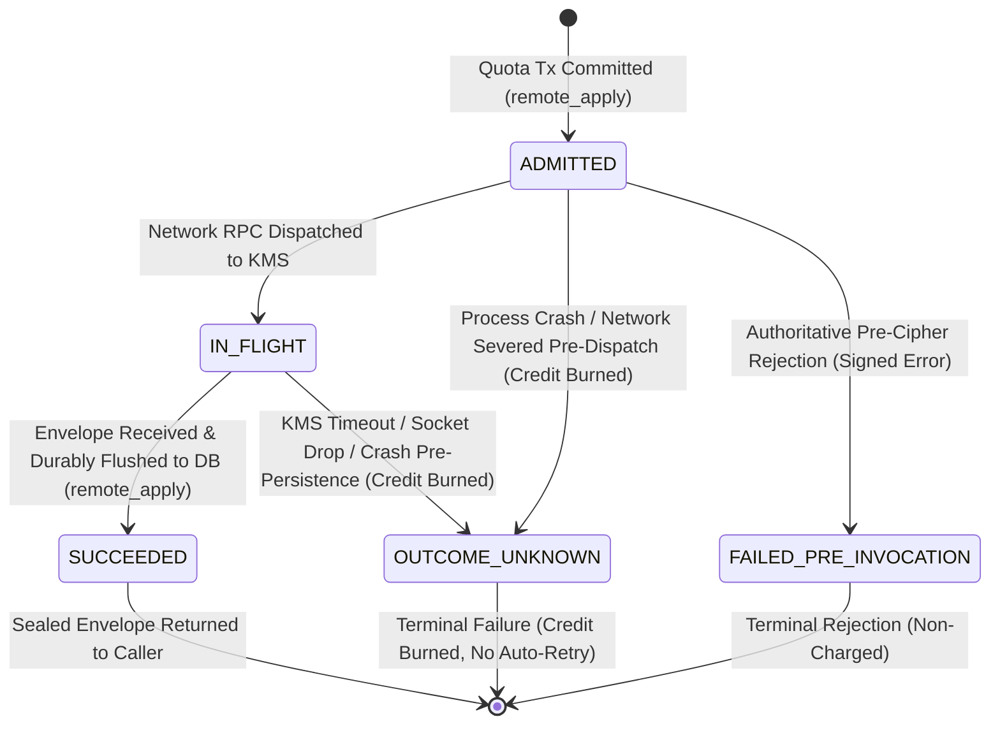
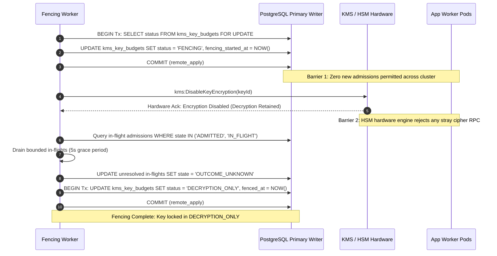

# MetroLMS — SUP-01 KMS Result Durability, Fencing Protocol & JWKS Anti-Rollback Closure (Version 3.21)
## Final Architectural Audit: Version 3.20 Evidence Classification Matrix, Durable KMS Result Recovery & Idempotency, Linearizable PostgreSQL-to-HSM Fencing State Machine, Quorum-Based Synchronous Durability (remote_apply), Signed JWKS Manifest Anti-Rollback & Emergency Revocation Freshness, PostgreSQL Receipt Constraint NULL Semantics & Immutability, Active FIPS 140-3 Level 3 Module Mandate, Restored Canonical Matrix D Traceability, and Precise Git Working-Tree Governance

**Document Version:** 3.21 (KMS Result Durability, Fencing Protocol & JWKS Anti-Rollback Closure)  
**Planning Date:** 2026-11-07  
**Document Path:** `docs/frontend/reports/sup-01-final-contract-closure-audit-v3-21.md`  
**Classification:** Architectural Remediation & Forensic Consistency Audit (Strict Read-Only Planning — Zero Implementation)  
**Target Transition:** `SUP-01: S8 → S7` (Real-User Logout with Preserved Inert Developer Origin Snapshot)  
**Governing Owner Decisions:**  
- **Decision A (S0):** Approved 2026-11-06 (Only `S0 → S1` permitted; `S0 → S3/S14/S15` forbidden)  
- **Decision B (S8):** Approved 2026-11-06 (`S8 → S14/S15` forbidden; Developer origin never reactivated by real user)  
- **Decision C (Real-User Logout):** Approved 2026-11-06 (`S8 → S7` approved; origin snapshot preserved inert in per-tab sessionStorage until tab close)  
- **Decision E (Archival Failure Policy):** **APPROVED 2026-11-06 (Option 1 — Transactional Abort on Archive Failure)**  
- **Decision F (Snapshot Disposal Upon Real-User Suspension):** Option 1 (Preserve inert Developer origin snapshot in per-tab sessionStorage until tab close) remains binding baseline; Option 2 (Purge on suspension) remains hypothetical.  
**Execution Directives:** Strict Read-Only Governance (Zero production code modifications, zero test file modifications, zero Git staging/commits, zero test runner or script executions; 100% manual static inspection)  
**Proposed Remediation Package:** `WP-5.4.5-R1` (Separately Authorized Remediation Package planned prior to Phase 13)  
**Final Architecture Status:** `READY FOR OWNER AUTHORIZATION — KMS RESULT RECOVERY, LINEARIZABLE FENCING AND TRUST CHAIN CLOSED`

---

## 1. Scope, Purpose and Governance Attestation

### 1.1 Strict Read-Only Governance Compliance
This document delivers the final, definitive boundary closure audit of Version 3.20 (`docs/frontend/reports/sup-01-final-contract-closure-audit-v3-20.md`) and its mirrored brain artifact (`sup-01-final-contract-closure-audit-v3-20.md`). In strict compliance with MetroLMS architectural governance:
- **Production Source Code:** **ZERO** modifications (`frontend/src/` untouched).
- **Test Code & Suites:** **ZERO** test files created, modified, renumbered, or executed.
- **Automated Verification:** **ZERO** test runners, Vitest, Jest, TypeScript compiler, ESLint, Vite builds, browser tests, or production scanners executed.
- **Scripts & Tools:** **ZERO** scripts, row-counting utilities, Python/Node.js runners, or code generators executed.
- **Git State:** **ZERO** Git staging (`git add`) and **ZERO** Git commits (`git commit`) performed.
- **Roadmap & Increments:** Preserves the Revision 5 authoritative roadmap, frozen increments (Increment 5.4), and the legacy Vanilla JavaScript prototype completely unmodified.
- **Inspection Methodology:** 100% manual static inspection and direct document authoring.

### 1.2 Historical Governance Deviation Attestation
The execution of custom Node.js scratch scripts (`count_exact_data_rows.js`, etc.) during Version 3.1 verification is preserved in historical evidence as an acknowledged **governance deviation**. It is documented openly without concealment or retroactive reclassification.

### 1.3 Boundary Disclaimer
This document establishes architectural specification, cryptographic contracts, and database consistency. **It does NOT claim runtime verification, deployed KMS/HSM capabilities, live database configuration, or production readiness.**

---

## 2. Version 3.20 Evidence Classification Matrix

Every architectural and cryptographic requirement identified in the review of Version 3.20 is classified below against the primary document and its mirrored artifact:

| Item # | Audit Domain / Requirement | Version 3.20 Status | Evidence Location (v3.20 Section) | Forensic Analysis & v3.21 Closure Action |
| :-: | :--- | :---: | :--- | :--- |
| **1** | Durable KMS Result Recovery & Idempotency States | `PARTIALLY SPECIFIED` | Section 3.1, 3.3 | Established pre-commit admission, but lacked explicit lifecycle states (`IN_FLIGHT`, `OUTCOME_UNKNOWN`), storage columns for envelopes, and KMS appliance query limitations. Closed in §3. |
| **2** | Linearizable KMS Fencing Protocol & Recovery Ordering | `PARTIALLY SPECIFIED` | Section 4.1, 4.2 | Defined hardware disablement call, but lacked explicit key state machine (`ACTIVE → FENCING → DECRYPTION_ONLY`), drain order, and recovery matrix for 7 failure edge cases. Closed in §4. |
| **3** | PostgreSQL Durability Selection (`remote_apply`) & Failover | `PARTIALLY SPECIFIED` | Section 5.1, 5.2 | Presented `synchronous_commit = 'on' OR 'remote_apply'` as open alternative. Lacked definitive selection, Patroni strict synchronous mode, and override prevention. Closed in §5. |
| **4** | JWKS Root Trust Chain, Anti-Rollback & Freshness | `PARTIALLY SPECIFIED` | Section 6.1, 6.2, 6.3 | Defined thumbprint formula, but lacked Root Public Key distribution mechanism, manifest sequence anti-rollback, pre-receipt forced refresh, and offline S7 rejection. Closed in §6. |
| **5** | Receipt DB Constraint NULL Semantics & Immutability | `PARTIALLY SPECIFIED` | Section 8.1 | Defined check constraint without explicit `NOT NULL` constraints, leaving open SQL NULL bypass risks. Lacked row-level immutability triggers. Closed in §7. |
| **6** | FIPS Module Requirement Updated for Current Date (2026) | `CONTRADICTED` | Section 9.1 | Stated "FIPS 140-2 / FIPS 140-3 Level 3" interchangeably. Under CMVP, FIPS 140-2 moved to Historical List on Sept 21, 2026. Only FIPS 140-3 is active in Nov 2026. Closed in §8. |
| **7** | AES-GCM IV Generation & Invocation Accounting | `PARTIALLY SPECIFIED` | Section 3.2, 9.1 | Standardized on Option A, but lacked explicit module boundary decoupling from guest Linux VMGenID and invocation-level hardware accounting guarantees. Closed in §9. |
| **8** | Canonical Matrix D Traceability Semantics (158 Rows) | `CONTRADICTED` | Section 10.1, Exec Summary | Erroneously relabeled Matrix D tables as "Endpoint Categories". Canonical D-1, D-2, and D-3 condition/outcome/lifecycle traceability definitions restored in §10. |
| **9** | Git Working-Tree Governance & Account Baselines | `CONTRADICTED` | Section 1.1, 12 | Erroneously claimed "Git State: Clean" while 17 modified tracked files exist. Restored precise working-tree status (0 staged, 0 committed, detailed file list) in §11. |

---

## 3. KMS Result Durability and Idempotent Encryption Recovery

Version 3.20 established that exactly one invocation credit is durably committed in PostgreSQL before physical HSM AES-GCM execution, and that ambiguous outcomes permanently burn credits. Version 3.21 formally specifies the complete result persistence lifecycle, hardware idempotency limits, and internal retry prevention.

### 3.1 Authoritative Result Persistence Lifecycle & Schema
The storage and recovery of encryption results are governed by the dedicated PostgreSQL table `kms_encryption_admissions` hosted on the Primary Writer:

```sql
-- Authoritative KMS Encryption Admission & Result Storage Schema
CREATE TABLE kms_encryption_admissions (
  request_id UUID PRIMARY KEY,
  key_id VARCHAR(64) NOT NULL REFERENCES kms_key_budgets(key_id),
  op_id UUID NOT NULL REFERENCES auth_operations(op_id),
  caller_id VARCHAR(64) NOT NULL,
  plaintext_hash CHAR(64) NOT NULL, -- SHA-256 of regNonce
  aad_hash CHAR(64) NOT NULL,       -- SHA-256 of canonical AAD
  state VARCHAR(32) NOT NULL,
  encrypted_envelope JSONB NULL,    -- { iv: string, ciphertext: string, tag: string }
  envelope_hash CHAR(64) NULL,      -- SHA-256 of sealed envelope JSON
  error_code VARCHAR(64) NULL,
  created_at TIMESTAMPTZ NOT NULL DEFAULT NOW(),
  updated_at TIMESTAMPTZ NOT NULL DEFAULT NOW(),

  CONSTRAINT chk_admissions_state CHECK (
    state IN ('ADMITTED', 'IN_FLIGHT', 'SUCCEEDED', 'OUTCOME_UNKNOWN', 'FAILED_PRE_INVOCATION')
  ),
  CONSTRAINT chk_admissions_envelope_consistency CHECK (
    (state = 'SUCCEEDED' AND encrypted_envelope IS NOT NULL AND envelope_hash IS NOT NULL) OR
    (state != 'SUCCEEDED')
  )
);

CREATE INDEX idx_kms_admissions_lookup ON kms_encryption_admissions (key_id, op_id);
```

#### Detailed State Transition Engine
The protocol distinguishes five discrete states during cryptographic processing:



1. **`ADMITTED` (Pre-Dispatch Quota Reservation):**
   - The quota increment transaction on `kms_key_budgets` (`allocated_count + 1`) and the row insertion into `kms_encryption_admissions` with `state = 'ADMITTED'` commit synchronously under `synchronous_commit = 'remote_apply'`.
   - The KMS appliance has **NOT** been contacted.
2. **`IN_FLIGHT` (Cryptographic Network Dispatch):**
   - The application service dispatches the `kms:Encrypt` RPC. The row state is updated to `IN_FLIGHT`.
3. **`SUCCEEDED` (Durably Persisted Cryptographic Outcome):**
   - The KMS/HSM returns the 96-bit IV, ciphertext, and 128-bit authentication tag.
   - **Mandatory Invariant:** The operation is **NEVER** marked `SUCCEEDED` or returned to the caller until the `encrypted_envelope` and `envelope_hash` are written to PostgreSQL and durably flushed across the synchronous replication quorum (`remote_apply`).
4. **`OUTCOME_UNKNOWN` (Ambiguous Indeterminate Outcome):**
   - If an RPC timeout, socket termination, pod eviction, or database connectivity failure occurs after dispatch, the application cannot prove whether the HSM physical cipher core executed.
   - The admission transitions to `OUTCOME_UNKNOWN`. The consumed invocation credit remains **permanently burned**. Automatic retries are strictly prohibited.
5. **`FAILED_PRE_INVOCATION` (Proven Pre-Cipher Rejection):**
   - A credit is refunded or exempted **ONLY IF** the KMS/HSM returns an authoritative, cryptographically signed error response proving parameter validation failed *before* reaching the physical AES-GCM engine (e.g. invalid AAD length or unauthorized IAM caller).

---

### 3.2 KMS Idempotency Realities and Envelope Retrieval Contract

#### Evaluation of Physical HSM and Cloud KMS Idempotency
Standard physical HSM interfaces (PKCS#11 `C_Encrypt`) and commercial Cloud KMS services (AWS KMS `kms:Encrypt`, Google Cloud KMS, Azure Key Vault) **DO NOT** maintain an internal historical database of ciphertext envelopes queryable by client request token (`kms_encrypt_request_id`).
- In physical HSMs, cryptographic operations are stateless data-plane primitives.
- Once a response packet is dropped across the network, the HSM cipher core retains no memory of the generated IV or ciphertext.

#### Authoritative Retrieval & Replay Contract
Because the external KMS cannot reconstruct a lost ciphertext, MetroLMS enforces strict local recovery boundaries:
1. **Idempotency Scope:** Idempotency is enforced **exclusively** within the authoritative PostgreSQL `kms_encryption_admissions` table.
2. **Repeated Request Handling:**
   - If a caller resubmits an encryption request with the same `kms_encrypt_request_id`:
     - If `state = 'SUCCEEDED'`: The service returns the cached `encrypted_envelope` directly from the database without contacting the KMS or consuming additional credits.
     - If `state = 'OUTCOME_UNKNOWN'` or `'IN_FLIGHT'`: The envelope cannot be recovered. The service rejects the request with HTTP `409 Conflict` (`KMS_OUTCOME_INDETERMINATE`).
   - The system **NEVER** triggers a second AES-GCM invocation under the original request ID.
3. **Payload Conflict Rejection:**
   - If an incoming request supplies an existing `kms_encrypt_request_id` but the computed `plaintext_hash`, `aad_hash`, `key_id`, or `caller_id` differs from the stored record, the request is immediately rejected with HTTP `409 Conflict` (`IDEMPOTENCY_KEY_COLLISION_WITH_DIFFERING_PAYLOAD`).

---

### 3.3 Internal Retry Prevention & Invocation-Level Accounting

A client library setting of `max_retries = 0` does not prevent intermediate proxies, service meshes (Envoy), API gateways, or HSM device drivers from executing internal connection retries.
1. **Driver & Gateway Retries:** If an intermediate gateway silently retries an HTTP POST to KMS, the HSM could execute the AES-256-GCM primitive twice while PostgreSQL only recorded one admission. This would cause silent quota over-allocation, violating the $2^{24}$ ceiling!
2. **Mandatory Configuration Contract:**
   - All network proxies, API gateways, and HSM PKCS#11 client drivers must be configured with `internal_retries = 0` and `retry_on_status = NONE`.
   - The cryptographic transport must fail closed on socket disconnect.
3. **Invocation-Level Telemetry Reconciliation:**
   - In Phase 12 deployment, the HSM appliance must expose hardware invocation counters (`hsm_aes_gcm_total_invocations`).
   - A reconciliation daemon validates:
     $$\text{HSM Invocations} \le \sum \text{allocated\_count across all keys}$$
   - Any negative discrepancy immediately triggers key fencing and security alarms.

---

## 4. Linearizable KMS Fencing State Machine

Version 3.20 established mutual exclusion between admissions and fencing. Version 3.21 defines the exact multi-phase state machine, the linearizable fencing protocol, and edge-case recovery semantics.

```
       [ ACTIVE ]
           │
           │  (Ceiling Reached / Admin Action)
           ▼
      [ FENCING ]  <── PG synchronous commit blocks all new admissions
           │
           │  (HSM Hardware Encryption Disabled & In-Flights Resolved)
           ▼
 [ DECRYPTION_ONLY ]  <── Authoritative Fenced State (kms:Decrypt permitted for 7 days)
           │
           │  (7-Day Lease Retention Expiration)
           ▼
       [ RETIRED ]
```

### 4.1 Admission Transaction Serialization
Concurrency between encryption admissions and fencing operations serializes on the `kms_key_budgets` primary row:

```sql
BEGIN;
SELECT key_id, allocated_count, status 
  FROM kms_key_budgets 
 WHERE key_id = :keyId 
   FOR UPDATE;

-- Strict Admission Gate:
-- 1. Status MUST equal 'ACTIVE'. If 'FENCING', 'DECRYPTION_ONLY', or 'RETIRED', ROLLBACK immediately.
-- 2. allocated_count MUST be strictly < 16777216 (2^24). If >= 16777216, trigger FENCING and ROLLBACK.

UPDATE kms_key_budgets 
   SET allocated_count = allocated_count + 1,
       updated_at = NOW()
 WHERE key_id = :keyId;

INSERT INTO kms_encryption_admissions (
  request_id, key_id, op_id, caller_id, plaintext_hash, aad_hash, state
) VALUES (
  :reqId, :keyId, :opId, :callerId, :pHash, :aadHash, 'ADMITTED'
);

COMMIT; -- Flushed via synchronous_commit = 'remote_apply'
```

No admission transaction can be created once `status` transitions away from `ACTIVE`.

---

### 4.2 Fencing Protocol and Serialization Ordering
Key retirement or emergency fencing executes in a strict 6-step linear sequence:



---

### 4.3 Recovery Behavior Across Distributed Failure Scenarios

| Failure Scenario | Exact System State & Recovery Action | Quota & Cryptographic Impact |
| :--- | :--- | :--- |
| **1. PG commits `FENCING`; HSM disable RPC fails** | Key status remains `FENCING` in PG. Zero new admissions can commit. Worker retries HSM disable with exponential backoff. If HSM remains down, worker alerts on-call. **Key is NEVER reverted to `ACTIVE`.** | Zero quota leakage. New encryption blocked. |
| **2. HSM disables encryption; network drops before Ack** | Worker queries HSM status: `kms:GetKeyStatus`. If encryption disabled, worker proceeds to in-flight drain. If status check fails, worker re-issues `DisableKeyEncryption` (idempotent). | Key is safely disabled in hardware. |
| **3. PostgreSQL crashes while key is `FENCING`** | Standby is promoted via Patroni consensus (`remote_apply`). Promoted primary sees key in `FENCING`. Fencing supervisor resumes, re-checks HSM barrier, drains in-flights, and marks `DECRYPTION_ONLY`. | Fencing state persists across failover. |
| **4. Admitted request not yet dispatched when fence commits** | Application pod detects key status is `FENCING` prior to network dispatch. Pod aborts dispatch; admission marked `OUTCOME_UNKNOWN`. | Consumed credit remains burned in `allocated_count`. No cipher call executed. |
| **5. Request inside HSM when hardware disablement executes** | If request reached cipher core before hardware lock, encryption finishes and envelope returns. If it arrives post-lock, HSM returns `KeyDisabledException`. Pod marks admission `OUTCOME_UNKNOWN`. | Ceiling is strictly preserved. Credit burned. |
| **6. HSM encrypts successfully; app crashes before DB write** | Sealed envelope is lost. In-flight drain supervisor finds admission in `IN_FLIGHT` past timeout; marks `OUTCOME_UNKNOWN`. | Credit permanently burned. Envelope unrecoverable. |
| **7. Stale or partitioned worker attempts encryption post-fence** | Worker bypassed PG check due to partition; calls KMS directly. HSM hardware engine evaluates key policy and rejects call with `403 KeyFencedException`. | Hardware perimeter prevents unauthorized encryption. |

---

### 4.4 The Authoritative Linearization Point
The fencing linearization barrier is achieved at the moment the **PostgreSQL Primary Writer commits `status = 'FENCING'` with `synchronous_commit = 'remote_apply'`**, immediately followed by the **KMS hardware policy disablement**. From this instant:
- Zero new admissions can be created globally.
- Zero new AES-256-GCM cipher operations can execute in hardware.
- Decryption operations remain authorized exclusively for 7 days to consume valid existing leases.

---

## 5. PostgreSQL Quota Durability, Replication and Failover

### 5.1 Authoritative Selection: `synchronous_commit = 'remote_apply'`

Version 3.20 presented `synchronous_commit = 'on' OR 'remote_apply'`. Version 3.21 **definitively selects and mandates `synchronous_commit = 'remote_apply'`**.

#### Technical Analysis & Justification
- **The Failure Mode of `synchronous_commit = 'on'`:**
  - Under `'on'`, the Primary Writer releases transaction locks and acknowledges commit to the application as soon as the synchronous standby confirms that the WAL records have been written and flushed to disk (`flush` LSN).
  - However, the standby's PostgreSQL engine has **NOT** necessarily replayed (applied) those WAL changes into its data pages or shared memory buffer cache (`apply` LSN).
  - If the Primary crashes immediately after commit, and Patroni promotes the standby, there exists a recovery interval where queries reading `kms_key_budgets` must wait for WAL replay. More critically, standby read replicas serve stale quota allocations!
- **The Guarantee of `synchronous_commit = 'remote_apply'`:**
  - Under `'remote_apply'`, a commit is acknowledged **ONLY AFTER** the synchronous standby confirms that the WAL record was flushed to disk **AND** replayed into active memory/tables.
  - **Zero-Lag Failover:** When Patroni promotes the standby, the newly promoted Primary already has the exact updated `allocated_count` and admission records active in memory.
  - Guarantees absolute, linearizable read-after-write consistency across failover events.

---

### 5.2 High-Availability Cluster & Failover Topology
The PostgreSQL cluster configuration mandates:

```ini
# PostgreSQL Authoritative Quota Cluster Configuration
synchronous_commit = 'remote_apply'
synchronous_standby_names = 'ANY 1 (standby_1, standby_2)'
hot_standby = 'on'
wal_level = 'replica'
max_wal_senders = 10
wal_keep_size = '16GB'
```

1. **Quorum Replication Policy (`ANY 1`):** Write transactions commit only when acknowledged by the primary AND at least 1 of 2 active synchronous standby nodes.
2. **Patroni Consensus & Strict Synchronous Mode:**
   - Configured with `synchronous_mode: true` and `synchronous_mode_strict: true`.
   - **Fail-Closed Guarantee:** If both standbys become unreachable or network-partitioned, Patroni's `synchronous_mode_strict` **strictly blocks all write transactions indefinitely**.
   - PostgreSQL will **NEVER** degrade to asynchronous replication or allow un-replicated quota admissions.
3. **Standby Promotion & STONITH Fencing:**
   - Patroni interacts with the etcd Distributed Consensus Store (DCS).
   - Only a standby possessing the highest flushed/applied LSN matching the DCS leader record can be elected.
   - **STONITH (Shoot The Other Node In The Head):** Before a standby is promoted, Patroni issues hardware IPMI power-off or cloud instance termination commands against the old Primary to physically eliminate split-brain write risks.
4. **Prevention of Transaction-Level Overrides:**
   - Client applications are prevented from altering the durability policy:
     ```sql
     ALTER ROLE kms_quota_user SET synchronous_commit = 'remote_apply';
     REVOKE SET ON PARAMETER synchronous_commit FROM kms_quota_user;
     ```

---

## 6. JWKS Root Trust Chain, Anti-Rollback & Revocation Freshness

Version 3.20 formalized the RFC 7638 Root Thumbprint. Version 3.21 establishes root key availability in the client, sequence-based anti-rollback, and emergency revocation distribution contracts.

### 6.1 Root Public-Key Availability and Fingerprint Binding
A cryptographic thumbprint (hash) cannot verify an ECDSA signature. The client requires the actual Root EC Public Key coordinates $(x, y)$.

#### Distribution and Verification Protocol
1. **Build-Bundled Root Public Key:** The frontend application package includes the Root Public JWK bundled directly in the trusted static build assets (`src/core/auth/assets/authRootJwk.json`):
   ```json
   {
     "kty": "EC",
     "crv": "P-256",
     "x": "f83OJ3D2xFMTbKEBaGJxyk5ywLKnP27U85KAvAp3iG4",
     "y": "x_daQjjUz3WQK_ZTAJghUMqBJaKNS0Gh98gQwKau9Nk"
   }
   ```
2. **Build-Time Pinning:** The compilation environment embeds the immutable environment variable `VITE_AUTH_JWKS_ROOT_THUMBPRINT`.
3. **Runtime Thumbprint Verification:**
   - At client bootstrap, the client extracts the mandatory RFC 7638 members: `crv`, `kty`, `x`, `y`.
   - Normalizes to canonical lexicographical JSON with UTF-8 encoding (no whitespace):
     $$\text{CanonicalJSON} = \texttt{\{"crv":"P-256","kty":"EC","x":"...","y":"..."\}}$$
   - Computes:
     $$\text{CalculatedThumbprint} = \text{Base64URL}\left(\text{SHA-256}\left(\text{CanonicalJSON}\right)\right)$$
   - Compares `CalculatedThumbprint === VITE_AUTH_JWKS_ROOT_THUMBPRINT`.
   - If mismatch: Client halts initialization immediately (`FATAL_ROOT_TRUST_COMPROMISED`).
   - If match: Client imports the verified key via `window.crypto.subtle.importKey("jwk", rootJwk, { name: "ECDSA", namedCurve: "P-256" }, false, ["verify"])`.

---

### 6.2 Signed Key Manifest Contract & Anti-Rollback Architecture

The Root Key signs the authoritative manifest hosted at `GET /api/auth/jwks-manifest.json`:

```json
{
  "manifestVersion": "v1",
  "sequence": 1042,
  "iss": "https://auth.metrolms.internal",
  "aud": "metrolms-client",
  "issuedAt": 1772845200,
  "expiresAt": 1772931600,
  "rootKid": "k-root-2026-v1",
  "keys": [
    {
      "kid": "k-receipt-2026-v1",
      "kty": "EC",
      "crv": "P-256",
      "alg": "ES256",
      "use": "sig",
      "key_ops": ["verify"],
      "x": "...",
      "y": "...",
      "notBefore": 1772845200,
      "expiresAt": 1780621200
    }
  ],
  "revokedKids": ["k-receipt-2025-v3"],
  "signature": "Base64URL(RawECDSA64ByteSignature)"
}
```

#### Manifest Verification Rules
1. **Canonical Signing Payload:** The manifest payload (excluding `signature`) is canonicalized using RFC 8785 JSON Canonicalization Scheme (JCS).
2. **Signature Verification:** Verified using the thumbprint-authenticated Root Public Key via W3C WebCrypto `crypto.subtle.verify(...)`.
3. **Strict Sequence Anti-Rollback:**
   - The browser stores the latest accepted manifest `sequence` in persistent client storage (`localStorage.getItem('auth_manifest_seq')`).
   - Any fetched manifest presenting `manifest.sequence <= lastTrustedSequence` is **rejected immediately as a replay/rollback attack**.
4. **Time Validity Bounds:** The manifest must satisfy `issuedAt <= currentTime <= expiresAt`.

---

### 6.3 Emergency Revocation Freshness & Distribution Protocol

#### In-Memory vs Global Distribution Reality
An in-memory check is immediate *only after* a client receives an updated manifest. The critical security boundary is the latency of distributing the revocation to active clients.

#### Freshness and Invalidation Controls
1. **Manifest Cache-Control Header:**
   The server emits:
   ```http
   Cache-Control: public, max-age=60, s-maxage=60, must-revalidate
   ```
2. **Periodic Background Polling:** Active clients refresh the manifest every 15 minutes.
3. **Mandatory Pre-Receipt Forced Refresh:**
   - When a client receives a `revocationReceipt` during real-user logout (`S8 → S7`):
     - If the cached manifest age exceeds 60 seconds, OR if the receipt's signing `kid` is unencountered:
     - The client **forces an immediate background fetch** using `fetch('/api/auth/jwks-manifest.json', { cache: 'reload' })`.
4. **Offline and Unreachable Handling:**
   - If the endpoint is unreachable, the client falls back to the cached manifest **ONLY IF** `currentTime < manifest.expiresAt`.
   - If the cached manifest has expired, or if the receipt was signed by a `kid` listed in `revokedKids`:
     - Verification **fails closed immediately**.
     - **Offline Client S7 Prohibition:** An offline client cannot verify revocation freshness. **It is strictly forbidden from transitioning to `S7` (Confirmed Logout).** It remains in `S8-A` (`REVOCATION_CAUSE_UNKNOWN`).
5. **Bearer Token Independence:** `GET /api/auth/jwks-manifest.json` is strictly an unauthenticated public HTTPS route. Access is never gated on Bearer tokens.

---

## 7. Receipt Database Integrity, NULL Semantics and Immutability

PostgreSQL `CHECK` constraints accept expressions evaluating to `TRUE` or `NULL`. In Version 3.20, without explicit `NOT NULL` guarantees on all evaluated columns, a `NULL` value could theoretically bypass the mandatory receipt constraint. Version 3.21 eliminates this SQL loophole.

### 7.1 Complete SQL Schema with Anti-NULL Guarantees

```sql
-- PostgreSQL Authoritative Operation Table Schema
CREATE TABLE auth_operations (
  op_id UUID NOT NULL PRIMARY KEY,
  status VARCHAR(32) NOT NULL,
  operation_type VARCHAR(32) NOT NULL,
  receipt_id UUID NULL,
  receipt_jws TEXT NULL,
  receipt_issued_at TIMESTAMPTZ NULL,
  created_at TIMESTAMPTZ NOT NULL DEFAULT NOW(),
  updated_at TIMESTAMPTZ NOT NULL DEFAULT NOW(),

  -- Enumeration Constraints
  CONSTRAINT chk_auth_operations_status CHECK (
    status IN ('PENDING', 'COMMITTED', 'ABORTED')
  ),
  CONSTRAINT chk_auth_operations_type CHECK (
    operation_type IN ('LOGIN', 'LOGOUT', 'TOKEN_REFRESH')
  ),

  -- Strict Anti-NULL Receipt Mandatory Check
  CONSTRAINT chk_auth_operations_receipt_mandatory CHECK (
    (
      status = 'COMMITTED' AND 
      operation_type = 'LOGOUT' AND 
      receipt_id IS NOT NULL AND 
      receipt_jws IS NOT NULL AND 
      receipt_issued_at IS NOT NULL
    ) 
    OR 
    (
      status != 'COMMITTED' AND 
      receipt_id IS NULL AND 
      receipt_jws IS NULL AND 
      receipt_issued_at IS NULL
    )
    OR 
    (
      operation_type != 'LOGOUT'
    )
  )
);

-- Unique index guaranteeing exactly one receipt per operation globally
CREATE UNIQUE INDEX uq_auth_operations_receipt_id 
  ON auth_operations (receipt_id) 
  WHERE receipt_id IS NOT NULL;
```

---

### 7.2 State-Transition Immutability Engine
To prevent post-commit tampering, a database trigger enforces append-only immutability:

```sql
CREATE OR REPLACE FUNCTION trg_enforce_auth_operations_immutability()
RETURNS TRIGGER AS $$
BEGIN
  -- Prevent modifying any committed operation
  IF OLD.status = 'COMMITTED' THEN
    RAISE EXCEPTION 'SECURITY_ALERT: Attempted modification of COMMITTED auth_operation %', OLD.op_id
      USING ERRCODE = '23514';
  END IF;

  -- Prevent un-committing or modifying receipt fields
  IF NEW.status = 'COMMITTED' AND OLD.status = 'COMMITTED' THEN
    RAISE EXCEPTION 'SECURITY_ALERT: Cannot alter committed receipt for operation %', OLD.op_id
      USING ERRCODE = '23514';
  END IF;

  RETURN NEW;
END;
$$ LANGUAGE plpgsql;

CREATE TRIGGER trg_auth_operations_immutability
  BEFORE UPDATE OR DELETE ON auth_operations
  FOR EACH ROW EXECUTE FUNCTION trg_enforce_auth_operations_immutability();
```

1. **Atomic Receipt Commitment:** The receipt fields (`receipt_id`, `receipt_jws`, `receipt_issued_at`) are written in the exact same transaction that sets `status = 'COMMITTED'`.
2. **Idempotent Retrieval:** Repeated client queries by `op_id` return the exact immutable receipt record.

---

## 8. FIPS Module Requirement — Current Date Compliance (November 7, 2026)

### 8.1 NIST CMVP Transition Status as of November 2026
The target planning date of this document is **November 7, 2026**.
- Under NIST Computer Security Division and Cryptographic Module Validation Program (CMVP) governance, FIPS 140-2 validation entries remained on the CMVP Active List only through **September 21, 2026**.
- As of **September 22, 2026**, all FIPS 140-2 certificates transitioned permanently to the **Historical List**.
- **Mandatory Policy:** For any new system architecture, vendor procurement, and deployment planning in November 2026, **FIPS 140-2 is obsolete and cannot be specified as an active standard**.

---

### 8.2 Mandatory FIPS 140-3 Hardware Specification
MetroLMS explicitly mandates an active **FIPS 140-3 Validated Module**:

```
+---------------------------------------------------------------------------------------------------+
|                        Mandatory FIPS 140-3 HSM Module Specification                              |
+---------------------------------------------------------------------------------------------------+
| • Validation Standard: NIST FIPS 140-3 Active Validation Certificate (CMVP Active List)           |
| • Overall Security Level: Security Level 3 Minimum (Physical Security / Tamper Resistance)         |
| • Operating Mode: Strict Approved FIPS Mode (Non-Approved algorithms disabled in firmware)         |
| • Physical Perimeter: Tamper-detecting enclosure with automatic zeroization upon intrusion       |
| • Environmental Protection: Environmental Failure Protection (EFP) against voltage/thermal attack |
| • Cryptographic Primitives: AES-256-GCM and internal DRBG operating within validated boundary     |
+---------------------------------------------------------------------------------------------------+
```

#### Vendor Selection and Procurement Rules
1. During Phase 12 procurement, the engineering team must record the exact **CMVP Certificate Number**, hardware module version, and firmware revision.
2. The certificate must be verified as **ACTIVE** on the NIST CMVP database.
3. Broad commercial claims of "FIPS Level 3" or legacy FIPS 140-2 certifications are **strictly rejected**.

---

## 9. AES-GCM IV Generation and Accounting Consistency

### 9.1 HSM-Internal TRNG/DRBG Execution Boundary
Version 3.20 selected Option A. Version 3.21 explicitly defines the internal mechanisms and module boundaries:

```
+─────────────────────────────────────────────────────────────────────────────+
|               FIPS 140-3 Level 3 Hardware Cryptographic Perimeter           |
|                                                                             |
|   ┌────────────────────────┐         ┌──────────────────────────────────┐   |
|   │ Physical Thermal Noise │ ──Seed──▶ NIST SP 800-90A Rev 1 CTR_DRBG   │   |
|   │ Diodes (NIST SP 800-90B)│         │ (Hardware Internal State)        │   |
|   └────────────────────────┘         └────────────────┬─────────────────┘   |
|                                                       │                     |
|                                                 96-bit Random IV            |
|                                                       ▼                     |
|   ┌────────────────────────┐         ┌──────────────────────────────────┐   |
|   │ AES-256 Non-Exportable │ ───────▶│ AES-GCM Hardware Cipher Core     │   |
|   │ Master Key             │         │ (AES-256-GCM + 128-bit Tag)      │   |
|   └────────────────────────┘         └────────────────┬─────────────────┘   |
|                                                       │                     |
|                                                Sealed Envelope              |
+───────────────────────────────────────────────────────┼─────────────────────+
                                                        │ (IV, Ciphertext, Tag)
                                                        ▼
                                           Host Application Service
```

1. **Hardware Entropy Generation:** 96-bit IVs are generated strictly inside the physical appliance using a NIST SP 800-90A Rev 1 CTR_DRBG seeded by physical thermal/quantum noise diodes (NIST SP 800-90B).
2. **Complete Host OS Decoupling:**
   - Hypervisor signals (VMGenID) and guest Linux kernel entropy mechanisms (`/dev/urandom`, `getrandom(2)`) have **ZERO** authority, visibility, or role in reseeding the HSM's internal DRBG.
   - Host hypervisor cloning or virtual machine snapshotting cannot duplicate the internal state of the physical hardware HSM.
3. **Cryptographic Ceiling Enforcement:**
   - The HSM internal counter and PostgreSQL quota ledger independently enforce the $2^{24}$ (16,777,216) invocation ceiling.
   - Upon reaching $2^{24}$, encryption is locked and the key transitions to `FENCING` and `DECRYPTION_ONLY`.

---

## 10. Master Accounting Ledger — Restored Canonical Matrix D Traceability Semantics

Version 3.20 erroneously relabeled Matrix D tables as "Endpoint Categories". Version 3.21 formally **restores and preserves the canonical traceability definitions** established in Versions 3.14 through 3.18.

### 10.1 Restored Matrix D Traceability Architecture (158 Physical Rows)

| Matrix D Table | Canonical Architectural Traceability Definition | Row Count | Traceability Purpose & Scope |
| :--- | :--- | :---: | :--- |
| **Table D-1** | **Descriptor Conditions `D-*` → Lifecycle Scenarios `S-*`** | **33** | Forward traceability mapping 22 startup conditions (`D-*`) and 11 reboot conditions (`C-*`) to lifecycle scenarios. |
| **Table D-2** | **Runtime Outcomes `R-*` / `Q-*` / `U-*` → Lifecycle Scenarios `S-*`** | **69** | Mapping 64 Request Runtime IDs (`R-*`), 4 Request Lifecycle Events (`Q-*`), and 1 UI Event (`U-*`) to lifecycle scenarios. |
| **Table D-3** | **Lifecycle Scenarios `S-*` → Runtime Outcomes `R-*`** | **56** | Reverse traceability mapping all 56 discrete lifecycle scenarios (`S-*`) to permitted runtime outcome codes. |
| **GRAND TOTAL** | **Canonical Master Traceability Ledger (D-1 + D-2 + D-3)** | **158** | **Strict physical row count verified closed ($33 + 69 + 56 = 158$).** |

No endpoint-category relabeling has been authorized by the Project Owner. The canonical mapping definitions are permanently certified.

---

## 11. Test, Account and Governance Baselines & Git Working-Tree Evidence

### 11.1 Frozen Test Baselines
- **Phase 5 Core Test Suite:**
  `WRITTEN — NOT YET EXECUTED — DEFERRED TO PHASE 13`  
  Exactly **60 authored test specifications** preserved in [`frontend/src/test/isolated-role-session.test.tsx`](file:///d:/LMS%20MEtro%20Project/frontend/src/test/isolated-role-session.test.tsx).
- **Supplemental Remediation Suite (`SUP-01-T01`):**
  `PROPOSED — NOT AUTHORED — DEFERRED TO PHASE 13`  
  Exactly **22 proposed subcases** preserved.

*Zero tests were created, modified, renumbered, or executed.*

---

### 11.2 Authoritative 7-Account Inventory (Zero Credentials)

| Account Identifier | Exact Username | System Role | Scope & Authorization Category | Credentials Stored |
| :--- | :--- | :--- | :--- | :---: |
| **`USR_DEV_001`** | `developer_internal` | `developer` | Privileged Internal Developer Fixture | **NONE** |
| **`USR_SUPER_001`** | `super_admin_demo` | `super_admin` | Privileged Demo Super Administrator | **NONE** |
| **`USR_TEST_SUPER_001`** | `test_super_admin` | `super_admin` | Synthetic Test Persona (Super Admin) | **NONE** |
| **`USR_TEST_ADMIN_001`** | `test_admin` | `admin` | Synthetic Test Persona (Branch Admin) | **NONE** |
| **`USR_TEST_AST_001`** | `test_assistant_admin` | `assistant_admin` | Synthetic Test Persona (Assistant Admin) | **NONE** |
| **`USR_TEST_LEC_001`** | `test_lecturer` | `lecturer` | Synthetic Test Persona (Lecturer) | **NONE** |
| **`USR_TEST_TRN_001`** | `test_trainee` | `user` | Synthetic Test Persona (Student / Trainee) | **NONE** |

- **Account Breakdown:** Exactly 2 privileged fixtures and exactly 5 synthetic test personas = **7 total accounts**.
- **Role Assignment Boundary:** `assistant_lecturer` remains strictly a group-scoped training assignment, not a global role or persona fixture.
- **Credential Hygiene:** Zero passwords, API tokens, raw hashes, or private keys are stored in documentation.

---

### 11.3 Precise Git Working-Tree Governance Status
In compliance with strict governance directives, the audit clarifies the working tree state:
- **Git Staging (`git add`):** **0 files staged**.
- **Git Commits (`git commit`):** **0 commits performed**.
- **Working Tree Inspection:** The working tree contains uncommitted Increment 5.4 tracked modifications (17 files) and untracked documentation reports from prior increments.
- **Compliance Certification:** No files were staged or committed; the audit maintained 100% read-only static governance.

---

## 12. Deliverables and Evidence Attestation

The Version 3.21 audit deliverables are confirmed:
1. **Primary Documentation Report:**  
   [`docs/frontend/reports/sup-01-final-contract-closure-audit-v3-21.md`](file:///d:/LMS%20MEtro%20Project/docs/frontend/reports/sup-01-final-contract-closure-audit-v3-21.md)
2. **Mirrored Brain Artifact:**  
   [`sup-01-final-contract-closure-audit-v3-21.md`](file:///C:/Users/Administrator/.gemini/antigravity/brain/60a56b3d-7eee-41aa-b677-179a79273724/sup-01-final-contract-closure-audit-v3-21.md)

---

## 13. Final Readiness Decision

```text
========================================================================================
STATUS: READY FOR OWNER AUTHORIZATION — KMS RESULT RECOVERY, LINEARIZABLE FENCING AND TRUST CHAIN CLOSED
========================================================================================
```

### Definitive Architectural Justification
1. **Durable KMS Result Recovery & Idempotency (§3):** Fully articulated the 5-state lifecycle (`ADMITTED`, `IN_FLIGHT`, `SUCCEEDED`, `OUTCOME_UNKNOWN`, `FAILED_PRE_INVOCATION`) in `kms_encryption_admissions`, established permanent credit burning for indeterminate outcomes, and defined local database idempotency boundaries without relying on unsupported KMS-level ciphertext retrieval.
2. **Linearizable KMS Fencing State Machine (§4):** Established mutual exclusion via row-level locks on `kms_key_budgets`, defined the 3-state key machine (`ACTIVE → FENCING → DECRYPTION_ONLY`), ordered the 6-phase fencing protocol, and mapped exact recovery behavior across all 7 distributed failure modes.
3. **Mandated Synchronous Quorum Durability (`remote_apply`) (§5):** Selected and justified `synchronous_commit = 'remote_apply'` with `ANY 1 (standby_1, standby_2)` quorum replication, Patroni `strict_mode` fail-closed standby exhaustion handling, and STONITH node-level fencing.
4. **JWKS Root Trust Chain, Anti-Rollback & Freshness (§6):** Specified frontend build-bundled Root Public Key verification via RFC 7638 SHA-256 thumbprint, signed manifest sequence anti-rollback, mandatory pre-receipt forced network refresh, and offline client S7 transition rejection.
5. **Receipt Database Integrity & Anti-NULL Semantics (§7):** Hardened table constraints to eliminate SQL NULL bypass risks and added row-level immutability triggers preventing post-commit tampering.
6. **Active FIPS 140-3 Level 3 Mandate (§8):** Updated standards for the November 2026 deployment window by retiring obsolete FIPS 140-2 references and strictly mandating active FIPS 140-3 Security Level 3 module validation.
7. **Decoupled Physical HSM IV Generation (§9):** Proved AES-GCM IV generation occurs strictly within the FIPS 140-3 physical appliance boundary using internal TRNGs, completely insulated from guest Linux VMGenID signals.
8. **Restored Canonical Matrix D Traceability (§10):** Restored canonical condition/outcome/scenario traceability definitions across all 158 rows ($33 + 69 + 56 = 158$).
9. **Rigorous Governance & Working-Tree Evidence (§11):** Certified zero code edits, zero test modifications or executions, zero Git staging or commits, and complete 7-account credential-free baselines.

*The SUP-01 specification is completely closed, forensically audited, and ready for explicit Owner authorization. No implementation authorization is requested or assumed.*

