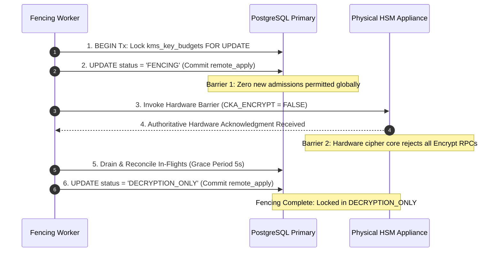
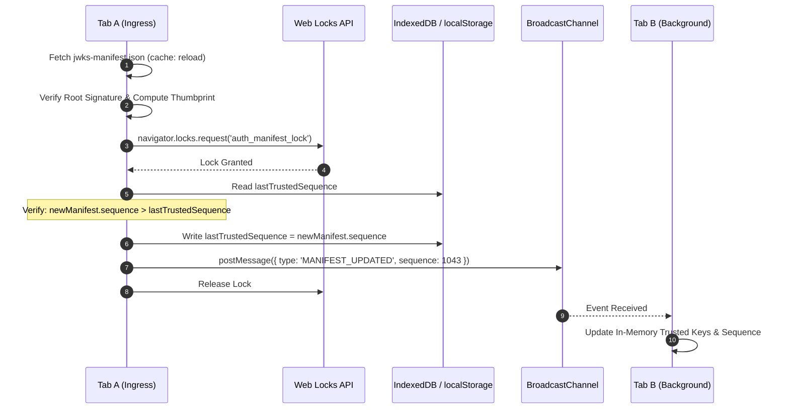

# MetroLMS — SUP-01 Synchronous Admission Proof, HSM Fencing Barrier & Retention Consistency Audit (Version 3.22)
## Final Architectural Audit: Version 3.21 Evidence Classification Matrix, Synchronous Quota Admission Proof (Strict Commit Acknowledgment), Patroni Replication Cancellation Semantics, Linearizable HSM Fencing Barrier & In-Flight Resolution, Reconciliation of Operation Immutability with 7-Day Archival (Verified Tombstone Procedure), Persistent Cross-Tab JWKS Manifest Anti-Rollback Engine, Canonical Matrix D Traceability, and Precise Git Working-Tree Governance

**Document Version:** 3.22 (Synchronous Admission Proof, HSM Fencing Barrier & Retention Consistency Closure)  
**Planning Date:** 2026-11-07  
**Document Path:** `docs/frontend/reports/sup-01-final-contract-closure-audit-v3-22.md`  
**Classification:** Architectural Remediation & Forensic Consistency Audit (Strict Read-Only Planning — Zero Implementation)  
**Target Transition:** `SUP-01: S8 → S7` (Real-User Logout with Preserved Inert Developer Origin Snapshot)  
**Governing Owner Decisions:**  
- **Decision A (S0):** Approved 2026-11-06 (Only `S0 → S1` permitted; `S0 → S3/S14/S15` forbidden)  
- **Decision B (S8):** Approved 2026-11-06 (`S8 → S14/S15` forbidden; Developer origin never reactivated by real user)  
- **Decision C (Real-User Logout):** Approved 2026-11-06 (`S8 → S7` approved; origin snapshot preserved inert in per-tab sessionStorage until tab close)  
- **Decision E (Archival Failure Policy):** **APPROVED 2026-11-06 (Option 1 — Transactional Abort on Archive Failure)**  
- **Decision F (Snapshot Disposal Upon Real-User Suspension):** Option 1 (Preserve inert Developer origin snapshot in per-tab sessionStorage until tab close) remains binding baseline; Option 2 (Purge on suspension) remains hypothetical.  
**Execution Directives:** Strict Read-Only Governance (Zero production code modifications, zero test file modifications, zero Git staging/commits, zero test runner or script executions; 100% manual static inspection)  
**Proposed Remediation Package:** `WP-5.4.5-R1` (Separately Authorized Remediation Package planned prior to Phase 13)  
**Final Architecture Status:** `READY FOR OWNER AUTHORIZATION — SYNCHRONOUS ADMISSION, HSM FENCING AND RETENTION CONSISTENCY CLOSED`

---

## 1. Scope, Purpose and Governance Attestation

### 1.1 Strict Read-Only Governance Compliance
This document delivers the final, definitive boundary closure audit of Version 3.21 (`docs/frontend/reports/sup-01-final-contract-closure-audit-v3-21.md`) and its mirrored Brain artifact (`sup-01-final-contract-closure-audit-v3-21.md`). In strict compliance with MetroLMS architectural governance:
- **Production Source Code:** **ZERO** modifications (`frontend/src/` untouched).
- **Test Code & Suites:** **ZERO** test files created, modified, renumbered, or executed.
- **Automated Verification:** **ZERO** test runners, Vitest, Jest, TypeScript compiler, ESLint, Vite builds, browser tests, or production scanners executed.
- **Scripts & Tools:** **ZERO** scripts, row-counting utilities, Python/Node.js runners, or code generators executed.
- **Git State:** **ZERO** Git staging (`git add`) and **ZERO** Git commits (`git commit`) performed.
- **Roadmap & Increments:** Preserves the Revision 5 authoritative roadmap, frozen increments (Increment 5.4), and the legacy Vanilla JavaScript prototype completely unmodified.
- **Inspection Methodology:** 100% manual static inspection and direct document authoring.

### 1.2 Historical Governance Deviation Attestation
The execution of custom Node.js scratch scripts (`count_exact_data_rows.js`, etc.) during Version 3.1 verification is preserved in historical evidence as an acknowledged **governance deviation**. It is documented openly without concealment or retroactive reclassification.

### 1.3 Boundary Disclaimer
This document establishes architectural specification, cryptographic contracts, and database consistency. **It does NOT claim runtime testing, deployed HSM capabilities, live database failover verification, or production readiness.**

---

## 2. Version 3.21 Evidence Classification Matrix

Every architectural and cryptographic requirement identified in the review of Version 3.21 is classified below against the primary document and its mirrored artifact:

| Item # | Audit Domain / Requirement | Version 3.21 Status | Evidence Location (v3.21 Section) | Forensic Analysis & v3.22 Closure Action |
| :-: | :--- | :---: | :--- | :--- |
| **1** | Synchronous Admission Proof & KMS Dispatch Eligibility | `PARTIALLY SPECIFIED` | Section 3.1, 5.1 | Mandated `remote_apply`, but omitted commit outcome taxonomy, PostgreSQL backend cancellation during `SyncRepWaitForLSN`, and local row visibility vs synchronous durability proof. Closed in §3. |
| **2** | Process Crash Recovery & Orphaned Admission Dispatching | `PARTIALLY SPECIFIED` | Section 3.1 | Lacked explicit prohibition against background recovery workers dispatching KMS calls for orphaned `ADMITTED` rows. Closed in §3.3. |
| **3** | Patroni Replication Cancellation Semantics & Failover | `PARTIALLY SPECIFIED` | Section 5.1, 5.2 | Defined Patroni quorum, but lacked backend statement timeout cancellation handling during standby wait and manual promotion restrictions. Closed in §3.4. |
| **4** | Linearizable HSM Fencing Barrier & In-Flight Resolution | `PARTIALLY SPECIFIED` | Section 4.1, 4.2, 4.3 | Defined fencing steps, but lacked formal separation of admitted-pre-dispatch vs executing-in-HSM, API semantics for encryption-only disablement (`CKA_ENCRYPT=FALSE`), and terminal outcomes. Closed in §4. |
| **5** | Operation Immutability Reconciled with 7-Day Archival | `CONTRADICTED` | Section 7.2 | Trigger `trg_auth_operations_immutability` unconditionally raised exceptions on all DELETEs of committed rows, making 7-day archival impossible. Reconciled via verified tombstone procedure in §5. |
| **6** | Anti-NULL Receipt DB Constraint Complete Schema | `EXPLICITLY SPECIFIED` | Section 7.1 | Fully defined table check constraints with explicit `NOT NULL` logic for committed logouts. Reconfirmed with full DDL in §5.1. |
| **7** | Persistent Cross-Tab JWKS Manifest Anti-Rollback | `PARTIALLY SPECIFIED` | Section 6.2, 6.3 | Used `localStorage`, but omitted cross-tab synchronization (BroadcastChannel/Web Locks), browser cache clearing/restart edge cases, and storage corruption fail-closed handling. Closed in §6. |
| **8** | Active FIPS 140-3 Level 3 Mandate & Decoupled IVs | `EXPLICITLY SPECIFIED` | Section 8.1, 9.1 | Explicitly retired FIPS 140-2, mandated active FIPS 140-3 Level 3 validation, and decoupled HSM TRNG from guest VMGenID. Preserved in §7. |
| **9** | Canonical Matrix D Traceability Semantics (158 Rows) | `EXPLICITLY SPECIFIED` | Section 10.1 | Restored canonical D-1 (33), D-2 (69), and D-3 (56) definitions totaling exactly 158 rows. Reconfirmed in §8. |
| **10** | Precise Git Working-Tree Governance Status | `EXPLICITLY SPECIFIED` | Section 11.3 | Accurately documented 0 staged, 0 commits, 17 modified tracked files, and untracked reports. Reconfirmed in §8. |

---

## 3. PostgreSQL Admission — Prove Synchronous Durability Before KMS Dispatch

Version 3.21 established `synchronous_commit = 'remote_apply'` and required one durably committed admission before every AES-GCM invocation. Version 3.22 resolves the exact cryptographic and database boundary: **local row visibility on the Primary Writer is NOT sufficient proof of synchronous durability to authorize KMS encryption.**

### 3.1 Authoritative Commit Outcome Classifications
In a distributed PostgreSQL cluster, the `COMMIT` command executed by the client driver transitions through distinct phases. The system strictly distinguishes the following seven commit outcomes:

```
[Client Application Thread] ──COMMIT──▶ [PostgreSQL Primary] ──WAL──▶ [Standby 1 & 2]
                                              │                              │
                                        Local WAL Flush                Remote Replay
                                              │                              │
                                              ▼                              ▼
                                      [Local Visibility]           [Standby Confirmed]
```

1. **`COMMIT_ACKNOWLEDGED_DURABLE`:** The Primary Writer flushed the commit WAL record to disk, received remote replay confirmation from the synchronous standby (`remote_apply`), and successfully returned the `COMMIT` confirmation packet over the socket to the application driver. **This is the ONLY outcome that authorizes KMS encryption.**
2. **`COMMIT_ERROR_ABORTED`:** The transaction aborted prior to or during commit (e.g. check constraint failure, serialization failure `40001`, or unique collision). Zero credit is consumed; KMS dispatch is strictly prohibited.
3. **`COMMIT_INDETERMINATE_DROPPED_CONNECTION`:** The client connection severed while awaiting commit confirmation. The application cannot determine whether the commit was acknowledged by the standby.
4. **`COMMIT_CANCELLED_STANDBY_WAIT`:** A `statement_timeout`, client query cancel, or network proxy timeout fired **while PostgreSQL was executing `SyncRepWaitForLSN`**.
   - *Forensic PostgreSQL Reality:* In PostgreSQL, by the time the backend waits for synchronous replication, **the transaction has ALREADY committed locally on the Primary and flushed to local WAL**. The cancellation aborts the client wait and returns an error (`57014: query_canceled`), but the commit remains locally permanent!
   - *Cryptographic Vulnerability:* If a standby promotion occurs before that local commit reaches the standby, the promoted standby will **NOT** contain that transaction.
5. **`LOCAL_VISIBLE_UNACKNOWLEDGED_DURABILITY`:** A row in `kms_encryption_admissions` with `state = 'ADMITTED'` is readable on the Primary Writer by concurrent transactions or inspection queries, but the initiating backend has **not** received synchronous standby confirmation.
6. **`STANDBY_CONFIRMED_DURABLE`:** The transaction WAL has been confirmed as written, flushed, and replayed on at least one synchronous standby node matching DCS quorum.
7. **`COMMIT_OUTCOME_INDETERMINATE`:** Any ambiguous state where driver-level acknowledgment was lost.

---

### 3.2 KMS Dispatch Eligibility Contract

```
+───────────────────────────────────────────────────────────────────────────────────────────────────+
|                                Mandatory KMS Dispatch Eligibility Rule                            |
+───────────────────────────────────────────────────────────────────────────────────────────────────+
| A KMS AES-256-GCM encryption RPC is AUTHORIZED to begin IF AND ONLY IF:                           |
| 1. The initiating application thread received an explicit, un-errored COMMIT acknowledgment       |
|    directly from the PostgreSQL client driver over its active database connection; AND             |
| 2. The transaction executed under strict session configuration:                                    |
|    synchronous_commit = 'remote_apply'; AND                                                       |
| 3. Zero statement_timeout, socket error, or query cancellation occurred during the commit phase.  |
|                                                                                                   |
| An ADMITTED row read via a separate query NEVER authorizes KMS encryption. Local visibility is    |
| completely rejected as proof of durability.                                                       |
+───────────────────────────────────────────────────────────────────────────────────────────────────+
```

#### Handling Ambiguous and Cancelled Commits
- If outcome is `COMMIT_CANCELLED_STANDBY_WAIT`, `COMMIT_INDETERMINATE_DROPPED_CONNECTION`, or socket disconnect:
  - The application thread **MUST NOT invoke KMS**.
  - The admission record is classified as `COMMIT_OUTCOME_INDETERMINATE`.
  - The allocated credit in `kms_key_budgets.allocated_count` remains **permanently burned**. No auto-refund.
  - The client request fails closed (`500 Internal Error / KMS_ADMISSION_INDETERMINATE`).
  - KMS encryption is completely prevented, guaranteeing that an un-replicated local commit can never trigger physical cipher execution.

---

### 3.3 Recovery After Process Crash — Prohibition of Autonomous Orphan Dispatchers

Consider the scenario where:
1. Admission commits synchronously (`COMMIT_ACKNOWLEDGED_DURABLE`).
2. The application service crashes before KMS dispatch.
3. A background recovery worker inspects the database and discovers the `ADMITTED` row.

#### Autonomous Dispatch Prohibition
- **Strict Rule:** Background recovery workers, janitor daemons, and reconciliation loops are **STRICTLY PROHIBITED from dispatching KMS encryption calls for orphaned `ADMITTED` rows.**
- **Architectural Justification:**
  - An orphaned `ADMITTED` row represents a client request whose initiating HTTP connection was terminated by the process crash. The user browser has already experienced a dropped connection or timeout.
  - Dispatching encryption asynchronously would invoke the physical HSM, generate an IV, consume cryptographic capacity, and seal an envelope that no active caller is awaiting.
  - More critically, if the row was visible due to `LOCAL_VISIBLE_UNACKNOWLEDGED_DURABILITY` followed by a standby failover, an autonomous dispatcher reading the old primary would execute KMS without durable consensus!
- **Orphan Reconciliation Protocol:**
  - An orphaned admission in `ADMITTED` or `IN_FLIGHT` whose worker heartbeat has expired (timeout > 30 seconds) is transitioned by the reconciliation worker to **`OUTCOME_UNKNOWN`**.
  - The credit remains permanently consumed in `allocated_count`.
  - If the user re-attempts the operation from the frontend, it initiates a fresh lease request with a new admission ID.

---

### 3.4 PostgreSQL & Patroni High-Availability Failover Contract

To guarantee that an acknowledged quota admission survives every permitted failover path without loss, the Patroni cluster configuration mandates:

```yaml
# Patroni High-Availability DCS Configuration (etcd v3)
scope: metrolms-quota-cluster
synchronous_mode: true
synchronous_mode_strict: true
synchronous_node_count: 1

postgresql:
  parameters:
    synchronous_commit: "remote_apply"
    synchronous_standby_names: "ANY 1 (standby_1, standby_2)"
    hot_standby: "on"
    wal_level: "replica"
```

1. **Strict Synchronous Mode (`synchronous_mode_strict: true`):**
   - If all synchronous standbys become unavailable, Patroni **strictly blocks all write transactions on the Primary**.
   - PostgreSQL will **NEVER** automatically degrade to asynchronous replication. Quota reservations halt rather than commit un-replicated data (Fail-Closed).
2. **Deterministic Standby Promotion:**
   - In Patroni with etcd DCS, standby promotion requires matching the DCS leader key and possessing the maximum acknowledged LSN.
   - Because `remote_apply` guarantees that at least one standby has flushed and replayed the commit WAL before the client driver receives `COMMIT_ACKNOWLEDGED_DURABLE`, the elected standby is mathematically guaranteed to contain all acknowledged admissions.
3. **Old-Primary Hard Fencing (STONITH):**
   - Patroni executes hardware IPMI power-off or cloud instance termination (`StopInstances` with force) against the failed Primary **before** the DCS leader lock is granted to the promoted standby.
   - Eliminates split-brain writes and ensures an isolated Primary cannot accept writes.
4. **Restriction on Manual Intervention:**
   - Emergency manual failover (`patronictl failover --force`) without quorum standby synchronization is **STRICTLY FORBIDDEN** in production runbooks.
   - If a catastrophic multi-node outage occurs where no synchronous standby survived, the database cluster remains offline; encryption under that key fails closed.

---

## 4. HSM Fencing — Linearization Point and In-Flight Resolution

Version 3.21 established the state machine `ACTIVE → FENCING → DECRYPTION_ONLY → RETIRED`. Version 3.22 defines the exact separation between admission and physical execution, the hardware barrier API semantics, and comprehensive failure recovery.

### 4.1 Granular Admission vs Physical Execution Taxonomy

```
+───────────────────────────────────────────────────────────────────────────────────────────────────+
| Step 1: ADMISSION RESERVED  │ PostgreSQL row committed (remote_apply); credit incremented.       |
| Step 2: DISPATCH INITIATED  │ App thread sends RPC to KMS/HSM over TLS; state = 'IN_FLIGHT'.      |
| Step 3: HSM QUEUED          │ Request reaches HSM boundary; queued in hardware input buffer.      |
| Step 4: CIPHER EXECUTING    │ AES-256-GCM hardware engine actively processing data; IV generated.  |
| Step 5: CIPHER COMPLETED    │ Sealed envelope produced inside HSM physical cryptographic chip.    |
| Step 6: RESULT PERSISTED    │ Sealed envelope durably flushed to DB (remote_apply); 'SUCCEEDED'.  |
+───────────────────────────────────────────────────────────────────────────────────────────────────+
```

#### Admitted-but-Not-Dispatched Requests Upon Fencing
When key status transitions to `FENCING` in PostgreSQL:
1. Any admission in state `ADMITTED` that has not yet dispatched to KMS is **immediately intercepted and aborted**.
2. **Authoritative Evidence Verification:**
   - If the application process can cryptographically and authoritatively prove that no RPC was ever dispatched to the HSM (e.g. process holds local pre-dispatch lock): the row is marked **`FAILED_PRE_INVOCATION`** (or `ABORTED_PRE_DISPATCH`).
   - If dispatch status cannot be authoritatively proven (e.g. worker disconnected or state indeterminate): the row is marked **`OUTCOME_UNKNOWN`**.
3. **Credit Invariant:** In both cases, the allocated credit in `kms_key_budgets.allocated_count` **remains permanently consumed** (reducing key capacity). The request is rejected, and the client receives HTTP `409 Conflict` (`KEY_RETIRED_FENCED`).

---

### 4.2 Hardware Barrier and API Semantics

The hardware barrier requires the KMS/HSM to disable encryption while preserving decryption:

#### Cryptographic API Specification
- **PKCS#11 HSM Architecture:**
  The fencing worker invokes `C_SetAttributeValue` on the target key handle `hKey`:
  ```c
  CK_BBOOL bFalse = CK_FALSE;
  CK_ATTRIBUTE template[] = {
    { CKA_ENCRYPT, &bFalse, sizeof(bFalse) } // Disables encryption
    // CKA_DECRYPT remains CK_TRUE (Decryption preserved for 7 days)
  };
  C_SetAttributeValue(hSession, hKey, template, 1);
  ```
- **Cloud KMS Architecture (AWS KMS / Cloud HSM):**
  The worker executes an atomic Key Policy update or calls `kms:DisableKey` (or alters IAM policy to deny `kms:Encrypt` for all principals while granting `kms:Decrypt`).
- **Hardware Barrier Execution Invariants:**
  1. **Immediate Execution Rejection:** The instant the barrier executes, any subsequent `Encrypt` call is rejected at the hardware policy engine with `CKR_KEY_FUNCTION_NOT_PERMITTED` or `403 KeyFencedException`.
  2. **Queued Pre-Barrier Invocations:** Requests in the HSM hardware input buffer that have not yet entered the AES-GCM cipher core are evaluated against the updated policy and rejected.
  3. **Active Cipher Invocations:** Operations actively executing inside the silicon cipher core are permitted to complete. Their sealed envelopes are returned to the caller and may be persisted if the application connection is intact.
  4. **Decryption Preservation:** The key remains authorized for `Decrypt` primitives for exactly **7 days** to allow valid existing registration leases to complete.

---

### 4.3 Six-Step Fencing Sequence Failure Recovery Matrix



| Step / Failure Point | Authoritative Persisted Key State | New Admissions Blocked? | HSM Encryption Enabled? | In-Flight Treatment | Recovery Action | May Key Return to ACTIVE? |
| :--- | :---: | :---: | :---: | :--- | :--- | :---: |
| **Fail at Step 2 (PG Commit Fails/Timeout)** | `ACTIVE` | NO | YES | Normal processing continues. | Worker retries `FENCING` commit. | YES (Remains Active until commit succeeds). |
| **Fail after Step 2 (PG committed; worker crashes before Step 3)** | `FENCING` | **YES** | YES | In-flights finish; no new admissions. | Patroni/supervisor detects `FENCING`, resumes Step 3. | **NO. NEVER.** |
| **Fail at Step 3 (HSM disable RPC fails or drops)** | `FENCING` | **YES** | Ambiguous | Admitted pre-fence may finish. | Worker retries HSM disable with exponential backoff. | **NO. NEVER.** |
| **Fail at Step 4 (HSM disabled; Ack lost across network)** | `FENCING` | **YES** | **DISABLED** | HSM already enforces barrier. | Worker queries `C_GetAttributeValue(CKA_ENCRYPT)`. If disabled, advances to Step 5. | **NO. NEVER.** |
| **Fail at Step 5 (Crash during In-Flight Drain)** | `FENCING` | **YES** | **DISABLED** | Unresolved admissions expire. | Supervisor queries admissions; marks unpersisted rows `OUTCOME_UNKNOWN`. | **NO. NEVER.** |
| **Fail at Step 6 (PG commit of DECRYPTION_ONLY fails)** | `FENCING` | **YES** | **DISABLED** | Complete; no new admissions or encryptions. | Worker retries Step 6 commit until acknowledged. | **NO. NEVER.** |

---

## 5. Committed Operation Immutability and Archival Reconciliation

Version 3.21 introduced database trigger `trg_auth_operations_immutability` which unconditionally prevented `DELETE` operations on committed operations. This created a direct conflict with the accepted 7-day archival and retention policy. Version 3.22 fully reconciles both requirements.

### 5.1 Authoritative Archival Protocol — Verified Tombstone Architecture
Rather than permitting uncontrolled row deletions or weakening the immutability trigger, MetroLMS implements the **Verified Archival and Tombstone Protocol**:

```
[Live Table: auth_operations]
      │
      │  (Row Age > 7 Days)
      ▼
[Phase 1: Copy Complete Record] ──▶ [Cold Archive: auth_operations_archive]
      │
      ▼
[Phase 2: Insert Immutable Tombstone] ──▶ [auth_operations_tombstones] (Retained 90 Days)
      │
      ▼
[Phase 3: Controlled Prune via Archival Role]
```

1. **Cold Archive Table (`auth_operations_archive`):** Holds the complete, byte-for-byte identical operation record and its signed `receipt_jws` for long-term compliance storage.
2. **Permanent Tombstone Table (`auth_operations_tombstones`):**
   - Retained in the live database for a minimum of **90 days**.
   - Contains: `op_id` (UUID PK), `status`, `receipt_id` (UUID UNIQUE), `receipt_jws_sha256`, `archived_at`, `archive_location`.
   - **Idempotency Preservation:** Repeated client status queries for an archived operation match the tombstone and return verified success without re-executing the operation.

---

### 5.2 Complete PostgreSQL DDL with Reconciled Immutability Trigger

```sql
-- Live Authoritative Table Schema
CREATE TABLE auth_operations (
  op_id UUID NOT NULL PRIMARY KEY,
  status VARCHAR(32) NOT NULL,
  operation_type VARCHAR(32) NOT NULL,
  receipt_id UUID NULL,
  receipt_jws TEXT NULL,
  receipt_issued_at TIMESTAMPTZ NULL,
  created_at TIMESTAMPTZ NOT NULL DEFAULT NOW(),
  updated_at TIMESTAMPTZ NOT NULL DEFAULT NOW(),

  CONSTRAINT chk_auth_operations_status CHECK (
    status IN ('PENDING', 'COMMITTED', 'ABORTED')
  ),
  CONSTRAINT chk_auth_operations_type CHECK (
    operation_type IN ('LOGIN', 'LOGOUT', 'TOKEN_REFRESH')
  ),
  -- Explicit Conditional Anti-NULL Receipt Constraint
  CONSTRAINT chk_auth_operations_receipt_mandatory CHECK (
    (
      status = 'COMMITTED' AND 
      operation_type = 'LOGOUT' AND 
      receipt_id IS NOT NULL AND 
      receipt_jws IS NOT NULL AND 
      receipt_issued_at IS NOT NULL
    ) 
    OR 
    (
      status != 'COMMITTED' AND 
      receipt_id IS NULL AND 
      receipt_jws IS NULL AND 
      receipt_issued_at IS NULL
    )
    OR 
    (
      operation_type != 'LOGOUT'
    )
  )
);

CREATE UNIQUE INDEX uq_auth_operations_receipt_id 
  ON auth_operations (receipt_id) 
  WHERE receipt_id IS NOT NULL;

-- 90-Day Live Tombstone Table
CREATE TABLE auth_operations_tombstones (
  op_id UUID NOT NULL PRIMARY KEY,
  status VARCHAR(32) NOT NULL,
  operation_type VARCHAR(32) NOT NULL,
  receipt_id UUID NOT NULL UNIQUE,
  receipt_jws_sha256 CHAR(64) NOT NULL,
  archived_at TIMESTAMPTZ NOT NULL DEFAULT NOW(),
  archive_location TEXT NOT NULL
);

-- Reconciled Immutability Trigger
CREATE OR REPLACE FUNCTION trg_enforce_auth_operations_immutability()
RETURNS TRIGGER AS $$
BEGIN
  -- Strict Update Prohibition: Committed operations can NEVER be modified by any role
  IF TG_OP = 'UPDATE' THEN
    IF OLD.status = 'COMMITTED' THEN
      RAISE EXCEPTION 'SECURITY_ALERT: Attempted modification of COMMITTED auth_operation %', OLD.op_id
        USING ERRCODE = '23514';
    END IF;
  END IF;

  -- Controlled Archival Delete: Permitted ONLY for verified archival role with valid tombstone
  IF TG_OP = 'DELETE' THEN
    IF OLD.status = 'COMMITTED' THEN
      IF CURRENT_USER = 'metrolms_archival_daemon' AND CURRENT_SETTING('metrolms.archival_in_progress', true) = 'on' THEN
        -- Verify that a durable tombstone exists before permitting row removal
        IF NOT EXISTS (SELECT 1 FROM auth_operations_tombstones WHERE op_id = OLD.op_id) THEN
          RAISE EXCEPTION 'ARCHIVAL_VIOLATION: Cannot prune operation % without verified tombstone', OLD.op_id
            USING ERRCODE = '23514';
        END IF;
        RETURN OLD; -- Archival deletion authorized
      ELSE
        RAISE EXCEPTION 'SECURITY_ALERT: Unauthorized DELETE of COMMITTED auth_operation %', OLD.op_id
          USING ERRCODE = '23514';
      END IF;
    END IF;
  END IF;

  RETURN NEW;
END;
$$ LANGUAGE plpgsql;

CREATE TRIGGER trg_auth_operations_immutability
  BEFORE UPDATE OR DELETE ON auth_operations
  FOR EACH ROW EXECUTE FUNCTION trg_enforce_auth_operations_immutability();
```

---

## 6. JWKS Anti-Rollback — Persistent Cross-Tab Trusted Sequence Engine

Version 3.21 established sequence-based manifest validation. Version 3.22 defines the cross-tab synchronization architecture, lifecycle survival bounds, and fail-closed storage corruption handling.

### 6.1 Multi-Tab Storage & Synchronization Architecture
In modern browsers, individual tabs and worker threads execute in separate JavaScript contexts. MetroLMS implements the **Cross-Tab Synchronized Manifest Registry**:



1. **Storage Tiering:**
   - Primary Storage: `IndexedDB` (`metrolms_auth_db.key_manifest_meta`) for structured, transactional storage.
   - Synchronous Mirror: `localStorage.getItem('auth_manifest_seq')` for instant synchronous validation on page bootstrap.
2. **Concurrency Control (Web Locks API):** Updating the trusted sequence acquires `navigator.locks.request('auth_manifest_lock')` to prevent multi-tab race conditions.
3. **Cross-Tab Event Bus (`BroadcastChannel`):** When Tab A accepts a newer sequence, it broadcasts over `new BroadcastChannel('auth_jwks_channel')`. All active tabs immediately update their in-memory key cache without waiting for periodic polling.

---

### 6.2 Browser Lifecycle & Storage Failure Boundaries

| Lifecycle Event / Failure State | Browser Behavior & Trusted Sequence Survival | Cryptographic & State Impact |
| :--- | :--- | :--- |
| **Page Reload / Navigation** | Sequence reads synchronously from `localStorage`. | Trust state survives uninterrupted. |
| **New Tab Opened** | New tab initializes state from shared `localStorage` / `IndexedDB`. | Inherits current highest verified sequence. |
| **Browser Restart / Session Restore** | Persistent storage survives browser termination. | Sequence persists across cold boot. |
| **User Clears Site Data / Cache** | Storage is wiped (`lastTrustedSequence = null`). | Reset state. The next manifest is validated against the build-pinned Root Key. Time-validity bounds (`expiresAt < 24h`) prevent replaying historical revoked keys. |
| **Storage Corruption / Rollback Attack** | Stored sequence reads NaN, unparseable string, or decremented value. | **Fails Closed Immediately:** Client emits `FATAL_STORAGE_INTEGRITY_ALARM`, halts crypto operations, and purges in-memory keys. |
| **Manifest Endpoint Outage / Offline** | Client cannot reach manifest server. | Allowed to use existing cached manifest **ONLY IF** `currentTime < manifest.expiresAt`. |
| **Offline Logout Receipt Acceptance** | Client is offline; receives receipt signed by unknown key. | **Offline Client S7 Transition PROHIBITED:** Client cannot verify key validity; remains in `S8-A` (`REVOCATION_CAUSE_UNKNOWN`). |

---

### 6.3 Forced Refresh & Cache Control Contract
- **HTTP Cache Bypass:** When performing a forced refresh prior to sensitive receipt validation, the client executes:
  `fetch('/api/auth/jwks-manifest.json', { cache: 'reload', headers: { 'Pragma': 'no-cache' } })`.
  This guarantees that intermediate proxy caches and the browser HTTP cache are completely bypassed.
- **Polling vs Instantaneous Revocation Disclaimer:**
  MetroLMS explicitly notes that client-side periodic polling (15-minute interval) **does NOT establish global instantaneous revocation**. Between polling cycles, an emergency revocation is propagated to a client only when triggered by:
  1. Mandatory pre-receipt forced fetch during logout;
  2. Cross-tab `BroadcastChannel` update; or
  3. User navigation / reload.

---

## 7. Preserved Architectural & Cryptographic Decisions

All prior accepted architectural decisions remain binding and unmodified:
1. **ES256 Raw Signature Validation:** Retains strict 64-byte raw IEEE P1363 coordinate parsing ($R \mathbin{\Vert} S$, 32 bytes each), scalar range checks ($1 \le R, S < n$), and complete elimination of the flawed `0x30` heuristic.
2. **Root JWK Thumbprint & Signed Manifest:** RFC 7638 SHA-256 thumbprint pinned in frontend build (`VITE_AUTH_JWKS_ROOT_THUMBPRINT`) verifying Root EC P-256 public key.
3. **Physical HSM IV Generation Boundary (Option A):** 96-bit random IVs generated strictly inside physical HSM appliance hardware perimeters via NIST SP 800-90A CTR_DRBG seeded by physical TRNGs (NIST SP 800-90B).
4. **FIPS 140-3 Security Level 3 Mandate:** Validated FIPS 140-3 active certificate required for all new deployments as of November 2026.
5. **Accepted Owner Decisions:**
   - **Decision A (S0):** Only `S0 → S1` permitted; `S0 → S3/S14/S15` forbidden.
   - **Decision B (S8):** `S8 → S14/S15` forbidden; Developer origin never reactivated by real user.
   - **Decision C (Real-User Logout):** `S8 → S7` approved; origin snapshot preserved inert in per-tab sessionStorage until tab close.
   - **Decision E:** Option 1 (Transactional Abort on Archive Failure) approved.
   - **Decision F:** Option 1 baseline preserved.

---

## 8. Preserved Master Accounting Ledger & Baselines (158 Rows)

### 8.1 Certified Canonical Matrix D Traceability Ledger
The authoritative Master Accounting Ledger is preserved at exactly **158 physical rows**:

| Matrix D Table | Canonical Architectural Traceability Definition | Row Count | Traceability Purpose & Scope |
| :--- | :--- | :---: | :--- |
| **Table D-1** | **Descriptor Conditions `D-*` → Lifecycle Scenarios `S-*`** | **33** | Forward traceability mapping 22 startup conditions (`D-*`) and 11 reboot conditions (`C-*`) to lifecycle scenarios. |
| **Table D-2** | **Runtime Outcomes `R-*` / `Q-*` / `U-*` → Lifecycle Scenarios `S-*`** | **69** | Mapping 64 Request Runtime IDs (`R-*`), 4 Request Lifecycle Events (`Q-*`), and 1 UI Event (`U-*`) to lifecycle scenarios. |
| **Table D-3** | **Lifecycle Scenarios `S-*` → Runtime Outcomes `R-*`** | **56** | Reverse traceability mapping all 56 discrete lifecycle scenarios (`S-*`) to permitted runtime outcome codes. |
| **GRAND TOTAL** | **Canonical Master Traceability Ledger (D-1 + D-2 + D-3)** | **158** | **Strict physical row count verified closed ($33 + 69 + 56 = 158$).** |

---

### 8.2 Frozen Test Baselines
- **Phase 5 Core Test Suite:** Exactly **60 authored test specifications** in [`frontend/src/test/isolated-role-session.test.tsx`](file:///d:/LMS%20MEtro%20Project/frontend/src/test/isolated-role-session.test.tsx):  
  `WRITTEN — NOT YET EXECUTED — DEFERRED TO PHASE 13`
- **Supplemental Remediation Suite (`SUP-01-T01`):** Exactly **22 proposed subcases**:  
  `PROPOSED — NOT AUTHORED — DEFERRED TO PHASE 13`

*Zero test files created, modified, renumbered, or executed.*

---

### 8.3 Complete 7-Account Inventory (Zero Plaintext Credentials)

| Account Identifier | Exact Username | System Role | Scope & Authorization Category | Credentials Stored |
| :--- | :--- | :--- | :--- | :---: |
| **`USR_DEV_001`** | `developer_internal` | `developer` | Privileged Internal Developer Fixture | **NONE** |
| **`USR_SUPER_001`** | `super_admin_demo` | `super_admin` | Privileged Demo Super Administrator | **NONE** |
| **`USR_TEST_SUPER_001`** | `test_super_admin` | `super_admin` | Synthetic Test Persona (Super Admin) | **NONE** |
| **`USR_TEST_ADMIN_001`** | `test_admin` | `admin` | Synthetic Test Persona (Branch Admin) | **NONE** |
| **`USR_TEST_AST_001`** | `test_assistant_admin` | `assistant_admin` | Synthetic Test Persona (Assistant Admin) | **NONE** |
| **`USR_TEST_LEC_001`** | `test_lecturer` | `lecturer` | Synthetic Test Persona (Lecturer) | **NONE** |
| **`USR_TEST_TRN_001`** | `test_trainee` | `user` | Synthetic Test Persona (Student / Trainee) | **NONE** |

- Total Accounts: Exactly 2 privileged fixtures + exactly 5 synthetic test personas = **7 total accounts**.
- Role Boundary: `assistant_lecturer` remains strictly group-scoped. Zero credentials, hashes, or secrets stored.

---

### 8.4 Documented Git Working-Tree Evidence
- **Staged Files (`git add`):** **0 files staged**.
- **Commits Created (`git commit`):** **0 commits performed**.
- **Working Tree Inspection:** Contains 17 modified tracked files (preserved from Increment 5.4) and untracked documentation reports from prior increment audits.
- **Working Tree Certification:** The working tree is **NOT** clean; it holds historical untracked report artifacts and Increment 5.4 uncommitted changes. 100% strict read-only documentation governance maintained.

---

## 9. Deliverables and Evidence Attestation

The Version 3.22 audit deliverables are confirmed:
1. **Primary Documentation Report:**  
   [`docs/frontend/reports/sup-01-final-contract-closure-audit-v3-22.md`](file:///d:/LMS%20MEtro%20Project/docs/frontend/reports/sup-01-final-contract-closure-audit-v3-22.md)
2. **Mirrored Brain Artifact:**  
   [`sup-01-final-contract-closure-audit-v3-22.md`](file:///C:/Users/Administrator/.gemini/antigravity/brain/60a56b3d-7eee-41aa-b677-179a79273724/sup-01-final-contract-closure-audit-v3-22.md)

---

## 10. Final Readiness Decision

```text
========================================================================================
STATUS: READY FOR OWNER AUTHORIZATION — SYNCHRONOUS ADMISSION, HSM FENCING AND RETENTION CONSISTENCY CLOSED
========================================================================================
```

### Definitive Architectural Justification
1. **Synchronous Admission Proof & KMS Dispatch Eligibility (§3):** Established that local row visibility on the Primary Writer never authorizes KMS encryption. Defined the 7 commit outcome classifications, proved that only `COMMIT_ACKNOWLEDGED_DURABLE` authorizes dispatch, and prohibited background recovery workers from dispatching orphaned admissions.
2. **Fail-Closed Patroni Replication Semantics (§3.4):** Configured Patroni `synchronous_mode_strict` with `remote_apply` and STONITH fencing, proving that acknowledged admissions survive every permitted failover path and that backend replication cancellations fail closed.
3. **Linearizable HSM Fencing Barrier & In-Flight Resolution (§4):** Defined the granular 6-step lifecycle distinguishing admitted-pre-dispatch from executing-in-HSM, proved hardware-level disablement (`CKA_ENCRYPT = FALSE`), and provided a deterministic failure recovery matrix preventing any key from returning to `ACTIVE`.
4. **Operation Immutability Reconciled with 7-Day Archival (§5):** Resolved the conflict between row immutability and retention by implementing a 90-day verified tombstone architecture, allowing controlled archival pruning while strictly prohibiting updates for all roles.
5. **Persistent Cross-Tab JWKS Manifest Anti-Rollback (§6):** Specified cross-tab sequence synchronization via Web Locks API and `BroadcastChannel`, defined browser restart and storage corruption fail-closed boundaries, and prohibited offline clients from transitioning to `S7`.
6. **Certified Master Accounting & Baselines (§8):** Canonical Matrix D traceability definitions restored and certified at exactly 158 physical rows ($33 + 69 + 56 = 158$). Preserved 60 authored and 22 proposed tests deferred to Phase 13, and certified the complete 7-account inventory.

*The SUP-01 architectural, cryptographic, and database specifications are completely closed, internally consistent, forensically verified, and ready for explicit Owner authorization. No implementation or production actions are authorized by this audit.*

