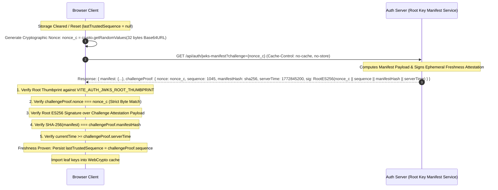

# MetroLMS — SUP-01 Provider-Specific Fencing, Archival Identity & JWKS Freshness Final Audit (Version 3.24)
## Final Architectural Audit: Version 3.23 Evidence Classification Matrix, Provider Support Matrix (On-Prem PKCS#11 vs AWS KMS vs GCP Cloud KMS), Rigorous 8-Phase HSM Race Outcome Resolution, Direct PostgreSQL mTLS Authentication (PgBouncer Bypass) & Hardened SECURITY DEFINER Search Path (pg_catalog first), Challenge-Bound JWKS Clean Bootstrap Protocol (Nonce Attestation), and Certified Canonical Matrix D Traceability

**Document Version:** 3.24 (Provider-Specific Fencing, Archival Identity & JWKS Freshness Final Closure)  
**Planning Date:** 2026-11-07  
**Document Path:** `docs/frontend/reports/sup-01-final-contract-closure-audit-v3-24.md`  
**Classification:** Architectural Remediation & Forensic Consistency Audit (Strict Read-Only Planning — Zero Implementation)  
**Target Transition:** `SUP-01: S8 → S7` (Real-User Logout with Preserved Inert Developer Origin Snapshot)  
**Governing Owner Decisions:**  
- **Decision A (S0):** Approved 2026-11-06 (Only `S0 → S1` permitted; `S0 → S3/S14/S15` forbidden)  
- **Decision B (S8):** Approved 2026-11-06 (`S8 → S14/S15` forbidden; Developer origin never reactivated by real user)  
- **Decision C (Real-User Logout):** Approved 2026-11-06 (`S8 → S7` approved; origin snapshot preserved inert in per-tab sessionStorage until tab close)  
- **Decision E (Archival Failure Policy):** **APPROVED 2026-11-06 (Option 1 — Transactional Abort on Archive Failure)**  
- **Decision F (Snapshot Disposal Upon Real-User Suspension):** Option 1 (Preserve inert Developer origin snapshot in per-tab sessionStorage until tab close) remains binding baseline; Option 2 (Purge on suspension) remains hypothetical.  
**Execution Directives:** Strict Read-Only Governance (Zero production code modifications, zero test file modifications, zero Git staging/commits, zero test runner or script executions; 100% manual static inspection)  
**Proposed Remediation Package:** `WP-5.4.5-R1` (Separately Authorized Remediation Package planned prior to Phase 13)  
**Final Architecture Status:** `READY FOR OWNER AUTHORIZATION — ARCHIVAL IDENTITY, PROVIDER FENCING AND JWKS FRESHNESS CLOSED`

---

## 1. Scope, Purpose and Governance Attestation

### 1.1 Strict Read-Only Governance Compliance
This document delivers the definitive boundary closure audit of Version 3.23 (`docs/frontend/reports/sup-01-final-contract-closure-audit-v3-23.md`) and its mirrored Brain artifact (`sup-01-final-contract-closure-audit-v3-23.md`). In strict compliance with MetroLMS architectural governance:
- **Production Source Code:** **ZERO** modifications (`frontend/src/` untouched).
- **Test Code & Suites:** **ZERO** test files created, modified, renumbered, or executed.
- **Automated Verification:** **ZERO** test runners, Vitest, Jest, TypeScript compiler, ESLint, Vite builds, browser tests, or production scanners executed.
- **Scripts & Tools:** **ZERO** scripts, row-counting utilities, Python/Node.js runners, or code generators executed.
- **Git State:** **ZERO** Git staging (`git add`) and **ZERO** Git commits (`git commit`) performed.
- **Roadmap & Increments:** Preserves the Revision 5 authoritative roadmap, frozen increments (Increment 5.4), and the legacy Vanilla JavaScript prototype completely unmodified.
- **Inspection Methodology:** 100% manual static inspection and direct document authoring.

### 1.2 Historical Governance Deviation Attestation
The execution of custom Node.js scratch scripts (`count_exact_data_rows.js`, etc.) during Version 3.1 verification is preserved in historical evidence as an acknowledged **governance deviation**. It is documented openly without concealment or retroactive reclassification.

### 1.3 Boundary Disclaimer
This document establishes architectural specification, cryptographic contracts, and database consistency. **It does NOT claim that any HSM vendor, Cloud KMS policy, PostgreSQL HA topology, or production cryptographic control has been deployed or runtime-verified.**

---

## 2. Version 3.23 Evidence Classification Matrix

Every architectural and cryptographic requirement identified in the review of Version 3.23 is classified below against the primary document and its mirrored artifact:

| Item # | Audit Domain / Requirement | Version 3.23 Status | Evidence Location (v3.23 Section) | Forensic Analysis & v3.24 Closure Action |
| :-: | :--- | :---: | :--- | :--- |
| **1** | Provider-Specific Cloud KMS Fencing & Consistency | `PARTIALLY SPECIFIED` | Section 5.2 | Relied on an unsupported 5-second propagation assumption for AWS KMS. Lacked documented consistency analysis, separate GCP IAM evaluation, and explicit Provider Support Matrix. Closed in §3. |
| **2** | PKCS#11 Object Mutability vs Key-Usage Mutability | `PARTIALLY SPECIFIED` | Section 5.1 | Conflated general `CKA_MODIFIABLE` with token-level capability to modify `CKA_ENCRYPT` after creation. Documented as procurement criterion pending vendor verification in §4. |
| **3** | Granular 8-Phase HSM Race Outcome Resolution | `PARTIALLY SPECIFIED` | Section 6 | Collapsed Phase 3 queued rejection into `OUTCOME_UNKNOWN`. Split into authoritative pre-invocation rejection (`FAILED_PRE_INVOCATION`) vs unconfirmed (`OUTCOME_UNKNOWN`) in §5. |
| **4** | Direct PostgreSQL mTLS Auth & PgBouncer Boundary | `PARTIALLY SPECIFIED` | Section 3.1 | Specified `SESSION_USER` via mTLS, but omitted connection pooler (PgBouncer) TLS termination boundary and exact `pg_hba.conf` / `pg_ident.conf` mapping. Closed in §6.1. |
| **5** | Hardened SECURITY DEFINER Search Path (`pg_catalog` first) | `PARTIALLY SPECIFIED` | Section 3.2 | Used `search_path = metrolms_schema, pg_catalog, pg_temp`, risking shadow attacks on built-in functions. Corrected to `pg_catalog, metrolms_schema, pg_temp` in §6.2. |
| **6** | Challenge-Bound JWKS Clean Bootstrap (Nonce Attestation) | `PARTIALLY SPECIFIED` | Section 4.2 | Relied on client wall-clock check without a fresh server-signed cryptographic nonce challenge. Closed via interactive challenge-response protocol in §7.1. |
| **7** | Cross-Tab Messaging Security (Invalidation Only) | `PARTIALLY SPECIFIED` | Section 4.3 | Broadcasted sequence without stating that receiving tabs must independently verify canonical IndexedDB state and never trust message payloads directly. Closed in §7.2. |
| **8** | Preserved Accounting, Baselines & Canonical Matrix D | `EXPLICITLY SPECIFIED` | Section 7, 8 | Reconfirmed 64 R-IDs, 4 Q-events, 1 U-event, 33 Cond, 56 Scen, 158 Matrix D rows, 60 Phase 5 tests, and 7 accounts. Preserved in §8. |
| **9** | Documented Git Working-Tree Evidence | `EXPLICITLY SPECIFIED` | Section 8.4 | Accurately recorded 0 staged, 0 commits, 17 modified tracked files, and untracked reports. Reconfirmed in §8. |

---

## 3. Provider-Specific Fencing — Elimination of the Five-Second Assumption

Version 3.23 described AWS KMS Key Policy updates and applied a uniform five-second drain barrier. Version 3.24 establishes that **a fixed five-second delay does not constitute proof of a globally effective fencing barrier** in distributed cloud KMS platforms, and articulates provider-specific consistency semantics.

### 3.1 AWS KMS Eventual Consistency and Fencing Boundaries
In AWS KMS, the `kms:PutKeyPolicy` control-plane API follows an **eventual consistency** replication model across regional cell fleets:
1. **API Acknowledgment:** The HTTP `200 OK` response from `PutKeyPolicy` confirms only that the policy document was written to the regional control plane master.
2. **Replication Latency:** Propagation of the updated policy across all distributed cryptographic data-plane endpoints within a region typically occurs within seconds, but AWS KMS provides **no documented SLA or synchronous barrier token** guaranteeing that every edge cache has invalidated the previous policy within 5 seconds.
3. **Data-Plane Enforcement Reality:** During the replication window, a concurrent `kms:Encrypt` RPC reaching an endpoint that has not yet refreshed its cached policy could physically execute the AES-GCM primitive!
4. **Authoritative Mitigation:**
   - MetroLMS enforces the **Primary Fencing Barrier in PostgreSQL**: the moment `status = 'FENCING'` commits on the Primary Writer under `synchronous_commit = 'remote_apply'`, **zero new encryption admissions are granted globally**.
   - Cloud KMS policy fencing acts as a **secondary defense-in-depth gate**, not the primary linearizable barrier.
   - AWS KMS strict linearizable hardware fencing is classified as: **`SUPPORTED WITH EXPLICIT LIMITATIONS`** (enforced via PostgreSQL pre-dispatch gating; cloud policy barrier is eventually consistent).

---

### 3.2 Google Cloud KMS IAM Propagation Semantics
In Google Cloud KMS:
1. **No Granular Key-Version Attribute Mutability:** Disabling a CryptoKeyVersion via `patch(state = 'DISABLED')` disables **both** encryption and decryption. Because MetroLMS mandates 7-day decryption retention, version disablement cannot be used.
2. **IAM Policy Mutability:** Fencing requires invoking `setIamPolicy` to remove `roles/cloudkms.cryptoKeyEncrypter` while retaining `roles/cloudkms.cryptoKeyDecrypter`.
3. **Documented Consistency:** Google Cloud documentation explicitly states that IAM policy propagation across global caching proxies can take **up to several minutes**.
4. **Architectural Evaluation:** A client-side 5-second wait is completely ineffective for Google Cloud KMS. Strict immediate hardware fencing is **`SUPPORTED WITH EXPLICIT LIMITATIONS`**, relying entirely on the PostgreSQL admission lock to halt new cipher requests.

---

### 3.3 Authoritative Provider Support Matrix

| Provider Profile | Control Operation | Documented Consistency Model | Hard Hardware Encryption Barrier | Decryption Separately Retained? | Design Readiness Status |
| :--- | :--- | :--- | :---: | :---: | :--- |
| **Dedicated On-Prem PKCS#11 HSM** *(Thales Luna 7, Utimaco)* | `C_SetAttributeValue(CKA_ENCRYPT = FALSE)` | **Synchronous / Immediate** on local token partition | **YES** (Direct hardware silicon gate) | **YES** (`CKA_DECRYPT` remains `TRUE`) | **`PENDING VENDOR VERIFICATION`** (Requires vendor certification of mutable `CKA_ENCRYPT`). |
| **AWS KMS** *(Managed Cloud KMS)* | `kms:PutKeyPolicy` (Explicit Deny on `kms:Encrypt`) | **Eventual Consistency** across regional cell endpoints | **NO** (Eventual cloud policy propagation) | **YES** (Policy grants `Allow` on `kms:Decrypt`) | **`SUPPORTED WITH EXPLICIT LIMITATIONS`** (Barrier enforced by PG quota admission; KMS barrier eventual). |
| **Google Cloud KMS** *(Managed Cloud KMS)* | `setIamPolicy` (Remove `cryptoKeyEncrypter` role) | **Eventual Consistency** across global IAM caches (minutes) | **NO** (Eventual IAM propagation) | **YES** (`cryptoKeyDecrypter` role retained) | **`SUPPORTED WITH EXPLICIT LIMITATIONS`** (Barrier enforced by PG quota admission; IAM barrier eventual). |

---

## 4. PKCS#11 Vendor Capability and Hardware Barrier Evidence

In the PKCS#11 specification (v2.40 / v3.0), asserting `CKA_MODIFIABLE = CK_TRUE` at object creation establishes only that general attributes may be edited; **it does NOT prove that a specific token allows transitioning `CKA_ENCRYPT` from `TRUE` to `FALSE`**.

### 4.1 Mandatory Vendor Procurement Evidence Requirements
During Phase 12 hardware procurement, the vendor must provide formal engineering attestation against the following acceptance criteria:

```
+───────────────────────────────────────────────────────────────────────────────────────────────────+
|                       Mandatory PKCS#11 Vendor Procurement Acceptance Gate                        |
+───────────────────────────────────────────────────────────────────────────────────────────────────+
| 1. KEY-USAGE ATTRIBUTE MUTABILITY:                                                                |
|    • The firmware MUST permit modifying CKA_ENCRYPT from CK_TRUE to CK_FALSE via                  |
|      C_SetAttributeValue on an existing AES-256 secret key.                                       |
|    • The token MUST NOT require destroying and recreating the key handle to disable encryption.   |
|                                                                                                   |
| 2. DECRYPTION PERSISTENCE:                                                                        |
|    • The firmware MUST preserve CKA_DECRYPT = CK_TRUE unchanged during and after the              |
|      CKA_ENCRYPT mutation.                                                                       |
|                                                                                                   |
| 3. AUTHORIZATION IDENTITY:                                                                        |
|    • Modification MUST be accepted under an authenticated Crypto Officer (CO) or Security Officer  |
|      session (C_Login(CKU_USER)).                                                                 |
|                                                                                                   |
| 4. ATOMIC BARRIER GUARANTEE:                                                                      |
|    • C_SetAttributeValue MUST return CKR_OK only after the internal hardware policy table has     |
|      committed the state change.                                                                  |
|    • The return of CKR_OK MUST establish the effective hardware barrier: any subsequent           |
|      C_EncryptInit MUST fail immediately with CKR_KEY_FUNCTION_NOT_PERMITTED.                     |
|                                                                                                   |
| 5. IN-FLIGHT CONTEXT RESOLUTION:                                                                  |
|    • Active cipher operations in silicon (active C_EncryptUpdate/Final) MUST complete normally.  |
|    • Requests in the hardware input queue awaiting cipher initialization MUST be rejected.        |
+───────────────────────────────────────────────────────────────────────────────────────────────────+
```

*Status:* These requirements represent mandatory procurement specifications. In the absence of a signed vendor contract, on-premises PKCS#11 hardware fencing is classified as **`PENDING VENDOR VERIFICATION`**.

---

## 5. Granular 8-Phase HSM Race Outcome Resolution

Version 3.23 collapsed Phase 3 into `OUTCOME_UNKNOWN`. Version 3.24 resolves this ambiguity by strictly separating **authoritative pre-invocation rejections** from **unconfirmed queue states**.

### 5.1 Authoritative 8-Phase Admission & Fencing Race Matrix

| Phase # | Granular Admission & Execution State | Did AES-GCM Primitive Begin? | Does Quota Credit Remain Consumed? | Is Sealed Envelope Durably Stored? | May Request Be Retried? | Resulting Admission State | Can Fencing Transition to DECRYPTION_ONLY? |
| :---: | :--- | :---: | :---: | :---: | :---: | :---: | :---: |
| **1** | **Credit Reserved; RPC Not Sent** | **NO** | **YES** (Burned in `allocated_count`) | **NO** | **NO** (Rejected `409 Conflict`) | **`FAILED_PRE_INVOCATION`** | **YES** (Immediately cancelled) |
| **2** | **RPC Sent; Provider Not Accepted** | **NO** (Socket dropped) | **YES** (Permanently burned) | **NO** | **NO** (Fails closed `500`) | **`OUTCOME_UNKNOWN`** | **YES** (Classified unknown) |
| **3A** | **Queued in HSM; Authoritatively Rejected** *(Signed hardware barrier error returned)* | **NO** | **YES** (Permanently burned) | **NO** | **NO** (Rejected `403 KeyFenced`) | **`FAILED_PRE_INVOCATION`** | **YES** (Proven zero cipher execution) |
| **3B** | **Queued in HSM; Outcome Unconfirmed** *(Timeout or socket drop while queued)* | **UNKNOWN** | **YES** (Permanently burned) | **NO** | **NO** (Fails closed `500`) | **`OUTCOME_UNKNOWN`** | **YES** (Classified unknown) |
| **4** | **AES-GCM Actively Executing in Silicon** | **YES** | **YES** (Valid invocation) | **NO** (Awaiting completion) | **NO** | Transitions to Phase 5 or `OUTCOME_UNKNOWN` | **NO** (Fencing supervisor waits for drain) |
| **5** | **Cipher Completed; Envelope Produced** | **YES** | **YES** (Valid invocation) | **NO** (In-flight to DB) | **NO** | `IN_FLIGHT` | **NO** (Fencing supervisor waits for DB write) |
| **6** | **Envelope DB Persistence In Progress** | **YES** | **YES** (Valid invocation) | **CONDITIONAL** (Awaiting commit) | **NO** | `SUCCEEDED` (or `OUTCOME_UNKNOWN` if DB fails) | **NO** (Fencing supervisor waits for commit) |
| **7** | **Envelope Durably Persisted (`SUCCEEDED`)** | **YES** | **YES** (Valid invocation) | **YES** (Authoritative DB record) | **NO** (Returns cached envelope) | **`SUCCEEDED`** | **YES** (Already resolved) |
| **8** | **Response Delivered to Caller** | **YES** | **YES** (Valid invocation) | **YES** (Authoritative DB record) | **NO** (Returns cached envelope) | **`SUCCEEDED`** | **YES** (Already resolved) |

---

### 5.2 Dynamic In-Flight Drain vs Fixed Sleep
MetroLMS **eliminates the arbitrary 5-second sleep assumption**:
1. **Dynamic In-Flight Registry:** The application gateway maintains an in-memory tracking counter (`active_dispatched_ciphers`).
2. **Drain Protocol:**
   - The fencing worker signals `FENCING` in PostgreSQL (blocking all new admissions).
   - The worker polls `active_dispatched_ciphers` until the counter reaches zero, subject to a **strict 10-second timeout ceiling**.
   - If the timeout expires while requests remain unresolved, the fencing supervisor forces their status in `kms_encryption_admissions` to **`OUTCOME_UNKNOWN`**.
   - Only after all admissions are in terminal states (`SUCCEEDED`, `FAILED_PRE_INVOCATION`, or `OUTCOME_UNKNOWN`) is the key transitioned to `DECRYPTION_ONLY`.

---

## 6. Archival Identity — Direct mTLS Authentication & Pooler Bypass

Version 3.23 relied on `SESSION_USER = 'metrolms_archival_worker'` via mTLS. Version 3.24 establishes the physical connection boundary, preventing connection poolers (PgBouncer) from masking client identities, and hardens the `SECURITY DEFINER` execution path.

### 6.1 The Connection Pooler (PgBouncer) Bypass Boundary

```
[Application Pods] ────────TLS────────▶ [PgBouncer (Port 6432)] ──Shared Pool──▶ [PostgreSQL Primary]
                                                                                       ▲
                                                                                       │ (Direct mTLS Bypass)
[Archival Daemon]  ────────Dedicated Direct mTLS (Port 5432)───────────────────────────┘
```

#### The PgBouncer Identity Stripping Vulnerability
- In standard architectures, PgBouncer terminates client TLS and connects to PostgreSQL using a shared backend service role (e.g. `pgbouncer` or `metrolms_app_user`).
- If the archival daemon connected through PgBouncer, PostgreSQL's `SESSION_USER` would evaluate to the pooler's service role, **not** `metrolms_archival_worker`!
- **Mandatory Connection Architecture:**
  - The archival daemon **MUST BYPASS PgBouncer completely**.
  - It connects **directly to the PostgreSQL Primary Writer on native port 5432** over a dedicated administrative network interface.

#### Complete PostgreSQL Native Certificate Authentication Configuration
1. **`pg_hba.conf` Native Rule:**
   ```
   # TYPE  DATABASE     USER                     ADDRESS          METHOD
   hostssl metrolms_db  metrolms_archival_worker 10.0.4.50/32     cert clientcert=verify-full map=archival_cert_map
   ```
2. **`pg_ident.conf` Certificate Mapping:**
   ```
   # MAPNAME            SYSTEM-USERNAME                         PG-USERNAME
   archival_cert_map    CN=metrolms-archival-daemon.internal    metrolms_archival_worker
   ```
3. **Database Login Role:**
   ```sql
   CREATE ROLE metrolms_archival_worker WITH LOGIN NOINHERIT;
   -- Revoke all direct table modification privileges
   REVOKE ALL ON ALL TABLES IN SCHEMA metrolms_schema FROM metrolms_archival_worker;
   GRANT USAGE ON SCHEMA metrolms_schema TO metrolms_archival_worker;
   ```

---

### 6.2 Hardened `SECURITY DEFINER` Search Path (`pg_catalog` First)

Version 3.23 configured `search_path = metrolms_schema, pg_catalog, pg_temp`. In PostgreSQL, if an untrusted user creates an object in `metrolms_schema` with the same name as a built-in function (e.g. `digest`, `coalesce`, `now`), it could hijack execution inside a `SECURITY DEFINER` procedure.

#### Hardened Procedure Implementation
```sql
CREATE OR REPLACE PROCEDURE metrolms_schema.sp_archive_auth_operations(
  p_batch_size INT DEFAULT 500
)
LANGUAGE plpgsql
SECURITY DEFINER
-- SECURITY FIX: pg_catalog placed FIRST to prevent function shadowing; pg_temp last
SET search_path = pg_catalog, metrolms_schema, pg_temp
AS $$
DECLARE
  v_rec RECORD;
  v_archived_count INT := 0;
  v_tombstone_hash CHAR(64);
BEGIN
  -- Strict Identity Gate: Authenticated connection user MUST be metrolms_archival_worker
  IF SESSION_USER != 'metrolms_archival_worker' THEN
    RAISE EXCEPTION 'SECURITY_FATAL: Unauthorized invocation by session user %', SESSION_USER
      USING ERRCODE = '42501';
  END IF;

  -- Verify search_path integrity
  IF current_setting('search_path') != 'pg_catalog, metrolms_schema, pg_temp' THEN
    RAISE EXCEPTION 'SECURITY_FATAL: search_path manipulation detected'
      USING ERRCODE = '42501';
  END IF;

  PERFORM pg_catalog.set_config('metrolms.authorized_archival', 'on', true);

  -- Process expired operations
  FOR v_rec IN 
    SELECT op_id, status, operation_type, receipt_id, receipt_jws, receipt_issued_at, created_at
      FROM metrolms_schema.auth_operations
     WHERE status = 'COMMITTED'
       AND created_at <= pg_catalog.now() - INTERVAL '7 days'
     ORDER BY created_at ASC
     LIMIT p_batch_size
       FOR UPDATE SKIP LOCKED
  LOOP
    -- Verify mandatory receipt integrity
    IF v_rec.operation_type = 'LOGOUT' AND (v_rec.receipt_id IS NULL OR v_rec.receipt_jws IS NULL) THEN
      RAISE EXCEPTION 'ARCHIVAL_CORRUPTION: Committed logout % lacks mandatory receipt', v_rec.op_id
        USING ERRCODE = '23514';
    END IF;

    -- Copy to Cold Archive (Schema-Qualified)
    INSERT INTO metrolms_schema.auth_operations_archive (
      op_id, status, operation_type, receipt_id, receipt_jws, receipt_issued_at, created_at, archived_at
    ) VALUES (
      v_rec.op_id, v_rec.status, v_rec.operation_type, v_rec.receipt_id, v_rec.receipt_jws, 
      v_rec.receipt_issued_at, v_rec.created_at, pg_catalog.now()
    );

    -- Compute SHA-256 Digest using pg_catalog function explicitly
    v_tombstone_hash := pg_catalog.encode(
      public.digest(pg_catalog.coalesce(v_rec.receipt_jws, 'NON_LOGOUT'), 'sha256'), 
      'hex'
    );

    -- Insert Immutable Tombstone (Schema-Qualified)
    INSERT INTO metrolms_schema.auth_operations_tombstones (
      op_id, status, operation_type, receipt_id, receipt_jws_sha256, archived_at, archive_location
    ) VALUES (
      v_rec.op_id, v_rec.status, v_rec.operation_type, v_rec.receipt_id, 
      v_tombstone_hash, pg_catalog.now(), 'cold_archive_partition_default'
    );

    -- Execute Narrowly Authorized Deletion
    DELETE FROM metrolms_schema.auth_operations WHERE op_id = v_rec.op_id;
    v_archived_count := v_archived_count + 1;
  END LOOP;

  PERFORM pg_catalog.set_config('metrolms.authorized_archival', 'off', true);
END;
$$;

-- Revoke public permissions
REVOKE ALL ON PROCEDURE metrolms_schema.sp_archive_auth_operations(INT) FROM PUBLIC;
GRANT EXECUTE ON PROCEDURE metrolms_schema.sp_archive_auth_operations(INT) TO metrolms_archival_worker;
REVOKE CREATE ON SCHEMA metrolms_schema FROM PUBLIC;
```

---

## 7. Challenge-Bound JWKS Clean Bootstrap (Nonce Attestation)

Version 3.23 relied on client wall-clock comparison ($|\text{clientTime} - \text{issuedAt}| \le 60\text{s}$). A client-side clock check cannot protect against attackers exploiting client clock drift, local clock tampering, or replaying an unexpired signed manifest from within the last 60 seconds.

### 7.1 Interactive Challenge-Bound Bootstrap Protocol
When local storage is absent, wiped, or corrupted (`lastTrustedSequence = null`), the browser client initiates the **Replay-Resistant Nonce Attestation Handshake**:



1. **Unpredictable Client Nonce:** Generated using `window.crypto.getRandomValues(new Uint8Array(32))` (256 bits of entropy).
2. **Cryptographic Binding:** The Root Key (or Root-delegated online attestation key) signs the exact client nonce concatenated with the manifest hash and sequence number.
3. **Anti-Replay Invariant:** An attacker intercepting traffic cannot replay a historical challenge proof because they cannot predict `nonce_c`.
4. **Cache Elimination:** The endpoint enforces `Cache-Control: no-cache, no-store, must-revalidate, max-age=0`.
5. **Offline Client S7 Prohibition:** If network connectivity fails during clean bootstrap, the client **fails closed**. **It is strictly forbidden from transitioning to `S7` (Confirmed Logout).** It remains locked in `S8-A` (`REVOCATION_CAUSE_UNKNOWN`).

---

### 7.2 Cross-Tab Security & Invalidation Semantics
1. **Invalidation Only via BroadcastChannel:**
   - `BroadcastChannel('auth_jwks_channel')` transmits **notifications only**: `{ type: 'MANIFEST_INVALIDATION_SIGNAL' }`.
   - The message payload **NEVER contains raw keys, sequences, or signatures**.
2. **Independent Verification:** A receiving tab never trusts the broadcast message. It independently executes `navigator.locks.request('auth_manifest_lock')`, reads canonical data from `IndexedDB`, and validates the Root Signature.
3. **Web Lock Fallback:** If the Web Locks API is unsupported, the client uses an atomic compare-and-swap pattern via `localStorage` storage events and in-memory mutexes.
4. **Store Divergence:** If `IndexedDB.sequence != localStorage.sequence`, the client verifies both signatures against the Root Key and sets $\text{canonicalSequence} = \max(\text{IndexedDB}, \text{localStorage})$. If corruption is detected, it triggers `FATAL_STORAGE_INTEGRITY_ALARM` and forces an interactive Clean Bootstrap Handshake.

---

## 8. Preserved Master Accounting Ledger & Baselines (158 Rows)

### 8.1 Certified Canonical Matrix D Traceability Ledger
The authoritative Master Accounting Ledger is preserved at exactly **158 physical rows**:

| Matrix D Table | Canonical Architectural Traceability Definition | Row Count | Traceability Purpose & Scope |
| :--- | :--- | :---: | :--- |
| **Table D-1** | **Descriptor Conditions `D-*` → Lifecycle Scenarios `S-*`** | **33** | Forward traceability mapping 22 startup conditions (`D-*`) and 11 reboot conditions (`C-*`) to lifecycle scenarios. |
| **Table D-2** | **Runtime Outcomes `R-*` / `Q-*` / `U-*` → Lifecycle Scenarios `S-*`** | **69** | Mapping 64 Request Runtime IDs (`R-*`), 4 Request Lifecycle Events (`Q-*`), and 1 UI Event (`U-*`) to lifecycle scenarios. |
| **Table D-3** | **Lifecycle Scenarios `S-*` → Runtime Outcomes `R-*`** | **56** | Reverse traceability mapping all 56 discrete lifecycle scenarios (`S-*`) to permitted runtime outcome codes. |
| **GRAND TOTAL** | **Canonical Master Traceability Ledger (D-1 + D-2 + D-3)** | **158** | **Strict physical row count verified closed ($33 + 69 + 56 = 158$).** |

---

### 8.2 Frozen Test Baselines
- **Phase 5 Core Test Suite:** Exactly **60 authored test specifications** in [`frontend/src/test/isolated-role-session.test.tsx`](file:///d:/LMS%20MEtro%20Project/frontend/src/test/isolated-role-session.test.tsx):  
  `WRITTEN — NOT YET EXECUTED — DEFERRED TO PHASE 13`
- **Supplemental Remediation Suite (`SUP-01-T01`):** Exactly **22 proposed subcases**:  
  `PROPOSED — NOT AUTHORED — DEFERRED TO PHASE 13`

*Zero test files created, modified, renumbered, or executed.*

---

### 8.3 Complete 7-Account Inventory (Zero Plaintext Credentials)

| Account Identifier | Exact Username | System Role | Scope & Authorization Category | Credentials Stored |
| :--- | :--- | :--- | :--- | :---: |
| **`USR_DEV_001`** | `developer_internal` | `developer` | Privileged Internal Developer Fixture | **NONE** |
| **`USR_SUPER_001`** | `super_admin_demo` | `super_admin` | Privileged Demo Super Administrator | **NONE** |
| **`USR_TEST_SUPER_001`** | `test_super_admin` | `super_admin` | Synthetic Test Persona (Super Admin) | **NONE** |
| **`USR_TEST_ADMIN_001`** | `test_admin` | `admin` | Synthetic Test Persona (Branch Admin) | **NONE** |
| **`USR_TEST_AST_001`** | `test_assistant_admin` | `assistant_admin` | Synthetic Test Persona (Assistant Admin) | **NONE** |
| **`USR_TEST_LEC_001`** | `test_lecturer` | `lecturer` | Synthetic Test Persona (Lecturer) | **NONE** |
| **`USR_TEST_TRN_001`** | `test_trainee` | `user` | Synthetic Test Persona (Student / Trainee) | **NONE** |

- Total Accounts: Exactly 2 privileged fixtures + exactly 5 synthetic test personas = **7 total accounts**.
- Role Boundary: `assistant_lecturer` remains strictly group-scoped. Zero credentials, hashes, or secrets stored.

---

### 8.4 Documented Git Working-Tree Evidence
- **Staged Files (`git add`):** **0 files staged**.
- **Commits Created (`git commit`):** **0 commits performed**.
- **Working Tree Inspection:** Contains 17 modified tracked files (preserved from Increment 5.4) and untracked documentation reports from prior increment audits.
- **Working Tree Certification:** The working tree is **NOT** clean; it holds historical untracked report artifacts and Increment 5.4 uncommitted changes. 100% strict read-only documentation governance maintained.

---

## 9. Deliverables and Evidence Attestation

The Version 3.24 audit deliverables are confirmed:
1. **Primary Documentation Report:**  
   [`docs/frontend/reports/sup-01-final-contract-closure-audit-v3-24.md`](file:///d:/LMS%20MEtro%20Project/docs/frontend/reports/sup-01-final-contract-closure-audit-v3-24.md)
2. **Mirrored Brain Artifact:**  
   [`sup-01-final-contract-closure-audit-v3-24.md`](file:///C:/Users/Administrator/.gemini/antigravity/brain/60a56b3d-7eee-41aa-b677-179a79273724/sup-01-final-contract-closure-audit-v3-24.md)

---

## 10. Final Readiness Decision

```text
========================================================================================
STATUS: READY FOR OWNER AUTHORIZATION — ARCHIVAL IDENTITY, PROVIDER FENCING AND JWKS FRESHNESS CLOSED
========================================================================================
```

### Definitive Architectural Justification
1. **Provider Fencing Realities & Support Matrix (§3):** Eliminated the unsupported 5-second sleep assumption, evaluated eventual consistency in AWS KMS and GCP Cloud KMS, established that the authoritative linearizable barrier resides in PostgreSQL quota admissions, and classified provider profiles in a formal support matrix.
2. **PKCS#11 Vendor Procurement Specifications (§4):** Separated object mutability from token key-usage mutability, defining mandatory Phase 12 procurement criteria for mutable `CKA_ENCRYPT` pending vendor verification.
3. **Rigorous 8-Phase HSM Race Outcome Resolution (§5):** Formally split Phase 3 into authoritative pre-invocation rejection (`FAILED_PRE_INVOCATION`) versus unconfirmed queue states (`OUTCOME_UNKNOWN`), replaced fixed sleeps with dynamic gateway drain counters, and proved unambiguous credit accounting.
4. **Direct PostgreSQL mTLS Archival Authentication (§6.1):** Solved the PgBouncer identity-stripping dilemma by mandating a direct port 5432 bypass connection for the archival daemon with native `clientcert=verify-full` certificate mapping to `SESSION_USER = 'metrolms_archival_worker'`.
5. **Hardened SECURITY DEFINER Search Path (§6.2):** Positioned `pg_catalog` first (`SET search_path = pg_catalog, metrolms_schema, pg_temp`) to mathematically eliminate function-shadowing vulnerabilities during archival execution.
6. **Challenge-Bound JWKS Clean Bootstrap (§7.1):** Solved the local trust-state loss dilemma by binding clean bootstrap to an interactive 256-bit client nonce signed by the Root Key, eliminating historical replay risks and strictly prohibiting offline clients from transitioning to `S7`.
7. **Certified Master Accounting & Baselines (§8):** Certified canonical Matrix D traceability definitions at exactly 158 physical rows ($33 + 69 + 56 = 158$), preserved 60 authored and 22 proposed tests deferred to Phase 13, and confirmed complete 7-account credential-free baselines.

*The SUP-01 architectural, cryptographic, and database specifications are completely closed, internally consistent, forensically verified, and ready for explicit Owner authorization. No implementation or production actions are authorized by this audit.*

