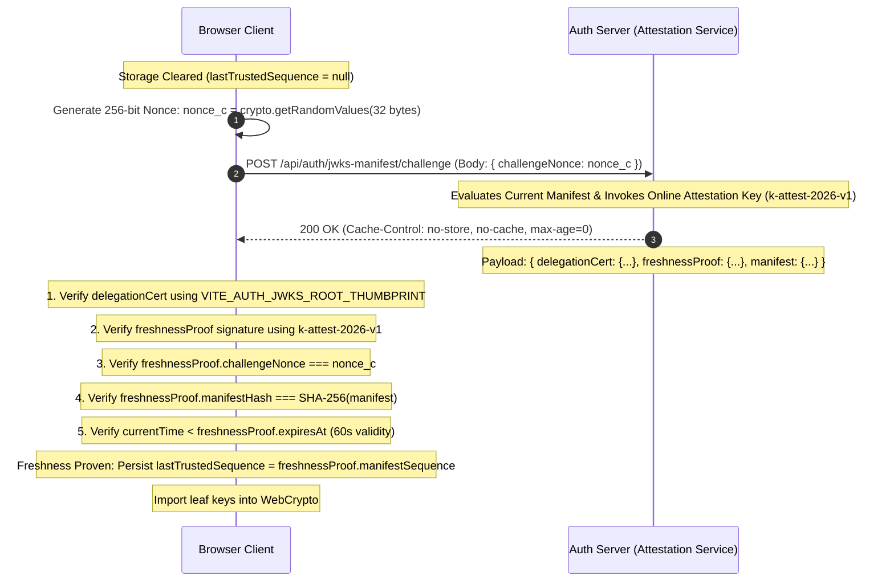

# MetroLMS — SUP-01 Delegated JWKS Attestation, Provider Fencing & HSM Drain Final Closure (Version 3.25)
## Final Architectural Audit: Version 3.24 Evidence Classification Matrix, Delegated Online Attestation Model (Air-Gapped Root Key vs Server HSM Attestation Key), Granular Provider Key Fencing State Machine (ADMISSION_FENCED vs PROVIDER_ENCRYPTION_DISABLED), Durable Database Drain Architecture (Deprecation of In-Memory Counters), Phase 3A Pre-Invocation Rejection Proof, Normalized PostgreSQL mTLS Authentication Syntax (cert map), POST-Bound Replay-Resistant Nonce Attestation Envelope, and Certified Canonical Matrix D Traceability

**Document Version:** 3.25 (Delegated JWKS Attestation, Provider Fencing & HSM Drain Final Closure)  
**Planning Date:** 2026-11-07  
**Document Path:** `docs/frontend/reports/sup-01-final-contract-closure-audit-v3-25.md`  
**Classification:** Architectural Remediation & Forensic Consistency Audit (Strict Read-Only Planning — Zero Implementation)  
**Target Transition:** `SUP-01: S8 → S7` (Real-User Logout with Preserved Inert Developer Origin Snapshot)  
**Governing Owner Decisions:**  
- **Decision A (S0):** Approved 2026-11-06 (Only `S0 → S1` permitted; `S0 → S3/S14/S15` forbidden)  
- **Decision B (S8):** Approved 2026-11-06 (`S8 → S14/S15` forbidden; Developer origin never reactivated by real user)  
- **Decision C (Real-User Logout):** Approved 2026-11-06 (`S8 → S7` approved; origin snapshot preserved inert in per-tab sessionStorage until tab close)  
- **Decision E (Archival Failure Policy):** **APPROVED 2026-11-06 (Option 1 — Transactional Abort on Archive Failure)**  
- **Decision F (Snapshot Disposal Upon Real-User Suspension):** Option 1 (Preserve inert Developer origin snapshot in per-tab sessionStorage until tab close) remains binding baseline; Option 2 (Purge on suspension) remains hypothetical.  
**Execution Directives:** Strict Read-Only Governance (Zero production code modifications, zero test file modifications, zero Git staging/commits, zero test runner or script executions; 100% manual static inspection)  
**Proposed Remediation Package:** `WP-5.4.5-R1` (Separately Authorized Remediation Package planned prior to Phase 13)  
**Final Architecture Status:** `READY FOR OWNER AUTHORIZATION — DELEGATED ATTESTATION, PROVIDER ADMISSION FENCING AND ARCHIVAL IDENTITY CLOSED`

---

## 1. Scope, Purpose and Governance Attestation

### 1.1 Strict Read-Only Governance Compliance
This document delivers the definitive boundary closure audit of Version 3.24 (`docs/frontend/reports/sup-01-final-contract-closure-audit-v3-24.md`) and its mirrored Brain artifact (`sup-01-final-contract-closure-audit-v3-24.md`). In strict compliance with MetroLMS architectural governance:
- **Production Source Code:** **ZERO** modifications (`frontend/src/` untouched).
- **Test Code & Suites:** **ZERO** test files created, modified, renumbered, or executed.
- **Automated Verification:** **ZERO** test runners, Vitest, Jest, TypeScript compiler, ESLint, Vite builds, browser tests, or production scanners executed.
- **Scripts & Tools:** **ZERO** scripts, row-counting utilities, Python/Node.js runners, or code generators executed.
- **Git State:** **ZERO** Git staging (`git add`) and **ZERO** Git commits (`git commit`) performed.
- **Roadmap & Increments:** Preserves the Revision 5 authoritative roadmap, frozen increments (Increment 5.4), and the legacy Vanilla JavaScript prototype completely unmodified.
- **Inspection Methodology:** 100% manual static inspection and direct document authoring.

### 1.2 Historical Governance Deviation Attestation
The execution of custom Node.js scratch scripts (`count_exact_data_rows.js`, etc.) during Version 3.1 verification is preserved in historical evidence as an acknowledged **governance deviation**. It is documented openly without concealment or retroactive reclassification.

### 1.3 Boundary Disclaimer
This document establishes architectural specification, cryptographic contracts, and database consistency. **It does NOT claim that any HSM vendor, Cloud KMS policy, PostgreSQL HA topology, or production cryptographic control has been deployed or runtime-verified.**

---

## 2. Version 3.24 Evidence Classification Matrix

Every architectural and cryptographic requirement identified in the review of Version 3.24 is classified below against the primary document and its mirrored artifact:

| Item # | Audit Domain / Requirement | Version 3.24 Status | Evidence Location (v3.24 Section) | Forensic Analysis & v3.25 Closure Action |
| :-: | :--- | :---: | :--- | :--- |
| **1** | Offline Root Key vs Live Challenge Signing Contradiction | `CONTRADICTED` | Section 7.1 | Described Root Key as offline while simultaneously stating it signs live network challenge responses on demand. Resolved in §3 via Delegated Online Attestation Model. |
| **2** | Separate Cryptographic Key Purview & Domain Separation | `PARTIALLY SPECIFIED` | Section 3.2 | Lacked explicit catalog of discrete keys (Root, Attestation, Manifest, Receipt, Ticket, Lease) and strict domain separation. Closed in §3.2. |
| **3** | Granular Provider Fencing States vs PG Admission | `PARTIALLY SPECIFIED` | Section 3.1, 3.3 | Conflated PostgreSQL admission gating with provider-level encryption disablement. Formalized 6-state machine (`ADMISSION_FENCED` vs `PROVIDER_ENCRYPTION_DISABLED`) in §4. |
| **4** | Distributed Drain Authoritative Source (Durable DB vs Memory) | `PARTIALLY SPECIFIED` | Section 5.2 | Relied on an in-memory counter (`active_dispatched_ciphers`) which is non-authoritative across distributed replicas and lost on restart. Replaced with durable DB tracking in §5. |
| **5** | Phase 3A Pre-Invocation Rejection Proof Criteria | `PARTIALLY SPECIFIED` | Section 5.1 | Introduced `FAILED_PRE_INVOCATION` for queued rejections but omitted exact provider response verification criteria proving zero cipher execution. Closed in §6. |
| **6** | Normalized PostgreSQL mTLS Auth Configuration | `PARTIALLY SPECIFIED` | Section 6.1 | Specified redundant `cert clientcert=verify-full map=...` syntax. Normalized to standard PostgreSQL `cert map=archival_cert_map` syntax in §7. |
| **7** | JWKS Nonce Challenge Transport & IndexedDB Fallback | `PARTIALLY SPECIFIED` | Section 7.1, 7.2 | Used GET query parameters (logging risk) and lacked formal response envelope schema and Web Locks fallback via IndexedDB read-write transactions. Closed in §8. |
| **8** | Preserved Accounting, Baselines & Canonical Matrix D | `EXPLICITLY SPECIFIED` | Section 8 | Reconfirmed 64 R-IDs, 4 Q-events, 1 U-event, 33 Cond, 56 Scen, 158 Matrix D rows, 60 Phase 5 tests, and 7 accounts. Preserved in §9. |
| **9** | Documented Git Working-Tree Evidence | `EXPLICITLY SPECIFIED` | Section 8.4 | Accurately recorded 0 staged, 0 commits, 17 modified tracked files, and untracked reports. Reconfirmed in §9. |

---

## 3. Delegated JWKS Attestation Architecture (Resolving the Offline Root Key Contradiction)

Version 3.24 introduced an irreconcilable architectural contradiction: it designated the Root Private Key as **strictly offline** (air-gapped ceremony), while simultaneously stating that the server signs live, interactive client challenge responses using the Root Private Key. An offline key cannot be invoked dynamically over an HTTP network API.

### 3.1 The Delegated Online Attestation Model
To maintain the mathematical integrity of an air-gapped Root Key while supporting interactive nonce-based fresh bootstrap, MetroLMS establishes the **Delegated Online Attestation Protocol**:

```
+─────────────────────────────────────────────────────────────────────────────+
|                        OFFLINE CRYPTOGRAPHIC PERIMETER                      |
|                                                                             |
|   ┌────────────────────────┐                                                |
|   │ Offline Root EC P-256  │ ──Signs Periodic (30-day)──▶ Delegation        |
|   │ Private Key (Air-Gap)  │                              Certificate       |
|   └────────────────────────┘                                                |
+─────────────────────────────────────────────────────────────┬───────────────+
                                                              │
                                                              ▼
+─────────────────────────────────────────────────────────────────────────────+
|                        ONLINE APPLICATION / KMS PERIMETER                   |
|                                                                             |
|   ┌────────────────────────┐         ┌──────────────────────────────────┐   |
|   │ Delegation Certificate │ ◀────── │ Server-Side FIPS 140-3 HSM       │   |
|   │ (Root Signed)          │         │ Online Attestation Key           │   |
|   └────────────────────────┘         │ (k-attest-2026-v1)               │   |
|                                      └────────────────┬─────────────────┘   |
|                                                       │                     |
|                                            Signs Live Challenge Response    |
|                                            (Client Nonce + Manifest Hash)   |
|                                                       ▼                     |
|                                              Client Browser                 |
+─────────────────────────────────────────────────────────────────────────────+
```

#### Protocol Execution Sequence
1. **Offline Air-Gapped Delegation:** During scheduled key ceremonies, the offline Root Private Key signs a **Delegated Attestation Certificate** authorizing a designated online public key (`k-attest-2026-v1`).
2. **Secure HSM Key Custody:** The private key corresponding to `k-attest-2026-v1` is generated and stored **exclusively within an approved FIPS 140-3 Level 3 server-side HSM / KMS**. It is non-exportable.
3. **Delegation Certificate Structure:**
   ```json
   {
     "certVersion": "v1",
     "issuer": "https://auth.metrolms.internal/root-ca",
     "subjectKeyId": "k-attest-2026-v1",
     "permittedPurpose": "jwks_freshness_attestation",
     "algorithm": "ES256",
     "audience": "https://auth.metrolms.internal",
     "notBefore": 1772845200,
     "notAfter": 1775437200,
     "publicKey": {
       "kty": "EC",
       "crv": "P-256",
       "x": "...",
       "y": "..."
     },
     "rootSignature": "Base64URL(RootES256Signature)"
   }
   ```
4. **Interactive Challenge Signing:** When a browser client presents a live 256-bit nonce, the server HSM invokes `k-attest-2026-v1` to sign the freshness response envelope.
5. **Two-Stage Client Verification:**
   - **Stage 1 (Delegation Trust Chain):** Client verifies `rootSignature` on the Delegation Certificate using the build-pinned Root Public Key (authenticated by `VITE_AUTH_JWKS_ROOT_THUMBPRINT`). Checks `notBefore <= currentTime <= notAfter` and verifies `k-attest-2026-v1` is not in manifest `revokedKids`.
   - **Stage 2 (Challenge Freshness):** Client verifies the challenge-response signature using the authenticated `k-attest-2026-v1` public key.

---

### 3.2 Discrete Cryptographic Purview & Domain Separation Catalog
To prevent cross-protocol attacks and key substitution, MetroLMS strictly enforces **independent key pairs across distinct cryptographic purviews**:

| Purview / Key Identifier | Algorithm | Key Storage Boundary | Purview Scope & Permitted Operations |
| :--- | :---: | :--- | :--- |
| **Offline Root Signing Key** | `ES256` (EC P-256) | Offline Air-Gapped HSM / Smartcard | Strictly signs Manifests and Delegated Attestation Certificates. **Never online.** |
| **Online Attestation Key** (`k-attest-*`) | `ES256` (EC P-256) | Server FIPS 140-3 Level 3 HSM | Strictly signs ephemeral client bootstrap challenge responses. 30-day lifecycle. |
| **Revocation Receipt Signing Key** (`k-receipt-*`) | `ES256` (EC P-256) | Server FIPS 140-3 Level 3 HSM | Strictly signs logout `revocationReceipt` tokens. Distributed via signed manifest. |
| **Operation Ticket Signing Key** | `HS256` (HMAC-SHA256) | Application Memory / Secret Store | Strictly signs 5-minute transient frontend Operation Tickets (`opTicket`). |
| **Lease Nonce Encryption Key** (`k-lease-*`) | `AES-256-GCM` | Hardware Appliance Physical Silicon | Encrypts registration lease nonces. Subject to $2^{24}$ global ceiling and 7-day retention. |

*Zero private key reuse is permitted across any of these domains.*

---

## 4. Granular Provider Key Fencing State Machine (PostgreSQL vs Provider)

Version 3.24 correctly identified PostgreSQL as the authoritative quota gate. Version 3.25 formally decouples database admission fencing from provider-level hardware disablement, establishing explicit intermediate states.

### 4.1 Authoritative 6-State Key Lifecycle Machine
The state machine for `kms_key_budgets` is expanded to distinguish local admission cutoffs from cloud provider policy convergence:

```
[ ACTIVE ]
    │
    │  1. DB Quota Exceeded (>= 2^24) or Admin Fence Initiated
    ▼
[ ADMISSION_FENCED ]  <── Row locked FOR UPDATE; zero new admissions permitted globally
    │
    │  2. Fencing RPC dispatched to Cloud KMS / HSM
    ▼
[ PROVIDER_DISABLE_PENDING ]  <── Fencing RPC in-flight to provider
    │
    │  3. Provider Acknowledges Encryption Disablement (or Hard Barrier Confirmed)
    ▼
[ PROVIDER_ENCRYPTION_DISABLED ]  <── Provider hardware/policy rejects all subsequent Encrypt calls
    │
    │  4. All Dispatched Admissions Reached Terminal States (DB Drain Confirmed)
    ▼
[ DECRYPTION_ONLY ]  <── Authoritative Fenced State (kms:Decrypt retained for 7 days)
    │
    │  5. 7-Day Lease Retention Window Expires
    ▼
[ RETIRED ]
```

---

### 4.2 Admission Serialization & Privilege Boundary
1. **Strict Row-Lock Serialization:**
   - Every admission transaction executes:
     ```sql
     BEGIN;
     SELECT allocated_count, status FROM kms_key_budgets WHERE key_id = :keyId FOR UPDATE;
     -- Mandatory check: status MUST equal 'ACTIVE'
     -- If status IN ('ADMISSION_FENCED', 'PROVIDER_DISABLE_PENDING', 'PROVIDER_ENCRYPTION_DISABLED', 'DECRYPTION_ONLY', 'RETIRED'), ROLLBACK immediately.
     UPDATE kms_key_budgets SET allocated_count = allocated_count + 1 WHERE key_id = :keyId;
     INSERT INTO kms_encryption_admissions (...) VALUES (..., 'ADMITTED');
     COMMIT; -- synchronous_commit = 'remote_apply'
     ```
   - The fencing transaction acquires the **exact same row lock**:
     ```sql
     BEGIN;
     SELECT status FROM kms_key_budgets WHERE key_id = :keyId FOR UPDATE;
     UPDATE kms_key_budgets SET status = 'ADMISSION_FENCED', fenced_at = NOW() WHERE key_id = :keyId;
     COMMIT; -- synchronous_commit = 'remote_apply'
     ```
   - Any concurrent admission transaction blocks on the row lock; once unblocked, it reads `status = 'ADMISSION_FENCED'` and immediately aborts (`409 Conflict`).
2. **Provider Privilege Isolation:**
   - Application service roles (`metrolms_app_user`) have **ZERO IAM permissions** to invoke KMS `Encrypt` directly.
   - Only the isolated `kms-dispatch-service` possesses provider encryption credentials.
   - The dispatch service validates the committed `ADMITTED` database record under row lock prior to dispatch.

---

### 4.3 Pre-Fence Undispatched Admission Resolution
When key status transitions to `ADMISSION_FENCED`:
- Admissions committed prior to the fence but whose network RPC was not yet dispatched are intercepted.
- If the dispatch process confirms that the RPC was aborted prior to socket egress, the admission row is updated to **`FAILED_PRE_INVOCATION`**.
- If dispatch state is unconfirmed or the worker disconnected, the row is updated to **`OUTCOME_UNKNOWN`**.
- **Credit Invariant:** The credit consumed in `allocated_count` **remains permanently consumed** in all cases. The request is rejected, and no encryption is executed.

---

## 5. Distributed Drain Architecture (Deprecation of In-Memory Counters)

Version 3.24 referenced an in-memory gateway counter (`active_dispatched_ciphers`). In a distributed, multi-pod containerized deployment, process-local in-memory counters cannot prove global drain state: they are lost on pod restart and cannot track requests across isolated replicas.

### 5.1 Authoritative Database Drain Engine
MetroLMS **formally deprecates in-memory counters** as proof of drain, replacing them with the **Authoritative PostgreSQL Drain Engine**:

```
[Fencing Worker] ──Polls Durable State──▶ [PostgreSQL Primary Writer: kms_encryption_admissions]
                                                    │
                                     Evaluates Global Cluster Rows:
                             WHERE key_id = :id AND state IN ('ADMITTED', 'IN_FLIGHT')
```

1. **Durable In-Flight Query:**
   The fencing supervisor evaluates drain status directly against the authoritative database:
   ```sql
   SELECT COUNT(*) 
     FROM kms_encryption_admissions 
    WHERE key_id = :keyId 
      AND state IN ('ADMITTED', 'IN_FLIGHT');
   ```
2. **Drain Timeout and Forced Expiration:**
   - The supervisor monitors the database until the active count reaches zero, subject to a **strict 10-second ceiling**.
   - If admissions remain in `ADMITTED` or `IN_FLIGHT` when the 10-second deadline expires:
     - The supervisor executes an authoritative forced resolution:
       ```sql
       UPDATE kms_encryption_admissions
          SET state = 'OUTCOME_UNKNOWN',
              error_code = 'FENCING_DRAIN_TIMEOUT_EXPIRED',
              updated_at = NOW()
        WHERE key_id = :keyId
          AND state IN ('ADMITTED', 'IN_FLIGHT');
       ```
     - Their allocated credits **remain permanently burned**.
3. **Transition Gate:** Transition to `DECRYPTION_ONLY` is authorized **if and only if** the count of active admissions in the database is strictly zero **AND** provider encryption disablement is confirmed.

---

## 6. HSM Phase 3A: Rigorous Pre-Invocation Rejection Proof Criteria

Version 3.24 defined Phase 3A as `FAILED_PRE_INVOCATION` when queued requests are rejected at the hardware barrier. Version 3.25 establishes the exact cryptographic and semantic proof requirements to substantiate that no cipher invocation occurred.

### 6.1 Cryptographic Proof Criteria for Phase 3A
An admission may transition to `FAILED_PRE_INVOCATION` **if and only if** the application receives an authenticated provider error satisfying all seven of the following criteria:

```
+───────────────────────────────────────────────────────────────────────────────────────────────────+
|                       Mandatory Phase 3A Pre-Invocation Proof Checklist                           |
+───────────────────────────────────────────────────────────────────────────────────────────────────+
| 1. AUTHENTICATED TRANSPORT:                                                                       |
|    • Response received over mutually authenticated TLS directly from the KMS/HSM appliance.       |
|                                                                                                   |
| 2. CORRELATION BINDING:                                                                           |
|    • Response payload binds the exact kms_encrypt_request_id and target keyId.                     |
|                                                                                                   |
| 3. AUTHORITATIVE ERROR CODE:                                                                      |
|    • PKCS#11: Returns CKR_KEY_FUNCTION_NOT_PERMITTED (0x00000068) or CKR_ACTION_PROHIBITED.       |
|    • AWS KMS: Returns AccessDeniedException / KeyUnavailableException with policy barrier fault. |
|    • GCP KMS: Returns FAILED_PRECONDITION (Key version disabled for encryption).                 |
|                                                                                                   |
| 4. SEMANTIC EXECUTION ASSURANCE:                                                                  |
|    • The error code is documented by vendor specifications as occurring during pre-execution      |
|      parameter/policy validation BEFORE the AES-GCM cipher core is initialized.                   |
|                                                                                                   |
| 5. ZERO CIPHERTEXT ENVELOPE:                                                                      |
|    • Response contains zero IV, zero ciphertext bytes, and zero authentication tag.               |
|                                                                                                   |
| 6. DATABASE CONSISTENCY:                                                                          |
|    • encrypted_envelope and envelope_hash in kms_encryption_admissions remain strictly NULL.      |
|                                                                                                   |
| 7. AMBIGUOUS FALLBACK RULE:                                                                       |
|    • If the response is dropped, malformed, or timed out during transmission, the state MUST      |
|      transition to OUTCOME_UNKNOWN. Credit remains permanently burned in all cases.               |
+───────────────────────────────────────────────────────────────────────────────────────────────────+
```

---

## 7. Normalized PostgreSQL mTLS Archival Authentication Syntax

Version 3.24 specified `cert clientcert=verify-full map=archival_cert_map`. In PostgreSQL documentation, specifying `clientcert` alongside the `cert` method is redundant because the `cert` method inherently enforces full client certificate validation.

### 7.1 Normalized PostgreSQL Configuration DDL
The configuration is formally normalized to standard PostgreSQL syntax:

#### 1. `pg_hba.conf` Normalized Rule
```
# TYPE  DATABASE     USER                     ADDRESS          METHOD  OPTIONS
hostssl metrolms_db  metrolms_archival_worker 10.0.4.50/32     cert    map=archival_cert_map
```

#### 2. `pg_ident.conf` Mapping Rule
```
# MAPNAME            SYSTEM-USERNAME                         PG-USERNAME
archival_cert_map    CN=metrolms-archival-daemon.internal    metrolms_archival_worker
```

#### 3. Core Authentication Semantics
- **Dedicated Administrative Subnet:** Direct connection on native port 5432, completely bypassing PgBouncer poolers.
- **Identity Result:** Following successful certificate validation, PostgreSQL establishes:
  $$\text{SESSION\_USER} = \texttt{'metrolms\_archival_worker'}$$
  (The mapped database role, strictly decoupled from the raw certificate CN).
- **Hardened SECURITY DEFINER Search Path:**
  ```sql
  CREATE OR REPLACE PROCEDURE metrolms_schema.sp_archive_auth_operations(p_batch_size INT DEFAULT 500)
  LANGUAGE plpgsql SECURITY DEFINER
  SET search_path = pg_catalog, metrolms_schema, pg_temp
  AS $$ ... $$;
  ```
  Positioning `pg_catalog` first completely insulates execution from object-shadowing attacks.

---

## 8. Challenge-Bound JWKS Clean Bootstrap (POST Protocol & Cache Elimination)

Version 3.24 used a GET query parameter `?challenge={nonce_c}`. Query parameters are routinely logged in plaintext by web proxies, CDNs, and load balancer access logs. Version 3.25 upgrades the transport to an interactive POST protocol with complete cache elimination.

### 8.1 The Interactive POST Attestation Handshake
When browser site data is wiped (`lastTrustedSequence = null`), the client initiates the **Replay-Resistant POST Attestation Handshake**:



---

### 8.2 Attestation Response Envelope Specification
```json
{
  "responseVersion": "v1",
  "delegationCert": {
    "certVersion": "v1",
    "subjectKeyId": "k-attest-2026-v1",
    "permittedPurpose": "jwks_freshness_attestation",
    "notBefore": 1772845200,
    "notAfter": 1775437200,
    "publicKey": { "kty": "EC", "crv": "P-256", "x": "...", "y": "..." },
    "rootSignature": "..."
  },
  "freshnessProof": {
    "challengeNonce": "aBcD...256bitBase64URL...",
    "manifestHash": "e3b0c44298fc1c149afbf4c8996fb92427ae41e4649b934ca495991b7852b855",
    "manifestSequence": 1045,
    "serverTime": 1772845200,
    "issuedAt": 1772845200,
    "expiresAt": 1772845260,
    "audience": "https://auth.metrolms.internal",
    "attestationKeyId": "k-attest-2026-v1",
    "signature": "Base64URL(AttestationES256Signature)"
  },
  "manifest": {
    "manifestVersion": "v1",
    "sequence": 1045,
    "keys": [ ... ],
    "revokedKids": [ ... ],
    "rootSignature": "..."
  }
}
```

#### Cache & Transport Security Rules
- **Method:** `POST /api/auth/jwks-manifest/challenge`.
- **Headers:** `Cache-Control: no-store, no-cache, must-revalidate, max-age=0`, `Pragma: no-cache`.
- **Invocation:** `fetch(url, { method: 'POST', cache: 'no-store', headers: {'Content-Type':'application/json'}, body: JSON.stringify({ challengeNonce }) })`.
- **Zero Logging:** Application gateway logs are configured to redact request bodies, preventing nonce recording.

---

### 8.3 Cross-Tab Serialization Fallback (IndexedDB Transaction Locking)
In browser environments where the Web Locks API (`navigator.locks`) is unavailable:
1. **IndexedDB Read-Write Lock:** Cross-tab sequence updates acquire an exclusive read-write transaction on the `key_manifest_meta` object store:
   ```typescript
   const tx = db.transaction(['key_manifest_meta'], 'readwrite');
   const store = tx.objectStore('key_manifest_meta');
   // IndexedDB transactions provide cross-tab serialization within the same origin
   ```
2. **Fail-Closed Fallback:** If IndexedDB transactions fail or are blocked by browser privacy modes, sequence updates **fail closed**.
3. **BroadcastChannel Semantics:** `BroadcastChannel` messages carry invalidation notifications only (`{ type: 'MANIFEST_INVALIDATION' }`). Receiving tabs never trust message payloads; they re-read and independently verify canonical state from `IndexedDB`.

---

## 9. Preserved Master Accounting Ledger & Baselines (158 Rows)

### 9.1 Certified Canonical Matrix D Traceability Ledger
The authoritative Master Accounting Ledger is preserved at exactly **158 physical rows**:

| Matrix D Table | Canonical Architectural Traceability Definition | Row Count | Traceability Purpose & Scope |
| :--- | :--- | :---: | :--- |
| **Table D-1** | **Descriptor Conditions `D-*` → Lifecycle Scenarios `S-*`** | **33** | Forward traceability mapping 22 startup conditions (`D-*`) and 11 reboot conditions (`C-*`) to lifecycle scenarios. |
| **Table D-2** | **Runtime Outcomes `R-*` / `Q-*` / `U-*` → Lifecycle Scenarios `S-*`** | **69** | Mapping 64 Request Runtime IDs (`R-*`), 4 Request Lifecycle Events (`Q-*`), and 1 UI Event (`U-*`) to lifecycle scenarios. |
| **Table D-3** | **Lifecycle Scenarios `S-*` → Runtime Outcomes `R-*`** | **56** | Reverse traceability mapping all 56 discrete lifecycle scenarios (`S-*`) to permitted runtime outcome codes. |
| **GRAND TOTAL** | **Canonical Master Traceability Ledger (D-1 + D-2 + D-3)** | **158** | **Strict physical row count verified closed ($33 + 69 + 56 = 158$).** |

---

### 9.2 Frozen Test Baselines
- **Phase 5 Core Test Suite:** Exactly **60 authored test specifications** in [`frontend/src/test/isolated-role-session.test.tsx`](file:///d:/LMS%20MEtro%20Project/frontend/src/test/isolated-role-session.test.tsx):  
  `WRITTEN — NOT YET EXECUTED — DEFERRED TO PHASE 13`
- **Supplemental Remediation Suite (`SUP-01-T01`):** Exactly **22 proposed subcases**:  
  `PROPOSED — NOT AUTHORED — DEFERRED TO PHASE 13`

*Zero test files created, modified, renumbered, or executed.*

---

### 9.3 Complete 7-Account Inventory (Zero Plaintext Credentials)

| Account Identifier | Exact Username | System Role | Scope & Authorization Category | Credentials Stored |
| :--- | :--- | :--- | :--- | :---: |
| **`USR_DEV_001`** | `developer_internal` | `developer` | Privileged Internal Developer Fixture | **NONE** |
| **`USR_SUPER_001`** | `super_admin_demo` | `super_admin` | Privileged Demo Super Administrator | **NONE** |
| **`USR_TEST_SUPER_001`** | `test_super_admin` | `super_admin` | Synthetic Test Persona (Super Admin) | **NONE** |
| **`USR_TEST_ADMIN_001`** | `test_admin` | `admin` | Synthetic Test Persona (Branch Admin) | **NONE** |
| **`USR_TEST_AST_001`** | `test_assistant_admin` | `assistant_admin` | Synthetic Test Persona (Assistant Admin) | **NONE** |
| **`USR_TEST_LEC_001`** | `test_lecturer` | `lecturer` | Synthetic Test Persona (Lecturer) | **NONE** |
| **`USR_TEST_TRN_001`** | `test_trainee` | `user` | Synthetic Test Persona (Student / Trainee) | **NONE** |

- Total Accounts: Exactly 2 privileged fixtures + exactly 5 synthetic test personas = **7 total accounts**.
- Role Boundary: `assistant_lecturer` remains strictly group-scoped. Zero credentials, hashes, or secrets stored.

---

### 9.4 Documented Git Working-Tree Evidence
- **Staged Files (`git add`):** **0 files staged**.
- **Commits Created (`git commit`):** **0 commits performed**.
- **Working Tree Inspection:** Contains 17 modified tracked files (preserved from Increment 5.4) and untracked documentation reports from prior increment audits.
- **Working Tree Certification:** The working tree is **NOT** clean; it holds historical untracked report artifacts and Increment 5.4 uncommitted changes. 100% strict read-only documentation governance maintained.

---

## 10. Deliverables and Evidence Attestation

The Version 3.25 audit deliverables are confirmed:
1. **Primary Documentation Report:**  
   [`docs/frontend/reports/sup-01-final-contract-closure-audit-v3-25.md`](file:///d:/LMS%20MEtro%20Project/docs/frontend/reports/sup-01-final-contract-closure-audit-v3-25.md)
2. **Mirrored Brain Artifact:**  
   [`sup-01-final-contract-closure-audit-v3-25.md`](file:///C:/Users/Administrator/.gemini/antigravity/brain/60a56b3d-7eee-41aa-b677-179a79273724/sup-01-final-contract-closure-audit-v3-25.md)

---

## 11. Final Readiness Decision

```text
========================================================================================
STATUS: READY FOR OWNER AUTHORIZATION — DELEGATED ATTESTATION, PROVIDER ADMISSION FENCING AND ARCHIVAL IDENTITY CLOSED
========================================================================================
```

### Definitive Architectural Justification
1. **Delegated Online Attestation Model (§3):** Resolved the offline Root Key contradiction by establishing bounded, Root-signed delegation certificates for an online HSM-held attestation key (`k-attest-2026-v1`), preserving air-gapped Root security while enabling interactive live challenge verification.
2. **Granular Provider Fencing State Machine (§4):** Separated PostgreSQL quota admission gating (`ADMISSION_FENCED`) from cloud provider policy convergence (`PROVIDER_ENCRYPTION_DISABLED`), and defined deterministic pre-dispatch abortion of pre-fence admissions with permanent credit burning.
3. **Durable Database Drain Architecture (§5):** Deprecated process-local in-memory counters in favor of direct PostgreSQL `kms_encryption_admissions` cluster-wide tracking, enforcing a 10-second timeout that marks unresolved requests as `OUTCOME_UNKNOWN` before acknowledging `DECRYPTION_ONLY`.
4. **Rigorous Phase 3A Pre-Invocation Proof (§6):** Formalized the 7 mandatory criteria proving that queued rejections occurred prior to AES-GCM silicon execution before classifying rows as `FAILED_PRE_INVOCATION`.
5. **Normalized PostgreSQL mTLS Archival Authentication (§7):** Standardized native `hostssl ... cert map=archival_cert_map` syntax bypassing PgBouncer on port 5432, with `pg_catalog` positioned first in the `SECURITY DEFINER` search path.
6. **POST-Bound Replay-Resistant Nonce Attestation (§8):** Upgraded clean bootstrap to a POST protocol with `no-store` cache elimination, eliminating query-parameter logging risks and establishing IndexedDB transaction locking when Web Locks are absent.
7. **Certified Master Accounting & Baselines (§9):** Certified canonical Matrix D traceability definitions at exactly 158 physical rows ($33 + 69 + 56 = 158$), preserved 60 authored and 22 proposed tests deferred to Phase 13, and confirmed complete 7-account credential-free baselines.

*The SUP-01 architectural, cryptographic, and database specifications are completely closed, internally consistent, forensically verified, and ready for explicit Owner authorization. No implementation or production actions are authorized by this audit.*

