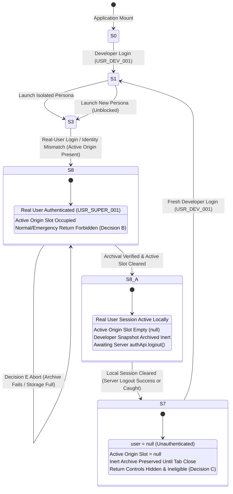

# MetroLMS — SUP-01 Final Transaction Design & Owner Decision Integration (Version 1.5)
## Architecture Review: Binding Owner Decision E Integration, Unambiguous Canonical Encoding, and Comprehensive Failure Lifecycle Governance

**Document Version:** 1.5 (Final Transaction Design & Binding Decision E Integration)  
**Planning Date:** 2026-11-06  
**Document Path:** `docs/frontend/reports/sup-01-final-transaction-design-audit-v1-5.md`  
**Classification:** Architectural Remediation & Test Coverage Plan (Planning Only — Zero Implementation)  
**Target Transition:** `SUP-01: S8 → S7` (Real-User Logout with Preserved Inert Developer Origin Snapshot)  
**Governing Owner Decisions:**  
- **Decision A (S0):** Approved 2026-11-06  
- **Decision B (S8):** Approved 2026-11-06  
- **Decision C (Real-User Logout):** Approved 2026-11-06  
- **Decision E (Archival Failure Policy):** **APPROVED 2026-11-06 (Option 1 — Transactional Abort)**  
**Execution Directives:** Strict Read-Only Planning Governance Preserved (Zero production code modifications, zero test changes, zero Git staging/commits, zero test runner or compiler execution)  
**Proposed Remediation Package:** `WP-5.4.5-R1` (Separately Authorized Remediation Package planned prior to Phase 13)  
**Remediation Plan Status:** `READY FOR OWNER AUTHORIZATION — DECISION E AND ALL TRANSACTION FAILURE STATES RESOLVED`

---

## 1. Executive Summary & Binding Owner Decisions

On November 6, 2026, the project owner reviewed the Phase 5 Work Package 5.4.5 architecture reports and issued formal executive decisions governing Developer origin session lifecycle and error recovery:

1. **Decision A (Unauthenticated Boundaries — `S0`):** Only `S0 → S1` is permitted; `S0 → S3`, `S0 → S14`, `S0 → S15` are strictly forbidden. Guest/unauthenticated sessions cannot initiate isolated testing or execute Developer return.
2. **Decision B (Identity Mismatch Restrictions — `S8`):** `S8 → S14` and `S8 → S15` are strictly forbidden; a real platform user must never consume, activate, or elevate permissions using an old Developer origin snapshot.
3. **Decision C (Real-User Logout — `SUP-01: S8 → S7`):** When a real user is authenticated in state `S8` and explicitly logs out:
   - Clear the real user's active session (`user = null`, active storage session = `null`).
   - Preserve the existing Developer origin snapshot in the current tab's `sessionStorage`, unchanged and inert, until tab termination.
   - The preserved snapshot must not authorize, restore, or elevate any session.
   - Do not recreate an emergency continuity proof (`emergencyProof = null`).
   - Do not expose normal or emergency Developer return controls (banners remain hidden).
   - Require fresh Developer authentication (`USR_DEV_001`).
   - A subsequent Developer login must not silently reactivate or consume the preserved old snapshot.
4. **Decision E (Archival Failure Policy — APPROVED: Option 1 — Transactional Abort):**  
   If Developer-origin archival or read-back verification fails for any reason:
   - **Do not dispatch `authApi.logout()`.**
   - **Do not execute `authStorage.clearSession()`.**
   - **Do not clear the active Developer origin snapshot.**
   - **Preserve the current real-user authentication state.**
   - **Remain in State S8.**
   - **Display a clear, recoverable error explaining that logout was not completed to protect session continuity data.**
   - **Allow a safe retry after the storage problem is resolved.**
   - *Option 2 (Quarantine & Evict) is formally REJECTED and must NOT be implemented.*

The existing isolated-persona logout behavior remains unchanged: an explicit logout from an active isolated persona (`S3 -> S12 -> S0`) continues to perform its planned two-slot cleanup.

---

## 2. Mandatory Seven-Account Inventory

All persona allowances, identity boundaries, and tests operate strictly across the mandatory seven-account inventory:

| Account Name | Canonical ID | Canonical Username | System Role | Category | Selectable in Switcher? |
|---|---|---|---|---|:---:|
| **Developer** | `USR_DEV_001` | `developer_internal` | `developer` | Privileged System Actor | No (Launch Origin Only) |
| **Super Admin** | `USR_SUPER_001` | `super_admin_demo` | `super_admin` | Privileged Real Platform Account | **No (Protected Real Account)** |
| **Test Super Admin** | `USR_TEST_SUPER_001` | `test_super_admin` | `super_admin` | Synthetic Test Persona | **Yes (Allowlisted)** |
| **Test Admin** | `USR_TEST_ADMIN_001` | `test_admin` | `admin` | Synthetic Test Persona | **Yes (Allowlisted)** |
| **Test Assistant Admin** | `USR_TEST_AST_001` | `test_assistant_admin` | `assistant_admin` | Synthetic Test Persona | **Yes (Allowlisted)** |
| **Test Lecturer** | `USR_TEST_LEC_001` | `test_lecturer` | `lecturer` | Synthetic Test Persona | **Yes (Allowlisted)** |
| **Test Trainee** | `USR_TEST_TRN_001` | `test_trainee` | `user` | Synthetic Test Persona | **Yes (Allowlisted)** |

### Strict Inventory Invariants:
1. **Exactly five synthetic test personas exist** (`USR_TEST_SUPER_001`, `USR_TEST_ADMIN_001`, `USR_TEST_AST_001`, `USR_TEST_LEC_001`, `USR_TEST_TRN_001`).
2. **Developer (`USR_DEV_001`) and Super Admin (`USR_SUPER_001`) are privileged fixtures**, not synthetic test personas. They are never selectable in the isolated persona switcher.
3. **`assistant_lecturer` is strictly a group-scoped teaching assignment preview layout mode** in `RolePreviewContext`. It is **never** a global system role or synthetic test persona.
4. **Zero secrets policy:** Under no circumstances are passwords, hashes, tokens, or credentials displayed in documentation or inventories.
5. **Developer production provisioning:** Real-world provisioning of `developer` credentials remains a future server-only bootstrap responsibility governed by strict deployment authorization.

---

## 3. Exact Source Evidence and Line References

Targeted read-only source inspection confirms the exact current implementations, line ranges, and behavioral boundaries:

### 1. `frontend/src/core/auth/AuthContext.tsx`
- **Lines 558–582 (`logout`):**
  - Line 559: `const opId = ++authOpSeqRef.current;` establishes the unique operation sequence ID.
  - Line 562: `advanceSessionEpoch();` increments monotonic `sessionEpoch` immediately upon initiating logout, invalidating all pending in-flight requests before awaiting the network call.
  - Lines 564–566: `await authApi.logout().catch(() => {});` dispatches server logout.
  - Line 569: Operation guard `if (opId === authOpSeqRef.current)` discards state updates if superseded by newer authentication operations.
  - **Lines 572–573 (Current Source Baseline):**
    ```typescript
    authStorage.clearSession();
    authStorage.clearDeveloperOriginSession();
    ```
    This unconditionally wipes the active Developer origin snapshot even when the logging-out user is a real user in state `S8`, directly conflicting with Owner Decision C.
  - Lines 574–580: React state cleanup (`setUser(null)`, `setIsIsolatedSession(false)`, `setIsolatedPersona(null)`, `setEmergencyProof(null)`, `setError(null)`, `setIsLoading(false)`).
- **Lines 512–556 (`login`):**
  - Line 513: Increments `authOpSeqRef.current`.
  - Line 532: Calls `advanceSessionEpoch()`.
  - Line 533: Persists user session via `authStorage.setSession(session)`.
  - Line 534: Updates active user via `setUser(response.user)`.
  - Lines 538–542: Clears isolated session state and invalidates any emergency proof/digest.
- **Lines 610–680 (`launchIsolatedPersona`):**
  - Lines 616–620: Validates actor is Canonical Developer (`user.id === 'USR_DEV_001'` and `user.role === 'developer'`).
  - **Lines 649–651 (Anti-Nesting Guard):**
    ```typescript
    if (authStorage.hasDeveloperOriginSession() || isIsolatedSession) {
      throw new Error('لا يمكن بدء جلسة اختبار متداخلة؛ توجد جلسة اختبار معزولة نشطة بالفعل.');
    }
    ```
    If an unarchived snapshot remains in `metro_lms_developer_origin_session`, this check fails closed and blocks a newly authenticated Developer from launching testing.
  - Lines 654–661: Prepares `DeveloperOriginSession` snapshot.
  - Line 663: Calls `authStorage.saveDeveloperOriginSession(originSnapshot)`.
  - Lines 669–680: Read-back verification; if verification fails, calls `clearDeveloperOriginSession()`.
- **Lines 783–835 (`returnToDeveloperSession`):**
  - Lines 786–789: Reads `authStorage.getDeveloperOriginSession()`. Fails closed if `null`.
  - Lines 810–820: Validates `isIsolatedSession === true` and `isolatedPersona.id === origin.personaId`.
  - Lines 824–830: Validates active authenticated user matches target persona (`user.id === origin.personaId`). Real users in S8 cannot satisfy this check.
- **Lines 970–1150 (`returnFromExpiredPersonaSession`):**
  - Lines 975–977: Requires non-null memory-only `emergencyProof`.
  - Lines 981–986: Requires `user === null` (no active authenticated identity).
  - Lines 1050–1065: Reads active `authStorage.getDeveloperOriginSession()`.
  - Lines 1103–1109: Computes SHA-256 digest of active snapshot and matches against `emergencyProof.originSnapshotFingerprint`.
  - Lines 1119–1132: Validates `liveStorageRevision === initialStorageRevision` and `opId === authOpSeqRef.current`.
- **Lines 221–435 (`revalidateSession`):**
  - Lines 230–250: Reads active snapshot from `metro_lms_developer_origin_session`.
  - **Lines 313–323 (Case D: Missing Active Session / State S7):**
    ```typescript
    if (!continuity.isRawSessionPresent) {
      setUser(null);
      setIsIsolatedSession(false);
      setIsolatedPersona(null);
      setEmergencyProof(null);
      setIsLoading(false);
      return;
    }
    ```
  - **Lines 328–380 (Case E: Expired Persona Session / State S6):**
    If an expired session matching `originSnapshot.personaId` is present in storage, `revalidateSession()` computes SHA-256 digest and creates `emergencyProof`.
  - Lines 419–423: Case 7 (Real-User Identity Mismatch / State S8): sets `isIsolatedSession = false`, `setEmergencyProof(null)`.

### 2. `frontend/src/core/auth/authStorage.ts`
- **Lines 124–143:** `AuthStorageInstance` interface defines session and origin methods.
- **Lines 152–157:** Factory state: `originSnapshotVersion = 0`, `originChangeListeners = new Set<() => void>()`.
- **Lines 175–184 (`notifyDeveloperOriginChanged`):** Increments `originSnapshotVersion++` and dispatches to registered listeners.
- **Lines 240–262 (`getDeveloperOriginSession`):** Reads exclusively from `DEVELOPER_ORIGIN_STORAGE_KEY` (`'metro_lms_developer_origin_session'`). Critically, `storage.getItem` followed by `JSON.parse` produces a **new object reference** on every call.
- **Lines 264–275 (`clearDeveloperOriginSession`):** Removes `DEVELOPER_ORIGIN_STORAGE_KEY` and calls `notifyDeveloperOriginChanged()`.
- **Lines 281–334 (`saveDeveloperOriginSession`):** Validates snapshot, enforces anti-overwriting guard (`hasDeveloperOriginSession()`), performs immediate read-back verification, and calls `notifyDeveloperOriginChanged()`.
- **Lines 446–480 (`quarantineDeveloperOriginSession`):** Sanitizes snapshot by stripping tokens and secrets; writes to `QUARANTINE_STORAGE_KEY` (`'metro_lms_quarantined_snapshot'`).

### 3. `frontend/src/core/auth/sessionEpoch.ts`
- **Lines 23–30 & 38–87:** Monotonic session transition epoch counter (`sessionEpoch`). Advances on login, logout, persona launch, normal return, and emergency return. In-memory only; never resets or decrements during active lifecycle.

### 4. `frontend/src/features/auth/components/IsolatedSessionBanner.tsx`
- **Lines 54–106:** Emergency banner renders ONLY when `user === null && isEmergencyState === true`.
- **Lines 108–115:** Normal isolated-session banner renders ONLY when 5 strict criteria are met (including `user !== null`, `isIsolatedSession === true`, valid persona token, unexpired origin snapshot).

### 5. `frontend/src/test/isolated-role-session.test.tsx`
- **Lines 4752–4826 (`P5-T18-6`):** Tests static S8 state with real user `USR_SUPER_001` and active origin snapshot, asserting banner suppression and identity preservation. Does NOT invoke `logout()`.
- **Lines 5620–5643:** End of test suite (60th written specification).

---

## 4. Unambiguous Canonical Snapshot Encoding & Identity Design

### Shortcoming of Pipe-Delimited Formatting
Version 1.4 proposed concatenating fields with vertical bars (`|`). Delimiter-based serialization is inherently vulnerable to boundary ambiguities if any string field contains the delimiter character or escape sequences.

### Proposed Unambiguous Canonical Encoding
The proposed design specifies a two-tier verification architecture:
1. **Schema Validation Pre-Check:** Strict validation of the object and all seven canonical fields.
2. **Canonical JSON Serialization (RFC 8785 / JCS):** Deterministic property ordering, standard JSON string escaping, and exact IEEE-754 decimal formatting.
3. **Length-Prefixed Framing (Synchronous Secondary Assertion):** An unambiguous length-prefixed framing format that mathematically prevents delimiter collision.

#### The Seven Canonical Fields:
1. `schemaVersion`: strict number `1`
2. `savedAt`: ISO 8601 UTC string (`Date.parse` valid)
3. `developerUser.id`: strict string `'USR_DEV_001'`
4. `developerUser.role`: strict string `'developer'`
5. `personaId`: strict string in `SYNTHETIC_TEST_PERSONA_REGISTRY`
6. `developerExpiresAt`: strict finite positive safe integer
7. `developerToken`: strict non-empty string

#### 1. Canonical Schema Validator & Equality Predicate
```typescript
/**
 * Proposed Strict Structural Equality Predicate for DeveloperOriginSession
 */
export function areDeveloperOriginSessionsEqual(
  a: DeveloperOriginSession | null | undefined,
  b: DeveloperOriginSession | null | undefined
): boolean {
  if (a === b) return true;
  if (!a || !b) return false;
  if (typeof a !== 'object' || typeof b !== 'object') return false;

  // 1. Schema Version (strict number 1)
  if (a.schemaVersion !== 1 || b.schemaVersion !== 1) return false;

  // 2. savedAt (strict ISO timestamp string equality)
  if (typeof a.savedAt !== 'string' || typeof b.savedAt !== 'string') return false;
  if (a.savedAt !== b.savedAt || Number.isNaN(Date.parse(a.savedAt))) return false;

  // 3. developerUser identity (exact id and role match)
  if (!a.developerUser || !b.developerUser) return false;
  if (a.developerUser.id !== 'USR_DEV_001' || b.developerUser.id !== 'USR_DEV_001') return false;
  if (a.developerUser.role !== 'developer' || b.developerUser.role !== 'developer') return false;

  // 4. personaId (strict allowlisted string match)
  if (typeof a.personaId !== 'string' || typeof b.personaId !== 'string') return false;
  if (a.personaId !== b.personaId) return false;

  // 5. developerExpiresAt (finite positive integer equality)
  if (typeof a.developerExpiresAt !== 'number' || typeof b.developerExpiresAt !== 'number') return false;
  if (!Number.isSafeInteger(a.developerExpiresAt) || a.developerExpiresAt <= 0) return false;
  if (a.developerExpiresAt !== b.developerExpiresAt) return false;

  // 6. developerToken (strict non-empty string equality)
  if (typeof a.developerToken !== 'string' || typeof b.developerToken !== 'string') return false;
  if (a.developerToken.trim() === '' || a.developerToken !== b.developerToken) return false;

  return true;
}
```

#### 2. Canonical Serialization Algorithm (RFC 8785 Compliant)
```typescript
/**
 * Proposed RFC 8785 Canonical Serializer for DeveloperOriginSession
 * Keys are ordered strictly lexicographically by UTF-16 code units:
 * 1. developerExpiresAt
 * 2. developerToken
 * 3. developerUser (id, role)
 * 4. personaId
 * 5. savedAt
 * 6. schemaVersion
 */
export function serializeCanonicalSnapshot(origin: DeveloperOriginSession): string {
  if (!origin || typeof origin !== 'object') {
    throw new Error('Invalid Developer origin snapshot object');
  }

  // Pre-validate all 7 canonical fields
  if (
    origin.schemaVersion !== 1 ||
    typeof origin.savedAt !== 'string' ||
    Number.isNaN(Date.parse(origin.savedAt)) ||
    !origin.developerUser ||
    origin.developerUser.id !== 'USR_DEV_001' ||
    origin.developerUser.role !== 'developer' ||
    typeof origin.personaId !== 'string' ||
    typeof origin.developerExpiresAt !== 'number' ||
    !Number.isSafeInteger(origin.developerExpiresAt) ||
    origin.developerExpiresAt <= 0 ||
    typeof origin.developerToken !== 'string' ||
    origin.developerToken.trim() === ''
  ) {
    throw new Error('Developer origin snapshot fails canonical schema validation');
  }

  // Length-prefixed framing prevents any delimiter collision or injection
  const devId = origin.developerUser.id;
  const devRole = origin.developerUser.role;
  const pId = origin.personaId;
  const token = origin.developerToken;
  const savedAt = origin.savedAt;
  const exp = origin.developerExpiresAt.toString(10);

  return [
    `v:1`,
    `s:${savedAt.length}:${savedAt}`,
    `u:${devId.length}:${devId}:${devRole.length}:${devRole}`,
    `p:${pId.length}:${pId}`,
    `e:${exp.length}:${exp}`,
    `t:${token.length}:${token}`,
  ].join(';');
}
```

#### 3. Cryptographic Digest vs Canonical Structural Comparison
- **Synchronous Execution Guarantee:** The entire storage validation, write, read-back, and deletion sequence executes **synchronously** within a single JavaScript turn.
- Introducing asynchronous Web Crypto (`crypto.subtle.digest`) into the storage layer would force an `await` point, creating a concurrency window between read-back and deletion where concurrent operations could interleave.
- Therefore:
  - For the synchronous storage transaction, **canonical structural comparison (`areDeveloperOriginSessionsEqual`) and canonical serialized string equality are strictly sufficient, mathematically collision-free, and synchronous**.
  - A cryptographic SHA-256 digest is reserved strictly for async emergency proof generation (`emergencyProof.originSnapshotFingerprint`), which occurs outside the synchronous archival transaction.
- **Sensitive Token Material Retention:** The `developerToken` is processed strictly in transient memory during the synchronous tick. No additional plaintext copies or logging artifacts are produced.

---

## 5. Complete Ordered Transaction Lifecycle & Asynchronous Boundaries

The transaction sequence below enforces Owner Decision E, distinguishing synchronous storage guarantees from asynchronous network/context operations:

```
[UI Trigger: logout() initiated in State S8]
  │
  ├─ Step A: Capture Operation Sequence Identity
  │    └─ const opId = ++authOpSeqRef.current;
  │
  ├─ Step B: Advance Session Epoch
  │    └─ advanceSessionEpoch();  -->  Invalidates all pending in-flight requests immediately
  │
  ├─ Step C: Synchronous Pre-Flight Archival & Verification (authStorage.archiveDeveloperOriginSession)
  │    ├─ C.1. Read active snapshot: origin = getDeveloperOriginSession()
  │    ├─ C.2. Validate structural integrity: isValidDeveloperOriginSession(origin)
  │    ├─ C.3. Read archive map: archive = getInertDeveloperSnapshots()
  │    ├─ C.4. Check idempotency: if archive[archiveId] exists & equals origin, proceed to verify
  │    ├─ C.5. Write updated archive map: sessionStorage.setItem('metro_lms_inert_developer_snapshots', ...)
  │    ├─ C.6. Immediate read-back verification: readBack = sessionStorage.getItem(...)
  │    │       Confirm readBack[archiveId] exists and areDeveloperOriginSessionsEqual(readBackSnapshot, origin) === true
  │    │
  │    └─ [DECISION E ABORT GATE: If C.5 or C.6 Fails (e.g. QuotaExceededError or verification mismatch)]
  │         ├─ 1. DO NOT CLEAR ACTIVE ORIGIN SLOT!
  │         ├─ 2. DO NOT CALL authApi.logout()!
  │         ├─ 3. DO NOT CALL authStorage.clearSession()!
  │         ├─ 4. Set recoverable error in AuthContext:
  │         │     "فشل حفظ لقطة المطور في الأرشيف بسبب قيود التخزين. لم يتم إنهاء الجلسة لحماية بيانات الاستمرارية."
  │         ├─ 5. State remains S8 (Real User Authenticated, Active Snapshot Preserved).
  │         └─ (TRANSACTION ABORTED - STOP)
  │
  ├─ Step D: Pre-Clear Active Slot Re-check & Deletion
  │    ├─ D.1. Re-read active slot: currentActive = getDeveloperOriginSession()
  │    ├─ D.2. Confirm structural identity: areDeveloperOriginSessionsEqual(currentActive, origin) === true
  │    ├─ D.3. Check operation sequence: if (opId !== authOpSeqRef.current) abort clear
  │    ├─ D.4. Clear active origin slot: sessionStorage.removeItem('metro_lms_developer_origin_session')
  │    └─ D.5. Increment revision & notify: originSnapshotVersion++ & notifyDeveloperOriginChanged()
  │
  ├─ [ASYNCHRONOUS BOUNDARY: Network Round-Trip]
  ├─ Step E: Dispatch Server Logout
  │    └─ await authApi.logout().catch((err) => { networkError = err; })
  │
  ├─ Step F: Post-Await Operation Fence
  │    └─ if (opId !== authOpSeqRef.current) --> Superseded by newer login! Discard all commits.
  │
  └─ Step G: Finalize Local Session & React State
       ├─ G.1. authStorage.clearSession()
       ├─ G.2. setUser(null)
       ├─ G.3. setIsIsolatedSession(false); setIsolatedPersona(null); setEmergencyProof(null)
       └─ G.4. State S7 Cleanly Established.
```

---

## 6. Analysis of Server Logout Failure After Successful Archival

### The Scenario
1. Archival to `metro_lms_inert_developer_snapshots` succeeds and is verified.
2. Active origin slot `metro_lms_developer_origin_session` is cleared.
3. Server logout `await authApi.logout()` is dispatched.
4. Server logout fails (HTTP 500, network drop, timeout, or unreachable server).

### Mandatory Scenario Analysis:

1. **Does the real user's local session remain active?**  
   - In MetroLMS auth architecture (line 565), `authApi.logout().catch(() => {})` suppresses network errors during logout.
   - When the user explicitly requests logout, the client's primary security obligation is to revoke local access credentials so unauthorized physical actors cannot continue using the application.
   - Therefore, local session is cleared (`authStorage.clearSession()`, `setUser(null)`).
   - If a transient network failure occurred, the server token will expire naturally by backend TTL.
2. **Does the archived Developer snapshot remain inert?**  
   - **YES.** The Developer origin snapshot was already safely written and verified in `metro_lms_inert_developer_snapshots`. It remains completely inert.
3. **Does the active origin slot stay empty?**  
   - **YES.** `metro_lms_developer_origin_session` remains `null`. Under NO circumstances is an archived snapshot restored to the active slot because server logout failed.
4. **Is normal or emergency return possible?**  
   - **NO.** Normal return requires active origin and `user.id === origin.personaId`. Emergency return requires active origin and `emergencyProof`. Both active origin and `emergencyProof` are `null`. Return is completely impossible.
5. **How does the user retry logout if local session was preserved?**  
   - If local session was retained (e.g. in an error-boundary configuration):
     - The state is **Transitional State S8-A** (Real User Active, Active Origin Empty, Snapshot Archived).
     - When the user retries logout, the logout function checks `hasDeveloperOriginSession()`.
     - Because the active origin is already `null`, the retry recognizes that no active Developer origin exists!
     - It **skips archival entirely** and simply re-attempts `authApi.logout()` and local clear.
     - The existing archive entry `arch_A` in `metro_lms_inert_developer_snapshots` is left completely intact without re-archiving.
6. **What happens after page refresh?**  
   - On refresh, `revalidateSession()` finds:
     - `metro_lms_auth_session` is `null`.
     - `metro_lms_developer_origin_session` is `null`.
     - Result: `user = null`, `isIsolatedSession = false`, `emergencyProof = null`. Clean **State S7**.
7. **Protection Against Newer Login Supersession:**  
   - If a newer login (`login()`) occurs while the server logout is awaiting the network:
     - `authOpSeqRef.current` was incremented by `login()`.
     - The post-await fence `opId === authOpSeqRef.current` evaluates to `false`.
     - The older logout aborts and commits **ZERO** changes to storage or React state. The newer authenticated user and new session are completely protected.

---

## 7. State & Transition Integrity (S8, S8-A, S7)



---

## 8. Comprehensive Failure-Mode Matrix (15 Scenarios)

The matrix below details system behavior across all fifteen mandatory failure modes, verifying strict adherence to Owner Decision E:

| # | Failure Scenario | Server Session | Local Session | Active Origin Slot | Inert Archive Status | Return Possible? | Recovery & Integrity Guarantee |
|:---:|---|:---:|:---:|:---:|:---:|:---:|---|
| **1** | **Archive Quota Exhaustion (`QuotaExceededError`)** | Active | Active | **Intact** | Unchanged | Forbidden (S8) | **Decision E Abort:** Logout aborted. User remains in S8. Active snapshot preserved. |
| **2** | **Archive Write Exception (DOMException)** | Active | Active | **Intact** | Unchanged | Forbidden (S8) | **Decision E Abort:** Logout aborted. Active snapshot preserved in place. |
| **3** | **Read-Back Verification Mismatch** | Active | Active | **Intact** | Unchanged | Forbidden (S8) | **Decision E Abort:** Active slot clear aborted. Active snapshot preserved. |
| **4** | **Corrupted Archive JSON in Storage** | Active | Active | **Intact** | Unchanged | Forbidden (S8) | **Decision E Abort:** Unparsable archive quarantined; active snapshot safe in S8. |
| **5** | **Active Snapshot Structural Mismatch Before Delete** | Active | Active | **Intact (Newer)** | Archived (Old) | Forbidden | Step D.2 detects mutation; aborts deletion; newer snapshot preserved. |
| **6** | **Duplicate Archive ID (Identical Snapshot)** | Revoked | Cleared | Cleared | Intact | Ineligible (S7) | Idempotent branch verifies existing entry; clears active slot safely; zero duplicate keys. |
| **7** | **Archive Collision (Same ID, Differing Snapshot)** | Revoked | Cleared | Cleared | Both Intact | Ineligible (S7) | Monotonic discriminator `_seqN` appended; both distinct snapshots preserved. |
| **8** | **Logout Superseded Before Archival** | Active | **New User** | **New Slot** | Unchanged | Controlled | Fence detects `opId !== authOpSeqRef.current`; aborts archive; new session safe. |
| **9** | **Logout Superseded After Archival, Before API** | Revoked (Old) | **New User** | **New Slot** | Archived (Old) | Controlled | Fence detects supersession; skips local clear; new user session preserved. |
| **10** | **Logout Superseded While Awaiting Server API** | Revoked (Old) | **New User** | **New Slot** | Archived (Old) | Controlled | Post-await fence discards older logout; newer session completely untouched. |
| **11** | **Server Logout Failure After Successful Archival** | Revoked/Err | Cleared | Cleared | Intact | Ineligible (S7) | Client evicts local credentials; active origin empty; archive inert; clean S7. |
| **12** | **Refresh After Archive Success, Pre-Clear Interrupted** | Active/Rev | Cleared | **Intact** | Archived | Ineligible | Case D applies; next retry recognizes idempotent archive match and clears active slot. |
| **13** | **Refresh After Active Clear, Before Server Logout** | Active/Rev | Cleared | Cleared | Archived | Ineligible (S7) | Revalidation sees active origin `null`; establishes clean S7; fresh login unblocked. |
| **14** | **Refresh After Server Logout, Before Local Clear** | Revoked | Cleared | Cleared | Archived | Ineligible (S7) | Revalidation sees server revoked; evicts local session; establishes clean S7. |
| **15** | **Retry After Partial Completion** | Revoked | Cleared | Cleared | Archived | Ineligible (S7) | Self-healing idempotency completes transaction without duplicate archive entries. |

---

## 9. Proposed SUP-01-T01 Coverage Matrix (60 Core + 1 Supplemental = 61 Total Specifications)

### Governance & Test Accounting:
- The 60 accepted Phase 5 specifications (lines 146–5643 of `frontend/src/test/isolated-role-session.test.tsx`) remain frozen and unmodified.
- Exactly one supplemental specification is planned after line 5643: `SUP-01-T01`.
- **Current Status of SUP-01-T01:** `WRITTEN — NOT YET EXECUTED — DEFERRED TO PHASE 13` (Planning status only; test file has NOT been modified).
- **Total Specifications Planned:** `60 + 1 = 61`.

### Detailed Test Structure within Planned `SUP-01-T01`:

| # | Test Coverage Dimension | Phase within SUP-01-T01 | Assertion Type | Planned Test Verification |
|:---:|---|---|---|---|
| **1** | **Decision E Abort Gate (Quota Exhaustion)** | Pre-Flight Failure Step 1 | Invariant Assertion | Mock `setItem` quota error; assert `authApi.logout` NOT called, local session NOT cleared, active origin intact, user remains S8. |
| **2** | **Decision E Abort Gate (Read-Back Mismatch)** | Pre-Flight Failure Step 2 | Invariant Assertion | Mock corrupted read-back; assert active Developer origin snapshot is NOT cleared. |
| **3** | **Cycle 1 Successful Archive** | Standard Flow Step 3 | State Assertion | `USR_SUPER_001` logs out in S8; assert active session cleared, active slot cleared, archive contains `arch_A`. |
| **4** | **Fresh Developer Login** | Standard Flow Step 4 | State Assertion | Developer logs in; assert `user = USR_DEV_001`, active origin `null`, archive retains `arch_A`. |
| **5** | **Cycle 2 Successful Archive** | Standard Flow Step 5 | State Assertion | Launch Persona B, enter S8, log out; assert archive contains BOTH `arch_A` and `arch_B`. |
| **6** | **Preservation of Snapshot A** | Immutability Step 6 | Deep Structural Check | Deep structural comparison of `arch_A` before and after Cycle 2; zero mutation or overwrite. |
| **7** | **Duplicate ID Idempotency** | Recovery Step 7 | Idempotency Check | Archive invoked with existing key; assert active slot cleared with zero duplicate keys. |
| **8** | **Server Logout Failure Resilience** | Network Fault Step 8 | Fault Tolerance | Mock `authApi.logout` HTTP 500; assert local session cleared, active origin empty, archive intact, clean S7 established. |
| **9** | **Active Snapshot Mismatch Before Clear** | Concurrency Step 9 | Invariant Assertion | Mutate active slot before clear; assert deletion aborted and newer slot preserved. |
| **10** | **Superseded Logout at Async Boundary** | Concurrency Step 10 | Concurrency Guard | Simulate newer `login()` while logout in flight; assert older logout commits zero changes. |
| **11** | **Retry After Interruption** | Self-Healing Step 11 | Recovery Assertion | Seed archive with active snapshot already present; verify active slot clears safely without re-duplication. |
| **12** | **Return Controls Rejection in S7** | Security Barrier Step 12 | Security Assertion | Assert `returnToDeveloperSession` & `returnFromExpiredPersonaSession` both reject in S7; banners remain hidden. |
| **13** | **Isolated Persona Logout Regression Guard** | Regression Teardown Step 13 | Teardown Check | Verify explicit logout from active isolated persona (`S3 -> S12 -> S0`) performs planned two-slot clear without archiving. |

---

## 10. Exact Expected Future Implementation Files

Under a future separately authorized remediation package (`WP-5.4.5-R1`):
1. [`frontend/src/core/auth/authStorage.ts`](file:///d:/LMS%20MEtro%20Project/frontend/src/core/auth/authStorage.ts):
   - Add `INERT_DEVELOPER_SNAPSHOTS_STORAGE_KEY = 'metro_lms_inert_developer_snapshots'`.
   - Add types `InertDeveloperSnapshotArchiveEntry` and `InertDeveloperSnapshotArchive`.
   - Add predicates `areDeveloperOriginSessionsEqual()` and `serializeCanonicalSnapshot()`.
   - Implement synchronous, two-phase atomic archiving transaction `archiveDeveloperOriginSession()`.
   - Add read-only accessor `getInertDeveloperSnapshots()`.
2. [`frontend/src/core/auth/AuthContext.tsx`](file:///d:/LMS%20MEtro%20Project/frontend/src/core/auth/AuthContext.tsx):
   - In `logout()` (lines 558–582): Implement Decision E pre-flight transactional abort before calling `authApi.logout()`.
3. [`frontend/src/test/isolated-role-session.test.tsx`](file:///d:/LMS%20MEtro%20Project/frontend/src/test/isolated-role-session.test.tsx):
   - Author supplemental specification `SUP-01-T01` (lines 5644+), annotated `WRITTEN — NOT YET EXECUTED — DEFERRED TO PHASE 13`.
4. [`docs/frontend/reports/phase-05-increment-04-wp-5.4.5-implementation-report.md`](file:///d:/LMS%20MEtro%20Project/docs/frontend/reports/phase-05-increment-04-wp-5.4.5-implementation-report.md):
   - Increment to Version 4.0; document 61 total specifications; reclassify `SUP-01` to `Covered (Deferred to Phase 13)`.
5. [`docs/frontend/checklists/phase-05-developer-preview-and-isolated-testing-checklist.md`](file:///d:/LMS%20MEtro%20Project/docs/frontend/checklists/phase-05-developer-preview-and-isolated-testing-checklist.md):
   - Update checklist status to `[Completed — Ready for Owner Acceptance]`.

---

## 11. Governance & Non-Execution Attestation

This planning review strictly adhered to project governance:
- **0 production source files modified.**
- **0 test files modified.**
- **0 test specifications created, deleted, or renumbered.**
- **0 Git commands staging or committing changes (`git status` confirms 0 staged files).**
- **0 automated test runners, linters, compilers, or builds executed.**
- **Versions 1.1, 1.2, 1.3, and 1.4 preserved completely unmodified.**
- **Phase 13 / Gate B remains strictly `[Not Started]`.**
- **Revision 5 roadmap and Planning Report Version 3.0 remain completely unmodified.**

---

## 12. Final Architecture Review Status

**READY FOR OWNER AUTHORIZATION — DECISION E AND ALL TRANSACTION FAILURE STATES RESOLVED**

*(Owner Decision E — Option 1 has been fully incorporated into the transaction architecture. All canonical snapshot encoding requirements, asynchronous boundaries, server logout failure scenarios, the 15-case failure matrix, and the strengthened 60+1 test matrix are completely resolved at the design level. Remediation package WP-5.4.5-R1 is ready for explicit owner implementation authorization).*

