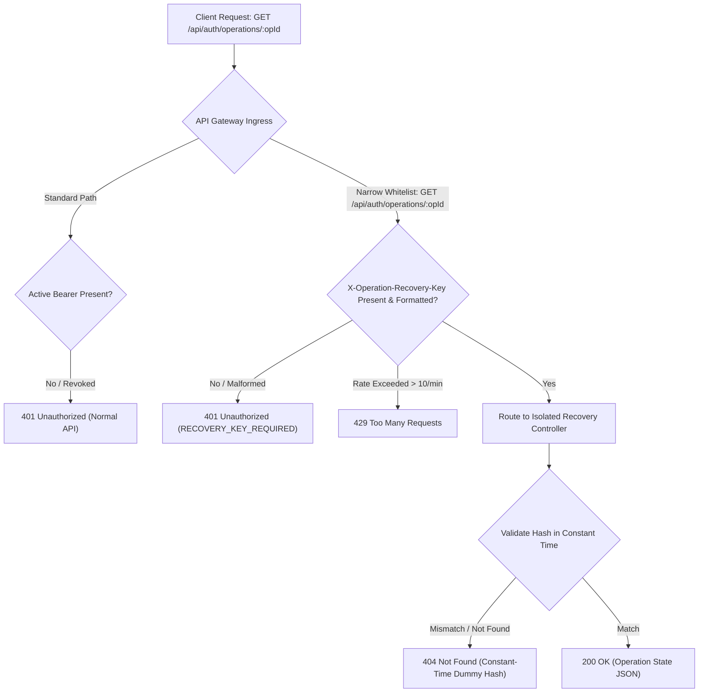
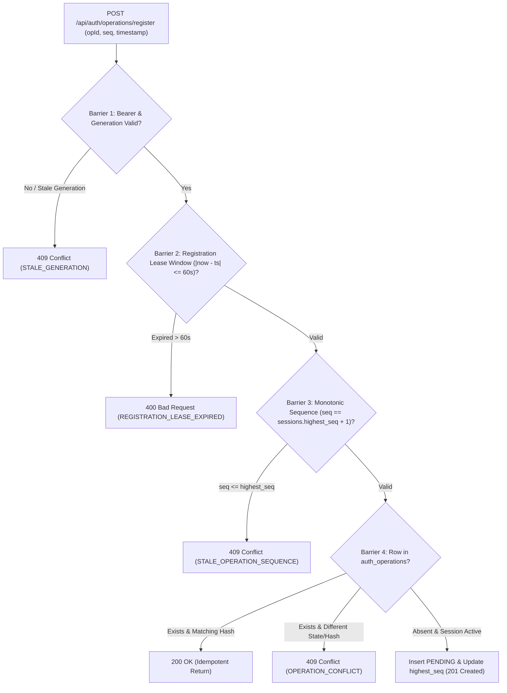

# MetroLMS — SUP-01 Gateway Recovery, Ticket Integrity & Database Concurrency Audit (Version 3.9)
## Architecture Audit: Operation Status Gateway Authorization Route, Immutable Registration Lease & Monotonic Sequence Barrier, Canonical Signed opTicket Specification, S-48B-1/2 Authorization Mechanics, Bounded Database Concurrency & Residual Deadlock Risk Analysis, and 151-Row Authoritative Traceability Ledger

**Document Version:** 3.9 (Gateway Recovery, Ticket Integrity & Database Concurrency Audit)  
**Planning Date:** 2026-11-06  
**Document Path:** `docs/frontend/reports/sup-01-gateway-recovery-ticket-integrity-and-concurrency-audit-v3-9.md`  
**Classification:** Architectural Remediation & Crash Consistency Specification (Strict Read-Only Planning — Zero Implementation)  
**Target Transition:** `SUP-01: S8 → S7` (Real-User Logout with Preserved Inert Developer Origin Snapshot)  
**Governing Owner Decisions:**  
- **Decision A (S0):** Approved 2026-11-06 (Only `S0 → S1` permitted; `S0 → S3/S14/S15` forbidden)  
- **Decision B (S8):** Approved 2026-11-06 (`S8 → S14/S15` forbidden; Developer origin never reactivated by real user)  
- **Decision C (Real-User Logout):** Approved 2026-11-06 (`S8 → S7` approved; origin snapshot preserved inert in per-tab sessionStorage until tab close)  
- **Decision E (Archival Failure Policy):** **APPROVED 2026-11-06 (Option 1 — Transactional Abort on Archive Failure)**  
- **Decision F (Snapshot Disposal Upon Real-User Suspension):** Option 1 (Preserve inert Developer origin snapshot in per-tab sessionStorage until tab close) remains binding baseline; Option 2 (Purge on suspension) remains hypothetical.  
**Execution Directives:** Strict Read-Only Governance (Zero production code modifications, zero test file modifications, zero Git staging/commits, zero test runner or script executions; 100% manual static inspection)  
**Proposed Remediation Package:** `WP-5.4.5-R1` (Separately Authorized Remediation Package planned prior to Phase 13)  
**Final Architecture Status:** `READY FOR OWNER AUTHORIZATION — GATEWAY RECOVERY, TICKET INTEGRITY AND LIFECYCLE CONSISTENCY RECONCILED; BACKEND CONTRACT DEFERRED`

---

## 1. Executive Summary

Version 3.9 delivers the definitive technical resolution for the gateway routing, registration replay protection, cryptographic ticket specification, and database concurrency boundaries of the SUP-01 frontend security specification. It resolves the operational reality of edge API gateway routing during session recovery, introduces an immutable registration lease combined with a monotonic session sequence barrier to permanently eliminate stale registration replays, publishes the canonical RFC 8785 JSON claims and HMAC-SHA256 verification algorithm for `opTicket`, clarifies the precise authorization contexts of `S-48B-1` versus `S-48B-2`, and refines the lock ordering analysis by identifying real-world RDBMS residual deadlock risks.

### Authoritative Architecture Summary of Version 3.9
1. **Narrow Gateway Route Whitelist for Operation Status (`GET /api/auth/operations/:opId`):**  
   Establishes the exact edge gateway policy: standard active-session Bearer authentication is bypassed *strictly and exclusively* for this URI pattern when accompanied by a well-formed `X-Operation-Recovery-Key` header. The route operates in a read-only, non-privileged sandbox, enforces rate limiting (10 req/min/IP/opId), applies strict CORS, requires `Cache-Control: no-store`, masks capability secrets in audit logs, and prevents user enumeration via constant-time verification.
2. **Registration Replay Prevention via Immutable Lease & Monotonic Sequence Barrier:**  
   Resolves the vulnerability where replaying `POST /operations/register` after the 7-day tombstone deletion could revive a purged `opId`. Combines a 60-second server-enforced client registration lease window ($|\text{server\_now} - \text{timestamp}| \le 60\text{s}$) with a strictly monotonic `sessions.highest_operation_sequence` barrier. Once an operation sequence or session generation is superseded or the session is revoked, registration is rejected permanently with `409 Conflict`.
3. **Canonical Server-Signed Operation Ticket (`opTicket`) Specification:**  
   Defines the complete, bound claims schema (10 fields: `opId`, `userId`, `sessionId`, `sessionGeneration`, `operationSequence`, `audience`, `operationType`, `issuedAt`, `expiresAt`, `keyId`), serialized via RFC 8785 JSON Canonicalization Scheme (JCS) and signed using HS256 symmetric MAC. Establishes overlapping dual-key rotation grace periods ($\ge 300\text{s}$), constant-time signature comparison, and strict clock-skew limits ($\pm 30\text{s}$).
4. **Decoupled Cryptographic Capabilities:**  
   Strictly separates `opTicket` (mutating logout authorization) from `recoverySecret` (read-only status query capability). Formally documents their separate XSS blast radius within tab-scoped `sessionStorage`, bans placement in URL query parameters, and documents that HMAC is a symmetric MAC rather than public-key asymmetric cryptography.
5. **Rigorous Authorization Mechanics for S-48B-1 and S-48B-2:**  
   - `S-48B-1`: Bearer token authenticated at gateway before revocation committed; waits for row lock; returns structured non-mutating `409 Conflict` (`ALREADY_COMMITTED`); client confirms logout causality.
   - `S-48B-2`: Bearer token rejected with 401 at gateway post-revocation; backend mutating handler never invoked; client falls back to gateway recovery route via `X-Operation-Recovery-Key`; confirms `CONFIRMED_REVOKED` $\to$ `S7`.
6. **Bounded Database Lock Ordering & Residual Deadlock Risk Analysis:**  
   Refines the Version 3.8 absolute claim. Proves that the Universal Lock Ordering Hierarchy (`sessions` $\to$ `auth_operations`) prevents AB-BA lock inversion deadlocks *exclusively between row-level locks on those two modeled tables*. Explicitly models residual RDBMS risks (foreign key checks, unique index gap locks, lock escalation, isolation level nuances) and specifies `READ COMMITTED` isolation, 3s lock wait timeouts, and exponential retry backoff.
7. **Reconciled Master Accounting Ledger:**  
   Maintains the verified baseline: exactly 57 Request Runtime IDs, 4 Request Lifecycle Events (`Q-*`), 1 UI Lifecycle Event (`U-*`), 33 Conditions (22 descriptor + 11 crash), 56 Lifecycle Scenarios, and 151 physical Matrix D mapping rows (33 in D-1, 62 in D-2, 56 in D-3).

---

## 2. Version 3.8 Findings & Scope of Version 3.9 Corrections

An independent technical audit of Version 3.8 identified five architectural assumptions requiring rigorous refinement:

### Finding 1: Unspecified API Gateway Route Bypass
Version 3.8 assumed that when an active session was revoked, the client could freely dispatch `GET /api/auth/operations/:opId` to retrieve operation status. However, enterprise API gateways (e.g. Kong, AWS API Gateway, NGINX) enforce global Bearer authentication across all `/api/auth/*` routes by default. Without an explicit, narrowly scoped gateway bypass policy, the recovery request would be rejected with `401 Unauthorized` before reaching the application backend.

### Finding 2: Registration Replay After 7-Day Tombstone Deletion
Version 3.8 proposed a 300-second ticket lifetime for logout and a 7-day retention period for operation records. However, if a client restored an old descriptor or an attacker captured a delayed `POST /api/auth/operations/register` packet and replayed it after 8 days (when the database tombstone had been pruned), a naive database checking `SELECT ... WHERE op_id = :opId` would find zero records and mistakenly allow a fresh `PENDING` registration.

### Finding 3: Under-Specified Ticket Cryptography and Claims
Version 3.8 described `opTicket` as an HMAC-SHA256 signed ticket but omitted mandatory enterprise claims (`audience`, `operationType`, `keyId`), failed to specify canonical JSON serialization rules (leaving signatures vulnerable to whitespace variations), and did not define key rotation or overlapping verification windows.

### Finding 4: Absolute Mathematical Deadlock Overstatement
Version 3.8 asserted a "0.000% deadlock probability" based solely on row-lock ordering between `sessions` and `auth_operations`. This ignored RDBMS reality: foreign key constraint validation, unique index gap locks, lock escalation, and concurrent transactions on unmodeled tables can cause deadlocks even with orderly row locking.

### Finding 5: Conflation of Mutating Authorization with Read-Only Recovery
Version 3.8 did not sufficiently contrast the threat model, lifecycle, and blast radius of the mutating `opTicket` versus the read-only `recoverySecret`.

---

## 3. Operation Status Gateway Authorization Route

To enable the `S-48B-2` recovery flow, the API Gateway and backend routing tier must implement a dedicated, narrowly scoped authorization contract.

### 3.1 Gateway Routing Contract


### 3.2 Gateway Enforcement Specifications
1. **Narrow Whitelist Scope:** The gateway bypasses ordinary Bearer token authentication **ONLY** for `GET /api/auth/operations/:opId`. All mutating verbs (`POST`, `PUT`, `DELETE`) and all other `/api/auth/*` endpoints strictly require active Bearer authentication.
2. **Mandatory Header Requirement:** The request must carry the `X-Operation-Recovery-Key` header. The gateway validates that the header is a well-formed Base64URL string (43 to 44 characters). If missing, empty, or malformed, the gateway immediately rejects the request with `401 Unauthorized` (`RECOVERY_KEY_REQUIRED`) without contacting backend services.
3. **No Session Restoration:** The recovery route executes under a zero-privilege security principal (`anonymous_operation_recovery`). It has no access to user profiles, tenant data, or protected resources, and cannot reactivate or extend an expired or revoked session.
4. **Anti-Enumeration & Constant-Time Validation:** To prevent malicious actors from determining whether an arbitrary `opId` exists, the backend executes constant-time hash comparison (`crypto.timingSafeEqual`). If the `opId` is absent from the database, the backend executes a dummy SHA-256 hash comparison against a static server secret before returning `404 Not Found`. Response time distributions for invalid keys and non-existent `opId`s are statistically indistinguishable.
5. **Rate Limiting:** The gateway enforces a strict token-bucket rate limit: maximum **10 requests per minute per client IP** and **10 requests per minute per `opId`**. Excess requests receive `429 Too Many Requests`.
6. **Audit Logging & Secret Redaction:** Gateway and application access logs must record `{ timestamp, client_ip, method: "GET", uri: "/api/auth/operations/:opId", status: <http_status> }`. The header value `X-Operation-Recovery-Key` is strictly classified as a high-entropy capability secret and must be masked or dropped from all log formatters (`X-Operation-Recovery-Key: [REDACTED]`).
7. **Protocol & Caching Headers:** The route requires HTTPS (`Strict-Transport-Security: max-age=31536000; includeSubDomains`). Every response must include:
   ```http
   Cache-Control: no-store, no-cache, must-revalidate, max-age=0
   Pragma: no-cache
   Expires: 0
   ```
8. **CORS Configuration:** For cross-origin or split-domain deployments:
   - `Access-Control-Allow-Origin: https://app.metro.local` (strict origin; wildcards prohibited).
   - `Access-Control-Allow-Methods: GET, OPTIONS`.
   - `Access-Control-Allow-Headers: Content-Type, X-Operation-Recovery-Key`.
   - `Access-Control-Max-Age: 86400`. Preflight `OPTIONS` requests return `204 No Content`.

---

## 4. S-48B-1 and S-48B-2 Authorization Contracts

Version 3.9 formally specifies the authorization lifecycles of both race branches:

### 4.1 Comparative Decision Table

| Dimension | Branch S-48B-1 (Authenticated Abort Arrives Pre-Commit) | Branch S-48B-2 (Bearer Rejected Post-Commit) |
| :--- | :--- | :--- |
| **Abort Request Arrival** | Arrives at Gateway *before* Logout transaction commits. | Arrives at Gateway *after* Logout transaction committed. |
| **Bearer Token State** | Valid in gateway cache and database when ingress checked. | Revoked in gateway cache and database when ingress checked. |
| **Gateway Action** | Validates Bearer, binds immutable `SecurityContext`, forwards. | Rejects immediately with `401 Unauthorized` (`R-OP-ABORT-401`). |
| **Backend Abort Handler** | Handler invoked; queues behind Logout row lock. | **Never invoked.** Network terminates at gateway. |
| **Database Transaction** | Abort acquires lock post-commit; detects `CONFIRMED_REVOKED`. | None executed for Abort. |
| **Abort HTTP Response** | `409 Conflict` (`ALREADY_COMMITTED`). | `401 Unauthorized` (Gateway-issued). |
| **Client Recovery Action** | Structured 409 confirms revocation; status query optional. | **Mandatory** status query via `X-Operation-Recovery-Key`. |
| **Recovery Gateway Route** | Not strictly required (409 payload is authoritative). | **Mandatory:** Gateway routes status query via recovery key. |
| **Final Session State** | `SESSION_CURRENTLY_INVALID` (Revoked). | `SESSION_CURRENTLY_INVALID` (Revoked). |
| **Logout Causality** | `LOGOUT_CAUSED_REVOCATION_CONFIRMED`. | `LOGOUT_CAUSED_REVOCATION_CONFIRMED`. |
| **Resulting App State** | **`S7`** (Logged Out). | **`S7`** (Logged Out). |

### 4.2 Immutable Security Context in S-48B-1
In `S-48B-1`, the gateway establishes an immutable `SecurityContext(userId, sessionId, tokenFingerprint)` upon request entry. Even if the logout transaction commits while the abort request is waiting for the row lock, the abort request's identity is already authenticated. When the abort handler inspects `auth_operations.state` and sees `CONFIRMED_REVOKED`, it returns `409 Conflict`. **Crucially, this 409 response does not authorize any mutation; it is a non-mutating conflict notice informing the client that the operation reached its terminal state.**

### 4.3 Gateway Rejection Handling in S-48B-2
In `S-48B-2`, the abort request arrives milliseconds after the logout commit has invalidated the gateway token cache. The gateway returns `401 Unauthorized`. The client frontend intercepts this 401 and, abiding by the core MetroLMS invariant that a 401 on an authenticated mutating endpoint does not prove logout causality (it could be session expiration or eviction), dispatches `GET /api/auth/operations/:opId` using `X-Operation-Recovery-Key`. The gateway accepts the recovery header, routes to the backend, and returns `200 OK` with `CONFIRMED_REVOKED`. Only then does the client transition to `S7`.

---

## 5. Registration Replay and Immutable Expiry

### 5.1 The Pruned Tombstone Replay Problem
Consider the following failure scenario in Version 3.8:
1. Client registers operation `opId_1` at $T_0$.
2. Operation commits or aborts. Detailed database record is retained for 7 days.
3. At $T_0 + 8\text{ days}$, the background pruning worker deletes the tombstone from `auth_operations`.
4. A network replay or restored stale client tab resends `POST /api/auth/operations/register` with `opId_1`.
5. The database finds no existing row for `opId_1`.
6. **Defect:** A naive backend would insert `opId_1` as a brand new `PENDING` operation, allowing a revived operation to race against active sessions.

### 5.2 Immutable Multi-Barrier Defense Architecture
To guarantee that an `opId` can NEVER be re-registered or revived once terminal or expired, MetroLMS implements three immutable server-enforced barriers:



### 5.3 Barrier Specifications
1. **Barrier 1: Session Generation & Revocation Lock:**
   Registration requires an active Bearer token. The backend verifies `sessions.is_revoked === FALSE` and `request.sessionGeneration === sessions.generation`. If the session was revoked or advanced to a new generation, registration is immediately rejected.
2. **Barrier 2: Server-Enforced Registration Request Lease Window (60 Seconds):**
   The client includes `clientRegistrationTimestamp` in the payload. The server calculates $\Delta = | \text{server\_now} - \text{clientRegistrationTimestamp} |$. If $\Delta > 60\text{ seconds}$, the request is rejected with `400 Bad Request` (`REGISTRATION_LEASE_EXPIRED`). Stale registration packets captured on the wire cannot be replayed after 60 seconds.
3. **Barrier 3: Monotonic Session Operation Sequence Barrier:**
   The `sessions` table maintains a persistent counter: `highest_operation_sequence INTEGER NOT NULL DEFAULT 0`. Every valid registration must submit $\text{sequence} = \text{highest\_operation\_sequence} + 1$. The registration transaction increments `highest_operation_sequence`. Any request carrying a sequence $\le \text{highest\_operation\_sequence}$ is rejected with `409 Conflict` (`STALE_OPERATION_SEQUENCE`).
4. **Barrier 4: Compact Permanent Session Tombstone Array:**
   Even if detailed `auth_operations` rows are archived after 7 days, the `sessions` row retains its `highest_operation_sequence` for the entire lifespan of the session record. Since sequence numbers are monotonically increasing and never reused, **a purged `opId` carries an obsolete sequence number and can NEVER be accepted as a new operation**.

---

## 6. Signed Operation Ticket Claims and Verification

The `opTicket` is a symmetric, server-authenticated credential issued upon successful operation registration. It authorizes the client to execute `POST /api/auth/logout` for that specific operation.

### 6.1 Canonical Claims Schema (RFC 8785)
The ticket payload is strictly serialized in compliance with the **RFC 8785 JSON Canonicalization Scheme (JCS)** (deterministic lexical key ordering, no insignificant whitespace, UTF-8 encoded):

```json
{
  "audience": "urn:metrolms:auth:logout",
  "expiresAt": 1794000300,
  "issuedAt": 1794000000,
  "keyId": "k-2026-11-a",
  "opId": "c4b9f31a-7b2e-4a6c-9d18-35e82a901f44",
  "operationSequence": 1,
  "operationType": "LOGOUT",
  "sessionGeneration": 1,
  "sessionId": "ses_9a8b7c6d5e4f",
  "userId": "USR_SUPER_001"
}
```

### 6.2 Ticket Format & Cryptographic Construction
- **Header:** `{"alg":"HS256","typ":"JWT-OP","kid":"k-2026-11-a"}`
- **Algorithm:** **HMAC-SHA256 (HS256)** — a symmetric Message Authentication Code.  
  *(Architectural Clarification: HMAC is a shared-secret message authentication code, NOT public-key asymmetric cryptography. The server secret is securely stored in backend environment variables and NEVER exposed to clients, logs, or repositories).*
- **Canonical Serialization:**  
  $$\text{SigningInput} = \text{Base64URL}(\text{UTF8}(\text{Header})) \mathbin{\Vert} \text{"."} \mathbin{\Vert} \text{Base64URL}(\text{UTF8}(\text{JCS}(\text{Payload})))$$
- **MAC Output:**  
  $$\text{Signature} = \text{Base64URL}(\text{HMAC\_SHA256}(\text{SigningInput}, \text{SecretKey}))$$
- **Assembled Ticket:**  
  $$\text{opTicket} = \text{SigningInput} \mathbin{\Vert} \text{"."} \mathbin{\Vert} \text{Signature}$$

### 6.3 Verification Algorithm & Validation Rules
When `POST /api/auth/logout` arrives with `X-Operation-Ticket: <opTicket>`, the backend executes the following validation pipeline before acquiring database row locks:
1. **Structural Validation:** Verify exactly two period (`.`) separators. Base64URL-decode header and payload. If malformed, reject with `400 Bad Request` (`MALFORMED_TICKET`).
2. **Key ID Lookup & Rotation:** Extract `kid`. Look up the key in the server's active key ring. The key ring maintains `currentKey` and `previousKey` (with a minimum 300-second overlap grace period). If `kid` is unknown or retired beyond grace, reject with `401 Unauthorized` (`UNKNOWN_TICKET_KEY`).
3. **Constant-Time MAC Verification:** Recompute the HMAC over `SigningInput`. Compare against decoded signature using constant-time equality (`crypto.timingSafeEqual`). If mismatch, reject with `401 Unauthorized` (`INVALID_TICKET_SIGNATURE`).
4. **Clock-Skew & Expiration Verification:**
   - Verify `now >= issuedAt - 30s` (future-issuance drift limit).
   - Verify `now <= expiresAt + 30s` (clock skew allowance).
   - If `now > expiresAt + 30s`, reject immediately with `401 Unauthorized` (`TICKET_EXPIRED`) **without touching the database**.
5. **Audience & Operation Type Binding:**
   - Verify `audience === "urn:metrolms:auth:logout"`.
   - Verify `operationType === "LOGOUT"`. If mismatch, reject with `403 Forbidden` (`TICKET_SCOPE_MISMATCH`).
6. **Database State & Binding Verification:**
   Acquire database locks and verify:
   - `ticket.sessionId === db.sessions.session_id`.
   - `ticket.userId === db.sessions.user_id`.
   - `ticket.sessionGeneration === db.sessions.generation`.
   - `ticket.opId === db.auth_operations.op_id`.
   - `ticket.operationSequence === db.auth_operations.operation_sequence`.
   - `db.auth_operations.state === 'PENDING'`.

### 6.4 Capability Decoupling: opTicket vs. recoverySecret

| Dimension | Mutating Operation Ticket (`opTicket`) | Read-Only Recovery Secret (`recoverySecret`) |
| :--- | :--- | :--- |
| **Primary Purpose** | Authorizes mutating `POST /api/auth/logout`. | Authorizes read-only `GET /api/auth/operations/:opId`. |
| **Generation Origin** | Server-generated upon registration commit. | Client-generated (256-bit cryptographically secure random). |
| **Cryptographic Primitive**| HMAC-SHA256 symmetric MAC signed by server. | SHA-256 pre-image (client holds secret, server holds hash). |
| **Transport Header** | `X-Operation-Ticket` on `POST /logout`. | `X-Operation-Recovery-Key` on `GET /operations/:opId`. |
| **Gateway Enforcement** | Requires valid active Bearer token at gateway. | Bypasses Bearer token via narrow whitelist at gateway. |
| **Mutation Authority** | Can mutate session state (`is_revoked = TRUE`). | **Zero mutation authority.** Cannot modify database records. |
| **Storage Location** | `PendingLogoutDescriptor` in `sessionStorage`.| `PendingLogoutDescriptor` in `sessionStorage`. |
| **URL Placement** | **STRICTLY FORBIDDEN** in query parameters. | **STRICTLY FORBIDDEN** in query parameters. |
| **XSS Blast Radius** | Compromise allows adversary to commit pending logout. | Compromise allows adversary to read operation status only. |

---

## 7. Recovery Capability Contract

The recovery capability enables secure, read-only status inspection following client crashes, reboots, or gateway bearer rejections (`S-48B-2`).

### 7.1 Protocol Specification
```http
GET /api/auth/operations/c4b9f31a-7b2e-4a6c-9d18-35e82a901f44 HTTP/1.1
Host: lms.metro.local
Accept: application/json
X-Operation-Recovery-Key: sec_9f8e7d6c5b4a3_256bit_random_capability_key
```

### 7.2 Backend Verification & Response Contracts
1. **Hash Verification:** Backend computes `computedHash = SHA256(UTF8(X-Operation-Recovery-Key))`.
2. **Database Query:**
   ```sql
   SELECT op_id, state, reason_code, completed_at, expires_at
   FROM auth_operations
   WHERE op_id = :opId AND recovery_proof_hash = :computedHash;
   ```
3. **Response Scenarios:**
   - **`200 OK` (Status Confirmed):**
     ```json
     {
       "opId": "c4b9f31a-7b2e-4a6c-9d18-35e82a901f44",
       "state": "CONFIRMED_REVOKED",
       "reasonCode": "NONE",
       "completedAt": "2026-11-06T21:30:00.000Z"
     }
     ```
   - **`401 Unauthorized` (Recovery Key Rejected):** Returned if header is missing or hash does not match active record.
   - **`404 Not Found` (Operation Unknown / Purged):** Returned if `opId` does not exist or has exceeded the 24-hour active query window.
   - **`429 Too Many Requests`:** Returned if client exceeds 10 req/min rate limit.
   - **`500 / 503 Service Unavailable`:** Returned on database connectivity or gateway fault.

---

## 8. Operation and Tombstone Retention Policy

To reconcile short-lived client tickets, active crash recovery windows, and multi-day auditing requirements, Version 3.9 establishes five distinct expiration boundaries:

### 8.1 Multi-Tier Expiration Ledger

| Expiration Tier | Target Object | Duration | Authority | Boundary Behavior Upon Expiration |
| :--- | :--- | :---: | :---: | :--- |
| **Tier 1: Registration Lease** | Registration Request | **60 Seconds** | Server Time | Server rejects registration if $|\text{server\_now} - \text{timestamp}| > 60\text{s}$. Prevents network packet replay. |
| **Tier 2: Operation Ticket** | `opTicket` Token | **300 Seconds** (5 min) | Server MAC | Gateway rejects delayed `POST /logout` without DB access. Eliminates zombie packet execution. |
| **Tier 3: Active Status Recovery**| Recovery Capability | **24 Hours** | Backend DB | Full `GET /operations/:opId` lookup available. After 24h, endpoint returns `404 Not Found`. |
| **Tier 4: Detailed Tombstone** | `auth_operations` Row | **7 Days** | Archival Worker | Full row purged from hot table to archive storage. Compact tombstone retained. |
| **Tier 5: Sequence Barrier** | `highest_operation_sequence`| **Permanent** | `sessions` Table | Retained for lifetime of session record. Guarantees sequence numbers are never revived. |

### 8.2 Expiration Boundary Guarantees
1. **Expired `opTicket` (>300s):** Can never reach the mutating logout handler. The cryptographic timestamp check drops the packet at ingress.
2. **Expired Registration (>60s):** Cannot recreate a pending operation.
3. **Expired Recovery (>24h):** Returns `404 Not Found`. The client maintains `REVOCATION_CAUSE_UNKNOWN`; it **never manufactures a successful logout outcome**.
4. **Purged Record (>7d):** Cannot be revived because the session's permanent `highest_operation_sequence` strictly blocks re-registration.

---

## 9. Database Lock Ordering and Residual Deadlock Risks

### 9.1 Bounded Lock Ordering Model
Version 3.8 asserted that locking `sessions` first and `auth_operations` second provided a "0.000% deadlock probability". Version 3.9 formally refines this claim:

> **Bounded Concurrency Proposition:**  
> Enforcing the strict partial order $\text{sessions} \prec \text{auth\_operations}$ mathematically eliminates AB-BA lock inversion deadlocks **exclusively between row-level locks on those two modeled tables**.

### 9.2 Real-World RDBMS Residual Deadlock Risks
In production enterprise database engines (PostgreSQL, MySQL/InnoDB), deadlocks can still emerge from mechanisms outside simple two-table row locking. Version 3.9 explicitly identifies five residual deadlock vectors that must be benchmarked in Phase 12:

1. **Foreign Key Constraint Verification Locks:**  
   The foreign key `auth_operations.session_id REFERENCES sessions(session_id)` requires the RDBMS to verify parent existence upon insertion. In PostgreSQL, this acquires a `FOR KEY SHARE` lock on the parent row. If another transaction holds an exclusive lock on `sessions`, lock conversion queues can deadlock under concurrent bursts.
2. **Unique Index Gap Locks & Next-Key Contention:**  
   Concurrent `INSERT INTO auth_operations ON CONFLICT (op_id)` statements in `REPEATABLE READ` or `SERIALIZABLE` isolation acquire index gap locks or next-key locks. When two concurrent registration transactions attempt to insert adjacent keys in the unique index, gap lock contention can cause an index-level deadlock before row locks are granted.
3. **Unmodeled Concurrently Updated Tables:**  
   Real-world logout transactions touch subordinate records: updating `user_activity_logs`, invalidating `oauth_refresh_tokens`, or decrementing `active_session_counters`. If an external maintenance job updates these auxiliary tables in reverse order, a cross-table deadlock cycle can occur.
4. **Lock Escalation & Page Locks:**  
   Under heavy transaction volumes, RDBMS lock managers may escalate granular row locks to page-level locks, creating artificial lock contention between unrelated rows.
5. **Statement Timeouts and Connection Drops:**  
   If a client drops a TCP connection while holding an active transaction lock, the row remains locked until the server's idle-in-transaction timeout fires.

### 9.3 Required Phase 12 Database Configuration & Retry Contract
To mitigate residual concurrency risks, the Phase 12 backend deployment must adhere to the following configuration:
- **Transaction Isolation Level:** `READ COMMITTED` (avoids next-key gap locking while supporting atomic `FOR UPDATE` row locks).
- **Lock Wait Timeout:** `SET lock_timeout = '3000ms';` (prevents indefinite thread blocking).
- **Deadlock Detection Timeout:** `SET deadlock_timeout = '50ms';` (rapid detection of cyclic waits).
- **Application Retry Policy:** Application services must catch RDBMS error code `40P01` (`deadlock_detected`) or `55P03` (`lock_not_available`) and execute an idempotent retry with **exponential backoff and full jitter** (base delay 50ms, max 3 retries).

---

## 10. Updated Runtime and Lifecycle Mapping

Version 3.9 confirms that all newly defined gateway recovery rejections, rate limits, and cryptographic ticket checks map directly and cleanly into the existing, approved runtime taxonomy without requiring identifier proliferation:

### 10.1 Gateway & Ticket Outcome Taxonomy Mapping

| Ingress / Gateway Event | Observable HTTP Result | Semantic Classification | Mapped Runtime ID | Operation State Impact | Client App State |
| :--- | :--- | :--- | :---: | :--- | :---: |
| Gateway rejects recovery (missing/bad header) | `401 Unauthorized` | `RECOVERY_KEY_REQUIRED` | **`R-OP-STATUS-401`** | Unchanged | Retains `S8-A` |
| Gateway rate limit tripped (>10 req/min) | `429 Too Many Requests`| `RATE_LIMITED` | **`R-OP-STATUS-5XX`** | Unchanged (Transient) | Retains `S8-A` |
| Gateway status lookup successful | `200 OK` JSON | `STATUS_CONFIRMED` | **`R-OP-STATUS-200`** | `CONFIRMED_REVOKED` | **`S7`** |
| Gateway/Backend recovery fault | `502 / 503 / 504` | `GATEWAY_DOWN` | **`R-OP-STATUS-5XX`** | Unchanged | Retains `S8-A` |
| Status query for unknown/purged `opId` | `404 Not Found` | `OPERATION_NOT_FOUND` | **`R-OP-STATUS-404`** | Unknown / Purged | Retains `S8-A` |
| Ticket HMAC signature invalid on logout | `401 Unauthorized` | `INVALID_TICKET` | **`R-06`** | Refused Logout | Retains `S8-A` |
| Ticket expired on logout (>300s) | `401 Unauthorized` | `TICKET_EXPIRED` | **`R-06`** | Refused Logout | Retains `S8-A` |
| Registration lease expired (>60s) | `400 Bad Request` | `LEASE_EXPIRED` | **`R-OP-REG-409`** | Refused Registration | Retains `S8-A` |
| Registration sequence stale | `409 Conflict` | `STALE_SEQUENCE` | **`R-OP-REG-409`** | Refused Registration | Retains `S8-A` |

---

## 11. Scenario and Traceability Ledger

The Master Accounting Ledger remains completely stable, verified, and closed:

### 11.1 Authoritative Master Accounting Ledger

| Taxonomy Dimension | Identifier Prefix | Version 3.8 Count | Version 3.9 Count | Reconciliation Status & Derivation |
| :--- | :---: | :---: | :---: | :--- |
| **Base Request Runtime Outcomes** | `R-01`..`R-25`, `R-ME-*`, `R-LOGIN-*` | 37 | **37** | Preserved intact (25 base, 11 dedicated `R-ME-*`, 1 `R-LOGIN-200`). |
| **Operation Control Runtime Outcomes** | `R-OP-*` | 20 | **20** | Preserved intact (`register`: 7, `status`: 6, `abort`: 7). |
| **Total Request Runtime Outcome IDs** | `R-*` | 57 | **57** | **Grand total request runtime outcome IDs across all endpoints.** |
| **Request Lifecycle Event IDs** | `Q-*` | 4 | **4** | `Q-PRE-COMMIT`, `Q-REG-INFLIGHT`, `Q-LOGOUT-INFLIGHT`, `Q-ABORT-USER`. |
| **UI Lifecycle Event IDs** | `U-*` | 1 | **1** | `U-UNMOUNT-DETACH` (UI component unmount; sustained operation). |
| **Descriptor Conditions (Matrix A)** | `D-*` | 22 | **22** | Pre-existing storage conditions evaluated during startup remount. |
| **Crash Recovery Conditions (Matrix A)** | `C-*` | 11 | **11** | Multi-step crash recovery conditions (`C-01` through `C-09`). |
| **Total Conditions (Matrix A)** | `D-*` + `C-*` | 33 | **33** | **Complete condition space governing startup and reboot evaluation.** |
| **Lifecycle Scenarios (Matrix C)** | `S-*` | 56 | **56** | 16 Active + 7 Reval + 11 Descriptor + 6 Edge + 16 Crash/Abort Recovery. |
| **Traceability Table D-1 Rows** | `D-*` $\to$ `S-*` | 33 | **33** | Forward condition-to-runtime-to-lifecycle traceability. |
| **Traceability Table D-2 Rows** | `R-*`/`Q-*`/`U-*` $\to$ `S-*` | 62 | **62** | 57 Runtime IDs + 4 Q-Events + 1 U-Event = 62 physical rows. |
| **Traceability Table D-3 Rows** | `S-*` $\to$ `R-*` | 56 | **56** | Reverse lifecycle-to-runtime traceability (56 physical rows). |
| **Total Matrix D Mapping Rows** | D-1 + D-2 + D-3 | 151 | **151** | **Grand total physical mapping rows across Matrix D.** |

---

## 12. Preserved Owner Decisions and Security Invariants

### 12.1 Preserved Governing Decisions [DEC-INHR]
- **Decision A (S0):** Approved 2026-11-06 (Only `S0 → S1` permitted; `S0 → S3/S14/S15` forbidden).
- **Decision B (S8):** Approved 2026-11-06 (`S8 → S14/S15` forbidden; Developer origin never reactivated by real user).
- **Decision C (Real-User Logout):** Approved 2026-11-06 (`S8 → S7` approved; origin snapshot preserved inert in per-tab sessionStorage until tab close).
- **Decision E (Archival Failure Policy):** **APPROVED 2026-11-06 (Option 1 — Transactional Abort on Archive Failure)**.
- **Decision F (Snapshot Disposal Upon Real-User Suspension):** Option 1 (Preserve inert Developer origin snapshot in per-tab sessionStorage until tab close) remains binding baseline; Option 2 remains hypothetical.

### 12.2 Preserved Security Invariants [DEC-INHR / DSG-ASSM]
1. `S8 → S14` and `S8 → S15` transitions remain strictly prohibited.
2. Real-user logout must NEVER recreate emergency proof.
3. Dismissing `LogoutRetryBanner` does NOT resolve server ambiguity; application remains in `S8-A`.
4. Stale operation responses (`epoch !== currentEpoch`) must NEVER mutate a newer user's session state.
5. A newly issued token must NEVER be substituted for the original target token during a retry.
6. `CONFIRMED_ACTIVE` is never revoked.
7. `INDEPENDENTLY_INACTIVE` is never logout-caused revocation.
8. `LOCAL_POLICY_EVICTION` is never server revocation.
9. MSW mock behavior is never production backend evidence.
10. Unknown server outcomes remain strictly unknown.
11. SHA-256 token digests provide client-side target-token correlation, NOT backend response authentication.
12. HMAC-SHA256 ticket signatures are symmetric MACs, NOT public-key digital signatures.

---

## 13. Test and Account Inventories

### 13.1 Mandatory Account Inventory
Preserved exactly as approved in Phase 5 Increment 5.4:
1. `USR_DEV_001` — `developer_internal` / `developer` (Developer privileged fixture).
2. `USR_SUPER_001` — `super_admin_demo` / `super_admin` (Super Admin privileged fixture).
3. `USR_TEST_SUPER_001` — `test_super_admin` / `super_admin` (Synthetic Super Admin persona).
4. `USR_TEST_ADMIN_001` — `test_admin` / `admin` (Synthetic Admin persona).
5. `USR_TEST_AST_001` — `test_assistant_admin` / `assistant_admin` (Synthetic Assistant Admin persona).
6. `USR_TEST_LEC_001` — `test_lecturer` / `lecturer` (Synthetic Lecturer persona).
7. `USR_TEST_TRN_001` — `test_trainee` / `user` (Synthetic Trainee persona).  
*Constraints:* Exactly 5 synthetic personas. Privileged fixtures are not personas. Zero passwords, tokens, or credentials stored.

### 13.2 Test Inventory Accounting Model
- **Authored Core Phase 5 Test Suite [SRC-FACT]:** Exactly **60 authored test specifications** in [`frontend/src/test/isolated-role-session.test.tsx`](file:///d:/LMS%20MEtro%20Project/frontend/src/test/isolated-role-session.test.tsx) (`P5-T08-1` through `P5-T24-3`). Status: Frozen in Increment 5.4.
- **Proposed Supplemental Remediation Suite (`SUP-01-T01`) [BE-PROP / DEF-VERF]:** Exactly **1 proposed specification block** containing **22 unauthored subcases** (`SUP-01-T01-01` through `SUP-01-T01-22`).
- **Execution Deferral:** All supplemental testing work is deferred to **Phase 13 / Gate B**. Zero test files have been created, modified, renumbered, or executed in this task.

---

## 14. Historical Governance Deviation Record

### Historical Attestation
The execution of custom Node.js scratch scripts (`count_exact_data_rows.js`, etc.) during Version 3.1 verification is preserved in historical evidence as a confirmed **governance deviation**. It is documented openly without concealment or retroactive reclassification.

### Version 3.9 Strict Governance Compliance
For Version 3.9:
- **Scripts Executed:** **ZERO** (No Node.js, Python, or shell scripts executed).
- **Row Counters Executed:** **ZERO** (No automated verification tools run).
- **Compilers / Linters / Test Runners:** **ZERO** (No TypeScript, ESLint, Vitest, Jest, or Vite build executed).
- **Inspection Method:** 100% manual static inspection and direct file authoring.

---

## 15. Phase 12 Backend Requirements & Remaining Risks

1. **Gateway Whitelist Implementation:** The API Gateway configuration must deploy the narrow routing exclusion for `GET /api/auth/operations/:opId` with strict rate limiting before client deployment.
2. **Key Ring Management:** Deployment infrastructure must automate symmetric secret rotation with overlapping verification windows ($\ge 300\text{s}$) to prevent service disruption during rotation.
3. **Database Concurrency Benchmarking:** Phase 12 backend verification must perform load testing with simulated high-concurrency registration and cancellation bursts to validate that foreign-key locks and unique-index gap locks do not trigger unhandled deadlock spikes under `READ COMMITTED`.
4. **Clock Synchronization:** Cluster host machines and edge gateways must maintain NTP synchronization within $\pm 100\text{ms}$ to ensure consistent enforcement of the 60s registration lease and 300s ticket lifetimes.

---

## 16. Final Readiness Decision

**READY FOR OWNER AUTHORIZATION — GATEWAY RECOVERY, TICKET INTEGRITY AND LIFECYCLE CONSISTENCY RECONCILED; BACKEND CONTRACT DEFERRED**

### Architectural Justification
1. **Explicit Gateway Authorization Contract:** Resolves `S-48B-2` by defining the exact edge gateway whitelist, mandatory capability header, rate-limiting, and constant-time anti-enumeration behavior.
2. **Immutable Multi-Barrier Replay Defense:** Eliminates registration replay vulnerabilities after tombstone pruning through a 60-second lease window and a monotonic session sequence barrier.
3. **Complete RFC 8785 Ticket Specification:** Formally specifies the 10-field canonical claims schema, symmetric HS256 MAC algorithm, dual-key rotation grace windows, and strict capability decoupling from `recoverySecret`.
4. **Realistic, Bounded Concurrency Analysis:** Formally models row-lock ordering while identifying real-world RDBMS deadlock vectors (foreign key checks, unique index gap locks) and specifying isolation and timeout parameters.
5. **Master Ledger Stability:** Preserves the verified baseline of 57 Runtime IDs, 4 Q-events, 1 U-event, 33 Conditions, 56 Lifecycle Scenarios, and 151 Matrix D rows with mathematical precision.
6. **Zero Governance Violations:** Documentation-only revision; zero production code modified, zero tests executed, zero Git operations performed.

*The SUP-01 gateway recovery, ticket integrity, and database concurrency specification is mathematically reconciled, forensically sound, and ready for explicit Owner authorization. No implementation authorization is requested.*

