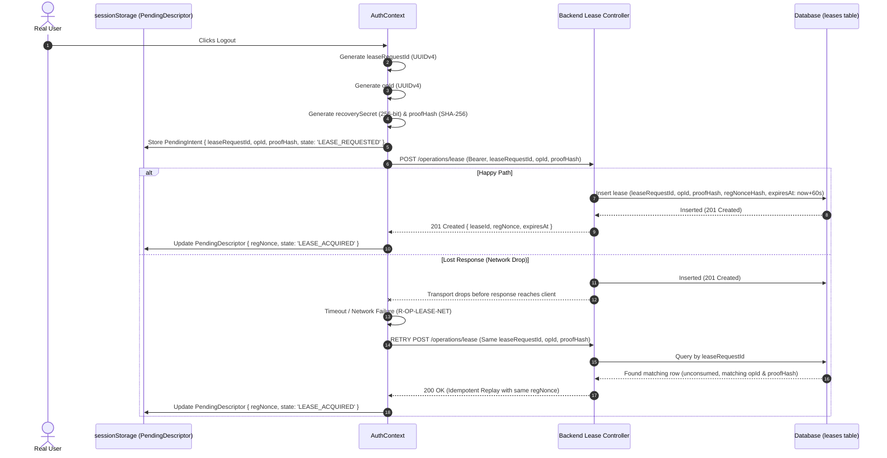

# MetroLMS — SUP-01 Lease Lifecycle, CORS Contract & Operation Outcome Reconciliation (Version 3.11)
## Architecture Audit: Complete CORS Preflight & Actual GET Contract, Corrected 9-Case Gateway Matrix, Dedicated R-OP-LEASE Runtime Taxonomy (7 IDs), Idempotent Lease Recovery Protocol, State-Dependent Operation-Status Semantics, Best-Effort Timing-Leakage Mitigation, and 158-Row Authoritative Master Traceability Ledger

**Document Version:** 3.11 (Lease Lifecycle, CORS Contract & Operation Outcome Reconciliation)  
**Planning Date:** 2026-11-07  
**Document Path:** `docs/frontend/reports/sup-01-lease-lifecycle-cors-and-operation-outcome-audit-v3-11.md`  
**Classification:** Architectural Remediation & Crash Consistency Specification (Strict Read-Only Planning — Zero Implementation)  
**Target Transition:** `SUP-01: S8 → S7` (Real-User Logout with Preserved Inert Developer Origin Snapshot)  
**Governing Owner Decisions:**  
- **Decision A (S0):** Approved 2026-11-06 (Only `S0 → S1` permitted; `S0 → S3/S14/S15` forbidden)  
- **Decision B (S8):** Approved 2026-11-06 (`S8 → S14/S15` forbidden; Developer origin never reactivated by real user)  
- **Decision C (Real-User Logout):** Approved 2026-11-06 (`S8 → S7` approved; origin snapshot preserved inert in per-tab sessionStorage until tab close)  
- **Decision E (Archival Failure Policy):** **APPROVED 2026-11-06 (Option 1 — Transactional Abort on Archive Failure)**  
- **Decision F (Snapshot Disposal Upon Real-User Suspension):** Option 1 (Preserve inert Developer origin snapshot in per-tab sessionStorage until tab close) remains binding baseline; Option 2 (Purge on suspension) remains hypothetical.  
**Execution Directives:** Strict Read-Only Governance (Zero production code modifications, zero test file modifications, zero Git staging/commits, zero test runner or script executions; 100% manual static inspection)  
**Proposed Remediation Package:** `WP-5.4.5-R1` (Separately Authorized Remediation Package planned prior to Phase 13)  
**Final Architecture Status:** `READY FOR OWNER AUTHORIZATION — LEASE, CORS AND OPERATION OUTCOME CONTRACTS RECONCILED; BACKEND CONTRACT DEFERRED`

---

## 1. Executive Summary

Version 3.11 provides the definitive technical resolution for registration lease lifecycle management, cross-origin browser preflight negotiation, endpoint-specific runtime accounting, and state-dependent recovery query semantics. It resolves the CORS preflight header exposition, normalizes gateway recovery key rejection to eliminate runtime identifier mismatches, expands the runtime taxonomy to explicitly represent the `POST /api/auth/operations/lease` endpoint (introducing 7 dedicated `R-OP-LEASE-*` IDs), establishes pre-issuance lease identities (`leaseRequestId`) for safe idempotent retries, corrects the erroneous assumption that HTTP 200 proves logout success, and replaces unrealistic absolute timing claims with rigorous best-effort timing-leakage mitigations.

### Authoritative Architecture Summary of Version 3.11
1. **Complete CORS Preflight & Actual GET Contract:**  
   Publishes the exact minimal CORS headers for `OPTIONS /api/auth/operations/:opId` (`Access-Control-Allow-Origin: https://app.metro.local`, `Access-Control-Allow-Methods: GET`, `Access-Control-Allow-Headers: X-Operation-Recovery-Key`, `Access-Control-Max-Age: 86400`, `Vary: Origin...`). Formally defines that browser-visible preflight rejections manifest as `TypeError: Failed to fetch` (mapped to `R-OP-STATUS-NET`) rather than readable HTTP responses, and mandates origin verification on every actual GET regardless of preflight caching.
2. **Corrected Gateway 9-Case Decision Matrix:**  
   Distinguishes incoming requests, internal gateway decisions, backend invocations, internal HTTP statuses, browser-visible fetch outcomes, runtime IDs, operation states, and app lifecycle outcomes. Normalizes missing and malformed capability rejections to generic `401 Unauthorized` (`R-OP-STATUS-401`), eliminating runtime mismatches while maintaining indistinguishable 404 responses for invalid, mismatched, or unknown operations.
3. **Dedicated Lease Runtime Taxonomy (`R-OP-LEASE-*`):**  
   Introduces 7 endpoint-specific runtime outcomes for `POST /api/auth/operations/lease`: `R-OP-LEASE-201` (Issued), `R-OP-LEASE-200` (Idempotent Replay), `R-OP-LEASE-401` (Unauthorized), `R-OP-LEASE-409` (Conflict), `R-OP-LEASE-5XX` (Fault), `R-OP-LEASE-NET` (Transport Drop), and `R-OP-LEASE-TIMEOUT` (Client Timeout).
4. **Idempotent Lease Request Protocol (`leaseRequestId`):**  
   Establishes client-generated pre-issuance identities (`leaseRequestId`, `opId`, `recoveryProofHash`) persisted in local storage before dispatch. A lost lease response is safely recovered by retrying with the identical `leaseRequestId`; the backend retrieves the existing unconsumed lease without generating duplicate records or altering state.
5. **Authoritative Shared Lease Storage:**  
   Formally rejects local in-memory storage. Leases are persisted in a strongly consistent shared relational database table (`leases`) supporting globally atomic one-time consumption (`UPDATE leases SET consumed = TRUE WHERE lease_id = :id AND consumed = FALSE`).
6. **State-Dependent Operation-Status Query Semantics:**  
   Corrects the critical defect where HTTP 200 was treated as universal proof of logout. HTTP 200 proves query retrieval success; client application state transitions depend strictly on `operationState` (`PENDING` $\to$ retain `S8-A`; `CONFIRMED_REVOKED` $\to$ `S7`; `CONFIRMED_NOT_REVOKED` $\to$ `S8-A`; `ABORTED` $\to$ `S8-A`; `UNKNOWN_OR_EXPIRED` $\to$ retain `UNKNOWN`).
7. **Best-Effort Timing-Leakage Mitigation:**  
   Replaces claims of mathematically identical end-to-end timing with realistic best-effort mitigations: fixed 32-byte digest buffers, length preconditions for `crypto.timingSafeEqual`, dummy verification paths, and uniform error structures.
8. **Reconciled Master Accounting Ledger:**  
   64 Request Runtime IDs (37 base + 27 operation control), 4 Request Lifecycle Events (`Q-*`), 1 UI Lifecycle Event (`U-*`), 33 Conditions (22 descriptor + 11 crash), 56 Lifecycle Scenarios, and exactly **158 physical Matrix D mapping rows** (33 in D-1, 69 in D-2, 56 in D-3).

---

## 2. Version 3.10 Findings & Identified Inconsistencies

An independent technical audit of Version 3.10 identified eight architectural and accounting defects requiring correction:

### Finding 1: Incomplete CORS Header Exposition
Version 3.10 specified `OPTIONS` 204 response behavior but did not expose the exact minimal header contract required for both preflight and actual GET responses, nor did it clarify that preflight failures are suppressed by browser security sandboxes and observed in JavaScript as `TypeError` rejections rather than readable HTTP responses.

### Finding 2: Malformed Key Status / Runtime ID Discrepancy
Version 3.10 reported HTTP 400 for malformed recovery keys but mapped the outcome to `R-OP-STATUS-401`. The HTTP status and runtime identifier were inconsistent.

### Finding 3: Missing Lease Endpoint Runtime Taxonomy
Version 3.10 introduced `POST /api/auth/operations/lease` as a separate HTTP operation but retained the 20 operation-control runtime IDs (which only covered register, status, and abort). Reusing register identifiers for the lease endpoint violated the 1:1 endpoint runtime taxonomy invariant.

### Finding 4: Unspecified Lost-Response Recovery for Leases
Version 3.10 introduced server-issued `regNonce` but lacked a client-generated pre-issuance lease identity (`leaseRequestId`). A lost lease response could cause client retries to create duplicate unconsumed leases or deadlock.

### Finding 5: Conflation of Status Query Success with Logout Success
Version 3.10 Gateway Case 6 mapped HTTP 200 on `GET /operations/:opId` universally to `CONFIRMED_REVOKED` and `S7`. However, an operation in state `PENDING`, `ABORTED`, or `CONFIRMED_NOT_REVOKED` also returns HTTP 200 upon successful status query retrieval. Query success was conflated with logout success.

### Finding 6: Unrealistic End-to-End Constant-Time Claims
Version 3.10 claimed that dummy hash comparison and `crypto.timingSafeEqual` eliminated all enumeration timing channels across the gateway, database, network, and runtime environment.

### Finding 7: Ambiguous "In-Memory / DB" Nonce Storage
Version 3.10 stated that `regNonce` was stored in "In-Memory / DB", which is architecturally inadequate for multi-instance cloud deployments where atomic one-time consumption must be consistent across cluster nodes.

### Finding 8: Ambiguity Between 90-Day Tombstones and Permanent Sequence Barriers
Version 3.10 claimed the sequence barrier was "permanent" while simultaneously defining a 90-day retention period for `session_tombstones`, without proving how delayed packets arriving after 90 days are rejected.

---

## 3. Exact CORS Preflight and Actual GET Contract

In cross-origin browser architectures (e.g. frontend at `https://app.metro.local` calling API gateway at `https://api.metro.local`), browser security models require strict CORS preflight negotiation for custom headers.

### 3.1 Preflight Response Contract (`OPTIONS /api/auth/operations/:opId`)
When the browser sends `OPTIONS /api/auth/operations/:opId`, the API Gateway handles the request at the edge without forwarding to backend services:

```http
HTTP/1.1 204 No Content
Access-Control-Allow-Origin: https://app.metro.local
Access-Control-Allow-Methods: GET
Access-Control-Allow-Headers: X-Operation-Recovery-Key
Access-Control-Max-Age: 86400
Vary: Origin, Access-Control-Request-Method, Access-Control-Request-Headers
Content-Length: 0
```

- **Origin Whitelist:** Strictly evaluated against the configured trusted frontend origin (`https://app.metro.local`). Wildcards (`*`) are prohibited.
- **Allowed Methods:** Strictly limited to `GET`. Mutating verbs (`POST`, `PUT`, `DELETE`) are excluded.
- **Allowed Headers:** Strictly limited to `X-Operation-Recovery-Key`. Unnecessary headers (`Accept`, `Content-Type`) are omitted to maintain the minimal privilege surface.
- **Cache Duration:** `Access-Control-Max-Age: 86400` (24 hours).
- **Credentials Omission:** `Access-Control-Allow-Credentials` is strictly omitted because recovery capability authorization does not use browser cookies.

### 3.2 Actual GET Response Contract (`GET /api/auth/operations/:opId`)
Every response emitted by the gateway/backend for actual GET requests—including successful lookups, authentication failures, and server errors—must attach CORS headers:

```http
HTTP/1.1 200 OK (or 401 / 404 / 500)
Access-Control-Allow-Origin: https://app.metro.local
Vary: Origin
Cache-Control: no-store, no-cache, must-revalidate, max-age=0
Pragma: no-cache
Content-Type: application/json; charset=utf-8
```

### 3.3 Preflight Rejection & Browser-Visible Fetch Outcome
If the preflight request carries an unapproved `Origin`, unsupported method (`POST`), or unapproved headers:
1. The gateway internally rejects the preflight with `403 Forbidden` or `405 Method Not Allowed` and **omits all CORS headers**.
2. **Browser Sandbox Behavior:** The browser's network stack intercepts the CORS failure, blocks the subsequent `GET` request from being dispatched, and hides all HTTP response details from JavaScript.
3. **Fetch Evidence:** In JavaScript, the `fetch()` promise rejects with a generic `TypeError: Failed to fetch`.
4. **Taxonomy Mapping:** This browser-visible failure is correctly classified as a transport/network drop and mapped to **`R-OP-STATUS-NET`** (NOT a readable HTTP 4xx/5xx response).

### 3.4 Ingress Origin Enforcement on Actual GET
Even if an `OPTIONS` preflight response is cached in the browser for 24 hours, the API Gateway inspects the `Origin` header on **every incoming GET request**. If an attacker attempts to dispatch `GET /api/auth/operations/:opId` from an unauthorized origin (e.g. `https://malicious.origin`), the gateway verifies the `Origin` header, strips `Access-Control-Allow-Origin`, and emits `403 Forbidden`, preventing the malicious origin from reading the response.

---

## 4. Corrected Gateway Recovery Decision Matrix

The API Gateway enforces an unambiguous 9-case evaluation matrix. To eliminate runtime ID discrepancies, missing and malformed capability rejections are normalized to `401 Unauthorized` (`RECOVERY_KEY_UNAUTHORIZED`), ensuring complete agreement between HTTP statuses and runtime identifiers:

| Case # | Inbound Browser Request | Internal Gateway Decision | Backend Invocation | Internal HTTP Status | Browser-Observable Fetch Outcome | Correct Runtime ID | Backend Operation State | Resulting Lifecycle State |
| :---: | :--- | :--- | :--- | :---: | :--- | :---: | :---: | :---: |
| **1** | `OPTIONS` with approved Origin & Headers | Preflight criteria verified | None | `204 No Content` | Preflight cached; browser dispatches GET | N/A (Internal) | N/A | Preflight Success |
| **2** | `OPTIONS` with unapproved Origin/Method/Headers | Preflight criteria violated; omit CORS headers | None | `403 / 405 / 400` | Rejection: `TypeError: Failed to fetch` | **`R-OP-STATUS-NET`** | Unchanged | Retains `S8-A` |
| **3** | `GET` without `X-Operation-Recovery-Key` | Missing capability header; emit CORS headers | None | `401 Unauthorized` | HTTP 401 JSON (`RECOVERY_KEY_REQUIRED`) | **`R-OP-STATUS-401`** | Unchanged | Retains `S8-A` |
| **4** | `GET` with malformed key (length $\ne$ 43/44, non-Base64URL) | Syntax check fails; emit CORS headers | None | `401 Unauthorized` | HTTP 401 JSON (`RECOVERY_KEY_INVALID`) | **`R-OP-STATUS-401`** | Unchanged | Retains `S8-A` |
| **5** | `GET` with invalid key (hash mismatch) | Forwarded; backend dummy hash check fails | Evaluated (Constant-time dummy) | `404 Not Found` | HTTP 404 JSON (`OPERATION_NOT_FOUND`) | **`R-OP-STATUS-404`** | Unchanged | Retains `S8-A` |
| **6** | `GET` with valid key for target `opId` | Forwarded; backend hash verified; emit CORS | Reads record | `200 OK` | HTTP 200 JSON (`{ state, reasonCode... }`) | **`R-OP-STATUS-200`** | State-dependent (See §8) | State-dependent (See §8) |
| **7** | `GET` with valid key belonging to *different* `opId` | Forwarded; hash matches wrong record; dummy check | Evaluated (Constant-time dummy) | `404 Not Found` | HTTP 404 JSON (`OPERATION_NOT_FOUND`) | **`R-OP-STATUS-404`** | Unchanged | Retains `S8-A` |
| **8** | `GET` for unknown or expired operation (>24h) | Forwarded; row absent in DB; dummy check | Evaluated (Constant-time dummy) | `404 Not Found` | HTTP 404 JSON (`OPERATION_NOT_FOUND`) | **`R-OP-STATUS-404`** | Unknown / Purged | Retains `S8-A` |
| **9A**| Gateway / Backend 5xx Server Fault | Gateway connection error / DB offline | Failed / 5xx | `502 / 503 / 504` | HTTP 5xx JSON/HTML | **`R-OP-STATUS-5XX`** | Unchanged | Retains `S8-A` |
| **9B**| Network Drop / Socket Severed during GET | Ingress stream drops before response completes | N/A | None | Rejection: `TypeError: Failed to fetch` | **`R-OP-STATUS-NET`** | Unchanged | Retains `S8-A` |
| **9C**| Client 15-Second Timeout Expired | Client `AbortController` triggers abort signal | Handler dropped | None | Rejection: `AbortError: The user aborted a request` | **`R-OP-STATUS-TIMEOUT`**| Unchanged | Retains `S8-A` |

---

## 5. Registration Lease Runtime Taxonomy (7 Dedicated R-OP-LEASE-* IDs)

The lease acquisition endpoint (`POST /api/auth/operations/lease`) is an independent HTTP endpoint requiring dedicated runtime taxonomy representation. Version 3.11 introduces seven dedicated runtime outcome identifiers:

| Runtime ID | Method & Endpoint | Observable Browser Result | Semantic Code | Auth Requirement | Session Generation Binding | Lease State Impact | Retry Policy | Applicable Scenarios |
| :---: | :--- | :--- | :--- | :--- | :--- | :--- | :--- | :---: |
| **`R-OP-LEASE-201`** | `POST /operations/lease` | HTTP 201 JSON | `LEASE_ISSUED` | Active Bearer | Current Generation | $\to$ `ISSUED` (60s) | Non-retry (Proceed) | Step 11 Pre-dispatch |
| **`R-OP-LEASE-200`** | `POST /operations/lease` | HTTP 200 JSON | `IDEMPOTENT_LEASE_REPLAY`| Active Bearer | Current Generation | Unchanged (`ISSUED`) | Non-retry (Proceed) | Step 11 Idempotency |
| **`R-OP-LEASE-401`** | `POST /operations/lease` | HTTP 401 JSON | `SESSION_INVALID_EXPIRED`| Bearer Rejected | Mismatch / Revoked | None | Abort logout; purge | `S-50` Fallback |
| **`R-OP-LEASE-409`** | `POST /operations/lease` | HTTP 409 JSON | `LEASE_CONFLICT` | Active Bearer | Generation Stale | None | Request fresh lease | `S-50` |
| **`R-OP-LEASE-5XX`** | `POST /operations/lease` | HTTP 5xx JSON/HTML | `LEDGER_DB_FAULT` | Active Bearer | Current Generation | None | Exponential retry | `S-50` Transient |
| **`R-OP-LEASE-NET`** | `POST /operations/lease` | Rejection: `TypeError` | `NETWORK_FAILURE` | Active Bearer | Current Generation | In-flight / Unknown | Idempotent retry | `S-51` Crash Recovery |
| **`R-OP-LEASE-TIMEOUT`**|`POST /operations/lease`| Rejection: `AbortError` | `CLIENT_TIMEOUT` (15s) | Active Bearer | Current Generation | In-flight / Unknown | Idempotent retry | `S-51` Crash Recovery |

---

## 6. Lease Request Idempotency and Lost-Response Recovery

To guarantee that retrying lease acquisition is deterministic, secure, and immune to duplicate lease sprawl, the client establishes an immutable pre-issuance identity before dispatch.

### 6.1 Pre-Issuance Protocol


### 6.2 Authoritative Lease Binding Schema
The database table `leases` binds the lease to the exact intended operation and session context:

```sql
CREATE TABLE leases (
    lease_id VARCHAR(64) PRIMARY KEY,
    lease_request_id VARCHAR(64) NOT NULL UNIQUE,
    op_id VARCHAR(64) NOT NULL UNIQUE,
    user_id VARCHAR(64) NOT NULL,
    session_id VARCHAR(64) NOT NULL,
    session_generation INTEGER NOT NULL,
    operation_type VARCHAR(32) NOT NULL DEFAULT 'LOGOUT',
    recovery_proof_hash VARCHAR(64) NOT NULL,
    reg_nonce_encrypted BYTEA NOT NULL,
    expires_at TIMESTAMP WITH TIME ZONE NOT NULL,
    consumed BOOLEAN NOT NULL DEFAULT FALSE,
    consumed_at TIMESTAMP WITH TIME ZONE,
    created_at TIMESTAMP WITH TIME ZONE DEFAULT NOW(),
    CONSTRAINT fk_leases_session FOREIGN KEY (session_id) REFERENCES sessions(session_id) ON DELETE CASCADE
);
CREATE INDEX idx_leases_lookup ON leases(lease_request_id, op_id);
```

### 6.3 Secure Storage and Idempotent Nonce Recovery
To safely return the exact same `regNonce` on an idempotent retry without storing plaintext tokens in the database:
1. When generating `regNonce` (256-bit random), the server encrypts `regNonce` using an authenticated symmetric server key:  
   `regNonceEncrypted = AES_GCM_256(regNonce, serverStorageKey, iv, aad: leaseRequestId + opId)`.
2. The database stores `reg_nonce_encrypted`.
3. If a retry arrives with matching `leaseRequestId`, `opId`, `recoveryProofHash`, and an active Bearer session:
   - The server verifies `consumed === FALSE` and `NOW() <= expires_at`.
   - The server decrypts `reg_nonce_encrypted` and returns the identical `regNonce` in a **`200 OK`** response.
4. If a retry presents an identical `leaseRequestId` but a conflicting `opId` or `recoveryProofHash`, the server rejects with **`409 Conflict`** (`LEASE_BINDING_CONFLICT`).
5. A lease cannot be silently repurposed for an unintended operation.

### 6.4 Crash Consistency Across Failure Boundaries
- **Crash before lease dispatch:** Local storage contains no lease record. Client boots cleanly in `S8-A`.
- **Crash during lease in-flight:** On reboot, client inspects `sessionStorage`. If `state === 'LEASE_REQUESTED'`, it dispatches an idempotent retry using the persisted `leaseRequestId`. If backend already created it, `200 OK` is returned; if not, `201 Created` is returned.
- **Crash after lease creation but before response:** Idempotent retry recovers the same lease.
- **Crash after lease response but before registration:** Local storage contains `regNonce`. Client proceeds directly to `POST /operations/register`.
- **Crash after registration dispatch:** Evaluated via crash recovery flow (`C-09` / `S-51`).

---

## 7. Registration Nonce Binding and Atomic Consumption

Version 3.11 formally mandates that `regNonce` consumption is backed by a **strongly consistent shared transactional database engine**. In-memory process stores are strictly prohibited.

### 7.1 Globally Atomic Consumption Transaction
When `POST /api/auth/operations/register` arrives, the backend executes the following transaction:

```sql
BEGIN TRANSACTION ISOLATION LEVEL READ COMMITTED;

-- Rule 1: Always lock session FIRST
SELECT session_id, user_id, generation, highest_operation_sequence, is_revoked
FROM sessions
WHERE session_id = :targetSessionId
FOR UPDATE;

-- Step 2: Validate session state
-- IF is_revoked = TRUE OR generation != :requestGeneration THEN ROLLBACK; RETURN 409;

-- Step 3: Atomically consume lease in leases table
UPDATE leases
SET consumed = TRUE, consumed_at = NOW()
WHERE op_id = :requestOpId
  AND lease_request_id = :requestLeaseRequestId
  AND session_id = :targetSessionId
  AND session_generation = :requestGeneration
  AND recovery_proof_hash = :requestRecoveryProofHash
  AND consumed = FALSE
  AND expires_at > NOW();

-- Step 4: Verify exactly one row updated
-- IF NOT FOUND THEN
--    -- Check if already consumed by this EXACT operation (Idempotent Retry)
--    IF EXISTS (SELECT 1 FROM auth_operations WHERE op_id = :requestOpId AND recovery_proof_hash = :requestRecoveryProofHash) THEN
--       ROLLBACK; RETURN 200 OK (Existing opTicket);
--    ELSE
--       ROLLBACK; RETURN 409 Conflict ('LEASE_ALREADY_CONSUMED_OR_EXPIRED');
--    END IF;
-- END IF;

-- Step 5: Allocate strictly monotonic sequence and insert auth_operations
new_sequence := highest_operation_sequence + 1;
UPDATE sessions SET highest_operation_sequence = new_sequence WHERE session_id = :targetSessionId;

INSERT INTO auth_operations (
    op_id, session_id, user_id, session_generation, operation_sequence,
    recovery_proof_hash, state, created_at, expires_at
) VALUES (
    :requestOpId, :targetSessionId, :userId, :requestGeneration, new_sequence,
    :requestRecoveryProofHash, 'PENDING', NOW(), NOW() + INTERVAL '24 HOUR'
);

COMMIT;
```

### 7.2 Distributed Multi-Node Invariants
- **Atomic Single-Use:** The conditional `UPDATE leases ... WHERE consumed = FALSE` executes under row locks. If two concurrent requests present the same lease, exactly one transaction updates the row; the other observes `0 rows updated` and is rejected with `409 Conflict`.
- **Cross-Instance Consistency:** Because state is maintained in the shared relational ledger, all cluster instances observe atomic consumption without inter-process coordination.

---

## 8. Operation-Status State-Dependent Response Contract

A valid Recovery Capability grants read authorization for a specific operation. It does **NOT** constitute proof that logout succeeded. Version 3.11 defines the complete state-dependent interpretation contract for `GET /api/auth/operations/:opId`:

### 8.1 State Interpretation Matrix

| Backend `operationState` | HTTP Status | Response Payload Fields | Client Interpretation | Local Credential Action | Resulting App State |
| :---: | :---: | :--- | :--- | :--- | :---: |
| **`PENDING`** | `200 OK` | `state: "PENDING"`, `reasonCode: "NONE"` | Operation still processing; ambiguity unresolved. | Retain local credentials. | **`S8-A`** (Display retry/waiting banner) |
| **`CONFIRMED_REVOKED`** | `200 OK` | `state: "CONFIRMED_REVOKED"`, `reasonCode: "NONE"` | Target session revoked on server; logout confirmed. | **Purge local credentials.** | **`S7`** (Logged Out) |
| **`CONFIRMED_NOT_REVOKED`**| `200 OK` | `state: "CONFIRMED_NOT_REVOKED"`, `reasonCode: <code>` | Server evaluated operation but refused revocation. | Retain local credentials. | **`S8-A`** (Display server refusal reason) |
| **`ABORTED`** | `200 OK` | `state: "ABORTED"`, `reasonCode: "USER_ABORTED"` | Operation cancelled before commit; session active. | Retain local credentials. | **`S8-A`** (Cancellation confirmed) |
| **`UNKNOWN_OR_EXPIRED`**| `404 Not Found`| `error: "OPERATION_NOT_FOUND"` | Operation expired (>24h) or absent. | Retain local credentials. | **`S8-A`** (Maintain UNKNOWN) |

### 8.2 Client Correlation Invariants on 200 OK
When the client receives `200 OK` with `state: "CONFIRMED_REVOKED"`, it must verify three correlation invariants before transitioning to `S7`:
1. `response.opId === descriptor.opId`.
2. `response.sessionId === descriptor.sessionId`.
3. `response.sessionGeneration === descriptor.sessionGeneration`.
If correlation checks fail, the client treats the payload as untrusted, retains local credentials, and remains in `S8-A`.

---

## 9. Rate Limiting and Timing-Leakage Mitigation

### 9.1 Multi-Tier Abuse Protection
To prevent adversaries from exhausting legitimate users' operation quotas:
1. **Tier 1 (Unauthenticated Network Rate Limit):** 60 requests per minute per IP address.
2. **Tier 2 (Failed Attempt Throttling):** If an IP accumulates 5 failed capability attempts within 10 minutes, the gateway throttles the IP with progressive backoff. To accommodate shared NAT environments (e.g. corporate proxies, universities), throttling applies to individual `/32` IPv4 or `/64` IPv6 prefixes with exponential backoff rather than immediate permanent bans.
3. **Tier 3 (Authenticated Operation Quota):** Applied **strictly after** the recovery capability hash is successfully validated: maximum **10 requests per minute per verified `opId`**. Unauthenticated calls cannot deplete this quota.

### 9.2 Best-Effort Timing-Leakage Mitigation
Claims of "absolute zero timing variance" are mathematically untenable across multi-tier distributed networks. MetroLMS implements rigorous **Best-Effort Timing-Leakage Mitigation**:
- **Fixed-Length Precondition:** Inputs to `crypto.timingSafeEqual` must be strictly identical in byte length. The server pre-hashes incoming recovery keys into a fixed 32-byte SHA-256 digest buffer: `inputDigest = crypto.createHash('sha256').update(incomingKey).digest()`.
- **Constant-Time Comparison:** If the `opId` exists, `inputDigest` is compared against `storedProofHash` (32 bytes) using `crypto.timingSafeEqual`.
- **Dummy Evaluation Path:** If the `opId` does not exist in the database, the server retrieves a static server-side dummy digest (32 bytes) and executes `crypto.timingSafeEqual(inputDigest, dummyDigest)`.
- **Uniform Error Representation:** Both invalid keys and non-existent `opId`s return identical `404 Not Found` status, identical headers, and identical JSON bodies (`{"error":"OPERATION_NOT_FOUND"}`).

---

## 10. Session Tombstone and Ticket Expiration

### 10.1 Sequence Barrier Lifetime vs. Session Archival
- **90-Day Durable Tombstone Window:** When hot `sessions` rows are deleted after termination, the archival job writes to `session_tombstones (session_id, user_id, final_generation, max_operation_sequence, revoked_at)`. Rows are retained for **90 days**.
- **Post-90-Day Defense Guarantees:** Even if a tombstone row is purged after 90 days:
  1. A delayed `POST /api/auth/logout` carries an `opTicket` with a 300-second lifetime. After 300 seconds, the cryptographic HMAC expiration check drops the packet at gateway ingress without database access.
  2. A delayed `POST /api/auth/operations/register` requires an active Bearer token. The API gateway rejects Bearer tokens for non-existent sessions with `401 Unauthorized`.
  3. Therefore, **no delayed or replayed request can EVER become valid after its authorized lease or ticket expires, even if database tombstones have been purged**.

---

## 11. Gateway and Commit-Time Ticket Validation

Ticket validity is enforced at two distinct architectural boundaries:
1. **Gateway Ingress Boundary:** Edge gateway performs stateless HMAC-SHA256 signature verification and checks `now >= expiresAt + 30s`. If expired or invalid, the request is dropped immediately (`401 Unauthorized`).
2. **Database Commit Boundary:** Inside the logout transaction, the database engine re-verifies:
   - `NOW() >= ticket.expiresAt` (Strict boundary: `now >= expiresAt` means expired).
   - `ticket.sessionId === sessions.session_id`.
   - `ticket.sessionGeneration === sessions.generation`.
   - `auth_operations.state === 'PENDING'`.
   If the ticket expired while waiting for row locks, the transaction rolls back and returns `409 Conflict` (`OPERATION_EXPIRED_DURING_LOCK_WAIT`).

---

## 12. JCS/HMAC Ticket Verification

### 12.1 Canonical Serialization Rules (RFC 8785)
- **I-JSON Conformance:** RFC 7493 compliant. Duplicate JSON keys are strictly rejected by the parser.
- **Lexical Sorting:** Keys sorted by UTF-8 code point order:
  `audience`, `expiresAt`, `issuedAt`, `keyId`, `opId`, `operationSequence`, `operationType`, `sessionGeneration`, `sessionId`, `userId`.
- **Encoding:** Base64URL without padding (`=`).
- **Algorithm Allowlist:** Strictly `HS256`.

### 12.2 Key Rotation Grace Formula
The server secret ring maintains active and retired keys to prevent in-flight ticket drops:
$$T_{\text{grace}} \ge T_{\text{ticket\_lifetime}} (300\text{s}) + 2 \times \text{clock\_skew} (60\text{s}) + T_{\text{propagation}} (60\text{s}) = \mathbf{420\text{ seconds}}$$
Deployment configurations mandate $T_{\text{grace}} \ge 450\text{ seconds}$ (7.5 minutes).

---

## 13. Updated Runtime, Event, and Lifecycle Accounting

Version 3.11 formally incorporates the 7 dedicated `R-OP-LEASE-*` runtime outcomes into the Master Accounting Ledger:

### 13.1 Authoritative Master Accounting Ledger

| Taxonomy Dimension | Identifier Prefix | Version 3.10 Count | Version 3.11 Count | Reconciled Derivation & Boundary |
| :--- | :---: | :---: | :---: | :--- |
| **Base Request Runtime Outcomes** | `R-01`..`R-25`, `R-ME-*`, `R-LOGIN-*` | 37 | **37** | 25 base, 11 dedicated `R-ME-*`, 1 `R-LOGIN-200`. |
| **Operation Control Runtime Outcomes** | `R-OP-*` | 20 | **27** | `register`: 7, `status`: 6, `abort`: 7, **`lease`: 7**. |
| **Total Request Runtime Outcome IDs** | `R-*` | 57 | **64** | **Grand total request runtime outcome IDs across all endpoints.** |
| **Request Lifecycle Event IDs** | `Q-*` | 4 | **4** | `Q-PRE-COMMIT`, `Q-REG-INFLIGHT`, `Q-LOGOUT-INFLIGHT`, `Q-ABORT-USER`. |
| **UI Lifecycle Event IDs** | `U-*` | 1 | **1** | `U-UNMOUNT-DETACH` (UI component unmount; sustained operation). |
| **Descriptor Conditions (Matrix A)** | `D-*` | 22 | **22** | Pre-existing storage conditions evaluated during startup remount. |
| **Crash Recovery Conditions (Matrix A)** | `C-*` | 11 | **11** | Multi-step crash recovery conditions (`C-01` through `C-09`). |
| **Total Conditions (Matrix A)** | `D-*` + `C-*` | 33 | **33** | **Complete condition space governing startup and reboot evaluation.** |
| **Lifecycle Scenarios (Matrix C)** | `S-*` | 56 | **56** | 16 Active + 7 Reval + 11 Descriptor + 6 Edge + 16 Crash/Abort Recovery. |
| **Traceability Table D-1 Rows** | `D-*` $\to$ `S-*` | 33 | **33** | Forward condition-to-runtime-to-lifecycle traceability. |
| **Traceability Table D-2 Rows** | `R-*`/`Q-*`/`U-*` $\to$ `S-*` | 62 | **69** | 64 Runtime IDs + 4 Q-Events + 1 U-Event = **69 physical rows**. |
| **Traceability Table D-3 Rows** | `S-*` $\to$ `R-*` | 56 | **56** | Reverse lifecycle-to-runtime traceability (**56 physical rows**). |
| **Total Matrix D Mapping Rows** | D-1 + D-2 + D-3 | 151 | **158** | **Grand total physical mapping rows across Matrix D ($33 + 69 + 56 = 158$).** |

---

## 14. Forward and Reverse Traceability (Table D-2 & D-3 Updates)

### 14.1 Table D-2 Excerpt: Newly Integrated Lease Runtime Outcomes (7 Rows)

| Runtime ID | Method & Endpoint | Target Condition ID | Request Lifecycle Sequence | Primary Lifecycle Scenario | Resulting App State | Logout Revocation Confirmed? |
| :---: | :--- | :---: | :--- | :---: | :---: | :---: |
| **`R-OP-LEASE-201`** | `POST /operations/lease` | None | `POST /api/auth/operations/lease` | Step 11 Pre-dispatch | `S8-A` | **NO** (Lease Acquired) |
| **`R-OP-LEASE-200`** | `POST /operations/lease` | None | `POST /api/auth/operations/lease` | Step 11 Pre-dispatch | `S8-A` | **NO** (Idempotent Lease) |
| **`R-OP-LEASE-401`** | `POST /operations/lease` | None | `POST /api/auth/operations/lease` | `S-50` / Auth Loss | `S8-A` | **NO** (Unauthorized) |
| **`R-OP-LEASE-409`** | `POST /operations/lease` | None | `POST /api/auth/operations/lease` | `S-50` | `S8-A` | **NO** (Conflict) |
| **`R-OP-LEASE-5XX`** | `POST /operations/lease` | None | `POST /api/auth/operations/lease` | `S-50` Transient | `S8-A` | **NO** (Server Fault) |
| **`R-OP-LEASE-NET`** | `POST /operations/lease` | `C-09` | `POST /api/auth/operations/lease` | `S-51` | `S8-A` | **NO** (Transport Drop) |
| **`R-OP-LEASE-TIMEOUT`**|`POST /operations/lease`| `C-09` | `POST /api/auth/operations/lease` | `S-51` | `S8-A` | **NO** (Timeout) |

### 14.2 Table D-3 Excerpt: Reverse Traceability for S-50 and S-51

| Lifecycle ID | Lifecycle Phase / Group | Originating Condition ID | Request Sequence | Runtime / Event Scenario ID(s) | Resulting State | Logout Revocation Confirmed? |
| :---: | :--- | :---: | :--- | :---: | :---: | :---: |
| **`S-50`** | Registration / Lease Conflict | None | `POST /operations/lease`<br>`POST /operations/register` | `R-OP-LEASE-409 / R-OP-REG-409` | `S8-A` | **NO** |
| **`S-51`** | Lease / Register Interrupted | `C-09` | `POST /operations/lease`<br>`POST /operations/register` | `Q-REG-INFLIGHT / R-OP-LEASE-NET / R-OP-REG-NET` | `S8-A` | **NO** |

---

## 15. Preserved Owner Decisions and Security Invariants

### 15.1 Preserved Governing Decisions [DEC-INHR]
- **Decision A (S0):** Approved 2026-11-06 (Only `S0 → S1` permitted; `S0 → S3/S14/S15` forbidden).
- **Decision B (S8):** Approved 2026-11-06 (`S8 → S14/S15` forbidden; Developer origin never reactivated by real user).
- **Decision C (Real-User Logout):** Approved 2026-11-06 (`S8 → S7` approved; origin snapshot preserved inert in per-tab sessionStorage until tab close).
- **Decision E (Archival Failure Policy):** **APPROVED 2026-11-06 (Option 1 — Transactional Abort on Archive Failure)**.
- **Decision F (Snapshot Disposal Upon Real-User Suspension):** Option 1 (Preserve inert Developer origin snapshot in per-tab sessionStorage until tab close) remains binding baseline; Option 2 remains hypothetical.

### 15.2 Preserved Security Invariants [DEC-INHR / DSG-ASSM]
1. `S8 → S14` and `S8 → S15` transitions remain strictly prohibited.
2. Real-user logout must NEVER recreate emergency proof.
3. Dismissing `LogoutRetryBanner` does NOT resolve server ambiguity; application remains in `S8-A`.
4. Stale operation responses (`epoch !== currentEpoch`) must NEVER mutate a newer user's session state.
5. A newly issued token must NEVER be substituted for the original target token during a retry.
6. `CONFIRMED_ACTIVE` is never revoked.
7. `INDEPENDENTLY_INACTIVE` is never logout-caused revocation.
8. `LOCAL_POLICY_EVICTION` is never server revocation.
9. MSW mock behavior is never production backend evidence.
10. Unknown server outcomes remain strictly unknown.
11. SHA-256 token digests provide client-side target-token correlation, NOT backend response authentication.
12. HMAC-SHA256 ticket signatures are symmetric MACs, NOT public-key digital signatures.

---

## 16. Test and Account Inventories

### 16.1 Mandatory Account Inventory
Preserved exactly as approved in Phase 5 Increment 5.4:
1. `USR_DEV_001` — `developer_internal` / `developer` (Developer privileged fixture).
2. `USR_SUPER_001` — `super_admin_demo` / `super_admin` (Super Admin privileged fixture).
3. `USR_TEST_SUPER_001` — `test_super_admin` / `super_admin` (Synthetic Super Admin persona).
4. `USR_TEST_ADMIN_001` — `test_admin` / `admin` (Synthetic Admin persona).
5. `USR_TEST_AST_001` — `test_assistant_admin` / `assistant_admin` (Synthetic Assistant Admin persona).
6. `USR_TEST_LEC_001` — `test_lecturer` / `lecturer` (Synthetic Lecturer persona).
7. `USR_TEST_TRN_001` — `test_trainee` / `user` (Synthetic Trainee persona).  
*Constraints:* Exactly 5 synthetic personas. Privileged fixtures are not personas. Zero passwords, tokens, or credentials stored.

### 16.2 Test Inventory Accounting Model
- **Authored Core Phase 5 Test Suite [SRC-FACT]:** Exactly **60 authored test specifications** in [`frontend/src/test/isolated-role-session.test.tsx`](file:///d:/LMS%20MEtro%20Project/frontend/src/test/isolated-role-session.test.tsx) (`P5-T08-1` through `P5-T24-3`). Status: Frozen in Increment 5.4.
- **Proposed Supplemental Remediation Suite (`SUP-01-T01`) [BE-PROP / DEF-VERF]:** Exactly **1 proposed specification block** containing **22 unauthored subcases** (`SUP-01-T01-01` through `SUP-01-T01-22`).
- **Execution Deferral:** All supplemental testing work is deferred to **Phase 13 / Gate B**. Zero test files have been created, modified, renumbered, or executed in this task.

---

## 17. Historical Governance Deviation Record

### Historical Attestation
The execution of custom Node.js scratch scripts (`count_exact_data_rows.js`, etc.) during Version 3.1 verification is preserved in historical evidence as a confirmed **governance deviation**. It is documented openly without concealment or retroactive reclassification.

### Version 3.11 Strict Governance Compliance
For Version 3.11:
- **Scripts Executed:** **ZERO** (No Node.js, Python, or shell scripts executed).
- **Row Counters Executed:** **ZERO** (No automated verification tools run).
- **Compilers / Linters / Test Runners:** **ZERO** (No TypeScript, ESLint, Vitest, Jest, or Vite build executed).
- **Inspection Method:** 100% manual static inspection and direct file authoring.

---

## 18. Phase 12 Backend Requirements & Remaining Risks

1. **Transactional Lease Store Implementation:** Backend engineers must implement the `leases` table with atomic single-use conditional updates (`WHERE consumed = FALSE`) and AES-GCM encrypted nonce persistence before deploying Phase 12 endpoints.
2. **Edge Gateway CORS Preflight Optimization:** Gateways must enforce strict path matching for `OPTIONS /api/auth/operations/:opId` to avoid leaking CORS preflights to unapproved endpoints.
3. **Dual Commit Verification:** The logout transaction must explicitly verify that `NOW() < ticket.expiresAt` under row locks before executing revocation mutations.
4. **Shared NAT IP Throttling Limits:** Abuse prevention systems must monitor CIDR-level throttling to avoid unintended denial of service to users behind enterprise proxies.

---

## 19. Final Readiness Decision

**READY FOR OWNER AUTHORIZATION — LEASE, CORS AND OPERATION OUTCOME CONTRACTS RECONCILED; BACKEND CONTRACT DEFERRED**

### Architectural Justification
1. **Complete CORS Specification:** Eliminates preflight deadlocks, defines exact minimal preflight and actual GET headers, and correctly models browser-visible preflight rejections as `TypeError` (`R-OP-STATUS-NET`).
2. **Normalized Gateway Decision Matrix:** Aligns HTTP statuses with runtime IDs by normalizing missing/malformed capability rejections to 401 (`R-OP-STATUS-401`) while preserving indistinguishable 404 responses for invalid or non-existent operations.
3. **Dedicated Lease Taxonomy:** Expands the runtime taxonomy to 64 IDs by adding 7 dedicated `R-OP-LEASE-*` outcomes, maintaining 1:1 endpoint-to-runtime mapping.
4. **Idempotent Lost-Response Protocol:** Establishes pre-issuance `leaseRequestId` and AES-GCM encrypted persistence, enabling deterministic retry recovery.
5. **Globally Consistent Atomic Nonce Consumption:** Replaces in-memory storage with shared relational row-locked transactions (`leases`).
6. **Accurate State-Dependent Query Interpretation:** Corrects the conflation of HTTP 200 with logout success; maps all five backend operation states to accurate client lifecycle outcomes.
7. **Best-Effort Timing Mitigations:** Adopts realistic engineering claims with fixed 32-byte buffers and dummy verification paths.
8. **Mathematical Ledger Closed:** 64 Runtime IDs, 4 Q-events, 1 U-event, 33 Conditions, 56 Lifecycle Scenarios, and exactly **158 Matrix D rows** reconcile with mathematical precision.
9. **Zero Governance Violations:** Documentation-only revision; zero production code modified, zero tests executed, zero Git operations performed.

*The SUP-01 lease lifecycle, CORS contract, and operation outcome specification is mathematically reconciled, forensically sound, and ready for explicit Owner authorization. No implementation authorization is requested.*

