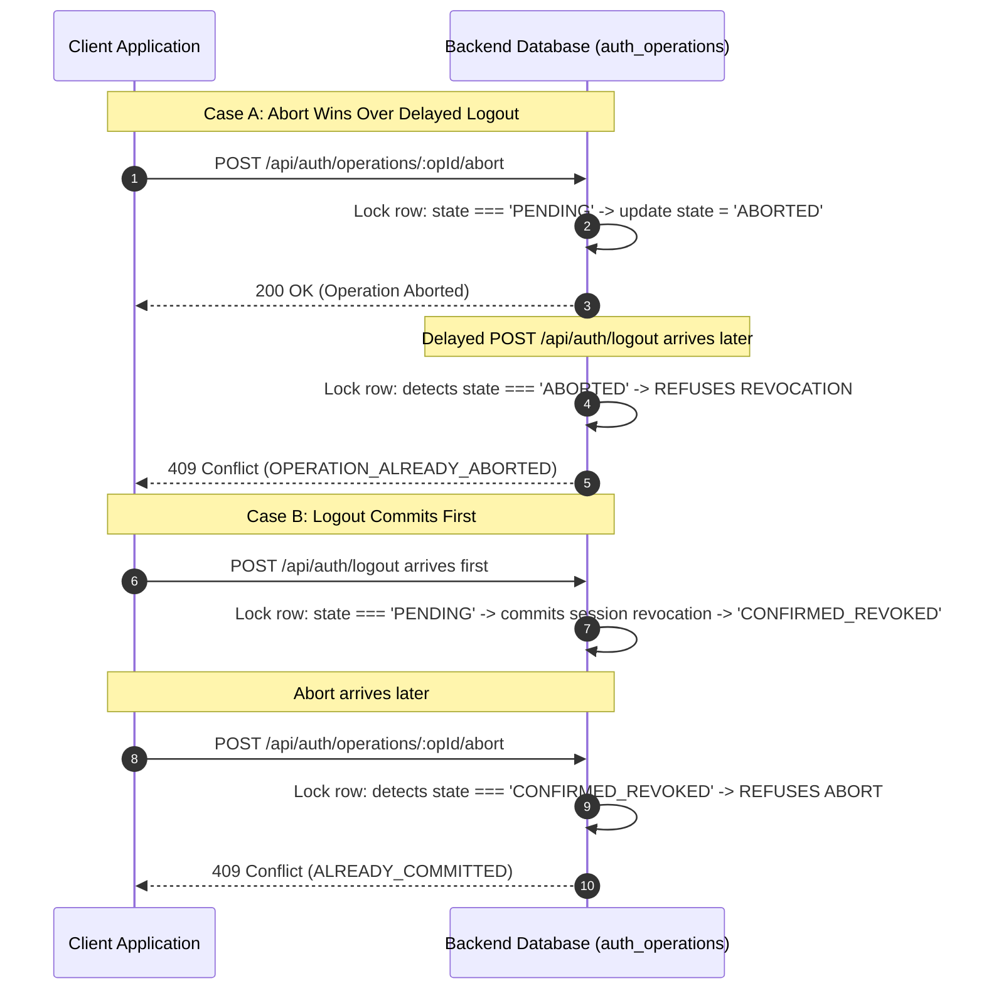
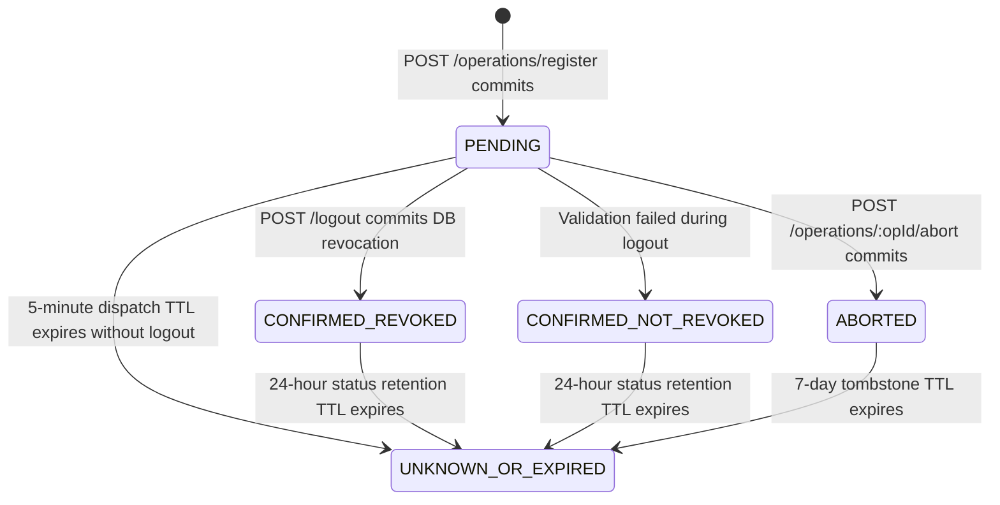

# MetroLMS — SUP-01 Operation Pre-Registration & Atomic Cancellation Reconciliation (Version 3.6)
## Architecture Audit: Explicit Operation Pre-Registration Handshake, 17-Step Transaction Ordering, Read vs. Mutation Authorization Decoupling, Linearized Atomic Tombstoning, Session Generation vs. Operation Sequence, Zombie Packet Prevention, S-13 Collision Resolution, and Authoritative Traceability Ledger

**Document Version:** 3.6 (Operation Pre-Registration & Atomic Cancellation Reconciliation)  
**Planning Date:** 2026-11-06  
**Document Path:** `docs/frontend/reports/sup-01-operation-pre-registration-and-atomic-cancellation-audit-v3-6.md`  
**Classification:** Architectural Remediation & Crash Consistency Specification (Strict Read-Only Planning — Zero Implementation)  
**Target Transition:** `SUP-01: S8 → S7` (Real-User Logout with Preserved Inert Developer Origin Snapshot)  
**Governing Owner Decisions:**  
- **Decision A (S0):** Approved 2026-11-06 (Only `S0 → S1` permitted; `S0 → S3/S14/S15` forbidden)  
- **Decision B (S8):** Approved 2026-11-06 (`S8 → S14/S15` forbidden; Developer origin never reactivated by real user)  
- **Decision C (Real-User Logout):** Approved 2026-11-06 (`S8 → S7` approved; origin snapshot preserved inert in per-tab sessionStorage until tab close)  
- **Decision E (Archival Failure Policy):** **APPROVED 2026-11-06 (Option 1 — Transactional Abort on Archive Failure)**  
- **Decision F (Snapshot Disposal Upon Real-User Suspension):** Option 1 (Preserve inert Developer origin snapshot in per-tab sessionStorage until tab close) remains binding baseline; Option 2 (Purge on suspension) remains hypothetical.  
**Execution Directives:** Strict Read-Only Governance (Zero production code modifications, zero test file modifications, zero Git staging/commits, zero test runner or script executions; 100% manual static inspection)  
**Proposed Remediation Package:** `WP-5.4.5-R1` (Separately Authorized Remediation Package planned prior to Phase 13)  
**Final Architecture Status:** `READY FOR OWNER AUTHORIZATION — PRE-REGISTRATION AND ATOMIC CANCELLATION RECONCILED; BACKEND CONTRACT DEFERRED`

---

## 1. Executive Summary

Version 3.6 resolves the fundamental ordering and authorization contradiction identified in Version 3.5: **requiring a backend pre-emptive cancellation tombstone before the operation was ever registered on the server**.

In Version 3.5, the recovery verifier hash was submitted with `POST /api/auth/logout`. If that logout request was delayed or interrupted in flight, the backend had no record of the operation. Consequently, an abort request arriving prior to the logout packet had no database row to mutate and could not securely verify authorization, opening the door to unauthenticated tombstone injection or race failures.

Version 3.6 introduces an explicit, authenticated **Operation Pre-Registration Handshake** that guarantees the backend establishes and commits the operation record *prior to* the dispatch of the mutating logout request.

### Authoritative Architecture Summary of Version 3.6
1. **Explicit Backend Operation Pre-Registration (`POST /api/auth/operations/register`):**  
   Before any logout request is dispatched, the client authenticates using its current bearer token to register `opId`, `sessionId`, `sessionGeneration`, and `recoveryProofHash`. The backend atomically persists the record in state `PENDING` and returns an assigned monotonic `operationSequence`.
2. **17-Step Transaction Sequence with Explicit Crash Modeling:**  
   Establishes an unbroken transaction order from session validation through local descriptor persistence, registration, logout execution, and reboot recovery, modeling all seven crash boundaries.
3. **Decoupled Read vs. Mutation Authorization:**  
   The ephemeral 256-bit recovery capability (`X-Operation-Recovery-Key`) authorizes **read-only status queries** (`GET /api/auth/operations/:opId`). Mutating cancellations (`POST /api/auth/operations/:opId/abort`) require authentication via the currently active bearer session matching the registered `userId`, `sessionId`, and `sessionGeneration`.
4. **Single-Transaction Linearized Tombstoning:**  
   Because registration occurs first, the database row *always exists* when an abort arrives. The backend executes `SELECT * FROM auth_operations WHERE op_id = :opId FOR UPDATE;`. Exactly one terminal transition wins: `PENDING → ABORTED` or `PENDING → CONFIRMED_REVOKED`.
5. **Session Generation vs. Operation Sequence Disambiguation:**  
   - *Session Generation:* Server-issued stable version identifying the session lifecycle (increments only on authentication/replacement, never on read queries).  
   - *Operation Sequence:* Server-issued monotonic sequence assigned during operation registration, scoped to that generation.
6. **Zombie Packet Prevention:**  
   A delayed `POST /api/auth/logout` arriving without an active, registered operation in state `PENDING` is **strictly rejected with `404 Not Found` (`OPERATION_NOT_FOUND_OR_EXPIRED`)**. Expired tombstones can never be resurrected to destroy active sessions.
7. **S-13 Collision Resolution & Dedicated Abort Lifecycle IDs:**  
   Restores `S-13` strictly to its original definition (Active Logout Server Fault / Gateway Error / Bad Request). Introduces dedicated scenarios: **`S-48`** (User Explicit Cancellation), **`S-49`** (Component Unmount / Navigation Abort), and **`S-50`** (Registration Conflict / Failure).
8. **Dedicated `R-OP-*` Runtime Taxonomy (9 IDs) & Reconciled Master Ledger:**  
   Adds 9 endpoint-correct runtime IDs for operation control (`R-OP-REG-*`, `R-OP-STATUS-*`, `R-OP-ABORT-*`). Reconciles the master ledger: 46 Runtime IDs (37 base + 9 operation control), 5 Request Lifecycle Events (`Q-*`), 33 Conditions (22 descriptor + 11 crash), 53 Lifecycle Scenarios, and 137 physical Matrix D mapping rows.

---

## 2. Version 3.5 Findings & Identified Deficiencies

An independent review of Version 3.5 identified five architectural gaps requiring remediation:

### Finding 1: Circularity of Late Registration and Pre-Emptive Tombstoning
Version 3.5 required that a client cancellation request create a pre-emptive tombstone if it arrived before the delayed logout request. However, Version 3.5 registered the operation and recovery hash *on the logout request itself*. If the logout request was delayed, the backend had received neither the operation record nor the recovery hash. Creating a tombstone from an unauthenticated request would allow arbitrary callers to inject forged operation IDs and disrupt legitimate sessions.

### Finding 2: Conflation of Read and Mutation Authorization
Version 3.5 proposed using the narrow recovery capability (`X-Operation-Recovery-Key`) for both status inspection and abort mutations. While appropriate for read-only status retrieval post-revocation, allowing an ephemeral capability to mutate database state bypassed standard bearer authentication while the session was active.

### Finding 3: Ambiguous Session Sequence vs. Operation Sequence
Version 3.5 referenced sequence numbers without separating the long-lived session generation from the short-lived operation sequence, leaving it ambiguous whether read operations (`GET /api/auth/me`) incremented sequences and risked invalidating pending operations.

### Finding 4: Zombie Packet Acceptance Post-Tombstone Purge
Version 3.5 proposed purging tombstones after 7 days, but did not define how the backend handled a delayed logout packet arriving after tombstone deletion. If the server treated a missing record as an unregistered request to be processed, a delayed packet could execute unauthorized revocation.

### Finding 5: S-13 Lifecycle Collision
Version 3.5 mapped both `Q-ABORT-USER` and `R-24` to `S-13`. However, in the accepted baseline roadmap, `S-13` was allocated to Server Faults (HTTP 500/502/504) on logout. Collapsing client cancellation into `S-13` caused an audit conflict.

---

## 3. Pre-Dispatch Pending Descriptor & Storage Guarantees

### 3.1 Schema: `PendingLogoutOperationDescriptor` (v2)
Stored in `sessionStorage` under key `metro_lms_pending_logout_op_v2`:
```typescript
interface PendingLogoutOperationDescriptor {
  schemaVersion: 2;
  opId: string;                   // UUIDv4 allocated by client
  userId: string;                 // Target user identifier
  sessionId: string;              // Bound server session identifier
  tokenFingerprint: string;       // SHA-256 hex digest of bearer token
  sessionGeneration: number;      // Server-issued session generation
  operationSequence: number | null;// Assigned by backend on registration
  createdAt: string;              // ISO 8601 client timestamp
  state: 'PERSISTED_PRE_REG' | 'REGISTERED_PENDING' | 'DISPATCHED_IN_FLIGHT';
  recoverySecret: string;         // 256-bit base64url capability key
  recoveryProofHash: string;      // SHA-256 hex digest of recoverySecret
}
```
*Security Invariant:* The raw bearer token is **never stored** in this descriptor.

### 3.2 Storage Guarantees and XSS Threat Model
1. **Synchronous Call vs. Volatile Memory:** `sessionStorage.setItem()` updates the in-memory Storage object immediately. However, Web Storage buffers can be dropped during kernel panics, power failures, or abrupt browser process termination before disk flush.
2. **Tab Closure Destruction:** WHATWG HTML §11.2 mandates that closing the browsing context permanently deletes `sessionStorage`.
3. **Same-Origin JavaScript Exposure (XSS):** Web Storage provides **zero cryptographic isolation** from scripts executing in the same origin. A malicious script or rogue extension can read `recoverySecret`. The 256-bit entropy protects against brute-force guessing over the network, but **does not make the secret tamper-proof against local XSS compromise**.
4. **Missing Descriptor Policy:** If the descriptor or `recoverySecret` is missing on reboot, the client **must not invent or reconstruct it**. It falls back strictly to `REVOCATION_CAUSE_UNKNOWN`.

---

## 4. Backend Operation Registration API Contract (Phase 12 Proposal)

The Phase 12 backend must expose an explicit pre-registration endpoint:

### 4.1 Endpoint Specification
`POST /api/auth/operations/register`

- **Authentication:** Mandatory valid bearer session: `Authorization: Bearer <active_token>`.
- **Request Headers:**
  - `Content-Type: application/json`
  - `X-Operation-ID: <opId>` (UUIDv4)
- **Request Body:**
  ```json
  {
    "opId": "c4b1b369-0f6c-4822-a8c6-b52b21cf56b8",
    "operationType": "LOGOUT",
    "tokenFingerprint": "8f4a1...b29c",
    "sessionGeneration": 3,
    "recoveryProofHash": "3e2b1...d40a"
  }
  ```

### 4.2 Backend Processing & Idempotency Rules
1. **Authentication & Target Validation:**  
   The backend verifies the bearer token. The token's `userId` and `sessionId` must match the request. The token's SHA-256 digest must match `tokenFingerprint`. The database session's current `generation` must equal `sessionGeneration`.
2. **Atomic Registration Transaction:**  
   The server checks `auth_operations` for `op_id`:
   - *New Operation:* Inserts record with `state = 'PENDING'`, allocates monotonic `operationSequence`, sets `expires_at = NOW() + INTERVAL 5 MINUTE`, and returns `201 Created`.
   - *Idempotent Retry (Exact Match):* If `op_id` exists and all bound fields (`userId`, `sessionId`, `tokenFingerprint`, `sessionGeneration`, `recoveryProofHash`) match identically, returns `200 OK` with existing `operationSequence` and `state`.
   - *Conflict Rejection:* If `op_id` exists but any field differs, returns `409 Conflict` (`OPERATION_ID_CONFLICT`).
   - *Stale Generation:* If `sessionGeneration` does not match the active session generation in the database, returns `409 Conflict` (`STALE_SESSION_GENERATION`).

### 4.3 Success Response (201 Created / 200 OK)
```json
{
  "opId": "c4b1b369-0f6c-4822-a8c6-b52b21cf56b8",
  "state": "PENDING",
  "operationSequence": 104,
  "sessionGeneration": 3,
  "registeredAt": "2026-11-06T23:25:00.000Z",
  "expiresAt": "2026-11-06T23:30:00.000Z"
}
```
*Authority Invariant:* Successful registration proves **only that the operation was registered**, NOT that the session was revoked.

---

## 5. Recovery Capability Authorization (Decoupled Read vs. Mutation)

Version 3.6 strictly separates read authorization from mutation authorization:

```mermaid
flowchart LR
    subgraph Read Authorization (Query Status)
        R1["GET /api/auth/operations/:opId"]
        R2["X-Operation-Recovery-Key: &lt;secret&gt;"]
        R1 --- R2
        R2 --> R3["Constant-time SHA256 match against registered recoveryProofHash"]
        R3 --> R4["Read-only OperationStatusResponse (Post-revocation valid)"]
    end

    subgraph Mutation Authorization (Abort Operation)
        M1["POST /api/auth/operations/:opId/abort"]
        M2["Authorization: Bearer &lt;token&gt;"]
        M1 --- M2
        M2 --> M3["Validate active user session, sessionId, and sessionGeneration"]
        M3 --> M4["Atomic transition PENDING to ABORTED"]
    end
```

### 5.1 Read-Only Recovery Capability Contract
- **Header:** `X-Operation-Recovery-Key: <base64url_secret>`.
- **Validation:** Backend executes constant-time comparison: `timingSafeEqual(SHA256(key), storedHash)`.
- **Permissions:** Authorizes **read-only retrieval** of operation state. It cannot access user profile data, cannot mutate state, and cannot restore sessions.
- **Transport Security:** Must be transmitted over TLS (HTTPS). Backend access logs are strictly prohibited from logging `X-Operation-Recovery-Key`.
- **Caching:** Response must include `Cache-Control: no-store, no-cache, private`.

### 5.2 Mutating Abort Authorization Contract
- **Authorization:** Requires valid active bearer session (`Authorization: Bearer <token>`).
- **Target Verification:** Must match the `userId`, `sessionId`, and `sessionGeneration` recorded in `auth_operations`.
- **Fallback Capability (Emergency Post-Crash Abort):** If the bearer token has expired or is inaccessible, an abort request must supply *both* the expired token signature and the `X-Operation-Recovery-Key`.

---

## 6. Complete 17-Step Transaction Ordering & Crash Boundary Model

### 6.1 Authoritative 17-Step Execution Sequence

1. **Session Validation:** Validate current authenticated real-user session and bearer token presence.
2. **Generation Retrieval:** Read last server-issued `sessionGeneration` from `authStorage`.
3. **OpID Allocation:** Allocate `opId = crypto.randomUUID()`.
4. **Recovery Secret Generation:** Generate 256-bit CSPRNG key `recoverySecret = base64url(crypto.getRandomValues(32))`.
5. **Verifier Calculation:** Calculate `recoveryProofHash = sha256_hex(recoverySecret)`.
6. **Descriptor Build:** Construct `PendingLogoutOperationDescriptor` with state `'PERSISTED_PRE_REG'`.
7. **Storage Persistence:** Persist descriptor into per-tab `sessionStorage`.
8. **Read-Back Validation:** Synchronously read back descriptor and verify exact field match.
9. **Transactional Abort:** If persistence or read-back fails, **abort immediately** with zero network I/O.
10. **Backend Registration:** Dispatch `POST /api/auth/operations/register` with `opId`, `sessionGeneration`, `recoveryProofHash`, authenticated by bearer token.
11. **Registration Verification:** Receive `201 Created` with server-assigned `operationSequence`.
12. **Descriptor State Update:** Update descriptor in `sessionStorage` with `operationSequence` and state `'REGISTERED_PENDING'`.
13. **Logout Dispatch:** Dispatch `POST /api/auth/logout` with `X-Operation-ID: <opId>` and `X-Operation-Sequence: <seq>`. Update local state to `'DISPATCHED_IN_FLIGHT'`.
14. **Response Processing:** Receive observed response (`R-01` 200 JSON or `R-06` 204 headers).
15. **Local Record Write:** Write `ClientLogoutRecord` (local recovery hint) to `sessionStorage`.
16. **Post-Crash Recovery Query:** If crash occurred during steps 10-15, execute reboot recovery query `GET /api/auth/operations/:opId` using `X-Operation-Recovery-Key`.
17. **Final Disposition:** Complete local credential cleanup on confirmed revocation or retain `S8-A` recovery state if unresolved.

### 6.2 Forensic Modeling Across Seven Crash Boundaries

| Crash Window | Boundary Location | Local Storage State on Reboot | Backend Database State | Reboot Revalidation & Recovery Path | Final Causality Attribution |
| :---: | :--- | :--- | :--- | :--- | :---: |
| **CB-1** | Post-persist, pre-registration | Descriptor `'PERSISTED_PRE_REG'` | No operation record exists | `GET /me` returns 200; client discovers unregistered op; drops descriptor. | `NOT_APPLICABLE` (Normal Auth) |
| **CB-2** | Registration in-flight | Descriptor `'PERSISTED_PRE_REG'` | Uncommitted or `PENDING` | `GET /me` returns 200; client retries registration or aborts. | `NOT_APPLICABLE` (`S8-A`) |
| **CB-3** | Registration committed, pre-response | Descriptor `'PERSISTED_PRE_REG'` | `PENDING` in database | Client retries registration; server returns idempotent 200 with sequence. | `NOT_APPLICABLE` (`S8-A`) |
| **CB-4** | Registration acknowledged, pre-logout | Descriptor `'REGISTERED_PENDING'` | `PENDING` in database | Client detects registered op; dispatches `POST /logout` or submits abort. | `NOT_APPLICABLE` (`S8-A`) |
| **CB-5** | Logout in-flight (`S-41`) | Descriptor `'DISPATCHED_IN_FLIGHT'` | In-flight / Delayed on network | `GET /me` returns 200; queries status $\to$ `PENDING`; client stays in `S8-A`. | `NOT_APPLICABLE` (`S8-A`) |
| **CB-6** | Server committed, pre-client receipt (`S-42A`, `S-43A`) | Descriptor `'DISPATCHED_IN_FLIGHT'` | `CONFIRMED_REVOKED` | `GET /me` returns 401; queries status $\to$ `CONFIRMED_REVOKED`. | **`LOGOUT_CAUSED_REVOCATION_CONFIRMED`** |
| **CB-7** | Hint written, pre-credential purge (`S-42B`, `S-43B`) | Descriptor + Client Record | `CONFIRMED_REVOKED` | `GET /me` returns 401; queries status $\to$ `CONFIRMED_REVOKED`; wipes tokens. | **`LOGOUT_CAUSED_REVOCATION_CONFIRMED`** |

---

## 7. Atomic Abort / Tombstone Protocol

Because operation pre-registration (Section 4) executes *before* logout dispatch, the database row **always exists** when a valid cancellation arrives:

### 7.1 Linearization Point & Concurrency Serialization
The backend executes all operation mutations inside an atomic transaction using row-level locking:
```sql
SELECT * FROM auth_operations WHERE op_id = :opId FOR UPDATE;
```

### 7.2 The Four Concurrency Cases



- **Case A (Registration completed, Abort wins):** Operation is `PENDING`. Abort request acquires lock, verifies session generation, updates `state = 'ABORTED'`, `reason_code = 'OPERATION_CANCELLED_BEFORE_COMMIT'`. When the delayed logout request arrives, the server checks the row, detects `ABORTED`, and immediately drops the logout packet without revoking the session.
- **Case B (Logout commits first):** Logout request acquires lock, revokes session, updates `state = 'CONFIRMED_REVOKED'`. When abort arrives, the server detects `CONFIRMED_REVOKED` and returns `409 Conflict` (`ALREADY_COMMITTED`). Revocation stands.
- **Case C (Concurrent race):** The database row lock enforces strict serialization. Exactly one transaction commits first; the loser receives `409 Conflict`. Both cannot report terminal success.
- **Case D (Registration never reached backend):** No database row exists. An abort request returns `404 Not Found` (`OPERATION_NOT_FOUND`). The server **never creates unauthenticated tombstones**. When a delayed logout arrives, it also fails with `404 Not Found` because it was never pre-registered.

---

## 8. Operation State Machine & Disambiguated Reason Codes

### 8.1 Clarification: Database State vs. Query Resolution Outcome
- **Persisted Database States (4 States):** `PENDING`, `CONFIRMED_REVOKED`, `CONFIRMED_NOT_REVOKED`, `ABORTED`.
- **API Resolution Outcome (1 Outcome):** `UNKNOWN_OR_EXPIRED`. This is **not a stored database state**; it is the synthetic client resolution returned when a database row is absent, purged after TTL, or inaccessible due to database fault.



### 8.2 Disambiguated Reason Code Taxonomy

| Reason Code | Applied State | Formal Technical Meaning | Target Session State |
| :--- | :---: | :--- | :---: |
| **`NONE`** | `CONFIRMED_REVOKED` | Operation executed normally; session revoked. | `SESSION_CURRENTLY_INVALID` |
| **`TARGET_ALREADY_INACTIVE`** | `CONFIRMED_NOT_REVOKED` | Bearer token was already dead/expired prior to logout dispatch. | `SESSION_CURRENTLY_INVALID` |
| **`OPERATION_CANCELLED_BEFORE_COMMIT`** | `ABORTED` | Client submitted authenticated abort while operation was `PENDING`. | `SESSION_CONFIRMED_ACTIVE` |
| **`STALE_SESSION_GENERATION`** | `CONFIRMED_NOT_REVOKED` | Session generation changed (e.g. newer login active); delayed packet dropped. | `SESSION_CONFIRMED_ACTIVE` |
| **`TARGET_SESSION_MISMATCH`** | `CONFIRMED_NOT_REVOKED` | `sessionId` or `tokenFingerprint` does not match active session. | `SESSION_STATUS_UNKNOWN` |
| **`OPERATION_NOT_PROCESSED`** | `CONFIRMED_NOT_REVOKED` | Transaction rolled back due to internal database fault. | `SESSION_STATUS_UNKNOWN` |
| **`OPERATION_RESULT_UNKNOWN`** | `UNKNOWN_OR_EXPIRED` | Operation record was purged from ledger after retention period. | `SESSION_STATUS_UNKNOWN` |

---

## 9. Session Generation vs. Operation Sequence Protocol

Version 3.6 establishes two distinct, non-interchangeable sequencing concepts:

### 9.1 Session Generation (Session Lifecycle Version)
- **Scope:** Bound to the user's authenticated session in the database.
- **Issuance:** Server sets `sessionGeneration: 1` upon login (`POST /api/auth/login`).
- **Mutation:** Increments **strictly on session-altering identity events**:
  1. User logs in from new tab replacing session ($G \to G+1$).
  2. Role elevation / privilege change.
  3. Re-authentication / password reset.
- **Read Invariant:** Normal revalidation queries (`GET /api/auth/me`) **NEVER increment session generation**.

### 9.2 Operation Sequence (Mutation Ordering)
- **Scope:** Bound to a single operation registration within a specific session generation.
- **Issuance:** Assigned monotonically by the server on `POST /api/auth/operations/register`.
- **Validation:** On `POST /api/auth/logout`, the server validates:
  `request.sessionGeneration === db.sessionGeneration AND request.operationSequence === db.operationSequence`.
  If either is stale, the request is rejected with `409 Conflict` (`STALE_SEQUENCE_REJECTED`).

---

## 10. Expiration, Idempotency & Zombie Packet Prevention

### 10.1 Multi-Tiered Retention Lifecycle
1. **Dispatch Window TTL (5 Minutes):** A registered operation must be executed via `POST /api/auth/logout` within 5 minutes. If no logout arrives within 5 minutes, the operation automatically expires to prevent lingering pending locks.
2. **Status Query Retention (24 Hours):** Active operation records remain queryable via `GET /api/auth/operations/:opId` for 24 hours to accommodate cold reboot recovery.
3. **Minimal Tombstone Retention (7 Days):** Terminal operation records (`ABORTED`, `CONFIRMED_REVOKED`) are compacted into minimal tombstones (`opId`, `state`, `tokenFingerprint`, `completedAt`) and retained for **7 days** to enforce duplicate request idempotency.

### 10.2 The Zombie Packet Prevention Rule
A major vulnerability in naive distributed architectures is that deleting a tombstone allows delayed network packets to be accepted as fresh requests. MetroLMS eliminates this via the **Strict Pre-Registration Invariant**:
- `POST /api/auth/logout` **CANNOT create an operation record**. It requires an existing, registered operation in state `PENDING`.
- If a delayed logout packet arrives and finds:
  - An `ABORTED` tombstone $\to$ Rejected with `409 Conflict` (`OPERATION_ALREADY_ABORTED`).
  - An expired/deleted record $\to$ Rejected with `404 Not Found` (`OPERATION_NOT_FOUND_OR_EXPIRED`).
- **Delayed packets can NEVER execute session revocation after an abort or expiration.**

---

## 11. S-13 Lifecycle Collision Resolution & Dedicated Abort Scenarios

### 11.1 Investigation of the S-13 Collision
In the approved Phase 5 Increment 5.4 architecture:
- **`S-13`** was defined as: *Active Logout — Transport Failure / Server Fault (HTTP 500/502/504, 400 Bad Request, 3xx Redirect)*.
- In Version 3.5, `Q-ABORT-USER` and `R-24` were mapped into `S-13`, creating an architectural collision between server-side 5xx faults and intentional client-side cancellations.

### 11.2 Reconciled Scenario Allocation
Version 3.6 restores `S-13` to its authoritative definition and introduces dedicated scenario IDs:

| Lifecycle ID | Scenario Name & Scope | Trigger Mechanism | Runtime Outcome ID(s) | Resulting State | Revocation Confirmed? |
| :---: | :--- | :--- | :---: | :---: | :---: |
| **`S-13`** | **Active Logout Server Fault / Bad Request** | Server returns 5xx fault, 400 bad request, or opaque redirect. | `R-10, R-12, R-20, R-21` | `S8-A` | **NO** |
| **`S-48`** | **Active Logout — Explicit User Cancellation** | User clicks "إلغاء" in UI; triggers `controller.abort()`. | `Q-ABORT-USER` $\to$ `R-24` | `S8-A` | **NO** |
| **`S-49`** | **Active Logout — Component Unmount / Navigation Abort** | Component unmounts or soft route navigation aborts fetch. | `Q-ABORT-UNMOUNT` $\to$ `R-24` | `S8-A` | **NO** |
| **`S-50`** | **Pre-Dispatch Registration Failure / Conflict** | Registration returns 409 conflict, stale generation, or 500 fault. | `R-OP-REG-409 / R-OP-REG-5XX` | `S8-A` | **NO** |

---

## 12. Runtime, API & Request Event Taxonomy

### 12.1 Dedicated Operation Control Runtime Outcomes (`R-OP-*`, 9 IDs)

| Runtime ID | Method & Endpoint | Trigger / Evidence | HTTP Status | Lifecycle Mapping |
| :---: | :--- | :--- | :---: | :---: |
| **`R-OP-REG-201`** | `POST /api/auth/operations/register` | New operation successfully registered and committed. | `201 Created` | Pre-dispatch Step 11 |
| **`R-OP-REG-200`** | `POST /api/auth/operations/register` | Idempotent registration retry acknowledged. | `200 OK` | Pre-dispatch Step 11 |
| **`R-OP-REG-409`** | `POST /api/auth/operations/register` | Registration conflict; mismatched payload or stale generation. | `409 Conflict` | `S-50` |
| **`R-OP-STATUS-200`**| `GET /api/auth/operations/:opId` | Status record retrieved and authenticated via recovery key. | `200 OK` | `S-42A/B, S-43A/B` |
| **`R-OP-STATUS-401`**| `GET /api/auth/operations/:opId` | Recovery key verifier mismatch or invalid key format. | `401 Unauthorized` | Recovery Fallback |
| **`R-OP-STATUS-404`**| `GET /api/auth/operations/:opId` | Operation not found, never registered, or expired from ledger. | `404 Not Found` | Recovery Fallback |
| **`R-OP-STATUS-5XX`**| `GET /api/auth/operations/:opId` | Database ledger storage fault or server exception. | `500 Internal Error` | Recovery Retry |
| **`R-OP-ABORT-200`** | `POST /api/auth/operations/:opId/abort` | Operation successfully transitioned to `ABORTED`. | `200 OK` | `S-48, S-49` |
| **`R-OP-ABORT-409`** | `POST /api/auth/operations/:opId/abort` | Abort rejected; operation already committed revocation. | `409 Conflict` | Race Step 7.2 |

### 12.2 Request Lifecycle Events (`Q-*`, 5 IDs)
- **`Q-PRE-COMMIT`:** Browser crash before registration dispatch (Step 1-9).
- **`Q-REG-INFLIGHT`:** Browser crash while registration request is in-flight on the network.
- **`Q-LOGOUT-INFLIGHT`:** Browser crash while logout request is in-flight on the network (`S-41`).
- **`Q-ABORT-USER`:** User explicitly clicks cancel in the UI; invokes `controller.abort()`.
- **`Q-ABORT-UNMOUNT`:** Component unmount or route navigation invokes `controller.abort()`.

---

## 13. Updated Scenario and Traceability Ledger

### 13.1 Authoritative Accounting Ledger

| Taxonomy Dimension | Identifier Prefix | Version 3.5 Count | Version 3.6 Adjustment & Derivation | Version 3.6 Count | Scope & Boundary |
| :--- | :---: | :---: | :--- | :---: | :--- |
| **Base Logout & Feature Outcomes** | `R-01`..`R-25` | 25 | Preserved intact (includes `R-10`, `R-11`, `R-22`, `R-23`, `R-24`, `R-25`) | **25** | 22 logout outcomes, 2 feature outcomes, 1 captive portal (`R-11`). |
| **Dedicated `GET /api/auth/me` Outcomes** | `R-ME-*` | 11 | Preserved intact (`R-ME-200` through `R-ME-404-GENERIC`) | **11** | Dedicated revalidation outcomes without duplicate `R-11`. |
| **Dedicated `POST /api/auth/login` Outcomes**| `R-LOGIN-*` | 1 | Preserved intact (`R-LOGIN-200`) | **1** | Fresh user login issuing new bearer credentials. |
| **Operation Control Outcomes** | `R-OP-*` | 0 | Added 9 dedicated operation control runtime IDs | **9** | Registration, status query, and abort API outcomes. |
| **Total Request Runtime Outcome IDs** | `R-*` | 37 | $37\text{ (Base)} + 9\text{ (Operation Control)} = 46$ | **46** | **Grand total request runtime outcome IDs across all endpoints.** |
| **Request Lifecycle Event IDs** | `Q-*` | 3 | Added `Q-REG-INFLIGHT` and `Q-ABORT-UNMOUNT` | **5** | Client operations interrupted without observable response. |
| **Descriptor Conditions (Matrix A)** | `D-*` | 22 | Preserved (`D-01A` through `D-06I`, `D-07`, `D-08`) | **22** | Pre-existing storage conditions evaluated during startup remount. |
| **Crash Recovery Conditions (Matrix A)** | `C-*` | 10 | Added `C-09` (Crash during registration dispatch) | **11** | Multi-step crash recovery conditions. |
| **Total Conditions (Matrix A)** | `D-*` + `C-*` | 32 | $22\text{ (Descriptor)} + 11\text{ (Crash)} = 33$ | **33** | **Complete condition space governing startup and reboot evaluation.** |
| **Lifecycle Scenarios (Matrix C)** | `S-*` | 50 | Added `S-48` (User Cancel), `S-49` (Unmount), `S-50` (Reg Failure) | **53** | 16 Active + 7 Reval + 11 Descriptor + 6 Edge + 13 Crash/Abort Recovery. |
| **Traceability Table D-1 Rows** | `D-*` $\to$ `S-*` | 32 | Added mapping row for condition `C-09` | **33** | Forward condition-to-runtime-to-lifecycle traceability. |
| **Traceability Table D-2 Rows** | `R-*`/`Q-*` $\to$ `S-*` | 40 | 46 Runtime IDs + 5 Event IDs = 51 rows | **51** | Full runtime/event-to-condition-to-lifecycle traceability. |
| **Traceability Table D-3 Rows** | `S-*` $\to$ `R-*` | 50 | Added reverse mapping rows for `S-48`, `S-49`, `S-50` | **53** | Full lifecycle reverse traceability. |
| **Total Matrix D Mapping Rows** | D-1 + D-2 + D-3 | 122 | $33 + 51 + 53 = 137$ | **137** | **Grand total physical mapping rows across Matrix D.** |
| **Persisted Backend Operation States** | `OP-STATE` | 5 | 4 Persisted states + 1 Query Resolution Outcome | **4 + 1** | Formally separated database states vs query resolution outcomes. |

---

### 13.2 Table D-1: Affected Condition Mappings (New & Corrected Rows)

| Condition ID | Trigger Event | Dispatched HTTP Operation(s) | Runtime / Event ID(s) | Resulting Lifecycle State | Target Session Validity | Operation Status | Final Logout Causality Attribution | Logout Revocation Confirmed? |
| :---: | :--- | :--- | :---: | :---: | :---: | :---: | :---: | :---: |
| **`C-01`**  | Crash pre-registration | None | `Q-PRE-COMMIT` | **`Normal Auth`** | `SESSION_CONFIRMED_ACTIVE` | `OPERATION_NOT_DISPATCHED` | `NOT_APPLICABLE` | **NO** |
| **`C-09`**  | Crash during registration | `POST /api/auth/operations/register` | `Q-REG-INFLIGHT` | **`S8-A`** | `SESSION_CONFIRMED_ACTIVE` | `OPERATION_OUTCOME_UNRESOLVED` | `NOT_APPLICABLE` | **NO** |
| **`C-02`**  | Crash during logout (`S-41`) | `POST /api/auth/logout` | `Q-LOGOUT-INFLIGHT` | **`S8-A`** | `SESSION_CONFIRMED_ACTIVE` | `OPERATION_OUTCOME_UNRESOLVED` | `NOT_APPLICABLE` | **NO** |
| **`C-03A`** | Post-200 Crash Pre-Record | `POST /logout` + Query Status | `R-01` + `R-OP-STATUS-200` | **`S7`** | `SESSION_CURRENTLY_INVALID` | `CONFIRMED_REVOKED` | `LOGOUT_CAUSED_REVOCATION_CONFIRMED` | **YES** |
| **`C-03B`** | Post-200 Crash Post-Record | `POST /logout` + Query Status | `R-01` + `R-OP-STATUS-200` | **`S7`** | `SESSION_CURRENTLY_INVALID` | `CONFIRMED_REVOKED` | `LOGOUT_CAUSED_REVOCATION_CONFIRMED` | **YES** |
| **`C-04A`** | Post-204 Crash Pre-Record | `POST /logout` + Query Status | `R-06` + `R-OP-STATUS-200` | **`S7`** | `SESSION_CURRENTLY_INVALID` | `CONFIRMED_REVOKED` | `LOGOUT_CAUSED_REVOCATION_CONFIRMED` | **YES** |
| **`C-04B`** | Post-204 Crash Post-Record | `POST /logout` + Query Status | `R-06` + `R-OP-STATUS-200` | **`S7`** | `SESSION_CURRENTLY_INVALID` | `CONFIRMED_REVOKED` | `LOGOUT_CAUSED_REVOCATION_CONFIRMED` | **YES** |

---

### 13.3 Table D-2: Reconciled Runtime Outcome Rows (New Operation Control Entries)

| ID | Taxonomy Class | Method & Endpoint | Evidence Type & Status | Applicable Lifecycle Scenarios |
| :---: | :---: | :--- | :--- | :--- |
| **`R-OP-REG-201`** | Operation Control | `POST /api/auth/operations/register` | HTTP 201 Created: New operation registered | Step 11 Pre-dispatch |
| **`R-OP-REG-200`** | Operation Control | `POST /api/auth/operations/register` | HTTP 200 OK: Idempotent duplicate acknowledged | Step 11 Pre-dispatch |
| **`R-OP-REG-409`** | Operation Control | `POST /api/auth/operations/register` | HTTP 409 Conflict: Stale generation or payload mismatch | `S-50` |
| **`R-OP-STATUS-200`**| Operation Control | `GET /api/auth/operations/:opId` | HTTP 200 OK: Operation status verified | `S-42A/B, S-43A/B` |
| **`R-OP-STATUS-401`**| Operation Control | `GET /api/auth/operations/:opId` | HTTP 401 Unauthorized: Recovery key rejected | Fallback to UNKNOWN |
| **`R-OP-STATUS-404`**| Operation Control | `GET /api/auth/operations/:opId` | HTTP 404 Not Found: Operation unknown or expired | Fallback to UNKNOWN |
| **`R-OP-STATUS-5XX`**| Operation Control | `GET /api/auth/operations/:opId` | HTTP 5xx Server Error: Ledger storage fault | Recovery Retry |
| **`R-OP-ABORT-200`** | Operation Control | `POST /api/auth/operations/:opId/abort` | HTTP 200 OK: Operation successfully aborted | `S-48, S-49` |
| **`R-OP-ABORT-409`** | Operation Control | `POST /api/auth/operations/:opId/abort` | HTTP 409 Conflict: Already committed revocation | Case B Race Step 7.2 |
| **`Q-PRE-COMMIT`** | Request Event | Client crash | Operation Event: Crash pre-registration dispatch | `S-40` |
| **`Q-REG-INFLIGHT`**| Request Event | `POST /api/auth/operations/register` | Operation Event: Crash while registration in-flight | `C-09` |
| **`Q-LOGOUT-INFLIGHT`**| Request Event | `POST /api/auth/logout` | Operation Event: Crash while logout in-flight | `S-41` |
| **`Q-ABORT-USER`** | Request Event | Client cancel | Operation Event: User explicitly clicks cancel in UI | `S-48` |
| **`Q-ABORT-UNMOUNT`**| Request Event | Client unmount | Operation Event: Component unmount / route navigation abort | `S-49` |

---

### 13.4 Table D-3: Lifecycle Reverse Mapping (Affected & New Scenarios)

| Lifecycle ID | Lifecycle Phase / Group | Originating Condition ID | Request Sequence | Runtime / Event Scenario ID(s) | Resulting State | Logout Revocation Confirmed? |
| :---: | :--- | :---: | :--- | :---: | :---: | :---: |
| **`S-13`** | Active Logout Fault | None | `POST /api/auth/logout` | `R-10 / R-12 / R-20 / R-21` | `S8-A` | **NO** |
| **`S-48`** | Active Logout Cancel | None | `POST /operations/:opId/abort` | `Q-ABORT-USER` $\to$ `R-24` / `R-OP-ABORT-200` | `S8-A` | **NO** |
| **`S-49`** | Active Logout Unmount | None | `POST /operations/:opId/abort` | `Q-ABORT-UNMOUNT` $\to$ `R-24` | `S8-A` | **NO** |
| **`S-50`** | Pre-Dispatch Reg Fail | None | `POST /operations/register` | `R-OP-REG-409` | `S8-A` | **NO** |

---

## 14. Preserved Owner Decisions and Security Invariants

### 14.1 Preserved Governing Decisions [DEC-INHR]
- **Decision A (S0):** Approved 2026-11-06 (Only `S0 → S1` permitted; `S0 → S3/S14/S15` forbidden).
- **Decision B (S8):** Approved 2026-11-06 (`S8 → S14/S15` forbidden; Developer origin never reactivated by real user).
- **Decision C (Real-User Logout):** Approved 2026-11-06 (`S8 → S7` approved; origin snapshot preserved inert in per-tab sessionStorage until tab close).
- **Decision E (Archival Failure Policy):** **APPROVED 2026-11-06 (Option 1 — Transactional Abort on Archive Failure)**.
- **Decision F (Snapshot Disposal Upon Real-User Suspension):** Option 1 (Preserve inert Developer origin snapshot in per-tab sessionStorage until tab close) remains binding baseline; Option 2 remains hypothetical.

### 14.2 Preserved Security Invariants [DEC-INHR / DSG-ASSM]
1. `S8 → S14` and `S8 → S15` transitions remain strictly prohibited.
2. A real-user logout must NEVER recreate emergency proof.
3. Dismissing `LogoutRetryBanner` does NOT resolve server ambiguity; application remains in `S8-A`.
4. Stale operation responses (`epoch !== currentEpoch`) must NEVER mutate a newer user's session state.
5. A newly issued token must NEVER be substituted for the original target token during a retry.
6. `CONFIRMED_ACTIVE` is never revoked.
7. `INDEPENDENTLY_INACTIVE` is never logout-caused revocation.
8. `LOCAL_POLICY_EVICTION` is never server revocation.
9. MSW mock behavior is never production backend evidence.
10. Unknown server outcomes remain strictly unknown.
11. SHA-256 token digests provide client-side target-token correlation, NOT backend response authentication.

---

## 15. Test and Account Inventories

### 15.1 Mandatory Account Inventory
Preserved exactly as approved in Phase 5 Increment 5.4:
1. `USR_DEV_001` — `developer_internal` / `developer` (Developer privileged fixture).
2. `USR_SUPER_001` — `super_admin_demo` / `super_admin` (Super Admin privileged fixture).
3. `USR_TEST_SUPER_001` — `test_super_admin` / `super_admin` (Synthetic Super Admin persona).
4. `USR_TEST_ADMIN_001` — `test_admin` / `admin` (Synthetic Admin persona).
5. `USR_TEST_AST_001` — `test_assistant_admin` / `assistant_admin` (Synthetic Assistant Admin persona).
6. `USR_TEST_LEC_001` — `test_lecturer` / `lecturer` (Synthetic Lecturer persona).
7. `USR_TEST_TRN_001` — `test_trainee` / `user` (Synthetic Trainee persona).  
*Constraints:* Exactly 5 synthetic personas. Privileged fixtures are not personas. Zero passwords, tokens, or credentials stored.

### 15.2 Test Inventory Accounting Model
- **Authored Core Phase 5 Test Suite [SRC-FACT]:** Exactly **60 authored test specifications** in [`frontend/src/test/isolated-role-session.test.tsx`](file:///d:/LMS%20MEtro%20Project/frontend/src/test/isolated-role-session.test.tsx) (`P5-T08-1` through `P5-T24-3`). Status: Frozen in Increment 5.4.
- **Proposed Supplemental Remediation Suite (`SUP-01-T01`) [BE-PROP / DEF-VERF]:** Exactly **1 proposed specification block** containing **22 unauthored subcases** (`SUP-01-T01-01` through `SUP-01-T01-22`).
- **Execution Deferral:** All supplemental testing work is deferred to **Phase 13 / Gate B**. Zero test files have been created, modified, renumbered, or executed in this task.

---

## 16. Historical Governance Deviation Record

### Historical Attestation
The execution of custom Node.js scratch scripts (`count_exact_data_rows.js`, etc.) during Version 3.1 verification is preserved in historical evidence as a confirmed **governance deviation**. It is documented openly without concealment or retroactive reclassification.

### Version 3.6 Strict Governance Compliance
For Version 3.6:
- **Scripts Executed:** **ZERO** (No Node.js, Python, or shell scripts executed).
- **Row Counters Executed:** **ZERO** (No automated verification tools run).
- **Compilers / Linters / Test Runners:** **ZERO** (No TypeScript, ESLint, Vitest, Jest, or Vite build executed).
- **Inspection Method:** 100% manual static inspection and direct file authoring.

---

## 17. Phase 12 Backend Requirements & Remaining Risks

1. **Backend Implementation Dependency:** The Operation Pre-Registration API (`POST /api/auth/operations/register`), the 5-state operation ledger, and the recovery capability verifier are proposed Phase 12 contracts. Until deployed on the server, frontend recovery falls back closed to `REVOCATION_CAUSE_UNKNOWN`.
2. **Database Row Lock Contention:** High-frequency concurrent requests targeting the same session will queue on the `SELECT ... FOR UPDATE` lock. This is acceptable because authentication mutations for a single user session are low-volume events.
3. **Ledger Compaction Automation:** Scheduled background jobs must purge active operation records after 24 hours while compacting minimal tombstones for 7-day retention.

---

## 18. Final Readiness Decision

**READY FOR OWNER AUTHORIZATION — PRE-REGISTRATION AND ATOMIC CANCELLATION RECONCILED; BACKEND CONTRACT DEFERRED**

### Architectural Justification
1. **Ordering Contradiction Resolved:** Explicit Operation Pre-Registration guarantees that the backend creates and persists the operation record and recovery verifier *before* logout dispatch, enabling pre-emptive tombstones to function reliably.
2. **Authorization Boundaries Sealed:** Read-only recovery capability (`X-Operation-Recovery-Key`) is decoupled from mutating abort authorization, which requires valid bearer authentication.
3. **Linearized Atomic Tombstoning:** Exactly one terminal state wins under the database row lock; delayed logout requests cannot override an aborted operation.
4. **Zombie Packet Immunity:** Logout requests require an active, registered operation in state `PENDING`. Unregistered or expired packets are rejected with 404, preventing delayed packet resurrection.
5. **Sequencing Disambiguated:** Session generation (session lifecycle) is cleanly decoupled from operation sequence (mutation ordering).
6. **S-13 Collision Resolved:** `S-13` is restored to Server Faults; dedicated scenarios `S-48` (User Cancel), `S-49` (Unmount Abort), and `S-50` (Registration Failure) are established.
7. **Traceability Ledger Reconciled:** All 46 runtime IDs, 5 Q-events, 33 conditions, 53 lifecycle scenarios, and 137 Matrix D mapping rows reconcile with complete mathematical consistency.
8. **Zero Governance Violations:** Zero code modified; zero tests run; zero Git operations performed.

*The SUP-01 operation pre-registration and atomic cancellation design is mathematically reconciled, forensically sound, and ready for explicit Owner authorization. No implementation authorization is requested.*

