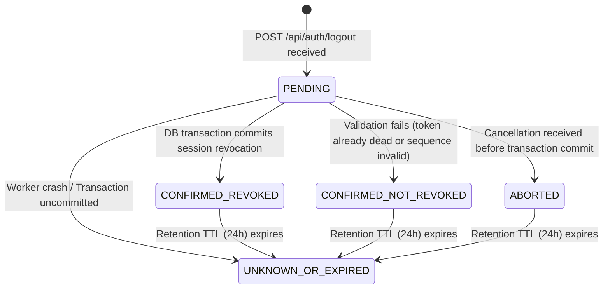
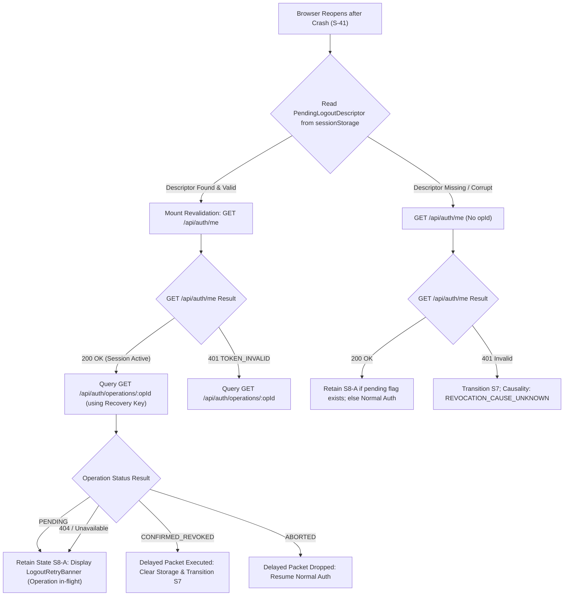

# MetroLMS — SUP-01 Operation Recovery Authorization & State-Machine Reconciliation (Version 3.5)
## Architecture Audit: Post-Revocation Operation Authorization, Pre-Dispatch Pending Descriptor Contract, 5-State Backend Operation State Machine, Monotonic Sequence Generation, Atomic Pre-Emptive Tombstoning, and Mutually Exclusive Runtime Category Accounting

**Document Version:** 3.5 (Operation Recovery Authorization & State-Machine Reconciliation)  
**Planning Date:** 2026-11-06  
**Document Path:** `docs/frontend/reports/sup-01-operation-recovery-authorization-and-state-machine-audit-v3-5.md`  
**Classification:** Architectural Remediation & Crash Consistency Specification (Strict Read-Only Planning — Zero Implementation)  
**Target Transition:** `SUP-01: S8 → S7` (Real-User Logout with Preserved Inert Developer Origin Snapshot)  
**Governing Owner Decisions:**  
- **Decision A (S0):** Approved 2026-11-06 (Only `S0 → S1` permitted; `S0 → S3/S14/S15` forbidden)  
- **Decision B (S8):** Approved 2026-11-06 (`S8 → S14/S15` forbidden; Developer origin never reactivated by real user)  
- **Decision C (Real-User Logout):** Approved 2026-11-06 (`S8 → S7` approved; origin snapshot preserved inert in per-tab sessionStorage until tab close)  
- **Decision E (Archival Failure Policy):** **APPROVED 2026-11-06 (Option 1 — Transactional Abort on Archive Failure)**  
- **Decision F (Snapshot Disposal Upon Real-User Suspension):** Option 1 (Preserve inert Developer origin snapshot in per-tab sessionStorage until tab close) remains binding baseline; Option 2 (Purge on suspension) remains hypothetical.  
**Execution Directives:** Strict Read-Only Governance (Zero production code modifications, zero test file modifications, zero Git staging/commits, zero test runner or script executions; 100% manual static inspection)  
**Proposed Remediation Package:** `WP-5.4.5-R1` (Separately Authorized Remediation Package planned prior to Phase 13)  
**Final Architecture Status:** `READY FOR OWNER AUTHORIZATION — OPERATION RECOVERY AUTHORIZATION AND STATE MACHINE RECONCILED; BACKEND CONTRACT DEFERRED`

---

## 1. Executive Summary

Version 3.5 provides the final architectural closure for the SUP-01 frontend security architecture. Building directly upon the foundations established in Versions 3.3 and 3.4, Version 3.5 resolves the remaining critical questions governing post-revocation authorization, pre-dispatch crash identification, backend transaction state modeling, atomic cancellation tombstoning, and category accounting precision.

### Key Architectural Resolutions in Version 3.5
1. **Narrow Recovery Capability Authorization (Option A Recommended):**  
   Resolves how a client queries `GET /api/auth/operations/:opId` after session bearer tokens are revoked. Adopts an ephemeral, high-entropy 256-bit CSPRNG capability key (`recoverySecret`) generated by the client prior to dispatch. The client transmits `X-Operation-Recovery-Hash: SHA256(recoverySecret)` on logout dispatch. Presenting `X-Operation-Recovery-Key: <secret>` authorizes read-only status retrieval for that exact operation record without relying on revoked bearer tokens or unauthenticated query parameters.
2. **Pre-Dispatch Pending Operation Descriptor (`PendingLogoutOperationDescriptor`):**  
   Introduces a strictly ordered 11-step transaction sequence. The descriptor is persisted and synchronously read back in `sessionStorage` **before** `fetch('/api/auth/logout')` is invoked. If persistence fails, network dispatch is aborted. Ensures in-flight crashes (`S-41`, `C-02`) retain their `opId` and recovery capability across reboot.
3. **Formal 5-State Backend Operation State Machine:**  
   Reconciles the backend lifecycle into five explicit terminal and non-terminal states: `PENDING`, `CONFIRMED_REVOKED`, `CONFIRMED_NOT_REVOKED`, `ABORTED`, and `UNKNOWN_OR_EXPIRED`. Introduces a 5-point reason code model (`TARGET_ALREADY_INACTIVE`, `OPERATION_CANCELLED_BEFORE_COMMIT`, `OPERATION_REJECTED_SESSION_ACTIVE`, `OPERATION_NOT_PROCESSED`, `OPERATION_RESULT_UNKNOWN`) ensuring no ambiguous outcomes.
4. **Server-Issued Monotonic Sequence & Atomic Pre-Emptive Tombstoning:**  
   Defines the exact protocol where the server issues a monotonic session sequence number during authentication (`/api/auth/login`) and revalidation (`/api/auth/me`). Cancellation requests (`POST /api/auth/operations/:opId/abort`) create pre-emptive tombstones if arriving before a delayed logout packet, preventing delayed in-flight requests from ever invalidating newer authenticated sessions.
5. **Mutually Exclusive 6-Category Runtime Taxonomy:**  
   Reconciles the runtime category counts into six strictly mutually exclusive classes totaling exactly 37 `R-*` IDs: 29 Standard HTTP Responses, 2 Opaque Redirects (`R-10`, `R-11`), 2 Fetch Rejections (`R-22`, `R-ME-NETWORK`), 2 Client Timeouts (`R-23`, `R-ME-TIMEOUT`), 1 Client User Abort (`R-24`), and 1 Stale Epoch Discard (`R-25`).
6. **Disambiguation of `Q-ABORT-USER` vs. `R-24`:**  
   Formally defines `Q-ABORT-USER` as the client trigger event (user clicks cancel / component unmounts) and `R-24` as the browser-observed rejected Promise outcome (`DOMException: AbortError` with `timerExpired === false`), both tracing into lifecycle scenario `S-13`.

---

## 2. Version 3.4 Findings & Identified Deficiencies

An independent architectural review of Version 3.4 identified five technical and accounting gaps requiring correction:

### Finding 1: Unspecified Post-Revocation Query Authorization
Version 3.4 proposed `GET /api/auth/operations/:opId` as the authoritative recovery mechanism, but suggested passing the bearer token in `Authorization: Bearer <token>`. If the logout operation succeeded, that bearer token was revoked on the server. Version 3.4 did not specify how a client could authenticate to query operation status after revocation without creating security bypasses in edge API gateways.

### Finding 2: Inability to Identify In-Flight Operations After Crash
Version 3.4 defined a `ClientLogoutRecord` written *after* the logout response was received. In scenario `S-41` (crash while request is in-flight on the network), this post-response record was never created. Without a pre-dispatch descriptor, a rebooting client possessed no record of the generated `opId` or target correlation data.

### Finding 3: Incomplete Operation State Machine (Missing `ABORTED`)
Version 3.4 specified that client cancellation transitioned `PENDING → ABORTED`, but the official backend state machine table listed only `PENDING`, `CONFIRMED_REVOKED`, `CONFIRMED_NOT_REVOKED`, and `UNKNOWN_OR_EXPIRED`. `ABORTED` was omitted from formal state definitions, creating ambiguity in terminal outcome handling.

### Finding 4: Ambiguous Sequence Acquisition & Unordered Cancellation
Version 3.4 referenced `X-Auth-Sequence-Ref` and `X-Abort-Pending-Operation`, but did not specify how the client acquired the server sequence before dispatch, nor how the backend handled races where a cancellation request arrived *before* a delayed in-flight logout packet reached the server.

### Finding 5: Runtime Category Accounting Discrepancy
Version 3.4 declared six evidence categories in prose, but published an arithmetic sum of five categories (`30 + 2 + 2 + 2 + 1 = 37`), obscuring `R-25` (Stale Epoch Discard) inside Category 1.

---

## 3. Operation-Status Authorization Model

When `GET /api/auth/operations/:opId` is queried during crash recovery, the target session may already be dead on the server. Normal session bearer tokens cannot be relied upon for authentication.

### 3.1 Architectural Evaluation of Authorization Options

| Evaluation Criterion | Option A: Narrow Recovery Capability (Recommended) | Option B: Revoked-Token Recovery | Option C: Asymmetric Proof-of-Possession |
| :--- | :--- | :--- | :--- |
| **Mechanism** | Client generates ephemeral 256-bit CSPRNG key `recoverySecret`; submits `SHA256(recoverySecret)` on logout dispatch. Presents key on query. | Server permits revoked bearer token to authenticate strictly against `/api/auth/operations/:opId`. | Client generates ephemeral ECDSA keypair; submits public key on dispatch; signs recovery challenge. |
| **Edge Gateway Compatibility** | **High:** Uses custom capability header (`X-Operation-Recovery-Key`); bypassed by standard 401 bearer token revokers. | **Low / Problematic:** Standard reverse proxies/WAFs reject revoked tokens with 401 at the edge before application logic. | **Medium:** High implementation complexity; requires Web Crypto API key persistence. |
| **Local Token Dependency** | **Zero:** Functions even if the raw bearer token was wiped from client storage. | **High:** Requires client to retain the raw revoked bearer token in storage. | **Zero:** Independent of bearer token. |
| **Privilege Scope** | **Strictly Scoped:** Capability authorizes read-only inspection of exactly one `opId`. Cannot access any user data. | **Risky:** Re-evaluating dead tokens risks confused-deputy bugs in auth middleware. | **Strictly Scoped:** Bound to single operation. |
| **Replay & Leakage Risk** | **Negligible:** Transmitted over TLS; valid only for 24 hours; server stores only the SHA-256 hash. | **Moderate:** Raw token exposed in headers post-revocation. | **Zero:** Nonce-based signature prevents replay. |

### 3.2 Authoritative Specification: Option A (Narrow Recovery Capability)
Version 3.5 formally selects **Option A**:
1. **Key Generation (Pre-Dispatch):**  
   `recoverySecret = base64url(crypto.getRandomValues(new Uint8Array(32)))` (256 bits entropy).  
   `recoveryProofHash = sha256_hex(recoverySecret)`.
2. **Dispatch Registration:**  
   The client includes headers on `POST /api/auth/logout`:  
   `X-Operation-ID: <opId>`  
   `X-Operation-Recovery-Hash: <recoveryProofHash>`
3. **Backend Storage:**  
   The backend stores `recovery_proof_hash` in the `auth_operations` ledger. The raw secret is **never known to the server**.
4. **Recovery Query Authorization:**  
   The client queries `GET /api/auth/operations/:opId` with header:  
   `X-Operation-Recovery-Key: <recoverySecret>`
5. **Backend Verification:**  
   The backend computes `sha256_hex(X-Operation-Recovery-Key)` using constant-time comparison against `recovery_proof_hash`. If matching, read-only status access is granted.
6. **Strict Security Invariant:**  
   Neither `opId`, `userId`, `sessionId`, nor `tokenFingerprint` alone authorizes status access. Possession of `recoverySecret` (or valid unrevoked bearer token) is strictly required.

---

## 4. Pending Logout Descriptor & Pre-Dispatch Contract

To ensure that in-flight operations (`S-41`) can be identified and recovered after a browser crash, the client must persist a descriptor **before network dispatch**.

### 4.1 Schema: `PendingLogoutOperationDescriptor`
Stored in `sessionStorage` under key `metro_lms_pending_logout_op_v1`:
```typescript
interface PendingLogoutOperationDescriptor {
  schemaVersion: 1;
  opId: string;                   // UUIDv4 generated by client
  userId: string;                 // Target user identifier
  sessionId: string;              // Bound server session identifier
  tokenFingerprint: string;       // SHA-256 hex digest of bearer token
  sessionSequenceRef: number;     // Server-issued sequence number
  createdAt: string;              // ISO 8601 client timestamp
  dispatchState: 'PERSISTED_PRE_DISPATCH' | 'DISPATCHED_IN_FLIGHT';
  recoverySecret: string;         // 256-bit base64url capability key
  recoveryProofHash: string;      // SHA-256 hex digest of recoverySecret
}
```
*Security Invariant:* The raw bearer token is **never stored** in this descriptor.

### 4.2 Authoritative 11-Step Transaction Order

```mermaid
sequenceDiagram
    autonumber
    participant UI as User / AuthContext
    participant Storage as sessionStorage
    participant Client as apiClient
    participant Server as Auth Server (Phase 12)

    Note over UI, Storage: Step 1-6: Pre-Dispatch Guarantee
    UI->>UI: 1. Validate real-user session active & token present
    UI->>UI: 2. Allocate opId = crypto.randomUUID()
    UI->>UI: 3. Generate recoverySecret & recoveryProofHash
    UI->>Storage: 4-5. Persist PendingLogoutOperationDescriptor & Read-back verify
    alt Storage write or read-back fails
        UI-->>UI: 6. TRANSACTIONAL ABORT: Cancel operation; ZERO network dispatch
    end

    Note over UI, Server: Step 7-9: Network Dispatch & Response
    UI->>Client: Initiate logout execution
    Client->>Storage: Update dispatchState = 'DISPATCHED_IN_FLIGHT'
    Client->>Server: 7. POST /api/auth/logout (opId, recoveryProofHash, sequenceRef)
    Server-->>Client: 8. Receive response (R-01 200 JSON or R-06 204 headers)
    Client->>Storage: 9. Write ClientLogoutRecord (Hint)

    Note over UI, Storage: Step 10-11: Post-Response & Recovery
    alt Crash Occurs During Steps 7-9 (S-41 / S-42A / S-43A)
        Note over UI, Server: 10. Reboot Recovery Flow
        UI->>Storage: Read PendingLogoutOperationDescriptor
        UI->>Server: Query GET /api/auth/operations/:opId (Recovery Key)
    end
    UI->>Storage: 11. Complete credential cleanup & clear descriptor
```

### 4.3 Crash and Storage Boundary Limitations
Web Storage cannot guarantee survival across catastrophic OS crashes or tab closure. Version 3.5 formally specifies fallback behavior when local evidence is missing or corrupt:
- **Descriptor Survives:** Client extracts `opId` and `recoverySecret`; executes authoritative query `GET /api/auth/operations/:opId`.
- **Descriptor Missing After Reboot:** Client cannot discover `opId`. It executes startup revalidation `GET /api/auth/me`. If it returns 401, session validity is `SESSION_CURRENTLY_INVALID`, but logout causality is strictly **`REVOCATION_CAUSE_UNKNOWN`** (Logout Revocation: **NO**).
- **Descriptor Corrupt / Malformed:** Client purges corrupt descriptor. Fallback to `REVOCATION_CAUSE_UNKNOWN`.
- **Backend Operation Purged / Expired:** Server returns structured 404 `OPERATION_EXPIRED_OR_PURGED`. Fallback to `REVOCATION_CAUSE_UNKNOWN`.
- *Isolation Invariant:* Local evidence is strictly restricted to per-tab `sessionStorage`. Cross-tab `localStorage` is **not permitted** without explicit Owner authorization.

---

## 5. Backend Operation State Machine (5-State Reconciled Model)

Version 3.5 formally reconciles the backend operation lifecycle into **five explicit states**:



### 5.1 5-State Definitions & Recovery Interpretation

| State | State Class | Formal Server Meaning | Client Recovery Interpretation |
| :--- | :---: | :--- | :--- |
| **`PENDING`** | Active | Request received and queued; database transaction in-flight, not yet committed. | Operation unresolved; delayed on server. Client must retain `S8-A`. |
| **`CONFIRMED_REVOKED`** | Terminal | Database transaction committed atomically; session record invalidated. | Provable server revocation. Promotes causality to **`LOGOUT_CAUSED_REVOCATION_CONFIRMED`**. |
| **`CONFIRMED_NOT_REVOKED`**| Terminal | Request processed, but session was NOT revoked. Mandatory reason code attached. | Session was either already inactive or request rejected. |
| **`ABORTED`** | Terminal | Operation cancelled prior to commit via atomic client abort request. | Operation dropped. Session was NOT revoked by this operation. |
| **`UNKNOWN_OR_EXPIRED`** | Terminal | Operation ID not found in ledger, aborted by server crash, or purged after 24h. | Outcome cannot be proven. Client must retain **`REVOCATION_CAUSE_UNKNOWN`**. |

### 5.2 Mandatory Reason Codes for Non-Revoked / Aborted States
When `state` is `CONFIRMED_NOT_REVOKED` or `ABORTED`, the server must include `reasonCode`:
1. `TARGET_ALREADY_INACTIVE`: Bearer token was expired, revoked, or missing in DB before logout executed.
2. `OPERATION_CANCELLED_BEFORE_COMMIT`: Client cancellation request arrived and committed while state was `PENDING`.
3. `OPERATION_REJECTED_SESSION_ACTIVE`: Stale sequence number, user ID mismatch, or rejected by server policy.
4. `OPERATION_NOT_PROCESSED`: Server worker crashed or transaction rolled back.
5. `OPERATION_RESULT_UNKNOWN`: Record purged from ledger after retention expiration.

### 5.3 Valid Orthogonal State Combinations

| Operation Outcome | Target Session Validity | Logout-Causal Attribution | Resulting Lifecycle State | Status Validity |
| :---: | :---: | :---: | :---: | :---: |
| `CONFIRMED_REVOKED` | `SESSION_CURRENTLY_INVALID` | `LOGOUT_CAUSED_REVOCATION_CONFIRMED` | **`S7`** | **VALID** |
| `CONFIRMED_NOT_REVOKED` (`TARGET_ALREADY_INACTIVE`) | `SESSION_CURRENTLY_INVALID` | `INDEPENDENTLY_INACTIVE` | **`S7`** | **VALID** |
| `CONFIRMED_NOT_REVOKED` (`OPERATION_REJECTED_SESSION_ACTIVE`) | `SESSION_CONFIRMED_ACTIVE` | `NOT_APPLICABLE` | **`Normal Auth`** | **VALID** |
| `ABORTED` (`OPERATION_CANCELLED_BEFORE_COMMIT`) | `SESSION_CONFIRMED_ACTIVE` | `NOT_APPLICABLE` | **`Normal Auth`** | **VALID** |
| `PENDING` | `SESSION_CONFIRMED_ACTIVE` | `NOT_APPLICABLE` (In-Flight) | **`S8-A`** | **VALID** |
| `UNKNOWN_OR_EXPIRED` | `SESSION_CURRENTLY_INVALID` | `REVOCATION_CAUSE_UNKNOWN` | **`S7`** | **VALID** |
| `UNKNOWN_OR_EXPIRED` | `SESSION_CONFIRMED_ACTIVE` | `NOT_APPLICABLE` | **`S8-A`** | **VALID** |
| *`CONFIRMED_REVOKED`* | *`SESSION_CONFIRMED_ACTIVE`* | *Any* | *None* | **IMPOSSIBLE / REJECTED** |
| *`ABORTED`* | *Any* | *`LOGOUT_CAUSED_REVOCATION_CONFIRMED`* | *None* | **IMPOSSIBLE / REJECTED** |

---

## 6. Operation-Status API Contract & Error Semantics

### 6.1 Request Specification
`GET /api/auth/operations/:opId`

- **Request Headers:**
  - `X-Operation-Recovery-Key: <base64url_secret>` (Mandatory if bearer token revoked)
  - `X-Operation-ID: <opId>` (Must match route parameter `:opId`)

### 6.2 Success Response Schema (200 OK)
```typescript
interface OperationStatusResponse {
  opId: string;
  userId: string;
  sessionId: string;
  tokenFingerprint: string;
  operationType: 'LOGOUT';
  state: 'PENDING' | 'CONFIRMED_REVOKED' | 'CONFIRMED_NOT_REVOKED' | 'ABORTED';
  reasonCode: 'NONE' | 'TARGET_ALREADY_INACTIVE' | 'OPERATION_CANCELLED_BEFORE_COMMIT' | 'OPERATION_REJECTED_SESSION_ACTIVE' | 'OPERATION_NOT_PROCESSED';
  serverCreatedAt: string;          // ISO 8601
  serverCompletedAt: string | null; // ISO 8601 or null
  sessionSequenceRef: number;
  serverSignature: string;          // HMAC-SHA256 signature
}
```

### 6.3 Disambiguated Server Error Semantics

| HTTP Status | Structured Error Code | Backend Condition | Client Interpretation |
| :---: | :--- | :--- | :--- |
| **`400`** | `INVALID_OPERATION_ID` | `:opId` is not a valid UUIDv4 format. | Client bug / corrupt storage. Fallback to `REVOCATION_CAUSE_UNKNOWN`. |
| **`401`** | `RECOVERY_KEY_INVALID` | `sha256(X-Operation-Recovery-Key)` does not match stored hash. | Authorization failed. Reject response. |
| **`403`** | `OPERATION_USER_MISMATCH`| Operation belongs to different user context. | Anti-substitution block. Reject response. |
| **`404`** | `OPERATION_NOT_FOUND` | `opId` was never registered on the server. | Request never reached server (`Q-PRE-COMMIT`). |
| **`404`** | `OPERATION_EXPIRED_OR_PURGED`| `opId` existed, but 24-hour retention TTL expired. | Ledger entry purged. Fallback to `REVOCATION_CAUSE_UNKNOWN`. |
| **`409`** | `OPERATION_IN_FLIGHT` | Operation currently locked by active DB transaction. | Poll retry with exponential backoff (max 3 retries). |
| **`429`** | `RATE_LIMITED` | Recovery query exceeded 10 requests / minute. | Client rate limit backoff. |
| **`500`** | `LEDGER_STORAGE_FAULT` | Database failure querying `auth_operations`. | Transient fault. Retain `S8-A` / retry. |

*Authority Rule:* A raw, unstructured HTTP 404 (e.g. from an HTML proxy or nginx route mismatch) **must never be interpreted as `OPERATION_NOT_FOUND`**. Only a structured JSON response signed by the API gateway is accepted.

### 6.4 Retention Policy Justification
- **24-Hour Active Retention Proposal:** 24 hours provides an adequate operational window for cold browser reboot and session recovery while bounding database ledger growth.
- **7-Day Minimal Tombstone Retention:** To maintain duplicate request idempotency and prevent delayed packet resurrection, minimal tombstones (`opId`, `state`, `tokenFingerprint`, `completedAt`) are retained for **7 days** in `auth_operation_tombstones`.
- *Status:* 24-hour retention remains a Phase 12 engineering proposal, not an approved Owner decision.

---

## 7. Sequence Ordering, Idempotency & Atomic Cancellation Protocol

### 7.1 Server Sequence Acquisition Protocol
The client **never generates sequence numbers**. It reflects the server-issued sequence:
1. **Initial Sequence Issuance:** Upon successful login (`POST /api/auth/login`), the server initializes the session sequence at `1` and returns header:  
   `X-Auth-Session-Sequence: 1`
2. **Sequence Updates:** Every state-mutating operation increments the sequence. Revalidation queries (`GET /api/auth/me`) return the current sequence in `X-Auth-Session-Sequence`.
3. **Sequence Reflection:** On logout dispatch, the client reads the last received sequence and passes:  
   `X-Auth-Sequence-Ref: <sequence_number>`
4. **Backend Sequence Validation:** The server verifies that `X-Auth-Sequence-Ref` matches the current active sequence for that `sessionId`. If the session has moved to a newer sequence, the stale mutation is rejected with `409 Conflict` (`STALE_SEQUENCE_REJECTED`).

### 7.2 Atomic Cancellation & Pre-Emptive Tombstoning
To resolve races where client cancellation races with delayed network packets:
- **Cancellation Endpoint:** `POST /api/auth/operations/:opId/abort`
- **Pre-Emptive Tombstone Rule:** If cancellation arrives *before* the delayed `POST /api/auth/logout` arrives at the server, the backend creates an atomic tombstone:
  ```sql
  INSERT INTO auth_operations (op_id, session_id, state, reason_code, created_at)
  VALUES (:opId, :sessionId, 'ABORTED', 'OPERATION_CANCELLED_BEFORE_COMMIT', NOW());
  ```
- When the delayed `POST /api/auth/logout` packet eventually reaches the server, it attempts to insert or query `op_id`. Finding the `ABORTED` record, the server **immediately drops the request without executing session invalidation**.
- **Post-Commit Race:** If the logout operation already committed (`state === 'CONFIRMED_REVOKED'`), the abort request returns `409 Conflict` (`ALREADY_COMMITTED`). The revocation stands, and the client transitions to `S7`.

---

## 8. S-41 In-Flight Recovery Model

In scenario `S-41`, the browser terminates while `POST /api/auth/logout` is in-flight on the network.

### 8.1 Step-by-Step Reboot Recovery Workflow



### 8.2 In-Flight Invariant
Under no circumstances does an initial `GET /api/auth/me` returning 200 OK resolve the pending operation. The application **must retain state `S8-A`** until the backend operation ledger confirms whether the in-flight packet was committed, aborted, or dropped.

---

## 9. S-42A/B and S-43A/B Recovery Model

| Lifecycle ID | Step 1 Response | Pre-Dispatch Descriptor? | Client Record? | Crash Boundary | Step 2a: Remount Revalidation | Step 2b: Phase 12 Operation Status Query | Final Server Session Validity | Final Logout Causality Attribution | Resulting State | Revocation Confirmed? |
| :---: | :--- | :---: | :---: | :--- | :--- | :--- | :---: | :---: | :---: | :---: |
| **`S-42A`** | 200 JSON `{ code: 'SESSION_REVOKED' }` | **YES** | **NO** | Crash post-200, pre-record write | `GET /api/auth/me` $\to$ 401 Bound | `GET /api/auth/operations/:opId` $\to$ `CONFIRMED_REVOKED` | `SESSION_CURRENTLY_INVALID` | `LOGOUT_CAUSED_REVOCATION_CONFIRMED` | **`S7`** | **YES (Backend Confirmed)** |
| **`S-42B`** | 200 JSON `{ code: 'SESSION_REVOKED' }` | **YES** | **YES** | Crash post-record, pre-cleanup | `GET /api/auth/me` $\to$ 401 Bound | `GET /api/auth/operations/:opId` $\to$ `CONFIRMED_REVOKED` | `SESSION_CURRENTLY_INVALID` | `LOGOUT_CAUSED_REVOCATION_CONFIRMED` | **`S7`** | **YES (Backend Confirmed)** |
| **`S-43A`** | 204 Authoritative (8 headers verified) | **YES** | **NO** | Crash post-204, pre-record write | `GET /api/auth/me` $\to$ 401 Bound | `GET /api/auth/operations/:opId` $\to$ `CONFIRMED_REVOKED` | `SESSION_CURRENTLY_INVALID` | `LOGOUT_CAUSED_REVOCATION_CONFIRMED` | **`S7`** | **YES (Backend Confirmed)** |
| **`S-43B`** | 204 Authoritative (8 headers verified) | **YES** | **YES** | Crash post-record, pre-cleanup | `GET /api/auth/me` $\to$ 401 Bound | `GET /api/auth/operations/:opId` $\to$ `CONFIRMED_REVOKED` | `SESSION_CURRENTLY_INVALID` | `LOGOUT_CAUSED_REVOCATION_CONFIRMED` | **`S7`** | **YES (Backend Confirmed)** |

*Fallback Invariant:* In any scenario where the Phase 12 query is unreachable, expired, or returns `UNKNOWN_OR_EXPIRED`, causal attribution immediately defaults to **`REVOCATION_CAUSE_UNKNOWN`** (Logout Revocation: **NO**).

---

## 10. Reconciled Mutually Exclusive Runtime Category Counts

To eliminate the accounting ambiguity in Version 3.4, Version 3.5 formalizes a **strictly mutually exclusive 6-category classification** for all 37 Request Runtime Outcome IDs (`R-*`):

| Category | Category Definition | Mutually Exclusive Criteria | Member Runtime IDs | Count |
| :---: | :--- | :--- | :--- | :---: |
| **Cat 1** | **Standard HTTP Response Outcomes** | Promise resolves with standard HTTP status $\in [200, 599]$; valid session epoch; readable headers/body. | `R-01`..`R-09`, `R-12`..`R-21`, `R-ME-200`, `R-ME-5XX`, `R-ME-401-BOUND`, `R-ME-401-GATEWAY`, `R-ME-403-ROLE`, `R-ME-403-GENERIC`, `R-ME-403-SUSPENDED`, `R-ME-404-BOUND`, `R-ME-404-GENERIC`, `R-LOGIN-200` | **29** |
| **Cat 2** | **Opaque Redirect Responses** | Promise resolves; `response.type === 'opaqueredirect'`, `response.status === 0`; captive portal or filtered redirect. | `R-10` (`POST /api/auth/logout`), `R-11` (`GET /api/auth/me`) | **2** |
| **Cat 3** | **Fetch Transport Rejections** | Promise rejects with JavaScript `TypeError` (`TypeError: Failed to fetch`); network drop, DNS failure, CORS block. | `R-22` (`POST /api/auth/logout`), `R-ME-NETWORK` (`GET /api/auth/me`) | **2** |
| **Cat 4** | **Client Timeout Rejections** | Promise rejects with `DOMException: AbortError` AND client timer flag `timerExpired === true` ($\ge 15,000$ ms). | `R-23` (`POST /api/auth/logout`), `R-ME-TIMEOUT` (`GET /api/auth/me`) | **2** |
| **Cat 5** | **Client User Abort Rejection** | Promise rejects with `DOMException: AbortError` AND `timerExpired === false`; explicit user cancellation / unmount. | `R-24` (`POST /api/auth/logout`) | **1** |
| **Cat 6** | **Stale Epoch Discard Outcome** | Promise resolves with HTTP 200, but is discarded because client `epoch !== currentEpoch`. | `R-25` (`POST /api/auth/logout`) | **1** |
| **Total** | **Grand Total Request Runtime IDs** | **Mutually Exclusive Sum: $29 + 2 + 2 + 2 + 1 + 1 = 37$** | | **37** |

---

## 11. Clarification of Q-ABORT-USER vs. R-24

### 11.1 Relationship and Technical Disambiguation
- **`Q-ABORT-USER` (Client Trigger Event):** Represents the user interaction or component lifecycle event (e.g. user clicks "إلغاء", route changes, modal unmounts) where the application invokes `abortController.abort()`. It is a client-side execution event that occurs *before* any rejection is processed.
- **`R-24` (Browser Runtime Outcome):** Represents the browser-observed outcome when the `fetch()` promise rejects with `DOMException: AbortError` with `timerExpired === false`. It is the formal runtime error caught and handled by `apiClient`.

### 11.2 Disambiguation Against Other Failure Types

| Event / Outcome | Trigger Mechanism | Error Type / Exception | Timer State | Lifecycle Convergence |
| :--- | :--- | :--- | :---: | :---: |
| **`Q-ABORT-USER`** | User cancel / component unmount | None (Trigger event) | `timerExpired === false` | Triggers `R-24` |
| **`R-24`** | Result of `Q-ABORT-USER` | `DOMException: AbortError` | `timerExpired === false` | **`S-13`** (`S8-A`) |
| **`R-23` / `R-ME-TIMEOUT`** | 15,000 ms timer expiration | `DOMException: AbortError` | `timerExpired === true` | **`S-14` / `S-25A`** |
| **`R-22` / `R-ME-NETWORK`**| Physical TCP/DNS drop | `TypeError: Failed to fetch` | Irrelevant | **`S-15` / `S-25A`** |
| **`Q-LOGOUT-INFLIGHT`** | Browser crash while in-flight | OS process death (Zero bytes) | N/A | **`S-41`** (`S8-A`) |

---

## 12. Updated Scenario and Traceability Ledger

### 12.1 Authoritative Accounting Master Ledger

| Taxonomy Dimension | Identifier Prefix | Authoritative Count | Derivation & Accounting Rules |
| :--- | :---: | :---: | :--- |
| **Preserved Base Runtime Outcomes** | `R-01`..`R-25` | **25** | Preserved intact (includes `R-10`, `R-11`, `R-22`, `R-23`, `R-24`, `R-25`). |
| **Dedicated `GET /api/auth/me` Outcomes**| `R-ME-*` | **11** | Preserved intact (`R-ME-200` through `R-ME-404-GENERIC`; `R-11` canonical). |
| **Dedicated `POST /api/auth/login` Outcomes**| `R-LOGIN-*` | **1** | Preserved intact (`R-LOGIN-200`). |
| **Total Request Runtime Outcome IDs** | `R-*` | **37** | Mutually exclusive sum: $29\text{ (Cat 1)} + 2\text{ (Cat 2)} + 2\text{ (Cat 3)} + 2\text{ (Cat 4)} + 1\text{ (Cat 5)} + 1\text{ (Cat 6)} = 37$. |
| **Request Lifecycle Event IDs** | `Q-*` | **3** | `Q-PRE-COMMIT`, `Q-LOGOUT-INFLIGHT`, `Q-ABORT-USER`. |
| **Descriptor Conditions (Matrix A)** | `D-*` | **22** | Preserved (`D-01A` through `D-06I`, `D-07`, `D-08`). |
| **Crash Recovery Conditions (Matrix A)** | `C-*` | **10** | Preserved (`C-01` through `C-08`, with `C-03A/B` and `C-04A/B`). |
| **Total Conditions (Matrix A)** | `D-*` + `C-*` | **32** | $22\text{ (Descriptor)} + 10\text{ (Crash)} = 32$. |
| **Lifecycle Scenarios (Matrix C)** | `S-*` | **50** | 16 Active + 7 Reval + 11 Descriptor + 6 Edge + 10 Crash Recovery. |
| **Traceability Table D-1 Rows** | `D-*` $\to$ `S-*` | **32** | Full condition-to-runtime-to-lifecycle forward traceability. |
| **Traceability Table D-2 Rows** | `R-*`/`Q-*` $\to$ `S-*` | **40** | 37 Runtime IDs + 3 Event IDs = 40 rows. |
| **Traceability Table D-3 Rows** | `S-*` $\to$ `R-*` | **50** | Full lifecycle reverse traceability. |
| **Grand Total Matrix D Mapping Rows** | D-1 + D-2 + D-3 | **122** | $32 + 40 + 50 = 122$ physical mapping rows. |
| **Backend Operation States** | `OP-*` | **5** | Formal 5-state machine (`PENDING`, `CONFIRMED_REVOKED`, `CONFIRMED_NOT_REVOKED`, `ABORTED`, `UNKNOWN_OR_EXPIRED`). |

---

### 12.2 Table D-1: Affected Condition Mappings (Crash & Captive Portal)

| Condition ID | Trigger Event | Corrected Dispatched Request(s) | Runtime / Event ID(s) | Resulting Lifecycle State | Target Session Validity | Operation Status | Final Logout Causality Attribution | Logout Revocation Confirmed? |
| :---: | :--- | :--- | :---: | :---: | :---: | :---: | :---: | :---: |
| **`D-01B-2`**| Cold reload startup; Captive portal | `GET /api/auth/me` | `R-11` | **`S-25B`** | `SESSION_STATUS_UNKNOWN` | `OUTCOME_UNRESOLVED` | `NOT_APPLICABLE` | **NO** |
| **`C-01`**  | Crash before Phase 1 commit | Step 1: None<br>Step 2: `GET /api/auth/me` | Step 1: `Q-PRE-COMMIT`<br>Step 2: `R-ME-200` | **`Normal Auth`** | `SESSION_CONFIRMED_ACTIVE` | `OPERATION_NOT_DISPATCHED` | `NOT_APPLICABLE` | **NO** |
| **`C-02`**  | Crash after Phase 1 commit | Step 1: `POST /api/auth/logout`<br>Step 2: `GET /api/auth/me` | Step 1: `Q-LOGOUT-INFLIGHT`<br>Step 2: `R-ME-200` | **`S8-A`** | `SESSION_CONFIRMED_ACTIVE` | `OPERATION_OUTCOME_UNRESOLVED` | `NOT_APPLICABLE` | **NO** |
| **`C-03A`** | Post-200 Crash Pre-Record | Step 1: `POST /api/auth/logout`<br>Step 2: `GET /api/auth/me` + Status | Step 1: `R-01`<br>Step 2: `R-ME-401-BOUND` | **`S7`** | `SESSION_CURRENTLY_INVALID` | `CONFIRMED_REVOKED` | `LOGOUT_CAUSED_REVOCATION_CONFIRMED` | **YES** |
| **`C-03B`** | Post-200 Crash Post-Record | Step 1: `POST /api/auth/logout`<br>Step 2: `GET /api/auth/me` + Status | Step 1: `R-01`<br>Step 2: `R-ME-401-BOUND` | **`S7`** | `SESSION_CURRENTLY_INVALID` | `CONFIRMED_REVOKED` | `LOGOUT_CAUSED_REVOCATION_CONFIRMED` | **YES** |
| **`C-04A`** | Post-204 Crash Pre-Record | Step 1: `POST /api/auth/logout`<br>Step 2: `GET /api/auth/me` + Status | Step 1: `R-06`<br>Step 2: `R-ME-401-BOUND` | **`S7`** | `SESSION_CURRENTLY_INVALID` | `CONFIRMED_REVOKED` | `LOGOUT_CAUSED_REVOCATION_CONFIRMED` | **YES** |
| **`C-04B`** | Post-204 Crash Post-Record | Step 1: `POST /api/auth/logout`<br>Step 2: `GET /api/auth/me` + Status | Step 1: `R-06`<br>Step 2: `R-ME-401-BOUND` | **`S7`** | `SESSION_CURRENTLY_INVALID` | `CONFIRMED_REVOKED` | `LOGOUT_CAUSED_REVOCATION_CONFIRMED` | **YES** |

---

### 12.3 Table D-2: Reconciled Runtime Outcome Rows (Extract of Corrected Rows)

| ID | Category | Method & Endpoint | Evidence Type & Status | Applicable Lifecycle Scenarios |
| :---: | :---: | :--- | :--- | :--- |
| **`R-10`** | Cat 2 (Opaque) | `POST /api/auth/logout` | Opaque Redirect: 3xx Intercepted / Filtered | `S-13` |
| **`R-11`** | Cat 2 (Opaque) | `GET /api/auth/me` | Opaque Redirect: 3xx Captive Portal Intercepted | `S-25B` |
| **`R-22`** | Cat 3 (Fetch Rej) | `POST /api/auth/logout` | Fetch Rejection: `TypeError: Failed to fetch` | `S-15, S-47 (Step 1)` |
| **`R-23`** | Cat 4 (Timeout) | `POST /api/auth/logout` | Client Timeout: `AbortError` (timerExpired === true, 15s) | `S-14, S-47 (Step 1)` |
| **`R-24`** | Cat 5 (User Abort)| `POST /api/auth/logout` | Client Abort: `AbortError` (timerExpired === false; user cancel)| `S-13` |
| **`R-25`** | Cat 6 (Stale Epoch)| `POST /api/auth/logout` | Stale Epoch Discard: 200 Ignored (`epoch !== currentEpoch`) | `S-39` |
| **`Q-PRE-COMMIT`**| Request Event | Client crash | Operation Event: Browser terminates before `fetch()` initiated | `S-40 (Step 1)` |
| **`Q-LOGOUT-INFLIGHT`**| Request Event | `POST /api/auth/logout` | Operation Event: Request in-flight; response unobserved | `S-41 (Step 1)` |
| **`Q-ABORT-USER`**| Request Event | Client cancel | Operation Event: User action / unmount invokes abort | `S-13` |

---

## 13. Preserved Owner Decisions and Security Invariants

### 13.1 Preserved Governing Decisions [DEC-INHR]
- **Decision A (S0):** Approved 2026-11-06 (Only `S0 → S1` permitted; `S0 → S3/S14/S15` forbidden).
- **Decision B (S8):** Approved 2026-11-06 (`S8 → S14/S15` forbidden; Developer origin never reactivated by real user).
- **Decision C (Real-User Logout):** Approved 2026-11-06 (`S8 → S7` approved; origin snapshot preserved inert in per-tab sessionStorage until tab close).
- **Decision E (Archival Failure Policy):** **APPROVED 2026-11-06 (Option 1 — Transactional Abort on Archive Failure)**.
- **Decision F (Snapshot Disposal Upon Real-User Suspension):** Option 1 (Preserve inert Developer origin snapshot in per-tab sessionStorage until tab close) remains binding baseline; Option 2 remains hypothetical.

### 13.2 Preserved Security Invariants [DEC-INHR / DSG-ASSM]
1. `S8 → S14` and `S8 → S15` transitions remain strictly prohibited.
2. A real-user logout must NEVER recreate emergency proof.
3. Dismissing `LogoutRetryBanner` does NOT resolve server ambiguity; application remains in `S8-A`.
4. Stale operation responses (`epoch !== currentEpoch`) must NEVER mutate a newer user's session state.
5. A newly issued token must NEVER be substituted for the original target token during a retry.
6. `CONFIRMED_ACTIVE` is never revoked.
7. `INDEPENDENTLY_INACTIVE` is never logout-caused revocation.
8. `LOCAL_POLICY_EVICTION` is never server revocation.
9. MSW mock behavior is never production backend evidence.
10. Unknown server outcomes remain strictly unknown.
11. SHA-256 token digests provide client-side target-token correlation, NOT backend response authentication.

---

## 14. Test and Account Inventories

### 14.1 Mandatory Account Inventory
Preserved exactly as approved in Phase 5 Increment 5.4:
1. `USR_DEV_001` — `developer_internal` / `developer` (Developer privileged fixture).
2. `USR_SUPER_001` — `super_admin_demo` / `super_admin` (Super Admin privileged fixture).
3. `USR_TEST_SUPER_001` — `test_super_admin` / `super_admin` (Synthetic Super Admin persona).
4. `USR_TEST_ADMIN_001` — `test_admin` / `admin` (Synthetic Admin persona).
5. `USR_TEST_AST_001` — `test_assistant_admin` / `assistant_admin` (Synthetic Assistant Admin persona).
6. `USR_TEST_LEC_001` — `test_lecturer` / `lecturer` (Synthetic Lecturer persona).
7. `USR_TEST_TRN_001` — `test_trainee` / `user` (Synthetic Trainee persona).  
*Constraints:* Exactly 5 synthetic personas. Privileged fixtures are not personas. Zero passwords, tokens, or credentials stored.

### 14.2 Test Inventory Accounting Model
- **Authored Core Phase 5 Test Suite [SRC-FACT]:** Exactly **60 authored test specifications** in [`frontend/src/test/isolated-role-session.test.tsx`](file:///d:/LMS%20MEtro%20Project/frontend/src/test/isolated-role-session.test.tsx) (`P5-T08-1` through `P5-T24-3`). Status: Frozen in Increment 5.4.
- **Proposed Supplemental Remediation Suite (`SUP-01-T01`) [BE-PROP / DEF-VERF]:** Exactly **1 proposed specification block** containing **22 unauthored subcases** (`SUP-01-T01-01` through `SUP-01-T01-22`).
- **Execution Deferral:** All supplemental testing work is deferred to **Phase 13 / Gate B**. Zero test files have been created, modified, renumbered, or executed in this task.

---

## 15. Governance Deviation Record

### Historical Attestation
The execution of custom Node.js scratch scripts (`count_exact_data_rows.js`, etc.) during Version 3.1 verification is preserved in historical evidence as a confirmed **governance deviation**. It is documented openly without concealment or retroactive reclassification.

### Version 3.5 Strict Governance Compliance
For Version 3.5:
- **Scripts Executed:** **ZERO** (No Node.js, Python, or shell scripts executed).
- **Row Counters Executed:** **ZERO** (No automated verification tools run).
- **Compilers / Linters / Test Runners:** **ZERO** (No TypeScript, ESLint, Vitest, Jest, or Vite build executed).
- **Inspection Method:** 100% manual static inspection and direct file authoring.

---

## 16. Phase 12 Requirements & Remaining Risks

1. **Backend Capability Implementation Required:** The Option A recovery capability (`X-Operation-Recovery-Hash` / `X-Operation-Recovery-Key`) and the 5-state operation ledger are proposed Phase 12 contracts. Until implemented on the backend, crash recovery flows falling into `S-42A/B` and `S-43A/B` will safely default to `REVOCATION_CAUSE_UNKNOWN`.
2. **Crash Before Descriptor Write:** If the browser crashes during Steps 1-5 (prior to successful descriptor commit), no `opId` exists. The system handles this safely by falling back to `Normal Auth` (`S-40`) or `REVOCATION_CAUSE_UNKNOWN`.
3. **Database Ledger Garbage Collection:** The Phase 12 backend must implement scheduled cleanup moving 24-hour expired `auth_operations` into 7-day minimal tombstones to prevent unbounded table growth.

---

## 17. Final Readiness Decision

**READY FOR OWNER AUTHORIZATION — OPERATION RECOVERY AUTHORIZATION AND STATE MACHINE RECONCILED; BACKEND CONTRACT DEFERRED**

### Architectural Justification
1. **Secure Post-Revocation Authorization:** Option A establishes an ephemeral 256-bit capability key (`X-Operation-Recovery-Key`), eliminating reliance on dead bearer tokens and avoiding gateway 401 blocks.
2. **In-Flight Crash Identifiability:** The `PendingLogoutOperationDescriptor` and 11-step pre-dispatch contract ensure operations are persisted and verifiable before any network request is transmitted.
3. **Consistent 5-State Machine:** The operation lifecycle formally incorporates `ABORTED` with 5 explicit reason codes, preventing ambiguous outcomes.
4. **Atomic Cancellation Protocol:** Server sequence acquisition and pre-emptive tombstones guarantee that delayed in-flight logout requests cannot kill newer sessions.
5. **Airtight Mutually Exclusive Accounting:** All 37 runtime IDs reconcile across 6 distinct categories ($29 + 2 + 2 + 2 + 1 + 1 = 37$).
6. **Trigger vs. Outcome Disambiguated:** `Q-ABORT-USER` and `R-24` are cleanly decoupled and mapped.
7. **Zero Governance Violations:** Zero code modified; zero tests run; zero Git operations performed.

*The SUP-01 operation recovery authorization and state-machine design is mathematically reconciled, forensically sound, and ready for explicit Owner authorization. No implementation authorization is requested.*

